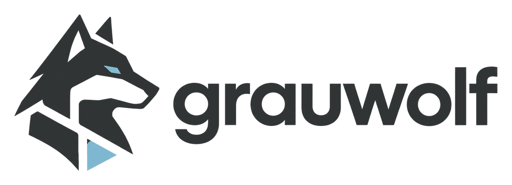

<h1 align="center">
  <picture>
    <source media="(prefers-color-scheme: dark)" srcset="docs/assets/grauwolf-logo-dark.png">
    
  </picture><br>
 <b>Run with the pack. Trust no one.</b>
</h1>

<p align="center">
  <b>Pure Rust. Any model. Zero trust.</b><br>
  <sub>Agents from a JSON spec – interpreted or compiled, from your laptop to a governed Kubernetes cluster.<br></sub>
</p>

<p align="center">
  <a href="LICENSE"></a>
  <a href="https://www.rust-lang.org"></a>
  <a href="https://doc.rust-lang.org/edition-guide/"></a>
  <a href="#versioning"></a>
</p>

<p align="center">
  <a href="docs/user-guide/README.md">📘 User guide</a> ·
  <a href="docs/developer-guide/README.md">🧑‍💻 Developer guide</a> ·
  <a href="docs/handbuch/README.md">🇩🇪 Handbuch</a> ·
  <a href="docs/entwickler/README.md">🇩🇪 Entwickler</a> ·
  <a href="docs/adr/README.md">🧾 ADRs</a> ·
  <a href="docs/features/README.md">🗂️ Feature catalog</a> ·
  <a href="examples/specs/">📄 Example specs</a> ·
  <a href="https://github.com/agentsw0rk/grauwolf/issues">🐞 Issues</a>
</p>

## Overview

grauwolf is a Rust framework for building AI agents. Agents are described as a JSON **spec** 
model, system prompt, types, tools and the flow as a graph of nodes and edges – and then either
**interpreted** directly or **generated** into a standalone, type-checked Rust crate. Both modes
behave the same; equivalence tests make sure of it. Tool code from specs is compiled to WASM and
runs in a sandbox. Under the hood grauwolf is async (tokio), uses a typed graph builder and serde
throughout, and keeps its domain core free of I/O.

### Key features

<table>
  <tr>
    <td width="33%" valign="top">🧭 <b><a href="docs/user-guide/04-flows.md">Graph flows</a></b><br><sub>Nodes and typed edges, or ready-made <code>react</code>, <code>verified</code>, <code>chat</code> strategies</sub></td>
    <td width="33%" valign="top">🧠 <b><a href="docs/user-guide/06-subgraphs-and-planners.md">Planning</a></b><br><sub>LLM planner with critic, GOAP over typed facts, parallel branches with merges</sub></td>
    <td width="33%" valign="top">🛠️ <b><a href="docs/user-guide/03-tools.md">Sandboxed tools</a></b><br><sub>Rust tools as WASM, signed packages from OCI or git, a <a href="docs/user-guide/15-the-tool-catalog.md">tool catalog</a>, MCP, skills, built-ins</sub></td>
  </tr>
  <tr>
    <td width="33%" valign="top">📚 <b><a href="docs/user-guide/07-conversations-and-knowledge.md">Knowledge &amp; memory</a></b><br><sub>RAG over documents and web pages, long-term memory, pgvector</sub></td>
    <td width="33%" valign="top">🔀 <b><a href="docs/user-guide/04-flows.md">Decisions</a></b><br><sub>Route by a typed question: options, yes/no, scale – by the model or System One</sub></td>
    <td width="33%" valign="top">🤝 <b><a href="docs/user-guide/08-external-tools-and-agents.md">Multi-agent</a></b><br><sub>Sub-agents as steps, <code>for_each</code> fan-out, remote agents over A2A</sub></td>
  </tr>
  <tr>
    <td width="33%" valign="top">🧩 <b><a href="docs/user-guide/04-flows.md">Code in graphs</a></b><br><sub><code>code</code> nodes, conditions and transforms as sandboxed Rust</sub></td>
    <td width="33%" valign="top">🤖 <b><a href="docs/user-guide/02-models.md">Any model</a></b><br><sub>Ollama, OpenAI, Anthropic, Gemini, Bedrock and more – with fallbacks and multimodal input</sub></td>
    <td width="33%" valign="top">♻️ <b><a href="docs/user-guide/09-operations.md">Reliability</a></b><br><sub>Checkpoints, resume after a crash, budgets, retries, response cache</sub></td>
  </tr>
  <tr>
    <td width="33%" valign="top">🔭 <b><a href="docs/user-guide/09-operations.md">Observability</a></b><br><sub>Events as JSON lines, OpenTelemetry GenAI traces across agents, approvals</sub></td>
    <td width="33%" valign="top">🚀 <b><a href="docs/user-guide/08-external-tools-and-agents.md">Serving</a></b><br><sub>CLI, chat, HTTP with streaming, A2A server, MCP server</sub></td>
    <td width="33%" valign="top">🏗️ <b><a href="docs/user-guide/11-code-generation.md">Code generation</a></b><br><sub>Spec → typed Rust crate, HTTP service and offline Dockerfile</sub></td>
  </tr>
  <tr>
    <td width="33%" valign="top">🔐 <b><a href="docs/user-guide/13-setting-up-a-cluster.md">Zero-trust identity</a></b><br><sub>SPIFFE mTLS between agents, secrets from OpenBao, egress lists</sub></td>
    <td width="33%" valign="top">👤 <b><a href="docs/user-guide/14-acting-on-behalf-of-people.md">On behalf of people</a></b><br><sub>Entra sign-in, Txn-Tokens across the agent chain, the person as user, grants for scheduled runs</sub></td>
    <td width="33%" valign="top">📐 <b><a href="docs/user-guide/01-getting-started.md">Spec tooling</a></b><br><sub>JSON schema, strict validation, Mermaid diagrams, a builder agent</sub></td>
  </tr>
  <tr>
    <td width="33%" valign="top">🎨 <b><a href="docs/user-guide/16-grauwolf-studio.md">grauwolf studio</a></b><br><sub>Draw specs on a canvas and run them there: palette from the node catalog, validation at the node, live runs with approvals, drawing together with Claude Code over MCP</sub></td>
    <td width="33%" valign="top"></td>
    <td width="33%" valign="top"></td>
  </tr>
</table>

<details>
<summary><b>All features in detail</b></summary>

* **Graph strategies:** nodes and edges with typed conditions, or ready-made strategies
  (`single_run`, `react`, `verified`, `chat`); subgraphs with their own tools and models.
* **Planning:** LLM planner with optional critic, goal-oriented action planning (GOAP) over true/false, enumeration, integer, number and free-text facts with comparison operators, counters, goal priorities, sub-agents as executors, input templates and success checks, parallel
  branches with `concat`, `index` or `llm_select` merges.
* **Tools:** Rust tool code in a WASM sandbox (inline, from files, or loaded from a directory at
  run time), ready-built tool packages pulled from OCI registries, or built from a git repository at a pinned commit (`GIT_TOKEN` for private ones), and pinned in `grauwolf.lock` (`tool_packages`, `grauwolf tools pull|inspect|lock`, for OCI references and `git+<url>@<rev>|tag:…|branch:…`; publish your own with `tools pack|push`, logins from `GRAUWOLF_REGISTRY_AUTH` or the Docker configuration; a tool policy in `grauwolf.toml` restricts registries and git hosts and requires cosign-compatible signatures of OCI packages (`tools keygen`, `tools push --sign-key`) or SSH-signed git commits and tags; a **tool catalog** per registry – `grauwolf-tools catalog list|search|show|add|remove|sync`, kept current by `push`, judged per entry by the reader's tool policy, the index optionally signed – with package metadata as OCI annotations (description, licence, build date, source and revision) and sandbox limits per tool; `grauwolf-tools new` scaffolds a tool repository with tests and a CI workflow), skills (instruction folders the agent loads on demand with `load_skill`, from local directories or git repositories pinned in `grauwolf.lock`, copied into generated images; `skills`), tools the agent builds for itself, Rust tools with `#[grauwolf::tool]` and
  `#[grauwolf::toolset]`, built-in file and user tools, `think`, `fetch` (allow-listed hosts), a key-value store and a todo list, an opt-in `run_command` tool (allowlist of programs, cleared environment, timeout; shell mode only explicitly and with an approval per call), Jira, Confluence and git tools, MCP
  servers (stdio, Streamable HTTP and the older HTTP+SSE transport, including resources), and other agents as tools – local or remote via
  A2A.
* **Knowledge and memory:** RAG over your own documents and web pages (`urls`, fetched at start with conditional requests; text, Markdown, HTML), a minimum similarity, and the best sections injected as context (`inject`) instead of or besides the search tool; conversations across runs (per user),
  long-term memory with automatic recall and remember, and history compression – down to facts;
  knowledge and memory can live in PostgreSQL with pgvector (shared by replicas, facts that expire).
* **Decisions:** route the flow by a typed question about a value – choose one of several options, answer yes/no with a threshold, or rate on a scale – answered by the model or by a System One decision service such as RKEV (`decide` and `on_decision`).
* **Workload identity for tools (ADR-0110):** `builtin_tools.fetch.auth` and `builtin_tools.git.auth` call internal hosts with mTLS (the server's SPIFFE ID is checked) or a JWT-SVID instead of a token, `mcp_servers.<name>.workload_api` and `builtin_tools.command.workload_api` hand the Workload API socket to a stdio server or to allowlisted programs; `grauwolf-git` has a test git server (push, mTLS, SPIFFE ID mapping; `examples/test-git-server/`, user guide chapters 3 and 8).
* **Acting on behalf of people (ADR-0111, stages 1 and 3):** a person signed in with Entra ID calls an agent with her access token; the agent exchanges it at the identity service (`grauwolf identity serve`, one per trust domain, Txn-Tokens signed by OpenBao Transit) for a Txn-Token, which A2A, MCP over HTTP and `fetch` pass on only over SPIFFE connections; every agent verifies it for mapped SPIFFE callers and runs with the person as its user (`on_behalf_of` in events and spans, approvals by the person only; `GRAUWOLF_IDENTITY_URL`; user guide chapter 14). In a cluster `grauwolf-k8-ops identity install` runs the identity service with its SPIFFE identity and Transit key, `agent deploy --identity` connects agents and `identity allow` names the entry agents; people sign in on the command line with `grauwolf login` (device code flow, tokens cached with mode 0600, `--print-token` for `curl`); `examples/delegation/` registers the applications in Entra Local and walks through the flow. **Grants (stage 3):** a person allows unattended runs once with `grauwolf identity grant create` (a sign-in of its own with `offline_access`; the refresh token is kept in OpenBao KV by the identity service, redeemed and rotated on every run); a schedule (`grauwolf-k8-ops schedule add`, a CronJob with its own SPIFFE ID running `grauwolf call`) calls the entry agent with `Grauwolf-Grant`, and the run acts for the person (`on_behalf_of.grant`), checked against the `grants` section of the identity policy (`identity allow --grants|--trigger`); admins list and revoke with `identity grants`.
* **Credentials from a secret broker:** variables can come from files or from OpenBao (or Vault) instead of the environment: the agent logs in with its SPIFFE identity (a JWT-SVID from the SPIRE Workload API through `SPIFFE_ENDPOINT_SOCKET`), reads KV v2 secrets, caches them and re-reads them on an interval (`[credentials]` in `grauwolf.toml` or `GRAUWOLF_CREDENTIALS`, `grauwolf credentials check`; manifests and a setup script in `examples/spire-openbao/`; user guide chapter 12).
* **Multi-agent flows:** chain agents as steps of a graph (`agent`: a sub-agent from `agent_tools`, with its own history but the budget, usage and approvals of the run) and run an agent or a subgraph once per element of a JSON list (`for_each`: `max_parallel` at a time, results in input order, `on_error: skip`, progress saved per element so a resumed run does only the rest); with `decide` for branches. Generated crates run the same flows. A spec and its local sub-agents form one agent tree for every command: cycles and sub-specs outside the root's directory are refused, a sub-agent that two agents name is loaded once and shared, one `grauwolf.lock` and one tool policy cover the tree (`spec build` and `tools lock` included), and generated images carry the sub-agents' tools and packages so they run offline.
* **Code in graphs:** a `code` node, an `on_code` condition and a `transform` on an edge run Rust (`fn run`, `fn check`, `fn transform`) as sandboxed WASM like tools – pure functions of the value, typed from the spec types, `code_file` for long code; built by `spec build`, at run start and by `spec generate` (embedded, so generated crates behave like the interpreter), also as sources with `--tool-sources`.
* **Models:** Ollama, OpenAI and compatible services, Anthropic, Gemini, Amazon Bedrock; fallback models, `temperature` and `think` per model.
* **Multimodal input:** images, PDFs and audio as attachments, from the CLI, the chat and the HTTP
  service.
* **Reliability:** checkpoints before every node and inside `plan`/`parallel`, resume after a
  crash, files or SQL (SQLite, Postgres) as storage, limits per run (steps, tool calls, tokens,
  cost), retries on transient errors, and a response cache (`--llm-cache`) for repeated
  requests.
* **Observability:** events as JSON lines, OpenTelemetry with the GenAI conventions (one trace across agents
  that call each other over A2A and MCP, W3C `traceparent`; generated services with `GRAUWOLF_OTEL=1`), token usage
  and cost, interceptors, human approval before selected tools.
* **Spec tooling:** JSON schema of the DSL, strict validation with JSON-pointer errors, Mermaid
  diagrams, and a builder agent that writes and repairs specs from a plain-language description.
* **grauwolf studio** (**Enterprise** – not part of the open source distribution): a visual editor for specs ([ADR-0126](docs/adr/0126-grauwolf-studio.md),
  [chapter 16](docs/user-guide/16-grauwolf-studio.md)): one binary `grauwolf-studio serve` serves a
  Rust API (`/api/v1` with an OpenAPI description and a generated TypeScript client) and a Rete.js
  canvas that edits the spec JSON of local workspaces – separate projects with a start page, a switcher and the workspace in the URL – directly – on two levels: an overview of the
  agent with its tools, MCP servers, agent tools, knowledge, memory and skills on named, typed ports (connecting writes a resource into the spec, disconnecting parks it on the canvas, other specs of the workspace become sub-agents), and the flow with typed ports, where a
  strategy shows the flow grauwolf derives and converts to an editable graph; the palette from the node catalog,
  edge conditions picked from the types, validation shown at the node, the Mermaid diagram, positions
  in a `<spec>.layout.json` beside the spec, and a layout with the Eclipse Layout Kernel (layers, orthogonal edges routed around the nodes, labels that cover nothing) for specs without one and for *Tidy up* (one step of undo). The workspace folder is shown as a file tree: tool code, skills and knowledge open in Monaco, files a spec refers to open from the inspector, and missing ones are created from templates that validate and build. A spec runs in the
  studio itself: a run panel with streamed text, folded tool calls, approvals as buttons, usage,
  Stop and chat follow-ups, the running node highlighted on the canvas, a budget per turn (steps,
  tokens, time) and at most two runs at once; planners show their actions as dashed links to the
  subgraphs they may run, numbered in the order of the plan grauwolf's GOAP planner expects and lit in
  the order a run chose them; API keys are stored locally (never shown again) and
  the inspector lists the models of a provider and the tools of an MCP server. The frame is that of an
  IDE: an activity bar (explorer, palette, search over files, spec names and node ids), tabs for several
  open specs and files with an Overview / Flow / JSON switch (the JSON view in sync with the canvas),
  inspector tabs, a bottom panel with RUN, EVENTS, PROBLEMS and TOOLS, a status bar (validity, tool
  policy, lockfile, model backend reachable, the run) and a command palette (Ctrl+K) fed by one
  command registry. The studio is also an MCP editor: a coding agent such as Claude Code connects to
  `/mcp` (Streamable HTTP, a token per start, a ready `claude mcp add` command in the studio) and reads,
  draws, saves and runs specs with tools of its own while you watch – both edit one working copy in the
  backend with invertible operations and live sync, the agent's changes light up on the canvas and
  in EVENTS. GitHub workspaces follow in part 2b.
* **Serving:** CLI, chat, HTTP service with streaming and per-user tokens (opt-in chat API
  `/api/chat` and `/api/signature` with `--chat-api`, used e.g. by AgentWeaver), Agent2Agent (A2A)
  server, and MCP server – an agent becomes a tool for Claude Desktop or your IDE.
* **Egress list:** `spec egress` prints every destination an agent and its local sub-agents may reach, derived from the specs (model hosts, MCP servers, remote agents, `fetch` hosts, Jira, git, System One, knowledge URLs, OpenBao, …) with `phase` and `from_env`; `spec generate --dockerfile` writes it to `app/egress.json` ([ADR-0110](docs/adr/0110-workload-identity-for-tools-and-credentials.md)).
* **Code generation:** `spec generate` writes a crate with typed functions; with the `app`
  feature, `run_app` wires providers, MCP, knowledge, built-in tools, sub-agents and memory just
  like `grauwolf spec run` (one `provision` call builds the agent once, `run_provisioned` runs it
  per user; ADR-0114); with `--service` the crate also gets a binary `agent` that serves the
  agent over HTTP (`/run`, `/run/stream`, A2A, MCP), configured from the environment; `--dockerfile` adds a `Dockerfile` that builds it offline in the
  builder image.
* **Harnesses:** a `<name>.harness.json` names a root spec and how its agent tree is shipped;
  `grauwolf harness generate` writes its project (crate, `Dockerfile`, `app/`) into
  `build/<name>/` – several harnesses, several projects – and `grauwolf-k8-ops agent deploy
  --harness` takes its image, port and environment from the same file; grauwolf studio frames a harness on the
  overview of its root spec, edits it in the inspector and lists all of them, with generating their projects, in its **Harnesses** side bar view, and the **Workspace** tab draws every harness as a frame around its root spec's overview on one canvas ([ADR-0128](docs/adr/0128-harness.md));
  `grauwolf-k8-ops agent build --harness` builds the committed and pushed project into its image in
  the cluster with Kaniko, no Docker needed ([ADR-0129](docs/adr/0129-building-harness-images-in-the-cluster.md)).
  The studio pushes each harness's project to a GitHub **project repository** on every save, one folder per
  harness, with the publish state shown per harness ([ADR-0130](docs/adr/0130-project-repository.md)).

</details>

### Available LLM providers

| | Provider | What you get | Credentials |
|---|---|---|---|
| 🦙 | **Ollama** | local models, including embeddings | `OLLAMA_HOST` |
| 🟢 | **OpenAI** | and any endpoint that speaks the Chat Completions API | `OPENAI_API_KEY`, `OPENAI_BASE_URL` |
| 🟠 | **Anthropic** | Claude, with prompt caching | `ANTHROPIC_API_KEY` |
| 🔷 | **Google Gemini** | native API, thought signatures, embeddings | `GEMINI_API_KEY` |
| ☁️ | **Amazon Bedrock** | Converse API for all chat models and inference profiles | `AWS_ACCESS_KEY_ID`/`AWS_SECRET_ACCESS_KEY`/`AWS_REGION` or `AWS_BEARER_TOKEN_BEDROCK` |
| 🔌 | **OpenAI-compatible by name** | OpenRouter, DeepSeek, Mistral, Groq, DashScope, xAI | `<NAME>_API_KEY` |

A spec can mix providers, e.g. a different model per subgraph. Decisions that name the
`system_one` decider read `RKEV_BASE_URL` and `RKEV_API_KEY`.

## Requirements

Start small – a binary and a local model are enough. Everything else comes in only when you use
the feature that needs it.

| | You want to … | You need |
|---|---|---|
| ▶️ | **run an agent** from a spec | the `grauwolf` CLI ([install](#command-line)) and an LLM – a local [Ollama](https://ollama.com) is enough |
| 🦀 | **use grauwolf as a library** or build the CLI yourself | Rust 1.85 or newer (edition 2024) |
| 🛠️ | **write tool code** in specs or build tool packages | Rust with `rustup target add wasm32-unknown-unknown` – or the `grauwolf-tools` image, which has both |
| 🏗️ | **generate crates and images** | Rust 1.85+; Docker (or another builder) for `--dockerfile`, which builds `FROM` the grauwolf builder image |
| ♻️ | **keep runs, conversations and checkpoints** beyond one process | files work out of the box; SQLite or PostgreSQL for a database |
| 📚 | **share knowledge and memory** between replicas | PostgreSQL with the pgvector extension |
| 🔭 | **trace agents** | an OpenTelemetry collector (OTLP), e.g. Grafana Tempo or the LGTM stack |
| 🔐 | **zero trust on Kubernetes**: SPIFFE identities, mTLS between agents, no secrets in env vars | Kubernetes 1.25+ with a NetworkPolicy-enforcing network plugin; **SPIRE** (server, agents, spire-controller-manager, SPIFFE CSI driver); **OpenBao** (or Vault); `grauwolf-k8-ops`, which installs the OIDC discovery provider and configures OpenBao ([chapter 13](docs/user-guide/13-setting-up-a-cluster.md)) |
| 👤 | **act on behalf of people** | everything of the zero-trust row, plus **Entra ID** (or Entra Local for tests) with three app registrations; the cluster must reach the issuer's keys; OpenBao Transit is set up by `identity install` ([chapter 14](docs/user-guide/14-acting-on-behalf-of-people.md)) |

`grauwolf-k8-ops doctor` checks the Kubernetes prerequisites and names the next step for each one
that is missing.

## Quickstart

Describe the agent as a spec and run it from the command line:

```json
{
  "spec_version": 1,
  "name": "assistant",
  "model": { "provider": "ollama", "id": "qwen3.5:9b" },
  "system_prompt": "You are a helpful assistant. Answer briefly.",
  "strategy": { "kind": "single_run" }
}
```

```sh
OLLAMA_HOST=localhost:11434 grauwolf spec run assistant.json "What is the capital of France?"
```

Or use the same spec from Rust:

```rust
use std::sync::Arc;

use grauwolf::prelude::*; // AgentSpec (+ AgentSpecExt), Interpreter, executor_from_env, …

#[tokio::main]
async fn main() -> Result<(), Box<dyn std::error::Error>> {
    let spec = AgentSpec::from_json(
        r#"{
            "spec_version": 1,
            "name": "assistant",
            "model": { "provider": "ollama", "id": "qwen3.5:9b" },
            "system_prompt": "You are a helpful assistant. Answer briefly.",
            "strategy": { "kind": "single_run" }
        }"#,
    )?;
    let executor = executor_from_env(&spec.model.provider)?; // reads OLLAMA_HOST
    let agent = Interpreter::new(Arc::new(executor)).load(&spec)?;

    let answer = agent.run("What is the capital of France?").await?;
    println!("{answer}");
    Ok(())
}
```

Or turn the same spec into Rust code – an HTTP service – and a container image:

```sh
# a Rust crate with an `agent` binary (checked with cargo check)
grauwolf spec generate assistant.json --out assistant --service --check
cargo build --release --features service --manifest-path assistant/Cargo.toml

# run it and ask it over HTTP
OLLAMA_HOST=http://localhost:11434 GRAUWOLF_ALLOW_ANONYMOUS=true assistant/target/release/agent &
curl -s localhost:8080/run -H 'content-type: application/json' \
  -d '{"input": "What is the capital of France?"}'          # → {"output": "Paris …"}

# a crate with a Dockerfile; the image builds offline FROM the grauwolf builder image
grauwolf spec generate assistant.json --dockerfile --out assistant-image
docker build --network none -t assistant assistant-image
docker run --rm -p 8080:8080 -e OLLAMA_HOST=http://host.docker.internal:11434 \
  -e GRAUWOLF_ALLOW_ANONYMOUS=true assistant
```

The Dockerfile builds `FROM ghcr.io/agentsw0rk/grauwolf-builder:<version of the CLI>`; use
`--builder-image` for an image of your own. The `Dockerfile` fails the build when the builder is of another version than the CLI
that generated it (`--allow-builder-mismatch` to skip); `grauwolf version --json` prints the CLI version and its builder image. Details – the service's variables, `app/`, tool code as
sources – are in [chapter 11 of the user guide](docs/user-guide/11-code-generation.md).

More to try:

```sh
grauwolf spec validate examples/specs/calculator.json          # errors come with JSON pointers
grauwolf spec chat examples/specs/echo.json                     # one conversation, line by line
grauwolf spec run seer.json "What is in the picture?" --attach wolf.png
grauwolf spec create "A calculator that adds numbers" --model ollama:qwen3.5:9b --out calc.json
grauwolf spec serve examples/specs/echo.json --addr 127.0.0.1:8080   # HTTP, A2A and MCP
grauwolf spec generate examples/specs/calculator.json --out calculator --check
```

## Using in your projects

Three programs, one for each job:

| Program | For | Install |
|---|---|---|
| 🐺 `grauwolf` | running, serving, generating agents – the full runtime | `cargo install --git https://github.com/agentsw0rk/grauwolf grauwolf-cli` |
| 🛠️ `grauwolf-tools` | tool authors and CI: build, check, pack, sign and push WASM tools (about 8 MB) | `cargo install --git https://github.com/agentsw0rk/grauwolf grauwolf-tools-app` |
| ☸️ `grauwolf-k8-ops` | operators: SPIRE, OpenBao, agents and the identity service on Kubernetes | `cargo install --git https://github.com/agentsw0rk/grauwolf grauwolf-k8-ops-app` |

On macOS, `scripts/build-macos.sh` builds them from a checkout (`--tools`, `--k8-ops`).

### Command line

```sh
cargo install --git https://github.com/agentsw0rk/grauwolf grauwolf-cli
```

On macOS, `scripts/build-macos.sh` builds the CLI from a checkout: it checks the Xcode command line
tools, installs the Rust toolchain and the WASM target with rustup, and writes `dist/grauwolf`
(`--universal` for Apple Silicon and Intel in one binary, `--install` to copy it to `~/.local/bin`).

This installs the `grauwolf` binary. From a checkout, `cargo run -p grauwolf-cli -- <command>`
works as well.

#### `grauwolf-tools`: building and publishing tools without the agent runtime

Tool authors and CI pipelines that only build, check, pack and push WASM tools can use the lean
program `grauwolf-tools` (about 8 MB, builds in under a minute; no model providers, sandbox, MCP or
server). It has the commands of `grauwolf tools …` – `build`, `pack`, `push`, `pull`, `inspect`,
`lock`, `keygen` – plus `new` (a tool repository with CI), `catalog` (the tool catalog of a registry, [chapter 15](docs/user-guide/15-the-tool-catalog.md)) and `validate <package folder>`, which checks `grauwolf-tools.json` and the tool code
without building:

```sh
cargo install --git https://github.com/agentsw0rk/grauwolf grauwolf-tools-app
grauwolf-tools validate docs/user-guide/examples/03-package
grauwolf-tools push docs/user-guide/examples/03-package registry.example.com/team/text-and-math:1.0
```

On macOS `scripts/build-macos.sh --tools` builds it next to the CLI (`dist/grauwolf-tools`); the image
`ghcr.io/agentsw0rk/grauwolf-tools` (`docker/tools.Dockerfile`) carries the Rust toolchain with the WASM
target. See [chapter 3](docs/user-guide/03-tools.md) and the [CLI reference](docs/user-guide/reference-cli.md#grauwolf-tools).

#### `grauwolf-k8-ops`: SPIRE and OpenBao for agents on Kubernetes

The program `grauwolf-k8-ops` ([ADR-0120](docs/adr/0120-grauwolf-k8-ops.md)) sets up what
[credentials from OpenBao with SPIFFE](docs/user-guide/12-credentials-from-openbao.md) needs, with your
kubeconfig (`--context` picks one) and an OpenBao token. Every command can be run again and changes
only what differs.

| Commands | What they do |
|---|---|
| 🩺 `doctor` | checks prerequisites and setup, with the next step for every failed check |
| 🔑 `oidc install`, `openbao setup`, `openbao token` | the SPIRE OIDC discovery provider, OpenBao's JWT auth and KV mount, and a least-privilege token instead of the root token |
| 🐺 `agent add · list · remove · check` | one namespace, SPIFFE ID, OpenBao role and policy per agent; `check` resolves every mapped variable |
| 🚀 `agent deploy · status · logs · undeploy` | runs the agent: Deployment, Service, optional Ingress, spec from a ConfigMap; `--otel`, `--events`, `--egress` for a derived NetworkPolicy ([ADR-0121](docs/adr/0121-grauwolf-k8-ops-agent-deploy.md)) |
| 🤝 `agent allow · deny · callers` | which agents may call an agent over mTLS ([ADR-0109](docs/adr/0109-workload-identity-with-spiffe.md)) |
| 👤 `identity install · status · allow · deny · grants · uninstall`, `schedule add · list · remove · run-now` | the identity service for acting on behalf of people, grants and the schedules that use them ([ADR-0111](docs/adr/0111-delegation-with-transaction-tokens.md)) |
| 🔒 `secret set · get · list · delete` | an agent's secrets in OpenBao; values only from stdin or a hidden prompt |
| 🌐 `trust-domain set · restore` | changes the trust domain of a running SPIRE and everything that holds it, with a plan and a backup |

```sh
cargo install --git https://github.com/agentsw0rk/grauwolf grauwolf-k8-ops-app
grauwolf-k8-ops doctor
```

On macOS `scripts/build-macos.sh --k8-ops` builds it (`dist/grauwolf-k8-ops`). See
[chapter 13](docs/user-guide/13-setting-up-a-cluster.md) and the [CLI reference](docs/user-guide/reference-cli.md#grauwolf-k8-ops).

#### `grauwolf-studio`: the visual editor

> **Enterprise** – grauwolf studio is not part of the open source distribution; its code (`crates/apps/grauwolf-studio`, `studio/`, `scripts/studio.sh`) is not in the public repository. The documentation stays public.

grauwolf studio ([ADR-0126](docs/adr/0126-grauwolf-studio.md)) draws and edits specs in the browser.
Build the frontend once, then serve it with the API; the workspaces live in `~/grauwolf-studio/workspaces` (`--root` for another folder, `--workspace <dir>` for one folder only):

```sh
(cd studio/web && npm ci && npm run build)
cargo run -p grauwolf-studio -- serve --web studio/web/out
# open http://127.0.0.1:8090
```

Or let `scripts/studio.sh` prepare, build and start everything (backend and the editor with hot reload; `--static` for the single-binary mode). See [chapter 16](docs/user-guide/16-grauwolf-studio.md) and `studio/README.md` (Enterprise, not in the public repository; API, workspaces, layout file).

### Cargo

grauwolf is not on crates.io yet; add the facade crate from Git:

```toml
[dependencies]
grauwolf = { git = "https://github.com/agentsw0rk/grauwolf" }
tokio = { version = "1", features = ["macros", "rt-multi-thread"] }
```

All features are on by default: `macros`, `ollama`, `openai`, `anthropic`, `gemini`, `bedrock`, `sandbox`,
`mcp`, `builtin` (light built-in tools), `git` (git tools, libgit2), `fetch` (the `fetch` tool), `command` (the `run_command` tool),
`atlassian` (Jira and Confluence), `sql`, `pgvector` (PostgreSQL with pgvector for knowledge and memory), `otel`, `a2a`. For a leaner build, turn off the defaults and pick what
you need:

```toml
grauwolf = { git = "https://github.com/agentsw0rk/grauwolf", default-features = false, features = ["ollama"] }
```

### Container images

| Image | Dockerfile | What for |
|---|---|---|
| 🐺 `ghcr.io/agentsw0rk/grauwolf` | `docker/cli.Dockerfile` | the CLI – also runs `spec serve` and `identity serve` |
| 🛠️ `ghcr.io/agentsw0rk/grauwolf-tools` | `docker/tools.Dockerfile` | `grauwolf-tools` with the Rust toolchain and the WASM target, for CI |
| 🧱 `ghcr.io/agentsw0rk/grauwolf-builder` | `docker/builder.Dockerfile` | the offline builder that generated `--dockerfile` crates build `FROM` |
| 📦 your agent | `docker/agent.Dockerfile` | a spec as a small service image (`--build-arg SPEC=… --target runtime`; distroless, port 8080, non-root) |

CI builds them all; tags `v*` publish the first three for amd64 and arm64 (one multi-arch tag;
private packages – pulling needs `docker login ghcr.io`). See
[chapter 9](docs/user-guide/09-operations.md#container-images).

### Generated crates

`grauwolf spec generate <spec> --out <dir>` writes a standalone crate with typed `graph()`,
`run(executor, input)` and structs for the spec's types. Enable its `app` feature to run it with
everything wired from the environment:

```toml
[dependencies]
calculator = { path = "calculator", features = ["app"] }
```

```rust
let answer = calculator::run_app(Path::new("."), "What is 2 + 3?".into()).await?;
```

Generated code runs like the interpreter (ADR-0119): `run_provisioned` takes `RunOptions` with a
budget, a conversation, attachments, an approver for tools that need approval (also the shell mode
of `run_command`), a frame sink and checkpoints (`resume_provisioned` continues a run); costs and
`limits.max_cost` come with the price table of `GRAUWOLF_PRICES`; a generated service keeps
conversations, takes attachments, asks through `/approvals` and streams text deltas on `/run/stream`.

With `--tool-sources`, `spec generate` writes the tool code as sources (`tools/<name>/`,
`tools/tools.json`) and needs no Rust toolchain; `grauwolf tools build <dir>` compiles the modules
(also in the Docker build of `--dockerfile`; errors per tool, `--format json`), see
[chapter 11](docs/user-guide/11-code-generation.md#tool-code-as-sources---tool-sources-and-grauwolf-tools-build).

Without `app`, the crate depends only on grauwolf's domain crates and you pass in the executor,
external tools and memory yourself.

## Development

```sh
cargo fmt --all
cargo xtask check --affected   # before every commit: clippy and fast tests of what changed
cargo xtask check --full       # before every push: everything, incl. the slow tier and the feature matrix
```

`cargo xtask check --affected` runs fmt, clippy and the fast tests only for the packages you
changed and those that depend on them; `cargo xtask check --full` runs everything
([developer guide, chapter 2](docs/developer-guide/02-development-setup.md)).

Provider adapters are tested offline against recorded responses. A conformance suite checks them
against real models when the matching variable is set:

```sh
GRAUWOLF_OLLAMA_URL=http://localhost:11434 GRAUWOLF_OLLAMA_MODEL=qwen3.5:9b cargo test -p grauwolf-ollama --test live
GRAUWOLF_OPENAI_API_KEY=… cargo test -p grauwolf-openai --test live
GRAUWOLF_ANTHROPIC_API_KEY=… cargo test -p grauwolf-anthropic --test live
GRAUWOLF_GEMINI_API_KEY=… cargo test -p grauwolf-gemini --test live
AWS_BEARER_TOKEN_BEDROCK=… cargo test -p grauwolf-bedrock --test live
```

The workspace is split into layers – `crates/domain` (no I/O), `crates/adapters`,
`crates/support` and `crates/apps` – see [docs/architecture.md](docs/architecture.md).

## Roadmap

Next up is grauwolf studio ([ADR-0126](docs/adr/0126-grauwolf-studio.md)), the AgentWeaver
frontend on a Rust backend that edits grauwolf specs directly; it supersedes the export backend of
[ADR-0092](docs/adr/0092-agentweaver-export-backend.md). Part 1 (the canvas on a local workspace) and
part 2a (runs in the studio, API keys, discovery), the editor as an MCP server with live sync and
undo/redo of the user's own changes (each MCP change can be taken back from EVENTS) and the layout with ELK are done; part 2b
brings GitHub workspaces – see the feature catalog [E14](docs/features/E14-agentweaver.md). Decision nodes with a System One
service (RKEV) are already done.

## Versioning

grauwolf is a 1.0 pre-release (crate version 0.1.0): APIs may change between commits until the first
release. The spec format carries its own version (`"spec_version": 1`); specs of other versions
are rejected instead of being misread.

## Contributing

Contributions are welcome – please open an issue first for larger changes. The project works
test-first (one test per cycle; test, code and docs in one commit), and every commit passes
formatting, clippy and the full test suite. Design decisions are recorded as
[ADRs](docs/adr/README.md); read the related ones before changing a design. Everything in the
repository is written in English (German versions of both guides are linked above).

How we work, the DCO sign-off and pull requests: [CONTRIBUTING.md](CONTRIBUTING.md). Maintainers and
decisions: [MAINTAINERS.md](MAINTAINERS.md), [GOVERNANCE.md](GOVERNANCE.md). The project follows the
[CNCF Code of Conduct](CODE_OF_CONDUCT.md); report security issues privately as described in
[SECURITY.md](SECURITY.md).

## License

grauwolf is licensed under the [Apache License, Version 2.0](LICENSE); see also [NOTICE](NOTICE).

## Support

* Questions, bugs and feature requests: [GitHub issues](https://github.com/agentsw0rk/grauwolf/issues)
* Guides: [user](docs/user-guide/README.md), [developer](docs/developer-guide/README.md); German: [Nutzer](docs/handbuch/README.md), [Entwickler](docs/entwickler/README.md)
