# Architecture – grauwolf

Status: **Accepted** (user, 2026-11-06), revised in review iteration 1, brought up to date with the code on
2026-11-09. Decisions in detail: [adr/](adr/README.md), in particular ADR-0016 to ADR-0029. Guided introduction
with the path of a run: [Developer guide, chapter 1](developer-guide/01-architecture.md).

## 1. Guiding principles

1. **Domain core without infrastructure.** The message model, tools, graph, agent flow and AgentSpec know neither
   HTTP nor a database, wasmtime or an async runtime. Everything technical plugs in via **ports** (traits)
   (ports & adapters).
2. **One engine, three entry points.** The typed Rust builder, the interpreter (JSON at runtime) and generated code
   all run on **the same** graph engine. Otherwise the three paths drift apart.
3. **Catalogs as the single source.** Node kinds and edge conditions each live in **one** catalog.
   Spec validation, JSON schema, interpreter, generator and builder all derive from it. (A feature catalog was
   planned but is not implemented; features are code, see 4.7.)
4. **Generic technology stays generic.** The `codegen` fork and the macro crate know nothing about agents, and the
   WASM host knows nothing about specs.
5. **Cut for AI-assisted development.** Small crates with a clear task and a documented contract. An AI agent can
   work on a crate with little context; tests catch boundary violations (section 6).

## 2. Domain vs. technical concerns

| Domain areas (what the user models) | Cross-cutting technical concerns (how it runs) |
|---|---|
| **Conversation**: message, prompt, model, parameters, streaming frames, usage/cost | **Transport**: HTTP/SSE, auth – only in provider adapters |
| **Tools**: contract, descriptor, registry, tool scope per run, result rendering | **Isolation**: build and execution of tool code as WASM |
| **Strategies**: graph model, catalogs, engine, strategy templates | **Runtime**: tokio adapter for `Clock`, `spawn_blocking` for tool builds |
| **Agent runtime**: context, scopes, ExecutionState, features, interceptors, limits, domain events | **Observability**: JSONL log and export of domain events to OpenTelemetry |
| **Generative agents**: AgentSpec, types, validation, interpreter, generator, builder agent | **Code generation**: generic Rust code builder (fork), proc macros |
| **Memory**: chat memory, checkpoints, history compression, long-term memory | **Persistence infrastructure**: SQL and file stores behind ports |
| **Planning**: LLM planner, GOAP | **Protocol transport**: MCP/A2A wire formats, HTTP service |
| **Knowledge**: embeddings, documents, retrieval | **Test kit**: mocks, conformance suite for `LlmClient` |

Rule of thumb: **domain crates define ports, technical crates implement them.** Domain events such as
`NodeExecutionStarting` are domain concepts; their export as an OTel span is technical.

## 3. Layers and crates

```
crates/
├── domain/                      # no IO, no tokio (allowed deps: ADR-0016)
│   ├── grauwolf-prompt          # Conversation: Message, Prompt, LlModel, LlmParams, StreamFrame, usage, prices
│   ├── grauwolf-llm             # Port LlmClient + PromptExecutor (routing, fallback, retry policy), port Clock
│   ├── grauwolf-tools           # Tool contract, descriptor, registry, ToolShelf, ports ToolRuntime/ToolFactory
│   ├── grauwolf-graph           # Graph model, catalogs (Node, Condition), Engine<Ctx> on Value, typed builder
│   ├── grauwolf-agents          # AgentContext, scopes, ExecutionState, node implementations, features,
│   │                            #   interceptors, domain events, budget, ports CheckpointStore/ChatHistoryStore/FactMemory
│   ├── grauwolf-spec-model      # spec types, parsing without expansion, JSON schema (ADR-0108)
│   ├── grauwolf-strategies      # strategy templates: strategy → graph
│   ├── grauwolf-spec            # loading with strategy expansion, semantic validation; re-exports the model
│   ├── grauwolf-interpreter     # Spec → running agent (RunExtras, approvals, self-built tools)
│   ├── grauwolf-generator       # Spec → Rust crate
│   ├── grauwolf-builder-agent   # Builder agent: request → valid spec (F13.12, ADR-0035)
│   ├── grauwolf-planner         # Planner agents: plan loop, LLM planner, GOAP (E10, ADR-0039)
│   └── grauwolf-rag             # Embeddings, vector store, search as tool, long-term memory (E08, ADR-0038)
├── adapters/
│   ├── grauwolf-llm-http        # shared HTTP/SSE base for providers (reqwest)
│   ├── grauwolf-openai          # LlmClient (+ Embedder) for OpenAI
│   ├── grauwolf-anthropic       # LlmClient for Anthropic
│   ├── grauwolf-bedrock         # LlmClient for Amazon Bedrock (Converse API), own SigV4 signing and event-stream decoder (ADR-0105)
│   ├── grauwolf-ollama          # LlmClient (+ Embedder) for Ollama
│   ├── grauwolf-gemini          # LlmClient (+ Embedder) for the native Gemini API (ADR-0083)
│   ├── grauwolf-toolbuild       # Tool code → WASM module (tool ABI v1), artifact cache (ADR-0024/0029/0030)
│   ├── grauwolf-oci             # general OCI distribution client: registry access, credentials, image layout (ADR-0107, ADR-0108)
│   ├── grauwolf-git             # shared libgit2 adapter: own smart-HTTP transport with token auth, SSH signature checks (ADR-0104, ADR-0107, ADR-0108)
│   ├── grauwolf-toolpkg         # tool packages on top of it: format, pack, cache, lockfile, tool policy and signatures, setup of the resolvers and locking of agent trees (ADR-0107, ADR-0118)
│   ├── grauwolf-agent-tree      # the prepared agent tree: read and resolve phase over a spec and its sub-agents, copy into an image; shared by the host and grauwolf-tools-app (ADR-0115, ADR-0118)
│   ├── grauwolf-egress          # the destinations of an agent tree derived from its specs, with the default address of every model provider: `spec egress`, `app/egress.json`, `agent deploy --egress` (ADR-0110 stage 6)
│   ├── grauwolf-openbao         # the OpenBao HTTP API: JWT login, KV read, admin calls of the setup; shared by grauwolf-credentials and grauwolf-k8-ops-app (ADR-0110, ADR-0120)
│   ├── grauwolf-k8s             # Kubernetes access over kube-rs (rustls): objects as JSON, server-side apply, access reviews; feature `testing` has an in-memory API server (ADR-0120)
│   ├── grauwolf-spiffe          # workload identity: port WorkloadIdentity, own minimal Workload API client for JWT-SVIDs (ADR-0109)
│   ├── grauwolf-credentials     # credential sources `file` and `openbao` behind `Env` (CredentialEnv, refresh in the background; ADR-0110)
│   ├── grauwolf-config          # environment port (`Env`), registry section, table of environment variables (ADR-0108, ADR-0118)
│   ├── grauwolf-sandbox         # ToolRuntime via wasmtime (ADR-0014, ADR-0029)
│   ├── grauwolf-builtin-tools   # light built-in tools: files under a root, key-value, to-do, think, user I/O (ADR-0046, ADR-0098)
│   ├── grauwolf-tools-git       # git tools on libgit2 (ADR-0104, ADR-0108)
│   ├── grauwolf-tools-web       # the fetch tool (ADR-0098, ADR-0108)
│   ├── grauwolf-tools-command   # the run_command tool (ADR-0099)
│   ├── grauwolf-mcp             # MCP client and server (ADR-0036, ADR-0051, ADR-0056)
│   ├── grauwolf-a2a             # A2A client: remote agents as tools (ADR-0055)
│   ├── grauwolf-atlassian       # Jira and Confluence Cloud tools via REST (ADR-0104)
│   ├── grauwolf-systemone       # Decider for decision nodes: System One service such as RKEV (ADR-0100)
│   ├── grauwolf-otel            # OpenTelemetry spans from agent events (ADR-0049)
│   ├── grauwolf-store-sql       # SQL store (SQLite/Postgres) for conversation histories and checkpoints (ADR-0048)
│   └── grauwolf-store-pgvector  # PostgreSQL with pgvector: vector store for knowledge and long-term memory (ADR-0106)
├── support/                     # generic; depends on no grauwolf crate (exception: test kit)
│   ├── grauwolf-codegen         # Fork of carllerche/codegen + syn, prettyplease (MIT)
│   ├── grauwolf-macros          # proc macros #[tool], #[toolset] (ADR-0003)
│   └── grauwolf-test            # MockLlmClient, LlmClient conformance suite
└── apps/
    ├── grauwolf-host            # Composition root (ADR-0108): AgentLoader, providers, tokio clock, file stores,
    │                            #   tools directory, tool factory, knowledge, memory, packages, MCP, telemetry
    ├── grauwolf                 # Facade: re-exports the crates and the host's modules (same paths), chat API,
    │                            #   observations, service start, macros `grauwolf::tool`/`grauwolf::toolset`
    ├── grauwolf-cli             # `grauwolf spec validate|schema|graph|build|run|chat|resume|generate|create|serve|mcp`,
    │                            #   `grauwolf tools …` (delegates to grauwolf-tools-app), `grauwolf token`
    ├── grauwolf-tools-app       # the lean program `grauwolf-tools` (ADR-0118): tool commands build|pack|push|pull|inspect|
    │                            #   lock|keygen|validate; beside the host, depends on no other app crate
    ├── grauwolf-k8-ops-app      # the program `grauwolf-k8-ops` (ADR-0120): doctor, oidc install, openbao setup, agent, secret, trust-domain;
    │                            #   depends on no other app crate, nothing depends on it
    ├── grauwolf-studio          # grauwolf studio (ADR-0126): the editor's API /api/v1 and its static frontend (studio/web);
    │                            #   may use host and server, nothing depends on it
    └── grauwolf-server          # Agents as HTTP service (axum): /run, /run/stream, /a2a, /mcp, /approvals (4.8)
```

Not implemented from earlier plans: an ACP adapter and stores for Redis.

### Dependency rules

The diagram shows the normal dependencies between grauwolf crates according to the `Cargo.toml` files under
`crates/*/*/`. Edges that already exist transitively (for example to `grauwolf-prompt`) are omitted, as are
`dev-dependencies`. Dashed: optional dependencies (Cargo features; the default features of the host, the server
and the facade enable all of them).

```mermaid
flowchart BT
  subgraph domain
    prompt[grauwolf-prompt]
    llm[grauwolf-llm]
    tools[grauwolf-tools]
    graphcrate[grauwolf-graph]
    agents[grauwolf-agents]
    specmodel[grauwolf-spec-model]
    strategies[grauwolf-strategies]
    spec[grauwolf-spec]
    rag[grauwolf-rag]
    planner[grauwolf-planner]
    builder[grauwolf-builder-agent]
    interp[grauwolf-interpreter]
    gen[grauwolf-generator]
  end
  subgraph support
    codegen[grauwolf-codegen]
    macros[grauwolf-macros]
    testkit[grauwolf-test]
  end
  subgraph adapters
    http[grauwolf-llm-http]
    openai[grauwolf-openai]
    anthropic[grauwolf-anthropic]
    bedrock[grauwolf-bedrock]
    ollama[grauwolf-ollama]
    gemini[grauwolf-gemini]
    toolbuild[grauwolf-toolbuild]
    oci[grauwolf-oci]
    toolpkg[grauwolf-toolpkg]
    config[grauwolf-config]
    spiffe[grauwolf-spiffe]
    openbao[grauwolf-openbao]
    credentials[grauwolf-credentials]
    k8s[grauwolf-k8s]
    agenttree[grauwolf-agent-tree]
    egress[grauwolf-egress]
    sandbox[grauwolf-sandbox]
    builtin[grauwolf-builtin-tools]
    git[grauwolf-git]
    toolsgit[grauwolf-tools-git]
    toolsweb[grauwolf-tools-web]
    toolscommand[grauwolf-tools-command]
    mcp[grauwolf-mcp]
    a2a[grauwolf-a2a]
    otel[grauwolf-otel]
    systemone[grauwolf-systemone]
    atlassian[grauwolf-atlassian]
    sql[grauwolf-store-sql]
    pgvec[grauwolf-store-pgvector]
  end
  subgraph apps
    host[grauwolf-host]
    facade[grauwolf]
    server[grauwolf-server]
    cli[grauwolf-cli]
    toolsapp[grauwolf-tools-app]
    k8ops[grauwolf-k8-ops-app]
  end
  llm --> prompt
  tools --> prompt
  agents --> graphcrate & llm & tools
  specmodel --> graphcrate
  strategies --> specmodel & graphcrate
  spec --> specmodel & strategies & graphcrate
  rag --> tools
  planner --> agents
  builder --> agents & spec
  interp --> agents & planner & spec
  gen --> spec & tools & codegen
  testkit --> llm
  http --> llm
  openai --> http & rag
  anthropic --> http
  bedrock --> http
  ollama --> http & rag
  gemini --> http & rag
  systemone --> agents
  atlassian --> tools
  toolbuild --> spec & tools
  oci --> spec
  toolpkg --> oci & git & spec & tools & toolbuild & config
  agenttree --> spec & gen & builtin & toolbuild & config & tools
  agenttree -.-> toolpkg
  egress --> agenttree & spec
  spiffe --> config
  credentials --> openbao & spiffe & config
  toolsgit --> git & tools
  sandbox --> tools
  builtin --> tools
  mcp --> tools
  a2a --> tools
  otel --> agents
  sql --> agents
  pgvec --> rag
  host --> interp & builder & rag & toolbuild & config & agenttree
  host -.-> openai & anthropic & bedrock & gemini & ollama & sandbox & toolpkg & builtin & toolsgit & toolsweb & toolscommand & mcp & a2a & otel & sql & pgvec & systemone & atlassian & credentials
  facade --> server & host & interp & builder & rag & toolbuild
  facade -.-> openai & anthropic & bedrock & gemini & ollama & sandbox & toolpkg & macros
  server --> interp & mcp
  server --> host
  server -.-> ollama
  cli --> host & server & gen & toolbuild & toolsapp
  toolsapp --> toolpkg & toolbuild & config & spec & tools & agenttree
  k8ops --> agenttree & k8s & openbao & config & spec & egress
```



- `domain/*` never depends on `adapters/*` or `apps/*`. Allowed external dependencies: `serde`, `serde_json`,
  `schemars`, `thiserror`, `futures-core`, `futures-util`, `async-lock`, `pin-project-lite`. No `tokio` in any form
  (ADR-0016, ADR-0026). Domain crates may use support crates (e.g. `grauwolf-generator` → `grauwolf-codegen`), but
  the test kit only as a `dev-dependency`.
- `support/*` depends on no grauwolf crate. Exception: `grauwolf-test` may use domain crates.
- `adapters/*` may use everything except `apps/*`.
- Only `apps/*` compose concrete adapters.
- `dev-dependencies` are exempt, except for the app crates; integration tests of domain crates therefore use e.g. sandbox and toolbuild.
- **App order (ADR-0108 stage 4d, ADR-0118):** `grauwolf-host` → `grauwolf-server` → `grauwolf-cli`; an app crate depends only on those below it, for every kind of dependency. `grauwolf-tools-app` (the program `grauwolf-tools`) stands beside the host: the CLI depends on it, it depends on no other app crate, and `xtask check-arch` plus a dependency-count test keep it lean. `grauwolf-k8-ops-app` (the program `grauwolf-k8-ops`, ADR-0120) is a sibling in the same way, and nothing depends on it. `grauwolf-studio` (ADR-0126) may use the host and the server, and nothing depends on it. The facade `grauwolf` is the public API on top (re-exports, macros, features, no logic); no app crate depends on it. `domain/*`, `adapters/*` and `support/*` never depend on `grauwolf-host`, `-server`, `-cli` or `grauwolf`, not even as a `dev-dependency` (no exceptions today).
- An architecture test checks these rules (section 6, `xtask/src/arch.rs`).

## 4. Core building blocks

### 4.0 AgentContext (ADR-0108 stage 5)
- `AgentContext` in `grauwolf-agents` is the public type; it is a thin coordinator over private components
  (`conversation`, `model_selection`, `tool_access`, `accounting`, `storage`, `event_bus`, `llm_gateway`) and
  feature modules with free functions (`facts`, `compression`, `decision`). Its public methods delegate; forks
  share the counters of `accounting` and copy the rest. The crate's `AGENTS.md` lists where things live.

### 4.1 Graph engine (ADR-0017)
- `grauwolf-graph` contains a generic `Engine<Ctx>` on `serde_json::Value`, the graph model, the catalogs and the
  typed builder; it depends on no other grauwolf crate. Node implementations live in `grauwolf-agents`, because they
  need `AgentContext`.
- Node: `Fn(&mut Ctx, Value) -> BoxFuture<Result<Value>>`. Edge condition: `Fn(&Ctx, Value) ->
  BoxFuture<Result<Option<Value>>>` (filter-map, includes `transformed`).
- Edges are evaluated in declaration order; the first matching edge wins. If none matches, that is a runtime error.
- Maximum number of node executions per graph run (`max_steps`, default 50, configurable in the spec via `limits`,
  ADR-0078).
- The typed builder (de)serializes at node boundaries; the interpreter feeds `Value` directly; generated code uses
  the builder and is therefore checked at compile time.
- Streaming is a side channel: frames go to a sink and into events; the node output is the aggregated result
  (ADR-0023).

### 4.2 Run state and checkpoints (ADR-0020, ADR-0034, ADR-0077)
```rust
pub struct ExecutionState { version: u32, checkpoint: Checkpoint, context: ContextSnapshot }
pub struct Checkpoint { path: Vec<String>, input: Value }          // grauwolf-graph: path to the next node
pub struct ContextSnapshot { prompt, model, storage: BTreeMap<String, Value>, self_tools: Vec<NewTool> }
```
- Fully serializable. The engine reports a `Checkpoint` before each node; `Checkpointing` stores it via the port
  `CheckpointStore` (adapters: file in the host, SQL in `grauwolf-store-sql`). Progress within a node is stored
  under the current checkpoint (ADR-0052).
- Runtime handles (executor, tools, frame sink, approver, memory, features) are not part of the snapshot. On start
  and on resume they come in via `RunExtras` (`run_checkpointed_with`, `resume_with`, ADR-0077). Self-built tools
  are stored as definitions (`NewTool`) in the snapshot and rebuilt on resume via the `ToolFactory`. The engine
  restores tool subsets of subgraphs when it enters them.
- Parallel branches: checkpoints sit at the boundary of the `parallel` node; resuming restarts all branches
  (ADR-0045).
- Deviation from ADR-0020: the fields `params`, `tool_names`, `iterations` and a type `Extensions` planned there do
  not exist.

### 4.3 Catalogs (ADR-0018, ADR-0021)
```rust
pub struct NodeKindDescriptor {                 // fields private, access via methods
    kind: &'static str,                         // "llm_request"
    signature: fn(&Value) -> Result<(DataType, DataType), CatalogError>,  // depends on params
    example_params: fn() -> Value,              // for conformance tests
    params_schema: fn() -> Value,
}
pub enum DataType { String, Message, ToolCall, ToolResult, ToolCalls, ToolResults, Named(String) }
```
- **Node catalog** in `grauwolf-graph` (`Catalogs::builtin()`). A conformance test
  (`grauwolf-generator/tests/catalog_conformance.rs`) checks that every node kind and every condition has a generator
  template. The equivalence tests (section 6) secure the same behavior. The kinds `subgraph`, `plan`, `goap` and
  `parallel` are assembled by the interpreter itself, because they need the whole spec.
- **Condition catalog** in `grauwolf-graph` (`on_assistant_message`, `on_tool_call`, `on_multiple_tool_calls`,
  `on_field`, `on_history_longer`). Free expressions in CEL (ADR-0021) are **not implemented**.
- **Feature catalog** (`FeatureDescriptor`, ADR-0027) is **not implemented**; specs reference no features.

### 4.4 Spec pipeline (ADR-0022, ADR-0025, ADR-0041)
`JSON → Value → resolve file references (tool_files, code_file; ADR-0073) → spec_version → AgentSpec (strict,
deny_unknown_fields) → expand strategy to graph → validate (catalogs, nominal types) → { Interpreter | Generator }`.
- Strategy templates `single_run`, `react`, `verified` and `chat` (ADR-0041, ADR-0076) become an ordinary graph when
  the spec is read; afterwards nothing refers to the strategy any more.
- Separate namespaces for nodes, tools, types and subgraphs; IDs are snake_case identifiers; `start`/`finish` are
  reserved; subgraph nodes have path IDs (`sub/node`).
- Run-related spec fields with their own ADR: `limits` (ADR-0078), `tools_dir` (ADR-0074), `self_tools` (ADR-0075).
- Errors carry JSON pointers. Compile errors in tool code are mapped back to `/tools/<i>/code` with the line
  (builder agent, `ToolBuildChecker` in the host); `grauwolf spec generate --check` reports errors of the generated
  crate with file and line. A **source map** from the generated code back to spec locations is **not implemented**.
- Features the generator does not map (e.g. `tools_dir`, `self_tools`, `limits.max_cost`) are rejected with
  `GeneratorError::Unsupported`.
- Custom nodes in specs as WASM transformations (ADR-0028) are **not implemented**; specs use only catalog kinds and
  subgraphs.

### 4.5 Tools (ADR-0003, ADR-0014, ADR-0024, ADR-0029, ADR-0030)
- The port `ToolRuntime` in `grauwolf-tools` accepts **artifacts** (`ToolArtifact { name, bytes, hash }`), never
  source code.
- `grauwolf-toolbuild` compiles tool code from specs to **core WASM modules** (`wasm32-unknown-unknown`, tool ABI v1
  per ADR-0029: no imports, exports `memory`/`gw_alloc`/`gw_call`, JSON in and out) with a content-addressed cache.
  The build is secured in layers (ADR-0030): code check, hermetic cargo invocation with `--offline`, time limit,
  optional OS wrapper. The trusted step `ToolBuilder::prepare()` loads the dependencies of the guest crate
  beforehand (v1: only `serde_json`); it is triggered e.g. by `grauwolf spec build`.
- `grauwolf-oci` is the general OCI distribution client (token flow, digest checks, push, credentials, image layout); `grauwolf-toolpkg` builds on it and fetches ready-built tool packages from OCI registries and, built from their sources with the tool build, from git repositories through `grauwolf-git` (ADR-0107): distribution API v2, digests verified, cache keyed by digest, `grauwolf.lock`; a tool policy (`grauwolf.toml`: allowed registries and git hosts, required cosign signatures of OCI packages, required SSH signatures of git commits and tags) is applied before and while packages are resolved; the result are `ResolvedTool`s (definition + verified module) that the interpreter and the generator treat like built tools.
- `grauwolf-sandbox` runs the modules in wasmtime: each call runs in a fresh instance with a fuel and memory limit.
  Capabilities, WIT interfaces and WASI components (originally ADR-0014) are **not implemented**; they would be a
  tool ABI v2 behind the same port.
- In-process execution for Rust tools written by the developer (`Tool`/`DynTool`, `#[tool]`, `#[toolset]` on `impl`
  blocks; via the facade as `grauwolf::tool`/`grauwolf::toolset`, ADR-0003), plus built-in tools, MCP tools,
  knowledge tools and sub-agents (`agent_tools`, local or via A2A).
- Tools at runtime: tool files (ADR-0073), a tools directory that is read before each run (ADR-0074), and tools the
  agent builds itself (ADR-0075). The latter run via the port `ToolFactory` (host: build with `ToolBuilder` in
  `spawn_blocking`, execution in the sandbox) and sit on a `ToolShelf` per run.
- The `AgentContext` enforces the tool set of the active subgraph (tool scopes, including the build permission for
  `create_tool`). Calls outside it return an error text to the LLM. Tools that require approval go through a
  `ToolApprover` (ADR-0061). The number of tool calls per run is limited by `limits.max_tool_calls` (ADR-0078).

### 4.6 Runtime abstractions (ADR-0026)
- The port `Clock` lives in `grauwolf-llm` (only `sleep`), because the `PromptExecutor` already waits for retries;
  the tokio adapter `TokioClock` lives in the host.
- A port `Spawn` does **not** exist. Parallel branches (ADR-0045) run concurrently in the same task
  (`FuturesUnordered`) on copies of the context (`AgentContext::fork`), which are merged afterwards; concurrent tool
  calls work the same way. The host offloads blocking work (tool builds) with `tokio::task::spawn_blocking`.
- The guard API planned in ADR-0026 (`ctx.llm().write().await`) does **not** exist: nodes receive
  `&mut AgentContext` and work on it directly (`prompt()`, `append()`, `set_model()`, scopes …).
- The context keeps limits per run (tokens, cost, tool calls) as a `Budget` (ADR-0072, ADR-0078).

### 4.7 Domain events, features and interceptors (ADR-0007, ADR-0047)
- `grauwolf-agents` defines `enum AgentEvent`. **Features** (`trait Feature { fn on_event(&self, &AgentEvent) }`)
  only listen and are installed as code (`Interpreter::with_feature`, `RunExtras.feature`).
- **Interceptors** (`trait Interceptor`) intervene synchronously via `&mut` in LLM and tool calls
  (`before_llm_call`, `after_llm_call`, `before_tool_call → ToolDecision`, `after_tool_call`). They replace the fold
  over owned data from ADR-0027. Installed via `Interpreter::with_interceptor`; approvals (ADR-0061) build on them.
- Exporters are adapters or live in the host: JSONL log (`JsonlEventLog`), OpenTelemetry (`grauwolf-otel`).
  Langfuse and a remote debugger are not implemented.

### 4.8 Apps: host, facade, CLI, service (ADR-0053, ADR-0054, ADR-0056, ADR-0061, ADR-0068, ADR-0108)
- **Composition root `grauwolf-host`** (ADR-0108, stage 4a): `AgentLoader` reads specs, builds providers from the
  environment, builds tools (via `grauwolf-toolbuild`, always included) and external tools, and returns an
  `InterpretedAgent`; also memory, knowledge, packages, MCP and telemetry wiring. Adapters are Cargo features. It
  knows neither the server nor the facade nor the CLI; the observer of MCP tool lists
  (`mcp_observer::McpToolsObserver`) is passed explicitly (`AgentLoader::with_mcp_tools_observer`,
  `ProvisionOptions::with_mcp_tools_observer`); no process-wide state. The module `provisioning` (ADR-0114) prepares everything an agent run needs – a `ProvisionedAgent` once per loaded agent, a `ProvisionedRun` per run and user – and is used by the loader, the CLI, the server and generated code. Environment variables are read through one typed
  `config::Config` (sections, `Env` port, table `config::VARIABLES`); the process environment only at entry points.
- **Facade `grauwolf`**: the public API. It re-exports the sub-crates and every module of the host under the same
  paths (`grauwolf::loader`, `grauwolf::providers`, …) and the server's `chat_api`, `observations` and `service` (stage 4c). It has no code of its own; its Cargo
  features forward to the host's and the server's.
- **CLI `grauwolf-cli`** uses the host, the server, the generator and the domain crates directly; it does not depend on the facade (stage 4d). Its Cargo dependencies switch on all provider and tool features of the host (and `ollama`, `service` of the server).
- **Service `grauwolf-server`** (axum; stage 4c: the HTTP side in one place, depends on the host, not on the facade; also holds the chat API `chat_api`, the `observations` and `service`, the start of generated services): `/run`, `/run/stream` (SSE), `/health`, `/a2a` with the agent card under
  `/.well-known/agent-card.json` (A2A server, ADR-0054), `/mcp` (MCP server over HTTP, ADR-0056),
  `/approvals/{id}` (approvals, ADR-0061), and access with user tokens (`spec serve --users`, `grauwolf token`,
  ADR-0068). The A2A client, by contrast, lives in `grauwolf-a2a`.

## 5. Vertical slices

The single source for the order is ADR-0015. Each slice ends with an agent from JSON that runs **in both modes**
(equivalence test).

| Slice | domain | adapters | support | apps | Evidence |
|---|---|---|---|---|---|
| 1 ✅ | prompt (Message), llm (port), graph (engine, node catalog: `llm_request`, condition catalog: `on_assistant_message`), agents (minimal context, `llm_request` node), spec (strict), interpreter, generator | – | codegen (fork import), test (MockLlmClient) | – | `examples/specs/echo.json`: interpreter and generated crate yield the same result against the mock |
| 2 ✅ | tools, condition catalog (`on_tool_call`), nodes `execute_tool`, `llm_send_tool_result`, spec types | toolbuild, sandbox | macros | cli (`spec build`) | `calculator.json` with tool code in the equivalence test of both modes |
| 3 ✅ | – | llm-http, openai, anthropic, ollama | test (LlmClient conformance suite) | grauwolf (features, providers from the environment), cli (`spec run`) | Echo/calculator/triage via `grauwolf spec run` against Ollama (`qwen3.5:9b`); suite passed live for Ollama and OpenAI-compatible (Ollama `/v1`); OpenAI/Anthropic live still open (keys) |
| 4 ✅ | subgraphs, ExecutionState/checkpoints, feature pipeline + events | – | – | cli (`run --run-id`, `resume`, `--events`, compile errors with spec path) | `draft_and_summarize.json`: abort after the subgraph, `spec resume` continues without repeating it (CLI test) |
| 5+ ✅ | memory, planner, RAG, builder agent, further nodes and strategies | otel, store-sql, mcp, a2a, builtin-tools | – | server (axum) | per feature; ACP not implemented |

The spec corpus under `examples/specs/` serves at the same time as test data, documentation and few-shot examples
for the builder agent.

## 6. Development with AI – guardrails (ADR-0019)

- **One `AGENTS.md` per crate** (symlink `CLAUDE.md`) with purpose, features, allowed dependencies and invariants.
  Invariants not yet implemented are marked as "target".
- **ADRs** under `docs/adr/`.
- **Architecture fitness test** (`cargo xtask check-arch` on `cargo metadata`, rules in `xtask/src/arch.rs`); runs as
  a test in `cargo test --workspace`.
- **Conformance suite** in `grauwolf-test` for `LlmClient`. A suite for `ToolRuntime` is a target, not implemented.
- **Catalog conformance**: every node kind and condition has a generator template.
- **Equivalence tests interpreter ⇔ generator** on the spec corpus.
- **Snapshot tests** (`insta`) for generated code.
- **`#![deny(missing_docs)]`** is a target; so far implemented only in `grauwolf-codegen`. Small public APIs.
- **Feature IDs** (`F13.5` …) in test names or doc comments; each ID belongs to exactly one crate.

## 7. Change history

| Iteration | Change | Reason |
|---|---|---|
| Draft | Providers as adapter crates (ADR-0005), own `grauwolf-graph`, separation of codegen/generator, layer directories, CLI | Domain free of IO, smaller contexts |
| Review 1 | ExecutionState (0020), condition catalog (0021), nominal types (0022), streaming side channel (0023), tool build (0024, new crate `grauwolf-toolbuild`), strict spec (0025), Clock/Spawn + guard sessions (0026), hook fold + feature catalog (0027), custom nodes only as WASM (0028); node implementations moved to `grauwolf-agents`; `grauwolf-macros` added; generator belongs to slice 1 | Independent consistency and technical review |
| Slice 1 | `on_assistant_message` pulled forward into slice 1 | Without it, `start → llm_request → finish` is already not type-correct (`Message` ≠ `String`) |
| Reconciliation 2026-11-09 | Crate tree and dependency diagram updated from the `Cargo.toml` files; ExecutionState, DataType, tool ABI v1 (0029/0030), Clock in `grauwolf-llm` without Spawn and without guard API, interceptors (0047) instead of hook fold; not-implemented items marked: feature catalog, CEL, source map, WASM nodes, WIT/capabilities, ToolRuntime suite, `deny(missing_docs)`; re-classified: server endpoints, tools directory (0074), self-built tools (0075), `chat` (0076), checkpoints with runtime handles (0077), limits per run (0078), macros via the facade (0003) | The document was behind the code |
