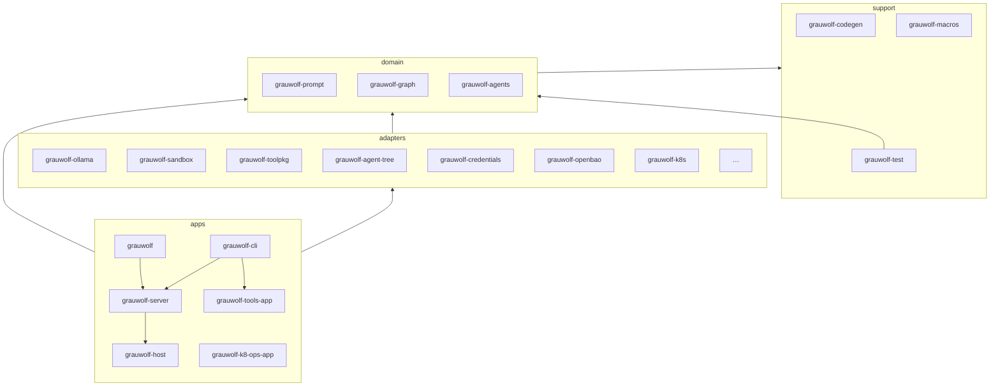
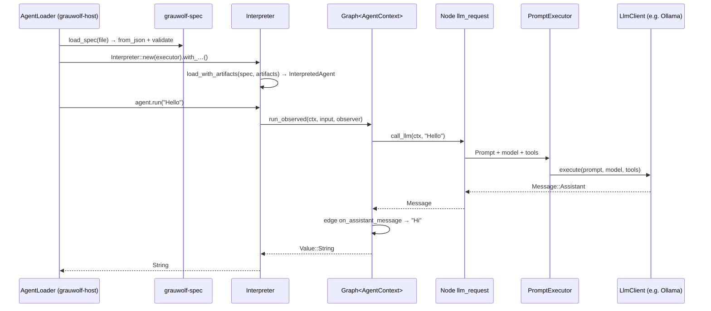

# Chapter 1 – Architecture

Before you change code in grauwolf or use the framework from Rust, you need a picture of the
whole: Which crates exist, who may depend on whom, and which path does a run take from the spec
file to the answer? This chapter gives you that picture. You know the terms *spec*, *node*,
*edge*, *tool* and *strategy* from the [user guide](../user-guide/README.md); here it is about
where they live in the code.

The binding decisions are in the [ADRs](../adr/README.md), the overall overview in
[docs/architecture.md](../architecture.md). This chapter is the guided introduction to them.

## 1.1 Four layers

grauwolf is a Cargo workspace. All crates live under `crates/<layer>/<crate>`, and the layer
follows from the directory alone ([ADR-0016](../adr/0016-layered-architecture.md)):

| Layer | Responsibility | Examples |
|---|---|---|
| `domain/` | Business core: messages, tools, graph, agent runtime, spec. Defines **ports**. No IO, no tokio. | `grauwolf-graph`, `grauwolf-agents`, `grauwolf-spec` |
| `adapters/` | Technology: HTTP, wasmtime, SQL, OpenTelemetry. Implements the ports. | `grauwolf-ollama`, `grauwolf-sandbox` |
| `support/` | Generic helpers without agent knowledge, plus the test kit. | `grauwolf-codegen`, `grauwolf-macros`, `grauwolf-test` |
| `apps/` | Assembly: composition root, facade, CLI, HTTP server. Only here are concrete adapters wired up. | `grauwolf-host`, `grauwolf`, `grauwolf-cli`, `grauwolf-server`, `grauwolf-tools-app`, `grauwolf-k8-ops-app` |

A **port** is a trait through which the business core says what it needs – for example "send a
prompt to an LLM" (`LlmClient`) or "execute a built tool" (`ToolRuntime`). An **adapter** is a
concrete implementation of that trait, such as `OllamaClient` or `SandboxRuntime`. This pattern
is called *ports & adapters*: the domain stays testable and free of infrastructure, and adapters
can be swapped.

### Dependency direction

Dependencies always point inward, toward the domain:



The rules in detail, as `xtask/src/arch.rs` checks them:

- **domain** may depend on other domain crates and on support crates, but not on the test kit
  `grauwolf-test` (only as a `dev-dependency`). External crates only from a fixed list:
  `serde`, `serde_json`, `serde_path_to_error`, `schemars`, `thiserror`, `futures-core`, `futures-util`, `async-lock`,
  `pin-project-lite`. No `tokio`, no `reqwest`, no `sqlx`, no `wasmtime`.
- **support** may use any external crates, but no grauwolf crate – exception:
  `grauwolf-test` may use domain crates.
- **adapters** may use everything except `apps/*`.
- **apps** may use everything, but follow an order among themselves (ADR-0108, stage 4d):
  `grauwolf-host` (composition root) → `grauwolf-server` (HTTP side) → `grauwolf-cli`; beside the host
  stands `grauwolf-tools-app`, the lean program `grauwolf-tools` for building and distributing tools
  (ADR-0118): the CLI depends on it, it depends on no other app crate and nothing but the CLI depends
  on it (and a test keeps its dependency closure at 75% of the CLI's at most). Likewise `grauwolf-k8-ops-app`, the operator program for Kubernetes (ADR-0120), depends on no other app crate and nothing depends on it; kube-rs and `k8s-openapi` live only in `grauwolf-k8s` and so only in that program. The host must
  not depend on the server, the CLI or the facade; the server not on the CLI or the facade; the CLI
  not on the facade. The facade `grauwolf` is only the public API on top (re-exports, the macros and
  Cargo features) and must contain no logic of its own; `check-arch` rejects item keywords such as
  `fn`, `struct` or `impl` in `crates/apps/grauwolf/src`.
- No domain, adapter or support crate depends on `grauwolf-host`, `grauwolf-server`, `grauwolf-cli`
  or `grauwolf`, not even as a `dev-dependency`.

Other `dev-dependencies` are exempt from the rules. That is why domain tests can use the test kit or
even the sandbox. A dev-dependency on an app crate would need an entry in
`APP_DEV_DEPENDENCY_EXCEPTIONS` in `xtask/src/arch.rs`; there is none today.

### The architecture test

The rules are not just on paper, they are a test. `cargo xtask check-arch` reads `cargo metadata`,
assigns each crate to its layer and reports violations:

```text
$ cargo xtask check-arch
Architecture ok: 51 crates checked.
```

The count covers every package of the workspace: the 50 crates under `crates/` plus `xtask`.
A violation is listed under `Architecture violations (ADR-0016):`, e.g. as
`grauwolf-agents (Domain) must not depend on tokio`. App-order violations name the edge and the rule, e.g. `grauwolf-cli (Apps) must not depend on grauwolf (dependency): rule app order host -> server -> cli …`. The same test
runs as part of `cargo test --workspace` (`xtask/tests/workspace_architecture.rs`), so you cannot
forget it. The alias is defined in `.cargo/config.toml`.

What the test does **not** check: the finer "Allowed dependencies" lists in the `AGENTS.md` of the
individual crates. You maintain those by hand (see [Chapter 2](02-development-setup.md)).

## 1.2 Crate map

Every crate has an `AGENTS.md` (with a `CLAUDE.md` symlink) describing its purpose, allowed
dependencies and invariants. Read it before you work on a crate. Here is the short version:

**domain/**

| Crate | Purpose |
|---|---|
| `grauwolf-prompt` | Conversation model: `Message`/`MessagePart`, `Prompt`, `LlModel`, `LlmParams`, `StreamFrame`, usage and prices. |
| `grauwolf-llm` | Port `LlmClient` and `PromptExecutor`: routing by provider, fallback, retries – without HTTP. |
| `grauwolf-tools` | Tool contract (`Tool`, `DynTool`), `ToolDescriptor`, `ToolRegistry`, port `ToolRuntime`, format of tool packages. |
| `grauwolf-graph` | Graph model, node and condition catalog, `Graph<Ctx>` engine on `serde_json::Value`, typed builder. |
| `grauwolf-agents` | Agent runtime: `AgentContext`, node implementations, feature pipeline, events, checkpoints, storage ports. |
| `grauwolf-spec-model` | The data model of the spec DSL (`AgentSpec` and its parts), strict parsing without strategy expansion (`AgentSpec::parse`), JSON schema, read-only helpers (`providers`, `to_mermaid`, …). No validation (ADR-0108 stage 6). |
| `grauwolf-strategies` | The strategy templates: `expand(&StrategySpec)` builds the graph and types of `single_run`, `react`, `verified`, `chat`. Depends only on the model and the node catalog. |
| `grauwolf-spec` | Re-exports the model; `AgentSpecExt` (`from_json` = parse + expand, `validate`, `warnings`), JSON schema, semantic validation with JSON pointer errors (one rule module per concern in `src/validate/`, ADR-0108). |
| `grauwolf-interpreter` | Runs a validated spec without compiling. |
| `grauwolf-generator` | Generates a Rust crate from a spec (`Cargo.toml`, `src/lib.rs`, built tools); there is no source map. |
| `grauwolf-builder-agent` | Generates a valid spec from a requirement in text form and repairs it. |
| `grauwolf-planner` | Planner agents: plan loop, LLM planner, GOAP. |
| `grauwolf-rag` | Splitting, embedding and searching documents; long-term memory (`remember`/`recall`). |

**adapters/**

| Crate | Purpose |
|---|---|
| `grauwolf-llm-http` | Shared HTTP/SSE base for providers (reqwest, error mapping). |
| `grauwolf-ollama`, `grauwolf-openai`, `grauwolf-anthropic`, `grauwolf-gemini`, `grauwolf-bedrock` | `LlmClient` per provider with its own DTOs. `grauwolf-bedrock` speaks the Bedrock Converse API and brings two protocol pieces of its own: AWS Signature Version 4 request signing (`sigv4`, injected into `HttpClient` through `with_signer`) and the decoder of the binary AWS event stream (`eventstream`, fed by `HttpClient::post_chunks`) that `converse-stream` answers with (ADR-0105). |
| `grauwolf-toolbuild` | Builds tool code from specs into WASM artifacts with a content-addressed cache. |
| `grauwolf-oci` | General OCI distribution client: token flow, digest checks, push, credentials (environment, Docker configuration), image layout, in-memory test registry (ADR-0107, ADR-0108). |
| `grauwolf-git` | Shared libgit2 adapter: process-wide libgit2 settings, the own smart-HTTP transport with token authentication, and SSH signature checks of commits and tags against an allowed-signers file (ADR-0104, ADR-0107). |
| `grauwolf-toolpkg` | Tool packages on top of `grauwolf-oci`: package format, packing, digest-keyed cache, `grauwolf.lock`, resolution of `tool_packages`, the tool policy with allowlists and signature checks (ADR-0107); the `setup` module (resolvers for the environment, policy, keys, pack, push) and `tree_lock` (one lockfile for an agent tree) that the host and `grauwolf-tools-app` share (ADR-0118). |
| `grauwolf-agent-tree` | The prepared agent tree (ADR-0115): read phase over a spec and its sub-agents with program-specific checks as `ReadOptions`, resolve phase, copy into an image; the host and `grauwolf-tools-app` share it (ADR-0118). |
| `grauwolf-credentials` | Credential sources behind the central configuration (ADR-0110): the `[credentials]` section (`CredentialsConfig`), `CredentialEnv` (an `Env` that answers mapped variables from `file:` and `openbao:` sources, refreshed in a background thread), `OpenBaoClient` (JWT-SVID login, KV v2 reads, re-login), `CredentialEnv::check`. The host applies it in `credentials::env_for` (feature `credentials`). |
| `grauwolf-openbao` | The OpenBao HTTP API (ADR-0120): `Bao<T: Transport>` with JWT login and KV v2 read (used by `grauwolf-credentials`) and the admin calls of the setup (auth methods, JWT config, KV mounts, policies, roles, KV write/list/delete, `capabilities-self`, health), idempotent `ensure_*` calls; `HttpTransport` for direct HTTP, other transports (the Kubernetes service proxy) are supplied by the caller. |
| `grauwolf-k8s` | The Kubernetes access of `grauwolf-k8-ops` (ADR-0120): `Cluster` over kube-rs (rustls) with objects as JSON values (`get`, `list`, `ensure` = server-side apply with field manager `grauwolf-k8-ops` and a hash annotation, `patch` = JSON merge patch, `delete`, `pod_log`, `pod_log_stream`, `can_i`, `raw`); feature `testing`: `FakeCluster`, an in-memory API server as a tower service (with a Deployment and Job simulation). |
| `grauwolf-spiffe` | The agent's workload identity (ADR-0109): the port `WorkloadIdentity` (`jwt_svid(audience)`), `WorkloadApiClient` (an own minimal gRPC client over the Unix socket in `SPIFFE_ENDPOINT_SOCKET`, no `protoc`), and with feature `testing` `FakeIdentity` and `FakeWorkloadApi`. |
| `grauwolf-config` | The `Env` port with `ProcessEnv`/`MapEnv`, the `RegistryConfig` section and `VARIABLES`, the one table of environment variables; the host's `config` re-exports it (ADR-0118). |
| `grauwolf-sandbox` | `ToolRuntime` on top of wasmtime with limits. |
| `grauwolf-builtin-tools` | Light built-in tools: files under a root, key-value, to-do, think, user input/output (no `git2`, no `reqwest`). |
| `grauwolf-tools-git` | Git tools for one repository on libgit2 (through `grauwolf-git`). |
| `grauwolf-tools-web` | The `fetch` tool: allow-listed hosts, address checks, HTML to text. |
| `grauwolf-tools-command` | The `run_command` tool: allowlist or shell mode, cleared environment, process-group kill on timeout (Unix only; ADR-0099). |
| `grauwolf-mcp` | MCP client and server: tools from MCP servers as grauwolf tools. |
| `grauwolf-a2a` | A2A client: remote agents as sub-agents. |
| `grauwolf-otel` | OpenTelemetry spans from agent events. |
| `grauwolf-systemone` | `Decider` for decision nodes: a System One service such as RKEV over HTTP. |
| `grauwolf-store-sql` | SQL storage (SQLite/Postgres) for conversation histories and checkpoints. |
| `grauwolf-store-pgvector` | PostgreSQL with pgvector for knowledge and long-term memory (ADR-0106): incremental indexing, per-user memory with expiry. |

**support/**

| Crate | Purpose |
|---|---|
| `grauwolf-codegen` | Generic Rust code builder (fork of `carllerche/codegen`) with syntax checking and formatting. |
| `grauwolf-macros` | Proc macro `#[tool]`: tools from functions. |
| `grauwolf-test` | Test kit: rule-based `MockLlmClient` and the conformance suite for `LlmClient`. |

**apps/**

| Crate | Purpose |
|---|---|
| `grauwolf-host` | Composition root (ADR-0108, stage 4a): builds providers from the typed configuration (`config`: `Env` port, `Config` sections, table of variables), loads specs (`AgentLoader`), provisions everything an agent run needs in one module (`provisioning`, ADR-0114: tools, memory, knowledge, MCP, sub-agents; packages and telemetry beside it). |
| `grauwolf` | Facade: re-exports the crates and the host's modules under the same paths per Cargo feature; no code of its own (the chat API, the observations and the service start are re-exported from `grauwolf-server`). |
| `grauwolf-cli` | The `grauwolf` program (`spec validate`, `run`, `chat`, `serve`, `generate`, …); its `tools` subcommand delegates to `grauwolf-tools-app`. |
| `grauwolf-tools-app` | The `grauwolf-tools` program (ADR-0118): `build`, `pack`, `push`, `pull`, `inspect`, `lock`, `keygen`, `validate` as a library plus a small binary (about 8 MB, a cold release build in under a minute). The package has this name because the domain crate `grauwolf-tools` holds the other. Depends on `grauwolf-config`, `-spec`, `-tools`, `-toolbuild`, `-toolpkg` and `-agent-tree` only. |
| `grauwolf-k8-ops-app` | The `grauwolf-k8-ops` program (ADR-0120): `doctor`, `oidc install`, `openbao setup`, `agent add/list/remove/check/deploy/status/logs/undeploy`, `secret set/get/list/delete`, `trust-domain set/restore` over `grauwolf-k8s`, `grauwolf-openbao` and `grauwolf-agent-tree` (the tree of `agent deploy --spec`). Depends on no other app crate; nothing depends on it. |
| `grauwolf-server` | The HTTP side: agents as an HTTP service and A2A server, the chat API with its observations, the start of generated services (ADR-0108, stage 4c); depends on the host. |

On top of that there is `xtask/` with development tools (so far only `check-arch`).

## 1.3 Three entry points, one engine

grauwolf knows three ways to describe an agent:

1. **Typed Rust builder** – you build the graph in code (`TypedGraph::build`), and the compiler
   checks the types at the edges ([Chapter 3](03-rust-api.md)).
2. **Interpreter** – a spec (JSON) is loaded and executed at runtime.
3. **Generator** – a spec becomes a standalone Rust crate that uses the typed builder
   ([Chapter 6](06-generator.md)).

All three run on the **same** engine `Graph<Ctx>` from `grauwolf-graph`
([ADR-0017](../adr/0017-value-engine.md)). The engine works on `serde_json::Value`: a node is a
function `(&mut Ctx, Value) -> Future<Result<Value>>`, and an edge condition maps the output value
to `Option<Value>` (matches / does not match, possibly converted). Edges are checked in
declaration order; the first matching one wins.
An edge may also carry a **transformation** (`TransformFn`, ADR-0102): it maps the value after the
condition matched and before the target runs, so the target's input – and the value of its
checkpoint – is the transformed one. The `code` node, the condition `on_code` and the edge `transform`
are code from the spec, built and run like tools ([Chapter 4](04-tools-internals.md#44-from-spec-code-to-a-wasm-module-toolbuilder)).

So that the three ways do not drift apart, there are **catalogs**
([ADR-0018](../adr/0018-node-catalog.md), [ADR-0021](../adr/0021-condition-catalog.md)): every
node kind (`llm_request`, `execute_tool`, …) and every condition (`on_tool_call`, …) is described
exactly once in `grauwolf-graph` – with a parameter schema and signature. Spec validation,
interpreter, generator and builder are all derived from it.

## 1.4 The path of a run

Let's follow what happens when you call `grauwolf spec run echo.json "Hello"` or use
`AgentLoader::load` from Rust. The spec is `examples/specs/echo.json`:

```json
{
  "spec_version": 1,
  "name": "echo",
  "model": { "provider": "ollama", "id": "llama3.2" },
  "system_prompt": "Repeat the user's message verbatim.",
  "graph": {
    "nodes": [ { "id": "call_llm", "kind": "llm_request" } ],
    "edges": [
      { "from": "start", "to": "call_llm" },
      { "from": "call_llm", "to": "finish", "when": { "kind": "on_assistant_message" } }
    ]
  }
}
```



### Step 1: Reading the spec – `load_spec`

`grauwolf::loader::load_spec(file)` (`crates/apps/grauwolf-host/src/loader.rs`) reads the file,
resolves the tools' file references (`tool_files`, `code_file`, [ADR-0073](../adr/0073-tool-files.md))
and then calls two functions from `grauwolf-spec` (methods of the extension trait
`AgentSpecExt`, `use grauwolf_spec::AgentSpecExt;`):

- `AgentSpec::from_json(&json)` (`AgentSpec::parse` of `grauwolf-spec-model` plus `grauwolf_strategies::expand`) deserializes **strictly** (`deny_unknown_fields`,
  [ADR-0025](../adr/0025-strict-spec.md)), checks `spec_version` and expands a `strategy`
  (e.g. `single_run`, `react`) into an ordinary graph
  ([ADR-0041](../adr/0041-strategy-templates.md)). After that, nobody sees the strategy anymore,
  only the graph.
- `spec.validate()` checks against the catalogs: IDs, namespaces, edges, types at the edges,
  tools, subgraphs. It returns **all** errors at once, each with a JSON pointer.

Errors come back as text with the file and pointer, for example
`broken.json:/graph/edges/0/to: …` (based on `crates/apps/grauwolf-host/tests/loader.rs`, which uses a file
named `kaputt.json`).

### Step 2: Assembling the agent – `AgentLoader`

`AgentLoader::load` does everything that needs infrastructure – that is why it lives in the
composition root `grauwolf-host` (re-exported by the facade) and not in the domain:

1. `executor_for(spec.providers(), env)` builds a `PromptExecutor` with one client for each
   provider of the spec (including subgraph models) and a retry policy.
2. An `Interpreter` is equipped with features, interceptors, prices, budget and approvals.
3. If the spec has tool code, `ToolBuilder` builds it into WASM artifacts, and a `SandboxRuntime`
   is set as the tool runtime ([Chapter 4](04-tools-internals.md)). `tool_packages` are resolved
   against `grauwolf.lock` here, once, and their tools go to the interpreter with
   `with_package_tools` ([section 4.10](04-tools-internals.md#410-tool-packages-from-registries-adr-0107)).
4. External tools (MCP, built-in tools, knowledge) and sub-agents (`agent_tools`, local or via
   A2A) are loaded – the sub-agents from the prepared agent tree (`grauwolf::agent_tree`, ADR-0115: one read and resolve pass over the spec and its sub-agents, cycles refused, a shared sub-agent loaded once).
5. `interpreter.with_tools(external).load_with_artifacts(&spec, &artifacts)` returns the
   `InterpretedAgent`.

### Step 3: The spec becomes a graph – `Interpreter`

`Interpreter::load_with_artifacts` (`crates/domain/grauwolf-interpreter/src/lib.rs`) validates the
spec once more (the interpreter only accepts valid specs), loads the tools into a `ToolRegistry`
via `ToolRuntime::instantiate` and builds the `Graph<AgentContext>` with `build_graph`:

- For ordinary node kinds, `grauwolf_agents::implementations::node(kind, params, types)` returns
  the node function, and for conditions `implementations::condition(kind, params)`.
- The kinds `subgraph`, `plan`, `goap`, `parallel` and `for_each` need the whole spec (they refer to
  subgraphs or agents) and are assembled in the interpreter itself. Subgraphs with their own tool selection
  or their own model get a `SubgraphScope`.

### Step 4: The run – `AgentContext` and nodes

`InterpretedAgent::run("Hello")` creates a **fresh** `AgentContext` for every run. The context is
the state of a run: prompt history, active model, tool registry, storage, installed features and
interceptors, usage and cost. Then it hands the context to the **run lifecycle**
(`grauwolf_agents::run_lifecycle::AgentRun`, ADR-0116), which owns the order of a run:
`agent_starting`, automatic memory recall, knowledge injection, the graph run
(`graph.run_observed(&mut ctx, input, observer)`, passed in as a function), automatic remember, saving
a conversation, and exactly one of `agent_completed` / `agent_failed`. Plain runs, runs with
checkpoints and resumed runs are options of the same lifecycle, and generated code calls it too, so
both paths share one sequence.

The engine executes node after node. The node `llm_request` appends the input to the prompt as a
user message, sends it through the `PromptExecutor` to the `LlmClient` of the active provider and
returns the assistant message. The condition `on_assistant_message` only lets plain text answers
through and converts them into a `String` – that is the output of the run.

### Step 5: Events

Along the way, the context reports **domain events** (`AgentEvent`): `agent_starting`,
`node_starting`, `llm_call_starting`, `llm_call_completed`, `tool_call_starting`, …, and at the
end `agent_completed` with usage and cost, or `agent_failed`. If you want to listen, you install a
`Feature` – for example a JSONL log or OpenTelemetry. Details in
[Chapter 7](07-events-and-observability.md).

## 1.5 Interpreter and generator

| | Interpreter | Generator |
|---|---|---|
| Input | Spec at runtime | Spec at build time |
| Result | `InterpretedAgent` in the same process | Rust crate with `graph()`, `run(executor, input)` and structs for the types |
| Type checking | Validation against the catalogs | additionally the Rust compiler |
| Tool code | Artifacts via `ToolRuntime` | Artifacts under `tools/`, executed in the sandbox |
| Use | CLI, server, quick experiments | standalone programs, embedding in larger applications |

Both must behave **the same**. Equivalence tests on the spec corpus `examples/specs/`
(`crates/domain/grauwolf-generator/tests/equivalence.rs`) make sure of that: the same spec runs
in the interpreter and as a generated crate against the same `MockLlmClient`, and the results
must match. Some functions deliberately exist only in the interpreter, e.g. tools directories
(`tools_dir`); the generator then reports `GeneratorError::Unsupported`.

## 1.6 The GOAP planner

The kind `goap` (ADR-0070 and its addenda) is the only node whose planning is data-driven, and it is
the same code in the interpreter and in generated crates: `grauwolf_planner::goap::fact_planner(params,
steps)` builds a `GoapPlanner<String, String, FactState>` from the parameters (as JSON) and the step
graphs of the subgraph actions; `planner_node` runs it with progress under `grauwolf.plan.<id>`.

- **State:** `FactState { task, facts, output }`. A fact is a `FactValue` (`Bool`, `Int`, `Number`,
  `Text`); its type is fixed by the initial value in `state` and the list under `values`. Numbers are
  compared and hashed by their bits, so states can be keys of the A* maps.
- **Conditions and effects** (`pre`, goal `facts`; `effects`, `on_success`, `on_failure`) are parsed once
  into small values (`Condition { fact, op, value }`, `Change::{Set, Add}`) – the spec check
  (`grauwolf-spec`, `validate/goap.rs`) repeats the same rules with pointers for errors, because the
  spec crate does not depend on the planner.
- **Search:** A* per goal over the *expected* effects (`effects`), bounded by `max_search_nodes` and
  `max_plan_depth`; the goal with the smallest `cost / (priority + 1)` wins, ties by declaration order.
  The planner replans from the actual state before every step.
- **Execution:** an `ActionRun` renders the `input` template, runs the executor – a step graph, or
  `AgentContext::run_agent_step` for an `agent` – and applies `on_success` or `on_failure` (a failure is an
  executor error or a missing `success_contains`; without `on_failure` the node fails). Fields of an
  object answer overwrite facts of the same name and type (*observed state*), which triggers replanning
  when the world differs from the expectation.
- **Tests:** `grauwolf-planner/tests/fact_*.rs` (planner), `grauwolf-spec/tests/goap.rs` (checks),
  `grauwolf-interpreter/tests/goap*.rs`, and the generator snapshot and equivalence case for
  `examples/specs/review_loop.json`.

## Key points

- Four layers: `domain` (business logic, ports, no IO), `adapters` (technology), `support`
  (generic, test kit), `apps` (assembly). Dependencies point inward.
- `cargo xtask check-arch` checks the layer rules and runs as part of `cargo test --workspace`.
- Every crate has an `AGENTS.md` with purpose, dependencies and invariants.
- A run: `load_spec` → `AgentSpec::from_json` + `validate` → `AgentLoader` →
  `Interpreter::load_with_artifacts` → `Graph<AgentContext>` → nodes call the LLM through the
  `PromptExecutor` → events to features.
- Builder, interpreter and generator share one engine and the catalogs; equivalence tests keep
  interpreter and generator in line.

Continue with [Chapter 2 – Development setup](02-development-setup.md).
