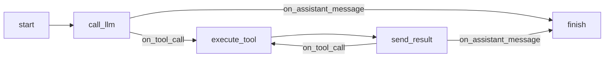

# Chapter 3 – grauwolf as a library

The CLI is only a thin layer over a Rust API. You can use the same API in your own program: load
and run specs, equip agents with conversations, features and approvals, write your own tools in
Rust and build graphs entirely in code without JSON. The chapter goes step by step – from the
simplest run through your own tools to your own graph.

## 3.1 The `grauwolf` facade

For applications, the `grauwolf` crate (`crates/apps/grauwolf`) is the entry point. It re-exports
the sub-crates under short names and the modules of the composition root `grauwolf-host`
(`crates/apps/grauwolf-host`, ADR-0108 stage 4a) under the same paths, so `grauwolf::loader` is
`grauwolf_host::loader`. The building blocks that need infrastructure live in the host; its Cargo
features (`ollama`, `mcp`, `builtin`, `git`, …) are the facade's features of the same name:

| Path | Contents |
|---|---|
| `grauwolf::spec`, `::interpreter`, `::agents`, `::graph`, `::llm`, `::prompt`, `::tools`, `::rag`, `::toolbuild`, `::builder_agent` | Re-exports of the domain crates (always present) |
| `grauwolf::ollama`, `::openai`, `::anthropic`, `::gemini`, `::bedrock`, `::sandbox` | Re-exports of the adapters (depending on the Cargo feature) |
| `grauwolf::providers` | Provider clients and `PromptExecutor` from environment variables |
| `grauwolf::loader` | `load_spec`, `AgentLoader` (load specs including tools and sub-agents) |
| `grauwolf::features` | `JsonlEventLog` (events as JSON lines) |
| `grauwolf::checkpoints`, `::memory` | File and SQL storage for checkpoints and conversations |
| `grauwolf::runtime` | `TokioClock`, the tokio adapter for the `Clock` port |
| `grauwolf::prelude` | everyday imports in one line: `AgentSpec` with `AgentSpecExt` (`from_json`, `validate`, `warnings`), `Interpreter`, `AgentLoader`, `load_spec`, `executor_from_env`, `Config`/`Env`/`MapEnv`/`ProcessEnv`, `PromptExecutor`, `LlModel`, `Message`, `Prompt`, `Prices`, `Usage`, `ToolDescriptor`, `DynTool`, `ToolError`, `ToolRegistry`, `AgentContext`, `Budget` and the macros `tool`/`toolset` |

Most programs need only `use grauwolf::prelude::*;`. Without it, `AgentSpec::from_json` and
`spec.validate()` need the trait in scope: `use grauwolf::spec::AgentSpecExt;` (ADR-0108 stage 6).

### Cargo features

By default, everything is enabled:

```toml
default = ["macros", "ollama", "openai", "anthropic", "gemini", "bedrock", "sandbox", "mcp", "builtin", "git", "fetch", "command", "atlassian", "sql", "otel", "a2a"]
```

The built-in tools are split by dependency (ADR-0108): `builtin` brings the light tools (files, key-value, to-do, think, user I/O), `git` the git tools (libgit2), `fetch` the `fetch` tool (HTTP client), `command` the `run_command` tool (process spawning, Unix only) and `atlassian` the Jira and Confluence tools. A spec that uses a group whose feature is off fails before the run with `this build has no git tools (feature `git`)` (likewise `fetch`, `command`, `atlassian`).

If you want a leaner build, you turn off the default features and pick what you need. Note: the
`grauwolf::loader` module only exists with `mcp`, `builtin`, `sandbox` and `a2a` together,
because the loader wires up all these tool sources. Without a provider's feature,
`providers::client_from` reports `ProviderError::Unknown` for that provider.

Until the first release, you include grauwolf via a path (or Git):

```toml
[dependencies]
grauwolf = { path = "../grauwolf/crates/apps/grauwolf" }
tokio = { version = "1", features = ["macros", "rt-multi-thread"] }
```

## 3.2 The simplest run

Load a spec, build an executor for its provider, start the agent:

```rust
use std::path::Path;
use std::sync::Arc;

use grauwolf::interpreter::Interpreter;
use grauwolf::loader::load_spec;
use grauwolf::providers::executor_from_env;

#[tokio::main]
async fn main() -> Result<(), Box<dyn std::error::Error>> {
    let spec = load_spec(Path::new("hello.json"))?;            // read + validate
    let executor = executor_from_env(&spec.model.provider)?;   // e.g. OLLAMA_HOST
    let agent = Interpreter::new(Arc::new(executor)).load(&spec)?;

    let answer = agent.run("What is the capital of France?").await?;
    println!("{answer}");
    Ok(())
}
```

The building blocks:

- `load_spec(path)` reads the file, resolves tool files and validates; errors are text with the
  file and JSON pointer (`crates/apps/grauwolf-host/src/loader.rs`).
- `executor_from_env(provider)` builds a `PromptExecutor` with the provider's client and a retry
  policy (`RetryPolicy::default()` with `TokioClock`). The variables are the same as in the CLI:
  `OLLAMA_HOST` (and `OLLAMA_THINK`), `OPENAI_API_KEY`/`OPENAI_BASE_URL`, `ANTHROPIC_API_KEY`,
  `GEMINI_API_KEY`/`GEMINI_BASE_URL`, `AWS_ACCESS_KEY_ID`/`AWS_SECRET_ACCESS_KEY`/`AWS_SESSION_TOKEN` or `AWS_BEARER_TOKEN_BEDROCK` with `AWS_REGION` and `BEDROCK_BASE_URL` (`bedrock`), and for the OpenAI-compatible providers (`openrouter`,
  `deepseek`, `mistral`, `groq`, `dashscope`, `xai`) `<NAME>_API_KEY`/`<NAME>_BASE_URL`, e.g.
  `GROQ_API_KEY` (`crates/apps/grauwolf-host/src/providers.rs`, list `BUILTIN`). For specs with several providers (subgraph models),
  use `executor_for(spec.providers(), |v| std::env::var(v).ok())`.
- `Interpreter::new(executor).load(&spec)` validates and builds an `InterpretedAgent`.
- `run(text)` performs a run with text input and output in a fresh context.

`Interpreter::load` is only enough for specs without tool code and without external tools. If the
spec has `tools`, it reports `InterpreterError::MissingArtifact`; if MCP, built-in or sub-agent
tools are missing, `MissingExternalTool`. For such specs, use the `AgentLoader`.

## 3.3 All inclusive: `AgentLoader`

`grauwolf::loader::AgentLoader` does most of what `grauwolf spec run` does: building tool code,
setting up the sandbox, starting MCP servers, indexing knowledge, opening long-term memory,
loading built-in tools and sub-agents (recursively). Not included are the tools directory
(`tools_dir`; you load it with `grauwolf::tools_dir`, see [Chapter 4](04-tools-internals.md)) and
automatic memory (`RunExtras.memory`, section 3.5).

```rust
use grauwolf::loader::AgentLoader;
use grauwolf::toolbuild::ToolBuilder;

let loader = AgentLoader::new(ToolBuilder::new(".grauwolf/tools"));  // cache for WASM artifacts
let (spec, agent) = loader.load(Path::new("examples/specs/calculator.json"), None).await?;
let answer = agent.run("What is 2+3?").await?;
```

From `crates/apps/grauwolf-host/tests/loader.rs`: the loader is the supplier of sub-agents
(`SubAgentSupplier`, see "Provisioning" below); it offers the sub-agents from `agent_tools` as tools for a
user, which is how generated crates get them:

```rust
let loader = AgentLoader::new(ToolBuilder::new(std::env::temp_dir().join("grauwolf-loader-tools")));
let (spec, _agent) = loader.load(&specs().join("coordinator.json"), None).await.unwrap();
let tools: Vec<_> = loader.supply(&spec, &specs()).await.unwrap()
    .iter().map(|agent| agent.tool_for(None)).collect();
assert_eq!(tools[0].name(), "translator");
```

The second argument of `load` is an optional `FrameSink` – a function that receives streaming
frames live (only the main agent, not its sub-agents).

### Settings for all loaded agents

The loader is a builder; every setting applies to the agent **and** its sub-agents:

| Method | Effect |
|---|---|
| `with_feature(Arc<dyn Feature>)` | Install a feature in every agent (e.g. an event log) |
| `with_agent_features(AgentFeatures)` | Features per spec, e.g. a tracing feature with the spec's name |
| `with_interceptor(Arc<dyn Interceptor>)` | Intervene in LLM and tool calls ([Chapter 7](07-events-and-observability.md)) |
| `with_prices(Arc<Prices>)` | Calculate cost per LLM call and run ([ADR-0071](../adr/0071-costs.md)) |
| `with_budget(Budget)` | Limit every run ([ADR-0072](../adr/0072-run-budget.md)); sub-agents have their own budget |
| `with_tool_approval(Vec<String>)` | Make tools require approval ([ADR-0061](../adr/0061-tool-approval.md)) |
| `with_user_io(Arc<dyn UserIo>)` | Where `say_to_user`/`ask_user` talk to (default: console) |
| `with_env(Arc<dyn Env>)` | Read variables from `env` instead of the process (see "Configuration and the environment" below) |
| `with_chat_api_mode(bool)` | Chat API mode: `OLLAMA_BASE_URL` stands in for a missing `OLLAMA_HOST` ([ADR-0094](../adr/0094-chat-api.md)) |
| `with_decider(Arc<dyn Decider>)` | The `system_one` decider of decision nodes; without it the loader builds one from `RKEV_BASE_URL` for specs that need it ([ADR-0100](../adr/0100-decision-node.md)) |

### Configuration and the environment

Every environment variable grauwolf reads is described once, in `grauwolf::config`
(`crates/apps/grauwolf-host/src/config.rs`, ADR-0108 stage 4b):

- `Env` is the port (`fn var(&self, name) -> Option<String>`); `ProcessEnv` reads the process
  environment, `MapEnv::new([("OLLAMA_HOST", "http://x")])` is a fixed set for tests, and every
  `Fn(&str) -> Option<String>` is an `Env` too.
- `Config::from_env(&dyn Env)` builds the typed sections `providers`, `registry`, `atlassian`, `git`,
  `system_one`, `service`, `chat_api` and `telemetry`; each section also has its own `from_env` and
  `from_lookup`, so a module that needs one of them never looks at the others. Values are kept as
  the variable holds them; the doc comment of each field says where an empty or blank value counts
  as unset (the same places as before the central configuration).
- `config::VARIABLES` lists every variable with its section and meaning; the table in the CLI
  reference ([Environment variables](../user-guide/reference-cli.md#environment-variables)) names
  the same variables, and a unit test fails when one of them is missing there or when `Config`
  reads a variable that is not in the table.

The host modules take a section or an environment instead of reading the process: `client_with`,
`executor_for_config`, `embedder_with` (`ProvidersConfig`), `decider_with` (`SystemOneConfig`),
`packages::resolver_with`,
`resolve_tools_with`, `push_package_with` (`RegistryConfig`), `OtelTracing::init_with`
(`TelemetryConfig`), and `env::expand_with` (`${VAR}` in headers); the loader keeps its environment (`with_env`), and
provisioning (see "Provisioning" below) reads everything from the `Env` it is given. The closure variants of the
provider functions (`client_from(provider, env_fn)`, `executor_from_env`, …) remain; the function
ladders of tool provisioning (`external::tools*`, `builtin::tools*`, …) are gone (ADR-0114, before
1.0, no wrappers). The process environment is read only at entry points: the CLI, `service::main` (`ServiceConfig::from_env`
of the facade) and the generated crates. A test of host logic therefore passes a `MapEnv` and never
calls `std::env::set_var`.

Outside the central configuration: the OTLP variables (`OTEL_EXPORTER_OTLP_*`) are read by the
OpenTelemetry SDK, `CARGO` and `RUSTC` by the tool build and `generate --check`.

Example with prices, budget and event log:

```rust
use grauwolf::agents::Budget;
use grauwolf::features::JsonlEventLog;
use grauwolf::prompt::Prices;

let prices: Prices = serde_json::from_str(r#"{
    "currency": "USD",
    "models": { "openai:gpt-4o-mini": { "input": 0.15, "output": 0.6 } }
}"#)?;                                                  // prices per million tokens
let loader = AgentLoader::new(ToolBuilder::new(".grauwolf/tools"))
    .with_prices(Arc::new(prices))
    .with_budget(Budget { max_tokens: Some(20_000), max_cost: Some(0.05), ..Default::default() })
    .with_feature(Arc::new(JsonlEventLog::new(std::io::stderr())));
```

`Prices::cost` calculates `tokens × price / 1,000,000`; the key is `<provider>:<id>`
(`crates/domain/grauwolf-prompt/src/usage.rs`). `Budget` implements `Default` and has the public
fields `max_tokens`, `max_cost`, `max_tool_calls` ([ADR-0078](../adr/0078-run-limits-in-specs.md))
and `max_prompt_tokens` ([ADR-0087](../adr/0087-tokenizer.md)); it is checked before every LLM
request.

### Provisioning: everything a run needs

`grauwolf::provisioning` (ADR-0114) is the one module that prepares what an agent run needs besides
its graph: model access (the executor), the `system_one` decider, the tools from outside the graph
– MCP servers, knowledge, the built-in groups, skills, memory tools, the key-value store, sub-agents –
and the long-term memory. It starts from a **loaded, resolved spec** (code files read, git skills
localised, tool packages resolved; the loader does that) and works in two stages:

- `ProvisionedAgent::new(&spec, base_dir, options).await` is built once per loaded agent and shared
  by all its runs: executor, decider, started MCP servers, the indexed knowledge, the built-in tool
  configuration, skills, the opened memory and the sub-agents. Everything that can fail (a missing
  credential, a feature that is not compiled in, an unreachable server) fails here.
- `agent.run(user)` is a cheap `ProvisionedRun` per run and user: `user_tools()` (the user's memory
  tools, key-value store and sub-agents that run on behalf of that user), `facts()` (automatic
  memory), `directory_tools().await` (the tools of `tools_dir`, reloaded per run) and
  `extras().await`, which is the `RunExtras` for `InterpretedAgent::run_with`. `agent.tools()` and
  `agent.tools_for(user)` give one flat list for callers that hand the tools on themselves.

```rust
use grauwolf::config::ProcessEnv;
use grauwolf::provisioning::{ProvisionOptions, ProvisionedAgent};

let options = ProvisionOptions::new(Arc::new(ProcessEnv));          // the one environment
let agent = ProvisionedAgent::new(&spec, base_dir, options).await?;
let run = agent.run(Some("anna"))?;                                  // per run and user
let answer = interpreted.run_with("Hi".into(), run.extras().await).await?;
```

`ProvisionOptions` holds what belongs to the agent: the `Env` (the only place configuration is
read from – provider settings, credentials, `${VAR}` in headers and the values the command tool
passes on), user I/O, a decider, the observer of MCP tool lists, the features for sub-agents, the
LLM cache, the tool builder for `tools_dir` and the supplier of sub-agents. `with_executor` and
`with_embedder` replace the providers (own providers, tests). Sub-agents come through the port
`SubAgentSupplier`, which the `AgentLoader` implements; generated code passes
`AgentLoader::for_provisioning(builder, &options)`. The user of the calling run is passed on to
sub-agent runs. Tests of tool provisioning belong here: build a `ProvisionedAgent` with a `MapEnv`
(see `crates/apps/grauwolf-host/tests/provisioning.rs`).

## 3.4 Configuring the `Interpreter` directly

If you need more control – such as your own tool runtime or your own tools alongside the spec –
you configure the `Interpreter` yourself. It has the same builder methods as the loader and a few
more (`crates/domain/grauwolf-interpreter/src/lib.rs`):

| Method | Effect |
|---|---|
| `with_tool_runtime(Arc<dyn ToolRuntime>)` | Runtime for tool artifacts, e.g. `SandboxRuntime` |
| `with_tools(Vec<Arc<dyn DynTool>>)` | External tools; only those the spec declares are offered (`AgentSpec::external_tools()`) |
| `with_tool_factory(Arc<dyn ToolFactory>)` | Factory for self-made tools (`self_tools`, [ADR-0075](../adr/0075-self-made-tools.md)) |
| `with_frame_sink(FrameSink)` | Streaming frames of all runs |
| `with_feature`, `with_interceptor`, `with_prices`, `with_budget`, `with_tool_approval` | as with the loader |

For specs with tool code, you pass in the built artifacts yourself:

```rust
let artifacts = grauwolf::loader::build_tools(file, &spec, &ToolBuilder::new(".grauwolf/tools"))?;
let agent = Interpreter::new(Arc::new(executor))
    .with_tool_runtime(Arc::new(grauwolf::sandbox::SandboxRuntime::new()?))
    .load_with_artifacts(&spec, &artifacts)?;
```

## 3.5 Runs: `run`, `run_json`, `run_with`

An `InterpretedAgent` can run any number of times; every run gets a fresh `AgentContext`.

- `run(text) -> Result<String, _>` – for specs with input and output `string`.
- `run_json(value) -> Result<Value, _>` – for named types. The input is checked against the type
  and normalized; if it does not fit, you get `InterpreterError::Input`.
- `run_with(value, RunExtras { … })` – like `run_json`, but with handles **for this run only**.
- `run_conversation(value, store, id)`, `run_checkpointed(value, store, run_id)`,
  `resume(store, run_id)` – conversations and checkpoints; `run_checkpointed_with(.., extras)` and
  `resume_with(store, run_id, extras)` take `RunExtras` like `run_with` (without a conversation;
  `resume_with` rebuilds self-made tools from the checkpoint, ADR-0077).

From `crates/domain/grauwolf-interpreter/tests/echo.rs` – an agent with a named type:

```rust
let spec = AgentSpec::from_json(r#"{ "spec_version": 1, "name": "relay",
    "model": { "provider": "ollama", "id": "m" },
    "types": { "Answer": { "type": "object", "properties": { "text": { "type": "string" } } } },
    "input": "Answer", "output": "Answer",
    "graph": { "edges": [ { "from": "start", "to": "finish" } ] } }"#).unwrap();
let agent = Interpreter::new(Arc::new(PromptExecutor::builder().build())).load(&spec).unwrap();

let output = block_on(agent.run_json(serde_json::json!({ "text": "hi" }))).unwrap();
assert_eq!(output, serde_json::json!({ "text": "hi" }));
```

### `RunExtras`

`RunExtras` has six public fields and implements `Default`:

| Field | Type | Effect |
|---|---|---|
| `feature` | `Option<Arc<dyn Feature>>` | Additional feature for this run only |
| `frame_sink` | `Option<FrameSink>` | Replaces the interpreter's frame sink |
| `conversation` | `Option<(Arc<dyn ChatHistoryStore>, String)>` | Conversation: store and ID |
| `tools` | `Vec<Arc<dyn DynTool>>` | Tools for this run only; they replace tools of the same name (e.g. a user's memory) |
| `approver` | `Option<ToolApprover>` | Approves tools that require approval; without it they are rejected |
| `memory` | `Option<Arc<dyn FactMemory>>` | Long-term memory for `auto_recall`/`auto_remember` |

Based on `crates/domain/grauwolf-interpreter/tests/run_with.rs` (shortened):

```rust
let history = Arc::new(MemoryChatHistoryStore::default());
let output = block_on(agent.run_with(
    json!("Hello"),
    RunExtras {
        feature: Some(recorder.clone()),
        frame_sink: Some(Arc::new(move |frame: &StreamFrame| {
            if let StreamFrame::TextDelta { text } = frame {
                sink_frames.lock().unwrap().push_str(text);
            }
        })),
        conversation: Some((history.clone(), "anna".into())),
        ..RunExtras::default()
    },
))
.unwrap();
```

After the run, the conversation store holds the user and assistant messages (without the system
prompt); the next run with the same ID continues the conversation. You find persistent stores in
`grauwolf::memory::FileChatHistoryStore` and `grauwolf::checkpoints::FileCheckpointStore`.

### Agents as tools: `into_tool`

An agent can be a tool of another agent ([ADR-0040](../adr/0040-agent-as-tool.md)).
`Arc<InterpretedAgent>::into_tool(name, description)` returns an `Arc<dyn DynTool>`. With text
input, the argument is `{ "request": "…" }`; with a named input type, its schema; structured
outputs come back as JSON text. Based on `crates/domain/grauwolf-interpreter/tests/agent_tool.rs`
(shortened):

```rust
let agent = interpreter(MockLlmClient::new("?").answer_when_contains("Hola", "Hello"))
    .load(&example("echo.json"))
    .unwrap();

let tool = Arc::new(agent).into_tool("translator", "Translates into English");
let answer = block_on(tool.call_json(json!({ "request": "Hola" }))).unwrap();
assert_eq!(answer, "Hello");
```

## 3.6 Your own tools in Rust with `#[tool]`

Tool code in specs runs in the WASM sandbox. Tools that **you** write in Rust, on the other hand,
run directly in the process. The most convenient way to create them is the `#[tool]` macro from
`grauwolf-macros` ([ADR-0003](../adr/0003-tool-definition.md), F03.5). Based on
`crates/domain/grauwolf-tools/tests/tool_macro.rs`:

```rust
use grauwolf_macros::tool;
use grauwolf_tools::{DynTool, ToolError, ToolRegistry};

/// Adds two numbers.
#[tool]
async fn add(#[arg("First number")] a: f64, #[arg("Second number")] b: f64) -> Result<f64, ToolError> {
    Ok(a + b)
}

/// Greets someone.
#[tool]
fn greet(name: String) -> Result<String, ToolError> {
    Ok(format!("Hello {name}"))
}

let registry = ToolRegistry::builder().tool(Add).tool(Greet).build();
assert_eq!(block_on(registry.call("add", json!({ "a": 2, "b": 3 }))).unwrap(), "5.0");
assert_eq!(block_on(registry.call("greet", json!({ "name": "World" }))).unwrap(), "\"Hello World\"");
```

From `add`, the macro generates the type `Add` (the tool) and `AddArgs` (the arguments with a
JSON schema). The tool name is the function name, the description comes from the doc comment, and
the argument descriptions from `#[arg("…")]`. The function may be `async` or not and must return
`Result<T, ToolError>`; `T` is given to the model as JSON text.

For your `Cargo.toml`, the facade is enough: write `#[grauwolf::tool]` or `#[grauwolf::toolset]`
(feature `macros`, enabled by default). The generated code then refers to `::grauwolf::tools`;
serde and schemars come via `grauwolf::tools::__private`. Only if you work without the facade do
you include `grauwolf-macros` and `grauwolf-tools` directly and write `#[tool]`/`#[toolset]` –
their code refers to `::grauwolf_tools` (ADR-0003 addendum). Example via the facade:
`crates/apps/grauwolf/tests/macros.rs`.

### Several tools with shared state: `#[toolset]`

If several tools need the same object – a database connection, a shopping cart, a counter – you
write them as methods of an `impl` block. `#[toolset]` turns every method marked `#[tool]` into a
tool; they all share the object via `Arc<Self>`. Based on
`crates/domain/grauwolf-tools/tests/toolset_macro.rs`:

```rust
use grauwolf_macros::toolset;

struct Shop {
    cart: Mutex<Vec<String>>,
}

#[toolset]
impl Shop {
    /// Puts an item into the shopping cart.
    #[tool]
    fn add_to_cart(&self, #[arg("Name of the item")] item: String) -> Result<String, ToolError> {
        self.cart.lock().unwrap().push(item);
        Ok(self.summary())
    }

    /// Counts the items in the shopping cart.
    #[tool]
    async fn count_items(&self) -> Result<usize, ToolError> {
        Ok(self.cart.lock().unwrap().len())
    }

    /// Not a tool method: stays an ordinary method.
    fn summary(&self) -> String {
        self.cart.lock().unwrap().join(", ")
    }
}

let shop = Arc::new(Shop { cart: Mutex::new(Vec::new()) });
let registry = ToolRegistry::default().extended(Arc::clone(&shop).tools());
```

- `tools(self: Arc<Self>)` returns all tools as `Vec<Arc<dyn DynTool>>`, in the order of the
  methods – suitable for `ToolRegistry::extended`, `Interpreter::with_tools` or
  `RunExtras.tools`.
- For each tool, `<Type><Method>` (here `ShopAddToCart`, holding the `Arc<Shop>`) and
  `<Type><Method>Args` are generated. Name, description and `#[arg("…")]` work as with `#[tool]`.
- Tool methods take `&self`; mutable state belongs behind a `Mutex` or similar. The object must
  be `Send + Sync + 'static`, because tools move between tasks.
- Rejected with an explanatory compile error: `&mut self` or a missing `self` on a tool method,
  generic `impl` blocks and trait implementations.

Without the macro, you implement the `Tool` trait yourself (`type Args: Deserialize + JsonSchema`,
`type Output: Serialize`, `name`, `description`, `call`); `crates/domain/grauwolf-agents/tests/tool_loop.rs`
shows this with the `Add` example. How `Tool`, `DynTool` and `ToolRegistry` fit together is
explained in [Chapter 4](04-tools-internals.md).

## 3.7 A graph in code

Instead of a spec, you can build the flow directly with the typed builder `TypedGraph` from
`grauwolf-graph` and use the ready-made nodes and conditions from `grauwolf-agents`. The compiler
checks that the types match at every edge.

### A single call

Based on `crates/domain/grauwolf-agents/tests/llm_request.rs`:

```rust
use grauwolf_agents::{AgentContext, conditions, nodes};
use grauwolf_graph::TypedGraph;
use grauwolf_llm::PromptExecutor;
use grauwolf_prompt::{LlModel, Prompt};

let graph = TypedGraph::<AgentContext, String, String>::build(|g| {
    let call_llm = g.node("call_llm", nodes::llm_request);
    g.edge(&g.start(), &call_llm);
    g.edge_when(&call_llm, &g.finish(), conditions::on_assistant_message);
})
.unwrap();

let mut ctx = AgentContext::new(
    Arc::new(executor),
    LlModel::new("mock", "m"),
    Prompt::builder("echo").system("Be brief.").build(),
);
let answer = block_on(graph.run(&mut ctx, "Hello".to_string())).unwrap();
```

The type parameters of `TypedGraph<Ctx, I, O>` are context, input and output. `g.node(id, f)`
returns a `NodeHandle<I, O>`; `g.edge(&a, &b)` only compiles if the output of `a` is the input of
`b`. `nodes::llm_request` takes a `String` and returns a `Message`; the condition
`conditions::on_assistant_message` turns a plain text answer into a `String` and rejects
everything else (`None`).

After the run, you can inspect the context: `ctx.prompt().messages` contains the history,
`ctx.usage()` and `ctx.cost()` the usage.

### With tools

The tool loop, based on `crates/domain/grauwolf-agents/tests/tool_loop.rs`: tools are attached to the
context via `with_tools`, and two conditions branch on the model's answer.

```rust
let mut ctx = AgentContext::new(Arc::new(executor), LlModel::new("mock", "m"), Prompt::builder("calc").build())
    .with_tools(ToolRegistry::builder().tool(Add).build());

let graph = TypedGraph::<AgentContext, String, String>::build(|g| {
    let call_llm = g.node("call_llm", nodes::llm_request);
    let execute_tool = g.node("execute_tool", nodes::execute_tool);
    let send_result = g.node("send_result", nodes::llm_send_tool_result);
    g.edge(&g.start(), &call_llm);
    g.edge_when(&call_llm, &execute_tool, conditions::on_tool_call);
    g.edge_when(&call_llm, &g.finish(), conditions::on_assistant_message);
    g.edge(&execute_tool, &send_result);
    g.edge_when(&send_result, &execute_tool, conditions::on_tool_call);
    g.edge_when(&send_result, &g.finish(), conditions::on_assistant_message);
})
.unwrap();

let answer = block_on(graph.run(&mut ctx, "What is 2+3?".to_string())).unwrap();
```



Edges are checked in declaration order. If none matches, that is a runtime error; in addition, the
engine stops after `DEFAULT_MAX_STEPS` (50) steps (`GraphBuilder::max_steps` changes this for
untyped graphs).

### Your own nodes

A node is a function `Fn(&mut Ctx, I) -> BoxFuture<Result<O, NodeError>>`. The doc test on
`TypedGraphBuilder::edge` (`crates/domain/grauwolf-graph/src/typed.rs`) shows the smallest form:

```rust
let graph = TypedGraph::<(), String, usize>::build(|g| {
    let length = g.node("length", |_, text: String| Box::pin(async move { Ok(text.len()) }));
    g.edge(&g.start(), &length);
    g.edge(&length, &g.finish());
});
```

With `TypedGraph<(), String, String>`, the same code does not compile – the edge from `usize` to
`String` is a type error. Input and output types must be `Serialize + DeserializeOwned`, because
the engine works on `serde_json::Value` at the node boundaries. You plug in subgraphs with
`g.subgraph(id, subgraph, scope)`.

Such nodes exist only in code. For a node kind to be available in specs as well, it goes into the
catalog – see [Chapter 5](05-extending.md).

## 3.8 Structured outputs

If the model is to return a fixed format, you use `nodes::llm_request_structured::<T>`. `T`
implements `Structured` and provides the name and JSON schema of the type
([ADR-0031](../adr/0031-structured-output.md)). Based on
`crates/domain/grauwolf-agents/tests/llm_request_structured.rs`:

```rust
#[derive(Debug, PartialEq, serde::Serialize, serde::Deserialize)]
struct Ticket {
    title: String,
    priority: i64,
}

impl Structured for Ticket {
    fn structured_output() -> StructuredOutput {
        StructuredOutput {
            name: "Ticket".into(),
            schema: serde_json::json!({
                "type": "object",
                "properties": { "title": { "type": "string" }, "priority": { "type": "integer" } },
                "required": ["title", "priority"]
            }),
        }
    }
}

let graph = TypedGraph::<AgentContext, String, Ticket>::build(|g| {
    let triage = g.node("triage", nodes::llm_request_structured::<Ticket>);
    g.edge(&g.start(), &triage);
    g.edge(&triage, &g.finish());
})
.unwrap();
let ticket = block_on(graph.run(&mut ctx, "Bug in the login".to_string())).unwrap();
```

The answer may be embedded in a ```` ```json ```` block; the node parses it into the type. With
`nodes::llm_request_structured_with_retries::<T, N>`, it asks again up to `N` times when answers
are unusable. In the interpreter, this corresponds to the node kind `llm_request_structured` with
`params.type` and `params.retries`; the generator produces exactly such structs with a
`Structured` implementation for named types ([Chapter 6](06-generator.md)).

## Key points

- The entry point is the `grauwolf` facade; Cargo features select providers and adapters.
- Simplest run: `load_spec` → `executor_from_env` → `Interpreter::new(..).load(&spec)` →
  `run(text)`.
- `AgentLoader` loads specs completely (tool build, sandbox, MCP, built-in tools, sub-agents) and
  passes features, interceptors, prices, budget and approvals on to all agents.
- `run_with(value, RunExtras { … })` gives a single run a feature, frame sink, conversation,
  tools, approver and memory; `into_tool` turns an agent into a tool.
- Rust tools with `#[grauwolf::tool]`, several tools with shared state with
  `#[grauwolf::toolset]` on an `impl` block (only the facade needed), graphs in code with
  `TypedGraph::build` and the nodes/conditions from `grauwolf_agents`.

Continue with [Chapter 4 – Tools from the inside](04-tools-internals.md).
