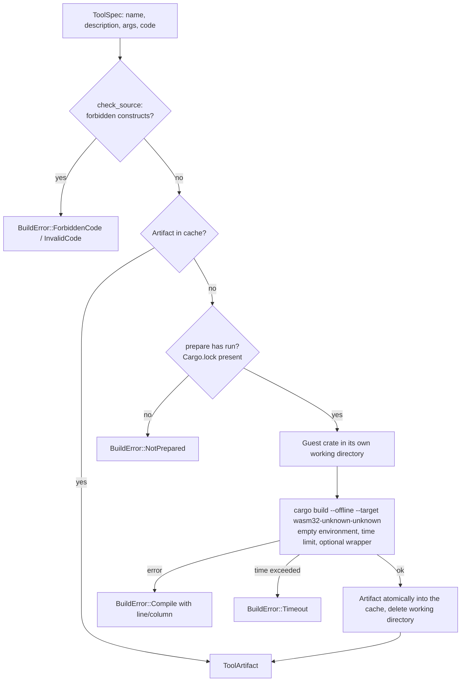
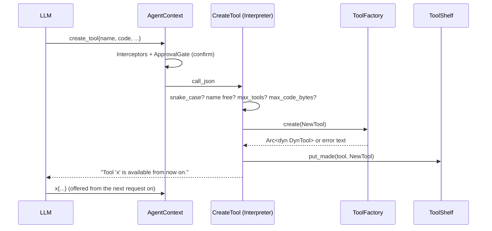
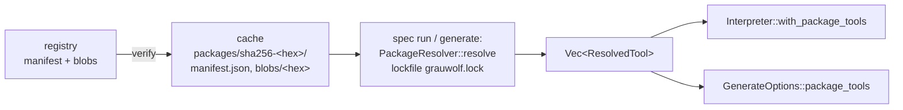

# Chapter 4: Tools from the inside

In [Chapter 3](03-rust-api.md) you used tools from Rust, and in the
[user guide](../user-guide/03-tools.md) from a spec. This chapter opens the hood: What does a tool's
contract look like, how is tool code from a spec built into WebAssembly (WASM), how does it run
in isolation, and how do tools join from outside (MCP, built-in tools, sub-agents) or even
during a run? By the end you will know where to step in when you investigate a tool problem
or connect a new tool source.

The crates involved:

| Crate | Layer | Purpose |
|---|---|---|
| `grauwolf-tools` | domain | Contract `Tool`/`DynTool`, `ToolRegistry`, `ToolShelf`, ports `ToolRuntime` and `ToolFactory` |
| `grauwolf-toolbuild` | adapters | Tool code from specs → WASM module (`ToolBuilder`) |
| `grauwolf-oci` | adapters | General OCI distribution client: registry access, credentials, image layout (section 4.10) |
| `grauwolf-toolpkg` | adapters | Tool packages on top of it: format, pack, cache, lockfile (section 4.10) |
| `grauwolf-sandbox` | adapters | `SandboxRuntime`: runs WASM modules in wasmtime |
| `grauwolf-git` | adapters | Shared libgit2 adapter: transport and token auth |
| `grauwolf-mcp`, `grauwolf-builtin-tools`, `grauwolf-tools-git`, `grauwolf-tools-web`, `grauwolf-a2a` | adapters | Tools from outside |
| `grauwolf` (facade) | apps | puts it all together: `external`, `tools_dir`, `self_tools`, `loader` |

## 4.1 The contract: `Tool` and `DynTool`

A **tool** is a function that the model can call with JSON arguments and that returns text.
`grauwolf-tools` knows two forms of it:

- **`Tool`** is typed: arguments (`Args`) and result (`Output`) are Rust types. The JSON schema
  the model gets to see is derived from `Args` via `schemars`.
- **`DynTool`** is the object-safe form ("JSON in, text out"). The registry, the sandbox,
  MCP and sub-agents work exclusively with it.

```rust
pub trait Tool: Send + Sync + 'static {
    type Args: DeserializeOwned + JsonSchema + Send;
    type Output: Serialize + Send;
    fn name(&self) -> &str;
    fn description(&self) -> &str;
    fn call(&self, args: Self::Args) -> BoxFuture<'_, Result<Self::Output, ToolError>>;
}

pub trait DynTool: Send + Sync {
    fn name(&self) -> &str;
    fn descriptor(&self) -> ToolDescriptor;
    fn call_json(&self, args: Value) -> BoxFuture<'_, Result<String, ToolError>>;
}
```

Through a blanket implementation, every `Tool` is automatically a `DynTool`: `call_json`
deserializes the arguments (error → `ToolError::InvalidArgs`), calls `call` and serializes
`Output` as JSON. That is why an `f64` result yields the text `"5.0"` and a `String` result
`"\"Hello world\""` (with quotes). The `ToolDescriptor` (from `grauwolf-prompt`) contains
`name`, `description` and `parameters` (the JSON schema).

**Tools with a state.** A tool that must remember something across calls and checkpoints (the
`todo` tools, ADR-0098) overrides two defaulted methods of `DynTool`: `state_key()` names a key in
the agent storage, and `call_with_state(args, &mut Value)` works on the stored value (`null` the
first time). The `AgentContext` runs such a call under the storage lock and keeps the changed value
only if the call succeeds; since the storage is part of every `ContextSnapshot`, the state survives
a resume. Without a context, `call_json` is all that is used.

A complete typed tool, based on `crates/domain/grauwolf-tools/tests/registry.rs`:

```rust
struct Add;

#[derive(Deserialize, JsonSchema)]
struct AddArgs { a: f64, b: f64 }

impl Tool for Add {
    type Args = AddArgs;
    type Output = f64;
    fn name(&self) -> &str { "add" }
    fn description(&self) -> &str { "Adds two numbers" }
    fn call(&self, args: AddArgs) -> BoxFuture<'_, Result<f64, ToolError>> {
        Box::pin(async move { Ok(args.a + args.b) })
    }
}
```

It is shorter with the `#[tool]` macro from `grauwolf-macros` (see [Chapter 3](03-rust-api.md));
it generates exactly this implementation from a function and takes the description from the
doc comment.

You implement `DynTool` directly when the schema is only known at runtime – that is what
sandbox, MCP and agent tools do. Example based on `crates/domain/grauwolf-interpreter/tests/tool_approval.rs`:

```rust
struct Upper;

impl DynTool for Upper {
    fn name(&self) -> &str { "upper" }
    fn descriptor(&self) -> ToolDescriptor {
        ToolDescriptor {
            name: "upper".into(),
            description: "Converts text to upper case".into(),
            parameters: json!({ "type": "object" }),
        }
    }
    fn call_json(&self, args: Value) -> BoxFuture<'_, Result<String, ToolError>> {
        let text = args["text"].as_str().unwrap_or_default().to_uppercase();
        Box::pin(async move { Ok(text) })
    }
}
```

### Errors are result text

`ToolError` has three variants: `UnknownTool`, `InvalidArgs` and `Execution`. A tool error
does **not** end the run. `AgentContext::execute_tool` (in `grauwolf-agents`, `context.rs`) turns
every error into a result text `Error: …` and returns it to the model so that it can correct
itself (F03.8, ADR-0027). The same applies to a tool that is not allowed in the active subgraph
("Error: tool 'x' is not available in this section") and to a call that an interceptor
refuses (section 4.9).

## 4.2 `ToolRegistry`: an agent's tools

The `ToolRegistry` holds all tools of an agent, sorted by name (`BTreeMap`). It is built with a
builder; `tool(..)` takes a tool by value, `shared(..)` an already shared `Arc<dyn DynTool>`,
for example from a `ToolRuntime`:

```rust
// based on crates/domain/grauwolf-tools/tests/registry.rs
let registry = ToolRegistry::builder().tool(Add).build();

let result = block_on(registry.call("add", json!({ "a": 2, "b": 3 }))).unwrap();
assert_eq!(result, "5.0");

let descriptors = registry.descriptors();
assert_eq!(descriptors[0].parameters["required"], json!(["a", "b"]));
```

Other methods:

- `descriptors()` – what is offered to the model.
- `contains(name)` – does the tool exist (also on the shelf, see below)?
- `extended(tools)` – a copy with additional tools; tools with the same name are **replaced**. The
  interpreter uses this for tools that apply to a single run only (`RunExtras.tools`, ADR-0059).

Which of these tools a node actually sees is decided not by the registry but by the
`AgentContext` via **tool scopes**: subgraphs with their own `tools` list hide all others
(ADR-0027).

### `ToolShelf`: tools that join during the run

Normally the registry is fixed at startup. For self-made tools (section 4.8) there is the
**tool shelf** `ToolShelf`: a shared, growing set (`Arc<RwLock<…>>`). Once you attach it to a
registry with `with_shelf`, `descriptors()` and `call()` also see its tools – in all clones of
the registry, for example in parallel branches:

```rust
// crates/domain/grauwolf-tools/tests/registry.rs
let shelf = grauwolf_tools::ToolShelf::default();
let registry = ToolRegistry::builder().build().with_shelf(shelf.clone());
let fork = registry.clone();

shelf.put(std::sync::Arc::new(Add)).unwrap();

assert_eq!(fork.descriptors()[0].name, "add");
// A name is assigned only once:
assert!(shelf.put(std::sync::Arc::new(Add)).is_err());
```

`is_on_shelf(name)` tells you whether a tool only joined during the run; the context needs
this for the visibility rules of self-made tools.

## 4.3 Ports for tool code: `ToolRuntime` and `ToolFactory`

A **port** is a trait in the domain that an adapter implements (see
[Chapter 1](01-architecture.md)). For tool code from specs there are two:

```rust
pub struct ToolArtifact { pub name: String, pub bytes: Vec<u8>, pub hash: String }

pub trait ToolRuntime: Send + Sync {
    fn instantiate(&self, artifact: &ToolArtifact, descriptor: ToolDescriptor)
        -> Result<Arc<dyn DynTool>, ToolError>;
}

pub struct NewTool { pub name: String, pub description: String, pub args: Value, pub code: String }

pub trait ToolFactory: Send + Sync {
    fn create(&self, tool: NewTool) -> BoxFuture<'_, Result<Arc<dyn DynTool>, String>>;
}
```

- `ToolRuntime` accepts **only finished artifacts**, never source code (ADR-0014). Building is a
  separate step (ADR-0024).
- `ToolFactory` turns source code into a tool during a run (ADR-0075). Errors are text for
  the model.

The interpreter gets the runtime via `Interpreter::with_tool_runtime` and the factory via
`with_tool_factory`. If the runtime is missing although the spec has tools, `load_with_artifacts`
reports `InterpreterError::MissingToolRuntime`; if the artifact for a tool is missing, `MissingArtifact`.

## 4.4 From spec code to a WASM module: `ToolBuilder`

In the user guide, tool code is a function body in the spec. `grauwolf-toolbuild` turns it into a
WASM module. This is how `ToolBuilder::build(&ToolSpec)` proceeds:



### The guest crate

For every tool a small `cdylib` crate is created. Its `src/lib.rs` embeds the code from the spec
in a fixed function and adds the ABI exports (abridged from `guest_source` in
`crates/adapters/grauwolf-toolbuild/src/lib.rs`):

```rust
use serde_json::Value;

fn tool(args: Value) -> Result<String, String> {
    /* `code` from the spec goes here */
}

#[unsafe(no_mangle)]
pub extern "C" fn gw_alloc(len: i32) -> i32 { /* reserve a buffer */ }

#[unsafe(no_mangle)]
pub extern "C" fn gw_call(pointer: i32, len: i32) -> i64 { /* read JSON, call tool(), write {"ok"|"err"} */ }
```

The only dependency is `serde_json`; release profile with `opt-level = "s"` and `panic = "abort"`.
Because the spec code starts on line 6 (`CODE_FIRST_LINE`), the builder maps compiler messages
to lines **in the tool code** (`CodeDiagnostic { level, message, line, column }`, F13.9). The
facade turns this into `<file>:/tools/<i>/code:<line>:<column>: error: …` (`build_error` in
`crates/apps/grauwolf-host/src/loader.rs`).

### Code of graphs: `build_code` (ADR-0102)

The code of a `code` node, an `on_code` condition and an edge `transform` is built by the same
pipeline: `AgentSpecExt::code_pieces()` lists the pieces of a spec (`CodePiece`: stable `name`,
`kind`, the JSON `pointer` of the code, `input`/`output` type names, the code and the named types
it uses), and `ToolBuilder::build_code(&piece)` (`cached_code`, `code_guest_crate` for
`--tool-sources`) runs the same check, cache, isolated build and tool ABI v1. Only the guest source
differs (`code::piece_source`): the user's function comes first, so the compiler messages map to
lines of the code as for tools; behind it come Rust structs for the spec types with hand-written
`FromJson`/`ToJson` conversions (the guest keeps its single dependency `serde_json`, no derive
macros), `type In`/`type Out`, and `fn tool(args)`, which converts the JSON, calls
`run`/`check`/`transform` and returns the result as JSON text. A panic is a trap
(`panic = "abort"`), which the sandbox reports like an exhausted fuel limit: as an error of the
call, never as `false`.

At run time, `grauwolf_agents::code::CodeModule` wraps a module loaded through `ToolRuntime`;
`code_node`, `code_condition` and `code_transform` turn it into the engine functions
(`NodeFn`, `ConditionFn`, `TransformFn`). The interpreter finds the module of a piece by the
pointer of its code (`AgentSpec::graph_pointer`), generated code calls the same functions with
modules embedded by `include_bytes!`.

### Usage

Based on the test `crates/adapters/grauwolf-toolbuild/tests/build.rs` (abridged) – build and
run directly in the sandbox:

```rust
let builder = ToolBuilder::new(cache_dir);
builder.prepare().unwrap();                     // once, with network access

let tool = ToolSpec {
    name: "add".into(),
    description: "Adds two numbers".into(),
    args: json!({ "type": "object", "properties": {
        "a": { "type": "number" }, "b": { "type": "number" } } }),
    code: r#"
        let a = args["a"].as_f64().ok_or("a is missing")?;
        let b = args["b"].as_f64().ok_or("b is missing")?;
        Ok((a + b).to_string())
    "#.into(),
};
let artifact = builder.build(&tool).unwrap();

let descriptor = ToolDescriptor {
    name: tool.name.clone(),
    description: tool.description.clone(),
    parameters: tool.args.clone(),
};
let sandboxed = SandboxRuntime::new().unwrap().instantiate(&artifact, descriptor).unwrap();
assert_eq!(block_on(sandboxed.call_json(json!({ "a": 2, "b": 3 }))).unwrap(), "5");
```

### Cache, `prepare` and offline

- **Cache:** artifacts live under `<cache>/artifacts/<hash>.wasm`. The key is a hash of the
  template version (`GUEST_TEMPLATE_VERSION = "abi-v1.0"`), tool name, code, argument schema and
  the output of `rustc --version`. If none of these changes, nothing is rebuilt. `cached(tool)`
  queries the cache without building. The CLI uses `.grauwolf/tools` by default (`--cache`).
- **Without a toolchain:** the key contains `rustc --version`. Where there is no `rustc` (the image
  of a generated service) the file `<cache>/toolchain` stands in for it; `export_toolchain(dir)`
  writes it (ADR-0115, section 4.12).
- **`prepare()`** resolves and downloads the dependencies (with network access) before any foreign
  code is involved, and writes a shared `<cache>/Cargo.lock`. It is idempotent. Every later build
  runs `--offline` with exactly this lockfile. Without `prepare()`, `build` returns `NotPrepared`.
- **A separate working directory per build**, deleted afterwards; the artifact is stored via an
  intermediate file and `rename`. This way even concurrent builds of the same tool do not
  interfere with each other (test `builds_tools_concurrently_into_a_fresh_cache`).

### Protection layers during the build (ADR-0030)

The build runs code that may come from a model. That is why there are four independent
layers:

1. **Code check** (`check_code`, F13.15): the code is split into tokens with `proc_macro2`;
   rejected are `include!`, `include_str!`, `include_bytes!`, `env!`, `option_env!`, the
   keywords `mod`, `extern`, `unsafe` and every attribute (`#[…]`) – nested ones too.
2. **Hermetic cargo invocation:** `env_clear()`, only `PATH`, `HOME`, `CARGO_HOME`, `RUSTUP_HOME`,
   `RUSTUP_TOOLCHAIN` are passed through; `--offline`.
3. **Time limit:** `with_timeout(Duration)`, default `DEFAULT_BUILD_TIMEOUT` = 300 s. cargo runs in
   its own process group, which is terminated completely when the limit is exceeded (`BuildError::Timeout`).
4. **Optional wrapper:** `with_wrapper(vec!["bwrap".into(), …])` puts a command in front of cargo
   (e.g. `bwrap …` or `docker run --network none …`). In the CLI: `--build-wrapper`, given once
   per part. Recommended for services with LLM-generated specs.

If the toolchain is missing, you get `BuildError::ToolchainMissing` with a hint. For the tests the
target must be installed: `rustup target add wasm32-unknown-unknown` (see
[Chapter 2](02-development-setup.md)).

## 4.5 Tool ABI v1 (ADR-0029)

The **ABI** (application binary interface) defines how host and WASM module exchange data.
Version 1 is deliberately minimal: a **core WASM module** for `wasm32-unknown-unknown` **without imports**.

| Export | Signature | Meaning |
|---|---|---|
| `memory` | – | the module's linear memory |
| `gw_alloc` | `(len: i32) -> i32` | reserves `len` bytes for the input, returns the pointer |
| `gw_call` | `(ptr: i32, len: i32) -> i64` | runs the tool; result `(ptr << 32) \| len` |

Flow of a call: the host serializes the arguments as UTF-8 JSON → `gw_alloc(len)` → writes
the bytes into memory → `gw_call(ptr, len)` → reads, at the returned location, a JSON
`{"ok": "<text for the LLM>"}` or `{"err": "<error>"}`.

Because there are no imports, tool code has **no file system, no network, no clock and no
randomness** – by construction. Tools with capabilities (e.g. HTTP) would need an ABI v2 with
WASI components; the `ToolRuntime` port would stay the same.

A minimal module following ABI v1, written directly as WAT (the WASM text format), from
`crates/adapters/grauwolf-sandbox/tests/abi.rs`:

```wat
(module
  (memory (export "memory") 1)
  (data (i32.const 1024) "{\"ok\":\"pong\"}")
  (func (export "gw_alloc") (param i32) (result i32) (i32.const 2048))
  (func (export "gw_call") (param i32 i32) (result i64)
    (i64.or (i64.shl (i64.const 1024) (i64.const 32)) (i64.const 13))))
```

## 4.6 The sandbox: `SandboxRuntime`

`grauwolf-sandbox` implements `ToolRuntime` with wasmtime:

- `instantiate` compiles the module and **rejects every module with imports**
  (`tool '…' imports … – tool ABI v1 allows no imports (ADR-0029)`).
- Every call runs in a **fresh instance**; nothing is kept between calls.
- **Limits** (`Limits { fuel, max_memory_bytes }`): default 100,000,000 fuel (compute budget) and
  64 MiB of memory. When the fuel is used up, the tool reports `the tool's compute budget is
  exhausted (fuel limit) – probably an endless loop` – as a normal tool error, i.e. as text for the
  model.

```rust
// crates/adapters/grauwolf-sandbox/tests/abi.rs
let runtime = SandboxRuntime::with_limits(Limits { fuel: 100_000, ..Limits::default() }).unwrap();
let tool = runtime.instantiate(&artifact("loop", ENDLESS), descriptor("loop")).unwrap();

let error = block_on(tool.call_json(json!({}))).unwrap_err();
assert!(error.to_string().contains("compute budget"));
```

**Limits of a package (ADR-0124).** `ToolRuntime::instantiate_limited(artifact, descriptor,
&ToolLimits)` loads a tool whose package asks for limits (`memory_mib`, `fuel`, `time_ms` in
`grauwolf-tools.json`); the default implementation ignores them, `SandboxRuntime` applies
`Limits::stricter` – per limit the smaller of host and package, so a package can only lower them.
`Limits.time` (default `None`) is a wall-clock limit per call, built on wasmtime's epoch
interruption: the engine is created with `epoch_interruption(true)`, every store gets a deadline
(far away without a time limit), and the first time-limited tool starts a ticker thread per engine
that advances the epoch every 5 ms and ends with the engine (`EngineWeak`). An expired deadline
traps with `Trap::Interrupt` (`ran longer than its time limit (N ms)`). The interpreter loads package
tools with `instantiate_limited` and `ResolvedTool.limits`; the generator emits
`runtime.instantiate_limited(…, &grauwolf_tools::ToolLimits { … })` for package tools that have
limits (`generate_lib_limited`) and leaves the rest of the generated code as it was.

Note: the sandbox runs the call synchronously; the future is already complete when it
is returned. `grauwolf-sandbox` has its own `rust-version` 1.97 because wasmtime requires it
(the rest of the workspace stays at 1.85).

## 4.7 Tools from outside

Everything that is not built from spec code arrives from outside as a finished `DynTool` and is
passed in with `Interpreter::with_tools(Vec<Arc<dyn DynTool>>)`. Of these, only the names the
spec declares are offered – `AgentSpec::external_tools()` lists them (MCP tools including resource
tools, the search tool from `knowledge`, memory tools, `agent_tools`, `builtin_tools`). If one is
missing, loading fails with `InterpreterError::MissingExternalTool`.

### One namespace, one table of built-in groups (ADR-0117)

All tools of an agent share one namespace (ADR-0025). `grauwolf-spec-model` lists it:
`AgentSpec::tool_namespace()` returns a `ToolNamespace` with one `ToolEntry { name, origin,
pointer }` per tool – `ToolOrigin` is `Own`, `Mcp`, `McpResource`, `Knowledge`, `Memory`,
`Builtin`, `Skill`, `SubAgent`, `Package`, `SelfBuild` or `CodePiece`, `pointer` is the JSON pointer
of the declaring place – in declaration order. Queries: `entries()`, `names()`, `is_taken`,
`names_except_origin`, `names_except_pointer` and `duplicates()` (every name an earlier entry
already has, as `ToolCollision { later, earlier }`). Code pieces need the graph catalogs, so the
caller adds them with `push` (the spec checks do); packages without `tools` only have names after
resolving and stay a resolve-time check. `external_tools()` is the namespace filtered to the
external origins.

Everything that asks "is this name taken" uses it: the spec checks call one rule
(`Rules::check_tool_collisions`) that reports `DuplicateToolName { name, other_origin,
other_pointer }` at the later declaration, `tools_of` in `grauwolf-toolpkg` takes the names of
everything but the package tools from it, and so does the tools directory of `provisioning`
(`tools_dir::taken_names`). A new tool source is a new `ToolOrigin` and one block in
`ToolNamespace::of`.

The built-in tool groups are one table, `BUILTIN_GROUPS`: a `BuiltinGroupInfo { group, tools,
section, needs_root }` per `BuiltinGroup`. The spec checks (known tools, required section, `root`),
the host (`builtin::build` loops over `BuiltinToolsSpec::groups()` and matches every group) and the
generator read it. Cargo features are not part of the table (ADR-0016): the generator keeps its
own `group_feature` mapping, the host its `cfg`-gated builders, both exhaustive over
`BuiltinGroup`. A new group is a row, a `BuiltinGroup` variant, an arm in the host's `build` and an
arm in the generator's `group_feature`; the compiler finds the places.

`grauwolf::provisioning` provides them (ADR-0050, ADR-0114) – for the loader, the CLI, the server
and generated crates alike: `ProvisionedAgent::new(&spec, base_dir, options)` starts the MCP
servers, indexes the knowledge, opens the memory, builds the built-in groups and the skills and
asks the supplier for the sub-agents, and `agent.tools_for(user)` returns the resulting tools (see
[Provisioning](03-rust-api.md#provisioning-everything-a-run-needs)). The per-kind constructors
behind it are private building blocks of the host.

**MCP** (`grauwolf-mcp`, ADR-0036/0051): `McpClient::spawn(command, args)` starts a server as a
process (stdio), `McpClient::connect_http(url, headers)` connects via Streamable HTTP and
`McpClient::connect_sse(url, headers)` via the older HTTP+SSE transport (ADR-0112).
`Arc<McpClient>::tools()` returns all server tools as `DynTool`, `resource_tools(prefix)` the
two tools `<prefix>_list_resources` and `<prefix>_read_resource`. Provisioning
takes only the tools declared in the spec; the server lives as long as its tools live.

```rust
// based on crates/adapters/grauwolf-mcp/tests/stdio.rs
let client = McpClient::spawn("python3", &[script.to_str().unwrap().to_owned()]).await.unwrap();
assert_eq!(client.call_tool("upper", json!({ "text": "hello" })).await.unwrap(), "HELLO");
```

**Built-in tools** (`grauwolf-builtin-tools`, ADR-0046): `FileTools::new(root)?.tools(names)`
returns `read_file`, `list_directory`, `write_file`, `edit_file`, `search_files`, which only work
below the root. `UserTools::new(io).tools(names)` returns `say_to_user` and `ask_user` via the
`UserIo` port (`say`, `ask`); `ConsoleUserIo` uses stderr/stdin. Your own front ends (web, chat)
implement `UserIo` and pass it through with `AgentLoader::with_user_io`.

**Sub-agents** (`agent_tools`, ADR-0040/0055): a local sub-agent becomes a tool with
`Arc<InterpretedAgent>::into_tool(name, description)`, a remote one via A2A with
`Arc<A2aClient>::tool(name, description)`. Which sub-agents there are is decided by the prepared
agent tree ([section 4.12](#412-the-prepared-agent-tree-adr-0115)); `AgentLoader` in
`crates/apps/grauwolf-host/src/loader.rs` loads each of its nodes once; details on A2A in
[Chapter 8](08-server-and-protocols.md).

## 4.8 Tools at runtime: tools directory and self-made tools

### `ToolsDir` (ADR-0074)

A **tools directory** (`tools_dir` in the spec) is re-read before every run. `ToolsDir::load`
reads all `*.json` files (not recursively, sorted), resolves `code_file`, checks the snake_case name,
builds with the `ToolBuilder` (cache!) and instantiates in the sandbox. Unusable files do not end
anything; they end up in `skipped` with a reason:

```rust
// based on crates/apps/grauwolf-host/tests/tools_dir.rs (abridged)
let tools = ToolsDir::new(&dir, ToolBuilder::new(cache), vec!["add".to_owned()]).unwrap();

let loaded = tools.load().await;   // LoadedTools { tools, skipped }

let names: Vec<&str> = loaded.tools.iter().map(|tool| tool.name()).collect();
assert_eq!(names, ["upper"]);      // broken.json, taken.json and a file with invalid JSON → skipped
```

The third parameter (`taken`) contains names the directory must not override – the CLI passes
the spec tools and `external_tools()`. The loaded tools go into this one run only, via
`RunExtras.tools`. Important: `ToolsDir` is loaded by the **CLI** (and, via `ServiceOptions.run_tools`,
by the server), not by `AgentLoader::load`. If you use the library directly, you call
`ToolsDir::load` yourself and pass the result in `RunExtras`.

### Self-made tools (ADR-0075)

With `self_tools` in the spec, the agent gets the tool `create_tool { name, description, args,
code }`. How the pieces interact:



- `CreateTool` (`crates/domain/grauwolf-interpreter/src/self_tools.rs`) checks the arguments and
  puts the factory's result on the run's `ToolShelf`. Every run gets a fresh shelf
  (`Interpreter::equip`). If the model writes the whole function `fn tool(...)` instead of just the
  body, `as_body` appends the call `tool(args)`.
- `BuildingToolFactory` (`crates/apps/grauwolf-host/src/self_tools.rs`) is the real factory: build with
  `ToolBuilder` in `tokio::task::spawn_blocking`, instance in the sandbox; with `with_save_dir(dir)`
  it writes `<name>.json` and `<name>.rs` into the tools directory. So it needs a
  tokio runtime.
- Without a factory, the interpreter rejects a spec with `self_tools` (`MissingToolFactory`).

For tests without a compiler, a fake factory is enough
(`crates/domain/grauwolf-interpreter/tests/self_tools.rs`):

```rust
struct FakeFactory;

impl ToolFactory for FakeFactory {
    fn create(&self, tool: NewTool) -> BoxFuture<'_, Result<Arc<dyn DynTool>, String>> {
        Box::pin(async move { Ok(Arc::new(Echo(tool)) as Arc<dyn DynTool>) })
    }
}

let agent = Interpreter::new(executor)
    .with_tool_factory(Arc::new(FakeFactory))
    .load(&spec)?;
```

The real factory reports compile errors as text with a position, e.g.
`tool '…' does not compile:` followed by `line 1, column 14: error: …` (test `builds_working_code_and_reports_compile_errors_as_text` in
`crates/apps/grauwolf-host/tests/self_tools.rs`). Where building is allowed (`enabled`, `self_tools` per
subgraph) is described in the [user guide, Chapter 10](../user-guide/10-self-made-tools.md).

## 4.9 Approvals: `ApprovalGate`

Some tools should only run after consent (ADR-0061). The mechanism consists of three parts:

1. `Interpreter::with_tool_approval(["upper"])` (or `AgentLoader::with_tool_approval`) makes tools
   require approval. With `self_tools.confirm` (the default), `create_tool` is added automatically.
2. The interpreter then installs an internal `ApprovalGate` in every run – an
   `Interceptor` whose `approve_tool_call` asks the run's **approver**. Without an approver it
   refuses: `tool 'upper' needs an approval that nobody can give here`.
3. You pass the approver (`ToolApprover`) per run in `RunExtras.approver`:

```rust
// based on crates/domain/grauwolf-interpreter/tests/tool_approval.rs (abridged)
let approver: ToolApprover = Arc::new(move |call| {
    let decision = if call.args["text"] == "hello" {
        ToolDecision::Proceed
    } else {
        ToolDecision::Deny("approval denied".into())
    };
    Box::pin(async move { decision })
});

let output = agent
    .run_with(json!("Say it out loud"), RunExtras { approver: Some(approver), ..RunExtras::default() })
    .await?;
```

`ToolApprover` is `Arc<dyn Fn(&ToolCall) -> BoxFuture<'static, ToolDecision> + Send + Sync>` – so
the approver may wait, for example for a human. A refusal (`Deny(text)`) goes to the model as the
tool result. Order in `execute_tool`: first all `before_tool_call`, then all
`approve_tool_call`; the first `Deny` wins. The CLI asks on the console (`console_approver`),
the server via SSE ([Chapter 8](08-server-and-protocols.md)). Sub-agents loaded by `AgentLoader`
have no approver and therefore refuse tools that require approval.

## 4.10 Tool packages from registries (ADR-0107)

A tool package is a set of ready-built tools shared through an OCI registry. Three crates share
the work, along the layer rules:

- `grauwolf-tools` (domain) has the **format**: `PackageManifest` is `grauwolf-tools.json` (format
  version, name, version, `abi: 1`, per tool name, description, `args` and the file name of its
  module). `from_json` validates (`PackageError`: unknown format or ABI version, no tools, names,
  module names that are not plain file names). `ResolvedTool` is what the rest of the system gets:
  definition plus verified `ToolArtifact`.
- `grauwolf-spec` (domain) has `tool_packages` (`ToolPackageSpec`) and the reference syntax
  (`OciReference::parse`). Validation never needs the network.
- `grauwolf-oci` (adapter) is the general OCI client (registry access, credentials, image layout); `grauwolf-toolpkg` (adapter) adds the package format, cache, lockfile and resolution on top of it. `grauwolf-git` (adapter) is the shared libgit2 adapter (own smart-HTTP transport with token auth, `fetch_files`: one commit into a scratch bare repository, files read from its tree); `grauwolf-toolpkg` and `grauwolf-tools-git` build on it.



**Package as OCI artifact:** manifest with `artifactType` `application/vnd.grauwolf.tools.v1`,
config blob = the package JSON (`…tools.config.v1+json`), one layer per module
(`…tools.module.v1+wasm`, annotation `org.opencontainers.image.title` = file name), optionally a
source layer (`…tools.source.v1.tar+gzip`). OCI image manifests and (deprecated) artifact
manifests are accepted.

**Client:** `RegistryClient` is an own small client over reqwest (about 350 lines) instead of the
`oci-client` crate. The decision (stage 1, ADR-0107): `oci-client` 0.18 does build against reqwest
0.13, but it brings a second major version of `sha2`, `oci-spec`, `chrono`, `olpc-cjson` and more,
and we need exact control over what is a trusted answer (digest checks, media types, token flow,
plain http only for local registries). The client does `GET /v2/<repo>/manifests/<ref>` and
`GET /v2/<repo>/blobs/<digest>`; on `401` it follows `WWW-Authenticate: Bearer realm=…,service=…,
scope=…` to the token endpoint (anonymous or with the basic credentials of
`GRAUWOLF_REGISTRY_AUTH` or the Docker configuration), keeps the token and retries once; a bare
bearer token in the credentials is sent directly. Every manifest and blob is checked against its digest (and the
`Docker-Content-Digest` header) before it is used.

**Cache and lock:** `PackageCache` stores the manifest and the blobs under
`<tool cache>/packages/sha256-<hex>/`, written atomically (temporary folder, rename), and verifies
everything again on every load; a damaged entry is an error. `PackageResolver::resolve` looks up
each `oci` reference *as written* in `grauwolf.lock`: a locked entry is fetched by digest (from the
cache without any request), a missing one is resolved through the registry and recorded, entries no
longer in the spec are dropped. `with_locked(true)` turns every change into an error before any
request. The module hashes in the lock are compared with the package on every resolve.

**Wiring:** `grauwolf::packages::resolve_tools` is the one entry point (the facade has the Cargo
feature `packages`). `AgentLoader` calls it once per load, `spec build` and `spec generate` call it
in the CLI. The interpreter instantiates the tools through the tool runtime like spec tools but
offers *all* of them (they are not part of `external_tools()`, because the names of a package
without `tools` are only known after resolving). The generator gets the tools in
`GenerateOptions::package_tools` and works on a copy of the spec in which they are tools without
code, so the crate embeds them (`include_bytes!`) and knows no registry; the image build stays
offline.

**Credentials:** `RegistryAuth::credential(registry)` is async and fallible and is only called when
a `401` challenge arrives (or for a static bearer token). Sources in this order:
`GRAUWOLF_REGISTRY_AUTH`, then `DockerConfig` (`docker.rs`; `RegistryAuth::from_env` loads
`default_config_path()`, i.e. `$DOCKER_CONFIG/config.json` or `~/.docker/config.json`):
`credHelpers.<registry>`, `credsStore`, then `auths` (`auth` as base64, `identitytoken`).
Registry names are normalized like Docker (`docker.io` ↔ `https://index.docker.io/v1/`). A helper
is `docker-credential-<name> get` with the registry on stdin, searched in `PATH` (a parameter of
`RegistryAuth::with_docker_config(path, helper_dirs)`, so tests never touch the process
environment), with a 20 s timeout and on a blocking thread; its output is parsed and never put
into an error. Tests use a temporary config and a fake helper script in a temporary directory.

**Pack and push:** `grauwolf_toolpkg::setup::pack_folder` (re-exported as `grauwolf::packages::pack_folder`) reads `grauwolf-tools.json`
(`PackageManifest::from_source_json`) and `src/<tool>.rs`, builds each tool with `ToolBuilder` and
hands manifest, modules and the optional source layer to `PackedPackage::new` in `grauwolf-toolpkg`.
`PackedPackage` holds the manifest bytes, its digest and the blobs by digest; `write_layout` and
`read_layout` (digests verified) map it to an OCI image layout directory. The source layer comes
from `source_archive`: a ustar archive with fixed mtime, uid and gid in a gzip stream of stored
deflate blocks, written by hand (no `tar`/`flate2`), so the same folder gives the same digests.
`RegistryClient::push` (in `grauwolf-oci`, taking the `OciImage` that `PackedPackage` derefs to) sends `HEAD` per blob, monolithic `POST` + `PUT ?digest=` uploads and the
manifest `PUT` (scope `repository:<repo>:push,pull`) and refuses an upload `Location` on another
host. `TestRegistry` implements these endpoints with an optional token challenge; the example
`serve_empty_registry` (an example of `grauwolf-oci`) serves an empty one for live checks.

**Testing:** `grauwolf_toolpkg::testing::TestRegistry` (feature `test-registry`, which forwards to
`grauwolf-oci`; it wraps `grauwolf_oci::testing::TestRegistry`) is an in-memory
registry on 127.0.0.1 with the subset of the API above, an optional token challenge and
`TestPackage` to store packages; `PONG_MODULE` is a tiny WAT module of ABI v1 that the sandbox
accepts as a module. The CLI tests (`crates/apps/grauwolf-cli/tests/tool_packages.rs`) run the
whole path from the outside against it.

### Git sources (ADR-0107 stage 3)

An entry `{ "git", "path"?, "rev" | "tag" | "branch" }` is a `GitSource` (`grauwolf-spec-model`,
`GitSource::from_entry`; `lock_key()` is the key `git+<url>[//<path>]@<rev | tag:<t> | branch:<b>`).
`PackageResolver::with_git(token, builder)` enables them. Resolution of one entry:

1. The commit is known from the lock, or from a full 40-hex `rev`: look up
   `<cache>/packages/git-<commit>[-<16 hex of sha256(path)>]/` (same verified format as an OCI
   entry, `PackageCache::load_git`); a hit needs no network and no toolchain.
2. Otherwise `grauwolf_git::fetch_files` fetches the commit (shallow first, then the branch and tag
   tips) into a bare scratch repository and returns the commit id and the files
   `grauwolf-tools.json` and `src/**` of the folder.
3. `pack_sources` (shared with `tools pack`) builds every module from the sources through the
   trait `ModuleBuilder`, which the host implements with `ToolBuilder` (adapters do not depend on
   each other); the result is stored in the cache and recorded in `Lockfile.git`
   (`LockedGit { commit, modules }`). Module hashes are compared with the lock on every resolve.

Prebuilt `.wasm` files in the folder are ignored: rebuilds are not bit-identical across toolchains,
so only the sources are trusted. Tests use `grauwolf_git::testing::TestGitServer` (smart-HTTP
upload-pack over a bare repository built with libgit2, feature `test-git-server`) and a fake
`ModuleBuilder` (`crates/adapters/grauwolf-toolpkg/tests/git.rs`); the real build is covered by the
slow test `crates/apps/grauwolf-host/tests/git_packages.rs`. `tools pull|inspect` accept a git reference (the lock key,
`GitSource::parse_reference`): `PackageResolver::pull_git` is `git_package` without a lockfile,
`inspect_git` fetches only the commit and the manifest, never builds, and checks the signature
(`GitSignatureStatus`) against the policy signers or `--allowed-signers`
(`crates/adapters/grauwolf-toolpkg/tests/git_inspect.rs`, `crates/apps/grauwolf-cli/tests/tool_packages_git.rs`). Signed commits and tags: see the next section.

### Policy and signatures (ADR-0107 stage 4)

`Policy` (`grauwolf-toolpkg`) wraps the `ToolPolicy` rules (`grauwolf-tools`, pure parsing of the
`[tool_packages]` table) with the loaded material: `Policy::load(path)` reads the policy file and
the files it names relative to itself (`oci_keys`: PEM public keys; `git_allowed_signers`: an
`AllowedSigners` of `grauwolf-git`); `Policy::new(..)` / `with_git_signers` build one in code.
`PackageResolver::with_policy(policy)` makes `pull` and `git_package` apply it first, before the
cache, the lockfile or the network; the host loads it (`GRAUWOLF_TOOL_POLICY`, else
`grauwolf.toml` next to the spec). Violations are `PackageFetchError::Policy`.

- **OCI:** `grauwolf-oci::cosign` has `SigningKey`/`PublicKey` (ECDSA P-256, PEM) and the
  cosign simple-signing payload (layer media type `application/vnd.dev.cosign.simplesigning.v1+json`,
  annotation `dev.cosignproject.cosign/signature`); the registry client reads and pushes the
  signature image under the tag `sha256-<hex>.sig`. `pull` with `require_signatures` verifies the
  signature for identity `registry/repository` and the manifest digest; the signatures live with
  the cache entry (`signatures.json`), are tried first and fetched when they do not satisfy the
  policy (not under `--locked` for an entry cached earlier). `PackageResolver::inspect` returns a
  `SignatureStatus` for `tools inspect`.
- **Git:** `grauwolf-git::sshsig` reads the SSH signature out of the raw commit (`gpgsig` header)
  or tag object and checks it against `AllowedSigners` (`verify_objects`; namespace `git`, principals
  against committer/tagger e-mail). `fetch_files` returns the raw objects in `Fetched::objects`.
  `git_package` checks them **before building**, stores them next to the cache entry
  (`commit.object`, `tag.object`), tries fresh objects, then stored ones, then (not under
  `--locked`) fetches them again with `Wanted::Tag`/`Wanted::Commit`, requiring the same commit.
  Tests: `tests/policy.rs`, `tests/signatures.rs` (OCI, test registry) and `tests/git_signatures.rs`
  (`grauwolf_git::testing::TestSigner`, `commit_files_signed`, `tag_signed`) in
  `crates/adapters/grauwolf-toolpkg`.

### The lean program `grauwolf-tools` (ADR-0118)

The tool commands (`build`, `pack`, `push`, `pull`, `inspect`, `lock`, `keygen`, `validate`, `new`,
`catalog`) live in
the app crate `grauwolf-tools-app` (library `grauwolf_tools_app`, binary `grauwolf-tools`); `grauwolf
tools …` delegates to the same `ToolsCommand` and `run_tools`, so there is one implementation. To
keep the program free of the agent runtime, everything the commands need sits below the host:

- `grauwolf-config` holds the `Env` port, `RegistryConfig` and the table `VARIABLES` (the host's
  `config` re-exports them, the table test in the host still checks it against `Config` and the
  CLI reference);
- `grauwolf_toolpkg::setup` holds the resolver constructors, `load_policy`, `lock_path`, the key
  helpers, `pack_folder`, `load_packed` and `push_package*` (`grauwolf::packages` re-exports it);
- `grauwolf_toolpkg::tree_lock::lock_tree` locks the tool packages and git skills of every node of
  an agent tree into one `grauwolf.lock`. `AgentTree::resolve` (`grauwolf-agent-tree`) calls it after its read
  phase and applies the result (localised skill directories); `grauwolf-tools lock` reads the tree
  with the same `AgentTree::read` and calls the same function. The one check it skips is the
  provider check (`ReadOptions::providers`, `None`: the program runs no agents); `grauwolf tools
  lock` passes a locker over the host's tree with the providers, so output and lockfile are the
  same in both programs (test `grauwolf-cli/tests/lock_equality.rs`).

`validate <folder>` (`validate::check_folder`) reads the manifest as `pack` does and runs
`grauwolf_toolbuild::guest_crate` on every `src/<tool>.rs` (forbidden constructs, F13.15) without a
toolchain. `xtask check-arch` forbids dependencies of the program on the host, server, CLI and
facade; `tests/workspace_architecture.rs` keeps its closure of normal dependencies at most 75% of
the CLI's (`arch::normal_dependency_count`; measured 61%, a host dependency would be about 98%).
Tests: `crates/apps/grauwolf-tools-app/tests/commands.rs` starts the binary for every command (the
cargo builds are `#[ignore = "slow: …"]`). Images: `docker/tools.Dockerfile` (Rust slim with the
WASM target, the program as entry point), CI job in `.github/workflows/images.yml` (pushed on tags
only, per architecture on native runners; not run locally), the builder image contains the program next to the CLI, and
`scripts/build-macos.sh --tools` builds it on a Mac.

### Package metadata and the tool catalog (ADR-0124)

**Metadata.** `PackageManifest` (grauwolf-tools) has optional `description`, `license`, `authors`,
`source` and per tool `limits` (`ToolLimits`, 0 refused) and `capabilities` (must be empty under ABI
v1: `PackageError::UnsupportedCapabilities`). All are skipped when unset, so a manifest without them
serializes – and hashes – as before. `grauwolf_toolpkg::package_annotations(&manifest, &BuildInfo)`
turns it into OCI annotations (`org.opencontainers.image.title|version|description|licenses|authors|
created|source|revision`, `vnd.grauwolf.tools.abi|built-with|rustc`); `setup::pack_folder` fills
`BuildInfo` from `SOURCE_DATE_EPOCH` (else the clock), `ToolBuilder::rustc_version()` and
`grauwolf_git::checkout_of(dir)` (remote `origin` without credentials, `HEAD` commit) and calls
`PackedPackage::with_annotations`. `Layout::parse` keeps the annotations, `Package.annotations`
carries them; packages without annotations pull as before.

**Crates of the catalog.**

| Crate | Layer | What |
|---|---|---|
| `grauwolf-tools::catalog` | domain | `CatalogIndex`, `CatalogEntry`, `CatalogTool`, `CatalogSignature`; `upsert`, `remove`, `list`, `search`, `find`, `compare_versions`; no IO, no crypto |
| `grauwolf-oci` | adapter | `RegistryClient::tags`, `repositories` (`/v2/_catalog`, `None` if not offered), `push_if` (`If-Match` / `If-None-Match`, `OciError::Conflict` on `412`); `TestRegistry::honour_conditional_writes`, `offer_catalog`, `interfere_with_next_put` |
| `grauwolf-toolpkg::catalog` | adapter | `CatalogStore` (`read`, `update`, `signature`), `catalog_entry`, `is_tool_package`, `entry_verdict`, `catalog_reference` |
| `grauwolf-tools-app::catalog`, `::new` | app | the commands `catalog …`, `push` integration, `new` with its `templates/` |

**Index format.** One OCI image manifest with `artifactType`
`application/vnd.grauwolf.catalog.v1+json`, the empty config (`application/vnd.oci.empty.v1+json`,
`{}`) and one layer of the artifact type holding the index JSON, by default at
`<registry>/grauwolf-catalog:latest`:

```json
{
  "format": 1,
  "updated": "2026-11-16T10:02:11Z",
  "entries": {
    "text-tools@1.2.0": {
      "reference": "registry.example.com/team/text-tools@sha256:5f0c…",
      "name": "text-tools", "version": "1.2.0",
      "description": "Counting and cleaning text",
      "tools": [{ "name": "count_words", "description": "Counts the words of a text",
                  "args": { "type": "object" }, "module": "count_words.wasm",
                  "digest": "sha256:9a2d…", "size": 48211,
                  "limits": { "memory_mib": 16, "time_ms": 500 }, "capabilities": [] }],
      "created": "2026-11-16T09:30:00Z", "source": "https://github.com/acme/text-tools",
      "revision": "4b1e9c…", "license": "Apache-2.0", "authors": ["Ada Lovelace <ada@example.com>"],
      "abi": 1, "built_with": "0.1.0", "rustc": "rustc 1.99.1 (58cf8f9c3 2026-10-13)",
      "signature": { "signed": true, "fingerprints": ["SHA256:Jx3k…"],
                     "signatures": [{ "payload": "{\"critical\":…}", "signature": "MEUCIQ…" }] }
    }
  }
}
```

Entries are keyed by `<name>@<version>`; the reference pins the digest (tags are not stored, so
`sync` over `1.0` and `latest` of the same manifest gives one entry). `catalog_entry` reads the
manifest, the config blob and the annotations (annotations win, the manifest fields are the
fallback); module sizes come from the layer descriptors, so modules are not downloaded. The entry
stores the package's cosign signatures themselves (payload and signature); `fingerprints` are the
writer's keys that verify one. A reader never trusts that list: `entry_verdict(policy, entry)`
applies the reader's allowlist and, under `require_signatures`, verifies the stored signatures
against the reader's `oci_keys` (identity `registry/repository`, the entry's digest). The verdict is
computed on every read and never written.

**Concurrency.** `CatalogStore::update(change, present, updated, key)`:

1. read the index and the digest of its manifest (missing: empty index, no digest);
2. apply `change`; if it reports no change (the entry is there already), stop without writing;
3. on the first write, a probe: `push_if` with an `If-Match` no manifest has. `412` = the
   registry honours conditions. Success = it ignores them (`Updated::ignores_conditions`; the
   command prints `ignores_conditions_note` once) and the probe was the write;
4. otherwise `push_if` with `If-Match: "<digest>"` (or `If-None-Match: *` for a new index); a
   `412` → start over;
5. check the write. Honouring registry: read the manifest back and compare the digest. Ignoring
   registry: wait `settle` (random 300–1000 ms, `with_settle`, env `GRAUWOLF_TOOLS_CATALOG_SETTLE_MS`
   in the app), read the index again and ask `present(&index)` – *our change* is in (entry with
   our digest, or entry gone), never a whole-index digest, since others may add to it – else start
   over;
6. at most `MAX_ATTEMPTS` (5) rounds, then an error that says the catalog kept changing.

Because `change` is applied to a freshly read index every round (add = upsert, remove = remove,
sync = replace the entries), a retry never loses another writer's entry it has seen. What remains
on registries without conditional writes is a writer that overwrites after our check;
`catalog sync` repairs that, and chapter 15 advises one writer at a time there. Tests: `grauwolf-toolpkg/tests/catalog.rs` lets the test
registry play the other writer just before a conditional and just after an unconditional `PUT`,
and checks the bound.

**Signing.** With a key (`--sign-key`, or the key of `push --sign-key`), `update` signs every index
it writes with `RegistryClient::push_signature` – the same cosign simple-signing signature as for
packages, under `sha256-<hex>.sig` in the catalog repository. `CatalogStore::signature(digest,
keys)` returns `Valid { fingerprint }`, `Invalid`, `Unsigned` or `Unchecked`; the reading commands
check it against the policy's `oci_keys` plus `--key` and refuse the whole catalog under
`require_signatures` unless it is valid.

**Where the catalog is.** `--catalog` (registry host or full reference, `catalog_reference`), else
`GRAUWOLF_TOOLS_CATALOG` (`RegistryConfig::tools_catalog`), else – for `catalog add` and `push` –
the default catalog of the package's registry. `push` adds by default (`--no-catalog`).

**`new`.** `grauwolf-tools-app/templates/` holds the files of the scaffold (`{{name}}`, `{{tool}}`,
`{{crate}}` are replaced): the manifest, the example tool, a test crate (`Cargo.toml.template`,
`tests/support/build.rs` wraps each code body in a block in `OUT_DIR`, `tests/<tool>.rs` `include!`s it as
a function body), README, `.gitignore` and the workflow for the `grauwolf-tools` image (which has
`git` since ADR-0124, for `checkout_of` and `SOURCE_DATE_EPOCH` in CI). Tests:
`grauwolf-tools-app/tests/new.rs` (the slow one packs the scaffold and runs its `cargo test
--offline`).

## 4.11 Skills (ADR-0103)

`grauwolf_builtin_tools::SkillLibrary::load(&[SkillRoot { dir, names }])` reads and checks skill
folders (`SKILL.md` with front matter, unique names, 1 MiB per file, no symlink out of the folder)
and offers `tools()` (`load_skill`, `read_skill_file`, read-only) and `prompt_block()`. The host
(`grauwolf_host::skills`) turns the `skills` section into roots – git sources through
`PackageResolver::resolve_skills` (lockfile section `skills`, cache entry
`packages/skills-<commit>…`, policy and signatures like git packages), done by the resolve phase of
the agent tree, which swaps them for the cache directories ([section 4.12](#412-the-prepared-agent-tree-adr-0115)) –
and provisioning adds the tools. Tools can extend the
system prompt through `DynTool::prompt_addition`; `ToolRegistry::prompt_addition` collects the
texts, and the interpreter and the generated code append them with `Prompt::extend_system`. The
`skill_loaded` event is emitted by tool execution after a successful call of `load_skill`.

## 4.12 The prepared agent tree (ADR-0115)

A spec and the specs of its local sub-agents form a tree. `grauwolf-agent-tree` (re-exported as
`grauwolf_host::agent_tree`, which adds `read` with the host's checks) is the one place that walks
it; `spec validate`, `spec build`, `tools lock`, the `AgentLoader` and
`spec generate --dockerfile` all use it, so they agree on what a tree is.

**Read phase** – `AgentTree::read(file, &ReadOptions)` (`read_spec(spec, base_dir, &options)` for a
root in memory; the host calls `agent_tree::read(file)` with its `read_options()`): local,
no network. Every spec is read once (`read_spec`, so `code_file` and `tool_files` are inlined) and
validated; the result is `AgentTree { nodes }`, node 0 the root. An `AgentNode` has its `spec`,
`file`, `relative` path (to the root's directory), `children` (`Child::Local { name, node }` or
`Child::Remote { name, url }`) and `companions` (`grauwolf_generator::companion_paths`, only paths
below the spec's directory). The rules: a node is identified by its canonical path, so a sub-spec
under two parents is one node (diamond); a cycle is an error naming the chain; a sub-spec that is
absolute or outside the root's directory is an error; `Child::Remote` (A2A) is a leaf; the types of
`agent` nodes are checked against the children's signatures; unknown providers and broken local
skill directories are errors – the provider check is an option (`ReadOptions::providers`: the host
passes its built-in providers, `grauwolf-tools` none), the skill directory check is on in both.
All errors come together as `<file>:<pointer>: <message>`
(`ReadErrors`). Validation never needs the network.

**Resolve phase** – `tree.resolve(&ResolveOptions { builder, locked, config, build_code,
resolve_root })` (network and lockfile) fills each node's `resolution()`: the spec with git skills
localised, the `package_tools`, the built `artifacts` (into the shared cache of the builder) and
the resolved `skills`. There is **one lockfile** next to the root (`tree.lock_path()`) and **one
policy** (the root's): each node resolves against its view of the lockfile
(`PackageResolver::resolve_in` / `resolve_skills_in` take lockfile content, the tree merges and
writes). The key format: the entries of the root keep their keys (a lockfile of a spec without
sub-agents is unchanged); the entries of any other node are `<relative spec path>#<key>`, e.g.
`agents/writer.json#git+https://host/repo.git//tools@v1`. Entries that no node claims fall into
the root's view and count as stale under `--locked`. A `grauwolf.lock` next to a sub-spec is not
used and gives a warning. A tree without packages and git skills never touches the lockfile.

**Callers.** The loader (`prepare_tree`) reads and resolves, then builds the agent of node 0 with
provisioning; the `SubAgentSupplier` of every node (`TreeSupplier`) serves its `children` from a
`OnceCell` per node, so a diamond is loaded and provisioned once and shared (one MCP server set,
one knowledge index). `AgentLoader::supply(spec, base_dir)` (used by generated code through
`for_provisioning`, which is `locked`) reads a tree from a root in memory and does not resolve the
root (`resolve_root: false`).

**Copy into an image** – `tree.copy_into(app, builder)`: per node the companions and the resolved
git skills (`skills-git/<index>`), per node but the root its spec document (code and tool files
inlined, git skills replaced), and in `app/.grauwolf/tools` the cache entries of the sub-agents:
`artifacts/<hash>.wasm`, the shared `Cargo.lock` (so `prepare()` has nothing to do), the file
`toolchain` (stands in for `rustc --version` in the cache key, section 4.4) and the package
entries (`packages/…`) their lock entries name, together with `grauwolf.lock`. The generated
service loads sub-agents from there, `--locked`, without network, toolchain or git. The tool
policy applies at image build time.

Tests: `grauwolf-agent-tree/tests/` (`read.rs`, `resolve.rs` for lockfile, policy and diamonds,
`copy.rs`, `git_skills.rs`), the host's `tests/agent_tree.rs` (its provider and skill checks, the
copy loaded offline), `tests/loader.rs` (diamond provisioned once).

## Key points

- `Tool` is the typed form, `DynTool` the object-safe one; every `Tool` is automatically a
  `DynTool`. Tool errors become result text for the model, not aborted runs.
- `ToolRegistry` holds the tools, `ToolShelf` those created only during the run; visibility is
  governed by tool scopes in the `AgentContext`.
- Spec code is built with `ToolBuilder` into a core WASM module following ABI v1: code check,
  `prepare()` + offline, time limit, optional wrapper, content-addressed cache.
- `SandboxRuntime` runs modules without imports in fresh instances with fuel and memory limits.
- Tool packages from registries and git repositories (`tool_packages`) are pulled or built by `grauwolf-toolpkg`, verified by digest or commit (and, under the tool policy, by signature), cached, pinned in `grauwolf.lock` and handed to the interpreter as `ResolvedTool`s.
- External tools (MCP, built-in, sub-agents) come in via `with_tools`; only declared ones are
  offered. `ToolsDir` and `BuildingToolFactory` provide tools at runtime.
- Built-in tools are adapters behind provisioning (`grauwolf::provisioning`): the light tools (files, key-value, to-do, think, user
  I/O) in `grauwolf-builtin-tools` (feature `builtin`), the `fetch` tool in `grauwolf-tools-web`
  (feature `fetch`), the `run_command` tool in `grauwolf-tools-command` (feature `command`, ADR-0099: kept out
  of the light crate because it is the only one that spawns processes; `tokio::process` with
  `process_group(0)`, output readers per stream with a byte cap, `SIGKILL` to the negative pid on
  timeout and after the exit so no leftover keeps the pipes open; the environment is `env_clear`ed
  and filled from `CommandConfig::env`, which the host resolves from the process environment;
  approval is not the tool's business: the interpreter adds `run_command` to the approval-required
  tools when the spec's shell mode asks for it (`CommandSpec::needs_approval`), so the
  `ApprovalGate` of ADR-0061 rejects it without an approver, the CLI's `console_approver` asks on the
  console and the service's `/approvals` asks remotely), the git tools in `grauwolf-tools-git` (feature `git`; on libgit2 (`git2`, no `git` program): blocking calls in `spawn_blocking` under a lock per
  directory; `http`/`https` remotes go through an own smart-HTTP transport on reqwest
  (`git_transport.rs`, registered once per process, settings per call in a thread-local) that
  follows no redirect – libgit2's own HTTP code crashes on some redirects – and sends the token
  only to the host of the repository URL; git2 is built without `https`, so no OpenSSL),
  Jira and Confluence in `grauwolf-atlassian` (feature `atlassian`; REST, results `HTTP <status>\n<body>`). A spec that uses the tools of a group whose feature is not compiled in is refused when the tools are built (`this build has no git tools (feature `git`)`), and the generator enables the features a spec needs for the facade of a generated crate. Credentials
  are read when the tools are built, so a missing one fails before the run (ADR-0104).
- Approvals are an interceptor (`ApprovalGate`) plus a `ToolApprover` per run.

Continue with [Chapter 5: Extending](05-extending.md).
