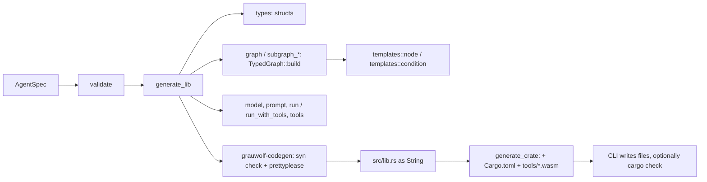

# Chapter 6: The generator

grauwolf runs a spec in two ways: the **interpreter** builds a graph from the JSON at runtime, and
the **generator** writes a standalone Rust crate from it that uses the typed builder from
`grauwolf-graph` and is therefore checked at compile time. How you invoke it as a user
(`grauwolf spec generate`) is described in the
[user guide, chapter 11](../user-guide/11-code-generation.md). This chapter is about the inside:
How is `grauwolf-generator` structured, how do new node kinds get into it, what can it not do (yet),
and how do the equivalence tests ensure that both paths do the same thing?

## 6.1 Overview

`grauwolf-generator` lives in the domain layer. It executes nothing itself and writes no files: it
returns source code as a `String` or a crate as files in memory. Writing and `cargo check` are
handled by the CLI (`crates/apps/grauwolf-cli/src/commands/spec/generate.rs`, function `run`).



Dependencies: `grauwolf-spec` (spec, constants such as `SUBGRAPH_KIND`), `grauwolf-codegen` (the
generic code builder, a fork of `carllerche/codegen`, ADR-0013) and `grauwolf-tools` (for
`ToolArtifact`, `ResolvedTool` and `ToolSourceCrate`).

## 6.2 The public API

There are two entry points (`crates/domain/grauwolf-generator/src/lib.rs`):

```rust
pub fn generate_lib(spec: &AgentSpec) -> Result<String, GeneratorError>;

pub fn generate_crate(
    spec: &AgentSpec,
    grauwolf: &GrauwolfDependency,
    artifacts: &[ToolArtifact],
) -> Result<GeneratedCrate, GeneratorError>;

pub enum GrauwolfDependency { Path(PathBuf) }   // `crates/` directory of a checkout

pub struct GeneratedCrate {
    pub files: BTreeMap<PathBuf, String>,          // Cargo.toml, src/lib.rs
    pub binary_files: BTreeMap<PathBuf, Vec<u8>>,  // tools/<name>.wasm
}
```

The simplest example is the snapshot test for the echo spec
(`crates/domain/grauwolf-generator/tests/generate.rs`):

```rust
#[test]
fn generates_a_typed_graph_library_for_the_echo_spec() {
    let source = grauwolf_generator::generate_lib(&example("echo.json")).unwrap();
    insta::assert_snapshot!(source);
}
```

From `examples/specs/echo.json` (one `llm_request` node, an edge to `finish` on
`on_assistant_message`) you get – abridged from the snapshot
`tests/snapshots/generate__generates_a_typed_graph_library_for_the_echo_spec.snap`:

```rust
//! Generated from the AgentSpec `echo` – do not edit by hand.

use std::sync::Arc;
use grauwolf_agents::AgentContext;
use grauwolf_graph::{GraphError, TypedGraph};
use grauwolf_llm::PromptExecutor;
use grauwolf_prompt::{LlModel, Prompt};
use grauwolf_agents::events::{AgentEvent, Feature};
/// Strategy graph of the agent.
pub fn graph() -> Result<TypedGraph<AgentContext, String, String>, GraphError> {
    TypedGraph::build(|g| {
        let node_call_llm = g.node("call_llm", grauwolf_agents::nodes::llm_request);
        g.edge(&g.start(), &node_call_llm);
        g.edge_when(
            &node_call_llm,
            &g.finish(),
            grauwolf_agents::conditions::on_assistant_message,
        );
    })
}
/// Model from the spec.
pub fn model() -> LlModel {
    LlModel::new("ollama", "llama3.2")
}
/// Initial prompt from the spec.
pub fn prompt() -> Prompt {
    Prompt::builder("echo").system("Repeat the user's message verbatim.").build()
}
/// Runs the agent with `input` in a fresh context.
pub async fn run(
    executor: Arc<PromptExecutor>,
    input: String,
) -> Result<String, Box<dyn std::error::Error + Send + Sync>> {
    run_observed(executor, input, Vec::new()).await
}
/// Like [`run`]; `features` see all events of the run, in the same order as with the interpreter (ADR-0084).
pub async fn run_observed(
    executor: Arc<PromptExecutor>,
    input: String,
    features: Vec<Arc<dyn Feature>>,
) -> Result<String, Box<dyn std::error::Error + Send + Sync>> {
    let mut ctx = AgentContext::new(executor, model(), prompt());
    // … install features, then one call of the run lifecycle
    //   (`grauwolf_agents::run_lifecycle::AgentRun`, ADR-0116) around graph.run_observed(..):
    //   AgentStarting, memory, knowledge, AgentCompleted or AgentFailed
}
/// The spec of this crate as JSON (for `run_app`, ADR-0084).
pub const SPEC_JSON: &str = "{\"spec_version\":1,\"name\":\"echo\", … }";
/// Runs the agent like `grauwolf spec run`: providers from the environment, external tools, sub-agents and long-term memory (shared area) with paths relative to `base_dir` (feature `app`).
#[cfg(feature = "app")]
pub async fn run_app(/* … */) { /* … */ }
// … provision(base_dir, options), run_provisioned(&provisioned, input, run_options) and
//   run_app_with(base_dir, input, provision_options, run_options), also behind the feature `app`
```

The generator does not need to know about strategy templates (`"strategy": { "kind": "react" }`,
ADR-0041): `AgentSpec::from_json` already expands them into an ordinary `graph`.

## 6.3 Structure of the generated crate

### `src/lib.rs`

`generate_lib` validates the spec (`GeneratorError::Invalid`) and then generates, in order:

| Element | When | Content |
|---|---|---|
| Structs | per entry in `types` | `pub struct` with `serde`, `schemars`, `Structured` (ADR-0022, ADR-0031) |
| `graph()` | always | `TypedGraph<AgentContext, Input, Output>` via `TypedGraph::build` |
| `subgraph_<name>()` | per subgraph | typed by the subgraph's `input`/`output` (ADR-0034) |
| `model()`, `prompt()` | always | model and system prompt from the spec |
| `run(executor, input)` | always | fresh `AgentContext`, `graph()?.run(..)` |
| `tools()` | spec has `tools` | loads the embedded WASM artifacts into `SandboxRuntime` |
| `EXTERNAL_TOOLS`, `run_with_tools(executor, input, external)`, `tools(external)` | spec has external tools | ADR-0050, see 6.5 |
| `run_with_memory(executor, input, [external,] memory)` | `auto_recall`, `auto_remember` or `remember_compressed` | recall/store via `grauwolf_agents::memory` as in the interpreter (ADR-0084) |
| `run_with_decider(executor, input, [external,] [memory,] decider)` | a decision node names `decider: system_one` | `decider: Option<Arc<dyn Decider>>`, set on the context; `run_provisioned` passes `provisioned.decider()`, which provisioning builds from `RKEV_BASE_URL` (ADR-0100) |
| `run_observed(executor, input, [external,] [memory,] [decider,] features)` | always | core of all entry points; features see the same events in the same order as with the interpreter (ADR-0084 addendum) |
| `SPEC_JSON`, `provision(base_dir, ProvisionOptions)`, `run_provisioned(&provisioned, input, RunOptions)`, `run_app(base_dir, input)`, `run_app_with(base_dir, input, provision_options, run_options)` | always (the functions only with Cargo feature `app`) | one `ProvisionedAgent::new` call sets up providers, external tools, sub-agents and memory like `spec run` (ADR-0084, ADR-0114); `run_provisioned` brings the user's memory, key-value store and sub-agents per run; the facade is an optional dependency of the crate, without default features |

Node variables are named `node_<id>` – the prefix prevents collisions with Rust keywords.
Edges become `g.edge(..)` or `g.edge_when(.., <condition>)` in declaration order, i.e. with the
same "first matching edge wins" semantics as in the interpreter.

The entire source code is checked by `grauwolf-codegen` with `syn` and formatted with
`prettyplease`. If it is not valid Rust, you get `GeneratorError::InvalidCode` – this almost always
points to a bug in a template.

### Named types

`types/<Name>` becomes a struct (`src/types.rs`). Supported are objects with fields of type
`string` (→ `String`), `integer` (→ `i64`), `number` (→ `f64`), `boolean` (→ `bool`) and
`array` with `items` (→ `Vec<_>`). Fields not listed in `required` become `Option<_>` with
`#[serde(default, skip_serializing_if = "Option::is_none")]`. Rust keywords become
raw identifiers (`r#type`). Everything else – nested objects, field names with uppercase letters,
`_`, `self` … – results in `GeneratorError::UnsupportedType { path, reason }` with a JSON pointer,
e.g. `/types/Ticket/properties/meta`.

### The service binary (ADR-0093)

`generate_crate_with(spec, dep, artifacts, &GenerateOptions { service: true })` (the plain
`generate_crate` uses the default) adds `src/main.rs`, a Cargo feature
`service = ["app", "grauwolf/service", "grauwolf/otel", "grauwolf/credentials"]` (the tracing of ADR-0123 costs about 19 more crates; the credential sources of ADR-0110 are needed because `grauwolf-k8-ops agent deploy` gives every agent a `[credentials]` configuration; a full facade has both anyway) and a `[[bin]]` named `agent` with
`required-features = ["service"]`, so that the library builds as before without the feature. The
binary name is fixed instead of the spec's name so that container images need not know it. The
whole `main` is a call of `grauwolf::service::main(SPEC_JSON, provision, run)`: `provision` calls the
generated `provision(base_dir, options)` once at start (executor, MCP servers, knowledge index,
sub-agents), and `run` converts the JSON input into the crate's input type, calls
`run_provisioned(&agent, input, options)` for each request and converts the output back (snapshots `generate__echo_service_main.snap` and
`generate__echo_service_cargo_toml.snap`). The facade wraps this as a `ServedAgent`
(chapter 8) and reads the environment (`ServiceConfig::from_env`). `GeneratedAgent` maps the server's `RunExtras` (conversation, attachments, approver, frame sink,
features) onto `RunOptions`, so `run_provisioned` keeps conversations and asks for approvals as `spec serve` does; the
test `generated_services_answer_health_and_run` in `tests/equivalence.rs` builds the binary and
checks `/health`, `/run` and A2A on the additional port against a mocked Ollama. `generated_services_authenticate_callers_by_spiffe` runs the same binary with `GRAUWOLF_SPIFFE=1` against the fake Workload API of `grauwolf-spiffe` (a Unix socket served by the test process): a mapped client reaches the mTLS port, an unmapped one gets `403`, a client without a certificate is refused and `agent_starting` carries `caller` (ADR-0109, ADR-0119). `generated_services_export_spans_and_continue_the_callers_trace` runs it with `GRAUWOLF_OTEL=1` against a wiremock that accepts `POST /v1/traces`, sends a request with a `traceparent`, ends the service with SIGTERM and looks for the trace ID, the parent span ID, `invoke_agent` and the service name in the bodies (ADR-0123; the protobuf is searched, not decoded). All three tests share one build directory and take turns. The CLI offers
this as `spec generate --service` (`--check` then checks with the feature `service`).

### `Dockerfile` for the service

`GenerateOptions { dockerfile: Some(DockerfileOptions { builder_image, expected_builder_version }) }` (implies `service`)
adds `Dockerfile` and `.dockerignore` (module `docker`; snapshots `generate__echo_dockerfile.snap`). The build stage starts `FROM <builder_image>`, copies the lock
file of the builder (`/opt/grauwolf/Cargo.lock`, so the versions are those of the pre-built
dependencies) and runs `cargo build --release --offline --features service` with
`CARGO_TARGET_DIR=/opt/grauwolf/target`. With `expected_builder_version: Some(v)` the first build step
is a guard (`RUN test "$GRAUWOLF_VERSION" = "v" || { echo …; exit 1; }`; the builder image sets the
variable): a crate is built only by the builder of the release that generated it. The CLI passes its
own version unless `--allow-builder-mismatch` is given (tests `the_dockerfile_refuses_a_builder_…`,
`the_dockerfile_has_no_guard_…`). `default_builder_image(version)` names the release's builder. The runtime stage is always
`gcr.io/distroless/cc-debian12:nonroot`; the git tools need no `git` program (libgit2 is linked
into the binary, ADR-0104). The directory `app/` of the crate becomes `/app` (working directory and
`GRAUWOLF_DATA_DIR`); the generator does not fill it, the caller copies the files the spec names
(the CLI does, chapter 11 of the user guide: `AgentTree::copy_into` copies the whole resolved agent
tree, including the tool cache and the lockfile of the sub-agents, so that they run offline;
[section 4.12](04-tools-internals.md#412-the-prepared-agent-tree-adr-0115)). The generator does not force `full_facade`; the
pre-built dependencies only fit crates generated with it, so callers set both (the CLI's
`--dockerfile` does).

### `Cargo.toml` and artifacts

`generate_crate` adds a manifest with its own `[workspace]` (so the crate is not attached to any
surrounding workspace) and path dependencies on `<crates>/domain/grauwolf-agents`,
`-graph`, `-llm`, `-prompt`. Depending on the spec, it adds: `grauwolf-planner` (for `plan`/`goap`),
`serde`/`schemars` (for `types`), `serde_json`, `grauwolf-tools` and `grauwolf-sandbox` (for tools).
`GenerateOptions { full_facade: true }` (CLI `--full-facade`) depends on the facade with its default
features instead of the list the spec needs, so that all specs share one dependency graph and a
builder image can pre-build it (ADR-0096; snapshot `generate__echo_full_facade_cargo_toml.snap`).

Tool code is **not** copied into the crate. The generator takes the prebuilt artifacts
(see [chapter 4](04-tools-internals.md)), stores them as `tools/<name>.wasm` and embeds them with
`include_bytes!`. From the snapshot `generate__calculator_lib.snap`:

```rust
pub fn tools() -> Result<ToolRegistry, Box<dyn std::error::Error + Send + Sync>> {
    let runtime = grauwolf_sandbox::SandboxRuntime::new()?;
    let registry = ToolRegistry::builder()
        .shared(
            runtime
                .instantiate(
                    &ToolArtifact {
                        name: "add".into(),
                        bytes: include_bytes!("../tools/add.wasm").to_vec(),
                        hash: String::new(),
                    },
                    ToolDescriptor { name: "add".into(), /* … */ },
                )?,
        )
        .build();
    Ok(registry)
}
```

Tools of `tool_packages` (ADR-0107) come in `GenerateOptions::package_tools` (resolved by the
caller, `grauwolf spec generate` fetches them): the generator derives a copy of the spec in which they
are tools without code and `tool_packages` is empty, so they are embedded like the others and the
crate (including `SPEC_JSON`) knows no registry. Without `package_tools`, a spec with
`tool_packages` is `GeneratorError::UnresolvedPackages`.

**Tool sources (ADR-0095).** With `GenerateOptions { tool_sources: Some(crates), .. }` the generator
embeds the same `tools/<name>.wasm` but writes no modules (and needs no artifacts): per tool
`tools/<name>/Cargo.toml` and `tools/<name>/src/lib.rs`, the manifest `tools/tools.json`
(`ToolSourcesManifest` of `grauwolf-tools`) and a standard-library-only `build.rs` that panics naming
`grauwolf tools build .` while a module is missing. The generator has no guest template of its own:
the `ToolSourceCrate`s (name, both files, SHA-256) come from `grauwolf_toolbuild::guest_crate`, the
same code `ToolBuilder::build` writes, which the CLI calls (`spec generate --tool-sources`); a tool
without an entry is `GeneratorError::MissingToolSource`. `grauwolf tools build <dir>` checks the
hashes with `source_hash` and compiles with `ToolBuilder::build_sources`. With `dockerfile`, the
`Dockerfile` copies `tools/` and runs `grauwolf tools build .` before `COPY . .`. Snapshots
`generate__tool_sources_*`; the slow test
`generated_crates_with_tool_sources_build_after_their_modules_are_built` shows the failing `cargo
build`, builds the modules and compares with the interpreter.

If an artifact is missing, `generate_crate` reports `GeneratorError::MissingArtifact`. That is why
the CLI builds the artifacts beforehand with `build_tools` from the facade – the same code as for
the interpreter.

## 6.4 Templates: how node kinds become Rust

Every node kind and every edge condition from the catalogs in `grauwolf-graph` needs a
generator template (ADR-0018, ADR-0021). Templates live in
`crates/domain/grauwolf-generator/src/templates.rs` and return a **Rust expression** as text:

```rust
pub fn node(kind: &str, params: &Value) -> Option<String>;
pub fn condition(kind: &str, params: &Value) -> Option<String>;
```

Simple kinds are a path; parameterized kinds insert type and value parameters:

```rust
"execute_tool" => "grauwolf_agents::nodes::execute_tool",
"llm_request_force_tool" => {
    return Some(format!(
        "grauwolf_agents::nodes::llm_request_force_tool({:?})",
        params.get("tool")?.as_str()?
    ));
}
"compress_history" => { /* … */
    "keep_last" => Some(format!(
        "grauwolf_agents::nodes::compress_history_keep_last::<{value}, {}>",
        params["keep"].as_u64()?
    )),
}
```

`rust_type` translates the catalogs' data types (`string`, `message`, `tool_result`, …) into Rust
types; a named type becomes the generated struct of the same name.

The **conformance test** `tests/catalog_conformance.rs` ensures that no kind is forgotten: it
iterates over all kinds of `Catalogs::builtin()`, calls the template with the kind's example
parameters (`example_params()`) and fails if one returns `None`:

```rust
#[test]
fn every_builtin_node_kind_has_a_template() {
    let catalogs = Catalogs::builtin();
    let missing: Vec<&str> = catalogs.nodes.kinds()
        .filter(|kind| {
            let params = catalogs.nodes.get(kind).unwrap().example_params();
            templates::node(kind, &params).is_none()
        })
        .collect();
    assert!(missing.is_empty(), "node kinds without a template: {missing:?}");
}
```

### Structural kinds

Six kinds (`code` among them, with the condition `on_code`) are not in the catalogs but are defined as constants in `grauwolf-spec-model` (re-exported by `grauwolf-spec`), because
they reference other parts of the spec: `subgraph`, `parallel`, `plan`, `goap` and `for_each`.
`graph_function` handles them directly:

- **`subgraph`** → `let sub_x = subgraph_<name>()?;` before the builder and `g.subgraph("x", sub_x,
  scope)` inside it. The scope is `ToolSubset::new([...])` with its own tool list or
  `SubgraphScope::new().with_model(..)` with its own model (ADR-0043).
- **`parallel`** → `grauwolf_agents::parallel::parallel::<I, O>(vec![Branch::new(..)…], Merge::…)`
  (ADR-0045).
- **`for_each`** → `grauwolf_agents::for_each::for_each::<I, O>(ForEach::new(Body::…).with_max_parallel(n)…, id)`
  with `Body::Agent(name)` or `Body::Graph { name, graph: subgraph_<name>()?.into_graph(), scope }`;
  the parameters come from `ForEachParams::parse`, like in the interpreter; `array<T>` types are
  `Vec<T>` (ADR-0101). The node kind `agent` is an ordinary catalog kind →
  `nodes::agent_step::<I, O>("name")`.
- **`code`** (ADR-0102) → `grauwolf_agents::code::code_node_typed::<I, O>(module_<piece>.clone())`;
  the module is `code_module("<piece name>", include_bytes!("../tools/<piece name>.wasm"))`, a
  function of the generated library that loads the embedded WASM module into the sandbox once per
  process. Code is **not** compiled natively into the service: the generated crate runs the same
  modules in the same sandbox as the interpreter, so behavior and isolation match. Edges with
  `on_code` or `transform` become `g.edge_with(&from, &to, Some(code_condition(..)),
  Some(code_transform(..)))`; the types of such an edge are checked by `spec validate` and when the
  target reads its input, not by the Rust compiler. The pieces come from `AgentSpecExt::code_pieces()`
  in graph order, their artifacts are passed to `generate_crate` next to the tool artifacts (name =
  piece name), and `GenerateOptions::tool_sources` needs a source crate for each of them
  (`ToolSourceKind::Code`, `Condition`, `Transform` in `tools/tools.json`).
- **`plan`** → `grauwolf_planner::plan_node(Arc<LlmPlanner>, max_iterations, id)` (ADR-0039).
- **`goap`** → `grauwolf_planner::planner_node` with `goap::fact_planner` from the parameters as JSON
  (ADR-0070).

Subgraphs are built **before** `TypedGraph::build`, because the builder closure cannot return
errors.

How to add a new node kind end to end (catalog, implementation, template, tests) is described in
[chapter 5](05-extending.md).

## 6.5 External tools in generated code (ADR-0050)

MCP tools, the search tool from `knowledge`, memory tools, sub-agents and built-in tools only
exist at runtime. Instead of rejecting them, the generator makes them explicit: it writes the
expected names into a constant and expects the caller to provide the tools (snapshot
`generate__external_tools_lib.snap`):

```rust
pub const EXTERNAL_TOOLS: &[&str] = &["list_files", "read_file"];

pub async fn run_with_tools(
    executor: Arc<PromptExecutor>,
    input: String,
    external: Vec<Arc<dyn DynTool>>,
) -> Result<String, Box<dyn std::error::Error + Send + Sync>> { /* … */ }
```

`run(executor, input)` calls `run_with_tools` without external tools and therefore fails as long
as some are expected. `tools(external)` reports a missing tool by name and only takes the declared
ones. In an application you obtain the tools by provisioning the agent:

```rust
let provisioned = ProvisionedAgent::new(&spec, base_dir, options).await?;
let external = provisioned.tools_for(None)?;
let output = my_agent::run_with_tools(executor, input, external).await?;
```

Sub-agents from `agent_tools` come through the supplier port of provisioning, which the
`AgentLoader` implements (see [chapter 3](03-rust-api.md)); generated code passes
`AgentLoader::for_provisioning(..)`, which loads with `--locked` from the tool cache in `app/.grauwolf/tools` (ADR-0115).

### Skills (ADR-0103)

Skills are external tools too: with `skills` in the spec, `EXTERNAL_TOOLS` contains `load_skill` and
`read_skill_file`, and provisioning provides them from `<base_dir>/<dir>`. The skill
folders are **not** embedded in the binary; `SPEC_JSON` names them, and an image has them under
`/app`. The system prompt block (the skill list) comes from the tools: `DynTool::prompt_addition()`
of `load_skill`. Because the tools exist only at run time, the generated `run_observed` builds the
registry first and extends the prompt (`Prompt::extend_system`) before the context is created:

```rust
let registry = tools(external)?;
let prompt = match registry.prompt_addition() {
    Some(addition) => prompt().extend_system(&addition),
    None => prompt(),
};
let mut ctx = AgentContext::new(executor, model(), prompt).with_tools(registry);
```

The interpreter does the same at load time. Git sources are resolved before generating: the CLI
(`spec generate --dockerfile`) resolves the agent tree (ADR-0115), which fetches them through the
lockfile, copies them to `app/skills-git/<n>/` (`AgentTree::copy_into`) and generates from a copy of the spec whose sources are these local
directories (the same idea as for tool packages: the generated crate has no reference to the
outside). The equivalence case `skill_writer.json` compares output and events, including
`skill_loaded`.

## 6.6 What the generator cannot do: `Unsupported`

Some things only live at the interpreter's runtime. For these, `generate_lib` immediately returns
`GeneratorError::Unsupported { feature }` with the hint to run the spec with `grauwolf spec run`:

| `feature` | Reason |
|---|---|
| `tools_dir` | the tools directory is re-read and rebuilt before every run (ADR-0074) |
| `self_tools` | needs build and sandbox in the middle of a run (ADR-0075) |

The error text is
``'<feature>' is not yet supported by the generator – run the spec with `grauwolf spec run` ``.

In addition there is `UnsupportedType` (type cannot be mapped, 6.3) and `MissingTemplate { kind }`
(a kind without a template – the conformance test should prevent this).

A test case for such a rejection (`tests/generate.rs`, `refuses_a_tools_directory`) checks with
`matches!(&error, GeneratorError::Unsupported { feature } if feature == "tools_dir")`. If you
introduce a new runtime property that the generator cannot map, add it here – a clear error is
better than a crate that behaves differently from the interpreter.

## 6.7 Equivalence tests: interpreter ⇔ generator

The core promise of the DSL is: a spec behaves the same in the interpreter and as a generated crate
(ADR-0015, ADR-0019). This is checked by `crates/domain/grauwolf-generator/tests/equivalence.rs`.

### How the test works

For each case in `CASES` (spec from `examples/specs/`, input as JSON, rules for the mock):

1. Load the spec, build the tools with `ToolBuilder` (cache under `target/toolbuild-tests`).
2. Run the interpreter with `MockLlmClient` from `grauwolf-test`, `SandboxRuntime` and built-in
   file tools if needed → expected output. If `expect` is set, the output must match it exactly
   (this proves a specific path through the graph).
3. Write the crate with `generate_crate` and put a test `tests/equivalence.rs` into it that builds
   the same mock as Rust source code (`mock_source`) and compares the output with the
   interpreter's.
4. Run `cargo test` in the generated crate; if it fails, the message shows stdout and
   stderr.

A case looks like this (shortened):

```rust
Case {
    spec: "calculator.json",
    expect: None,
    input: r#""What is 2+3?""#,
    mock: &[
        Rule::CallTool("2+3", "add", r#"{ "a": 2, "b": 3 }"#),
        Rule::Answer("5", "The result is 5."),
    ],
},
```

The rules correspond to the methods of `MockLlmClient`: `Rule::Answer(needle, text)` →
`answer_when_contains`, `Rule::CallTool(needle, tool, args)` → `call_tool_when_contains`,
`Rule::CallTools(needle, calls)` → `call_tools_when_contains`. The mock reacts to the last
input that contains `needle`; the first matching rule wins, so specific rules go first.

### Running

```sh
cargo test -p grauwolf-generator --test equivalence
```

The test needs the toolchain including `wasm32-unknown-unknown` and builds a separate crate for
every spec – this takes a while and uses **more than a gigabyte**. The crates end up under
`$CARGO_TARGET_DIR/generated-equivalence/<spec-name>/` (without `CARGO_TARGET_DIR` under
`target/generated-equivalence/`), their shared build directory under
`generated-equivalence/target/`. To save space, the test sets `CARGO_INCREMENTAL=0` and
`CARGO_PROFILE_DEV_DEBUG=line-tables-only`. Put `CARGO_TARGET_DIR` outside the workspace (see
[chapter 2](02-development-setup.md)).

### Cleaning up

The test only deletes the directory of the respective crate before rewriting it, not the shared
build directory. If space runs low, you may delete everything – it is recreated on the next run:

```sh
rm -rf "${CARGO_TARGET_DIR:-target}/generated-equivalence"
```

### Adding a new case

1. Put the spec under `examples/specs/` (it serves both as an example and as test data).
2. Add a `Case` with input and mock rules; set `expect` if the case should prove a specific path
   (e.g. first rejected, then accepted for `verified_calculator.json`).
3. If the spec needs external tools, both sides must get them: `file_tools` for the
   interpreter, `file_tools_source` as source code for the generated crate. So far the test covers
   built-in file tools (`notes_reader.json`).

## 6.8 Diagnostics from `cargo check`

After writing, `grauwolf spec generate --check` runs `cargo check --message-format=json` in the
crate and prints errors as `<spec>: <crate>/src/lib.rs:<line>:<column>: error: …`
(F13.9, `cargo_check` in the CLI). There is currently no source map that traces these positions
back to places in the spec; compile errors in **tool code**, however, already point to
`/tools/<i>/code:<line>:<column>` when the tools are built (see [chapter 4](04-tools-internals.md)).

## Key points

- `generate_lib` returns `src/lib.rs` as text, `generate_crate` the whole crate in memory;
  writing and `cargo check` are handled by the CLI.
- Generated code uses the typed builder; named types become structs, tool code comes in as
  prebuilt WASM via `include_bytes!`.
- Every catalog kind needs a template in `templates.rs`; the conformance test enforces this.
  `subgraph`, `parallel`, `plan`, `goap` and `for_each` are structural kinds with special handling.
- External tools become `EXTERNAL_TOOLS` + `run_with_tools`, automatic memory becomes
  `run_with_memory`, and with the feature `app`, `run_app` sets everything up via the facade;
  `tools_dir` and `self_tools` result in
  `Unsupported`. The core of every entry point is `run_handled(.., handles: RunHandles)`
  (`grauwolf_agents::run_handles`, ADR-0119): prices, caller budget, approvals (`AgentSpec::approval_tools()`),
  frame sink, conversation, attachments, checkpoints and resume come in one value, the same code as the
  interpreter's run options; `run_provisioned`/`resume_provisioned` build it from `RunOptions`.
- The equivalence test compares the interpreter and the generated crate against the same mock; it
  is big, and its working directory `generated-equivalence` may be deleted at any time.

Continue with [chapter 7: Events and observability](07-events-and-observability.md).
