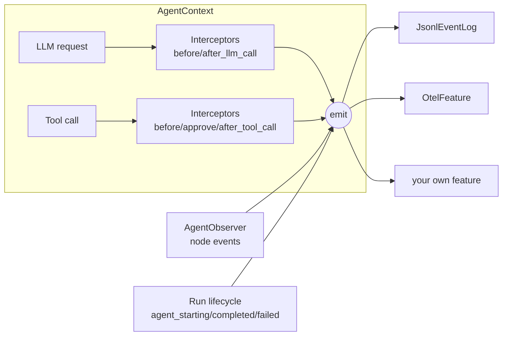
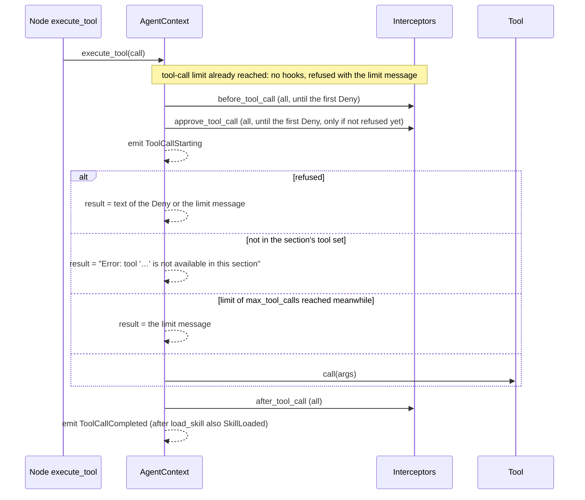

# Chapter 7: Events and observability

An agent should be traceable: Which model was asked, what did it answer, which tool ran with which
arguments, what did it cost? grauwolf answers this with **domain events** – typed events that the
agent reports during the run
([ADR-0007](../adr/0007-observability.md)). Two extension points build on them:

- **Features** only listen. They receive every event and turn it into something: a log,
  OpenTelemetry spans, metrics.
- **Interceptors** intervene. They may change prompts, answers and tool calls or refuse calls –
  up to and including approval by a human.

This chapter shows both, from simple listening to asynchronous approval, and explains how token
usage, costs and budget flow through the context. How you switch these functions on as a user via
the CLI (`--events`, `--otel`, `--prices`, `--max-cost`, `--confirm-tools`) is described in
[chapter 9 of the user guide](../user-guide/09-operations.md).



## 7.1 The event kinds

All events are variants of `AgentEvent` in `crates/domain/grauwolf-agents/src/events.rs`.
They are serializable (`#[serde(tag = "event", rename_all = "snake_case")]`); as JSON, every event
carries its name in the field `event`, e.g. `{"event":"tool_call_completed", …}`.

| Event | Fields | Reported by |
|---|---|---|
| `AgentStarting` | `input`, `caller?` (SPIFFE ID of the calling workload, ADR-0109), `trace_parent?` (`TraceParent { traceparent, tracestate? }`, the caller's W3C trace context as raw header values, ADR-0123); both skipped when `None`, old JSON without them parses | run lifecycle (`grauwolf_agents::run_lifecycle`, shared by the interpreter and generated code), at the start of every run (also when resuming) |
| `AgentCompleted` | `output`, `usage?`, `cost?` | run lifecycle, at the end – after the conversation was saved |
| `AgentFailed` | `error`, `usage?`, `cost?` | run lifecycle, on error (including budget, an output that cannot be converted, a failed conversation save); every run ends with exactly one of `AgentCompleted` / `AgentFailed` |
| `NodeStarting` / `NodeCompleted` | `path`, `input` or `output` | `AgentObserver` at every node boundary |
| `LlmCallStarting` | `model`, `tools` (names) | `AgentContext` before every LLM request |
| `LlmCallCompleted` | `answer`, `usage?`, `cost?`, `model?` | `AgentContext` after the answer |
| `LlmCallFailed` | `error` | `AgentContext` |
| `LlmFallback` | `from`, `to`, `error` | `AgentContext`, when a model fails and the request goes to the fallback model `to` ([ADR-0088](../adr/0088-model-fallbacks.md)) |
| `ToolCallStarting` / `ToolCallCompleted` | `call` or `result` | `AgentContext::execute_tool` |
| `ModerationStarting` / `ModerationCompleted` / `ModerationFailed` | `model` or `harmful`, `categories` or `error` | moderation ([ADR-0066](../adr/0066-content-moderation.md)); the checked text is never in the event |
| `DecisionStarting` / `DecisionCompleted` / `DecisionFailed` | `node` (ID of the `decide` node), `answer`, `probability?`, `confidence?`, `model?` or `error` | decision nodes ([ADR-0100](../adr/0100-decision-node.md)); the judged value is never in the event |
| `ForEachItemStarting` / `ForEachItemCompleted` / `ForEachItemFailed` | `node` (ID of the `for_each` node), `index` (from 0), `error` | `for_each` nodes, per element ([ADR-0101](../adr/0101-multi-agent-flows.md)); OpenTelemetry records them as span events of the open span |
| `MemoryRecalled` / `MemoryRemembered` / `MemoryFailed` | `facts` or `error` | automatic memory ([ADR-0069](../adr/0069-automatic-memory.md)) |
| `PlanBuilt` / `PlanStepExecuted` | `iteration`, `plan` | planner (`grauwolf-planner`) |
| `SkillLoaded` | `name` | after a successful `load_skill` call (tool execution; ADR-0103) |

A few rules you should know when evaluating events:

- `path` is the node's path, multi-part in subgraphs (`["sub", "call_llm"]`).
- Events show what was **actually** sent or executed – that is, after the interceptors.
- Tool errors are not separate events: they appear as text in the result of
  `ToolCallCompleted` and start with `Error:` ([ADR-0027](../adr/0027-interceptors-features.md)).
- `usage` and `cost` are missing from the JSON when they are unknown.
- Streamed text is **not** an event. It flows through the side channel `FrameSink`
  ([ADR-0023](../adr/0023-streaming-side-channel.md)); the event `LlmCallCompleted` contains the
  assembled answer.

## 7.2 Features: listening

### The contract

A feature is a trait with a single method:

```rust
/// Extension that is installed in the [`crate::AgentContext`] and receives all events.
pub trait Feature: Send + Sync {
    /// Processes `event`; should return quickly and not block.
    fn on_event(&self, event: &AgentEvent);
}
```

`on_event` is synchronous and is called in the middle of the run. If you export slowly (network,
database), buffer and send in the background – that is what the OpenTelemetry batch exporter does.
A feature must never abort the run; it swallows errors.

### The simplest feature: collecting events

In tests, events are usually collected in a `Mutex<Vec<_>>` (based on
`crates/domain/grauwolf-agents/tests/events.rs`):

```rust
/// Feature that collects all events.
#[derive(Default)]
struct Recorder(Mutex<Vec<AgentEvent>>);

impl Feature for Recorder {
    fn on_event(&self, event: &AgentEvent) {
        self.0.lock().unwrap().push(event.clone());
    }
}
```

It is installed directly on the context with `install`; afterwards you can check the order:

```rust
let recorder = Arc::new(Recorder::default());
let mut ctx = AgentContext::new(executor, LlModel::new("mock", "m"), Prompt::builder("calc").build())
    .with_tools(ToolRegistry::builder().tool(Add).build())
    .install(recorder.clone());

block_on(graph.run(&mut ctx, "What is 2+3?".to_string())).unwrap();
// Event names: llm_call_starting, llm_call_completed, tool_call_starting,
//              tool_call_completed, llm_call_starting, llm_call_completed
```

`graph.run` reports no node events; they only arise with an observer (`AgentObserver`),
as the interpreter uses via `run_observed`.

### Where features are attached

| Level | Method | Applies to |
|---|---|---|
| `AgentContext` | `install(feature)` | this context (and its forks) |
| `Interpreter` | `with_feature(feature)` | every run of every loaded agent |
| `InterpretedAgent::run_with` | `RunExtras { feature: Some(..), .. }` | only this run, e.g. one HTTP request |
| `AgentLoader` | `with_feature(feature)` | every loaded agent including sub-agents |
| `AgentLoader` | `with_agent_features(Arc<dyn Fn(&AgentSpec) -> Vec<Arc<dyn Feature>>>)` | separate features per agent, e.g. with the spec's name |

### `JsonlEventLog`: one line per event

The facade comes with a ready-made feature that writes every event as a JSON line
(`crates/apps/grauwolf-host/src/features.rs`):

```rust
impl<W: Write + Send> Feature for JsonlEventLog<W> {
    fn on_event(&self, event: &AgentEvent) {
        // A log must not abort the run; write errors are discarded.
        if let (Ok(line), Ok(mut out)) = (serde_json::to_string(event), self.out.lock()) {
            let _ = writeln!(out, "{line}").and_then(|()| out.flush());
        }
    }
}
```

The CLI switches it on with `--events` and writes to stderr
(`crates/apps/grauwolf-cli/src/commands/spec/loader.rs`, `observed_loader`):

```rust
if options.events {
    loader = loader.with_feature(Arc::new(JsonlEventLog::new(std::io::stderr())));
}
```

Instead of `stderr` you can pass any `Write`, e.g. a `File`.

## 7.3 OpenTelemetry

**OpenTelemetry** (OTel) is an open standard for traces: a run becomes a tree of
**spans** (time segments with attributes), displayed by a collector, Jaeger, Langfuse or Datadog.
grauwolf generates the spans from the events
([ADR-0049](../adr/0049-opentelemetry.md)) – the engine and nodes know nothing about it.

### `OtelFeature` (adapter `grauwolf-otel`)

`OtelFeature` is an ordinary `Feature` that receives a tracer and names the spans according to the
**GenAI Semantic Conventions** – the OTel conventions for AI applications:

| Span | Arises from | Attributes |
|---|---|---|
| `invoke_agent <name>` | `AgentStarting` … `AgentCompleted`/`AgentFailed` | `gen_ai.operation.name = invoke_agent`, `gen_ai.agent.name`, `grauwolf.caller` (when the call came with a SPIFFE ID), usage, `grauwolf.cost` |
| `node <path>` | `NodeStarting` … `NodeCompleted` | `grauwolf.node.path` |
| `chat <model>` | `LlmCallStarting` … `LlmCallCompleted`/`Failed` | `gen_ai.operation.name = chat`, `gen_ai.provider.name`, `gen_ai.request.model`, `grauwolf.tools`, usage, `grauwolf.cost` |
| `execute_tool <name>` | `ToolCallStarting` … `ToolCallCompleted` (via the call ID) | `gen_ai.tool.name`, `gen_ai.tool.call.id` |
| `decide <node>` | `Decision*` | `grauwolf.decision.node`, `.answer`, `.probability`, `.confidence`, `.model`; the chat span of a model-based decider is nested in it |
| `moderate <model>` | `Moderation*` | `gen_ai.operation.name = moderation`, `grauwolf.moderation.harmful`, `grauwolf.moderation.categories` |

Token usage is recorded in `gen_ai.usage.input_tokens`, `gen_ai.usage.output_tokens`,
`gen_ai.usage.cache_read.input_tokens` and `gen_ai.usage.cache_creation.input_tokens`. The model
the provider reports (`Completion.model`, event field `model`) is recorded in
`gen_ai.response.model`.
Memory and planner events become **span events** on the innermost open span
(`memory_recalled`, `plan_built`, `skill_loaded` …); `LlmFallback` becomes the span event `llm_fallback` on the
open chat span (`grauwolf.fallback.from`, `grauwolf.fallback.to`, `error.message`). Errors set the span status; a tool result that starts with
`Error:` counts as an error.

Content – answers (`gen_ai.output.messages`), tool arguments and results, plans – is only recorded
by the feature with `with_content(true)`, because it may contain personal data:

```rust
let feature = OtelFeature::new(tracer, "calculator").with_content(false);
```

Because LLM calls carry no ID, the feature assigns an end to the most recently started open call;
in parallel branches, chat spans may therefore appear swapped.

### One trace across agents (ADR-0123)

A call from one agent to another should be one trace. Two things carry the context, and neither
makes a domain crate depend on OpenTelemetry. Both use the W3C Trace Context headers `traceparent`
and `tracestate` as plain strings.

**Outbound: from the tracing feature to the HTTP client.** `Feature` has a method with a default:

```rust
fn trace_headers(&self, call: Option<&str>) -> Vec<(String, String)> { Vec::new() }
```

`OtelFeature` overrides it: it looks up the open span that makes the call – the `execute_tool` span of
the tool call `call`, or, without an ID, the innermost open decision, node or the agent span – and writes
it with the SDK's `TraceContextPropagator` (the only place in the workspace that uses the propagator;
the adapter depends on `opentelemetry_sdk` for that alone). The agent runtime asks the installed
features for the headers right before it runs the call and wraps the call in
`grauwolf_tools::with_trace_headers(headers, future)`: `ToolExecution` for a tool call of the model
(with its call ID, so parallel calls each get their own span), `AgentContext::run_agent_step` for an
`agent` node or a `for_each` element (the node's span). A2A and MCP clients read
`grauwolf_tools::current_trace_headers()` when they build a request and add the pairs: the A2A
`SendMessage` and `SendStreamingMessage`, and the `POST` requests of MCP Streamable HTTP and HTTP+SSE.
The handshake, the agent card and the tool listing happen outside a run and carry none; stdio has no
headers.

The scope belongs to the future, not to a thread or a runtime: `with_trace_headers` is a `poll_fn` that
sets a thread-local while it polls the inner future and restores it afterwards. It therefore works on
any executor (the domain crates have none of their own), holds across `.await`, and is not seen by a
task that the call spawns. Empty headers keep the enclosing scope, so a sub-agent without tracing
continues the trace of its caller's call. Without a tracing feature, nothing is sent.

A sub-agent in the same process (`agent_tools` with a `spec`) has its own `OtelFeature`, but runs
inside that scope: `AgentRun` uses the headers of the scope as `trace_parent` when no explicit one
was given, so its `invoke_agent` span is a child of the caller's `node` or `execute_tool` span.

**Inbound: from the request to the span.** The service routes read `traceparent` and `tracestate`
([chapter 8](08-server-and-protocols.md#authentication-with-spiffe)) into
`RunExtras.trace_parent`; `AgentRun::with_trace_parent` reports it as `AgentStarting.trace_parent`
(generated code: `RunOptions.trace_parent` → `RunHandles.trace_parent`). `OtelFeature` parses it with
the propagator and starts `invoke_agent` with that remote span context as the parent, in the caller's
trace. A header that does not parse, or has an all-zero ID, is ignored and the agent starts a new trace.
`grauwolf.caller` is set as before.

The tests are in `crates/adapters/grauwolf-otel/tests/spans.rs` (headers per span, parenting, malformed
headers), `crates/domain/grauwolf-tools/src/trace_headers.rs` (the scope), and
`crates/apps/grauwolf-server/tests/trace_context.rs`: a traced run against a wiremock A2A agent and a
wiremock MCP server inspects the `traceparent` that arrives; every route hands the incoming header to the
run; and a coordinator and a reviewer service, both traced into one in-memory exporter over a JWT-SVID
call, give one trace ID with `grauwolf.caller` set.

### Setting up export: `OtelTracing` (facade)

Export via OTLP/HTTP is set up by `grauwolf::otel::OtelTracing` (Cargo feature `otel`).
Without an endpoint, the standard variables `OTEL_EXPORTER_OTLP_ENDPOINT`,
`OTEL_EXPORTER_OTLP_HEADERS` and `OTEL_SERVICE_NAME` (default `grauwolf`) apply. The test
`crates/apps/grauwolf-host/tests/otel.rs` shows the whole path against a recording server:

```rust
let tracing = grauwolf::otel::OtelTracing::init(Some(&collector.uri())).unwrap();
let feature = tracing.feature("echo", false);

feature.on_event(&AgentEvent::AgentStarting { input: json!("Hello"), caller: None, trace_parent: None });
feature.on_event(&AgentEvent::AgentCompleted { output: json!("Hello"), usage: None, cost: None });
tokio::task::spawn_blocking(move || tracing.shutdown()).await.unwrap().unwrap();
```

`shutdown` sends open spans and blocks – do not call it directly in an async context. So that
every agent and sub-agent gets its own `invoke_agent` span with its own name, the CLI attaches the
feature per spec:

```rust
let (tracing, content) = (tracing.clone(), options.otel_content);
loader = loader.with_agent_features(Arc::new(move |spec: &AgentSpec| {
    vec![tracing.feature(&spec.name, content)]
}));
```

**Generated services** have no flags, so `grauwolf::service::main` reads `ServiceConfig.otel` /
`otel_content` (`GRAUWOLF_OTEL`, `GRAUWOLF_OTEL_CONTENT`, parsed by the host's `ServiceConfig`) and
starts `ServiceTracing::start(&config, &env)` before the runtime. `GeneratedAgent::traced_by` puts the
feature of the main agent into every run's options, and `provision_options_traced(env, chat_api,
tracing)` gives each sub-agent its own through `with_agent_features`. After `serve` returns (SIGTERM or
Ctrl+C) `main` calls `shutdown`, outside the runtime because it blocks. The Cargo feature `otel` of
`grauwolf-server` (forwarded by the facade's `otel`) switches this on; without it `GRAUWOLF_OTEL=1`
fails at start with `this build has no OpenTelemetry (feature `otel`)`.

The event log of `--events` is the same for a generated service: `ServiceConfig.events` (`GRAUWOLF_EVENTS`,
parsed by the host's `ServiceConfig`) makes `main` attach `stderr_event_log()` (one `JsonlEventLog` on stderr,
shared, so lines never mix) to the main agent (`GeneratedAgent::logged_by`) and, through
`provision_options_logged(env, chat_api, tracing, events)`, to every sub-agent.

## 7.4 Interceptors: intervening

### The hooks

An `Interceptor` ([ADR-0047](../adr/0047-interceptors.md)) has five hooks with
default implementations that do nothing. You only override what you need:

```rust
pub trait Interceptor: Send + Sync {
    fn before_llm_call(&self, _prompt: &mut Prompt, _tools: &mut Vec<ToolDescriptor>) {}
    fn after_llm_call(&self, _answer: &mut Message) {}
    fn before_tool_call(&self, _call: &mut ToolCall) -> ToolDecision { ToolDecision::Proceed }
    fn approve_tool_call<'a>(&'a self, _call: &'a ToolCall) -> BoxFuture<'a, ToolDecision> {
        Box::pin(std::future::ready(ToolDecision::Proceed))
    }
    fn after_tool_call(&self, _result: &mut ToolResult) {}
}
```

- `before_llm_call` changes the prompt and offered tools **only for this request**, not the
  history.
- `after_llm_call` edits the answer **before** it is appended to the history.
- `before_tool_call` may rewrite arguments or refuse with `ToolDecision::Deny(text)`;
  `text` then goes to the LLM as the tool result.
- `approve_tool_call` is the only asynchronous hook: it may wait, e.g. for a human.
- `after_tool_call` edits the result, including that of a refused call.

Multiple interceptors act in installation order; forks of parallel branches inherit them.

### Flow of a tool call

`AgentContext::execute_tool` (`crates/domain/grauwolf-agents/src/context.rs`, the steps in
`tool_execution.rs`) connects the hooks with the events in this order:



### Example: editing request and answer

Based on `crates/domain/grauwolf-agents/tests/interceptors.rs` – adds an
instruction, hides a tool and redacts a secret in the answer:

```rust
struct Guard;

impl Interceptor for Guard {
    fn before_llm_call(&self, prompt: &mut Prompt, tools: &mut Vec<ToolDescriptor>) {
        prompt.messages.insert(0, Message::system("Answer politely."));
        tools.retain(|tool| tool.name != "delete");
    }

    fn after_llm_call(&self, answer: &mut Message) {
        if let Message::Assistant(answer) = answer {
            for part in &mut answer.parts {
                if let grauwolf_prompt::AssistantPart::Text { text } = part {
                    *text = text.replace("secret123", "[removed]");
                }
            }
        }
    }
}

// on the context: ctx.intercept(Arc::new(Guard));
```

### Example: rewriting and refusing tool calls

```rust
struct ToolGuard;

impl Interceptor for ToolGuard {
    fn before_tool_call(&self, call: &mut ToolCall) -> ToolDecision {
        if call.tool == "delete" {
            return ToolDecision::Deny("Deleting is not allowed.".into());
        }
        if let Some(a) = call.args["a"].as_i64() {
            call.args["a"] = serde_json::json!(a * 2);
        }
        ToolDecision::Proceed
    }

    fn after_tool_call(&self, result: &mut ToolResult) {
        result.content = result.content.chars().take(20).collect();
    }
}
```

A real-world interceptor is `ConfirmTools` in the CLI (`--confirm-tools`): in `before_tool_call`
it asks synchronously on the console (`Run tool <name> with <args>? [y/N]`) and refuses everything
except `y` or `yes` (`j`/`ja` also work) with `The user refused the call of <name>.`

### Moderation

The text of a moderation (`AgentContext::moderate`, node `llm_moderate`) also passes through
`before_llm_call`: as a prompt with the ID `grauwolf_agents::MODERATION_PROMPT_ID` (`"moderation"`),
one user message and no tools. Afterwards the text of the user messages is checked –
so an interceptor can, for example, mask personal data before the text goes to a
moderation service, and recognize moderations by the ID. `after_llm_call` does not apply here (the
verdict is not a message); `llm_moderate` passes on the original text in the field `text`
(ADR-0047 addendum). Test: `crates/domain/grauwolf-agents/tests/moderation.rs`.

### Where interceptors are attached

`AgentContext::intercept`, `Interpreter::with_interceptor` and `AgentLoader::with_interceptor` –
analogous to features. Interceptors are code, not part of the spec.

## 7.5 Approvals: waiting asynchronously for a decision

Some tools should only run if someone agrees – for example a human in the web frontend
([ADR-0061](../adr/0061-tool-approval.md)). There are two building blocks for this:

1. `Interpreter::with_tool_approval(["upper"])` (or `AgentLoader::with_tool_approval`) makes
   tools **require approval**. Internally, the interpreter installs an `ApprovalGate` in every
   run – an interceptor that implements `approve_tool_call`.
2. A `ToolApprover` decides per run. It is passed via `RunExtras { approver, .. }`:

   ```rust
   pub type ToolApprover =
       Arc<dyn Fn(&ToolCall) -> BoxFuture<'static, ToolDecision> + Send + Sync>;
   ```

Without an approver the gate refuses (`tool '<name>' needs an approval that nobody can give
here`). Every sub-agent behaves the same way, because sub-agents have no approver. Based on
`crates/domain/grauwolf-interpreter/tests/tool_approval.rs`:

```rust
/// Approver that only allows calls with the argument `text = "hello"`.
fn approver(seen: Arc<std::sync::Mutex<Vec<String>>>) -> ToolApprover {
    Arc::new(move |call| {
        seen.lock().unwrap().push(call.tool.clone());
        let decision = if call.args["text"] == "hello" {
            ToolDecision::Proceed
        } else {
            ToolDecision::Deny("Approval denied".into())
        };
        Box::pin(async move { decision })
    })
}

let output = block_on(agent().run_with(
    json!("Say it out loud"),
    RunExtras { approver: Some(approver(Arc::clone(&seen))), ..RunExtras::default() },
))
.unwrap();
```

The HTTP service builds such an approver that reports the request to the client via SSE and waits
for its answer – see [chapter 8](08-server-and-protocols.md).

## 7.6 Usage, costs and budget

These three values arise in the `AgentContext` and become visible via events.

**Usage** ([ADR-0067](../adr/0067-token-usage.md)): adapters provide it via
`LlmClient::execute_with_usage` as `Completion { message, usage: Option<Usage> }`.
`grauwolf_prompt::Usage` has `input_tokens` (all of them, cached ones included), `output_tokens` and
optionally `cache_read_tokens`/`cache_write_tokens`. Usage deliberately is not part of the
`Message`; otherwise it would be in the history and be sent back to the provider.
`AgentContext::usage()` sums all requests of the run **including forks** of parallel branches.

**Costs** ([ADR-0071](../adr/0071-costs.md)): with a price table
(`grauwolf_prompt::Prices`, prices per million tokens under `<provider>:<id>`) the context
calculates an amount per call. It appears in `LlmCallCompleted.cost`, the total in
`AgentContext::cost()` and in `AgentCompleted`/`AgentFailed`. If the table does not know the model,
there is no amount – nothing is estimated. From
`crates/domain/grauwolf-agents/tests/usage.rs`:

```rust
let prices: grauwolf_prompt::Prices = serde_json::from_value(serde_json::json!({
    "currency": "USD",
    "models": { "mock:m": { "input": 1.0, "output": 10.0, "cache_read": 0.1 } }
}))
.unwrap();
let mut ctx = AgentContext::new(Arc::new(executor), LlModel::new("mock", "m"), prompt)
    .with_prices(Arc::new(prices))
    .install(recorder.clone());

block_on(ctx.request_llm()).unwrap();
let mut branch = ctx.fork();
block_on(branch.request_llm()).unwrap();
// ctx.cost() includes both calls, including the one in the fork
```

**Budget** ([ADR-0072](../adr/0072-run-budget.md)): `grauwolf_agents::Budget { max_tokens, max_cost,
max_tool_calls, max_prompt_tokens }` limits a run (it implements `Default`). Before **every** LLM request – normal, streaming, structured, multiple
answers, summary, fact request, moderation – the context checks the total so far.
If a limit is reached, you get `LlmError::BudgetExceeded`; the executor does not retry it,
and the run ends with `AgentFailed` including `usage`/`cost`. A single call can exceed the limit,
because its consumption is not known in advance.

`max_prompt_tokens` is checked in the same place, against the estimated size of the next request
([ADR-0087](../adr/0087-tokenizer.md)). `max_tool_calls` works differently
([ADR-0078](../adr/0078-run-limits-in-specs.md)): once the limit is reached, further tool calls
are not executed; the model gets the tool result `Error: limit of <n> tool calls per run reached –
answer now without further tools.` and the run goes on.

```rust
let mut ctx = AgentContext::new(Arc::new(executor), LlModel::new("mock", "m"), prompt)
    .with_budget(grauwolf_agents::Budget { max_tokens: Some(127), ..Default::default() });

block_on(ctx.request_llm()).unwrap();          // uses 120 + 7 = 127 tokens
let second = block_on(ctx.request_llm());      // Err(LlmError::BudgetExceeded { .. })
```

At a higher level, you set prices and budget with `Interpreter::with_prices`/`with_budget` or
`AgentLoader::with_prices`/`with_budget`. Sub-agents receive the same budget via the loader,
but as a separate one – their consumption does not count toward the calling agent.

Multiple answer variants (`execute_choices` returns `Choices { messages, usage }`) and moderation
(`Moderation.usage`, costs at the moderation model's price via `add_usage_for`) are counted too
(ADR-0067 addendum). The total, the costs and the number of tool calls are stored in the checkpoint
(`ContextSnapshot.usage`/`cost`/`tool_calls`) and continue after `restore` – so limits apply
to the whole run, even across `resume` (ADR-0077 addendum).

## Key points

- `AgentEvent` is the shared, serializable vocabulary for everything that happens in a run;
  events show the state **after** the interceptors.
- A **feature** (`on_event`) only listens – `JsonlEventLog` and `OtelFeature` are examples.
  Attach it via `install`, `with_feature`, `with_agent_features` or `RunExtras::feature`.
- An **interceptor** intervenes: edit prompt and answer, rewrite tool calls,
  refuse them or approve them asynchronously with `approve_tool_call`.
- Tools that require approval: `with_tool_approval` plus a `ToolApprover` in `RunExtras`; without
  an approver, calls are refused.
- Usage, costs and budget live in the `AgentContext`, include forks in their totals and appear in
  `LlmCallCompleted` and `AgentCompleted`/`AgentFailed`.

**Continue with [chapter 8: Server and protocols](08-server-and-protocols.md).**
