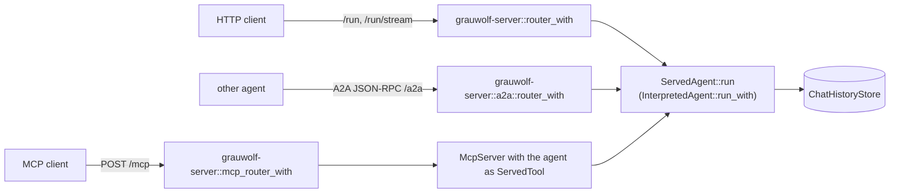
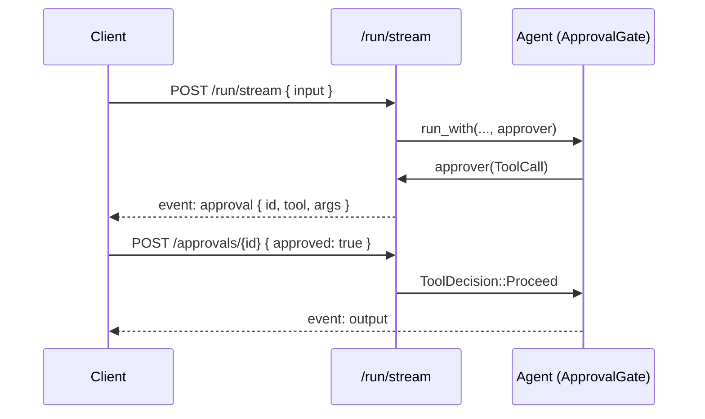

# Chapter 8: Server and protocols

So far you have started agents in your own process. In this chapter you make them reachable for
others: as an **HTTP service** for web backends and user interfaces, via **A2A** (Agent2Agent, an
open protocol that agents use to send each other tasks) for other agents, and via **MCP**
(Model Context Protocol, a protocol through which AI applications offer and use tools) for
tools such as desktop assistants. Conversely, you use the same crates to integrate remote agents and
MCP servers as tools into your agents.

How to start the service as a user (`grauwolf spec serve`, tokens, approvals) is described in the
user guide in [chapter 8](../user-guide/08-external-tools-and-agents.md) and
[chapter 9](../user-guide/09-operations.md). This chapter is about how it is structured in the code
and how you use or extend it in your own applications.

## The crates involved

| Crate | Layer | Task |
|---|---|---|
| `grauwolf-server` | apps | axum router for `/run`, `/run/stream`, `/approvals/{id}`, `/health`, A2A (`/a2a`, agent card) and `/mcp`; access control |
| `grauwolf-a2a` | adapters | A2A client: remote agents as `DynTool` (also streaming) |
| `grauwolf-mcp` | adapters | MCP client (stdio, Streamable HTTP, HTTP+SSE) and `McpServer` (tools, resources, prompts) |
| `grauwolf-cli` | apps | wires everything together in `spec serve` and `spec mcp` |

The server knows no providers and no tool build: it receives a fully loaded
`InterpretedAgent` (see [chapter 3](03-rust-api.md)) and a `ChatHistoryStore` for conversations.
Every request starts its own run with `InterpretedAgent::run_with` and a fresh context; one
loaded agent serves all requests concurrently.



## The simplest service

`grauwolf_server::router(agent, history)` returns an ordinary `axum::Router`. You bind it to a
`TcpListener` like any axum router. The following example is based on
`crates/apps/grauwolf-server/tests/server.rs`:

```rust
use std::sync::Arc;
use grauwolf_agents::memory::MemoryChatHistoryStore;
use grauwolf_interpreter::Interpreter;
use grauwolf_llm::PromptExecutor;
use grauwolf_spec::{AgentSpec, AgentSpecExt};
use grauwolf_test::MockLlmClient;

let spec = AgentSpec::from_json(&std::fs::read_to_string("examples/specs/echo.json")?)?;
let executor = PromptExecutor::builder()
    .client("ollama", Arc::new(MockLlmClient::new("Hello")))
    .build();
let agent = Interpreter::new(Arc::new(executor)).load(&spec)?;

let router =
    grauwolf_server::router(Arc::new(agent), Arc::new(MemoryChatHistoryStore::default()));
let listener = tokio::net::TcpListener::bind("127.0.0.1:0").await?;
axum::serve(listener, router).await?;
```

In an application you usually load the agent with `AgentLoader` from the facade, so that the spec's
tool code, MCP servers and sub-agents come along ([chapter 3](03-rust-api.md)).

The router knows three endpoints:

| Endpoint | Body | Response |
|---|---|---|
| `GET /health` | – | `ok` |
| `POST /run` | `{ input, conversation_id?, user_id? }` | `{ output }`, on errors status 500 with `{ error }` |
| `POST /run/stream` | like `/run` | server-sent events (see below) |

`input` is text or JSON according to the spec's input type. The test
`runs_the_agent_and_continues_conversations` shows that two calls with the same
`conversation_id` continue a conversation.

## Streaming with server-sent events

**Server-sent events** (SSE) are a simple HTTP stream in which the server sends events of the form
`event: <name>` / `data: <content>`. `/run/stream` delivers:

- `event: agent` – every `AgentEvent` of the run as JSON ([chapter 7](07-events-and-observability.md)),
- `event: text` – text deltas from the model, if the spec streams,
- `event: approval` – a pending approval (section "Approvals via the stream"),
- finally `event: output` with the output as JSON, or `event: error`.

Technically, the handler attaches three things to the run via `RunExtras`: a `Feature` that writes
every event into a `tokio::sync::mpsc` channel, a `frame_sink` for the text deltas and an
`approver`. The run itself executes in a `tokio::spawn`; the channel becomes the SSE stream. The
core in `crates/apps/grauwolf-server/src/lib.rs`:

```rust
/// Forwards the events of a run into the SSE channel.
struct Forward(mpsc::UnboundedSender<Event>);

impl Feature for Forward {
    fn on_event(&self, event: &AgentEvent) {
        if let Ok(event) = Event::default().event("agent").json_data(event) {
            let _ = self.0.send(event);
        }
    }
}
```

You can use the same pattern – one `Feature` per run via `RunExtras.feature` – if you want to route
events into your own user interface, a WebSocket connection or a queue.

## Conversations and users

With `conversation_id`, a run continues a conversation; the store is the `ChatHistoryStore` passed
in (in the CLI, a file or SQL store). With `user_id`, the conversation belongs to a user: the key is
built by `grauwolf_agents::memory::conversation_key(user, id)` – without a user it is `id`, with a
user `users/<hex(user)>/<id>` (ADR-0060). Conversation IDs from outside may only contain
`[A-Za-z0-9_-]`; invalid IDs result in `400`. This way nobody can reach another user's
conversation through a cleverly chosen ID. The test
`binds_conversations_to_their_user` shows this: `anna` and `bob` have separate conversations under
the same ID `c1`.

Without access control, the service **trusts** the `user_id` it is given. That is correct when your
own backend calls the service and authenticates the users itself; for end users who access it
directly, there are user tokens (section "Access").

## Serving any agent: `ServedAgent`

The routes do not need an `InterpretedAgent`, only the trait `ServedAgent`
([ADR-0093](../adr/0093-generated-service.md)): `input_schema()` (the schema of a named input
type, `None` for text; it decides the argument of the MCP tool) and
`run(input, extras, user) -> BoxFuture<Result<Value, String>>`. `InterpretedAgent` implements it;
a generated crate is served through `grauwolf_server::service` (re-exported as `grauwolf::service`, chapter 6). The routers take
the trait object through `router_for`, `a2a::router_for` and `mcp_router_for`; `router_with`,
`a2a::router_with` and `mcp_router_with` are thin wrappers for an `Arc<InterpretedAgent>`. An agent
may ignore handles it does not support (a generated agent has no conversation memory, for
example). `crates/apps/grauwolf-server/tests/served_agent.rs` serves a hand-written agent with
`/health`, `/run`, `/run/stream`, A2A and MCP.

## More options with `ServiceOptions`

`router_with(agent, history, options)` is the full constructor; `router` and
`router_with_user_tools` are shorthands. `ServiceOptions` has three optional fields:

| Field | Type | Effect |
|---|---|---|
| `user_tools` | `UserTools` = `Arc<dyn Fn(&str) -> Vec<Arc<dyn DynTool>>>` | runs with `user_id` get these tools; they replace the agent's tools of the same name (ADR-0059), e.g. the user's long-term memory |
| `run_tools` | `RunTools` = `Arc<dyn Fn() -> BoxFuture<'static, Vec<Arc<dyn DynTool>>>>` | is called before **every** request to `/run` and `/run/stream`, e.g. to re-read a tools directory (ADR-0074) |
| `facts` | `UserFacts` = `Arc<dyn Fn(Option<&str>) -> Arc<dyn FactMemory>>` | memory per user for automatic recall and storage (ADR-0069) |

`ServiceOptions::provisioned(agent)` fills all three from a `ProvisionedAgent` (ADR-0114);
`ServiceOptions::extras_for(user)` turns all three into the `RunExtras` of a run (`tools`,
`memory`). Since [ADR-0089](../adr/0089-protocols-complete.md), `/run`, A2A
(`a2a::router_with(.., options)`, user = owner of the task) and MCP over HTTP
(`mcp_router_with(server, agent, description, options)`, user from the token) all use it, so a
user sees the same tools and memory over every protocol. The following example from
`crates/apps/grauwolf-server/tests/server.rs` (`loads_the_run_tools_for_each_request`) provides,
on every request, the tools that are currently in a list:

```rust
let available: Arc<std::sync::Mutex<Vec<Arc<dyn DynTool>>>> = Arc::default();
let run_tools: grauwolf_server::RunTools = {
    let available = Arc::clone(&available);
    Arc::new(move || {
        let tools = available.lock().unwrap().clone();
        Box::pin(async move { tools })
    })
};
let router = grauwolf_server::router_with(
    Arc::new(agent),
    Arc::new(MemoryChatHistoryStore::default()),
    grauwolf_server::ServiceOptions {
        run_tools: Some(run_tools),
        ..Default::default()
    },
);
```

Tools per user work the same way; in the test `gives_each_run_the_tools_of_its_user` the
function builds, for every user, a tool `whoami` that states the user's name:

```rust
let router = grauwolf_server::router_with_user_tools(
    Arc::new(agent),
    Arc::new(MemoryChatHistoryStore::default()),
    Arc::new(|user: &str| vec![Arc::new(WhoAmI(user.to_owned())) as Arc<dyn DynTool>]),
);
```

## The chat API: `ChatApiOptions`

`ServiceOptions.chat_api: Some(ChatApiOptions { signature, observations })` adds two routes
([ADR-0094](../adr/0094-chat-api.md)): `POST /api/chat` – a thin layer over the same run as
`/run` (text input `{ message }` → `{ response }`, typed input is the body, typed output the
answer; `400`/`500` with `{ error }`; no conversation, no approver) – and `GET /api/signature`
→ `{ signature, observations }`, which `auth::check` lets pass without a token. `signature` is
the parsed file; `observations` is a closure that builds the object when asked, so the server
knows nothing about how it is collected.

The server crate does the collecting (`grauwolf_server::chat_api::ChatApi`, `grauwolf_server::observations`; re-exported as `grauwolf::chat_api` and `grauwolf::observations`):
`ChatApi::from_dir(base_dir, env)` reads `agent-signature.json` and `agent-names.json`;
`observations().feature_for(spec name)` is a `Feature` per agent that turns `llm_call_starting`
and `llm_call_completed.model` into `{modelId, firstSeen, lastSeen}` entries (the interpreter
installs it per spec through `AgentLoader::with_agent_features`, a generated service through
`GeneratedAgent::observed_by`, which feeds the main agent through `RunOptions.features` (the rest of `RunExtras` – conversation, attachments, approver, frame sink – is mapped onto `RunOptions` too, ADR-0119), and
`service::provision_options`, which hands a feature factory to the `ProvisionOptions` so that every
sub-agent the service loads is recorded under its own name too); the observer from `observations().mcp_tools_observer()` sees each MCP tool list, hashed by
`observations::schema_hash` (the CLI hands it to `AgentLoader::with_mcp_tools_observer`, a generated
service through `ProvisionOptions::with_mcp_tools_observer`); Ollama digests come from `OllamaClient::model_digest` when the report
is built, not during a run. `ChatApi::options()` turns it all into `ChatApiOptions`.

## Access: shared token and user tokens

The router itself performs no access control. You wrap the check around it as axum middleware:

- `with_token(router, token)` requires `Authorization: Bearer <token>` (ADR-0053),
- `with_auth(router, service_token, users)` additionally knows **user tokens** (ADR-0068).

`/health` and everything under `/.well-known/` (the A2A agent card) stay open; all other paths
respond with `401` without a valid token. The comparison runs in constant time, so that the
response time reveals nothing about the token.

The two kinds of tokens differ in whom the run belongs to:

- The **shared token** is that of a trusted backend. It may specify any `user_id`.
- A **user token** belongs to exactly one user. The service sets `user_id` itself; a
  different `user_id` in the body results in `403` – for `/run`, `/run/stream` and `/approvals/{id}`.

`Users::from_json` reads the users file `{ "<user>": "sha256:<hex>" }`. Only the SHA-256 hash is
stored; `token_hash(token)` computes it, `new_user_token()` creates a new token
(`gw_` and 128 bits of randomness). From `crates/apps/grauwolf-server/tests/users.rs`:

```rust
use grauwolf_server::Users;

const ANNA_TOKEN: &str = "gw_00112233445566778899aabbccddeeff";

let users = Users::from_json(
    &json!({ "anna": format!("sha256:{}", grauwolf_server::token_hash(ANNA_TOKEN)) })
        .to_string(),
)?;
let router = grauwolf_server::with_auth(router, Some("backend".into()), users);
```

After the check, the caller is attached to the request as an internal extension (`Caller::Service` or
`Caller::User(name)`); the handlers read it from there. Important for your own extensions:
`with_auth` puts a layer (`Router::layer`) around the routes the router has **at that point in
time**. So add your own routes beforehand with `merge`, otherwise they are unprotected.

The CLI reads the shared token from `GRAUWOLF_SERVER_TOKEN` and refuses to start on a
non-local address if there is neither a token nor a users file. TLS belongs in a reverse proxy
in front of it. Workloads can authenticate with SPIFFE instead of tokens: see
[Authentication with SPIFFE](#authentication-with-spiffe).

## Authentication with SPIFFE

Where a cluster runs SPIRE, callers can prove who they are with their workload identity instead of a token (ADR-0109). The identity internals (the port `WorkloadIdentity`/`TlsIdentity`, the Workload API client, verifiers, fakes) are in [chapter 9](09-identity-credentials-and-the-cluster-tool.md#92-workload-identity-grauwolf-spiffe); this section is about how the service and the protocol clients use it. The user's view is [chapter 9 of the user guide](../user-guide/09-operations.md#agents-calling-agents-with-spiffe).

**The layers, in order.** `with_spiffe_auth(router, service_token, users, gate)` is `with_auth` plus the SPIFFE gate (`ServiceConfig::secure` wraps the routes of both ports in it; with no gate it applies only the token rules of the section above). For each request it decides:

1. `ConnectInfo<PeerSpiffe>`: the connection came in through the mTLS listener, where the handshake has already verified the client certificate and put its SPIFFE ID in the connection info. This ID wins.
2. An `Authorization: Bearer` that looks like a JWT (three non-empty parts, not `gw_...`) is a JWT-SVID: the `SpiffeGate` has the SPIRE agent validate it for the audience (`GRAUWOLF_SPIFFE_AUDIENCE`, default the service's own ID) with `validate_jwt_svid`. Invalid is `401`, a Workload API that does not answer `503`.
3. Otherwise the token rules: user token, shared token, anonymous only where it was allowed before.

An ID from 1 or 2 goes through the `CallerMap`: a mapped ID becomes `Caller::User(user)`, so conversations, memory, approvals and tool stores follow exactly as for a user token; an ID without an entry is `403`.

**Two listeners.** `SpiffeInbound::start` (identity, callers file, accepted trust domains) is held by `ServiceConfig::spiffe_inbound`. The main port stays plain HTTP for people, the ingress, the probes and JWT-SVIDs. With `GRAUWOLF_SPIFFE=1` a `TlsListener` (an `axum::serve::Listener` in `spiffe.rs`) serves the second port, `GRAUWOLF_SPIFFE_PORT`: it accepts TCP connections, does the handshakes concurrently (10 s each, so a slow client does not block the others), requires a client certificate and yields each connection with `PeerSpiffe`. `service::routers_with_history` returns `ServiceRouters { main, mtls }`, and `serve` binds both.

**`CallerMap`** is the callers file (`GRAUWOLF_SPIFFE_USERS`): exact IDs and prefixes ending in `/*`, most specific wins. `CallerMap::watch(path, interval)` polls the resolved path, mtime and size every two seconds, so the `..data` symlink swap of a mounted ConfigMap is seen; an invalid new file is reported and the old map stays.

**A2A once per port.** The agent card names the endpoint an A2A client then sends its messages to. `routers_with_history` therefore builds the A2A router twice: the main port's card names `config.public_url()`, the mTLS port's card names `GRAUWOLF_SPIFFE_PUBLIC_URL` (default `https://localhost:<port>`). Run, MCP and the rest are built once and shared. The extra A2A port of a generated service (`A2A_PORT`) is not part of the mTLS design and stays plain.

**MCP over HTTP** is in `core`, next to `/run`, so `/mcp` sits on both ports behind the same `with_spiffe_auth` layer; `agent_mcp` reads `Caller` and `CallerSpiffe` from the request like the other handlers.

**From the request to the event.** `with_spiffe_auth` puts the ID in the request extensions as `CallerSpiffe` (never a token). The handlers (`/run`, `/run/stream`, `/api/chat`, A2A `rpc`, `agent_mcp`) copy it as text into `RunExtras.caller`; the interpreter hands it to `AgentRun::with_caller`, generated services go through the host's `RunOptions.caller`; the lifecycle reports it as `caller` in `AgentEvent::AgentStarting`, and `OtelFeature` records `grauwolf.caller` on the `invoke_agent` span.

**The client side.** `grauwolf_spiffe::ClientAuth` (`AuthMode::Mtls` or `Jwt`, plus the expected `SpiffeMatch` or the audience) is taken by `grauwolf-a2a` and `grauwolf-mcp`: `A2aClient::connect_with_auth`, `McpClient::connect_http_with_auth` and `connect_sse_with_auth`. For mTLS it gives `reqwest::ClientBuilder::use_preconfigured_tls` a `rustls::ClientConfig`; for JWT it supplies a fresh bearer per request. The host builds it from the spec in `spiffe::client_auth` (identity once per process and socket); provisioning does this for interpreted and generated agents alike.

**Error mapping.** A refused handshake used to surface as a plain connect error ("no connection ... refused or given up"), which hid the cause. `transport_error` (A2A) and `http_error` (MCP) now first ask `grauwolf_spiffe::tls_refusal(&error)`: it walks the error chain (also inside `std::io::Error`, which hides what it wraps from `source()`) for a rustls error and returns the verifier's reason, such as `the server is <id>, expected <id>`. The message is then `TLS handshake with <url> failed: <reason>; the call was not executed`, and only without a refusal does it say `no connection to <url> (refused or given up after 30 s)`. Found in the live check of ADR-0109.

**The trace context travels the same way** (ADR-0123). `InboundTrace`, an extractor, reads `traceparent` and `tracestate` of the request into `RunExtras.trace_parent`, and the A2A `rpc` handler does the same from its `HeaderMap`: `/run`, `/run/stream`, `/api/chat`, A2A and `agent_mcp` all hand it on (`ServedTool` carries it for MCP; `GeneratedAgent` maps it to `RunOptions.trace_parent`). The handlers run behind the authentication layer, so the header is read only from callers that passed it; it links spans and grants nothing, and it is never logged. The server does not parse it: a missing header is `None`, and `OtelFeature` ignores a malformed one ([chapter 7](07-events-and-observability.md#one-trace-across-agents-adr-0123)).

**Tests.** `grauwolf-server/tests/spiffe.rs` (mTLS port, `403`, JWT on the HTTP port, reload after a symlink swap), `tests/spiffe_a2a.rs` (the A2A client against the server, the TLS-refusal message) and `tests/spiffe_service.rs` (`routers_with_history`, the card per port); `grauwolf-a2a/tests/auth.rs`, `grauwolf-mcp/tests/spiffe.rs`; and in `grauwolf-generator/tests/equivalence.rs` the slow case `generated_services_authenticate_callers_by_spiffe`. All run with `TestCa` and `FakeWorkloadApi`/`FakeIdentity`, without SPIRE.

## Approvals via the stream

Some tools should only run after a human has agreed (ADR-0061). In the interpreter you make
them require approval with `Interpreter::with_tool_approval([...])` (or `AgentLoader::with_tool_approval`).
Internally this creates an `ApprovalGate` – an interceptor whose hook `approve_tool_call` asks the
run's approver ([chapter 7](07-events-and-observability.md)). The approver is a
`ToolApprover`:

```rust
// crates/domain/grauwolf-interpreter/src/approval.rs
pub type ToolApprover = Arc<dyn Fn(&ToolCall) -> BoxFuture<'static, ToolDecision> + Send + Sync>;
```

If a run has no approver (`RunExtras.approver` is `None`), the call is refused
(`tool '<name>' needs an approval that nobody can give here`); the reason goes to the LLM as the
tool result. This applies to `/run`, A2A, MCP and sub-agents – in all of these there
is no back channel to the human. Only `/run/stream` sets an approver:



The ID is 128 bits of randomness and is only valid while the run is waiting. `POST /approvals/{id}`
accepts `{ approved, reason?, user_id? }` and responds with `204`; an unknown ID or a
different user results in `404`. If no decision arrives within `DEFAULT_APPROVAL_TIMEOUT`
(5 minutes), the service refuses with `No approval given within 300 s`. The complete flow with an SSE reader is shown in
`crates/apps/grauwolf-server/tests/approvals.rs` (`asks_for_approval_in_the_stream_and_runs_the_tool_once_approved`).

If you want to obtain approvals through a different channel (chat message, ticket), write your
own `ToolApprover` and pass it to `run_with` in `RunExtras { approver: Some(...), .. }`.

## A2A server: the agent for other agents

`grauwolf_server::a2a::router(agent, history, info)` offers A2A 1.0 via JSON-RPC (ADR-0054);
`a2a::router_with(agent, history, info, options)` additionally runs every task with the
`ServiceOptions` handles of its owner (ADR-0089).
`AgentCardInfo::from_spec(&spec, base_url)` fills the **agent card** – the agent's public
self-description – from the spec's name and system prompt; `base_url` is the address at which
others reach the service. Based on `crates/apps/grauwolf-server/tests/a2a.rs`:

```rust
use grauwolf_server::a2a::AgentCardInfo;

let agent = Arc::new(Interpreter::new(Arc::new(executor)).load(&spec)?);
let listener = tokio::net::TcpListener::bind("127.0.0.1:0").await?;
let base = format!("http://{}", listener.local_addr()?);
let router = grauwolf_server::a2a::router(
    agent,
    Arc::new(MemoryChatHistoryStore::default()),
    AgentCardInfo::from_spec(&spec, &base),
);
```

The router offers:

- `GET /.well-known/agent-card.json` – name, description, interface `{base}/a2a` with
  `protocolBinding: "JSONRPC"`, `capabilities.streaming = true`, input/output format (`text/plain`
  or `application/json` for named types).
- `POST /a2a` with the methods `SendMessage` (result `{ task }` in the state
  `TASK_STATE_COMPLETED` or `TASK_STATE_FAILED`, answer as the artifact `answer`),
  `SendStreamingMessage` (SSE: task in the state `WORKING`, one `artifactUpdate` per text delta,
  finally `statusUpdate`), `GetTask` and `CancelTask`.

Errors follow the A2A codes: `-32001` unknown task, `-32002` task not cancelable, `-32004`
protocol method not offered (e.g. `ListTasks`, push notifications), `-32601` unknown
method, `-32602` invalid parameters, `-32009` unsupported `A2A-Version`. The `contextId`
of a message becomes the conversation ID; it is subject to the same rules as `conversation_id`, so
no context can reach a user's conversation.

With a user token (`Caller::User` in the extensions, set by `with_auth`), the task belongs to
that user: `start(params, owner)` builds the conversation key with
`conversation_key(Some(user), contextId)`, and the `TaskStore` remembers the owner of every task.
`GetTask`/`CancelTask` only return your own tasks; other users' tasks report `-32001` like unknown
ones. IDs are created with `approvals::new_id()` (128 bits from `getrandom`). The `TaskStore` keeps
at most `MAX_STORED_TASKS` (1000) tasks in memory and forgets the oldest first
(ADR-0054 addendum). Tests: `crates/apps/grauwolf-server/tests/a2a_users.rs`.

## A2A client: remote agents as tools

The opposite direction lives in `grauwolf-a2a` (ADR-0055). `A2aClient::connect(url, headers)` loads
the agent card (`url` is the card itself or the base URL) and selects the JSON-RPC interface.
`send(text)` sends a message and returns the text and `data` parts of the answer; follow-up
questions from the agent (`INPUT_REQUIRED`, `AUTH_REQUIRED`) come back as the text
`Question from the agent: …`, failed tasks as `A2aError::Task`. `send_streaming(text, on_text)`
uses `SendStreamingMessage` and hands every text piece to `on_text`; the read timeout then applies
between two events instead of to the whole run (ADR-0089). Based on
`crates/adapters/grauwolf-a2a/tests/client.rs`:

```rust
use grauwolf_a2a::A2aClient;

let client = A2aClient::connect(
    &server.uri(),
    &[("Authorization".into(), "Bearer secret".into())],
)
.await?;
assert_eq!(client.name(), "weather");
let answer = client.send("What will the weather be like?").await?;
```

As a tool for an agent, `Arc<A2aClient>::tool(name, description)` turns it into a `DynTool`
with the argument `{ request }`; without a description, the one from the agent card applies. If the
agent card reports `capabilities.streaming`, the tool uses `send_streaming`, otherwise
`SendMessage`. Every
call is a separate message without a remembered `contextId` – so conversations of different users
do not get mixed up in one service. Connections have timeouts (`CONNECT_TIMEOUT` 30 s,
`DEFAULT_READ_TIMEOUT` 10 min, adjustable with `connect_with_read_timeout`; ADR-0065).

For specs, `AgentLoader` takes care of this: entries in `agent_tools` with `url` are integrated via
`A2aClient::connect`, and `${VAR}` in `headers` is replaced from the environment
(`crates/apps/grauwolf-host/src/loader.rs`).

## MCP server: the agent as a tool

`grauwolf_mcp::McpServer::new(name, tools)` offers any `DynTool`s via MCP (ADR-0056).
`handle(message)` answers a JSON-RPC message (`initialize`, `ping`, `tools/list`,
`tools/call`; tool errors as `isError: true`); for notifications it returns `None`.
`with_resources(..)` adds `resources/list`/`resources/read`, `with_prompts(..)` adds
`prompts/list`/`prompts/get` (ADR-0089). For an agent, `grauwolf::mcp::agent_server(spec,
base_dir, tools)` from the facade offers the spec itself (`grauwolf://<name>/spec`), the documents
from `knowledge.sources` (`grauwolf://<name>/knowledge/<path>`) and a prompt `<name>` with the
argument `request`. Two transports build on it:

- **stdio**: `serve(reader, writer)` reads JSON-RPC line by line. This is how `grauwolf spec mcp`
  works.
- **Streamable HTTP**: `grauwolf_server::mcp_router(server)` offers `POST /mcp` – stateless,
  response as JSON, notifications with `202 Accepted`. `mcp_router_with(server, agent,
  description, options)` instead offers `agent` as the only tool and runs every call with the
  handles of the token's user (`InterpretedAgent::into_tool_with`, ADR-0089).

To offer an agent, you turn it into a tool with `InterpretedAgent::into_tool`. Based on
`crates/apps/grauwolf-server/tests/mcp.rs`:

```rust
use grauwolf_mcp::{McpClient, McpServer};

let agent = Arc::new(Interpreter::new(Arc::new(executor)).load(&spec)?);
let server = McpServer::new("echo", vec![agent.into_tool("echo", "Repeats")]);
let listener = tokio::net::TcpListener::bind("127.0.0.1:0").await?;
let base = format!("http://{}", listener.local_addr()?);
tokio::spawn(async move {
    axum::serve(listener, grauwolf_server::mcp_router(server)).await.unwrap()
});

let client = McpClient::connect_http(&format!("{base}/mcp"), &[]).await?;
let answer = client.call_tool("echo", json!({ "request": "Hello" })).await?;
```

Because `McpServer` takes any tools, you can also offer your own `#[tool]` functions or the tools
of a `ToolRegistry` via MCP – not just agents.

## MCP client: using other people's tools

`McpClient` talks to MCP servers in four ways:

- `McpClient::spawn(command, args)` starts the server as a process (stdio),
- `McpClient::connect(reader, writer)` uses any byte stream, handy for tests,
- `McpClient::connect_http(url, headers)` speaks Streamable HTTP with a session ID (ADR-0051),
- `McpClient::connect_sse(url, headers)` speaks the older HTTP+SSE transport of protocol
  2024-11-05 (ADR-0112, spec `transport: "sse"`).

The HTTP+SSE client (`src/sse.rs`) keeps one event stream per connection: `GET url` opens it, the
first event `endpoint` names the URI for `POST`s (it must have the origin of `url`, otherwise the
client refuses before sending any header there), and a reader task matches the `message` events
to pending calls by `id`. It answers requests of the server (`ping` with `{}`, everything else
with -32601) and ignores notifications. There is no resumption: if the stream ends, pending calls
fail and the next call reconnects once with a new `GET` and a new handshake. Timeouts as for
Streamable HTTP; the read timeout counts per call, the idle stream may stay quiet.

For tests, the feature `test-sse-server` of `grauwolf-mcp` offers `testing::SseTestServer`
(in-memory server for this transport, `SseBehavior` switches CRLF, multi-line data, a foreign
endpoint, required headers, `POST` statuses); `tests/sse.rs` of the crate and
`tests/mcp_sse.rs` of the host use it. The example `serve_sse_mcp` serves it with one tool for
live checks:

```bash
cargo run -p grauwolf-mcp --features test-sse-server --example serve_sse_mcp
grauwolf spec run docs/user-guide/examples/08-mcp-sse.json "Reverse the text 'grauwolf'."
```

After that there are `list_tools`, `call_tool`, `list_resources`/`read_resource` and
`list_prompts`/`get_prompt`. `Arc<McpClient>::tools()` returns all of the server's tools as `DynTool`,
`resource_tools(prefix)` the resources as two tools. From
`crates/adapters/grauwolf-mcp/tests/client.rs`:

```rust
let client = std::sync::Arc::new(connected().await);
let tools = client.tools().await?;
let registry = tools
    .into_iter()
    .fold(grauwolf_tools::ToolRegistry::builder(), |builder, tool| builder.shared(tool))
    .build();
let echoed = registry.call("echo", json!({ "text": "via MCP" })).await?;
```

For specs, provisioning starts all entries from `mcp_servers` and only passes on the tools
declared there ([chapter 4](04-tools-internals.md)).

## Putting it all together: how `spec serve` is wired

The CLI (`run` in `crates/apps/grauwolf-cli/src/commands/spec/serve.rs`) shows how the parts fit together. In
short:

```rust
let (spec, agent) = service_loader(options, tracing.as_ref())?.load(file, None).await?;
let agent = Arc::new(agent);
// resources (spec, knowledge) and prompt of the agent (ADR-0089)
let mcp = grauwolf::mcp::agent_server(&spec, base_dir, Vec::new()).await?;
let options = service_options(file, &spec, options).await?;
let router = grauwolf_server::router_with(Arc::clone(&agent), Arc::clone(&history), options.clone())
    // A2A and MCP with the same tools and memory as `/run` (ADR-0089)
    .merge(grauwolf_server::a2a::router_with(
        Arc::clone(&agent),
        history,
        grauwolf_server::a2a::AgentCardInfo::from_spec(&spec, &base_url),
        options.clone(),
    ))
    .merge(grauwolf_server::mcp_router_with(mcp, agent, agent_description(&spec), options));
let router = match (token, users) {
    (None, None) => router,
    (token, users) => grauwolf_server::with_auth(router, token, users.unwrap_or_default()),
};
axum::serve(listener, router).with_graceful_shutdown(/* Ctrl+C */).await
```

Note:

- `service_loader` is an `AgentLoader` with `with_tool_approval(--confirm-tools)`.
- `history` is a `FileChatHistoryStore` or – with `--conversations-db` – an SQL store.
- `options` is `ServiceOptions::provisioned(provisioned)`: `user_tools` and `facts` (memory tools,
  key-value store, sub-agents and automatic memory of the user) and `run_tools` (the tools
  directory) come from the `ProvisionedAgent` the loader returned (`load_provisioned`);
  `/run`, A2A and MCP share them (ADR-0114).
- Before binding, the service refuses a non-local address without a token or users file
  (`<address> is reachable from outside: set a token in GRAUWOLF_SERVER_TOKEN, pass --users or bind
  to 127.0.0.1`); after starting, it prints `grauwolf service for <name> on http://<address>`.
- `--public-url` sets the base URL of the agent card, e.g. behind a reverse proxy.

Your own applications can proceed in the same way and add further axum routes – before `with_auth`.

## Key points

- `grauwolf-server` provides axum routers: `router`/`router_with` for `/run`, `/run/stream`,
  `/approvals/{id}` and `/health`, `a2a::router` for A2A, `mcp_router` for MCP over HTTP.
- Every request is a run of a `ServedAgent` (`InterpretedAgent::run_with` for interpreted agents); feature, frame sink, conversation, tools,
  memory and approver come in via `RunExtras`.
- `ServiceOptions` adds tools per user (`user_tools`), per request (`run_tools`) and
  automatic memory (`facts`) – for `/run`, A2A (`a2a::router_with`) and MCP (`mcp_router_with`)
  alike.
- Conversations belong to users (`conversation_key`); `with_auth` distinguishes a backend's shared
  token from user tokens, which set `user_id` themselves.
- Tools that require approval are refused when there is no back channel; only `/run/stream` asks via
  `event: approval` and waits for `POST /approvals/{id}`.
- `with_spiffe_auth` adds workload identity to the same layer: an mTLS listener (`TlsListener`, `PeerSpiffe`), JWT-SVIDs on the HTTP port, the `CallerMap`, and `CallerSpiffe` down to `agent_starting.caller`; the clients take a `ClientAuth`.
- `grauwolf-a2a` and `grauwolf-mcp` turn remote agents and MCP servers into `DynTool`s;
  `McpServer` offers any tools (including an agent via `into_tool`), resources and prompts.

Next: [chapter 9](09-identity-credentials-and-the-cluster-tool.md) – workload identity, credential sources
and the operator program for Kubernetes. Back to the [developer guide overview](README.md).
