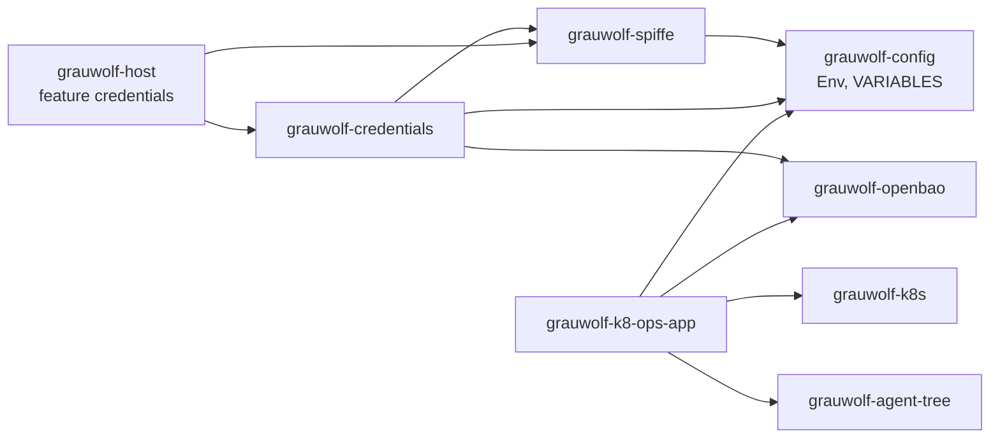
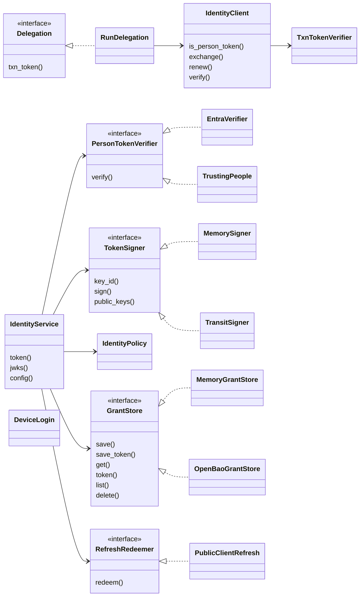
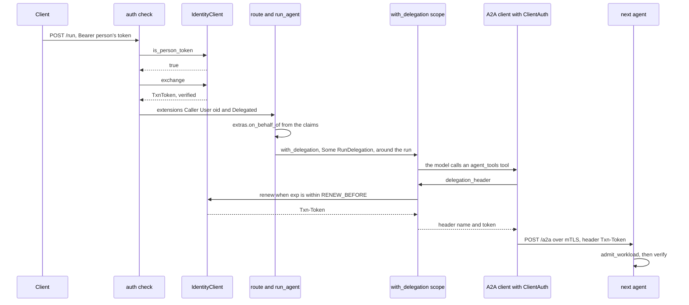

# Chapter 9: Identity, credentials and the cluster tool

Chapters 1 to 8 are about the agent itself. This chapter is about the ground it stands on when it
runs in Kubernetes: **who the agent is** (a SPIFFE identity from SPIRE), **where its secrets come
from** (a secret broker, OpenBao, instead of environment variables) and **how a cluster is set up
for that** (the operator program `grauwolf-k8-ops`). Five crates carry this, and you meet them
when you add a credential source, change what the operator program creates, or write a test that
needs a Kubernetes API server.

The user side is described in the user guide, in
[chapter 12](../user-guide/12-credentials-from-openbao.md) (credentials from OpenBao with SPIFFE)
and [chapter 13](../user-guide/13-setting-up-a-cluster.md) (`grauwolf-k8-ops`). This chapter does
not repeat it; it is about the code. The decisions are in
[ADR-0109](../adr/0109-workload-identity-with-spiffe.md),
[ADR-0110](../adr/0110-workload-identity-for-tools-and-credentials.md),
[ADR-0120](../adr/0120-grauwolf-k8-ops.md) and
[ADR-0121](../adr/0121-grauwolf-k8-ops-agent-deploy.md), including their implementation notes and
live checks. You should know [chapter 1](01-architecture.md) (layers, ports and adapters) and
[chapter 5](05-extending.md) (ports and adapters in practice).

## 9.1 The crates and who depends on whom

| Crate | Layer | Task |
|---|---|---|
| [`grauwolf-spiffe`](../../crates/adapters/grauwolf-spiffe/AGENTS.md) | adapters | The port `WorkloadIdentity` (a JWT-SVID for an audience) and an own minimal Workload API client |
| [`grauwolf-openbao`](../../crates/adapters/grauwolf-openbao/AGENTS.md) | adapters | The OpenBao HTTP API: JWT login and KV read (agents) plus the admin calls of the setup (operators) |
| [`grauwolf-credentials`](../../crates/adapters/grauwolf-credentials/AGENTS.md) | adapters | The `[credentials]` section and `CredentialEnv`, an `Env` that answers mapped variables from `file:` and `openbao:` sources |
| [`grauwolf-identity`](../../crates/adapters/grauwolf-identity/AGENTS.md) | adapters | Delegation (ADR-0111): Txn-Tokens, people's tokens from Entra and the signing key behind ports, the identity service's decisions and the agent's client ([9.9](#99-delegation-grauwolf-identity)) |
| [`grauwolf-k8s`](../../crates/adapters/grauwolf-k8s/AGENTS.md) | adapters | `Cluster`, a small JSON API over kube-rs, and (feature `testing`) `FakeCluster` |
| [`grauwolf-egress`](../../crates/adapters/grauwolf-egress/AGENTS.md) | adapters | The destinations of an agent tree derived from its specs (`derive_tree`), the one table of the model providers' default addresses and `resolve_all` for `from_env` |
| [`grauwolf-k8-ops-app`](../../crates/apps/grauwolf-k8-ops-app/AGENTS.md) | apps | The operator program: library `grauwolf_k8_ops_app`, binary `grauwolf-k8-ops` |



Three things to notice:

- **The agent runtime never sees Kubernetes.** `grauwolf-k8s` (kube-rs, k8s-openapi) is linked
  only by `grauwolf-k8-ops-app`. `grauwolf-host` links `grauwolf-credentials` and
  `grauwolf-spiffe` behind its Cargo feature `credentials` (in `default`, also a feature of the
  facade `grauwolf` and of the CLI). So a generated service pays for an HTTP client and `h2`, not
  for a Kubernetes client.
- **`grauwolf-openbao` is shared.** The agent's credential source and the operator program use
  the same `Bao` calls. Login and KV read were moved there from `grauwolf-credentials` without
  changing behaviour or error texts (the tests of `grauwolf-credentials` stayed green).
- **`grauwolf-k8-ops-app` is an app crate that no other app crate may touch.** `cargo xtask
  check-arch` rejects a dependency on the host, server, CLI, facade or tools-app and rejects any
  app crate depending on it (`arch::K8S_OPS_APP` in `xtask/src/arch.rs`). It may use adapters,
  among them `grauwolf-agent-tree` (reads the agent's files for `agent deploy --spec`; that
  brings the tool build crates into the binary) and `grauwolf-spec`. Of `grauwolf-config` it uses
  only `VARIABLES`, to validate variable names.

## 9.2 Workload identity: `grauwolf-spiffe`

### The port and the token

```rust
pub trait WorkloadIdentity: Send + Sync {
    fn jwt_svid<'a>(&'a self, audience: &'a str) -> BoxFuture<'a, Result<JwtSvid, SpiffeError>>;
}
```

That is everything grauwolf needs of an identity today: a JWT-SVID (a short-lived signed token that
names the workload's SPIFFE ID, `spiffe://<trust domain>/ns/<namespace>/sa/<service account>`) for
one audience. The port is a trait on purpose: the X.509 side and the validation of inbound tokens are
further methods (see "mTLS and inbound callers" below), so that credential sources and the A2A and
MCP clients never see the transport.

`JwtSvid` holds the token and the SPIFFE ID. `token()` is the credential; `spiffe_id()` is for logs
and errors ("login as spiffe://…"). Its `Debug` implementation prints the ID and hides the token
(`finish_non_exhaustive`), and `SpiffeError` never contains a token either. Keep it that way when
you add fields: a token that reaches a `{:?}` in a log line is a leak.

### An own Workload API client, not the `spiffe` crate

`WorkloadApiClient` speaks gRPC (`FetchJWTSVID`) to the SPIRE agent over the Unix socket named by
`SPIFFE_ENDPOINT_SOCKET` (`ENDPOINT_VARIABLE`, `unix:///path`; `from_env` returns `None` without
it, so nothing changes for setups without SPIRE). It is built directly on `h2`, and the protobuf
messages in `src/proto.rs` are written by hand with `prost` derive next to
`proto/workload.proto`.

Why not the `spiffe` crate? It would build offline, but it brings `tonic`, `prost-build` and
`protox`, `jsonwebtoken` and `x509-parser` into every build for one unary call, and the offline
builder image ([ADR-0096](../adr/0096-builder-and-cli-images.md)) would have to carry them
(ADR-0109, implementation notes). `h2` is in the lockfile anyway through `reqwest` and `hyper`.
Consequences for you: no `protoc`, no code generation at build time, nothing to commit that could
drift. The client sets the header `workload.spiffe.io: true` that the API requires and connects
per call, so a restarted SPIRE agent needs no handling. If you add a call (for example
`FetchX509SVID`), add the message types by hand in `proto.rs` and extend `proto/workload.proto`.

### The start-up retry

A pod usually starts before spire-controller-manager has created its registration entry and the
SPIRE agent has synced it. Found live (ADR-0110): the first call then gets `PERMISSION_DENIED`
("no identity issued", gRPC status 7), and grauwolf used to fail at once. `jwt_svid` now retries:

- **Transient** (`is_transient`): `SpiffeError::Unavailable` (socket missing or unreachable) and
  `SpiffeError::Refused` with status 7 (`PERMISSION_DENIED`) or 14 (`UNAVAILABLE`). Everything
  else returns at once.
- **Pause** from 200 ms, doubling to 5 s (`with_first_backoff` shortens the first pause in tests).
- **Deadline** 30 s by default; `SPIFFE_FETCH_TIMEOUT` (`FETCH_TIMEOUT_VARIABLE`, `30s`, `250ms`,
  `1m`) or `with_fetch_timeout` change it, `0s` tries exactly once. At the deadline the error is
  `SpiffeError::GaveUp`, which says how long it waited and what the last error was.

`agent deploy` sets `SPIFFE_FETCH_TIMEOUT=2m` in the pod, because a first identity on a busy
cluster can take longer than 30 s. If you add another transient case, add it to `is_transient` and
write the test first (see below).

### Tests without SPIRE

Feature `testing` (switch it on in your `dev-dependencies`) provides:

- `FakeIdentity`: an in-process `WorkloadIdentity` with test tokens (`FakeIdentity::new(id)`,
  `fail_with(reason)`, `audiences()` to see what was asked). Use it wherever a unit test needs an
  identity.
- `FakeWorkloadApi`: a real Workload API server (on `h2`, on a Unix socket you give it, with
  `grauwolf_test::TestDir` for the path). `start(socket, id, registered)` answers
  `PERMISSION_DENIED` for an unregistered workload and checks the security header;
  `start_denying(socket, id, n)` denies the first `n` calls and then issues, which is how the
  retry is tested; `endpoint()` is the `unix:` address, `requests()` the audiences asked.
- `test_token` and `test_token_claims`: tokens shaped like JWT-SVIDs but not signed.

`tests/workload_api.rs` is the pattern: start the fake, build a `WorkloadApiClient`, call, assert.
It covers the happy path, a refused workload, a missing socket, the endpoint from the environment,
the wait for the entry, a socket that appears later, the deadline and the deadline from
`SPIFFE_FETCH_TIMEOUT`.

### mTLS and inbound callers (ADR-0109, stages 1 and 2)

Stage 1 (outbound mTLS and JWT-SVIDs for A2A and MCP) and stage 2 (HTTPS in the service, validating callers, mapping SPIFFE IDs to users) are built; nothing of them is open. They extend this crate and this port. The callers are the A2A and MCP clients (`grauwolf-a2a`, `grauwolf-mcp`) and the service (`grauwolf-server`), which receive the port from the host like the credential sources do. How the service and the clients use it is in [chapter 8](08-server-and-protocols.md#authentication-with-spiffe).

The port is two traits plus a bundle. `WorkloadIdentity` adds `validate_jwt_svid(token, audience) -> SpiffeId`: the SPIRE agent checks signature, expiry and audience (`ValidateJWTSVID`), so grauwolf has no JWT crypto; a rejected token is `SpiffeError::Refused` for which `is_invalid_token()` is true. `TlsIdentity` has `id()`, `client_tls(&SpiffeMatch) -> rustls::ClientConfig` and `server_tls(&[trust domains]) -> rustls::ServerConfig`; `Identity` is both. `WorkloadApiClient` is the stateless JWT client; `SpiffeWorkload::connect(client)` also starts the `X509Source`.

- **Live source** (`source.rs`): two server streams, `FetchX509SVID` and `FetchX509Bundles`, update the latest SVID and the bundle per trust domain; a failed stream is reconnected with the doubling pause, and `connect` waits for the first SVID and bundle up to the fetch deadline (`SpiffeError::GaveUp`).
- **Rotation without restart** (`tls.rs`): `ResolvesServerCert` and `ResolvesClientCert` read the source at every handshake; the verifiers do too. Existing connections keep their certificate; new ones get the new one.
- **Verifiers**: the chain is checked with `webpki` (`EndEntityCert::verify_for_usage`) against the bundle of the **certificate's own trust domain**, not the web PKI and not a host name (SVIDs have no DNS name). Then the SPIFFE ID: the client checks it against the `SpiffeMatch` (`Id`, `Ids`, `TrustDomain`), the server requires the trust domain to be in its accepted list. The ID is the one URI SAN with scheme `spiffe` (`der.rs` is a minimal DER reader; two URI SANs or none are refused). TLS 1.3 only.
- **Outbound**: `ClientAuth` (`mtls` or `jwt` plus audience) gives the HTTP clients a `rustls::ClientConfig` for `reqwest::ClientBuilder::use_preconfigured_tls` and a fresh bearer per request. `grauwolf-a2a` and `grauwolf-mcp` take it (`connect_with_auth`, `connect_http_with_auth`, `connect_sse_with_auth`); the host builds it from the spec in `spiffe::client_auth`, once per process and socket for the identity (`spiffe::workload`). Generated crates provision through the same host code.
- **Inbound** (`grauwolf-server`, `spiffe.rs` and `auth.rs`): `SpiffeInbound::start` (identity, callers file, accepted domains), `TlsListener` (an `axum::serve::Listener` that does the handshakes concurrently and yields connections with `PeerSpiffe`, the verified ID, as connect info), `CallerMap` (the mapping file; polls the resolved path, mtime and size every two seconds, so the `..data` symlink swap of a ConfigMap is seen; an invalid new file keeps the old map). `with_spiffe_auth` decides in this order: (1) `ConnectInfo<PeerSpiffe>`; (2) a Bearer that looks like a JWT is validated with `validate_jwt_svid` for the audience (invalid: `401`, Workload API down: `503`); (3) the token rules. A mapped ID becomes `Caller::User(user)`, so everything per user follows; an unmapped one is `403`. `service::routers_with_history` builds the routes once per port (`ServiceRouters { main, mtls }`): run, MCP and the rest are shared, but A2A is built twice, because the agent card names the endpoint the client then sends to (`GRAUWOLF_SPIFFE_PUBLIC_URL`, default `https://localhost:<port>`; `spec serve` does the same). The extra A2A port (`A2A_PORT`) is not part of the mTLS design: it stays plain, with JWT-SVIDs. The caller's ID is put in the request extensions as `CallerSpiffe` (never a token). From there it flows as text: the handlers (`/run`, `/run/stream`, `/api/chat`, the A2A `rpc`, the MCP tool) set `RunExtras.caller`; the interpreter hands it to `AgentRun::with_caller`; for generated services `GeneratedAgent::run` copies it into the host's `RunOptions.caller`, whose `handles()` puts it in `RunHandles.caller`, and `RunHandles::start` calls `with_caller` too. The lifecycle reports it as `caller` in `AgentStarting`, and `OtelFeature` records it as `grauwolf.caller` on the `invoke_agent` span (there is no separate HTTP request span).
- **`tls_refusal`** (`tls.rs`): `tls_refusal(&error) -> Option<String>` walks an error chain, also inside `std::io::Error` (whose `source()` hides what it wraps), for a refused rustls handshake and returns the verifiers' reason (`the server is <id>, expected <id>`) or rustls' own message. Why: in the live check a wrong `auth.spiffe.id` only showed as `no connection ... (refused or given up after 30 s)`, because reqwest reports a failed handshake as a connect error. `grauwolf-a2a` and `grauwolf-mcp` ask it before they fall back to the connect message and say `TLS handshake with <url> failed: <reason>; the call was not executed`. Tests: `grauwolf-server/tests/spiffe_a2a.rs` and `grauwolf-mcp/tests/spiffe.rs`.
- **Fakes** (feature `testing`): `TestCa` issues SVIDs for given IDs at test time (P-256, the DER built by hand and signed with aws-lc-rs; no `rcgen`); `FakeIdentity` is the in-process port (`rotate()`, `expire()`, `trust(ca)`); `FakeWorkloadApi` serves JWT, `ValidateJWTSVID` and both X.509 streams on a Unix socket (`rotate()`, `add_bundle()`, `disconnect_streams()`). Test tokens carry a placeholder signature that only the fakes accept.

Tests: `grauwolf-spiffe/tests/mtls.rs` (handshakes, rotation, streams, validation), `grauwolf-server/tests/spiffe.rs` (mTLS port, 403, JWT on the HTTP port, reload after a symlink swap) and `tests/spiffe_a2a.rs` (the A2A client against the server, both with fakes), `grauwolf-spec/tests/auth.rs` (validation).

### Tools that use the identity (ADR-0110, stage 1)

The identity reaches four more places. The pattern is the same everywhere: **the host resolves, the tool receives**. Resolving needs the Workload API (async); building tools is synchronous, so `provisioning::builtin_tools` is async and calls `builtin::resolve_auth(builtin, env)` first, which turns `builtin_tools.fetch.auth` and `git.auth` into `Arc<ClientAuth>` (via `spiffe::client_auth`, errors named `builtin_tools.fetch.auth.<host>`) and hands them to the tools in `builtin::Settings`. Generated crates provision through the same code, so they behave the same; there is no separate generator path and no new slow test.

- **`fetch`** (`grauwolf-tools-web`): `FetchConfig.auth` is a list of `(host pattern, ClientAuth)`; per hop the first matching entry decides. The client gets `use_preconfigured_tls(tls_config)` and/or `bearer_auth(jwt)`, so a redirect to a host without an entry carries nothing. An identity host over `http://` is refused in the request (`allow_http` is global, so validation cannot decide it); a refused handshake is reported with `tls_refusal`.
- **git tools** (`grauwolf-tools-git`, `grauwolf-git`): `GitConfig.auth` becomes `Settings.auth` (mTLS in the blocking reqwest client of the own transport) and `Settings.bearer`. The transport is blocking and runs inside `spawn_blocking`, so a JWT-SVID is fetched in the async part of the call (`call_json`) and handed over in `Settings`; it goes only to the origin, like the token. `use_token` and `auth` exclude each other in validation.
- **stdio MCP** (`grauwolf-mcp`, `grauwolf-host`): `McpClient::spawn_with_env(command, args, env)`. `spawn` removes `SPIFFE_ENDPOINT_SOCKET` and `SPIFFE_FETCH_TIMEOUT` from what the child inherits (the child process is not started with a cleared environment, but the identity must be opt-in), and `mcp_servers.<n>.workload_api` adds them back through `spiffe::workload_env`. The child gets the agent's identity; SPIRE cannot tell the processes of a pod apart.
- **`run_command`**: `builtin_tools.command.workload_api` adds the same two variables to the program's environment in `builtin::command_tool`; the spec refuses it in shell mode.

Tests: `grauwolf-tools-web/tests/spiffe.rs` (an in-process HTTPS server with required client certificate and `TestCa`), `grauwolf-tools-git/tests/spiffe.rs` (the test git server below), `grauwolf-mcp/tests/stdio.rs` with `tests/fixtures/env_mcp_server.py`, `grauwolf-host/tests/workload_identity.rs` (provisioning errors, the child and the command see the socket), `grauwolf-spec/tests/workload_identity.rs` (validation).

### The test git server in mTLS mode (ADR-0110 Q5)

`grauwolf-git` (feature `test-git-server`) has a smart-HTTP server for tests: upload-pack and, since stage 1, **receive-pack** (the commands, the pack indexed with libgit2's pack writer, refs updated, `report-status`). `TestGitServer::start_spiffe(repository, &identity, &accepted, SpiffeAccess)` serves it over rustls with the identity's SVID and **requires client certificates**; the caller's SPIFFE ID comes from the handshake into the request extensions. `SpiffeAccess` is the mapping `{ "<id or prefix/*>": { "user", "push" } }` (the exact entry first, then the longest prefix, whole segments; a file is read again at every request, so a ConfigMap update works). Unmapped IDs get `403`, read-only IDs get `403` on push. `RecordedRequest` also has `spiffe_id` and `status`.

The listener and the mapping are a small copy of `TlsListener` and `CallerMap` of `grauwolf-server`: an adapter must not depend on an app, and moving them down would have meant a new crate for ~120 lines that only tests use. If a third user appears, move both to `grauwolf-spiffe`.

The example `serve_folder … --spiffe <mapping> [--bind <addr>] [--trust-domain <d>]` runs it with the SVID from the Workload API at `SPIFFE_ENDPOINT_SOCKET`; `docker/test-git-server.Dockerfile` builds it as an image (not a release image) and `examples/test-git-server/` has the manifest (restricted Pod Security: uid 65532, read-only root file system, `/tmp` as `emptyDir`, the CSI socket), a mapping file and the steps.

## 9.3 Credential sources: `grauwolf-credentials`

### The idea: another `Env`

Everything grauwolf reads from the outside goes through the `Env` port of `grauwolf-config`
(ADR-0108): `Env::var(name)`, with `ProcessEnv` as the real implementation and `MapEnv` for tests.
A credential source is **another implementation of that port**. `CredentialEnv` answers the
variables mapped in the `[credentials]` section from their source and every other variable from
the `Env` underneath. Whatever reads `ATLASSIAN_API_TOKEN` or `OPENAI_API_KEY` through `Env` then
sees the brokered value, and no consumer needs to know.

The section (see the user guide for the format) is parsed by `CredentialsConfig::parse(text, base)`
in `src/config.rs`: the optional `[credentials.openbao]` table (`address`, `auth.spiffe` with
`audience`, `role`, `mount`, `refresh`) and `[credentials.variables]`, a map from variable name to a
source string. `parse_source` turns `file:/path` and `openbao:<mount>/<path>#<field>` (alias
`vault:`) into a `Source`; relative `file:` paths are relative to the configuration file.

### The rules

They are enforced at parse time or in `CredentialEnv::start`, and each has a test:

- **Only names from `VARIABLES`** may be mapped; an unknown name is an error.
- **Unmappable variables.** Variables the process reads directly from its environment cannot be
  mapped, because a source would silently not apply to them: `OTEL_EXPORTER_OTLP_*`, `CARGO`,
  `RUSTC`, `HOME`, `PATH`, `DOCKER_CONFIG`, and the sources' own `GRAUWOLF_CREDENTIALS`,
  `SPIFFE_ENDPOINT_SOCKET`, `SPIFFE_FETCH_TIMEOUT` (`NOT_THROUGH_ENV` in `config.rs`). If you add a
  variable that something reads with `std::env::var` instead of `Env`, add it there.
- **Conflicts.** A mapped variable that is also set in the base environment is an error ("remove
  one of them"): there is no silent precedence.
- **No fallback.** A source that cannot be read at start fails the start with an error naming the
  variable and the source; nothing falls back to the environment. An empty value is an error too.
- An `openbao:` source needs `[credentials.openbao]` (parse error otherwise) and an identity
  (`SPIFFE_ENDPOINT_SOCKET`; `start` fails naming that variable if there is none).

### Resolving and refreshing

`CredentialEnv::start(base, &config, identity)` resolves every mapped variable once, **blocking**,
and then keeps them fresh. The sync configuration code (`Config` sections, `ServiceConfig`) cannot
`await`, so the work runs in a thread of its own (`grauwolf-credentials`) with a current-thread
tokio runtime; the first result is handed back over a channel, so a failing source fails `start`.
After `refresh` (default 5 minutes, `DEFAULT_REFRESH`) the thread resolves everything again and
swaps the map under an `RwLock`; a failed refresh keeps the old values and reports to stderr
("grauwolf: refreshing VAR from SOURCE: reason" – variable and source only). The thread holds only a
`Weak` reference to the map, so it ends when the last `CredentialEnv` is dropped. `file:` sources
are re-read on the same interval, a trailing newline is removed.

The OpenBao side is `OpenBaoClient` (`src/openbao.rs`): it logs in with a JWT-SVID
(`POST /v1/auth/<mount>/login {role, jwt}`), keeps the token in memory, replaces it by a **fresh
login** (a new JWT-SVID, they live 5 minutes) when it is within 30 s of its lease end
(`TOKEN_MARGIN`) and once after a `403`, and reads KV v2 fields. It does not renew tokens.

### Where it is wired in

| Place | How |
|---|---|
| `grauwolf_host::credentials::env_for(base, spec file)` | The one entry point: `base` unchanged without a `[credentials]` section, else `CredentialEnv::for_spec`. Without the Cargo feature `credentials` a configuration that asks for sources is an error, not silently ignored. |
| `AgentLoader` (`credential_env(file)`, `with_credential_env(env)`) | `load_provisioned` (hence `load`) builds the environment once per loader and shares it between clones, so `spec run`, `chat`, `resume`, `mcp`, `serve`, sub-agents and provisioning all read through the sources. |
| `spec serve` (`grauwolf-cli`, `commands/spec/serve.rs`) | Builds the environment itself first, because it also reads `GRAUWOLF_SERVER_TOKEN` and the chat API through it, and hands it to the loader with `with_credential_env`. |
| Generated services (`grauwolf_server::service::main`) | Uses `GRAUWOLF_CREDENTIALS`, else `grauwolf.toml` in `GRAUWOLF_DATA_DIR`, and reads every variable through it. |
| `grauwolf credentials check <VAR>…` / `--all` | `grauwolf_host::credentials::check_many` (`CredentialEnv::check_many`) resolves each variable on its own, so one failing source does not hide the others (one OpenBao login is shared), and prints `resolved <VAR> from <file\|openbao\|environment> (N bytes)` per variable, or the error on stderr; exit code 1 if any fails. This is what the check Job of `agent check` runs, with the names of all mapped variables. |

**Paths that do not use it yet:** the lean `grauwolf tools …` program (`grauwolf-tools-app`) reads
the process environment (`ProcessEnv`); the code generated by `spec generate` without `--service`
(`run_app`) builds its provisioning options with `ProcessEnv`; `grauwolf-oci`'s
`RegistryAuth::from_env` has no caller in the workspace (the host passes a `RegistryConfig`, which
reads through `Env`, so registry credentials *can* come from a source); the OTLP variables are read
by the SDK itself, and the tool build reads `CARGO` and `RUSTC`. Where a new code path reads a
variable, read it through `Env` and take the environment from the loader, not from `ProcessEnv`.

### Adding a new source kind

Say you want `exec:` (run a command) or an `aws-sm:` source:

1. **Test first**, in `src/config.rs` (parsing, rejections) and `src/env.rs` (resolving); a source
   needing a server gets its own integration test file next to `tests/openbao.rs`, with the server
   mocked (see 9.4).
2. Add a variant to `Source` and handle it in `parse_source` (the prefix), `Source::describe` (what
   appears in errors: scheme and location, **never a value**) and `resolve_all` in `src/env.rs`.
3. If it needs a client, create it in `CredentialEnv::start` like `OpenBaoClient` (only when a
   variable uses it) and give it the identity if it logs in with it.
4. If the HTTP calls are generic enough for the operator program too, put them in their own adapter
   crate, as `grauwolf-openbao` is, and add the crate to the allowed dependencies in the
   `AGENTS.md`.
5. Update the `AGENTS.md` of the crate, [chapter 12 of the user guide](../user-guide/12-credentials-from-openbao.md),
   the [reference](../user-guide/reference-config.md) and an ADR note.

### Redaction: no values in errors, `Debug` or logs

The invariant (crate `AGENTS.md`, ADR-0110): a value never appears in an error, a log line, `Debug`
output, an event or a span; errors name the variable and the source only. In the code this means:

- `CredentialError { variable, source, reason }` has no value field; its `Display` is
  "VAR from SOURCE: reason".
- `CredentialEnv`'s `Debug` prints the variable names, not the map.
- `BaoError` carries the HTTP status and the server's `errors` messages, never a body.
- `JwtSvid`'s `Debug` hides the token.
- `read_file` errors come from `std::io::Error` (which names the path, not the content) and fixed
  texts.

The tests enforce it with a marker: `tests/openbao.rs` has a constant `SECRET` (`"jira-token-s3cret"`)
as the value the mock returns, and `errors_never_contain_secret_values` provokes failures and asserts
that no error text contains it; `env.rs` has `debug_output_names_the_variables_but_not_the_values`
and `check_reports_source_and_length_but_not_the_value`; the operator program's tests assert that
the base64 of a stored secret is not in any output. When you add an error path, write the test that
puts a recognizable value into the mock and asserts it is absent from every message.

## 9.4 The OpenBao client: `grauwolf-openbao`

`Bao<T: Transport>` holds the calls; a `Transport` sends one request (`Request { method, path,
token, body }`, the path below the server address) and returns `Response { status, body }`.
`HttpTransport` talks to an address with reqwest (10 s timeout, token in `X-Vault-Token`, errors
without the URL). The operator program supplies a second transport, `ProxyTransport`, that sends
the same request through the Kubernetes API server's service proxy (9.6). Because the transport is
a type parameter (`Bao<AnyTransport>` in the program), the calls do not know how they travel.

`Bao::new(transport)` has no token; `with_token(token)` returns the same server with a token (admin
calls need one; agents log in with `login_jwt` and then use `with_token`).

- **Agent calls:** `login_jwt(mount, role, jwt) -> Token` (value and lease seconds) and
  `kv_read_field(mount, path, field)`.
- **Admin calls:** `health`, `capabilities_self`, `auth_methods`, `mounts`, `ensure_jwt_auth`,
  `jwt_config`, `ensure_kv2`, `ensure_policy`, `read_policy`, `delete_policy`, `ensure_jwt_role`,
  `read_jwt_role`, `list_jwt_roles`, `delete_jwt_role`, `kv_put_field`, `kv_list`,
  `kv_current_version`, `kv_delete_all`, `kv_delete_tree`. The helpers `jwt_role(audience, subject,
  policy)` and `kv_read_policy(mount, prefix)` build the role (`role_type=jwt`, `user_claim=sub`,
  `bound_subject` = the exact SPIFFE ID, `token_ttl` 1 h) and the policy (read only below the
  agent's prefix).

### The `ensure_*` pattern: read, compare, write

Every `ensure_*` reads what exists, compares it with the desired state and writes **only if they
differ**, returning `Outcome::Created`, `Updated` or `Unchanged`. The comparison is by *subset*: the
stored role may have more fields than the desired one (OpenBao adds defaults), so
`ensure_jwt_role` writes only when some desired field is missing or different; a policy is
compared as trimmed text. A call "changes nothing beyond what its name says"; idempotency is
the `ensure_*` calls' job, built on the `read_*` calls, which return `None` for a missing object
(`find` maps 404 to `None`).

When you add an admin call, first add its `read_*` (what does the server return when it exists,
and when it does not?), then `ensure_*` with the three outcomes. Errors come from
`BaoError::status(what, status, body)`: "what: HTTP 403: permission denied", assembled from the
status and the server's `errors` array only.

### Tests

`tests/admin.rs` mocks OpenBao with **wiremock** (`MockServer`, `Mock::given(method(…)).and(path(…))`,
`body_partial_json`) and uses `HttpTransport` against it. Typical cases: JWT auth enabled and
configured once, an unchanged one left alone, a KV mount of the wrong kind, a role written only when it
differs (`.expect(1)` on the write mock), a policy limited to the prefix, a tree removed
recursively with an error that holds no value, capabilities, a sealed server. The operator
program does not use wiremock: it has a small in-memory fake OpenBao behind `FakeCluster`'s
service-proxy hook (9.5 and 9.6), which also exercises `ProxyTransport`.

## 9.5 Kubernetes access: `grauwolf-k8s`

### `Cluster`: JSON values and a `Kind`

`Cluster` wraps a `kube::Client`. Objects are plain `serde_json::Value`s addressed by a `Kind`
(group, version, kind, plural, namespaced); `grauwolf_k8s::kinds` has the ones in use
(`NAMESPACE`, `CONFIG_MAP`, `SECRET`, `SERVICE`, `POD`, `DEPLOYMENT`, `STATEFUL_SET`, `DAEMON_SET`,
`JOB`, `INGRESS`, `CRD`, `CSI_DRIVER`, `CLUSTER_SPIFFE_ID`, …). There are no generated types and no
`DynamicObject`: `ClusterSPIFFEID` and the built-in kinds are handled the same way, and
`k8s-openapi` is in the manifest only to select the Kubernetes version feature (`v1_34`) that kube
needs. A new kind is one more `const` in `kind.rs`. Requests go through `Client::send` as raw
HTTP, so nothing depends on kube's `runtime` or `ws` features.

| Call | What it does |
|---|---|
| `get`, `list(kind, ns, label selector)` | Read; a missing object is `None` |
| `ensure(kind, ns, desired)` | Server-side apply, `force=true`, field manager `grauwolf-k8-ops` (`FIELD_MANAGER`); `Outcome::Created/Updated/Unchanged` |
| `patch(kind, ns, name, patch)` | JSON merge patch (`null` removes a field) of an existing object, no ownership taken; a missing object is a 404 error, never created |
| `delete` | Propagation `Background`; `false` if there was none |
| `pod_log`, `pod_log_previous` | The last lines; the log of the run before a restart |
| `pod_log_stream(ns, pod, tail, follow, sink)` | The log in chunks of **complete lines** to a closure, until it ends (with `follow`, until the pod or connection ends) |
| `can_i(verb, group, resource, ns)` | `SelfSubjectAccessReview`; `pods/log` is resource with subresource |
| `version`, `raw(method, path, headers, body)` | `raw` is any request through the API server (used for the OpenBao service proxy); an HTTP error status is a normal answer |

### `ensure` and the applied-hash annotation

`ensure` skips the write when the annotation `grauwolf.io/applied-hash` (`APPLIED_HASH`) of the
existing object equals `hash_of(desired)` (a short SHA-256 of the desired object's JSON). Why not
compare fields? The API server adds defaults to the arrays of a Deployment, so a field comparison
would never settle. The cost is that an edit made by hand to a managed object is not noticed until
the desired object changes (user guide chapter 13 says so, and `doctor` checks the parts that
matter for access). An object made by hand has no annotation, so the first `ensure` applies over
it and takes over the fields (`updated`); this is how `oidc install` adopts a provider made from
`examples/spire-openbao/`.

`hash_of` is public so that a program can put a hash into a pod template annotation. `agent deploy`
does: `grauwolf.io/config-hash` over the pod spec, the text of `grauwolf.toml` and the agent files,
so an unchanged deploy writes nothing and a changed one restarts exactly the pod.

### The rustls provider

`Cluster::connect(kubeconfig, context)` takes the kubeconfig context (`--context`; without it the current one, and a context that does not exist is an error listing the available ones) and remembers the server URL and the context (`server()`, `context()`, `describe()` for the first line of `doctor`; `FakeCluster::cluster()` reports `https://fake-cluster.test:6443`, context `fake-context`). It first calls `rustls::crypto::ring::default_provider().install_default()` and
ignores the result. Why: kube is built with `ring`, but other crates in the same binary bring
`aws-lc-rs`; with two providers linked rustls refuses to choose and **panics at the first TLS
client**. Found live: `doctor` against a real cluster panicked immediately, while every test passed,
because `FakeCluster` has no TLS. An already installed provider stays. The regression test is a
binary test that points the program at an HTTPS address nothing listens on and asserts an error, not a
panic (`tests/binary.rs`, `a_tls_connection_fails_with_an_error_not_a_panic`). If you add a TLS
client to this crate or link another provider, keep that test green.

Errors are `K8sError { status, message }`: the HTTP status and the API server's message, **no object
bodies** (a ConfigMap or Secret may hold values).

### `FakeCluster`: an API server in memory

Feature `testing` gives `FakeCluster`, a `tower::Service` that `Client::new` can wrap; the same
`Cluster` code runs against it as against a real server. It keeps objects by URL path (so
`/api/v1/namespaces/a/configmaps/c` is both the key and what `GET` returns), implements
server-side apply as a deep merge, JSON merge patch (a missing object is 404), label selectors,
namespace deletion that cascades, and access reviews. It records `writes()` (the `PATCH` paths of
every write that changed something, in order – an unchanged `ensure` writes nothing, so the list
proves idempotency) and `deleted()`.

Its hooks are what makes it more than a store:

- `on_change(|fake, method, path| …)` runs after every successful `PATCH` and `DELETE`, outside the
  lock, so the hook may read and change the fake. A test **plays the controllers**: a StatefulSet
  scaled to 0 makes its pods disappear, a server with a fresh volume writes a CA for the new
  trust domain. A forgotten step then shows up as a timeout instead of passing silently.
- `set_deployment_outcome(DeploymentOutcome::Ready(log) | Starting(log) | CrashLoop(log) | Never)`
  makes an applied Deployment get a generation, a status and one pod `<name>-x1` (ready, starting,
  or waiting with `CrashLoopBackOff`) with the given log.
- `set_job_outcome(JobOutcome::Succeeds(log) | Fails(log) | Never)` does the same for Jobs.
- `on_proxy(|method, service, path, body| (status, body))` answers requests below
  `.../services/<service>/proxy/…` – the fake OpenBao and the `/health` of a deployed agent.
- `deny(verb, resource)` makes access reviews answer `allowed: false`.
- `insert(path, object)` and `remove(path)` seed and edit the store without hooks;
  `object(path)` and `paths(prefix)` inspect it.

A test with it, in the shape of `crates/adapters/grauwolf-k8s/tests/cluster.rs`:

```rust
use grauwolf_k8s::testing::{DeploymentOutcome, FakeCluster};
use grauwolf_k8s::{Outcome, kinds};
use serde_json::json;

#[tokio::test]
async fn a_second_ensure_of_the_same_object_writes_nothing() {
    let fake = FakeCluster::new();
    fake.set_deployment_outcome(DeploymentOutcome::Ready("listening\n".into()));
    let cluster = fake.cluster();
    let desired = json!({"apiVersion": "apps/v1", "kind": "Deployment",
        "metadata": {"name": "d", "namespace": "a"},
        "spec": {"template": {"metadata": {"labels": {"app": "d"}},
            "spec": {"containers": [{"name": "main", "image": "x:1"}]}}}});

    let first = cluster.ensure(&kinds::DEPLOYMENT, Some("a"), &desired).await.unwrap();
    let again = cluster.ensure(&kinds::DEPLOYMENT, Some("a"), &desired).await.unwrap();

    assert_eq!((first, again), (Outcome::Created, Outcome::Unchanged));
    assert_eq!(fake.writes().len(), 1);
    let pods = cluster.list(&kinds::POD, Some("a"), Some("app=d")).await.unwrap();
    assert_eq!(pods[0]["status"]["containerStatuses"][0]["ready"], true);
}
```

When your code needs a response shape the fake does not produce yet, extend `testing.rs` (and add a
test for the extension in `tests/cluster.rs`) rather than working around it in the program's tests.

## 9.6 The operator program: `grauwolf-k8-ops`

### Shape of the crate

The commands are functions over `Services` and `Io`, so tests run them without a binary:

- `Services` (`services.rs`) holds the `Settings` (clap global options with the defaults of the
  cluster: namespaces, service names, JWT mount, KV mount, audience), the `Cluster` and a
  `Bao<AnyTransport>` plus `has_token`. `Services::connect` reads the kubeconfig and the token
  (`--token-file` or `OPENBAO_TOKEN`, never an argument); `Services::new(settings, cluster, token)` is
  what tests use with a `FakeCluster`. `services.admin()?` returns the OpenBao client or the reason
  why admin calls are impossible (no token).
- OpenBao is reached through the API server's service proxy by default (`ProxyTransport`:
  `/api/v1/namespaces/<ns>/services/http:<name>:<port>/proxy/…`, so only the kubeconfig is
  needed) or directly with `--openbao-addr` (`HttpTransport`); `AnyTransport` is the sum of the two.
  `ProxyTransport` turns the API server's own `Status` errors (no such service, no endpoints) into
  a clear error, while OpenBao's own errors (they carry an `errors` list) pass through.
- `Io` (`io.rs`) is where a command prints and reads: `line`, `text` (a log chunk as it is), `value`
  (a secret, untrimmed), `error`, `read_line`, `confirm` (`Proceed? [y/N]`, no input means no) and
  `read_secret` (the hidden prompt on a terminal, else all of stdin without one trailing newline;
  an empty value is refused). `main.rs` adds the hidden prompt only if stdin is a terminal.
- `execute(command, &Services, &mut Io) -> i32` runs one parsed command and turns an `Err(message)`
  into `error: …` on stderr and exit code 1; `run(args, &mut Io)` parses, connects and executes
  (exit code 2 for a usage error). `report::k8s` and `report::bao` give the words `created`,
  `updated`, `unchanged`.

### Module map

| Module | What it holds |
|---|---|
| `cli` | clap derive: `Cli`, `Settings`, `Command`, `AgentCommand`, `SecretCommand`, `TrustDomainCommand`, … |
| `services`, `io`, `report` | see above |
| `doctor` | Two sections (`PREREQUISITES`, `SETUP`); a `Report` of `Check { section, check, status, reason, hint }`; read-only, exit code 1 on any `fail` |
| `oidc` | `oidc install`: the OIDC discovery provider in its own namespace and its `ClusterSPIFFEID` |
| `openbao_setup` | `openbao setup`: the JWT auth method (with the provider's `jwks_url`), the KV v2 mount and the policy `grauwolf-k8-ops`; `openbao token`. The policy is a table of `Rule { path, capabilities }` (`rules(settings)`, rendered by `policy`) derived from the admin calls of `grauwolf-openbao` and the reads of `doctor`; **a new OpenBao call needs a rule there** (the test `every_command_works_with_the_restricted_token` fails otherwise) |
| `agent` | Names (`role_name`, `kv_prefix`), labels, the desired objects (`namespace_object`, `service_account_object`, `cluster_spiffe_id_object`, `config_map_object`, `render_config`), `add`, `list`, `remove` |
| `secret` | `secret set/get/list/delete` at `<kv>/agents/<agent>/<key>`, field `value` |
| `check` | `agent check`: the Job that runs `grauwolf credentials check` |
| `harness` | `agent deploy --harness` (ADR-0128 decision 6): reads the harness file through `Harness::parse_named`; `agent.rs` merges its `image`, `port` and `env` with the flags (`one_source` refuses both) |
| `deploy`, `agent_files` | `agent deploy/status/logs/undeploy`; the agent's tree as a ConfigMap with one `subPath` mount per file (`AGENT_MAP`, `SPEC_DIR`, `MAX_BYTES`) |
| `callers`, `caller_spec` | `agent allow/deny/callers`: the ConfigMap `grauwolf-callers` (`Callers`, `read_callers`, `callers_object`), the NetworkPolicy `grauwolf-mtls-callers` (`policy_object`, `sync_policy`, `policy_state`), `ports_of`, the clean-up for `agent remove` (`allowing`, `forget`); the check of a spec's calls to other agents (`spec_documents`, `check` → `Findings`), used by `deploy` and `doctor` |
| `egress` | `agent deploy --egress` (ADR-0110 stage 6): `derive` (the tree's destinations through `grauwolf-egress`, resolved with `--env`, the OpenBao address and the `--otel` endpoint), `plan` (the NetworkPolicy `grauwolf-egress` and what to warn about), `sync`, `remove`, `summary_of` (read back from annotations by `status` and `doctor`) |
| `identity` | `identity install/status/uninstall/allow/deny` (ADR-0111 Q3, Q4): the identity service in namespace `identity` (`ClusterSPIFFEID`, Deployment, Service, the policy ConfigMap `grauwolf-identity-policy` with `parse_policy`/`policy_text`, the NetworkPolicy `grauwolf-identity-ingress`, its egress through `egress::plan`) and the OpenBao side (Transit mount and key through `Bao::ensure_transit`/`ensure_transit_key`, `openbao_policy`, the JWT role); `for_agents`, `url_of`, `destination_of` and `hint_for` serve `agent deploy --identity`, `status`, `check` and `doctor`. The pod carries an agent pod's labels (`grauwolf.io/agent=grauwolf-identity`) so that `deploy::wait_ready` and `egress::plan` apply; the namespace has no agent label |
| `spire` | The trust domain in one function (`spire::trust_domain`), `trust_domain_sources` (every place that holds one), server version, replicas, `spiffe_id` |
| `hcl`, `x509`, `consumers` | Helpers for `trust-domain`: a trust-domain extractor and line-level rewriter for HCL and YAML (no HCL library), the SPIFFE trust domains of the CA certificates in a PEM bundle by a minimal DER walk (no X.509 library), the `--consumers` TOML and the replacement rule (`replace_domain`) |
| `trust_domain`, `restore` | `trust-domain set` (plan, backup, change, verification) and `trust-domain restore <backup>`, which reuses the steps of the first (`plan_recreate`, `spire_restarts`, `rewrite_configs`, `recreate_server`, `restart`, `verify`) |

### Conventions

- **Repeatable.** Every command can run again and changes only what differs; each object prints one
  line ending in `created`, `updated` or `unchanged`. K8s objects go through `Cluster::ensure`,
  OpenBao objects through `ensure_*`. A test per command runs it twice and asserts nothing changes
  (`fake.writes()`, `env.bao_writes()`).
- **Check everything before the first write.** `secret set` validates the name, the key and the
  variable and finds the namespace before it stores anything; `agent deploy` checks the agent,
  quantities, `--env` and the tree first.
- **Destructive commands print what they will do and need `--yes`.** `agent remove`, `agent undeploy
  --purge-data` and `trust-domain set/restore --apply` list the plan, then `io.confirm()` unless
  `--yes`; without a terminal and without `--yes` they cancel. `trust-domain set` without `--apply`
  only prints the plan (a test asserts that no write reaches the cluster or OpenBao).
- **Secrets only via stdin or the hidden prompt**, never from an argument or the environment, and
  never in output or errors (errors name agent and key only). The single exception is
  `secret get <agent> <key> --reveal`, which prints the value and nothing else, and refuses without
  `--reveal`.
- **Only touch what is ours.** A namespace is touched only if it carries `grauwolf.io/agent=<name>`
  and `app.kubernetes.io/managed-by=grauwolf-k8-ops` (`AGENT_LABEL`, `MANAGED_BY`); `agent add`
  refuses a namespace that exists without the label, `agent remove` never deletes one, and
  `agent list` leaves out namespaces that are terminating.
- **`--json`** exists where a machine reads the output (`doctor`, `agent list`, `agent status`,
  `secret list`). Build a `serde_json::Value` and print it with `io.line`.
- **Every OpenBao call needs a rule in the policy.** The tool must work with a token that has only
  the policy `grauwolf-k8-ops` (`openbao_setup::rules`). The fake OpenBao of `tests/common/mod.rs`
  enforces a policy path by path (`env.restrict_to("grauwolf-k8-ops")`, the same longest-prefix rule
  as OpenBao, `sudo` for writes below `sys/auth/`, `denied` lists what it refused), and
  `tests/restricted_token.rs` runs every command (except `trust-domain`, whose OpenBao reads are the
  role reads of `agent add`) that way. Add the new call there, then the rule.
- **Doctor lines carry a hint.** A line is `ok`, `warn` or `fail` with a reason and, where one
  exists, `next: <the command or step that fixes it>`. `Report::ok/warn/fail` take the section, a
  check name, a reason and (warn, fail) a hint. A missing token is a warning, not a failure, for
  the checks that need one.
- **Fail early, save the way back.** Multi-step changes write a backup first (`create_new`, mode
  0600, never overwritten), name the failed step and the backup file, and are finished by running
  the same command again (resume: places that already hold the new state are left alone).

### Adding a command

Say `agent scale <name> <n>`:

1. **Test first**, in `tests/commands.rs` (or the file that fits). `common::env()` gives a fake
   cluster with SPIRE installed and a fake OpenBao behind the proxy hook; `env.prepare().await` runs
   `oidc install` and `openbao setup`; `env.run(&["agent", "scale", …], "stdin text").await` returns
   a `Run { code, out, err }`. Assert the output, the exit code, `env.fake.writes()` and that a
   second run writes nothing.
2. **clap:** add a variant with doc comments (they become the help text) to the right enum in
   `cli.rs`. If an argument is a secret, it is not an argument: read it with `io.read_secret`.
3. **Dispatch:** add the arm in `agent::run` (or `execute` in `lib.rs` for a new top-level
   command) and write `pub async fn scale(services: &Services, io: &mut Io<'_>, …) -> Result<…,
   String>` in a module. Return `Err(message)` for failures; `execute` prints it. Use
   `services.cluster` for Kubernetes and `services.admin()?` for OpenBao.
4. **Output:** one line per changed object with `report::k8s(outcome)`; `io.confirm()` for
   anything destructive, with a `--yes` flag in `cli.rs`.
5. **Doctor:** if the command creates something whose absence breaks the agent, add a check to
   `doctor.rs` with a hint that names your command, and a case to `tests/doctor.rs`.
6. **Docs:** the table of commands in the app crate's `AGENTS.md`, its invariants if you add one,
   [chapter 13 of the user guide](../user-guide/13-setting-up-a-cluster.md), `README.md`, and the
   ADR (new decisions as a new ADR, details as a note in ADR-0120 or ADR-0121).

### Callers: `agent allow`, `deny` and `callers`

`callers.rs` is the other half of the inbound check of 9.2 (ADR-0109 Q6-Q9, ADR-0121). Nobody may call an agent over the mTLS port until its owner allows it; the commands keep three things in step:

- **The callers ConfigMap** `grauwolf-callers`, key `callers.json`, in the target's namespace: `{ "<SPIFFE ID>": "<user>" }`, the file `GRAUWOLF_SPIFFE_USERS` names. `allow <target> --from <caller> [--as <user>]` writes `spiffe://<trust domain>/ns/<caller namespace>/sa/<caller>` (the trust domain from `spire::trust_domain`) mapped to the caller's name or `--as`; both agents must exist. `Callers`, `parse_callers`, `callers_object` and `read_callers` are the pure part. The pod mounts the ConfigMap as a **directory**, never by `subPath`: only a directory follows the update through the `..data` swap that `CallerMap` watches. It is not part of the template hash, so `allow` and `deny` never restart the pod.
- **The NetworkPolicy** `grauwolf-mtls-callers` (`policy_object`, `sync_policy`, `policy_state`): it selects the pods `grauwolf.io/agent=<target>`, admits the HTTP port from anywhere and the mTLS port from the `kubernetes.io/metadata.name` namespace selectors of the callers. With no callers the mTLS rule is left out, not written with an empty `from` (a rule without `from` admits every source). The ports come from the Deployment (`ports_of`, defaults 8080 and 8443). `sync_policy` compares the live `spec` and patches it, because the hash annotation of `ensure` survives an edit by hand; `callers` then reports `matches`, `differs` or `missing`.
- **The caller's own spec** (`caller_spec::check`): for every `agent_tools` and `mcp_servers` entry whose URL host is `<name>.<ns>.svc[.cluster.local]` of an agent of the cluster, `deploy --spec` warns (never fails) when `auth.spiffe` is missing or does not fit the target's ID, when the URL is not `https` on the mTLS port (`jwt` goes to the HTTP port and is exempt), and when the target has not allowed the caller. `doctor` runs the same check on the specs in each agent's `grauwolf-agent` ConfigMap and prints one `caller spec` line per agent, plus `callers` and `NetworkPolicy` lines and the standing warning `NetworkPolicy enforcement` (the API accepts a policy whether or not the network plugin enforces it).
- **Clean-up.** `deny` also removes the entries of an agent that no longer exists (matched by `/sa/<name>`). `agent remove` asks `allowing` which other agents allow the removed one, lists them before the confirmation and calls `forget` for each, so nothing dangles; `undeploy` keeps the ConfigMap and the policy.

Every command is repeatable and reports `created`, `updated` or `unchanged` per object. Tests: `tests/callers.rs` (allow, deny, callers, the clean-up of remove) and `tests/caller_spec.rs`.

### Egress: `spec egress` and `agent deploy --egress`

Stage 6 of ADR-0110 (addendum B) derives the network rules from the spec instead of writing them by hand.

- **Where the derivation lives.** `grauwolf-egress` (adapters) holds `derive_tree(&AgentTree, &Options)`: one function for the CLI (`spec egress`, `app/egress.json` of `spec generate --dockerfile`) and for `grauwolf-k8-ops`. The spec model knows where it points to, but not the default host of a provider, and the operator program must not depend on the host, so the crate keeps the one table of default addresses (`providers::PROVIDER_ADDRESSES`). `grauwolf-host/tests/egress_addresses.rs` keeps that table equal to the provider adapters' `DEFAULT_BASE_URL`s and `OPENAI_COMPATIBLE`; a provider with another address is a change in both places and the test fails until it is.
- **A new destination in the spec** is a new case in `derive.rs` (`collect_spec`) and a test in `tests/derive.rs`. A destination is `{ scheme, host, port, any_port, purpose, pointer, phase, from_env }` (`any_port`: a `fetch` host inside the cluster, `target::is_cluster_host`, has no fixed port, so `port` is `None`; an external one keeps 443 and, with `allow_http`, 80); `Collector` merges equal ones (purposes joined with `; `, pointers with `, `) and sorts them (run before build). An address only a variable knows has no host (`from_env` only); an address with a default has it, and `from_env` names the variable that may replace it. `resolve_all(destinations, lookup)` fills in what a deployment knows; it never guesses either.
- **`agent deploy --egress`** (`egress.rs`) reads the tree, derives the destinations with the OpenBao address of the agent's `grauwolf.toml`, resolves them against `--env` and the `--otel` endpoint, and `plan` turns every run-phase destination into one of: nothing (`localhost`), an `ipBlock` (IP literals), a namespace and port (`<service>.<namespace>.svc…`, a bare name is a Service of the agent's namespace), or an external name. For a Service the **pod** port is read from the Service (`target_port`; a missing Service or a named port gives a warning and the service port), because a NetworkPolicy applies after the Service's NAT. An "any port" destination (`any_port`) is allowed on the pod ports of all ports of its Service (`service_pod_ports`); a pattern (`*.<namespace>.svc`), a Service that is missing or a named target port gives the whole namespace without `ports` (a warning for the last two; allowing nothing would break a `fetch` that the spec names, and a redeploy narrows it once the Service exists). External names get one rule: `0.0.0.0/0` except the cluster ranges, on the union of their ports; `--egress-strict` leaves it out. `sync` writes the policy with the same read-compare-patch as the callers' policy; `deploy` without `--egress` and `undeploy` call `remove`. The summary that `status` and `doctor` print is read back from the annotations `grauwolf.io/egress-*` of the policy, so they need no spec.
  A named target port (the Services that `agent deploy` writes use `http` and `mtls`) is first resolved through the container ports of the Deployments in that namespace whose pod labels match the Service's selector (`named_port`); only a name no such Deployment knows falls back as described.
  **External names behind the cluster's own ingress** (`balanced_by`, ADR-0111 live check): `plan` resolves an external host with the `Resolver` of `Services` (`System`: the resolver of the machine the tool runs on; `Fixed`: the table of the tests, `Env.dns`). A Service whose `status.loadBalancer.ingress[].ip` or `spec.externalIPs` contains one of the addresses (and that has a selector) gets a rule next to the external one: its namespace, its selector as `podSelector`, the pod ports behind the destination port (`target_port`, named ports as above). The note `egress: <host> resolves to the LoadBalancer of <ns>/<service>; allowing its pods (port <p>)` is printed. It applies to `identity install` and `agent deploy --egress` alike; the limit is that the tool's machine must resolve the host like the cluster does (split DNS), else only the external rule is made. In `--egress-strict` the name is not listed as blocked when a Service owns its address.
- **Limits of NetworkPolicies.** The ports of an external `fetch` host are assumed (443, 80 with `allow_http`); another port is blocked. A policy is applied asynchronously by the CNI or policy controller, so the first seconds of a new pod may not be covered (k3s: a probe started right away reached hosts the policy blocks, after 20 s it did not). That is the cluster's property, not grauwolf's; the user guide says so ([chapter 13](../user-guide/13-setting-up-a-cluster.md#limiting-what-an-agent-may-reach-egress)).
- **The pods.** The policy selects the pods labelled `grauwolf.io/agent=<agent>`. The check Job of `agent check` carries only `app.kubernetes.io/name=grauwolf`, so the policy does not touch it; the init container `data-dirs` runs in the agent's pod, needs nothing external and is covered by the same policy. The policy is not in the pod template, so the template hash does not change.
- Tests: `grauwolf-egress/tests/derive.rs` (per kind), `grauwolf-cli/tests/egress.rs` (all example specs, `app/egress.json`), `grauwolf-k8-ops-app/tests/egress.rs` (the policy in default and strict mode, the Service target port, `fetch` hosts in the cluster (all ports of a Service, a pattern, a missing Service), a host behind an external IP of a Service, the lifecycle, `status`, `doctor`).

### How `agent deploy` builds a pod

`deploy.rs` is the largest module of the program and the one that carries most of the traps below,
so the shape is worth knowing. One Deployment (one replica, strategy `Recreate` because a PVC can be
used by one pod), a ClusterIP Service, optionally an Ingress (`--host`) and a PVC (`--data-size`).
The pod is clean under the restricted Pod Security Standard (numeric user 65532, seccomp
`RuntimeDefault`, all capabilities dropped, no privilege escalation, no service account token,
`fsGroup` 65532), has the SPIFFE CSI volume with `SPIFFE_ENDPOINT_SOCKET`, mounts `grauwolf-config`
at `/etc/grauwolf` with `GRAUWOLF_CREDENTIALS` pointing at its `grauwolf.toml`, and has startup,
readiness and liveness probes on `/health`. With `--spec` the agent's tree is read with
`grauwolf_agent_tree::AgentTree::read` and stored in the ConfigMap `grauwolf-agent`; what needs a
build or a fetch (tools with code, tool packages, git skills), a tree above about 1 MB and files the
agent writes into its folder are refused with the advice to build an image with
`spec generate --service --dockerfile`. The pod always runs with `GRAUWOLF_SPIFFE=1` (ADR-0109 Q7-Q9): the
container and Service port `mtls` (`--mtls-port`), `GRAUWOLF_SPIFFE_USERS` pointing into the ConfigMap
`grauwolf-callers`, which is mounted as a **directory** (a `subPath` mount would not see updates: the service
reloads on the `..data` swap) and is **left out of the template hash**, so `agent allow` and `deny` apply
without a restart. `deploy` makes the map empty only if missing and keeps the NetworkPolicy
`grauwolf-mtls-callers` at its ports. Before it writes, `deploy --spec` runs `caller_spec::check` on the
specs of the tree (JSON files with a `spec_version`) and prints warnings; `doctor` runs the same check on
the specs in the `grauwolf-agent` ConfigMap. Two traps from this: an ingress rule without `from` admits every
source, so a policy with no callers has no rule for the mTLS port; and `Cluster::ensure` trusts its hash
annotation, which survives an edit by hand, so `sync_policy` compares the live `spec` and patches it.
Tracing is part of the pod and so of the hash: `--otel` (`DeployOptions::otel`, endpoint default
`DEFAULT_OTEL_ENDPOINT`) appends `--otel` and `--otel-content` to the `spec serve` command and sets
`OTEL_EXPORTER_OTLP_ENDPOINT` and `OTEL_SERVICE_NAME` (the agent's name), which `OtelTracing::init_with` reads
from the environment; there is no state outside the Deployment, so a deploy without `--otel` removes all
of it, and `tracing_of(deployment)` reads it back for `status` and `doctor` (the command has `--otel`).
Without `--spec` there is no command to extend, because the image runs as it is; the generated service
reads `GRAUWOLF_OTEL=1` and `GRAUWOLF_OTEL_CONTENT=1` (ADR-0123) that `deploy` sets instead, and
`tracing_of` reads those back too. `--env` refuses the four names only with `--otel` (`RESERVED_OTEL`).
`--events` (`DeployOptions::events`) works the same way: `--events` on the `spec serve` command, or
`GRAUWOLF_EVENTS=1` for an image; `events_of(deployment)` reads it back for `status`, `--env
GRAUWOLF_EVENTS` is refused only with `--events`, and `agent logs --events-only` keeps the lines that start with
`{"event":`.
`doctor` only looks up the Service in an endpoint `http://<svc>.<ns>.svc…` (`collector_service`)
and never calls the collector. The NetworkPolicy has `policyTypes: ["Ingress"]`, so egress to the
collector is not restricted by grauwolf.
The server token (32 random bytes from `getrandom`, hex)
is created in OpenBao only if missing, and mapped to `GRAUWOLF_SERVER_TOKEN` in `grauwolf.toml`
(the secret first, so the configuration never points at nothing). Waiting polls every 250 ms for the
Deployment's rollout and then `/health` through the service proxy, fails at once on
`CrashLoopBackOff`, `ImagePullBackOff` and similar waiting reasons, and prints the pod's state and
the last log lines.

## 9.7 Traps found in live checks

Each of these was found against a real cluster, after the automated tests were green. The
fix and the regression test are in the ADR named.

| Trap | What happens | Where it lives now |
|---|---|---|
| **Restricted Pod Security needs a numeric `runAsUser`** | A pod whose image user is given by name is rejected ("cannot verify user is non-root") | Every pod the tool makes (`check.rs`, `deploy.rs`) sets 65532; tests `the_check_job_fits_the_restricted_standard` and the deploy tests (ADR-0110, 0120) |
| **spire-controller-manager ignores `spire-system`** | A `ClusterSPIFFEID` never selects pods in the SPIRE namespace, so the OIDC discovery provider got no identity there | `oidc install` puts the provider in its own namespace, default `spire-oidc` (ADR-0110) |
| **The registration entry appears seconds after the pod** | First call to the Workload API: `PERMISSION_DENIED` ("no identity issued") | The retry of `WorkloadApiClient::jwt_svid` and `SPIFFE_FETCH_TIMEOUT` (9.2; ADR-0110); `agent deploy` sets 2 minutes |
| **The API server proxy drops `Authorization`** | A call to an agent through the service proxy with its server token gets 401 although `/health` works | Not fixable in the tool. `deploy` waits on `/health` (no token); token-protected calls go through the Ingress or come from inside the cluster; documented in user guide chapter 13 (ADR-0121) |
| **ConfigMap volumes project symlinks** | A volume with `items` makes each file a symlink into a hidden directory, and the skill check of `grauwolf-builtin-tools` refuses a symlink that leads out of its skill folder | `agent_files` stores the tree under flat keys `<index>-<name>` and mounts **one `subPath` per file**, which is a plain file; a change restarts the pod through the hash (ADR-0121) |
| **A trust domain contained in a longer one** | `test.agentswork.de` contains `agentswork.de`, so a search for leftovers of the old domain reported the rewritten lines themselves | The leftover search leaves the new domain out; `consumers::replace_domain` replaces `spiffe://<old>` followed by a delimiter and the exact quoted strings, never a bare substring (ADR-0120) |
| **Terminating namespaces** | `agent list` still showed agents whose namespace was being deleted (and `restore` would have written their role back) | `agent::agents` leaves out namespaces with a `deletionTimestamp`; `restore` skips the roles of agents that are not managed or are being deleted (ADR-0120) |
| **Two rustls providers** | kube uses `ring`, other crates `aws-lc-rs`; rustls panics at the first TLS client | `Cluster::connect` installs ring (9.5; ADR-0120) |
| **A changed callers ConfigMap reaches the pod late** | After `agent allow` or `deny` the old answer persists for 30-90 s (the first `403` after a `deny` came after about 40 s), because the kubelet copies a changed ConfigMap into the pod with a delay; the service then picks the file up within 2 s | Nothing to fix: it needs no restart, so the pod is not restarted. Tests of the reload use a symlink swap (`grauwolf-server/tests/spiffe.rs`); user guide chapter 13 names the delay (ADR-0109 live check) |
| **A NetworkPolicy does not cut open connections** | After `deny`, a calling agent with a pooled connection still reaches the mTLS port for a while | The callers file is the authoritative check and refuses the caller with `403`; the policy is the second line, for new connections (ADR-0109 Q9) |
| **The agent card names one endpoint per port** | A client that fetched the card over mTLS was sent to the plain port, because the mTLS port served the card of the HTTP port | `service::routers_with_history` builds A2A once per port; the mTLS card names `GRAUWOLF_SPIFFE_PUBLIC_URL`, which `deploy` sets to `https://<name>.<ns>.svc:<mtls port>`; test in `grauwolf-server/tests/spiffe_service.rs` (ADR-0109) |
| **A refused TLS handshake looks like a connect error** | A wrong `auth.spiffe.id` only said `no connection ... (refused or given up after 30 s)` | `grauwolf_spiffe::tls_refusal` (9.2) in the A2A and MCP clients: `TLS handshake with <url> failed: the server is <id>, expected <id>` (ADR-0109) |
| **A caller whose target is unreachable does not start** | The agent card of the target is fetched while the caller is provisioned, so a missing `allow` (the NetworkPolicy drops the connection), a target that is not deployed or a wrong URL stops the caller at start, not at the first call | Not fixable in the caller: `deploy` warns beforehand (`caller_spec::check`), `doctor` lists the callers; deploy the target first (ADR-0109 live check, user guide chapter 13) |

Two more that are not traps of the tool but of the cluster, listed in
[user guide chapter 12](../user-guide/12-credentials-from-openbao.md): OpenBao accepts a `jwks_url`
over plain HTTP inside the cluster, and `bound_issuer` is not set when the SPIRE server has no
`jwt_issuer`.

The pattern behind all of them: **the fake is a model, and a model has no TLS, no second crypto
provider, no admission controller and no controller-manager.** Whatever the fake cannot show is
what a live check is for.

## 9.8 Testing and live checks

### What the fast tests cover

All of them run without a cluster, SPIRE or OpenBao, and are part of `cargo xtask check --affected`:

- `grauwolf-spiffe`: the client against `FakeWorkloadApi` (9.2).
- `grauwolf-openbao`: the calls against wiremock (`tests/admin.rs`).
- `grauwolf-credentials`: parsing, the file source, and the `openbao` source against wiremock with
  `FakeIdentity` (`tests/openbao.rs`: login, KV read, `403` and one re-login, token reuse,
  re-login on expiry, refresh, a failing refresh, errors without values). The host and the CLI test
  the wiring (`grauwolf-host` `tests/credentials.rs` and `credentials::tests`).
- `grauwolf-k8s`: `tests/cluster.rs` against `FakeCluster`.
- `grauwolf-k8-ops-app`: `tests/commands.rs` (oidc, openbao, agent, secret, check), `tests/doctor.rs`
  (every doctor case), `tests/deploy.rs` (deploy, status, logs, undeploy, the deployment lines of
  `doctor`, the mTLS port and the callers mount), `tests/callers.rs` (allow, deny, callers, the clean-up of
  remove) and `tests/caller_spec.rs` (the warnings of deploy, the callers lines of `doctor`), `tests/trust_domain.rs` (plan, refusals, order of the writes, resume, timeouts,
  restore, with the controllers played through `on_change`) and `tests/binary.rs` (the real
  binary: usage errors, a missing kubeconfig, the TLS panic). The CA certificates in `tests/` are
  made with openssl.
- Architecture: `cargo xtask check-arch` (the rule test is `xtask/tests/arch_rules.rs`).

### A live check

The ADRs record five live checks (ADR-0110, ADR-0120 three times, ADR-0121). The procedure, without
anything that belongs to a particular cluster:

1. **Build an image for it.** A cluster needs the binary of the revision under test: the grauwolf
   image for `agent check` and `agent deploy`, built from the commit, and the operator program
   built for your own machine (`scripts/build-macos.sh --k8-ops`, or `cargo build -p
   grauwolf-k8-ops-app`). Record the commit hash with the result.
2. **`doctor` first, read-only.** It must report the prerequisites as ok (SPIRE, CSI driver, CRD,
   controller-manager, OpenBao reachable and unsealed, a token with the rights). Fix those by
   hand; `grauwolf-k8-ops` does not install SPIRE.
3. **A plan before `--apply`.** For the commands that have one (`trust-domain set/restore`), read the
   plan against the real objects: it finds the right ConfigMaps, the volume claim, the bundle, the
   restarts. Most findings of the earlier checks came from here.
4. **Use a test agent and a test domain,** and run write commands as a round trip (set the trust
   domain and back, add an agent and remove it), each with `--backup` and `--yes`.
5. **Check from inside.** After a change, run `doctor`, then `agent check` (the Job must print
   `resolved <VAR> from openbao (N bytes)`), then the counter-checks that matter: an agent must not
   read another agent's path (OpenBao answers `permission denied`), a pod under a different service
   account must be refused with no value in the message.
6. **Calls to a deployed agent** are made from a short Job in the agent's namespace under the
   restricted standard (see the proxy trap above), with the token taken from a temporary Secret.
7. **Clean up.** Test agents (`agent remove --purge-secrets --yes`), the image, build namespaces,
   temporary Secrets and Jobs. Leave the cluster as you found it, and say in the ADR what was **not**
   checked (the Ingress and the PVC of `agent deploy` have not been checked live).
8. **Write it down:** a "Live check (date, image built from `<hash>`)" section in the ADR with what
   was run, what was found (each finding becomes a fix with a regression test) and what was not
   checked. Do not write cluster names, addresses or credentials into it.

## 9.9 Delegation: `grauwolf-identity`

Delegation ([ADR-0111](../adr/0111-delegation-with-transaction-tokens.md), stages 1 and 3) lets
every agent of a chain know – verifiably – the person it works for, also in unattended runs on a
person's grant. The user side, with the setup steps, the
runtime flow and the pitfalls of the live check, is
[user guide chapter 14](../user-guide/14-acting-on-behalf-of-people.md). Here: where it lives, the
invariants, how it is tested and how to extend it.

### Across the crates

| Where | What |
|---|---|
| `grauwolf-tools` (`delegation.rs`, domain) | The port `Delegation` (`txn_token()`, renewed by the holder), the task-local scope `with_delegation(Option<Arc<dyn Delegation>>, future)`, `current_delegation()` and `delegation_header()`; the header name `TXN_TOKEN_HEADER` (`Txn-Token`). No HTTP, no token format |
| [`grauwolf-identity`](../../crates/adapters/grauwolf-identity/AGENTS.md) | The Txn-Token (`TxnClaims`, `issue`, `check`, `TxnTokenVerifier`), people's tokens behind `PersonTokenVerifier` (`EntraVerifier`), the signing key behind `TokenSigner` (`MemorySigner`, `TransitSigner`), `IdentityService` and `IdentityPolicy` (no HTTP), the agent's `IdentityClient` and `RunDelegation`, and `DeviceLogin` (device code flow and refresh); grants: `Grant`, `GrantStore` (`MemoryGrantStore`, `OpenBaoGrantStore`), `RefreshRedeemer` (`PublicClientRefresh`), `GrantsClient` and `call_agent` |
| `grauwolf-openbao`, `grauwolf-credentials` | Transit: `Bao::transit_key` and `transit_sign` for the signer, `ensure_transit` and `ensure_transit_key` for the setup; the service's OpenBao login with its JWT-SVID is the `OpenBaoClient` of `grauwolf-credentials` (a `TokenSource`) |
| `grauwolf-host` (`identity.rs`) | Composition: `agent_client` (the `IdentityClient` from `GRAUWOLF_IDENTITY_URL` with a `ClientAuth`), `service` (the `IdentityService` of `grauwolf identity serve`: Entra settings, `TransitSigner`, the watched policy); re-exports for the CLI and the server |
| `grauwolf-server` | `identity_router` and `serve_identity` (the identity service over HTTP and mTLS), and in every agent the entry and hop logic of `auth.rs` plus `run_agent` |
| `grauwolf-a2a`, `grauwolf-mcp`, `grauwolf-tools-web` | The propagation: the header on internal outgoing calls (A2A `post`, MCP `HttpTransport::post` and the HTTP+SSE `post`, `fetch`) |
| `grauwolf-k8-ops-app` (`identity.rs`, `schedule.rs`) | `identity install | status | uninstall | allow | deny | grants`, `agent deploy --identity`, the doctor line, `schedule add | list | remove | run-now` |
| `grauwolf-cli` (`commands/login.rs`, `commands/identity.rs`, `commands/grant.rs`, `commands/call.rs`) | `grauwolf login | logout`, `grauwolf identity serve`, `grauwolf identity grant create | list | revoke` and `grauwolf call` |

The ports and their adapters:



`Delegation` is in `grauwolf-tools`, everything else in `grauwolf-identity`; `TrustingPeople` and
`MemorySigner` are for tests (`TrustingPeople` behind the feature `testing`). `DeviceLogin` stands
alone: it is the person's side and shares nothing with the agents but the issuer.

### The token and the service

A Txn-Token is an ES256 JWT with JOSE `typ` `txntoken+jwt` and the claims `iss`, `aud` (the trust
domain), `sub` (the person's Entra `oid`), `name`/`upn`, `txn` (the chain), `purp`, `azd`,
`req_wl` (the workload at the entry), `iat`, `exp` and `chain_exp`. `chain_exp` is a grauwolf
claim, not in the transaction-token draft: renewals keep `txn`, `sub`, `purp`, `req_wl` and
`chain_exp`, and `exp` never goes beyond `chain_exp` (`MAX_CHAIN_LIFETIME`, 8 hours). Any
workload of the token's trust domain may renew; the policy (`IdentityPolicy`) is only asked at the
entry, and before the person's token is verified. `IdentityService::token` decides by the given
`subject_token_type`, else by the unverified `iss` (its own issuer means renewal) – unverified
claims only choose a code path. `IdentityError` maps to `400`/`401`/`403`/`503` and never contains
a token. `TransitSigner` caches the key's versions for `TRANSIT_KEYS_TTL` (60 s), signs with the
newest (`kid` `<key>-v<version>`) and publishes all of them, so a rotation in OpenBao overlaps.

### Entry and hops in an agent

`SpiffeInbound::start` builds an `IdentityClient` from `GRAUWOLF_IDENTITY_URL`
(`grauwolf_host::identity::agent_client`: `https://` with mTLS, `http://` with a JWT-SVID for
`GRAUWOLF_IDENTITY_SPIFFE_ID`) and gives it to the `SpiffeGate`; tests use
`SpiffeGate::delegating_to` or `SpiffeInbound::delegating_to`. `auth::check` then decides, before
the steps of [9.2](#mtls-and-inbound-callers-adr-0109-stages-1-and-2):

- **Entry.** A bearer that looks like a JWT and is not the shared token is asked
  `IdentityClient::is_person_token`: a `sub` of `spiffe://…` is a JWT-SVID (decided without a call);
  otherwise the unverified `iss` is compared with `person_issuer` from `GET /api/identity/config`,
  fetched once per process. A person's token is exchanged (`exchange`) with the agent's own identity;
  the identity service's `403` (the agent is not in its policy) is `403` at the agent
  (`IdentityError::Forbidden`), any other refusal (`401`) is `401`, an unreachable service `503`
  (`refuse_delegation`). A JWT of another issuer falls through to the JWT-SVID check.
- **Hop.** A `Txn-Token` header is looked at only after a SPIFFE caller (peer certificate or
  JWT-SVID) has been mapped by the callers file (`admit_workload`); it is verified with
  `IdentityClient::verify` (cached JWKS, `aud` = own trust domain, `exp`). Invalid is `401`, keys
  unreachable `503`. A Txn-Token from any other caller is `403`; one sent to an agent without
  identity client is `401`.

Both put `Caller::User(<oid>)` and `Delegated` (the verified `TxnToken` and the client) into the
request extensions. Every route runs the agent through `run_agent(agent, input, extras, user,
delegated)`: it sets `RunExtras.on_behalf_of` (`OnBehalfOf { oid, name, upn, txn }`, reported in
`agent_starting` and as span attributes) and wraps the run in `with_delegation` with a
`RunDelegation`, which renews within `RENEW_BEFORE` (60 s) of `exp`. When you add a route that runs
an agent, use `run_agent`, never `ServedAgent::run` directly. `ServiceConfig::from_env_with` and
`spec serve` call `SpiffeServiceConfig::check_identity()`: `GRAUWOLF_IDENTITY_URL` without
`GRAUWOLF_SPIFFE` is a start error.

The code path of an entry and a hop:



### Propagation

The pattern is that of the trace headers (ADR-0123): the HTTP client asks the scope when it builds
the request, so no token travels through tool arguments and the model never sees one. The
difference: `delegation_header()` is added **only when the client has a `ClientAuth`** – A2A
`post`, MCP `HttpTransport::post` and the HTTP+SSE `post`, and `fetch` for a host with an `auth`
entry (checked per redirect hop). A failed renewal fails the call with its reason. Like the trace
scope, `with_delegation` holds across `.await` inside the future; a `tokio::spawn`ed task does not
inherit it – `/run/stream` and A2A streaming wrap the run inside the spawned task.

### Invariants

- **The token never reaches the model, logs or events.** It is not a tool argument; `TxnToken`'s
  `Debug` leaves it out; `OnBehalfOf` carries `oid`, `name`, `upn` and `txn`, never the token;
  `IdentityError` texts never contain one. `agent_starting_names_the_person_and_no_event_carries_the_token`
  searches every event for the token.
- **Propagation only over SPIFFE-authenticated connections.** Only clients with a `ClientAuth` call
  `delegation_header()`; external hosts never get the header. On the receiving side a Txn-Token is
  accepted only from a SPIFFE caller in the callers file.
- **`chain_exp` bounds every chain.** Renewal keeps it and caps `exp` by it; after it, renewal is
  `401` ("the delegation chain has reached its maximum lifetime").
- **`aud` is the trust domain**, as a plain string. Verification compares it with the agent's own
  trust domain, renewal also checks that the caller is in it; a token never crosses trust domains.
- **Unverified claims only choose a path.** `is_person_token` and `IdentityService::token` peek at
  `iss`/`sub`; the decision about trust is made by a verification.

### In the cluster and on the command line (stage 1 part B)

- **`grauwolf-k8-ops identity install`** (module `identity`, see [9.6](#module-map)) writes OpenBao
  first (Transit mount, `ecdsa-p256` key – never replaced –, the policy `grauwolf-identity` with
  exactly `update transit/sign/<key>` and `read transit/keys/<key>`, the JWT role bound to
  `spiffe://<td>/ns/identity/sa/grauwolf-identity`), then the Kubernetes objects, and waits like
  `agent deploy`. The policy ConfigMap is mounted as a directory and left out of the pod hash: the
  service's `IdentityPolicy::watch` picks up `identity allow/deny` without a restart, once the kubelet
  has synced the ConfigMap (60–90 s in the live check). The calls are covered by new rules in
  `openbao_setup::rules` (`sys/mounts/transit`, `transit/keys/*`, the policy and role
  `grauwolf-identity`); `tests/identity.rs` runs the commands under the restricted policy.
  `--pull-secret` copies the secret like `agent deploy` and leaves an equal one in place.
- **`agent deploy --identity`** adds `GRAUWOLF_IDENTITY_URL` and `GRAUWOLF_IDENTITY_SPIFFE_ID`
  to the pod (in the hash), pushes the service into the egress destinations, and `--env` may never set
  either. The identity side's ingress admits the mTLS port from every namespace with
  `grauwolf.io/agent`, because any agent of a chain renews; the policy file decides who enters.
  The service's own egress names the keys host by port only, so a keys host behind the cluster's
  own ingress needs an extra NetworkPolicy (user guide chapter 14, pitfalls).
- **`grauwolf login`** (`grauwolf-cli`, `commands/login.rs`) is a thin shell around
  `grauwolf_identity::DeviceLogin` (re-exported by `grauwolf_host::identity`): `start`, `wait`
  (`authorization_pending`, `slow_down` + `SLOW_DOWN_STEP`, `expired_token`, `access_denied`, the
  local deadline), `refresh` (keeps the old refresh token when the server sends none). The form
  bodies are encoded by hand (the workspace's reqwest has no `form` feature). The cache is written
  to a new file with mode 0600 and renamed; the CLI has no command that calls an agent, so
  `--print-token` is the hand-over to `curl`.

### Grants and schedules (stage 3)

The decisions of the owner (2026-11-16, Q1–Q10 in ADR-0111) in code:

- **The model** (`grant.rs`): `Grant::new` checks the SPIFFE IDs, `valid_until` (default 30 days, at
  most 90, five minutes of clock leeway) and `max_run` (default 4 h, between 60 s and the service's
  `max_chain_lifetime`). `is_grant_id` (`grt_` + 32 lowercase hex) guards every store path, so a
  request can never name another KV path.
- **The store** (`grant_store.rs`): `OpenBaoGrantStore` talks KV v2 through the `Transport` of
  `grauwolf-openbao` with a token per call from the service's `TokenSource` (the same login as the
  Transit signer); metadata at `identity/grants/<id>`, the refresh token at
  `identity/grant-tokens/<id>`; delete removes the token first. Any OpenBao failure is
  `Unavailable` (`503`).
- **Redeeming** (`refresh.rs`): `RefreshRedeemer::redeem` returns a new access token and the
  refresh token to store (rotated, or the old one). `PublicClientRefresh` is the public client
  "grauwolf CLI" at the token endpoint (explicit or from the issuer's discovery, read once); a
  `4xx` is `Unauthorized`, a transport error or `5xx` `Unavailable`. The access token is verified
  with the same `PersonTokenVerifier` as people's tokens, so the person's `oid` comes from a
  verified token.
- **The service** (`service_grants.rs`): `with_grants(store, redeemer)`; `create_grant`
  (`allows_grant` of the policy, then one redemption whose person must be the creator),
  `own_grants`, `revoke_grant` (another person's grant is `NotFound`, like a missing one). A grant
  run is `token()` with `subject_token_type` `GRANT_TYPE` (or a `grt_` subject without type) and
  `trigger`: the checks run in the order exists (`401`) → agent and trigger (`403`) → policy
  (`403`) → valid (`401`) → redeem (`401`/`503`) → same `oid`; then the rotated token and
  `last_used` are stored, `purp` is the purposes joined by spaces, `azd` = `{"grant": id}`,
  `chain_exp` = now + `max_run`, and one audit line is printed. Renewal is unchanged, so it keeps
  all of it.
- **The agent** (`auth.rs`): `admit_workload` takes `Grauwolf-Grant` only after the SPIFFE caller is
  mapped and calls `IdentityClient::grant(id, caller)`; the result is a `Delegated` like an entry.
  The header from any other caller is `403`, together with `Txn-Token` `400`, to an agent without
  identity service `401`. `Delegated::on_behalf_of` reads `azd.grant` into `OnBehalfOf.grant`
  (`grauwolf.grant` on the span).
- **The CLI**: `identity grant create` reuses `DeviceLogin` with the login's settings for a second
  sign-in and never writes the login cache; `GrantsClient` maps the service's statuses back to
  `IdentityError`. `grauwolf call` gets its credential from `grauwolf_host::identity::caller_credential`
  and posts through `call_agent`; exit code 3 means refused.
- **The cluster tool**: `identity::Policy` has `callers`, `grant_agents` and `triggers`;
  `identity allow|deny --grants|--trigger`; `identity install --grant-client-id`; the service's OpenBao
  policy has the two KV folders; `identity grants` reads the metadata with `Bao::kv_read` and never
  the tokens' data; `schedule.rs` builds namespace, service account, `ClusterSPIFFEID`,
  NetworkPolicy and CronJob, and `callers::admit|release` put the schedule into the agent's callers.

### How to test

Everything runs without Entra, SPIRE, OpenBao or a cluster:

| Fake | What it stands for | Where |
|---|---|---|
| `FakeEntra` (`grauwolf_identity::testing`, feature `testing`) | an Entra tenant: RSA keys made at test time, `jwks()`, `token(oid, name)`, `sign(claims)` for wrong claims, `rotate(kid)`; refresh tokens with rotation (`refresh_token(oid, name)`, `redeemer()`, `is_valid_refresh_token`) and `disable(oid)` | `tests/entra.rs`; served on wiremock in `grauwolf-server/tests/identity_service.rs` and `delegation.rs` |
| `TrustingPeople` | a `PersonTokenVerifier` that takes the person from unverified claims (refuses `"bad": true`) | tests of the parts around the verification |
| `MemorySigner` | a `TokenSigner` with an in-memory P-256 key | the service and agent tests |
| `FakeIdentity`, `FakeWorkloadApi` (`grauwolf-spiffe`) | the workload's SVIDs and the Workload API | JWT-SVID callers and the identity client's auth |
| `FakeKv` (`grauwolf_identity::testing`) | OpenBao KV v2 in memory, `set_down` for an unreachable OpenBao | `tests/grant_store.rs` |
| `MemoryGrantStore` | the grant store | `tests/grants.rs`, the server and CLI tests |
| the fake OpenBao of `grauwolf-k8-ops-app/tests/common` (knows Transit keys, whole KV secrets in `kv_data`, `Env::store_grant`), `FakeCluster` (CronJobs, Jobs) | OpenBao and Kubernetes | `tests/identity.rs`, `tests/schedule.rs` |
| wiremock | Transit endpoints, the device code and token endpoints | `tests/transit_signer.rs`, `tests/device.rs`, `grauwolf-cli/tests/login.rs` |

- `grauwolf-identity`: `tests/txn.rs`, `entra.rs`, `service.rs`, `transit_signer.rs`, `agent.rs`,
  `device.rs` (pending, slow down, expired, declined, refresh), `grant_store.rs`, `grants.rs`
  (create, list, revoke, a grant run and every refusal: wrong trigger or agent, a purpose outside
  the policy, expired, revoked, disabled person), `refresh.rs`; unit tests of the grant model and
  the policy's `grants` section.
- Grants end to end: `grauwolf-server/tests/delegation.rs`
  `a_trigger_starts_a_run_on_a_grant_and_the_reviewer_sees_the_person_in_the_same_chain` and
  `grant_runs_are_refused_with_the_status_of_the_reason`; `identity_service.rs` (the `/grants`
  routes); `grauwolf-cli/tests/grants.rs` (create with a mocked device code endpoint against a real
  identity router, list, revoke, refusals) and `tests/call.rs` (the binary with a
  `FakeWorkloadApi`); `grauwolf-k8-ops-app/tests/identity.rs` (the grants section, `--grant-client-id`,
  `identity grants`) and `tests/schedule.rs`.
- `grauwolf-k8-ops-app/tests/identity.rs` (install, policy, allow/deny, status, uninstall, doctor,
  `agent deploy --identity`, the restricted token), `grauwolf-cli/tests/login.rs` (the flow with a
  mock server on its own runtime, the 0600 cache, `--status`, `--print-token` with refresh,
  `logout`), `grauwolf-openbao/tests/admin.rs` (the Transit admin calls).
- `grauwolf-server/tests/identity_service.rs` (the HTTP side of the service) and
  `tests/delegation.rs`: entry, `401`/`403`/`503` at the entry, a valid hop, manipulated, expired,
  wrong-`aud` and foreign-key tokens, the `403` cases, approvals by the person only,
  `on_behalf_of` in `agent_starting`, the token in no event, and end to end
  `a_coordinator_passes_the_person_on_to_the_reviewer_in_one_chain` (alice's token at the
  coordinator, its A2A tool carries the Txn-Token to the reviewer, one `txn`).
- Propagation with wiremock or the in-process servers: `grauwolf-a2a/tests/auth.rs`,
  `grauwolf-mcp/tests/delegation.rs` (`SseTestServer::post_header`),
  `grauwolf-tools-web/tests/spiffe.rs` (a test `Resolver` maps an identity host and an external host).

### How to extend

- **A new outgoing transport** (another protocol, another HTTP client) adds
  `grauwolf_tools::delegation_header()` **only where it has a `ClientAuth`**, i.e. where the call
  is authenticated by SPIFFE. Ask the scope when the request is built (not when the tool is
  created), fail the call when the renewal fails, and add a test that the header is sent with
  `auth` and not without. A transport that spawns tasks must open the scope inside the task.
- **Another grant store** (a database) implements `GrantStore`; keep the refresh token out of
  `Grant` and out of every error, and check IDs with `is_grant_id` before they reach a path.
- **The consent flow of ADR-0125** (the service as a confidential client) is another
  `RefreshRedeemer` plus a `/grants` route that receives an authorization code; the grant run does
  not change.
- **A new issuer of people's tokens** (another OIDC provider) goes behind
  `PersonTokenVerifier` and returns a `Person`; the Txn-Token side and the agents stay as they are.
  The agent recognises a person's token by `person_issuer`, so a second issuer also needs a change
  to `GET /api/identity/config` and `is_person_token`.
- **A new route that runs an agent** uses `run_agent`, so it gets `on_behalf_of` and the scope.
- **A new signer** (an HSM, a mounted key) implements `TokenSigner`: `key_id`, `sign` (JWS `r || s`
  for ES256) and `public_keys` with every version that may still verify.

### A live check of delegation

The steps mirror [user guide chapter 14](../user-guide/14-acting-on-behalf-of-people.md#step-by-step-setup);
the general rules of [9.8](#a-live-check) apply (an image of the commit, `doctor` first, clean up,
write it down in the ADR).

1. `openbao setup` with an admin token (the new rules), then `doctor`.
2. Register the applications (`examples/delegation/entra-local-apps.sh`) and check from inside the
   cluster that the issuer's JWKS host answers (probe pod below) – the first live check failed here.
3. `identity install` (with `--pull-secret` for a private registry), `identity status`.
4. `agent add`, `agent allow reviewer --from coordinator`, `agent deploy … --identity --events`,
   `identity allow coordinator`.
5. `grauwolf login`, then call the coordinator **through the Ingress or from a probe pod**, never
   through the API server proxy (it drops `Authorization`).
6. Read `agent logs <agent> --events-only` of both agents: the same `txn`, `caller` at the reviewer.
7. Counter-checks (ADR-0111 Q7): a token of another audience (`401`), a manipulated Txn-Token sent
   from a mapped caller (`401`), `identity deny coordinator` and, after a minute, `403` with the
   policy's reason; `identity allow` again.
8. Clean up: `identity uninstall --yes` (the Transit key stays), test agents, probe pods and their
   Secrets, `grauwolf logout`.

**The probe pod.** A short pod with `curl` calls an agent from inside the cluster with the person's
token. Put the token into a temporary Secret, not into the pod spec, and delete both afterwards:

```sh
kubectl -n default create secret generic probe-token \
  --from-literal=token="$(grauwolf login --print-token)"
kubectl -n default apply -f - <<'YAML'
apiVersion: v1
kind: Pod
metadata:
  name: delegation-probe
spec:
  restartPolicy: Never
  securityContext:
    runAsNonRoot: true
    runAsUser: 65532
    seccompProfile: { type: RuntimeDefault }
  containers:
    - name: curl
      image: curlimages/curl:8.11.1
      env:
        - name: TOKEN
          valueFrom: { secretKeyRef: { name: probe-token, key: token } }
      command: ["sh", "-c", "curl -sS --max-time 280 -w '\\nHTTP %{http_code}\\n' http://coordinator.coordinator.svc:8080/run -H \"Authorization: Bearer $TOKEN\" -H content-type:application/json -d '{\"input\": \"Review: the sky is green.\"}'"]
      securityContext:
        allowPrivilegeEscalation: false
        capabilities: { drop: ["ALL"] }
YAML
kubectl -n default logs -f delegation-probe
kubectl -n default delete pod delegation-probe && kubectl -n default delete secret probe-token
```

The agent's HTTP port is open to every namespace, so the probe can run anywhere; the same pod with
another URL checks the issuer's JWKS host (`curl <jwks_uri>`) or the identity service's
`http://grauwolf-identity.identity.svc:8080/api/identity/config`.

## Key points

- Five crates: `grauwolf-spiffe` (identity), `grauwolf-openbao` (broker API), `grauwolf-credentials`
  (sources as an `Env`), `grauwolf-k8s` (Kubernetes) and the program `grauwolf-k8-ops-app`. The
  agent runtime links the first three (feature `credentials`), never Kubernetes.
- Identity is a port (`WorkloadIdentity`); the Workload API client is own and minimal on `h2`;
  a not yet issued identity is retried until `SPIFFE_FETCH_TIMEOUT`. mTLS and inbound validation are
  open stages of ADR-0109 and extend that port.
- A credential source is another `Env`. Mapped variables must be in `VARIABLES`, must not be set in
  the environment, and a source that fails at start fails the start. Values never appear in errors,
  `Debug` or logs, and a test with a marker value proves it.
- `Bao<T: Transport>` and `ensure_*` (read, compare, write) make setup calls repeatable;
  `Cluster::ensure` does the same for Kubernetes with the `grauwolf.io/applied-hash` annotation.
- `FakeCluster` plus its hooks (`on_change`, `set_deployment_outcome`, `on_proxy`) is how every
  command is tested; what it cannot model (TLS, controllers, admission) is found in a live check.
- A command is repeatable, prints `created`/`updated`/`unchanged`, checks before it writes, takes
  secrets only from stdin, asks `--yes` for destructive steps, and has a doctor line with a hint.
- Delegation (9.9): a Txn-Token from the identity service, exchanged at the entry, verified at every hop
  only from a mapped SPIFFE caller, and attached by the HTTP clients only where they have a `ClientAuth`.
  Every route runs agents through `run_agent`; the token never reaches the model, logs or events. `grauwolf-k8-ops identity install` runs the service, `agent deploy
  --identity` connects agents, `grauwolf login` signs people in with the device code flow.

Back to the [developer guide overview](README.md).
