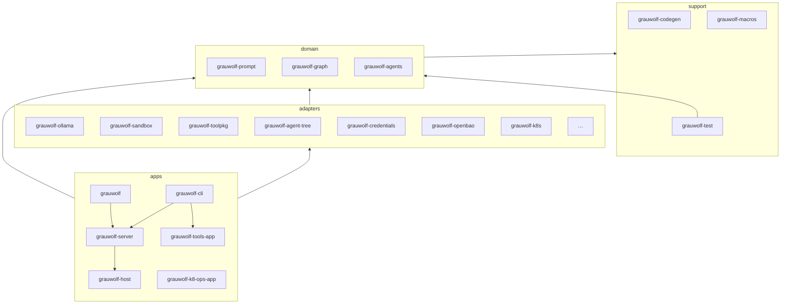
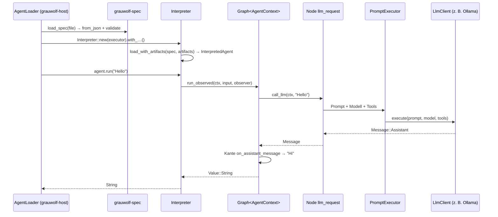

# Kapitel 1 – Architektur

Bevor du Code in grauwolf änderst oder das Framework aus Rust heraus nutzt, brauchst du ein Bild vom Ganzen: Welche Crates gibt es, wer darf von wem abhängen, und welchen Weg nimmt ein Lauf von der Spec-Datei bis zur Antwort? Dieses Kapitel liefert dir dieses Bild. Die Begriffe *Spec*, *Node*, *Kante*, *Tool* und *Strategie* kennst du aus dem [Nutzerhandbuch](../handbuch/README.md); hier geht es darum, wo sie im Code wohnen.

Die verbindlichen Entscheidungen stehen in den [ADRs](../adr/README.md), die Gesamtübersicht in [docs/architecture.md](../architecture.md). Dieses Kapitel ist der geführte Einstieg dazu.

## 1.1 Vier Schichten

grauwolf ist ein Cargo-Workspace. Alle Crates liegen unter `crates/<schicht>/<crate>`, und die Schicht ergibt sich allein aus dem Verzeichnis ([ADR-0016](../adr/0016-layered-architecture.md)):

| Schicht | Aufgabe | Beispiele |
|---|---|---|
| `domain/` | Fachlicher Kern: Nachrichten, Tools, Graph, Agent-Laufzeit, Spec. Definiert **Ports**. Kein IO, kein tokio. | `grauwolf-graph`, `grauwolf-agents`, `grauwolf-spec` |
| `adapters/` | Technik: HTTP, wasmtime, SQL, OpenTelemetry. Implementiert die Ports. | `grauwolf-ollama`, `grauwolf-sandbox` |
| `support/` | Generische Hilfen ohne Agenten-Wissen, dazu das Testkit. | `grauwolf-codegen`, `grauwolf-macros`, `grauwolf-test` |
| `apps/` | Zusammenbau: Kompositionswurzel, Fassade, CLI, HTTP-Server. Nur hier werden konkrete Adapter verdrahtet. | `grauwolf-host`, `grauwolf`, `grauwolf-cli`, `grauwolf-server`, `grauwolf-tools-app`, `grauwolf-k8-ops-app` |

Ein **Port** ist ein Trait, mit dem der fachliche Kern sagt, was er braucht – etwa „schicke einen Prompt an ein LLM“ (`LlmClient`) oder „führe ein gebautes Tool aus“ (`ToolRuntime`). Ein **Adapter** ist eine konkrete Implementierung dieses Traits, etwa `OllamaClient` oder `SandboxRuntime`. Dieses Muster heißt *Ports & Adapters*: Die Domain bleibt testbar und frei von Infrastruktur, und Adapter lassen sich austauschen.

### Abhängigkeitsrichtung

Abhängigkeiten zeigen immer nach innen, zur Domain:



Die Regeln im Einzelnen, so wie sie `xtask/src/arch.rs` prüft:

- **domain** darf von anderen Domain-Crates und von Support-Crates abhängen, aber nicht vom Testkit `grauwolf-test` (das nur als `dev-dependency`). Externe Crates nur aus einer festen Liste: `serde`, `serde_json`, `serde_path_to_error`, `schemars`, `thiserror`, `futures-core`, `futures-util`, `async-lock`, `pin-project-lite`. Kein `tokio`, kein `reqwest`, kein `sqlx`, kein `wasmtime`.
- **support** darf beliebige externe Crates nutzen, aber keine grauwolf-Crate – Ausnahme: `grauwolf-test` darf Domain-Crates verwenden.
- **adapters** dürfen alles außer `apps/*`.
- **apps** dürfen alles, halten untereinander aber eine Reihenfolge ein (ADR-0108, Stufe 4d): `grauwolf-host` (Kompositionswurzel) → `grauwolf-server` (HTTP-Seite) → `grauwolf-cli`. Neben dem Host steht `grauwolf-tools-app`, das schlanke Programm `grauwolf-tools` zum Bauen und Verteilen von Tools (ADR-0118): Die CLI hängt davon ab, es hängt von keiner anderen App-Crate ab, und nur die CLI hängt von ihm ab (ein Test hält seinen Abhängigkeitsabschluss auf höchstens 75 % dessen der CLI). Ebenso ist `grauwolf-k8-ops-app`, das Operator-Programm für Kubernetes (ADR-0120), von keiner anderen App-Crate abhängig, und niemand hängt von ihm ab; kube-rs und `k8s-openapi` gibt es nur in `grauwolf-k8s` und damit nur in diesem Programm. Der Host darf nicht vom Server, der CLI oder der Fassade abhängen, der Server nicht von der CLI oder der Fassade, die CLI nicht von der Fassade. Die Fassade `grauwolf` ist nur die öffentliche API obendrauf (Re-Exporte, die Makros und die Cargo-Features) und darf keine eigene Logik enthalten; `check-arch` weist Item-Schlüsselwörter wie `fn`, `struct` oder `impl` in `crates/apps/grauwolf/src` zurück.
- Keine Domain-, Adapter- oder Support-Crate hängt von `grauwolf-host`, `grauwolf-server`, `grauwolf-cli` oder `grauwolf` ab, auch nicht als `dev-dependency`.

Andere `dev-dependencies` sind von den Regeln ausgenommen. Deshalb können Domain-Tests das Testkit oder sogar die Sandbox nutzen. Eine dev-dependency auf eine App-Crate bräuchte einen Eintrag in `APP_DEV_DEPENDENCY_EXCEPTIONS` in `xtask/src/arch.rs`; einen solchen Eintrag gibt es heute nicht.

### Der Architekturtest

Die Regeln sind kein Papier, sondern ein Test. `cargo xtask check-arch` liest `cargo metadata`, ordnet jede Crate ihrer Schicht zu und meldet Verstöße:

```text
$ cargo xtask check-arch
Architecture ok: 51 crates checked.
```

Gezählt wird jedes Paket des Workspace: die 50 Crates unter `crates/` plus `xtask`. Ein Verstoß wird unter `Architecture violations (ADR-0016):` aufgelistet, z. B. als `grauwolf-agents (Domain) must not depend on tokio`. Verstöße gegen die App-Reihenfolge nennen die Kante und die Regel, z. B. `grauwolf-cli (Apps) must not depend on grauwolf (dependency): rule app order host -> server -> cli …`. Derselbe Test läuft als Teil von `cargo test --workspace` (`xtask/tests/workspace_architecture.rs`), du kannst ihn also nicht vergessen. Das Alias ist in `.cargo/config.toml` definiert.

Was der Test **nicht** prüft: die feineren Listen „Erlaubte Abhängigkeiten“ in den `AGENTS.md` der einzelnen Crates. Die pflegst du von Hand (siehe [Kapitel 2](02-entwicklungsumgebung.md)).

## 1.2 Crate-Landkarte

Jede Crate hat eine `AGENTS.md` (mit Symlink `CLAUDE.md`), die Zweck, erlaubte Abhängigkeiten und Invarianten beschreibt. Lies sie, bevor du an einer Crate arbeitest. Hier die Kurzfassung:

**domain/**

| Crate | Zweck |
|---|---|
| `grauwolf-prompt` | Konversationsmodell: `Message`/`MessagePart`, `Prompt`, `LlModel`, `LlmParams`, `StreamFrame`, Nutzung und Preise. |
| `grauwolf-llm` | Port `LlmClient` und `PromptExecutor`: Routing nach Anbieter, Fallback, Wiederholungen – ohne HTTP. |
| `grauwolf-tools` | Tool-Vertrag (`Tool`, `DynTool`), `ToolDescriptor`, `ToolRegistry`, Port `ToolRuntime`, Format der Tool-Pakete. |
| `grauwolf-graph` | Graph-Modell, Node- und Condition-Katalog, `Graph<Ctx>`-Engine auf `serde_json::Value`, typisierter Builder. |
| `grauwolf-agents` | Agent-Laufzeit: `AgentContext`, Node-Implementierungen, Feature-Pipeline, Events, Checkpoints, Speicher-Ports. |
| `grauwolf-spec-model` | Das Datenmodell der Spec-DSL (`AgentSpec` und seine Teile), strikte Deserialisierung ohne Strategie-Expansion (`AgentSpec::parse`), JSON-Schema, lesende Hilfen (`providers`, `to_mermaid`, …). Keine Validierung (ADR-0108, Stufe 6). |
| `grauwolf-strategies` | Die Strategie-Vorlagen: `expand(&StrategySpec)` baut Graph und Typen von `single_run`, `react`, `verified`, `chat`. Hängt nur vom Modell und dem Node-Katalog ab. |
| `grauwolf-spec` | Re-exportiert das Modell; `AgentSpecExt` (`from_json` = Parsen + Expandieren, `validate`, `warnings`), JSON-Schema, semantische Validierung mit JSON-Pointer-Fehlern (ein Regelmodul je Anliegen in `src/validate/`, ADR-0108). |
| `grauwolf-interpreter` | Führt eine validierte Spec ohne Kompilieren aus. |
| `grauwolf-generator` | Erzeugt aus einer Spec eine Rust-Crate (`Cargo.toml`, `src/lib.rs`, gebaute Tools); eine Source-Map gibt es nicht. |
| `grauwolf-builder-agent` | Erzeugt aus einer Anforderung in Textform eine gültige Spec und repariert sie. |
| `grauwolf-planner` | Planner-Agenten: Plan-Schleife, LLM-Planner, GOAP. |
| `grauwolf-rag` | Dokumente zerlegen, einbetten und durchsuchen; Langzeitgedächtnis (`remember`/`recall`). |

**adapters/**

| Crate | Zweck |
|---|---|
| `grauwolf-llm-http` | Gemeinsame HTTP/SSE-Basis für Anbieter (reqwest, Fehlerabbildung). |
| `grauwolf-ollama`, `grauwolf-openai`, `grauwolf-anthropic`, `grauwolf-gemini`, `grauwolf-bedrock` | `LlmClient` je Anbieter mit eigenen DTOs. `grauwolf-bedrock` spricht die Bedrock-Converse-API und bringt zwei Protokollteile mit: die Signatur von AWS-Requests nach Signature Version 4 (`sigv4`, über `with_signer` in `HttpClient` eingehängt) und den Decoder des binären AWS-Event-Streams (`eventstream`, gespeist von `HttpClient::post_chunks`), mit dem `converse-stream` antwortet (ADR-0105). |
| `grauwolf-toolbuild` | Baut Tool-Code aus Specs zu WASM-Artefakten mit inhaltsadressiertem Cache. |
| `grauwolf-oci` | Allgemeiner OCI-Distributionsclient: Token-Ablauf, Digest-Prüfungen, Push, Zugangsdaten (Umgebung, Docker-Konfiguration), Image-Layout, In-Memory-Testregistry (ADR-0107, ADR-0108). |
| `grauwolf-git` | Gemeinsamer libgit2-Adapter: prozessweite libgit2-Einstellungen, der eigene Smart-HTTP-Transport mit Token-Authentifizierung und SSH-Signaturprüfungen von Commits und Tags gegen eine Datei mit erlaubten Signierern (ADR-0104, ADR-0107). |
| `grauwolf-toolpkg` | Tool-Pakete auf Basis von `grauwolf-oci`: Paketformat, Packen, Cache nach Digest, `grauwolf.lock`, Auflösung von `tool_packages`, die Tool-Policy mit Allowlists und Signaturprüfungen (ADR-0107); das Modul `setup` (Resolver für Umgebung, Policy, Schlüssel, Pack, Push) und `tree_lock` (eine Lockdatei für einen Agenten-Baum), die Host und `grauwolf-tools-app` gemeinsam nutzen (ADR-0118). |
| `grauwolf-agent-tree` | Der vorbereitete Agenten-Baum (ADR-0115): Lesephase über eine Spec und ihre Unteragenten mit programmspezifischen Prüfungen als `ReadOptions`, Auflösungsphase, Kopie in ein Image; Host und `grauwolf-tools-app` teilen sie sich (ADR-0118). |
| `grauwolf-credentials` | Quellen für Zugangsdaten hinter der zentralen Konfiguration (ADR-0110): der Abschnitt `[credentials]` (`CredentialsConfig`), `CredentialEnv` (eine `Env`, die zugeordnete Variablen aus den Quellen `file:` und `openbao:` beantwortet und in einem Hintergrund-Thread aktualisiert wird), `OpenBaoClient` (JWT-SVID-Anmeldung, KV-v2-Lesezugriffe, erneute Anmeldung), `CredentialEnv::check`. Der Host wendet das in `credentials::env_for` an (Feature `credentials`). |
| `grauwolf-openbao` | Die OpenBao-HTTP-API (ADR-0120): `Bao<T: Transport>` mit JWT-Anmeldung und KV-v2-Lesezugriff (genutzt von `grauwolf-credentials`) sowie die Admin-Aufrufe der Einrichtung (Auth-Methoden, JWT-Konfiguration, KV-Mounts, Policies, Rollen, KV schreiben/auflisten/löschen, `capabilities-self`, Health), idempotente `ensure_*`-Aufrufe; `HttpTransport` für direktes HTTP, andere Transporte (der Kubernetes-Service-Proxy) liefert der Aufrufer. |
| `grauwolf-k8s` | Der Kubernetes-Zugriff von `grauwolf-k8-ops` (ADR-0120): `Cluster` über kube-rs (rustls) mit Objekten als JSON-Werten (`get`, `list`, `ensure` = Server-Side Apply mit Field-Manager `grauwolf-k8-ops` und einer Hash-Annotation, `patch` = JSON-Merge-Patch, `delete`, `pod_log`, `pod_log_stream`, `can_i`, `raw`); Feature `testing`: `FakeCluster`, ein API-Server im Speicher als Tower-Service (mit Simulation von Deployment und Job). |
| `grauwolf-spiffe` | Die Workload-Identität des Agenten (ADR-0109): der Port `WorkloadIdentity` (`jwt_svid(audience)`), `WorkloadApiClient` (ein eigener, minimaler gRPC-Client über den Unix-Socket in `SPIFFE_ENDPOINT_SOCKET`, ohne `protoc`) und mit Feature `testing` `FakeIdentity` und `FakeWorkloadApi`. |
| `grauwolf-config` | Der Port `Env` mit `ProcessEnv`/`MapEnv`, der Abschnitt `RegistryConfig` und `VARIABLES`, die eine Tabelle aller Umgebungsvariablen; die `config` des Hosts re-exportiert sie (ADR-0118). |
| `grauwolf-sandbox` | `ToolRuntime` auf Basis von wasmtime mit Limits. |
| `grauwolf-builtin-tools` | Leichte eingebaute Tools: Dateien unter einer Wurzel, Schlüssel-Wert, To-do, think, Benutzer-Ein-/Ausgabe (ohne `git2`, ohne `reqwest`). |
| `grauwolf-tools-git` | Git-Tools für ein Repository auf libgit2 (über `grauwolf-git`). |
| `grauwolf-tools-web` | Das Tool `fetch`: Hosts aus einer Allowlist, Adressprüfungen, HTML zu Text. |
| `grauwolf-tools-command` | Das Tool `run_command`: Allowlist oder Shell-Modus, geleerte Umgebung, Beenden der Prozessgruppe bei Timeout (nur Unix; ADR-0099). |
| `grauwolf-mcp` | MCP-Client und -Server: Tools von MCP-Servern als grauwolf-Tools. |
| `grauwolf-a2a` | A2A-Client: entfernte Agenten als Unteragenten. |
| `grauwolf-otel` | OpenTelemetry-Spans aus Agent-Events. |
| `grauwolf-systemone` | `Decider` für Entscheidungs-Nodes: ein System-One-Dienst wie RKEV über HTTP. |
| `grauwolf-store-sql` | SQL-Speicher (SQLite/Postgres) für Gesprächsverläufe und Checkpoints. |
| `grauwolf-store-pgvector` | PostgreSQL mit pgvector für Wissen und Langzeitgedächtnis (ADR-0106): inkrementelles Indexieren, Gedächtnis je Benutzer mit Ablauf. |

**support/**

| Crate | Zweck |
|---|---|
| `grauwolf-codegen` | Generischer Rust-Code-Builder (Fork von `carllerche/codegen`) mit Syntaxprüfung und Formatierung. |
| `grauwolf-macros` | Proc-Makro `#[tool]`: Tools aus Funktionen. |
| `grauwolf-test` | Testkit: regelbasierter `MockLlmClient` und die Konformitäts-Suite für `LlmClient`. |

**apps/**

| Crate | Zweck |
|---|---|
| `grauwolf-host` | Kompositionswurzel (ADR-0108, Stufe 4a): baut Anbieter aus der typisierten Konfiguration (`config`: Port `Env`, Abschnitte von `Config`, Tabelle der Variablen), lädt Specs (`AgentLoader`) und stellt alles, was ein Agenten-Lauf braucht, in einem Modul bereit (`provisioning`, ADR-0114: Tools, Gedächtnis, Wissen, MCP, Unteragenten; daneben Pakete und Telemetrie). |
| `grauwolf` | Fassade: re-exportiert die Crates und die Module des Hosts unter denselben Pfaden je Cargo-Feature; kein eigener Code (die Chat-API, die Beobachtungen und der Dienststart werden aus `grauwolf-server` re-exportiert). |
| `grauwolf-cli` | Das Programm `grauwolf` (`spec validate`, `run`, `chat`, `serve`, `generate`, …); sein Unterbefehl `tools` delegiert an `grauwolf-tools-app`. |
| `grauwolf-tools-app` | Das Programm `grauwolf-tools` (ADR-0118): `build`, `pack`, `push`, `pull`, `inspect`, `lock`, `keygen`, `validate` als Bibliothek plus ein kleines Binary (etwa 8 MB, ein kalter Release-Build in unter einer Minute). Das Paket heißt so, weil die Domain-Crate `grauwolf-tools` den anderen Namen hat. Hängt nur von `grauwolf-config`, `-spec`, `-tools`, `-toolbuild`, `-toolpkg` und `-agent-tree` ab. |
| `grauwolf-k8-ops-app` | Das Programm `grauwolf-k8-ops` (ADR-0120): `doctor`, `oidc install`, `openbao setup`, `agent add/list/remove/check/deploy/status/logs/undeploy`, `secret set/get/list/delete`, `trust-domain set/restore` über `grauwolf-k8s`, `grauwolf-openbao` und `grauwolf-agent-tree` (der Baum von `agent deploy --spec`). Hängt von keiner anderen App-Crate ab; niemand hängt von ihm ab. |
| `grauwolf-server` | Die HTTP-Seite: Agenten als HTTP-Dienst und A2A-Server, die Chat-API mit ihren Beobachtungen, der Start generierter Dienste (ADR-0108, Stufe 4c); hängt vom Host ab. |

Dazu kommt `xtask/` mit Entwicklungswerkzeugen (bisher nur `check-arch`).

## 1.3 Drei Eingänge, eine Engine

grauwolf kennt drei Wege, einen Agenten zu beschreiben:

1. **Typisierter Rust-Builder** – du baust den Graphen im Code (`TypedGraph::build`), und der Compiler prüft die Typen an den Kanten ([Kapitel 3](03-rust-api.md)).
2. **Interpreter** – eine Spec (JSON) wird zur Laufzeit geladen und ausgeführt.
3. **Generator** – aus einer Spec entsteht eine eigenständige Rust-Crate, die den typisierten Builder nutzt ([Kapitel 6](06-generator.md)).

Alle drei laufen auf **derselben** Engine `Graph<Ctx>` aus `grauwolf-graph` ([ADR-0017](../adr/0017-value-engine.md)). Die Engine arbeitet auf `serde_json::Value`: Eine Node ist eine Funktion `(&mut Ctx, Value) -> Future<Result<Value>>`, und eine Kanten-Bedingung bildet den Ausgabewert auf `Option<Value>` ab (passt / passt nicht, ggf. umgewandelt). Kanten werden in Deklarationsreihenfolge geprüft, die erste passende gewinnt. Eine Kante kann außerdem eine **Transformation** tragen (`TransformFn`, ADR-0102): Sie bildet den Wert ab, nachdem die Bedingung gepasst hat, und bevor das Ziel läuft. Die Eingabe des Ziels – und damit der Wert seines Checkpoints – ist also der transformierte Wert. Die Node `code`, die Bedingung `on_code` und die Kanten-Transformation `transform` sind Code aus der Spec; sie werden wie Tools gebaut und ausgeführt ([Kapitel 4](04-tools-intern.md#44-vom-spec-code-zum-wasm-modul-toolbuilder)).

Damit die drei Wege nicht auseinanderlaufen, gibt es **Kataloge** ([ADR-0018](../adr/0018-node-catalog.md), [ADR-0021](../adr/0021-condition-catalog.md)): Jede Node-Art (`llm_request`, `execute_tool`, …) und jede Bedingung (`on_tool_call`, …) ist genau einmal in `grauwolf-graph` beschrieben – mit Parameter-Schema und Signatur. Spec-Validierung, Interpreter, Generator und Builder leiten sich daraus ab.

## 1.4 Der Weg eines Laufs

Verfolgen wir, was passiert, wenn du `grauwolf spec run echo.json "Hello"` aufrufst oder aus Rust `AgentLoader::load` nutzt. Die Spec ist `examples/specs/echo.json`:

```json
{
  "spec_version": 1,
  "name": "echo",
  "model": { "provider": "ollama", "id": "llama3.2" },
  "system_prompt": "Repeat the user's message verbatim.",
  "graph": {
    "nodes": [ { "id": "call_llm", "kind": "llm_request" } ],
    "edges": [
      { "from": "start", "to": "call_llm" },
      { "from": "call_llm", "to": "finish", "when": { "kind": "on_assistant_message" } }
    ]
  }
}
```



### Schritt 1: Spec lesen – `load_spec`

`grauwolf::loader::load_spec(file)` (`crates/apps/grauwolf-host/src/loader.rs`) liest die Datei, löst die Datei-Verweise der Tools auf (`tool_files`, `code_file`, [ADR-0073](../adr/0073-tool-files.md)) und ruft dann zwei Funktionen aus `grauwolf-spec` auf (Methoden der Erweiterungs-Trait `AgentSpecExt`, `use grauwolf_spec::AgentSpecExt;`):

- `AgentSpec::from_json(&json)` (`AgentSpec::parse` aus `grauwolf-spec-model` plus `grauwolf_strategies::expand`) deserialisiert **strikt** (`deny_unknown_fields`, [ADR-0025](../adr/0025-strict-spec.md)), prüft `spec_version` und expandiert eine `strategy` (z. B. `single_run`, `react`) zu einem gewöhnlichen Graphen ([ADR-0041](../adr/0041-strategy-templates.md)). Danach sieht niemand mehr die Strategie, nur noch den Graphen.
- `spec.validate()` prüft gegen die Kataloge: IDs, Namensräume, Kanten, Typen an den Kanten, Tools, Subgraphen. Es liefert **alle** Fehler auf einmal, jeweils mit JSON-Pointer.

Fehler kommen als Text mit Datei und Pointer zurück, etwa `broken.json:/graph/edges/0/to: …` (nach `crates/apps/grauwolf-host/tests/loader.rs`, das eine Datei namens `kaputt.json` verwendet).

### Schritt 2: Agent zusammenbauen – `AgentLoader`

`AgentLoader::load` erledigt alles, was Infrastruktur braucht – deshalb liegt er in der Kompositionswurzel `grauwolf-host` (von der Fassade re-exportiert) und nicht in der Domain:

1. `executor_for(spec.providers(), env)` baut einen `PromptExecutor` mit je einem Client für jeden Anbieter der Spec (auch für Subgraph-Modelle) und einer Wiederholungsstrategie.
2. Ein `Interpreter` wird mit Features, Interceptors, Preisen, Budget und Freigaben ausgestattet.
3. Hat die Spec Tool-Code, baut `ToolBuilder` ihn zu WASM-Artefakten, und eine `SandboxRuntime` wird als Tool-Laufzeit gesetzt ([Kapitel 4](04-tools-intern.md)). `tool_packages` werden hier einmal gegen `grauwolf.lock` aufgelöst, und ihre Tools gehen mit `with_package_tools` an den Interpreter ([Abschnitt 4.10](04-tools-intern.md#410-tool-pakete-aus-registries-adr-0107)).
4. Externe Tools (MCP, eingebaute Tools, Wissen) und Unteragenten (`agent_tools`, lokal oder über A2A) werden geladen – die Unteragenten aus dem vorbereiteten Agenten-Baum (`grauwolf::agent_tree`, ADR-0115: ein Lese- und ein Auflösungsdurchgang über die Spec und ihre Unteragenten, Zyklen werden abgelehnt, ein geteilter Unteragent wird einmal geladen).
5. `interpreter.with_tools(external).load_with_artifacts(&spec, &artifacts)` liefert den `InterpretedAgent`.

### Schritt 3: Spec wird Graph – `Interpreter`

`Interpreter::load_with_artifacts` (`crates/domain/grauwolf-interpreter/src/lib.rs`) validiert die Spec noch einmal (der Interpreter akzeptiert nur gültige Specs), lädt die Tools über `ToolRuntime::instantiate` in eine `ToolRegistry` und baut mit `build_graph` den `Graph<AgentContext>`:

- Für gewöhnliche Node-Arten liefert `grauwolf_agents::implementations::node(kind, params, types)` die Node-Funktion, für Bedingungen `implementations::condition(kind, params)`.
- Die Arten `subgraph`, `plan`, `goap`, `parallel` und `for_each` brauchen die ganze Spec (sie verweisen auf Subgraphen oder Agenten) und werden im Interpreter selbst zusammengesetzt. Subgraphen mit eigener Tool-Auswahl oder eigenem Modell bekommen einen `SubgraphScope`.

### Schritt 4: Der Lauf – `AgentContext` und Nodes

`InterpretedAgent::run("Hello")` erzeugt für jeden Lauf einen **frischen** `AgentContext`. Der Kontext ist der Zustand eines Laufs: Prompt-Verlauf, aktives Modell, Tool-Registry, Speicher, installierte Features und Interceptors, Nutzung und Kosten. Dann übergibt er ihn an den **Lauf-Lebenszyklus** (`grauwolf_agents::run_lifecycle::AgentRun`, ADR-0116), der die Reihenfolge eines Laufs festlegt: `agent_starting`, automatisches Abrufen aus dem Gedächtnis, Einblenden von Wissen, der Graph-Lauf (`graph.run_observed(&mut ctx, input, observer)`, als Funktion übergeben), automatisches Merken, das Speichern eines Gesprächs und genau eines von `agent_completed` / `agent_failed`. Einfache Läufe, Läufe mit Checkpoints und fortgesetzte Läufe sind Optionen desselben Lebenszyklus, und auch generierter Code ruft ihn auf, sodass beide Wege dieselbe Abfolge teilen.

Die Engine führt Node für Node aus. Die Node `llm_request` hängt die Eingabe als Benutzer-Nachricht an den Prompt, schickt ihn über den `PromptExecutor` an den `LlmClient` des aktiven Anbieters und gibt die Assistenten-Nachricht zurück. Die Bedingung `on_assistant_message` lässt nur reine Textantworten durch und wandelt sie in einen `String` um – das ist die Ausgabe des Laufs.

### Schritt 5: Events

Unterwegs meldet der Kontext **Domain-Events** (`AgentEvent`): `agent_starting`, `node_starting`, `llm_call_starting`, `llm_call_completed`, `tool_call_starting`, …, am Ende `agent_completed` mit Nutzung und Kosten oder `agent_failed`. Wer zuhören will, installiert ein `Feature` – etwa ein JSONL-Log oder OpenTelemetry. Details in [Kapitel 7](07-ereignisse-und-beobachtung.md).

## 1.5 Interpreter und Generator

| | Interpreter | Generator |
|---|---|---|
| Eingabe | Spec zur Laufzeit | Spec zur Build-Zeit |
| Ergebnis | `InterpretedAgent` im selben Prozess | Rust-Crate mit `graph()`, `run(executor, input)` und Structs für die Typen |
| Typprüfung | Validierung gegen die Kataloge | zusätzlich der Rust-Compiler |
| Tool-Code | Artefakte über `ToolRuntime` | Artefakte unter `tools/`, ausgeführt in der Sandbox |
| Einsatz | CLI, Server, schnelles Ausprobieren | eigenständige Programme, Einbettung in größere Anwendungen |

Beide müssen sich **gleich** verhalten. Das sichern Äquivalenztests auf dem Spec-Korpus `examples/specs/` (`crates/domain/grauwolf-generator/tests/equivalence.rs`): Dieselbe Spec läuft im Interpreter und als generierte Crate gegen denselben `MockLlmClient`, und die Ergebnisse müssen übereinstimmen. Einige Funktionen gibt es bewusst nur im Interpreter, z. B. Tool-Ordner (`tools_dir`); der Generator meldet dann `GeneratorError::Unsupported`.

## 1.6 Der GOAP-Planer

Die Art `goap` (ADR-0070 und seine Nachträge) ist der einzige Node, dessen Planung datengetrieben ist, und sie ist im Interpreter und in generierten Crates derselbe Code: `grauwolf_planner::goap::fact_planner(params, steps)` baut aus den Parametern (als JSON) und den Schritt-Graphen der Subgraph-Aktionen einen `GoapPlanner<String, String, FactState>`; `planner_node` führt ihn aus und meldet den Fortschritt unter `grauwolf.plan.<id>`.

- **Zustand:** `FactState { task, facts, output }`. Ein Fakt ist ein `FactValue` (`Bool`, `Int`, `Number`, `Text`); sein Typ ist durch den Anfangswert in `state` und die Liste unter `values` festgelegt. Zahlen werden über ihre Bits verglichen und gehasht, sodass Zustände Schlüssel der A*-Maps sein können.
- **Bedingungen und Wirkungen** (`pre`, Ziel-`facts`; `effects`, `on_success`, `on_failure`) werden einmal in kleine Werte geparst (`Condition { fact, op, value }`, `Change::{Set, Add}`). Die Spec-Prüfung (`grauwolf-spec`, `validate/goap.rs`) wiederholt dieselben Regeln mit Pointern für Fehlermeldungen, weil die Spec-Crate nicht vom Planer abhängt.
- **Suche:** A* je Ziel über die *erwarteten* Wirkungen (`effects`), begrenzt durch `max_search_nodes` und `max_plan_depth`; das Ziel mit dem kleinsten `cost / (priority + 1)` gewinnt, bei Gleichstand entscheidet die Deklarationsreihenfolge. Der Planer plant vor jedem Schritt ab dem tatsächlichen Zustand neu.
- **Ausführung:** Ein `ActionRun` rendert die `input`-Vorlage, führt den Executor aus – einen Schritt-Graphen oder `AgentContext::run_agent_step` bei einem `agent` – und wendet `on_success` oder `on_failure` an (ein Fehlschlag ist ein Executor-Fehler oder ein fehlendes `success_contains`; ohne `on_failure` schlägt der Node fehl). Felder einer Objekt-Antwort überschreiben Fakten gleichen Namens und Typs (*beobachteter Zustand*), was eine neue Planung auslöst, wenn die Welt von der Erwartung abweicht.
- **Tests:** `grauwolf-planner/tests/fact_*.rs` (Planer), `grauwolf-spec/tests/goap.rs` (Prüfungen), `grauwolf-interpreter/tests/goap*.rs`, sowie der Generator-Snapshot und der Äquivalenzfall für `examples/specs/review_loop.json`.

## Das Wichtigste in Kürze

- Vier Schichten: `domain` (fachlich, Ports, kein IO), `adapters` (Technik), `support` (generisch, Testkit), `apps` (Zusammenbau). Abhängigkeiten zeigen nach innen.
- `cargo xtask check-arch` prüft die Schichtenregeln und läuft in `cargo test --workspace` mit.
- Jede Crate hat eine `AGENTS.md` mit Zweck, Abhängigkeiten und Invarianten.
- Ein Lauf: `load_spec` → `AgentSpec::from_json` + `validate` → `AgentLoader` → `Interpreter::load_with_artifacts` → `Graph<AgentContext>` → Nodes rufen über den `PromptExecutor` das LLM → Events an Features.
- Builder, Interpreter und Generator teilen eine Engine und die Kataloge; Äquivalenztests halten Interpreter und Generator gleich.

Weiter mit [Kapitel 2 – Entwicklungsumgebung](02-entwicklungsumgebung.md).
