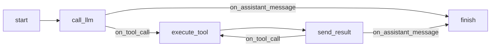

# Kapitel 3 – grauwolf als Bibliothek

Die CLI ist nur eine dünne Schicht über einer Rust-API. Dieselbe API kannst du in deinem eigenen Programm nutzen: Specs laden und ausführen, Agenten mit Gesprächen, Features und Freigaben ausstatten, eigene Tools in Rust schreiben und Graphen ganz ohne JSON im Code bauen. Das Kapitel geht schrittweise vor – vom einfachsten Lauf über eigene Tools bis zum eigenen Graphen.

## 3.1 Die Fassade `grauwolf`

Für Anwendungen ist die Crate `grauwolf` (`crates/apps/grauwolf`) der Einstieg. Sie re-exportiert die Teil-Crates unter kurzen Namen und die Module der Kompositionswurzel `grauwolf-host` (`crates/apps/grauwolf-host`, ADR-0108 Stufe 4a) unter denselben Pfaden, sodass `grauwolf::loader` gleich `grauwolf_host::loader` ist. Die Bausteine, die Infrastruktur brauchen, leben im Host; seine Cargo-Features (`ollama`, `mcp`, `builtin`, `git`, …) sind die gleichnamigen Features der Fassade:

| Pfad | Inhalt |
|---|---|
| `grauwolf::spec`, `::interpreter`, `::agents`, `::graph`, `::llm`, `::prompt`, `::tools`, `::rag`, `::toolbuild`, `::builder_agent` | Re-Exporte der Domain-Crates (immer vorhanden) |
| `grauwolf::ollama`, `::openai`, `::anthropic`, `::gemini`, `::bedrock`, `::sandbox` | Re-Exporte der Adapter (je nach Cargo-Feature) |
| `grauwolf::providers` | Anbieter-Clients und `PromptExecutor` aus Umgebungsvariablen |
| `grauwolf::loader` | `load_spec`, `AgentLoader` (Specs samt Tools und Unteragenten laden) |
| `grauwolf::features` | `JsonlEventLog` (Events als JSON-Zeilen) |
| `grauwolf::checkpoints`, `::memory` | Datei- und SQL-Speicher für Checkpoints und Gespräche |
| `grauwolf::runtime` | `TokioClock`, der tokio-Adapter für den Port `Clock` |
| `grauwolf::prelude` | Alltägliche Importe in einer Zeile: `AgentSpec` mit `AgentSpecExt` (`from_json`, `validate`, `warnings`), `Interpreter`, `AgentLoader`, `load_spec`, `executor_from_env`, `Config`/`Env`/`MapEnv`/`ProcessEnv`, `PromptExecutor`, `LlModel`, `Message`, `Prompt`, `Prices`, `Usage`, `ToolDescriptor`, `DynTool`, `ToolError`, `ToolRegistry`, `AgentContext`, `Budget` sowie die Makros `tool`/`toolset` |

Die meisten Programme brauchen nur `use grauwolf::prelude::*;`. Ohne sie brauchen `AgentSpec::from_json` und `spec.validate()` das Trait im Gültigkeitsbereich: `use grauwolf::spec::AgentSpecExt;` (ADR-0108 Stufe 6).

### Cargo-Features

Standardmäßig ist alles eingeschaltet:

```toml
default = ["macros", "ollama", "openai", "anthropic", "gemini", "bedrock", "sandbox", "mcp", "builtin", "git", "fetch", "command", "atlassian", "sql", "otel", "a2a"]
```

Die eingebauten Tools sind nach Abhängigkeiten aufgeteilt (ADR-0108): `builtin` bringt die leichten Tools (Dateien, Schlüssel-Wert, To-do, think, Benutzer-Ein-/Ausgabe), `git` die Git-Tools (libgit2), `fetch` das Tool `fetch` (HTTP-Client), `command` das Tool `run_command` (Prozessstart, nur Unix) und `atlassian` die Jira- und Confluence-Tools. Eine Spec, die eine Gruppe nutzt, deren Feature abgeschaltet ist, schlägt vor dem Lauf fehl mit `this build has no git tools (feature `git`)` (ebenso `fetch`, `command`, `atlassian`).

Willst du schlanker bauen, schaltest du die Standard-Features ab und wählst aus. Beachte: Das Modul `grauwolf::loader` gibt es nur mit `mcp`, `builtin`, `sandbox` und `a2a` zusammen, weil der Lader alle diese Tool-Quellen verdrahtet. Ohne das Feature eines Anbieters meldet `providers::client_from` für diesen Anbieter `ProviderError::Unknown`.

Bis zum ersten Release bindest du grauwolf über einen Pfad (oder Git) ein:

```toml
[dependencies]
grauwolf = { path = "../grauwolf/crates/apps/grauwolf" }
tokio = { version = "1", features = ["macros", "rt-multi-thread"] }
```

## 3.2 Der einfachste Lauf

Eine Spec laden, einen Executor für ihren Anbieter bauen, den Agenten starten:

```rust
use std::path::Path;
use std::sync::Arc;

use grauwolf::interpreter::Interpreter;
use grauwolf::loader::load_spec;
use grauwolf::providers::executor_from_env;

#[tokio::main]
async fn main() -> Result<(), Box<dyn std::error::Error>> {
    let spec = load_spec(Path::new("hello.json"))?;            // read + validate
    let executor = executor_from_env(&spec.model.provider)?;   // e.g. OLLAMA_HOST
    let agent = Interpreter::new(Arc::new(executor)).load(&spec)?;

    let answer = agent.run("What is the capital of France?").await?;
    println!("{answer}");
    Ok(())
}
```

Die Bausteine:

- `load_spec(path)` liest die Datei, löst Tool-Dateien auf und validiert; Fehler sind Text mit Datei und JSON-Pointer (`crates/apps/grauwolf-host/src/loader.rs`).
- `executor_from_env(provider)` baut einen `PromptExecutor` mit dem Client des Anbieters und einer Wiederholungsstrategie (`RetryPolicy::default()` mit `TokioClock`). Die Variablen sind dieselben wie in der CLI: `OLLAMA_HOST` (und `OLLAMA_THINK`), `OPENAI_API_KEY`/`OPENAI_BASE_URL`, `ANTHROPIC_API_KEY`, `GEMINI_API_KEY`/`GEMINI_BASE_URL`, `AWS_ACCESS_KEY_ID`/`AWS_SECRET_ACCESS_KEY`/`AWS_SESSION_TOKEN` oder `AWS_BEARER_TOKEN_BEDROCK` mit `AWS_REGION` und `BEDROCK_BASE_URL` (`bedrock`), und für die OpenAI-kompatiblen Anbieter (`openrouter`, `deepseek`, `mistral`, `groq`, `dashscope`, `xai`) `<NAME>_API_KEY`/`<NAME>_BASE_URL`, z. B. `GROQ_API_KEY` (`crates/apps/grauwolf-host/src/providers.rs`, Liste `BUILTIN`). Für Specs mit mehreren Anbietern (Subgraph-Modelle) nimmst du `executor_for(spec.providers(), |v| std::env::var(v).ok())`.
- `Interpreter::new(executor).load(&spec)` validiert und baut einen `InterpretedAgent`.
- `run(text)` führt einen Lauf mit Text-Ein- und -Ausgabe in einem frischen Kontext aus.

`Interpreter::load` reicht nur für Specs ohne Tool-Code und ohne externe Tools. Hat die Spec `tools`, meldet er `InterpreterError::MissingArtifact`; fehlen MCP-, eingebaute oder Unteragenten-Tools, `MissingExternalTool`. Für solche Specs nimmst du den `AgentLoader`.

## 3.3 Alles inklusive: `AgentLoader`

`grauwolf::loader::AgentLoader` erledigt den Großteil dessen, was `grauwolf spec run` tut: Tool-Code bauen, Sandbox einrichten, MCP-Server starten, Wissen indexieren, Langzeitgedächtnis öffnen, eingebaute Tools und Unteragenten (rekursiv) laden. Nicht dabei sind der Tool-Ordner (`tools_dir`; den lädst du mit `grauwolf::tools_dir`, siehe [Kapitel 4](04-tools-intern.md)) und das automatische Gedächtnis (`RunExtras.memory`, Abschnitt 3.5).

```rust
use grauwolf::loader::AgentLoader;
use grauwolf::toolbuild::ToolBuilder;

let loader = AgentLoader::new(ToolBuilder::new(".grauwolf/tools"));  // cache for WASM artifacts
let (spec, agent) = loader.load(Path::new("examples/specs/calculator.json"), None).await?;
let answer = agent.run("What is 2+3?").await?;
```

Aus `crates/apps/grauwolf-host/tests/loader.rs`: Der Lader ist der Lieferant von Unteragenten (`SubAgentSupplier`, siehe „Provisioning“ weiter unten); er bietet die Unteragenten aus `agent_tools` einzeln als Tools für einen Benutzer an, so bekommen es generierte Crates:

```rust
let loader = AgentLoader::new(ToolBuilder::new(std::env::temp_dir().join("grauwolf-loader-tools")));
let (spec, _agent) = loader.load(&specs().join("coordinator.json"), None).await.unwrap();
let tools: Vec<_> = loader.supply(&spec, &specs()).await.unwrap()
    .iter().map(|agent| agent.tool_for(None)).collect();
assert_eq!(tools[0].name(), "translator");
```

Das zweite Argument von `load` ist ein optionaler `FrameSink` – eine Funktion, die Streaming-Frames live erhält (nur der Hauptagent, nicht seine Unteragenten).

### Einstellungen für alle geladenen Agenten

Der Lader ist ein Builder; jede Einstellung gilt für den Agenten **und** seine Unteragenten:

| Methode | Wirkung |
|---|---|
| `with_feature(Arc<dyn Feature>)` | Feature in jedem Agenten installieren (z. B. ein Event-Log) |
| `with_agent_features(AgentFeatures)` | Features je Spec, z. B. ein Tracing-Feature mit dem Namen der Spec |
| `with_interceptor(Arc<dyn Interceptor>)` | In LLM- und Tool-Aufrufe eingreifen ([Kapitel 7](07-ereignisse-und-beobachtung.md)) |
| `with_prices(Arc<Prices>)` | Kosten je LLM-Aufruf und Lauf berechnen ([ADR-0071](../adr/0071-costs.md)) |
| `with_budget(Budget)` | Jeden Lauf begrenzen ([ADR-0072](../adr/0072-run-budget.md)); Unteragenten haben ein eigenes Budget |
| `with_tool_approval(Vec<String>)` | Tools freigabepflichtig machen ([ADR-0061](../adr/0061-tool-approval.md)) |
| `with_user_io(Arc<dyn UserIo>)` | Wohin `say_to_user`/`ask_user` sprechen (Standard: Konsole) |
| `with_env(Arc<dyn Env>)` | Variablen aus `env` statt aus dem Prozess lesen (siehe „Konfiguration und Umgebung“ unten) |
| `with_chat_api_mode(bool)` | Chat-API-Modus: `OLLAMA_BASE_URL` ersetzt ein fehlendes `OLLAMA_HOST` ([ADR-0094](../adr/0094-chat-api.md)) |
| `with_decider(Arc<dyn Decider>)` | Der `system_one`-Decider der Entscheidungs-Nodes; ohne ihn baut der Lader einen aus `RKEV_BASE_URL` für Specs, die ihn brauchen ([ADR-0100](../adr/0100-decision-node.md)) |

### Konfiguration und Umgebung

Jede Umgebungsvariable, die grauwolf liest, ist einmal beschrieben, in `grauwolf::config` (`crates/apps/grauwolf-host/src/config.rs`, ADR-0108 Stufe 4b):

- `Env` ist der Port (`fn var(&self, name) -> Option<String>`); `ProcessEnv` liest die Prozessumgebung, `MapEnv::new([("OLLAMA_HOST", "http://x")])` ist eine feste Menge für Tests, und jede `Fn(&str) -> Option<String>` ist ebenfalls eine `Env`.
- `Config::from_env(&dyn Env)` baut die typisierten Abschnitte `providers`, `registry`, `atlassian`, `git`, `system_one`, `service`, `chat_api` und `telemetry`; jeder Abschnitt hat außerdem sein eigenes `from_env` und `from_lookup`, sodass ein Modul, das einen davon braucht, nie die anderen ansieht. Werte bleiben so, wie die Variable sie hält; der Doc-Kommentar jedes Feldes sagt, wo ein leerer oder nur aus Leerzeichen bestehender Wert als nicht gesetzt gilt (dieselben Stellen wie vor der zentralen Konfiguration).
- `config::VARIABLES` listet jede Variable mit ihrem Abschnitt und ihrer Bedeutung; die Tabelle in der CLI-Referenz ([Umgebungsvariablen](../handbuch/referenz-cli.md#umgebungsvariablen)) nennt dieselben Variablen, und ein Unit-Test schlägt fehl, wenn eine davon dort fehlt oder `Config` eine Variable liest, die nicht in der Tabelle steht.

Die Host-Module nehmen einen Abschnitt oder eine Umgebung statt den Prozess zu lesen: `client_with`, `executor_for_config`, `embedder_with` (`ProvidersConfig`), `decider_with` (`SystemOneConfig`), `packages::resolver_with`, `resolve_tools_with`, `push_package_with` (`RegistryConfig`), `OtelTracing::init_with` (`TelemetryConfig`) und `env::expand_with` (`${VAR}` in Headern); der Lader behält seine Umgebung (`with_env`), und die Provisionierung (siehe „Provisioning“ unten) liest alles aus der `Env`, die sie bekommt. Die Closure-Varianten der Anbieter-Funktionen (`client_from(provider, env_fn)`, `executor_from_env`, …) bleiben erhalten; die Funktionsleitern der Tool-Provisionierung (`external::tools*`, `builtin::tools*`, …) sind entfallen (ADR-0114, vor 1.0, ohne Wrapper). Die Prozessumgebung wird nur an Einstiegspunkten gelesen: in der CLI, in `service::main` (`ServiceConfig::from_env` der Fassade) und in den generierten Crates. Ein Test von Host-Logik übergibt deshalb ein `MapEnv` und ruft nie `std::env::set_var` auf.

Außerhalb der zentralen Konfiguration: Die OTLP-Variablen (`OTEL_EXPORTER_OTLP_*`) liest das OpenTelemetry-SDK, `CARGO` und `RUSTC` liest der Tool-Build und `generate --check`.

Beispiel mit Preisen, Budget und Event-Log:

```rust
use grauwolf::agents::Budget;
use grauwolf::features::JsonlEventLog;
use grauwolf::prompt::Prices;

let prices: Prices = serde_json::from_str(r#"{
    "currency": "USD",
    "models": { "openai:gpt-4o-mini": { "input": 0.15, "output": 0.6 } }
}"#)?;                                                  // prices per million tokens
let loader = AgentLoader::new(ToolBuilder::new(".grauwolf/tools"))
    .with_prices(Arc::new(prices))
    .with_budget(Budget { max_tokens: Some(20_000), max_cost: Some(0.05), ..Default::default() })
    .with_feature(Arc::new(JsonlEventLog::new(std::io::stderr())));
```

`Prices::cost` rechnet `Tokens × Preis / 1 000 000`; der Schlüssel ist `<Anbieter>:<id>` (`crates/domain/grauwolf-prompt/src/usage.rs`). `Budget` implementiert `Default` und hat die öffentlichen Felder `max_tokens`, `max_cost`, `max_tool_calls` ([ADR-0078](../adr/0078-run-limits-in-specs.md)) und `max_prompt_tokens` ([ADR-0087](../adr/0087-tokenizer.md)); es wird vor jeder LLM-Anfrage geprüft.

### Provisioning: alles, was ein Lauf braucht

`grauwolf::provisioning` (ADR-0114) ist das eine Modul, das bereitstellt, was ein Agenten-Lauf außer seinem Graphen braucht: Modellzugang (der Executor), den Decider `system_one`, die Tools von außerhalb des Graphen – MCP-Server, Wissen, die eingebauten Gruppen, Skills, Gedächtnis-Tools, den Schlüssel-Wert-Speicher, Unteragenten – und das Langzeitgedächtnis. Es startet von einer **geladenen, aufgelösten Spec** (Code-Dateien gelesen, Git-Skills lokalisiert, Tool-Pakete aufgelöst; das erledigt der Lader) und arbeitet in zwei Stufen:

- `ProvisionedAgent::new(&spec, base_dir, options).await` wird einmal je geladenem Agenten gebaut und von all seinen Läufen geteilt: Executor, Decider, gestartete MCP-Server, das indexierte Wissen, die Konfiguration der eingebauten Tools, Skills, das geöffnete Gedächtnis und die Unteragenten. Alles, was fehlschlagen kann (eine fehlende Zugangsdatei, ein nicht einkompiliertes Feature, ein nicht erreichbarer Server), schlägt hier fehl.
- `agent.run(user)` ist ein günstiges `ProvisionedRun` je Lauf und Benutzer: `user_tools()` (die Gedächtnis-Tools, der Schlüssel-Wert-Speicher und die Unteragenten des Benutzers, die in dessen Auftrag laufen), `facts()` (automatisches Gedächtnis), `directory_tools().await` (die Tools von `tools_dir`, je Lauf neu geladen) und `extras().await`, das `RunExtras` für `InterpretedAgent::run_with` liefert. `agent.tools()` und `agent.tools_for(user)` geben eine flache Liste für Aufrufer, die die Tools selbst weiterreichen.

```rust
use grauwolf::config::ProcessEnv;
use grauwolf::provisioning::{ProvisionOptions, ProvisionedAgent};

let options = ProvisionOptions::new(Arc::new(ProcessEnv));          // the one environment
let agent = ProvisionedAgent::new(&spec, base_dir, options).await?;
let run = agent.run(Some("anna"))?;                                  // per run and user
let answer = interpreted.run_with("Hi".into(), run.extras().await).await?;
```

`ProvisionOptions` hält, was zum Agenten gehört: die `Env` (der einzige Ort, aus dem Konfiguration gelesen wird – Anbietereinstellungen, Zugangsdaten, `${VAR}` in Headern und die Werte, die das Command-Tool weitergibt), Benutzer-Ein-/Ausgabe, einen Decider, den Beobachter der MCP-Tool-Listen, die Features für Unteragenten, den LLM-Cache, den Tool-Builder für `tools_dir` und den Lieferanten der Unteragenten. `with_executor` und `with_embedder` ersetzen die Anbieter (eigene Anbieter, Tests). Unteragenten kommen über den Port `SubAgentSupplier`, den der `AgentLoader` implementiert; generierter Code übergibt `AgentLoader::for_provisioning(builder, &options)`. Der Benutzer des aufrufenden Laufs wird an Unteragenten-Läufe weitergegeben. Tests der Tool-Provisionierung gehören hierher: Baue ein `ProvisionedAgent` mit einem `MapEnv` (siehe `crates/apps/grauwolf-host/tests/provisioning.rs`).

## 3.4 Den `Interpreter` direkt konfigurieren

Brauchst du mehr Kontrolle – etwa eine eigene Tool-Laufzeit oder eigene Tools neben der Spec –, konfigurierst du den `Interpreter` selbst. Er hat dieselben Builder-Methoden wie der Lader und einige mehr (`crates/domain/grauwolf-interpreter/src/lib.rs`):

| Methode | Wirkung |
|---|---|
| `with_tool_runtime(Arc<dyn ToolRuntime>)` | Laufzeit für Tool-Artefakte, z. B. `SandboxRuntime` |
| `with_tools(Vec<Arc<dyn DynTool>>)` | Externe Tools; angeboten werden nur die, die die Spec deklariert (`AgentSpec::external_tools()`) |
| `with_tool_factory(Arc<dyn ToolFactory>)` | Fabrik für selbst gebaute Tools (`self_tools`, [ADR-0075](../adr/0075-self-made-tools.md)) |
| `with_frame_sink(FrameSink)` | Streaming-Frames aller Läufe |
| `with_feature`, `with_interceptor`, `with_prices`, `with_budget`, `with_tool_approval` | wie beim Lader |

Für Specs mit Tool-Code übergibst du die gebauten Artefakte selbst:

```rust
let artifacts = grauwolf::loader::build_tools(file, &spec, &ToolBuilder::new(".grauwolf/tools"))?;
let agent = Interpreter::new(Arc::new(executor))
    .with_tool_runtime(Arc::new(grauwolf::sandbox::SandboxRuntime::new()?))
    .load_with_artifacts(&spec, &artifacts)?;
```

## 3.5 Läufe: `run`, `run_json`, `run_with`

Ein `InterpretedAgent` kann beliebig oft laufen; jeder Lauf bekommt einen frischen `AgentContext`.

- `run(text) -> Result<String, _>` – für Specs mit Ein- und Ausgabe `string`.
- `run_json(value) -> Result<Value, _>` – für benannte Typen. Die Eingabe wird gegen den Typ geprüft und normalisiert; passt sie nicht, kommt `InterpreterError::Input`.
- `run_with(value, RunExtras { … })` – wie `run_json`, aber mit Handles **nur für diesen Lauf**.
- `run_conversation(value, store, id)`, `run_checkpointed(value, store, run_id)`, `resume(store, run_id)` – Gespräche und Checkpoints; `run_checkpointed_with(.., extras)` und `resume_with(store, run_id, extras)` nehmen `RunExtras` wie `run_with` (ohne Gespräch; `resume_with` baut selbst gebaute Tools aus dem Checkpoint neu, ADR-0077).

Aus `crates/domain/grauwolf-interpreter/tests/echo.rs` – ein Agent mit benanntem Typ:

```rust
let spec = AgentSpec::from_json(r#"{ "spec_version": 1, "name": "relay",
    "model": { "provider": "ollama", "id": "m" },
    "types": { "Answer": { "type": "object", "properties": { "text": { "type": "string" } } } },
    "input": "Answer", "output": "Answer",
    "graph": { "edges": [ { "from": "start", "to": "finish" } ] } }"#).unwrap();
let agent = Interpreter::new(Arc::new(PromptExecutor::builder().build())).load(&spec).unwrap();

let output = block_on(agent.run_json(serde_json::json!({ "text": "hi" }))).unwrap();
assert_eq!(output, serde_json::json!({ "text": "hi" }));
```

### `RunExtras`

`RunExtras` hat sechs öffentliche Felder und implementiert `Default`:

| Feld | Typ | Wirkung |
|---|---|---|
| `feature` | `Option<Arc<dyn Feature>>` | Zusätzliches Feature nur für diesen Lauf |
| `frame_sink` | `Option<FrameSink>` | Ersetzt den Frame-Sink des Interpreters |
| `conversation` | `Option<(Arc<dyn ChatHistoryStore>, String)>` | Gespräch: Speicher und ID |
| `tools` | `Vec<Arc<dyn DynTool>>` | Tools nur für diesen Lauf; sie ersetzen gleichnamige (z. B. das Gedächtnis eines Benutzers) |
| `approver` | `Option<ToolApprover>` | Gibt freigabepflichtige Tools frei; ohne ihn werden sie abgelehnt |
| `memory` | `Option<Arc<dyn FactMemory>>` | Langzeitgedächtnis für `auto_recall`/`auto_remember` |

Aus `crates/domain/grauwolf-interpreter/tests/run_with.rs` (gekürzt):

```rust
let history = Arc::new(MemoryChatHistoryStore::default());
let output = block_on(agent.run_with(
    json!("Hello"),
    RunExtras {
        feature: Some(recorder.clone()),
        frame_sink: Some(Arc::new(move |frame: &StreamFrame| {
            if let StreamFrame::TextDelta { text } = frame {
                sink_frames.lock().unwrap().push_str(text);
            }
        })),
        conversation: Some((history.clone(), "anna".into())),
        ..RunExtras::default()
    },
))
.unwrap();
```

Nach dem Lauf liegen im Gesprächsspeicher die Benutzer- und die Assistenten-Nachricht (ohne System-Prompt); der nächste Lauf mit derselben ID setzt das Gespräch fort. Dauerhafte Speicher findest du in `grauwolf::memory::FileChatHistoryStore` und `grauwolf::checkpoints::FileCheckpointStore`.

### Agenten als Tools: `into_tool`

Ein Agent kann Tool eines anderen Agenten sein ([ADR-0040](../adr/0040-agent-as-tool.md)). `Arc<InterpretedAgent>::into_tool(name, description)` liefert ein `Arc<dyn DynTool>`. Bei Texteingabe ist das Argument `{ "request": "…" }`, bei einem benannten Eingabetyp dessen Schema; strukturierte Ausgaben kommen als JSON-Text zurück. Aus `crates/domain/grauwolf-interpreter/tests/agent_tool.rs` (gekürzt):

```rust
let agent = interpreter(MockLlmClient::new("?").answer_when_contains("Hola", "Hello"))
    .load(&example("echo.json"))
    .unwrap();

let tool = Arc::new(agent).into_tool("translator", "Translates into English");
let answer = block_on(tool.call_json(json!({ "request": "Hola" }))).unwrap();
assert_eq!(answer, "Hello");
```

## 3.6 Eigene Tools in Rust mit `#[tool]`

Tool-Code in Specs läuft in der WASM-Sandbox. Tools, die **du** in Rust schreibst, laufen dagegen direkt im Prozess. Am bequemsten entstehen sie mit dem Makro `#[tool]` aus `grauwolf-macros` ([ADR-0003](../adr/0003-tool-definition.md), F03.5). Aus `crates/domain/grauwolf-tools/tests/tool_macro.rs`:

```rust
use grauwolf_macros::tool;
use grauwolf_tools::{DynTool, ToolError, ToolRegistry};

/// Adds two numbers.
#[tool]
async fn add(#[arg("First number")] a: f64, #[arg("Second number")] b: f64) -> Result<f64, ToolError> {
    Ok(a + b)
}

/// Greets someone.
#[tool]
fn greet(name: String) -> Result<String, ToolError> {
    Ok(format!("Hello {name}"))
}

let registry = ToolRegistry::builder().tool(Add).tool(Greet).build();
assert_eq!(block_on(registry.call("add", json!({ "a": 2, "b": 3 }))).unwrap(), "5.0");
assert_eq!(block_on(registry.call("greet", json!({ "name": "World" }))).unwrap(), "\"Hello World\"");
```

Aus `add` erzeugt das Makro den Typ `Add` (das Tool) und `AddArgs` (die Argumente mit JSON-Schema). Der Tool-Name ist der Funktionsname, die Beschreibung stammt aus dem Doc-Kommentar, die Beschreibungen der Argumente aus `#[arg("…")]`. Die Funktion darf `async` sein oder nicht und muss `Result<T, ToolError>` liefern; `T` wird dem Modell als JSON-Text übergeben.

Für deine `Cargo.toml` genügt die Fassade: Schreib `#[grauwolf::tool]` bzw. `#[grauwolf::toolset]` (Feature `macros`, standardmäßig an). Der erzeugte Code verweist dann auf `::grauwolf::tools`; serde und schemars kommen über `grauwolf::tools::__private`. Nur wer ohne Fassade arbeitet, bindet `grauwolf-macros` und `grauwolf-tools` direkt ein und schreibt `#[tool]`/`#[toolset]` – deren Code verweist auf `::grauwolf_tools` (ADR-0003 Nachtrag). Beispiel über die Fassade: `crates/apps/grauwolf/tests/macros.rs`.

### Mehrere Tools mit gemeinsamem Zustand: `#[toolset]`

Brauchen mehrere Tools dasselbe Objekt – eine Datenbankverbindung, einen Warenkorb, einen Zähler –, schreibst du sie als Methoden eines `impl`-Blocks. `#[toolset]` macht jede Methode mit `#[tool]` zu einem Tool; alle teilen sich das Objekt über `Arc<Self>`. Aus `crates/domain/grauwolf-tools/tests/toolset_macro.rs`:

```rust
use grauwolf_macros::toolset;

struct Shop {
    cart: Mutex<Vec<String>>,
}

#[toolset]
impl Shop {
    /// Puts an item into the shopping cart.
    #[tool]
    fn add_to_cart(&self, #[arg("Name of the item")] item: String) -> Result<String, ToolError> {
        self.cart.lock().unwrap().push(item);
        Ok(self.summary())
    }

    /// Counts the items in the shopping cart.
    #[tool]
    async fn count_items(&self) -> Result<usize, ToolError> {
        Ok(self.cart.lock().unwrap().len())
    }

    /// Not a tool method: stays an ordinary method.
    fn summary(&self) -> String {
        self.cart.lock().unwrap().join(", ")
    }
}

let shop = Arc::new(Shop { cart: Mutex::new(Vec::new()) });
let registry = ToolRegistry::default().extended(Arc::clone(&shop).tools());
```

- `tools(self: Arc<Self>)` liefert alle Tools als `Vec<Arc<dyn DynTool>>`, in der Reihenfolge der Methoden – passend für `ToolRegistry::extended`, `Interpreter::with_tools` oder `RunExtras.tools`.
- Je Tool entstehen `<Typ><Methode>` (hier `ShopAddToCart`, das den `Arc<Shop>` hält) und `<Typ><Methode>Args`. Name, Beschreibung und `#[arg("…")]` funktionieren wie bei `#[tool]`.
- Tool-Methoden nehmen `&self`; veränderlicher Zustand gehört hinter einen `Mutex` o. Ä. Das Objekt muss `Send + Sync + 'static` sein, weil Tools zwischen Tasks wandern.
- Abgelehnt mit erklärendem Compile-Fehler: `&mut self` oder fehlendes `self` an einer Tool-Methode, generische `impl`-Blöcke und Trait-Implementierungen.

Ohne Makro implementierst du das Trait `Tool` selbst (`type Args: Deserialize + JsonSchema`, `type Output: Serialize`, `name`, `description`, `call`); `crates/domain/grauwolf-agents/tests/tool_loop.rs` zeigt das am Beispiel `Add`. Wie `Tool`, `DynTool` und `ToolRegistry` zusammenhängen, erklärt [Kapitel 4](04-tools-intern.md).

## 3.7 Ein Graph im Code

Statt einer Spec kannst du den Ablauf direkt mit dem typisierten Builder `TypedGraph` aus `grauwolf-graph` bauen und die fertigen Nodes und Bedingungen aus `grauwolf-agents` verwenden. Der Compiler prüft, dass die Typen an jeder Kante zusammenpassen.

### Ein Aufruf

Aus `crates/domain/grauwolf-agents/tests/llm_request.rs`:

```rust
use grauwolf_agents::{AgentContext, conditions, nodes};
use grauwolf_graph::TypedGraph;
use grauwolf_llm::PromptExecutor;
use grauwolf_prompt::{LlModel, Prompt};

let graph = TypedGraph::<AgentContext, String, String>::build(|g| {
    let call_llm = g.node("call_llm", nodes::llm_request);
    g.edge(&g.start(), &call_llm);
    g.edge_when(&call_llm, &g.finish(), conditions::on_assistant_message);
})
.unwrap();

let mut ctx = AgentContext::new(
    Arc::new(executor),
    LlModel::new("mock", "m"),
    Prompt::builder("echo").system("Be brief.").build(),
);
let answer = block_on(graph.run(&mut ctx, "Hello".to_string())).unwrap();
```

Die Typparameter von `TypedGraph<Ctx, I, O>` sind Kontext, Eingabe und Ausgabe. `g.node(id, f)` liefert einen `NodeHandle<I, O>`; `g.edge(&a, &b)` kompiliert nur, wenn die Ausgabe von `a` die Eingabe von `b` ist. `nodes::llm_request` nimmt einen `String` und liefert eine `Message`; die Bedingung `conditions::on_assistant_message` macht aus einer reinen Textantwort einen `String` und lehnt alles andere ab (`None`).

Nach dem Lauf kannst du den Kontext untersuchen: `ctx.prompt().messages` enthält den Verlauf, `ctx.usage()` und `ctx.cost()` die Nutzung.

### Mit Tools

Die Tool-Schleife aus `crates/domain/grauwolf-agents/tests/tool_loop.rs`: Tools hängen über `with_tools` am Kontext, und zwei Bedingungen verzweigen nach der Antwort des Modells.

```rust
let mut ctx = AgentContext::new(Arc::new(executor), LlModel::new("mock", "m"), Prompt::builder("calc").build())
    .with_tools(ToolRegistry::builder().tool(Add).build());

let graph = TypedGraph::<AgentContext, String, String>::build(|g| {
    let call_llm = g.node("call_llm", nodes::llm_request);
    let execute_tool = g.node("execute_tool", nodes::execute_tool);
    let send_result = g.node("send_result", nodes::llm_send_tool_result);
    g.edge(&g.start(), &call_llm);
    g.edge_when(&call_llm, &execute_tool, conditions::on_tool_call);
    g.edge_when(&call_llm, &g.finish(), conditions::on_assistant_message);
    g.edge(&execute_tool, &send_result);
    g.edge_when(&send_result, &execute_tool, conditions::on_tool_call);
    g.edge_when(&send_result, &g.finish(), conditions::on_assistant_message);
})
.unwrap();

let answer = block_on(graph.run(&mut ctx, "What is 2+3?".to_string())).unwrap();
```



Kanten werden in Deklarationsreihenfolge geprüft. Passt keine, ist das ein Laufzeitfehler; außerdem bricht die Engine nach `DEFAULT_MAX_STEPS` (50) Schritten ab (`GraphBuilder::max_steps` ändert das für untypisierte Graphen).

### Eigene Nodes

Eine Node ist eine Funktion `Fn(&mut Ctx, I) -> BoxFuture<Result<O, NodeError>>`. Der Doc-Test an `TypedGraphBuilder::edge` (`crates/domain/grauwolf-graph/src/typed.rs`) zeigt die kleinste Form:

```rust
let graph = TypedGraph::<(), String, usize>::build(|g| {
    let length = g.node("length", |_, text: String| Box::pin(async move { Ok(text.len()) }));
    g.edge(&g.start(), &length);
    g.edge(&length, &g.finish());
});
```

Mit `TypedGraph<(), String, String>` kompiliert dasselbe nicht – die Kante von `usize` nach `String` ist ein Typfehler. Ein- und Ausgabetypen müssen `Serialize + DeserializeOwned` sein, weil die Engine an den Node-Grenzen auf `serde_json::Value` arbeitet. Subgraphen hängst du mit `g.subgraph(id, subgraph, scope)` ein.

Solche Nodes gibt es nur im Code. Damit eine Node-Art auch in Specs verfügbar ist, kommt sie in den Katalog – siehe [Kapitel 5](05-erweitern.md).

## 3.8 Strukturierte Ausgaben

Soll das Modell ein festes Format liefern, nutzt du `nodes::llm_request_structured::<T>`. `T` implementiert `Structured` und nennt Name und JSON-Schema des Typs ([ADR-0031](../adr/0031-structured-output.md)). Aus `crates/domain/grauwolf-agents/tests/llm_request_structured.rs`:

```rust
#[derive(Debug, PartialEq, serde::Serialize, serde::Deserialize)]
struct Ticket {
    title: String,
    priority: i64,
}

impl Structured for Ticket {
    fn structured_output() -> StructuredOutput {
        StructuredOutput {
            name: "Ticket".into(),
            schema: serde_json::json!({
                "type": "object",
                "properties": { "title": { "type": "string" }, "priority": { "type": "integer" } },
                "required": ["title", "priority"]
            }),
        }
    }
}

let graph = TypedGraph::<AgentContext, String, Ticket>::build(|g| {
    let triage = g.node("triage", nodes::llm_request_structured::<Ticket>);
    g.edge(&g.start(), &triage);
    g.edge(&triage, &g.finish());
})
.unwrap();
let ticket = block_on(graph.run(&mut ctx, "Bug in the login".to_string())).unwrap();
```

Die Antwort darf in einen ```` ```json ````-Block eingebettet sein; der Node parst sie in den Typ. Mit `nodes::llm_request_structured_with_retries::<T, N>` fragt er bei unbrauchbaren Antworten bis zu `N`-mal nach. Im Interpreter entspricht das der Node-Art `llm_request_structured` mit `params.type` und `params.retries`; der Generator erzeugt für benannte Typen genau solche Structs mit `Structured`-Implementierung ([Kapitel 6](06-generator.md)).

## Das Wichtigste in Kürze

- Einstieg ist die Fassade `grauwolf`; Cargo-Features wählen Anbieter und Adapter.
- Einfachster Lauf: `load_spec` → `executor_from_env` → `Interpreter::new(..).load(&spec)` → `run(text)`.
- `AgentLoader` lädt Specs komplett (Tool-Build, Sandbox, MCP, eingebaute Tools, Unteragenten) und gibt Features, Interceptors, Preise, Budget und Freigaben an alle Agenten weiter.
- `run_with(value, RunExtras { … })` gibt einem einzelnen Lauf Feature, Frame-Sink, Gespräch, Tools, Freigeber und Gedächtnis; `into_tool` macht einen Agenten zum Tool.
- Rust-Tools mit `#[grauwolf::tool]`, mehrere Tools mit gemeinsamem Zustand mit `#[grauwolf::toolset]` an einem `impl`-Block (nur die Fassade nötig), Graphen im Code mit `TypedGraph::build` und den Nodes/Bedingungen aus `grauwolf_agents`.

Weiter mit [Kapitel 4 – Tools von innen](04-tools-intern.md).
