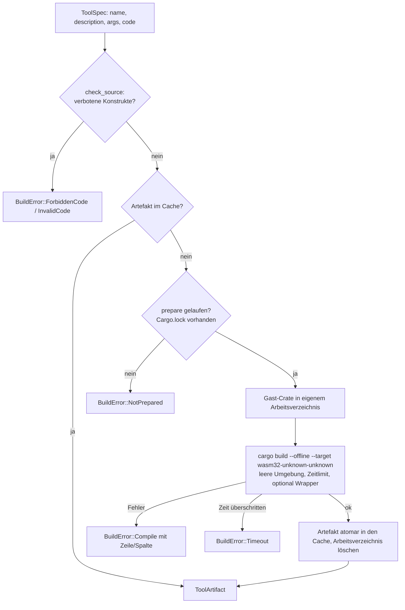
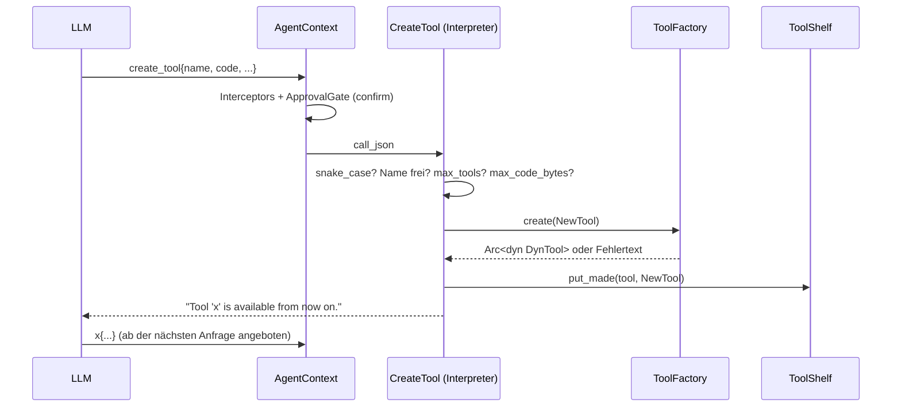
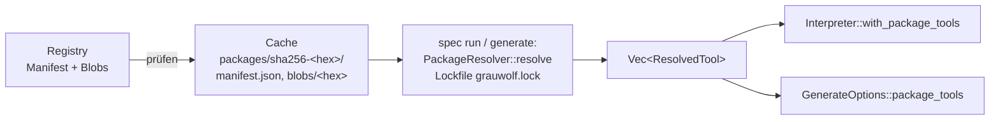

# Kapitel 4: Tools von innen

In [Kapitel 3](03-rust-api.md) hast du Tools aus Rust heraus benutzt, im
[Nutzerhandbuch](../handbuch/03-tools.md) aus einer Spec. Dieses Kapitel öffnet die Haube: Wie sieht
der Vertrag eines Tools aus, wie wird Tool-Code aus einer Spec zu WebAssembly (WASM) gebaut, wie läuft
er abgeschottet, und wie kommen Tools von außen (MCP, eingebaute Tools, Unteragenten) oder sogar
während des Laufs dazu? Am Ende weißt du, an welcher Stelle du eingreifst, wenn du ein Tool-Problem
untersuchst oder eine neue Tool-Quelle anbindest.

Die beteiligten Crates:

| Crate | Schicht | Aufgabe |
|---|---|---|
| `grauwolf-tools` | domain | Vertrag `Tool`/`DynTool`, `ToolRegistry`, `ToolShelf`, Ports `ToolRuntime` und `ToolFactory` |
| `grauwolf-toolbuild` | adapters | Tool-Code aus Specs → WASM-Modul (`ToolBuilder`) |
| `grauwolf-oci` | adapters | Allgemeiner OCI-Distributionsclient: Registry-Zugriff, Zugangsdaten, Image-Layout (Abschnitt 4.10) |
| `grauwolf-toolpkg` | adapters | Tool-Pakete darauf aufgesetzt: Format, Packen, Cache, Lockfile (Abschnitt 4.10) |
| `grauwolf-sandbox` | adapters | `SandboxRuntime`: führt WASM-Module in wasmtime aus |
| `grauwolf-git` | adapters | Gemeinsamer libgit2-Adapter: Transport und Token-Authentifizierung |
| `grauwolf-mcp`, `grauwolf-builtin-tools`, `grauwolf-tools-git`, `grauwolf-tools-web`, `grauwolf-a2a` | adapters | Tools von außen |
| `grauwolf` (Fassade) | apps | setzt alles zusammen: `external`, `tools_dir`, `self_tools`, `loader` |

## 4.1 Der Vertrag: `Tool` und `DynTool`

Ein **Tool** ist eine Funktion, die das Modell mit JSON-Argumenten aufrufen kann und die Text
zurückgibt. `grauwolf-tools` kennt zwei Formen davon:

- **`Tool`** ist typisiert: Argumente (`Args`) und Ergebnis (`Output`) sind Rust-Typen. Aus
  `Args` entsteht über `schemars` das JSON-Schema, das das Modell zu sehen bekommt.
- **`DynTool`** ist die objektsichere Form („JSON rein, Text raus“). Die Registry, die Sandbox,
  MCP und Unteragenten arbeiten ausschließlich damit.

```rust
pub trait Tool: Send + Sync + 'static {
    type Args: DeserializeOwned + JsonSchema + Send;
    type Output: Serialize + Send;
    fn name(&self) -> &str;
    fn description(&self) -> &str;
    fn call(&self, args: Self::Args) -> BoxFuture<'_, Result<Self::Output, ToolError>>;
}

pub trait DynTool: Send + Sync {
    fn name(&self) -> &str;
    fn descriptor(&self) -> ToolDescriptor;
    fn call_json(&self, args: Value) -> BoxFuture<'_, Result<String, ToolError>>;
}
```

Jedes `Tool` ist über eine Blanket-Implementierung automatisch ein `DynTool`: `call_json`
deserialisiert die Argumente (Fehler → `ToolError::InvalidArgs`), ruft `call` und serialisiert
`Output` als JSON. Darum liefert ein `f64`-Ergebnis den Text `"5.0"` und ein `String`-Ergebnis
`"\"Hello world\""` (mit Anführungszeichen). Der `ToolDescriptor` (aus `grauwolf-prompt`) enthält
`name`, `description` und `parameters` (das JSON-Schema).

**Tools mit Zustand.** Ein Tool, das sich über Aufrufe und Checkpoints hinweg etwas merken muss (die
`todo`-Tools, ADR-0098), überschreibt zwei Methoden von `DynTool` mit Standardimplementierung:
`state_key()` benennt einen Schlüssel im Agenten-Speicher, und `call_with_state(args, &mut Value)`
arbeitet auf dem gespeicherten Wert (beim ersten Mal `null`). Der `AgentContext` führt einen solchen
Aufruf unter der Sperre des Speichers aus und behält den geänderten Wert nur, wenn der Aufruf
gelingt; da der Speicher Teil jedes `ContextSnapshot` ist, übersteht der Zustand ein Fortsetzen
(Resume). Ohne Kontext wird nur `call_json` benutzt.

Ein vollständiges typisiertes Tool, aus `crates/domain/grauwolf-tools/tests/registry.rs`:

```rust
struct Add;

#[derive(Deserialize, JsonSchema)]
struct AddArgs { a: f64, b: f64 }

impl Tool for Add {
    type Args = AddArgs;
    type Output = f64;
    fn name(&self) -> &str { "add" }
    fn description(&self) -> &str { "Adds two numbers" }
    fn call(&self, args: AddArgs) -> BoxFuture<'_, Result<f64, ToolError>> {
        Box::pin(async move { Ok(args.a + args.b) })
    }
}
```

Kürzer geht es mit dem Makro `#[tool]` aus `grauwolf-macros` (siehe [Kapitel 3](03-rust-api.md));
es erzeugt genau diese Implementierung aus einer Funktion und nimmt die Beschreibung aus dem
Doc-Kommentar.

`DynTool` implementierst du direkt, wenn das Schema erst zur Laufzeit feststeht – so machen es
Sandbox-, MCP- und Agenten-Tools. Beispiel aus `crates/domain/grauwolf-interpreter/tests/tool_approval.rs`:

```rust
struct Upper;

impl DynTool for Upper {
    fn name(&self) -> &str { "upper" }
    fn descriptor(&self) -> ToolDescriptor {
        ToolDescriptor {
            name: "upper".into(),
            description: "Converts text to upper case".into(),
            parameters: json!({ "type": "object" }),
        }
    }
    fn call_json(&self, args: Value) -> BoxFuture<'_, Result<String, ToolError>> {
        let text = args["text"].as_str().unwrap_or_default().to_uppercase();
        Box::pin(async move { Ok(text) })
    }
}
```

### Fehler sind Ergebnistext

`ToolError` hat drei Varianten: `UnknownTool`, `InvalidArgs` und `Execution`. Ein Tool-Fehler
beendet den Lauf **nicht**. `AgentContext::execute_tool` (in `grauwolf-agents`, `context.rs`) macht
aus jedem Fehler einen Ergebnistext `Error: …` und gibt ihn dem Modell zurück, damit es sich
korrigieren kann (F03.8, ADR-0027). Dasselbe gilt für ein Tool, das im aktiven Subgraphen nicht
erlaubt ist („Error: tool 'x' is not available in this section“), und für einen Aufruf, den
ein Interceptor verweigert (Abschnitt 4.9).

## 4.2 `ToolRegistry`: die Tools eines Agenten

Die `ToolRegistry` hält alle Tools eines Agenten, sortiert nach Namen (`BTreeMap`). Aufgebaut
wird sie mit einem Builder; `tool(..)` nimmt ein Tool by value, `shared(..)` ein schon geteiltes
`Arc<dyn DynTool>`, etwa aus einer `ToolRuntime`:

```rust
// based on crates/domain/grauwolf-tools/tests/registry.rs
let registry = ToolRegistry::builder().tool(Add).build();

let result = block_on(registry.call("add", json!({ "a": 2, "b": 3 }))).unwrap();
assert_eq!(result, "5.0");

let descriptors = registry.descriptors();
assert_eq!(descriptors[0].parameters["required"], json!(["a", "b"]));
```

Weitere Methoden:

- `descriptors()` – was dem Modell angeboten wird.
- `contains(name)` – gibt es das Tool (auch auf der Ebene, siehe unten)?
- `extended(tools)` – Kopie mit zusätzlichen Tools; gleichnamige werden **ersetzt**. Der
  Interpreter nutzt das für Tools, die nur für einen Lauf gelten (`RunExtras.tools`, ADR-0059).

Welche dieser Tools ein Node tatsächlich sieht, entscheidet nicht die Registry, sondern der
`AgentContext` über **Tool-Scopes**: Subgraphen mit eigener `tools`-Liste blenden alle anderen aus
(ADR-0027).

### `ToolShelf`: Tools, die während des Laufs dazukommen

Normalerweise steht die Registry beim Start fest. Für selbst gebaute Tools (Abschnitt 4.8) gibt
es die **Tool-Ebene** `ToolShelf`: eine geteilte, wachsende Menge (`Arc<RwLock<…>>`). Hängt man sie
mit `with_shelf` an eine Registry, sehen `descriptors()` und `call()` auch ihre Tools – und zwar
in allen Klonen der Registry, etwa in parallelen Zweigen:

```rust
// crates/domain/grauwolf-tools/tests/registry.rs
let shelf = grauwolf_tools::ToolShelf::default();
let registry = ToolRegistry::builder().build().with_shelf(shelf.clone());
let fork = registry.clone();

shelf.put(std::sync::Arc::new(Add)).unwrap();

assert_eq!(fork.descriptors()[0].name, "add");
// Ein Name wird nur einmal vergeben:
assert!(shelf.put(std::sync::Arc::new(Add)).is_err());
```

`is_on_shelf(name)` sagt, ob ein Tool erst während des Laufs dazugekommen ist; der Kontext braucht
das für die Sichtbarkeitsregeln selbst gebauter Tools.

## 4.3 Ports für Tool-Code: `ToolRuntime` und `ToolFactory`

Ein **Port** ist ein Trait in der Domain, den ein Adapter implementiert (siehe
[Kapitel 1](01-architektur.md)). Für Tool-Code aus Specs gibt es zwei:

```rust
pub struct ToolArtifact { pub name: String, pub bytes: Vec<u8>, pub hash: String }

pub trait ToolRuntime: Send + Sync {
    fn instantiate(&self, artifact: &ToolArtifact, descriptor: ToolDescriptor)
        -> Result<Arc<dyn DynTool>, ToolError>;
}

pub struct NewTool { pub name: String, pub description: String, pub args: Value, pub code: String }

pub trait ToolFactory: Send + Sync {
    fn create(&self, tool: NewTool) -> BoxFuture<'_, Result<Arc<dyn DynTool>, String>>;
}
```

- `ToolRuntime` nimmt **nur fertige Artefakte** entgegen, nie Quelltext (ADR-0014). Bauen ist ein
  eigener Schritt (ADR-0024).
- `ToolFactory` macht während eines Laufs aus Quelltext ein Tool (ADR-0075). Fehler sind Text für
  das Modell.

Der Interpreter bekommt die Laufzeit über `Interpreter::with_tool_runtime` und die Fabrik über
`with_tool_factory`. Fehlt die Laufzeit, obwohl die Spec Tools hat, meldet `load_with_artifacts`
`InterpreterError::MissingToolRuntime`; fehlt für ein Tool das Artefakt, `MissingArtifact`.

## 4.4 Vom Spec-Code zum WASM-Modul: `ToolBuilder`

Im Nutzerhandbuch steht Tool-Code als Rumpf in der Spec. `grauwolf-toolbuild` macht daraus ein
WASM-Modul. So läuft `ToolBuilder::build(&ToolSpec)` ab:



### Die Gast-Crate

Für jedes Tool entsteht eine kleine `cdylib`-Crate. Ihr `src/lib.rs` bettet den Code aus der Spec
in eine feste Funktion ein und ergänzt die ABI-Exporte (gekürzt aus `guest_source` in
`crates/adapters/grauwolf-toolbuild/src/lib.rs`):

```rust
use serde_json::Value;

fn tool(args: Value) -> Result<String, String> {
    /* `code` from the spec goes here */
}

#[unsafe(no_mangle)]
pub extern "C" fn gw_alloc(len: i32) -> i32 { /* reserve a buffer */ }

#[unsafe(no_mangle)]
pub extern "C" fn gw_call(pointer: i32, len: i32) -> i64 { /* read JSON, call tool(), write {"ok"|"err"} */ }
```

Einzige Abhängigkeit ist `serde_json`; Release-Profil mit `opt-level = "s"` und `panic = "abort"`.
Weil der Spec-Code in Zeile 6 beginnt (`CODE_FIRST_LINE`), rechnet der Builder Compiler-Meldungen
auf Zeilen **im Tool-Code** um (`CodeDiagnostic { level, message, line, column }`, F13.9). Die
Fassade macht daraus `<file>:/tools/<i>/code:<line>:<column>: error: …` (`build_error` in
`crates/apps/grauwolf-host/src/loader.rs`).

### Code von Graphen: `build_code` (ADR-0102)

Der Code eines `code`-Nodes, einer `on_code`-Bedingung und einer Kanten-`transform` wird von
derselben Pipeline gebaut: `AgentSpecExt::code_pieces()` listet die Teile einer Spec (`CodePiece`:
stabiler `name`, `kind`, der JSON-`pointer` des Codes, die Typnamen `input`/`output`, der Code und
die benannten Typen, die er benutzt), und `ToolBuilder::build_code(&piece)` (`cached_code`,
`code_guest_crate` für `--tool-sources`) führt dieselbe Prüfung, denselben Cache, den isolierten Build
und die Tool-ABI v1 aus. Nur der Gast-Quelltext unterscheidet sich (`code::piece_source`): die
Funktion des Nutzers steht zuerst, damit Compiler-Meldungen auf Zeilen des Codes zeigen wie bei
Tools; dahinter folgen Rust-Structs für die Spec-Typen mit handgeschriebenen Konvertierungen
`FromJson`/`ToJson` (der Gast behält seine einzige Abhängigkeit `serde_json`, keine Derive-Makros),
`type In`/`type Out` und `fn tool(args)`, die das JSON umwandelt, `run`/`check`/`transform` aufruft
und das Ergebnis als JSON-Text zurückgibt. Ein Panic ist ein Trap (`panic = "abort"`), den die Sandbox
wie ein aufgebrauchtes Fuel-Limit meldet: als Fehler des Aufrufs, nie als `false`.

Zur Laufzeit umhüllt `grauwolf_agents::code::CodeModule` ein über `ToolRuntime` geladenes Modul;
`code_node`, `code_condition` und `code_transform` machen daraus die Engine-Funktionen
(`NodeFn`, `ConditionFn`, `TransformFn`). Der Interpreter findet das Modul eines Teils über den
Pointer seines Codes (`AgentSpec::graph_pointer`); generierter Code ruft dieselben Funktionen mit
Modulen auf, die per `include_bytes!` eingebettet sind.

### Benutzen

Aus dem Test `crates/adapters/grauwolf-toolbuild/tests/build.rs`, leicht gekürzt – bauen und
direkt in der Sandbox ausführen:

```rust
let builder = ToolBuilder::new(cache_dir);
builder.prepare().unwrap();                     // einmalig, mit Netz

let tool = ToolSpec {
    name: "add".into(),
    description: "Adds two numbers".into(),
    args: json!({ "type": "object", "properties": {
        "a": { "type": "number" }, "b": { "type": "number" } } }),
    code: r#"
        let a = args["a"].as_f64().ok_or("a is missing")?;
        let b = args["b"].as_f64().ok_or("b is missing")?;
        Ok((a + b).to_string())
    "#.into(),
};
let artifact = builder.build(&tool).unwrap();

let descriptor = ToolDescriptor {
    name: tool.name.clone(),
    description: tool.description.clone(),
    parameters: tool.args.clone(),
};
let sandboxed = SandboxRuntime::new().unwrap().instantiate(&artifact, descriptor).unwrap();
assert_eq!(block_on(sandboxed.call_json(json!({ "a": 2, "b": 3 }))).unwrap(), "5");
```

### Cache, `prepare` und offline

- **Cache:** Artefakte liegen unter `<cache>/artifacts/<hash>.wasm`. Der Schlüssel ist ein Hash aus
  der Version der Gast-Vorlage (`GUEST_TEMPLATE_VERSION = "abi-v1.0"`), dem Tool-Namen, dem Code,
  dem Argument-Schema und der Ausgabe von `rustc --version`. Ändert sich nichts davon, wird nichts neu
  gebaut. `cached(tool)` fragt den Cache ab, ohne zu bauen. Die CLI nutzt standardmäßig
  `.grauwolf/tools` (`--cache`).
- **Ohne Toolchain:** Der Schlüssel enthält `rustc --version`. Wo es kein `rustc` gibt (das Image
  eines generierten Dienstes), tritt die Datei `<cache>/toolchain` an seine Stelle; `export_toolchain(dir)`
  schreibt sie (ADR-0115, Abschnitt 4.12).
- **`prepare()`** löst die Abhängigkeiten auf und lädt sie (mit Netzzugang), bevor fremder Code ins Spiel
  kommt, und schreibt eine gemeinsame `<cache>/Cargo.lock`. Der Aufruf ist idempotent. Jeder spätere Build
  läuft mit `--offline` und genau dieser Lockdatei. Ohne `prepare()` liefert `build` `NotPrepared`.
- **Ein eigenes Arbeitsverzeichnis pro Build**, danach gelöscht; das Artefakt wird über eine
  Zwischendatei und `rename` abgelegt. So stören sich auch parallele Builds desselben Tools nicht
  (Test `builds_tools_concurrently_into_a_fresh_cache`).

### Schutzschichten beim Build (ADR-0030)

Der Build führt Code aus, der von einem Modell stammen kann. Darum gibt es vier unabhängige
Schichten:

1. **Code-Prüfung** (`check_code`, F13.15): Der Code wird mit `proc_macro2` in Token zerlegt;
   abgelehnt werden `include!`, `include_str!`, `include_bytes!`, `env!`, `option_env!`, die
   Schlüsselwörter `mod`, `extern`, `unsafe` und jedes Attribut (`#[…]`) – auch verschachtelte.
2. **Abgeschotteter Cargo-Aufruf:** `env_clear()`, nur `PATH`, `HOME`, `CARGO_HOME`, `RUSTUP_HOME`,
   `RUSTUP_TOOLCHAIN` werden durchgereicht; `--offline`.
3. **Zeitlimit:** `with_timeout(Duration)`, Standard `DEFAULT_BUILD_TIMEOUT` = 300 s. cargo läuft in
   einer eigenen Prozessgruppe, die bei Überschreitung vollständig beendet wird (`BuildError::Timeout`).
4. **Optionaler Wrapper:** `with_wrapper(vec!["bwrap".into(), …])` stellt einen Befehl vor cargo
   (z. B. `bwrap …` oder `docker run --network none …`). In der CLI: `--build-wrapper`, pro Teil
   einmal angegeben. Für Dienste mit von einem LLM erzeugten Specs empfohlen.

Fehlt die Toolchain, erhältst du `BuildError::ToolchainMissing` mit einem Hinweis. Für die Tests muss
das Target installiert sein: `rustup target add wasm32-unknown-unknown` (siehe
[Kapitel 2](02-entwicklungsumgebung.md)).

## 4.5 Tool-ABI v1 (ADR-0029)

Die **ABI** (application binary interface) legt fest, wie Host und WASM-Modul Daten austauschen.
Version 1 ist bewusst minimal: ein **Core-WASM-Modul** für `wasm32-unknown-unknown` **ohne Imports**.

| Export | Signatur | Bedeutung |
|---|---|---|
| `memory` | – | der lineare Speicher des Moduls |
| `gw_alloc` | `(len: i32) -> i32` | reserviert `len` Bytes für die Eingabe, liefert den Pointer |
| `gw_call` | `(ptr: i32, len: i32) -> i64` | führt das Tool aus; Ergebnis `(ptr << 32) \| len` |

Ablauf eines Aufrufs: Der Host serialisiert die Argumente als UTF-8-JSON → `gw_alloc(len)` → schreibt
die Bytes in den Speicher → `gw_call(ptr, len)` → liest an der zurückgegebenen Stelle ein JSON
`{"ok": "<text for the LLM>"}` oder `{"err": "<error>"}`.

Weil es keine Imports gibt, hat Tool-Code **kein Dateisystem, kein Netz, keine Uhr und keinen
Zufall** – das ist durch den Aufbau so. Tools mit Fähigkeiten (z. B. HTTP) bräuchten eine ABI v2 mit
WASI-Komponenten; der Port `ToolRuntime` bliebe derselbe.

Ein minimales Modul nach ABI v1, direkt als WAT (das Textformat von WASM) geschrieben, aus
`crates/adapters/grauwolf-sandbox/tests/abi.rs`:

```wat
(module
  (memory (export "memory") 1)
  (data (i32.const 1024) "{\"ok\":\"pong\"}")
  (func (export "gw_alloc") (param i32) (result i32) (i32.const 2048))
  (func (export "gw_call") (param i32 i32) (result i64)
    (i64.or (i64.shl (i64.const 1024) (i64.const 32)) (i64.const 13))))
```

## 4.6 Die Sandbox: `SandboxRuntime`

`grauwolf-sandbox` implementiert `ToolRuntime` mit wasmtime:

- `instantiate` übersetzt das Modul und **lehnt jedes Modul mit Imports ab**
  (`tool '…' imports … – tool ABI v1 allows no imports (ADR-0029)`).
- Jeder Aufruf läuft in einer **frischen Instanz**; zwischen Aufrufen bleibt nichts erhalten.
- **Limits** (`Limits { fuel, max_memory_bytes }`): Standard sind 100.000.000 Fuel (Rechenbudget) und
  64 MiB Speicher. Ist das Fuel aufgebraucht, meldet das Tool `the tool's compute budget is
  exhausted (fuel limit) – probably an endless loop` – als normaler Tool-Fehler, also als Text für
  das Modell.

```rust
// crates/adapters/grauwolf-sandbox/tests/abi.rs
let runtime = SandboxRuntime::with_limits(Limits { fuel: 100_000, ..Limits::default() }).unwrap();
let tool = runtime.instantiate(&artifact("loop", ENDLESS), descriptor("loop")).unwrap();

let error = block_on(tool.call_json(json!({}))).unwrap_err();
assert!(error.to_string().contains("compute budget"));
```

**Grenzen eines Pakets (ADR-0124).** `ToolRuntime::instantiate_limited(artifact, descriptor,
&ToolLimits)` lädt ein Tool, dessen Paket Grenzen verlangt (`memory_mib`, `fuel`, `time_ms` in
`grauwolf-tools.json`); die Standard-Implementierung ignoriert sie, `SandboxRuntime` wendet
`Limits::stricter` an – pro Grenze die kleinere aus Host und Paket, ein Paket kann sie also nur
senken. `Limits.time` (Standard `None`) ist eine Zeitgrenze pro Aufruf auf Basis der
Epoch-Unterbrechung von wasmtime: Die Engine wird mit `epoch_interruption(true)` erzeugt, jeder
Store bekommt eine Frist (ohne Zeitgrenze weit weg), und das erste Tool mit Zeitgrenze startet pro
Engine einen Ticker-Thread, der die Epoch alle 5 ms weiterzählt und mit der Engine endet
(`EngineWeak`). Eine abgelaufene Frist löst `Trap::Interrupt` aus (`ran longer than its time limit
(N ms)`). Der Interpreter lädt Paket-Tools mit `instantiate_limited` und `ResolvedTool.limits`; der
Generator erzeugt für Paket-Tools mit Grenzen `runtime.instantiate_limited(…,
&grauwolf_tools::ToolLimits { … })` (`generate_lib_limited`) und lässt den übrigen erzeugten Code,
wie er war.

Hinweis: Die Sandbox führt den Aufruf synchron aus; die Future ist beim Zurückgeben schon fertig.
`grauwolf-sandbox` hat eine eigene `rust-version` 1.97, weil wasmtime sie verlangt (der Rest des
Workspaces bleibt bei 1.85).

## 4.7 Tools von außen

Alles, was nicht aus Spec-Code gebaut wird, kommt von außen als fertiges `DynTool` und wird mit
`Interpreter::with_tools(Vec<Arc<dyn DynTool>>)` übergeben. Davon wird nur angeboten, was die Spec
deklariert – `AgentSpec::external_tools()` listet sie auf (MCP-Tools einschließlich Ressourcen-Tools,
das Suchtool aus `knowledge`, Gedächtnis-Tools, `agent_tools`, `builtin_tools`). Fehlt eines, schlägt
das Laden mit `InterpreterError::MissingExternalTool` fehl.

### Ein Namensraum, eine Tabelle für eingebaute Gruppen (ADR-0117)

Alle Tools eines Agenten teilen sich einen Namensraum (ADR-0025). `grauwolf-spec-model` führt ihn auf:
`AgentSpec::tool_namespace()` liefert einen `ToolNamespace` mit je einem `ToolEntry { name, origin,
pointer }` pro Tool – `ToolOrigin` ist `Own`, `Mcp`, `McpResource`, `Knowledge`, `Memory`,
`Builtin`, `Skill`, `SubAgent`, `Package`, `SelfBuild` oder `CodePiece`, `pointer` ist der JSON-Pointer
der deklarierenden Stelle – in Deklarationsreihenfolge. Abfragen: `entries()`, `names()`, `is_taken`,
`names_except_origin`, `names_except_pointer` und `duplicates()` (jeder Name, den ein früherer Eintrag
schon hat, als `ToolCollision { later, earlier }`). Code-Teile brauchen die Graph-Kataloge, darum fügt
der Aufrufer sie mit `push` hinzu (die Spec-Prüfungen tun das); Pakete ohne `tools` haben Namen erst
nach dem Auflösen und bleiben eine Prüfung zur Auflösungszeit. `external_tools()` ist der Namensraum,
gefiltert auf die externen Herkünfte.

Alles, was fragt „ist dieser Name belegt“, nutzt ihn: Die Spec-Prüfungen rufen eine Regel
(`Rules::check_tool_collisions`), die `DuplicateToolName { name, other_origin,
other_pointer }` bei der späteren Deklaration meldet; `tools_of` in `grauwolf-toolpkg` nimmt die Namen
aller Nicht-Paket-Tools daraus, und ebenso der Tool-Ordner von `provisioning` (`tools_dir::taken_names`).
Eine neue Tool-Quelle ist eine neue `ToolOrigin` und ein Block in `ToolNamespace::of`.

Die eingebauten Tool-Gruppen stehen in einer Tabelle, `BUILTIN_GROUPS`: ein `BuiltinGroupInfo { group, tools,
section, needs_root }` pro `BuiltinGroup`. Die Spec-Prüfungen (bekannte Tools, benötigter Abschnitt,
`root`), der Host (`builtin::build` läuft über `BuiltinToolsSpec::groups()` und behandelt jede Gruppe)
und der Generator lesen sie. Cargo-Features gehören nicht zur Tabelle (ADR-0016): Der Generator führt
seine eigene Zuordnung `group_feature`, der Host seine per `cfg` geschalteten Builder; beide sind
vollständig über `BuiltinGroup`. Eine neue Gruppe ist eine Zeile, eine Variante von `BuiltinGroup`, ein
Zweig in `build` des Hosts und ein Zweig in `group_feature` des Generators; der Compiler findet die Stellen.

`grauwolf::provisioning` stellt sie bereit (ADR-0050, ADR-0114) – für den Loader, die CLI, den Server
und generierte Crates gleichermaßen: `ProvisionedAgent::new(&spec, base_dir, options)` startet die
MCP-Server, indiziert das Wissen, öffnet das Gedächtnis, baut die eingebauten Gruppen und die Skills
und fragt den Lieferanten nach den Unteragenten, und `agent.tools_for(user)` liefert die daraus
entstehenden Tools (siehe [Provisioning](03-rust-api.md#provisioning-alles-was-ein-lauf-braucht)). Die
Konstruktoren pro Art dahinter sind private Bausteine des Hosts.

**MCP** (`grauwolf-mcp`, ADR-0036/0051): `McpClient::spawn(command, args)` startet einen Server als
Prozess (stdio), `McpClient::connect_http(url, headers)` verbindet sich über Streamable HTTP und
`McpClient::connect_sse(url, headers)` über den älteren HTTP+SSE-Transport (ADR-0112).
`Arc<McpClient>::tools()` liefert alle Server-Tools als `DynTool`, `resource_tools(prefix)` die
beiden Tools `<prefix>_list_resources` und `<prefix>_read_resource`. Das Provisioning übernimmt nur
die in der Spec deklarierten Tools; der Server lebt so lange wie seine Tools.

```rust
// based on crates/adapters/grauwolf-mcp/tests/stdio.rs
let client = McpClient::spawn("python3", &[script.to_str().unwrap().to_owned()]).await.unwrap();
assert_eq!(client.call_tool("upper", json!({ "text": "hello" })).await.unwrap(), "HELLO");
```

**Eingebaute Tools** (`grauwolf-builtin-tools`, ADR-0046): `FileTools::new(root)?.tools(names)`
liefert `read_file`, `list_directory`, `write_file`, `edit_file`, `search_files`, die nur unterhalb
der Wurzel arbeiten. `UserTools::new(io).tools(names)` liefert `say_to_user` und `ask_user` über den
Port `UserIo` (`say`, `ask`); `ConsoleUserIo` nutzt stderr und stdin. Eigene Oberflächen (Web, Chat)
implementieren `UserIo` und reichen es über `AgentLoader::with_user_io` durch.

**Unteragenten** (`agent_tools`, ADR-0040/0055): Ein lokaler Unteragent wird mit
`Arc<InterpretedAgent>::into_tool(name, description)` zu einem Tool, ein entfernter über A2A mit
`Arc<A2aClient>::tool(name, description)`. Welche Unteragenten es gibt, entscheidet der vorbereitete
Agenten-Baum ([Abschnitt 4.12](#412-der-vorbereitete-agenten-baum-adr-0115)); `AgentLoader` in
`crates/apps/grauwolf-host/src/loader.rs` lädt jeden seiner Knoten einmal. Details zu A2A stehen in
[Kapitel 8](08-server-und-protokolle.md).

## 4.8 Tools zur Laufzeit: Tool-Ordner und selbst gebaute Tools

### `ToolsDir` (ADR-0074)

Ein **Tool-Ordner** (`tools_dir` in der Spec) wird vor jedem Lauf neu eingelesen. `ToolsDir::load`
liest alle `*.json`-Dateien (nicht rekursiv, sortiert), löst `code_file` auf, prüft den Namen in
snake_case, baut mit dem `ToolBuilder` (mit Cache!) und instanziiert in der Sandbox. Unbrauchbare
Dateien beenden nichts; sie landen mit einem Grund in `skipped`:

```rust
// based on crates/apps/grauwolf-host/tests/tools_dir.rs (abridged)
let tools = ToolsDir::new(&dir, ToolBuilder::new(cache), vec!["add".to_owned()]).unwrap();

let loaded = tools.load().await;   // LoadedTools { tools, skipped }

let names: Vec<&str> = loaded.tools.iter().map(|tool| tool.name()).collect();
assert_eq!(names, ["upper"]);      // broken.json, taken.json and a file with invalid JSON → skipped
```

Der dritte Parameter (`taken`) enthält Namen, die der Ordner nicht überschreiben darf – die CLI
übergibt die Spec-Tools und `external_tools()`. Die geladenen Tools gelten nur für diesen einen Lauf,
über `RunExtras.tools`. Wichtig: `ToolsDir` wird von der **CLI** geladen (und über
`ServiceOptions.run_tools` vom Server), nicht von `AgentLoader::load`. Wer die Bibliothek direkt
benutzt, ruft `ToolsDir::load` selbst auf und übergibt das Ergebnis in `RunExtras`.

### Selbst gebaute Tools (ADR-0075)

Mit `self_tools` in der Spec bekommt der Agent das Tool `create_tool { name, description, args,
code }`. So greifen die Teile ineinander:



- `CreateTool` (`crates/domain/grauwolf-interpreter/src/self_tools.rs`) prüft die Argumente und legt
  das Ergebnis der Fabrik auf die `ToolShelf` des Laufs. Jeder Lauf bekommt eine frische Shelf
  (`Interpreter::equip`). Schreibt das Modell statt nur des Rumpfs die ganze Funktion `fn tool(...)`,
  hängt `as_body` den Aufruf `tool(args)` an.
- `BuildingToolFactory` (`crates/apps/grauwolf-host/src/self_tools.rs`) ist die echte Fabrik: Sie baut mit
  `ToolBuilder` in `tokio::task::spawn_blocking` und instanziiert in der Sandbox; mit `with_save_dir(dir)`
  schreibt sie `<name>.json` und `<name>.rs` in den Tool-Ordner. Sie braucht also eine
  tokio-Laufzeit.
- Ohne Fabrik lehnt der Interpreter eine Spec mit `self_tools` ab (`MissingToolFactory`).

Für Tests ohne Compiler genügt eine Fake-Fabrik
(`crates/domain/grauwolf-interpreter/tests/self_tools.rs`):

```rust
struct FakeFactory;

impl ToolFactory for FakeFactory {
    fn create(&self, tool: NewTool) -> BoxFuture<'_, Result<Arc<dyn DynTool>, String>> {
        Box::pin(async move { Ok(Arc::new(Echo(tool)) as Arc<dyn DynTool>) })
    }
}

let agent = Interpreter::new(executor)
    .with_tool_factory(Arc::new(FakeFactory))
    .load(&spec)?;
```

Die echte Fabrik meldet Compiler-Fehler als Text mit Position, z. B.
`tool '…' does not compile:` gefolgt von `line 1, column 14: error: …` (Test `builds_working_code_and_reports_compile_errors_as_text` in
`crates/apps/grauwolf-host/tests/self_tools.rs`). Wo das Bauen erlaubt ist (`enabled`, `self_tools` pro
Subgraph), beschreibt das [Nutzerhandbuch, Kapitel 10](../handbuch/10-selbst-gebaute-tools.md).

## 4.9 Freigaben: `ApprovalGate`

Manche Tools dürfen nur nach Zustimmung laufen (ADR-0061). Der Mechanismus besteht aus drei Teilen:

1. `Interpreter::with_tool_approval(["upper"])` (oder `AgentLoader::with_tool_approval`) macht Tools
   freigabepflichtig. Mit `self_tools.confirm` (der Standard) wird `create_tool` automatisch
   aufgenommen.
2. Der Interpreter setzt dann in jedem Lauf ein internes `ApprovalGate` ein – ein `Interceptor`, dessen
   `approve_tool_call` den **Freigebenden** des Laufs fragt. Ohne Freigebenden verweigert es:
   `tool 'upper' needs an approval that nobody can give here`.
3. Den Freigebenden (`ToolApprover`) übergibst du pro Lauf in `RunExtras.approver`:

```rust
// based on crates/domain/grauwolf-interpreter/tests/tool_approval.rs (abridged)
let approver: ToolApprover = Arc::new(move |call| {
    let decision = if call.args["text"] == "hello" {
        ToolDecision::Proceed
    } else {
        ToolDecision::Deny("approval denied".into())
    };
    Box::pin(async move { decision })
});

let output = agent
    .run_with(json!("Say it out loud"), RunExtras { approver: Some(approver), ..RunExtras::default() })
    .await?;
```

`ToolApprover` ist `Arc<dyn Fn(&ToolCall) -> BoxFuture<'static, ToolDecision> + Send + Sync>` – der
Freigebende darf also warten, etwa auf einen Menschen. Eine Ablehnung (`Deny(text)`) geht als
Tool-Ergebnis an das Modell. Reihenfolge in `execute_tool`: zuerst alle `before_tool_call`, dann alle
`approve_tool_call`; das erste `Deny` gewinnt. Die CLI fragt auf der Konsole (`console_approver`),
der Server über SSE ([Kapitel 8](08-server-und-protokolle.md)). Unteragenten, die `AgentLoader` lädt,
haben keinen Freigebenden und lehnen deshalb freigabepflichtige Tools ab.

## 4.10 Tool-Pakete aus Registries (ADR-0107)

Ein Tool-Paket ist eine Menge fertig gebauter Tools, die über eine OCI-Registry verteilt wird. Drei
Crates teilen sich die Arbeit entlang der Schichtregeln:

- `grauwolf-tools` (domain) hat das **Format**: `PackageManifest` ist `grauwolf-tools.json` (Formatversion,
  Name, Version, `abi: 1`, je Tool Name, Beschreibung, `args` und der Dateiname seines Moduls).
  `from_json` prüft (`PackageError`: unbekannte Format- oder ABI-Version, keine Tools, Namen, Modulnamen,
  die keine reinen Dateinamen sind). `ResolvedTool` ist das, was der Rest des Systems bekommt:
  Definition plus geprüftes `ToolArtifact`.
- `grauwolf-spec` (domain) hat `tool_packages` (`ToolPackageSpec`) und die Referenzsyntax
  (`OciReference::parse`). Die Prüfung braucht nie das Netz.
- `grauwolf-oci` (adapter) ist der allgemeine OCI-Client (Registry-Zugriff, Zugangsdaten, Image-Layout);
  `grauwolf-toolpkg` (adapter) setzt Paketformat, Cache, Lockfile und Auflösung darauf. `grauwolf-git`
  (adapter) ist der gemeinsame libgit2-Adapter (eigener Smart-HTTP-Transport mit Token-Authentifizierung,
  `fetch_files`: ein Commit in ein temporäres Bare-Repository, Dateien aus dessen Baum gelesen);
  `grauwolf-toolpkg` und `grauwolf-tools-git` bauen darauf auf.



**Paket als OCI-Artefakt:** Manifest mit `artifactType` `application/vnd.grauwolf.tools.v1`,
Config-Blob = das Paket-JSON (`…tools.config.v1+json`), eine Layer je Modul
(`…tools.module.v1+wasm`, Annotation `org.opencontainers.image.title` = Dateiname), optional eine
Quellcode-Layer (`…tools.source.v1.tar+gzip`). OCI-Image-Manifeste und (veraltete) Artefakt-Manifeste
werden akzeptiert.

**Client:** `RegistryClient` ist ein eigener kleiner Client über reqwest (etwa 350 Zeilen) statt der
Crate `oci-client`. Die Entscheidung (Stufe 1, ADR-0107): `oci-client` 0.18 baut zwar gegen reqwest
0.13, bringt aber eine zweite Hauptversion von `sha2`, `oci-spec`, `chrono`, `olpc-cjson` und mehr mit,
und wir brauchen genaue Kontrolle darüber, was eine vertrauenswürdige Antwort ist (Digest-Prüfung,
Medientypen, Token-Ablauf, Klartext-HTTP nur für lokale Registries). Der Client macht
`GET /v2/<repo>/manifests/<ref>` und `GET /v2/<repo>/blobs/<digest>`; bei `401` folgt er
`WWW-Authenticate: Bearer realm=…,service=…,scope=…` zum Token-Endpunkt (anonym oder mit den
Basis-Zugangsdaten aus `GRAUWOLF_REGISTRY_AUTH` oder der Docker-Konfiguration), behält das Token und
versucht es einmal erneut; ein nacktes Bearer-Token in den Zugangsdaten wird direkt geschickt. Jedes
Manifest und jeder Blob wird vor der Verwendung gegen seinen Digest (und den Header
`Docker-Content-Digest`) geprüft.

**Cache und Lock:** `PackageCache` legt Manifest und Blobs unter
`<tool cache>/packages/sha256-<hex>/` ab, atomar geschrieben (temporärer Ordner, rename), und prüft
bei jedem Laden alles erneut; ein beschädigter Eintrag ist ein Fehler. `PackageResolver::resolve`
sucht jede `oci`-Referenz *so wie geschrieben* in `grauwolf.lock` nach: Ein gesperrter Eintrag wird
über seinen Digest geholt (aus dem Cache ohne jede Anfrage), ein fehlender wird über die Registry
aufgelöst und festgehalten, Einträge, die nicht mehr in der Spec stehen, fallen weg. `with_locked(true)`
macht jede Änderung zu einem Fehler, noch bevor eine Anfrage läuft. Die Modul-Hashes im Lock werden
bei jeder Auflösung mit dem Paket verglichen.

**Verdrahtung:** `grauwolf::packages::resolve_tools` ist der eine Einstiegspunkt (die Fassade hat das
Cargo-Feature `packages`). `AgentLoader` ruft ihn einmal pro Laden auf, `spec build` und `spec generate`
rufen ihn in der CLI auf. Der Interpreter instanziiert die Tools über die Tool-Laufzeit wie Spec-Tools,
bietet aber *alle* an (sie gehören nicht zu `external_tools()`, weil die Namen eines Pakets ohne
`tools` erst nach dem Auflösen bekannt sind). Der Generator bekommt die Tools in
`GenerateOptions::package_tools` und arbeitet mit einer Kopie der Spec, in der sie Tools ohne Code sind,
sodass das Crate sie einbettet (`include_bytes!`) und keine Registry kennt; der Image-Build bleibt offline.

**Zugangsdaten:** `RegistryAuth::credential(registry)` ist asynchron und kann fehlschlagen; es wird nur
aufgerufen, wenn eine `401`-Herausforderung kommt (oder bei einem statischen Bearer-Token). Quellen in
dieser Reihenfolge: `GRAUWOLF_REGISTRY_AUTH`, dann `DockerConfig` (`docker.rs`; `RegistryAuth::from_env` lädt
`default_config_path()`, also `$DOCKER_CONFIG/config.json` oder `~/.docker/config.json`):
`credHelpers.<registry>`, `credsStore`, dann `auths` (`auth` als Base64, `identitytoken`).
Registry-Namen werden wie bei Docker normalisiert (`docker.io` ↔ `https://index.docker.io/v1/`). Ein
Helfer ist `docker-credential-<name> get` mit der Registry auf stdin, gesucht im `PATH` (ein Parameter von
`RegistryAuth::with_docker_config(path, helper_dirs)`, damit Tests die Prozessumgebung nie anfassen),
mit 20 s Zeitlimit und auf einem blockierenden Thread; seine Ausgabe wird geparst und nie in einen Fehler
übernommen. Tests nutzen eine temporäre Konfiguration und ein gefälschtes Helfer-Skript in einem
temporären Ordner.

**Packen und Hochladen:** `grauwolf_toolpkg::setup::pack_folder` (wieder exportiert als `grauwolf::packages::pack_folder`) liest `grauwolf-tools.json`
(`PackageManifest::from_source_json`) und `src/<tool>.rs`, baut jedes Tool mit `ToolBuilder` und übergibt
Manifest, Module und die optionale Quellcode-Layer an `PackedPackage::new` in `grauwolf-toolpkg`.
`PackedPackage` hält die Manifest-Bytes, deren Digest und die Blobs nach Digest; `write_layout` und
`read_layout` (Digests geprüft) bilden es auf ein OCI-Image-Layout-Verzeichnis ab. Die Quellcode-Layer
entsteht aus `source_archive`: ein ustar-Archiv mit festem mtime, uid und gid in einem gzip-Strom aus
gespeicherten Deflate-Blöcken, von Hand geschrieben (ohne `tar`/`flate2`), sodass derselbe Ordner immer
dieselben Digests ergibt. `RegistryClient::push` (in `grauwolf-oci`, nimmt das `OciImage`, auf das
`PackedPackage` zeigt) schickt `HEAD` je Blob, `POST` mit monolithischem Upload und `PUT ?digest=` sowie
das Manifest per `PUT` (Scope `repository:<repo>:push,pull`) und verweigert eine Upload-`Location` auf
einem anderen Host. `TestRegistry` implementiert diese Endpunkte mit optionaler Token-Herausforderung;
das Beispiel `serve_empty_registry` (ein Beispiel von `grauwolf-oci`) bietet eine leere Registry für
Live-Prüfungen an.

**Testen:** `grauwolf_toolpkg::testing::TestRegistry` (Feature `test-registry`, das an `grauwolf-oci`
weiterreicht; es umhüllt `grauwolf_oci::testing::TestRegistry`) ist eine Registry im Speicher auf
127.0.0.1 mit der oben genannten Teilmenge der API, einer optionalen Token-Herausforderung und
`TestPackage` zum Ablegen von Paketen; `PONG_MODULE` ist ein winziges WAT-Modul nach ABI v1, das die
Sandbox als Modul akzeptiert. Die CLI-Tests (`crates/apps/grauwolf-cli/tests/tool_packages.rs`) gehen
den ganzen Weg von außen gegen diese Registry.

### Git-Quellen (ADR-0107 Stufe 3)

Ein Eintrag `{ "git", "path"?, "rev" | "tag" | "branch" }` ist eine `GitSource` (`grauwolf-spec-model`,
`GitSource::from_entry`; `lock_key()` ist der Schlüssel `git+<url>[//<path>]@<rev | tag:<t> | branch:<b>`).
`PackageResolver::with_git(token, builder)` schaltet sie ein. Auflösung eines Eintrags:

1. Der Commit ist aus dem Lock bekannt oder steht als vollständiges 40-stelliges Hex-`rev` da: Nachschlagen
   von `<cache>/packages/git-<commit>[-<16 Hex von sha256(path)>]/` (gleiches geprüftes Format wie ein
   OCI-Eintrag, `PackageCache::load_git`); ein Treffer braucht weder Netz noch Toolchain.
2. Sonst holt `grauwolf_git::fetch_files` den Commit (zuerst flach, dann die Spitzen von Branch und Tag)
   in ein Bare-Scratch-Repository und liefert die Commit-ID und die Dateien `grauwolf-tools.json` und
   `src/**` des Ordners.
3. `pack_sources` (von `tools pack` mitbenutzt) baut jedes Modul aus den Quellen über den Trait
   `ModuleBuilder`, den der Host mit `ToolBuilder` implementiert (Adapter hängen nicht voneinander ab);
   das Ergebnis landet im Cache und wird in `Lockfile.git` eingetragen (`LockedGit { commit, modules }`).
   Modul-Hashes werden bei jeder Auflösung mit dem Lock verglichen.

Vorgebaute `.wasm`-Dateien im Ordner werden ignoriert: Neubauten sind über Toolchains hinweg nicht
bitgleich, darum vertrauen wir nur den Quellen. Tests nutzen `grauwolf_git::testing::TestGitServer`
(Smart-HTTP-upload-pack über ein mit libgit2 gebautes Bare-Repository, Feature `test-git-server`) und
einen gefälschten `ModuleBuilder` (`crates/adapters/grauwolf-toolpkg/tests/git.rs`); der echte Build ist
durch den langsamen Test `crates/apps/grauwolf-host/tests/git_packages.rs` abgedeckt. `tools pull|inspect`
akzeptieren eine Git-Referenz (den Lock-Schlüssel, `GitSource::parse_reference`): `PackageResolver::pull_git`
ist `git_package` ohne Lockfile, `inspect_git` holt nur den Commit und das Manifest, baut nie und prüft
die Signatur (`GitSignatureStatus`) gegen die Signierer der Policy oder `--allowed-signers`
(`crates/adapters/grauwolf-toolpkg/tests/git_inspect.rs`, `crates/apps/grauwolf-cli/tests/tool_packages_git.rs`).
Signierte Commits und Tags: siehe den nächsten Abschnitt.

### Policy und Signaturen (ADR-0107 Stufe 4)

`Policy` (`grauwolf-toolpkg`) umhüllt die `ToolPolicy`-Regeln (`grauwolf-tools`, reines Parsen der
Tabelle `[tool_packages]`) mit dem geladenen Material: `Policy::load(path)` liest die Policy-Datei und
die Dateien, die sie relativ zu sich nennt (`oci_keys`: PEM-Public-Keys; `git_allowed_signers`: ein
`AllowedSigners` aus `grauwolf-git`); `Policy::new(..)` / `with_git_signers` bauen eine im Code.
`PackageResolver::with_policy(policy)` sorgt dafür, dass `pull` und `git_package` sie zuerst anwenden,
vor Cache, Lockfile oder Netz; der Host lädt sie (`GRAUWOLF_TOOL_POLICY`, sonst `grauwolf.toml` neben der
Spec). Verstöße sind `PackageFetchError::Policy`.

- **OCI:** `grauwolf-oci::cosign` hat `SigningKey`/`PublicKey` (ECDSA P-256, PEM) und die
  cosign-Simple-Signing-Nutzlast (Layer-Medientyp `application/vnd.dev.cosign.simplesigning.v1+json`,
  Annotation `dev.cosignproject.cosign/signature`); der Registry-Client liest und schreibt das
  Signaturabbild unter dem Tag `sha256-<hex>.sig`. `pull` mit `require_signatures` prüft die Signatur
  für die Identität `registry/repository` und den Manifest-Digest; die Signaturen liegen beim Cache-Eintrag
  (`signatures.json`), werden zuerst probiert und nachgeladen, wenn sie die Policy nicht erfüllen (nicht
  unter `--locked` bei einem früher gecachten Eintrag). `PackageResolver::inspect` liefert für
  `tools inspect` einen `SignatureStatus`.
- **Git:** `grauwolf-git::sshsig` liest die SSH-Signatur aus dem rohen Commit (Header `gpgsig`) bzw. dem
  Tag-Objekt und prüft sie gegen `AllowedSigners` (`verify_objects`; Namespace `git`, Principals gegen
  die E-Mail-Adressen von Committer bzw. Tagger). `fetch_files` liefert die rohen Objekte in
  `Fetched::objects`. `git_package` prüft sie **vor dem Bauen**, speichert sie neben dem Cache-Eintrag
  (`commit.object`, `tag.object`), versucht frische Objekte, dann gespeicherte, und holt sie (nicht unter
  `--locked`) erneut mit `Wanted::Tag`/`Wanted::Commit`, wobei derselbe Commit verlangt wird.
  Tests: `tests/policy.rs`, `tests/signatures.rs` (OCI, Test-Registry) und `tests/git_signatures.rs`
  (`grauwolf_git::testing::TestSigner`, `commit_files_signed`, `tag_signed`) in
  `crates/adapters/grauwolf-toolpkg`.

### Das schlanke Programm `grauwolf-tools` (ADR-0118)

Die Tool-Befehle (`build`, `pack`, `push`, `pull`, `inspect`, `lock`, `keygen`, `validate`, `new`,
`catalog`) leben im
App-Crate `grauwolf-tools-app` (Bibliothek `grauwolf_tools_app`, Binary `grauwolf-tools`); `grauwolf
tools …` delegiert an denselben `ToolsCommand` und `run_tools`, es gibt also nur eine Implementierung.
Damit das Programm frei vom Agenten-Laufzeitsystem bleibt, liegt alles, was die Befehle brauchen, unterhalb des Hosts:

- `grauwolf-config` hält den Port `Env`, `RegistryConfig` und die Tabelle `VARIABLES` (die `config` des
  Hosts übernimmt sie wieder; der Tabellentest im Host prüft sie weiterhin gegen `Config` und die
  CLI-Referenz);
- `grauwolf_toolpkg::setup` hält die Konstruktoren der Resolver, `load_policy`, `lock_path`, die
  Schlüssel-Helfer, `pack_folder`, `load_packed` und `push_package*` (`grauwolf::packages` exportiert sie
  wieder);
- `grauwolf_toolpkg::tree_lock::lock_tree` sperrt die Tool-Pakete und Git-Skills jedes Knotens eines
  Agenten-Baums in eine gemeinsame `grauwolf.lock`. `AgentTree::resolve` (`grauwolf-agent-tree`) ruft sie
  nach seiner Lesephase auf und wendet das Ergebnis an (lokalisierte Skill-Ordner); `grauwolf-tools lock`
  liest den Baum mit demselben `AgentTree::read` und ruft dieselbe Funktion. Die eine Prüfung, die
  übersprungen wird, ist die Anbieter-Prüfung (`ReadOptions::providers`, `None`: das Programm führt keine
  Agenten aus); `grauwolf tools lock` übergibt einen Locker über den Baum des Hosts mit den Anbietern,
  damit Ausgabe und Lockdatei in beiden Programmen gleich sind (Test `grauwolf-cli/tests/lock_equality.rs`).

`validate <folder>` (`validate::check_folder`) liest das Manifest wie `pack` und führt
`grauwolf_toolbuild::guest_crate` auf jedem `src/<tool>.rs` aus (verbotene Konstrukte, F13.15), ohne
Toolchain. `xtask check-arch` verbietet dem Programm Abhängigkeiten auf Host, Server, CLI und Fassade;
`tests/workspace_architecture.rs` hält seinen Abschluss normaler Abhängigkeiten bei höchstens 75 % derer
der CLI (`arch::normal_dependency_count`; gemessen 61 %, eine Host-Abhängigkeit läge bei etwa 98 %).
Tests: `crates/apps/grauwolf-tools-app/tests/commands.rs` startet das Binary für jeden Befehl (die
Cargo-Builds sind `#[ignore = "slow: …"]`). Images: `docker/tools.Dockerfile` (Rust-Slim mit dem
WASM-Target, das Programm als Entrypoint), CI-Job in `.github/workflows/images.yml` (nur bei Tags
gepusht, je Architektur auf nativen Runnern; lokal nicht ausgeführt). Das Builder-Image enthält das
Programm neben der CLI, und `scripts/build-macos.sh --tools` baut es auf einem Mac.

### Paket-Metadaten und der Tool-Katalog (ADR-0124)

**Metadaten.** `PackageManifest` (grauwolf-tools) hat optional `description`, `license`, `authors`,
`source` und pro Tool `limits` (`ToolLimits`, 0 wird abgelehnt) und `capabilities` (unter ABI v1
leer: `PackageError::UnsupportedCapabilities`). Ungesetzt werden sie nicht geschrieben, ein Manifest
ohne sie wird also wie bisher serialisiert – und gehasht. `grauwolf_toolpkg::package_annotations(
&manifest, &BuildInfo)` macht daraus OCI-Annotationen (`org.opencontainers.image.title|version|
description|licenses|authors|created|source|revision`, `vnd.grauwolf.tools.abi|built-with|rustc`);
`setup::pack_folder` füllt `BuildInfo` aus `SOURCE_DATE_EPOCH` (sonst die Uhr),
`ToolBuilder::rustc_version()` und `grauwolf_git::checkout_of(dir)` (Remote `origin` ohne
Zugangsdaten, Commit von `HEAD`) und ruft `PackedPackage::with_annotations`. `Layout::parse` behält
die Annotationen, `Package.annotations` trägt sie; Pakete ohne Annotationen lassen sich wie bisher
holen.

**Crates des Katalogs.**

| Crate | Schicht | Was |
|---|---|---|
| `grauwolf-tools::catalog` | Domäne | `CatalogIndex`, `CatalogEntry`, `CatalogTool`, `CatalogSignature`; `upsert`, `remove`, `list`, `search`, `find`, `compare_versions`; kein IO, keine Kryptografie |
| `grauwolf-oci` | Adapter | `RegistryClient::tags`, `repositories` (`/v2/_catalog`, `None`, wenn nicht angeboten), `push_if` (`If-Match` / `If-None-Match`, `OciError::Conflict` bei `412`); `TestRegistry::honour_conditional_writes`, `offer_catalog`, `interfere_with_next_put` |
| `grauwolf-toolpkg::catalog` | Adapter | `CatalogStore` (`read`, `update`, `signature`), `catalog_entry`, `is_tool_package`, `entry_verdict`, `catalog_reference` |
| `grauwolf-tools-app::catalog`, `::new` | App | die Befehle `catalog …`, die Anbindung von `push`, `new` mit seinen `templates/` |

**Index-Format.** Ein OCI-Image-Manifest mit `artifactType` `application/vnd.grauwolf.catalog.v1+json`,
der leeren Config (`application/vnd.oci.empty.v1+json`, `{}`) und einer Schicht dieses Typs mit dem
Index-JSON, standardmäßig unter `<registry>/grauwolf-catalog:latest`:

```json
{
  "format": 1,
  "updated": "2026-11-16T10:02:11Z",
  "entries": {
    "text-tools@1.2.0": {
      "reference": "registry.example.com/team/text-tools@sha256:5f0c…",
      "name": "text-tools", "version": "1.2.0",
      "description": "Counting and cleaning text",
      "tools": [{ "name": "count_words", "description": "Counts the words of a text",
                  "args": { "type": "object" }, "module": "count_words.wasm",
                  "digest": "sha256:9a2d…", "size": 48211,
                  "limits": { "memory_mib": 16, "time_ms": 500 }, "capabilities": [] }],
      "created": "2026-11-16T09:30:00Z", "source": "https://github.com/acme/text-tools",
      "revision": "4b1e9c…", "license": "Apache-2.0", "authors": ["Ada Lovelace <ada@example.com>"],
      "abi": 1, "built_with": "0.1.0", "rustc": "rustc 1.99.1 (58cf8f9c3 2026-10-13)",
      "signature": { "signed": true, "fingerprints": ["SHA256:Jx3k…"],
                     "signatures": [{ "payload": "{\"critical\":…}", "signature": "MEUCIQ…" }] }
    }
  }
}
```

Die Einträge sind nach `<name>@<version>` geordnet; die Referenz legt den Digest fest (Tags werden
nicht gespeichert, `sync` über `1.0` und `latest` desselben Manifests ergibt also einen Eintrag).
`catalog_entry` liest Manifest, Config-Blob und Annotationen (Annotationen gewinnen, die Felder des
Manifests sind der Rückfall); die Modulgrößen kommen aus den Schicht-Deskriptoren, Module werden
also nicht geladen. Der Eintrag speichert die Cosign-Signaturen des Pakets selbst (Payload und
Signatur); `fingerprints` sind die Schlüssel des Schreibenden, die eine davon bestätigen. Ein Leser
verlässt sich nie auf diese Liste: `entry_verdict(policy, entry)` wendet die Allowlist des Lesers an
und prüft unter `require_signatures` die gespeicherten Signaturen gegen die `oci_keys` des Lesers
(Identität `registry/repository`, der Digest des Eintrags). Das Urteil wird bei jedem Lesen
berechnet und nie geschrieben.

**Nebenläufigkeit.** `CatalogStore::update(change, present, updated, key)`:

1. den Index und den Digest seines Manifests lesen (fehlt er: leerer Index, kein Digest);
2. `change` anwenden; meldet es keine Änderung (der Eintrag ist schon da), ohne Schreiben aufhören;
3. beim ersten Schreiben eine Probe: `push_if` mit einem `If-Match`, das kein Manifest hat. `412` =
   die Registry beachtet Bedingungen. Erfolg = sie ignoriert sie (`Updated::ignores_conditions`;
   der Befehl gibt einmal `ignores_conditions_note` aus), und die Probe war das Schreiben;
4. sonst `push_if` mit `If-Match: "<digest>"` (oder `If-None-Match: *` für einen neuen Index); ein
   `412` → von vorn;
5. das Schreiben prüfen. Beachtende Registry: das Manifest zurücklesen und den Digest vergleichen.
   Ignorierende Registry: `settle` warten (zufällig 300–1000 ms, `with_settle`, in der App die
   Umgebungsvariable `GRAUWOLF_TOOLS_CATALOG_SETTLE_MS`), den Index erneut lesen und
   `present(&index)` fragen – *unsere Änderung* ist darin (Eintrag mit unserem Digest oder
   Eintrag weg), nie ein Digest des ganzen Index, weil andere hinzufügen dürfen –, sonst von vorn;
6. höchstens `MAX_ATTEMPTS` (5) Runden, dann ein Fehler, der sagt, dass sich der Katalog laufend
   änderte.

Weil `change` in jeder Runde auf einen frisch gelesenen Index angewandt wird (add = upsert, remove =
remove, sync = Einträge ersetzen), verliert eine Wiederholung keinen Eintrag eines anderen
Schreibers, den sie gesehen hat. Bei Registries ohne bedingtes Schreiben bleibt ein Schreiber, der nach unserer Prüfung überschreibt;
das repariert `catalog sync`, und Kapitel 15 rät dort zu einem Schreiber zur Zeit. Tests:
`grauwolf-toolpkg/tests/catalog.rs` lässt die Test-Registry den anderen Schreiber spielen, kurz vor
einem bedingten und kurz nach einem unbedingten `PUT`, und prüft die Obergrenze.

**Signieren.** Mit einem Schlüssel (`--sign-key` oder dem Schlüssel von `push --sign-key`) signiert
`update` jeden geschriebenen Index mit `RegistryClient::push_signature` – dieselbe Cosign-Signatur
(Simple Signing) wie bei Paketen, unter `sha256-<hex>.sig` im Katalog-Repository.
`CatalogStore::signature(digest, keys)` liefert `Valid { fingerprint }`, `Invalid`, `Unsigned` oder
`Unchecked`; die lesenden Befehle prüfen gegen die `oci_keys` der Richtlinie plus `--key` und lehnen
unter `require_signatures` den ganzen Katalog ab, wenn die Signatur nicht gültig ist.

**Wo der Katalog liegt.** `--catalog` (Registry-Host oder volle Referenz, `catalog_reference`),
sonst `GRAUWOLF_TOOLS_CATALOG` (`RegistryConfig::tools_catalog`), sonst – für `catalog add` und
`push` – der Standard-Katalog der Registry des Pakets. `push` trägt standardmäßig ein
(`--no-catalog`).

**`new`.** `grauwolf-tools-app/templates/` enthält die Dateien des Gerüsts (`{{name}}`, `{{tool}}`,
`{{crate}}` werden ersetzt): Manifest, Beispiel-Tool, eine Test-Crate (`Cargo.toml.template`;
`tests/support/build.rs` packt jeden Code-Rumpf in `OUT_DIR` in einen Block, `tests/<tool>.rs` bindet ihn mit
`include!` als Funktionsrumpf ein), README, `.gitignore` und den Workflow für das Image
`grauwolf-tools` (das seit ADR-0124 `git` enthält, für `checkout_of` und `SOURCE_DATE_EPOCH` in der
CI). Tests: `grauwolf-tools-app/tests/new.rs` (der langsame packt das Gerüst und führt sein `cargo
test --offline` aus).

## 4.11 Skills (ADR-0103)

`grauwolf_builtin_tools::SkillLibrary::load(&[SkillRoot { dir, names }])` liest und prüft Skill-Ordner
(`SKILL.md` mit Front Matter, eindeutige Namen, 1 MiB je Datei, kein Symlink aus dem Ordner heraus) und
bietet `tools()` (`load_skill`, `read_skill_file`, nur lesend) und `prompt_block()`. Der Host
(`grauwolf_host::skills`) macht aus dem Abschnitt `skills` Wurzeln – Git-Quellen über
`PackageResolver::resolve_skills` (Abschnitt `skills` der Lockdatei, Cache-Eintrag
`packages/skills-<commit>…`, Policy und Signaturen wie bei Git-Paketen), erledigt von der Auflösungsphase
des Agenten-Baums, die sie gegen die Cache-Ordner austauscht ([Abschnitt 4.12](#412-der-vorbereitete-agenten-baum-adr-0115)) –
und das Provisioning ergänzt die Tools. Tools können den System-Prompt über
`DynTool::prompt_addition` erweitern; `ToolRegistry::prompt_addition` sammelt die Texte, und der Interpreter
sowie der erzeugte Code hängen sie mit `Prompt::extend_system` an. Das Ereignis `skill_loaded` gibt die
Tool-Ausführung nach einem erfolgreichen Aufruf von `load_skill` aus.

## 4.12 Der vorbereitete Agenten-Baum (ADR-0115)

Eine Spec und die Specs ihrer lokalen Unteragenten bilden einen Baum. `grauwolf-agent-tree` (wieder exportiert
als `grauwolf_host::agent_tree`, das `read` mit den Prüfungen des Hosts ergänzt) ist die einzige Stelle, die
ihn durchläuft; `spec validate`, `spec build`, `tools lock`, der `AgentLoader` und
`spec generate --dockerfile` benutzen sie alle, sodass sie sich darüber einig sind, was ein Baum ist.

**Lesephase** – `AgentTree::read(file, &ReadOptions)` (`read_spec(spec, base_dir, &options)` für eine
Wurzel im Speicher; der Host ruft `agent_tree::read(file)` mit seinen `read_options()`): lokal, ohne Netz.
Jede Spec wird einmal gelesen (`read_spec`, sodass `code_file` und `tool_files` eingebettet werden) und
geprüft; das Ergebnis ist `AgentTree { nodes }`, Knoten 0 ist die Wurzel. Ein `AgentNode` hat seine `spec`,
`file`, den relativen Pfad `relative` (zum Ordner der Wurzel), `children` (`Child::Local { name, node }` oder
`Child::Remote { name, url }`) und `companions` (`grauwolf_generator::companion_paths`, nur Pfade unterhalb
des Ordners der Spec). Die Regeln: Ein Knoten wird über seinen kanonischen Pfad identifiziert, eine
Sub-Spec unter zwei Eltern ist also ein Knoten (Raute); ein Zyklus ist ein Fehler, der die Kette nennt; eine
Sub-Spec, die absolut ist oder außerhalb des Ordners der Wurzel liegt, ist ein Fehler; `Child::Remote`
(A2A) ist ein Blatt; die Typen von `agent`-Knoten werden gegen die Signaturen der Kinder geprüft; unbekannte
Anbieter und kaputte lokale Skill-Ordner sind Fehler – die Anbieter-Prüfung ist eine Option
(`ReadOptions::providers`: der Host übergibt seine eingebauten Anbieter, `grauwolf-tools` keine), die
Prüfung der Skill-Ordner ist in beiden an. Alle Fehler kommen gemeinsam als `<file>:<pointer>: <message>`
(`ReadErrors`). Die Prüfung braucht nie das Netz.

**Auflösungsphase** – `tree.resolve(&ResolveOptions { builder, locked, config, build_code,
resolve_root })` (Netz und Lockfile) füllt für jeden Knoten `resolution()`: die Spec mit lokalisierten
Git-Skills, die `package_tools`, die gebauten `artifacts` (in den gemeinsamen Cache des Builders) und die
aufgelösten `skills`. Es gibt **eine Lockdatei** neben der Wurzel (`tree.lock_path()`) und **eine Policy**
(die der Wurzel): Jeder Knoten löst gegen seine Sicht auf die Lockdatei auf (`PackageResolver::resolve_in` /
`resolve_skills_in` nehmen den Inhalt der Lockdatei entgegen, der Baum führt zusammen und schreibt). Das
Schlüsselformat: Die Einträge der Wurzel behalten ihre Schlüssel (eine Lockdatei einer Spec ohne
Unteragenten bleibt unverändert); die Einträge jedes anderen Knotens sind `<relativer Spec-Pfad>#<key>`,
z. B. `agents/writer.json#git+https://host/repo.git//tools@v1`. Einträge, die kein Knoten beansprucht,
fallen in die Sicht der Wurzel und gelten unter `--locked` als veraltet. Eine `grauwolf.lock` neben einer
Sub-Spec wird nicht benutzt und erzeugt eine Warnung. Ein Baum ohne Pakete und Git-Skills fasst die
Lockdatei nie an.

**Aufrufer.** Der Loader (`prepare_tree`) liest und löst auf und baut dann den Agenten von Knoten 0 mit dem
Provisioning; der `SubAgentSupplier` jedes Knotens (`TreeSupplier`) liefert dessen `children` aus einem
`OnceCell` je Knoten, sodass eine Raute einmal geladen und provisioniert und dann geteilt wird (ein
MCP-Server-Satz, ein Wissensindex). `AgentLoader::supply(spec, base_dir)` (benutzt von generiertem Code über
`for_provisioning`, das `locked` ist) liest einen Baum aus einer Wurzel im Speicher und löst die Wurzel nicht
auf (`resolve_root: false`).

**Kopie in ein Image** – `tree.copy_into(app, builder)`: je Knoten die Begleitdateien und die aufgelösten
Git-Skills (`skills-git/<index>`), je Knoten außer der Wurzel sein Spec-Dokument (Code- und Tool-Dateien
eingebettet, Git-Skills ersetzt), und in `app/.grauwolf/tools` die Cache-Einträge der Unteragenten:
`artifacts/<hash>.wasm`, die gemeinsame `Cargo.lock` (damit `prepare()` nichts mehr zu tun hat), die Datei
`toolchain` (ersetzt `rustc --version` im Cache-Schlüssel, Abschnitt 4.4) und die Paket-Einträge
(`packages/…`), die ihre Lock-Einträge nennen, zusammen mit `grauwolf.lock`. Der generierte Dienst lädt
Unteragenten von dort, `--locked`, ohne Netz, Toolchain oder Git. Die Tool-Policy gilt beim Bauen des
Images.

Tests: `grauwolf-agent-tree/tests/` (`read.rs`, `resolve.rs` für Lockdatei, Policy und Rauten, `copy.rs`,
`git_skills.rs`), die `tests/agent_tree.rs` des Hosts (seine Anbieter- und Skill-Prüfungen, die offline
geladene Kopie), `tests/loader.rs` (Raute einmal provisioniert).

## Das Wichtigste in Kürze

- `Tool` ist die typisierte Form, `DynTool` die objektsichere; jedes `Tool` ist automatisch ein
  `DynTool`. Tool-Fehler werden zu Ergebnistext für das Modell, nicht zu abgebrochenen Läufen.
- `ToolRegistry` hält die Tools, `ToolShelf` die, die erst während des Laufs entstehen; die Sichtbarkeit
  regeln Tool-Scopes im `AgentContext`.
- Spec-Code wird mit `ToolBuilder` zu einem Core-WASM-Modul nach ABI v1 gebaut: Code-Prüfung,
  `prepare()` + offline, Zeitlimit, optionaler Wrapper, inhaltsadressierter Cache.
- `SandboxRuntime` führt Module ohne Imports in frischen Instanzen mit Fuel- und Speicherlimits aus.
- Tool-Pakete aus Registries und Git-Repositories (`tool_packages`) holt oder baut `grauwolf-toolpkg`,
  prüft sie über Digest oder Commit (und unter der Tool-Policy über die Signatur), cached sie, hält sie in
  `grauwolf.lock` fest und gibt sie als `ResolvedTool`s an den Interpreter.
- Externe Tools (MCP, eingebaut, Unteragenten) kommen über `with_tools` hinein; angeboten wird nur, was
  deklariert ist. `ToolsDir` und `BuildingToolFactory` liefern Tools zur Laufzeit.
- Eingebaute Tools sind Adapter hinter dem Provisioning (`grauwolf::provisioning`): die leichten Tools
  (Dateien, Schlüssel-Wert, To-do, Denken, Benutzer-IO) in `grauwolf-builtin-tools` (Feature `builtin`),
  das Tool `fetch` in `grauwolf-tools-web` (Feature `fetch`), das Tool `run_command` in
  `grauwolf-tools-command` (Feature `command`, ADR-0099: aus dem leichten Crate herausgehalten, weil es
  das einzige ist, das Prozesse startet; `tokio::process` mit `process_group(0)`, Ausgabeleser je Strom
  mit Byte-Obergrenze, `SIGKILL` an die negative PID bei Zeitüberschreitung und nach dem Ende, damit kein
  Rest die Pipes offen hält; die Umgebung wird mit `env_clear` geleert und aus `CommandConfig::env`
  befüllt, das der Host aus der Prozessumgebung auflöst; die Freigabe ist nicht Sache des Tools: der
  Interpreter nimmt `run_command` in die freigabepflichtigen Tools auf, wenn der Shell-Modus der Spec es
  verlangt (`CommandSpec::needs_approval`), sodass das `ApprovalGate` aus ADR-0061 ohne Freigebenden
  ablehnt, die `console_approver` der CLI auf der Konsole fragt und `/approvals` des Dienstes remote
  fragt), die Git-Tools in `grauwolf-tools-git` (Feature `git`; auf libgit2 (`git2`, kein `git`-Programm):
  blockierende Aufrufe in `spawn_blocking` unter einer Sperre je Ordner; `http`/`https`-Remotes laufen über
  einen eigenen Smart-HTTP-Transport auf reqwest (`git_transport.rs`, einmal je Prozess registriert,
  Einstellungen je Aufruf in einem Thread-Local), der keiner Weiterleitung folgt – der HTTP-Code von
  libgit2 stürzt bei manchen Weiterleitungen ab – und das Token nur an den Host der Repository-URL sendet;
  git2 wird ohne `https` gebaut, also ohne OpenSSL), Jira und Confluence in `grauwolf-atlassian` (Feature
  `atlassian`; REST, Ergebnisse `HTTP <status>\n<body>`). Eine Spec, die Tools einer Gruppe nutzt, deren
  Feature nicht einkompiliert ist, wird beim Bauen der Tools abgelehnt (`this build has no git tools (feature `git`)`),
  und der Generator schaltet für die Fassade eines erzeugten Crates die Features ein, die eine Spec braucht.
  Zugangsdaten werden beim Bauen der Tools gelesen, sodass eine fehlende schon vor dem Lauf scheitert (ADR-0104).
- Freigaben sind ein Interceptor (`ApprovalGate`) plus ein `ToolApprover` pro Lauf.

Weiter mit [Kapitel 5: Erweitern](05-erweitern.md).
