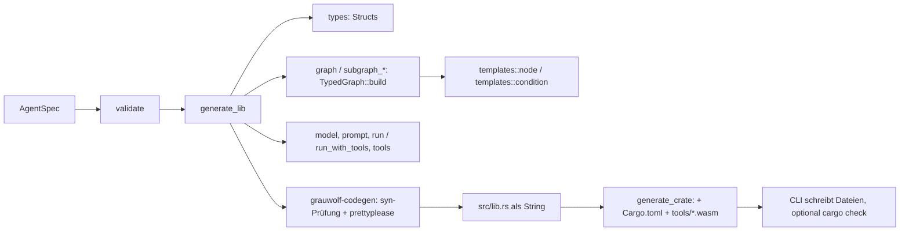

# Kapitel 6: Der Generator

grauwolf führt eine Spec auf zwei Wegen aus: der **Interpreter** baut zur Laufzeit aus dem JSON einen
Graphen, der **Generator** schreibt daraus eine eigenständige Rust-Crate, die mit dem typisierten
Builder aus `grauwolf-graph` arbeitet und damit beim Kompilieren geprüft wird. Wie du das als
Nutzer aufrufst (`grauwolf spec generate`), steht im
[Nutzerhandbuch, Kapitel 11](../handbuch/11-code-erzeugen.md). Hier geht es um das Innere:
Wie ist `grauwolf-generator` aufgebaut, wie kommen neue Node-Arten hinein, was kann er (noch) nicht,
und wie stellen die Äquivalenztests sicher, dass beide Wege dasselbe tun?

## 6.1 Überblick

`grauwolf-generator` liegt in der Domain-Schicht. Er führt selbst nichts aus und schreibt keine
Dateien: Er liefert Quelltext als `String` bzw. eine Crate als Dateien im Speicher. Schreiben und
`cargo check` übernimmt die CLI (`crates/apps/grauwolf-cli/src/commands/spec/generate.rs`, Funktion `run`).



Abhängigkeiten: `grauwolf-spec` (Spec, Konstanten wie `SUBGRAPH_KIND`), `grauwolf-codegen` (der
generische Code-Builder, ein Fork von `carllerche/codegen`, ADR-0013) und `grauwolf-tools` (für
`ToolArtifact`, `ResolvedTool` und `ToolSourceCrate`).

## 6.2 Die öffentliche API

Es gibt zwei Einstiegspunkte (`crates/domain/grauwolf-generator/src/lib.rs`):

```rust
pub fn generate_lib(spec: &AgentSpec) -> Result<String, GeneratorError>;

pub fn generate_crate(
    spec: &AgentSpec,
    grauwolf: &GrauwolfDependency,
    artifacts: &[ToolArtifact],
) -> Result<GeneratedCrate, GeneratorError>;

pub enum GrauwolfDependency { Path(PathBuf) }   // Verzeichnis `crates/` eines Checkouts

pub struct GeneratedCrate {
    pub files: BTreeMap<PathBuf, String>,          // Cargo.toml, src/lib.rs
    pub binary_files: BTreeMap<PathBuf, Vec<u8>>,  // tools/<name>.wasm
}
```

Das einfachste Beispiel ist der Snapshot-Test für die Echo-Spec
(`crates/domain/grauwolf-generator/tests/generate.rs`):

```rust
#[test]
fn generates_a_typed_graph_library_for_the_echo_spec() {
    let source = grauwolf_generator::generate_lib(&example("echo.json")).unwrap();
    insta::assert_snapshot!(source);
}
```

Aus `examples/specs/echo.json` (ein `llm_request`-Node, Kante nach `finish` bei
`on_assistant_message`) entsteht – gekürzt aus dem Snapshot
`tests/snapshots/generate__generates_a_typed_graph_library_for_the_echo_spec.snap`:

```rust
//! Generiert aus der AgentSpec `echo` – nicht von Hand bearbeiten.

use std::sync::Arc;
use grauwolf_agents::AgentContext;
use grauwolf_graph::{GraphError, TypedGraph};
use grauwolf_llm::PromptExecutor;
use grauwolf_prompt::{LlModel, Prompt};
use grauwolf_agents::events::{AgentEvent, Feature};
/// Strategie-Graph des Agenten.
pub fn graph() -> Result<TypedGraph<AgentContext, String, String>, GraphError> {
    TypedGraph::build(|g| {
        let node_call_llm = g.node("call_llm", grauwolf_agents::nodes::llm_request);
        g.edge(&g.start(), &node_call_llm);
        g.edge_when(
            &node_call_llm,
            &g.finish(),
            grauwolf_agents::conditions::on_assistant_message,
        );
    })
}
/// Modell aus der Spec.
pub fn model() -> LlModel {
    LlModel::new("ollama", "llama3.2")
}
/// Anfangs-Prompt aus der Spec.
pub fn prompt() -> Prompt {
    Prompt::builder("echo").system("Repeat the user's message verbatim.").build()
}
/// Führt den Agenten mit `input` in einem frischen Kontext aus.
pub async fn run(
    executor: Arc<PromptExecutor>,
    input: String,
) -> Result<String, Box<dyn std::error::Error + Send + Sync>> {
    run_observed(executor, input, Vec::new()).await
}
/// Wie [`run`]; `features` sehen alle Events des Laufs in derselben Reihenfolge wie beim Interpreter (ADR-0084).
pub async fn run_observed(
    executor: Arc<PromptExecutor>,
    input: String,
    features: Vec<Arc<dyn Feature>>,
) -> Result<String, Box<dyn std::error::Error + Send + Sync>> {
    let mut ctx = AgentContext::new(executor, model(), prompt());
    // … Features installieren, dann ein Aufruf des Lauf-Lebenszyklus
    //   (`grauwolf_agents::run_lifecycle::AgentRun`, ADR-0116) um graph.run_observed(..):
    //   AgentStarting, Gedächtnis, Wissen, AgentCompleted oder AgentFailed
}
/// Die Spec dieser Crate als JSON (für `run_app`, ADR-0084).
pub const SPEC_JSON: &str = "{\"spec_version\":1,\"name\":\"echo\", … }";
/// Führt den Agenten aus wie `grauwolf spec run`: Anbieter aus der Umgebung, externe Tools, Unteragenten und Langzeitgedächtnis (gemeinsamer Bereich) mit Pfaden relativ zu `base_dir` (Feature `app`).
#[cfg(feature = "app")]
pub async fn run_app(/* … */) { /* … */ }
// … provision(base_dir, options), run_provisioned(&provisioned, input, run_options) und
//   run_app_with(base_dir, input, provision_options, run_options), ebenfalls hinter dem Feature `app`
```

Strategie-Vorlagen (`"strategy": { "kind": "react" }`, ADR-0041) muss der Generator nicht kennen:
`AgentSpec::from_json` expandiert sie bereits zu einem gewöhnlichen `graph`.

## 6.3 Aufbau der erzeugten Crate

### `src/lib.rs`

`generate_lib` validiert die Spec (`GeneratorError::Invalid`) und erzeugt dann der Reihe nach:

| Element | Wann | Inhalt |
|---|---|---|
| Structs | je Eintrag in `types` | `pub struct` mit `serde`, `schemars`, `Structured` (ADR-0022, ADR-0031) |
| `graph()` | immer | `TypedGraph<AgentContext, Input, Output>` über `TypedGraph::build` |
| `subgraph_<name>()` | je Subgraph | typisiert nach `input`/`output` des Subgraphen (ADR-0034) |
| `model()`, `prompt()` | immer | Modell und System-Prompt aus der Spec |
| `run(executor, input)` | immer | frischer `AgentContext`, `graph()?.run(..)` |
| `tools()` | Spec hat `tools` | lädt die eingebetteten WASM-Artefakte in `SandboxRuntime` |
| `EXTERNAL_TOOLS`, `run_with_tools(executor, input, external)`, `tools(external)` | Spec hat externe Tools | ADR-0050, siehe 6.5 |
| `run_with_memory(executor, input, [external,] memory)` | `auto_recall`, `auto_remember` oder `remember_compressed` | Abrufen/Ablegen über `grauwolf_agents::memory` wie im Interpreter (ADR-0084) |
| `run_with_decider(executor, input, [external,] [memory,] decider)` | ein Entscheidungs-Node nennt `decider: system_one` | `decider: Option<Arc<dyn Decider>>`, am Kontext gesetzt; `run_provisioned` übergibt `provisioned.decider()`, das Provisioning aus `RKEV_BASE_URL` baut (ADR-0100) |
| `run_observed(executor, input, [external,] [memory,] [decider,] features)` | immer | Kern aller Einstiege; Features sehen dieselben Events in derselben Reihenfolge wie beim Interpreter (ADR-0084 Nachtrag) |
| `SPEC_JSON`, `provision(base_dir, ProvisionOptions)`, `run_provisioned(&provisioned, input, RunOptions)`, `run_app(base_dir, input)`, `run_app_with(base_dir, input, provision_options, run_options)` | immer (die Funktionen nur mit Cargo-Feature `app`) | ein einziger Aufruf von `ProvisionedAgent::new` richtet Anbieter, externe Tools, Unteragenten und Gedächtnis ein wie `spec run` (ADR-0084, ADR-0114); `run_provisioned` bringt Gedächtnis, Schlüssel-Wert-Speicher und Unteragenten des Benutzers je Lauf mit; die Fassade ist eine optionale Abhängigkeit der Crate, ohne Standard-Features |

Node-Variablen heißen `node_<id>` – das Präfix verhindert Kollisionen mit Rust-Schlüsselwörtern.
Kanten werden zu `g.edge(..)` oder `g.edge_when(.., <Bedingung>)` in Deklarationsreihenfolge, also
mit derselben „erste passende Kante gewinnt“-Semantik wie im Interpreter.

Der gesamte Quelltext wird von `grauwolf-codegen` mit `syn` geprüft und mit `prettyplease`
formatiert. Ist er kein gültiges Rust, gibt es `GeneratorError::InvalidCode` – das deutet fast
immer auf einen Fehler in einem Template hin.

### Benannte Typen

`types/<Name>` wird zu einem Struct (`src/types.rs`). Unterstützt werden Objekte mit Feldern vom
Typ `string` (→ `String`), `integer` (→ `i64`), `number` (→ `f64`), `boolean` (→ `bool`) und
`array` mit `items` (→ `Vec<_>`). Nicht in `required` genannte Felder werden zu `Option<_>` mit
`#[serde(default, skip_serializing_if = "Option::is_none")]`. Rust-Schlüsselwörter werden zu
Raw-Identifiern (`r#type`). Alles andere – verschachtelte Objekte, Feldnamen mit Großbuchstaben,
`_`, `self` … – ergibt `GeneratorError::UnsupportedType { path, reason }` mit JSON-Pointer, z. B.
`/types/Ticket/properties/meta`.

### Das Service-Binary (ADR-0093)

`generate_crate_with(spec, dep, artifacts, &GenerateOptions { service: true })` (die einfache
`generate_crate` nimmt die Voreinstellung) ergänzt `src/main.rs`, ein Cargo-Feature
`service = ["app", "grauwolf/service", "grauwolf/otel", "grauwolf/credentials"]` (das Tracing aus ADR-0123 kostet etwa 19 Crates mehr; die Zugangsdaten-Quellen aus ADR-0110 sind nötig, weil `grauwolf-k8-ops agent deploy` jedem Agenten eine `[credentials]`-Konfiguration mitgibt; eine volle Facade hat beides ohnehin) und ein `[[bin]]` namens `agent` mit
`required-features = ["service"]`. So baut die Bibliothek ohne das Feature weiterhin wie zuvor. Der
Binary-Name ist fest und nicht der Name der Spec, damit Container-Images ihn nicht kennen müssen. Das
gesamte `main` ist ein Aufruf von `grauwolf::service::main(SPEC_JSON, provision, run)`: `provision`
ruft beim Start einmal die generierte `provision(base_dir, options)` auf (Executor, MCP-Server,
Wissensindex, Unteragenten), und `run` wandelt die JSON-Eingabe in den Eingabetyp der Crate um, ruft
für jede Anfrage `run_provisioned(&agent, input, options)` auf und wandelt die Ausgabe zurück
(Snapshots `generate__echo_service_main.snap` und `generate__echo_service_cargo_toml.snap`). Die
Fassade verpackt das als `ServedAgent` (Kapitel 8) und liest die Umgebung (`ServiceConfig::from_env`).
`GeneratedAgent` bildet die `RunExtras` des Servers (Gespräch, Anhänge, Freigeber, Frame-Sink,
Features) auf `RunOptions` ab, damit `run_provisioned` Gespräche führt und Freigaben einholt wie
`spec serve`. Der Test `generated_services_answer_health_and_run` in `tests/equivalence.rs` baut das
Binary und prüft `/health`, `/run` und A2A auf dem zusätzlichen Port gegen ein gemocktes Ollama. `generated_services_authenticate_callers_by_spiffe` startet dasselbe Binary mit `GRAUWOLF_SPIFFE=1` gegen die Fake-Workload-API von `grauwolf-spiffe` (ein Unix-Socket, den der Testprozess bedient): Ein zugeordneter Client erreicht den mTLS-Port, ein nicht zugeordneter bekommt `403`, ein Client ohne Zertifikat wird abgewiesen, und `agent_starting` trägt `caller` (ADR-0109, ADR-0119). `generated_services_export_spans_and_continue_the_callers_trace` startet ihn mit `GRAUWOLF_OTEL=1` gegen einen Wiremock, der `POST /v1/traces` annimmt, schickt eine Anfrage mit `traceparent`, beendet den Dienst mit SIGTERM und sucht in den Bodies nach Trace-ID, Parent-Span-ID, `invoke_agent` und dem Dienstnamen (ADR-0123; das Protobuf wird durchsucht, nicht dekodiert). Alle drei Tests teilen sich ein Build-Verzeichnis und laufen nacheinander. Die
CLI bietet das als `spec generate --service` an (`--check` prüft dann mit dem Feature `service`).

### `Dockerfile` für den Dienst

`GenerateOptions { dockerfile: Some(DockerfileOptions { builder_image, expected_builder_version }) }` (setzt `service` voraus)
ergänzt `Dockerfile` und `.dockerignore` (Modul `docker`; Snapshots `generate__echo_dockerfile.snap`). Die
Build-Stufe beginnt mit `FROM <builder_image>`, kopiert die Lock-Datei des Builders
(`/opt/grauwolf/Cargo.lock`, damit die Versionen denen der vorgefertigten Abhängigkeiten entsprechen)
und führt `cargo build --release --offline --features service` mit
`CARGO_TARGET_DIR=/opt/grauwolf/target` aus. Mit `expected_builder_version: Some(v)` ist der erste
Build-Schritt eine Wächterprüfung (`RUN test "$GRAUWOLF_VERSION" = "v" || { echo …; exit 1; }`; das
Builder-Image setzt die Variable): Eine Crate wird nur vom Builder der Version gebaut, die sie erzeugt
hat. Die CLI übergibt ihre eigene Version, außer wenn `--allow-builder-mismatch` gesetzt ist (Tests
`the_dockerfile_refuses_a_builder_…`, `the_dockerfile_has_no_guard_…`). `default_builder_image(version)`
benennt den Builder des Release. Die Laufzeit-Stufe ist immer `gcr.io/distroless/cc-debian12:nonroot`;
die Git-Tools brauchen kein `git`-Programm (libgit2 ist in das Binary eingebunden, ADR-0104). Das
Verzeichnis `app/` der Crate wird zu `/app` (Arbeitsverzeichnis und `GRAUWOLF_DATA_DIR`); den Inhalt
füllt der Generator nicht, der Aufrufer kopiert die Dateien, die die Spec nennt (die CLI tut das,
Kapitel 11 des Nutzerhandbuchs: `AgentTree::copy_into` kopiert den ganzen aufgelösten Agenten-Baum
einschließlich Tool-Cache und Lock-Datei der Unteragenten, damit sie offline laufen;
[Abschnitt 4.12](04-tools-intern.md#412-der-vorbereitete-agenten-baum-adr-0115)). Der Generator
erzwingt `full_facade` nicht; die vorgefertigten Abhängigkeiten passen nur zu Crates, die damit erzeugt
wurden, deshalb setzen Aufrufer beides (die CLI tut das mit `--dockerfile`).

### `Cargo.toml` und Artefakte

`generate_crate` ergänzt ein Manifest mit eigenem `[workspace]` (die Crate hängt so an keinem
umgebenden Workspace) und Pfad-Abhängigkeiten auf `<crates>/domain/grauwolf-agents`,
`-graph`, `-llm`, `-prompt`. Je nach Spec kommen dazu: `grauwolf-planner` (bei `plan`/`goap`),
`serde`/`schemars` (bei `types`), `serde_json`, `grauwolf-tools` und `grauwolf-sandbox` (bei Tools).
`GenerateOptions { full_facade: true }` (CLI `--full-facade`) hängt die Fassade mit ihren
Standard-Features statt der Liste an, die die Spec braucht, damit alle Specs einen gemeinsamen
Abhängigkeitsgraph haben und ein Builder-Image ihn vorab bauen kann (ADR-0096; Snapshot
`generate__echo_full_facade_cargo_toml.snap`).

Tool-Code wird **nicht** in die Crate kopiert. Der Generator nimmt die vorab gebauten Artefakte
(siehe [Kapitel 4](04-tools-intern.md)), legt sie als `tools/<name>.wasm` ab und bettet sie mit
`include_bytes!` ein. Aus dem Snapshot `generate__calculator_lib.snap`:

```rust
pub fn tools() -> Result<ToolRegistry, Box<dyn std::error::Error + Send + Sync>> {
    let runtime = grauwolf_sandbox::SandboxRuntime::new()?;
    let registry = ToolRegistry::builder()
        .shared(
            runtime
                .instantiate(
                    &ToolArtifact {
                        name: "add".into(),
                        bytes: include_bytes!("../tools/add.wasm").to_vec(),
                        hash: String::new(),
                    },
                    ToolDescriptor { name: "add".into(), /* … */ },
                )?,
        )
        .build();
    Ok(registry)
}
```

Tools aus `tool_packages` (ADR-0107) kommen über `GenerateOptions::package_tools` (der Aufrufer löst
sie auf; `grauwolf spec generate` lädt sie). Der Generator leitet daraus eine Kopie der Spec ab, in
der sie Tools ohne Code sind und `tool_packages` leer ist. So werden sie wie die übrigen eingebettet,
und die Crate (einschließlich `SPEC_JSON`) kennt kein Register. Ohne `package_tools` ist eine Spec mit
`tool_packages` ein `GeneratorError::UnresolvedPackages`.

**Tool-Quellen (ADR-0095).** Mit `GenerateOptions { tool_sources: Some(crates), .. }` bettet der
Generator dieselben `tools/<name>.wasm` ein, schreibt aber keine Module (und braucht keine Artefakte).
Je Tool entstehen `tools/<name>/Cargo.toml` und `tools/<name>/src/lib.rs`, das Manifest
`tools/tools.json` (`ToolSourcesManifest` aus `grauwolf-tools`) und ein `build.rs`, das nur die
Standardbibliothek nutzt und mit `grauwolf tools build .` abbricht, solange ein Modul fehlt. Der
Generator hat keine eigene Gast-Vorlage: Die `ToolSourceCrate`s (Name, beide Dateien, SHA-256)
kommen aus `grauwolf_toolbuild::guest_crate`, demselben Code, den `ToolBuilder::build` schreibt und
den die CLI aufruft (`spec generate --tool-sources`). Ein Tool ohne Eintrag ist ein
`GeneratorError::MissingToolSource`. `grauwolf tools build <dir>` prüft die Hashes mit `source_hash`
und kompiliert mit `ToolBuilder::build_sources`. Mit `dockerfile` kopiert das `Dockerfile` `tools/` und
führt `grauwolf tools build .` aus, bevor `COPY . .` läuft. Snapshots `generate__tool_sources_*`; der
langsame Test `generated_crates_with_tool_sources_build_after_their_modules_are_built` zeigt den
fehlschlagenden `cargo build`, baut die Module und vergleicht mit dem Interpreter.

Fehlt ein Artefakt, meldet `generate_crate` `GeneratorError::MissingArtifact`. Deshalb baut die CLI die
Artefakte vorher mit `build_tools` aus der Fassade – derselbe Code wie beim Interpreter.

## 6.4 Templates: wie Node-Arten zu Rust werden

Jede Node-Art und jede Kanten-Bedingung aus den Katalogen in `grauwolf-graph` braucht ein
Generator-Template (ADR-0018, ADR-0021). Templates stehen in
`crates/domain/grauwolf-generator/src/templates.rs` und liefern einen **Rust-Ausdruck** als Text:

```rust
pub fn node(kind: &str, params: &Value) -> Option<String>;
pub fn condition(kind: &str, params: &Value) -> Option<String>;
```

Einfache Arten sind ein Pfad, parametrisierte Arten setzen Typ- und Wertparameter ein:

```rust
"execute_tool" => "grauwolf_agents::nodes::execute_tool",
"llm_request_force_tool" => {
    return Some(format!(
        "grauwolf_agents::nodes::llm_request_force_tool({:?})",
        params.get("tool")?.as_str()?
    ));
}
"compress_history" => { /* … */
    "keep_last" => Some(format!(
        "grauwolf_agents::nodes::compress_history_keep_last::<{value}, {}>",
        params["keep"].as_u64()?
    )),
}
```

`rust_type` übersetzt die Datentypen der Kataloge (`string`, `message`, `tool_result`, …) in Rust-Typen;
ein benannter Typ wird zum gleichnamigen generierten Struct.

Der **Konformitätstest** `tests/catalog_conformance.rs` stellt sicher, dass keine Art vergessen
wird: Er läuft über alle Arten von `Catalogs::builtin()`, ruft das Template mit den Beispiel-
parametern der Art (`example_params()`) auf und schlägt fehl, wenn eines `None` liefert:

```rust
#[test]
fn every_builtin_node_kind_has_a_template() {
    let catalogs = Catalogs::builtin();
    let missing: Vec<&str> = catalogs.nodes.kinds()
        .filter(|kind| {
            let params = catalogs.nodes.get(kind).unwrap().example_params();
            templates::node(kind, &params).is_none()
        })
        .collect();
    assert!(missing.is_empty(), "Node-Arten ohne Template: {missing:?}");
}
```

### Strukturelle Arten

Sechs Arten (darunter `code` mit der Bedingung `on_code`) stehen nicht in den Katalogen, sondern sind
in `grauwolf-spec-model` als Konstanten definiert (und von `grauwolf-spec` wieder exportiert), weil sie
andere Teile der Spec referenzieren: `subgraph`, `parallel`, `plan`, `goap` und `for_each`. Sie
behandelt `graph_function` direkt:

- **`subgraph`** → `let sub_x = subgraph_<name>()?;` vor dem Builder und `g.subgraph("x", sub_x,
  scope)` darin. Der Scope ist `ToolSubset::new([...])` bei eigener Tool-Liste oder
  `SubgraphScope::new().with_model(..)` bei eigenem Modell (ADR-0043).
- **`parallel`** → `grauwolf_agents::parallel::parallel::<I, O>(vec![Branch::new(..)…], Merge::…)`
  (ADR-0045).
- **`for_each`** → `grauwolf_agents::for_each::for_each::<I, O>(ForEach::new(Body::…).with_max_parallel(n)…, id)`
  mit `Body::Agent(name)` oder `Body::Graph { name, graph: subgraph_<name>()?.into_graph(), scope }`;
  die Parameter kommen aus `ForEachParams::parse`, wie im Interpreter; `array<T>`-Typen werden zu
  `Vec<T>` (ADR-0101). Die Node-Art `agent` ist eine gewöhnliche Katalog-Art →
  `nodes::agent_step::<I, O>("name")`.
- **`code`** (ADR-0102) → `grauwolf_agents::code::code_node_typed::<I, O>(module_<teil>.clone())`;
  das Modul ist `code_module("<Name des Teils>", include_bytes!("../tools/<Name des Teils>.wasm"))`, eine
  Funktion der erzeugten Bibliothek, die das eingebettete WASM-Modul einmal je Prozess in die Sandbox
  lädt. Code wird **nicht** nativ in den Dienst kompiliert: Die generierte Crate führt dieselben Module
  in derselben Sandbox aus wie der Interpreter, dadurch stimmen Verhalten und Isolation überein. Kanten
  mit `on_code` oder `transform` werden zu `g.edge_with(&from, &to, Some(code_condition(..)),
  Some(code_transform(..)))`; die Typen solcher Kanten prüft `spec validate` und das Ziel beim Lesen
  seiner Eingabe, nicht der Rust-Compiler. Die Teile kommen aus `AgentSpecExt::code_pieces()` in
  Graph-Reihenfolge, ihre Artefakte gehen neben den Tool-Artefakten an `generate_crate` (Name = Name
  des Teils), und `GenerateOptions::tool_sources` braucht für jedes von ihnen eine Quell-Crate
  (`ToolSourceKind::Code`, `Condition`, `Transform` in `tools/tools.json`).
- **`plan`** → `grauwolf_planner::plan_node(Arc<LlmPlanner>, max_iterations, id)` (ADR-0039).
- **`goap`** → `grauwolf_planner::planner_node` mit `goap::fact_planner` aus den Parametern als JSON
  (ADR-0070).

Subgraphen werden **vor** `TypedGraph::build` gebaut, weil die Builder-Closure keine Fehler
zurückgeben kann.

Wie du eine neue Node-Art Ende-zu-Ende hinzufügst (Katalog, Implementierung, Template, Tests),
beschreibt [Kapitel 5](05-erweitern.md).

## 6.5 Externe Tools im generierten Code (ADR-0050)

MCP-Tools, das Such-Tool aus `knowledge`, Gedächtnis-Tools, Unteragenten und eingebaute Tools
existieren erst zur Laufzeit. Statt sie abzulehnen, macht der Generator sie explizit: Er schreibt
die erwarteten Namen in eine Konstante und erwartet die Tools vom Aufrufer (Snapshot
`generate__external_tools_lib.snap`):

```rust
pub const EXTERNAL_TOOLS: &[&str] = &["list_files", "read_file"];

pub async fn run_with_tools(
    executor: Arc<PromptExecutor>,
    input: String,
    external: Vec<Arc<dyn DynTool>>,
) -> Result<String, Box<dyn std::error::Error + Send + Sync>> { /* … */ }
```

`run(executor, input)` ruft `run_with_tools` ohne externe Tools auf und schlägt daher fehl, solange
welche erwartet werden. `tools(external)` meldet ein fehlendes Tool mit Namen und übernimmt nur die
deklarierten. In einer Anwendung besorgst du die Tools, indem du den Agenten provisionierst:

```rust
let provisioned = ProvisionedAgent::new(&spec, base_dir, options).await?;
let external = provisioned.tools_for(None)?;
let output = my_agent::run_with_tools(executor, input, external).await?;
```

Unteragenten aus `agent_tools` kommen über den Lieferanten-Port der Provisionierung, den der
`AgentLoader` implementiert (siehe [Kapitel 3](03-rust-api.md)); generierter Code übergibt
`AgentLoader::for_provisioning(..)`, das mit `--locked` aus dem Tool-Cache in `app/.grauwolf/tools` lädt
(ADR-0115).

### Skills (ADR-0103)

Skills sind ebenfalls externe Tools: Mit `skills` in der Spec enthält `EXTERNAL_TOOLS` `load_skill` und
`read_skill_file`, und die Provisionierung stellt sie aus `<base_dir>/<dir>` bereit. Die Skill-Ordner
werden **nicht** in das Binary eingebettet; `SPEC_JSON` nennt sie, und ein Image hat sie unter
`/app`. Den Block im System-Prompt (die Skill-Liste) liefern die Tools: `DynTool::prompt_addition()`
von `load_skill`. Weil die Tools erst zur Laufzeit existieren, baut das generierte `run_observed` die
Registry zuerst und erweitert den Prompt (`Prompt::extend_system`), bevor der Kontext entsteht:

```rust
let registry = tools(external)?;
let prompt = match registry.prompt_addition() {
    Some(addition) => prompt().extend_system(&addition),
    None => prompt(),
};
let mut ctx = AgentContext::new(executor, model(), prompt).with_tools(registry);
```

Der Interpreter tut dasselbe beim Laden. Git-Quellen werden vor dem Erzeugen aufgelöst: Die CLI
(`spec generate --dockerfile`) löst den Agenten-Baum auf (ADR-0115), holt sie über die Lock-Datei,
kopiert sie nach `app/skills-git/<n>/` (`AgentTree::copy_into`) und erzeugt aus einer Kopie der Spec,
deren Quellen diese lokalen Ordner sind (dieselbe Idee wie bei den Tool-Paketen: Die erzeugte Crate hat
keinen Verweis nach außen). Der Äquivalenzfall `skill_writer.json` vergleicht Ausgabe und Events,
einschließlich `skill_loaded`.

## 6.6 Was der Generator nicht kann: `Unsupported`

Manches lebt nur zur Laufzeit des Interpreters. Dafür liefert `generate_lib` sofort
`GeneratorError::Unsupported { feature }` mit dem Hinweis, die Spec mit `grauwolf spec run`
auszuführen:

| `feature` | Grund |
|---|---|
| `tools_dir` | Tool-Ordner wird vor jedem Lauf neu gelesen und gebaut (ADR-0074) |
| `self_tools` | braucht Build und Sandbox mitten im Lauf (ADR-0075) |

Die Fehlermeldung lautet
``'<feature>' is not yet supported by the generator – run the spec with `grauwolf spec run` ``
(die Meldung selbst bleibt englisch, wie alle Ausgaben von grauwolf).

Daneben gibt es `UnsupportedType` (Typ nicht abbildbar, 6.3) und `MissingTemplate { kind }`
(eine Art ohne Template – sollte der Konformitätstest verhindern).

Ein Testfall für eine solche Ablehnung (`tests/generate.rs`, `refuses_a_tools_directory`) prüft mit
`matches!(&error, GeneratorError::Unsupported { feature } if feature == "tools_dir")`. Wenn du eine
neue Laufzeit-Eigenschaft einführst, die der Generator nicht abbilden kann, füge sie hier hinzu –
lieber ein klarer Fehler als eine Crate, die sich anders verhält als der Interpreter.

## 6.7 Äquivalenztests: Interpreter ⇔ Generator

Das Kernversprechen der DSL lautet: Eine Spec verhält sich im Interpreter und als generierte Crate
gleich (ADR-0015, ADR-0019). Das prüft `crates/domain/grauwolf-generator/tests/equivalence.rs`.

### So arbeitet der Test

Für jeden Fall in `CASES` (Spec aus `examples/specs/`, Eingabe als JSON, Regeln für den Mock):

1. Spec laden, Tools mit `ToolBuilder` bauen (Cache unter `target/toolbuild-tests`).
2. Den Interpreter mit `MockLlmClient` aus `grauwolf-test`, `SandboxRuntime` und ggf. eingebauten
   Dateitools laufen lassen → erwartete Ausgabe. Ist `expect` gesetzt, muss sie genau dem
   entsprechen (belegt einen bestimmten Weg durch den Graphen).
3. Mit `generate_crate` die Crate schreiben und einen Test `tests/equivalence.rs` hineinlegen, der
   denselben Mock als Rust-Quelltext aufbaut (`mock_source`) und die Ausgabe mit der des
   Interpreters vergleicht.
4. `cargo test` in der erzeugten Crate ausführen; scheitert er, zeigt die Meldung stdout und
   stderr.

Ein Fall sieht so aus (gekürzt):

```rust
Case {
    spec: "calculator.json",
    expect: None,
    input: r#""Was ist 2+3?""#,
    mock: &[
        Rule::CallTool("2+3", "add", r#"{ "a": 2, "b": 3 }"#),
        Rule::Answer("5", "Das Ergebnis ist 5."),
    ],
},
```

Die Regeln entsprechen den Methoden von `MockLlmClient`: `Rule::Answer(needle, text)` →
`answer_when_contains`, `Rule::CallTool(needle, tool, args)` → `call_tool_when_contains`,
`Rule::CallTools(needle, calls)` → `call_tools_when_contains`. Der Mock reagiert auf die letzte
Eingabe, die `needle` enthält; die erste passende Regel gewinnt, deshalb stehen spezifische Regeln
vorn.

### Ausführen

```sh
cargo test -p grauwolf-generator --test equivalence
```

Der Test braucht die Toolchain samt `wasm32-unknown-unknown` und baut für jede Spec eine eigene
Crate – das dauert und belegt **über ein Gigabyte**. Die Crates landen unter
`$CARGO_TARGET_DIR/generated-equivalence/<spec-name>/` (ohne `CARGO_TARGET_DIR` unter
`target/generated-equivalence/`), ihr gemeinsames Build-Verzeichnis unter
`generated-equivalence/target/`. Um Platz zu sparen, setzt der Test `CARGO_INCREMENTAL=0` und
`CARGO_PROFILE_DEV_DEBUG=line-tables-only`. Lege `CARGO_TARGET_DIR` außerhalb des Workspaces an (siehe
[Kapitel 2](02-entwicklungsumgebung.md)).

### Aufräumen

Der Test löscht nur das Verzeichnis der jeweiligen Crate vor dem Neuschreiben, nicht das
gemeinsame Build-Verzeichnis. Wird der Platz knapp, darfst du alles löschen – beim nächsten Lauf
entsteht es neu:

```sh
rm -rf "${CARGO_TARGET_DIR:-target}/generated-equivalence"
```

### Einen neuen Fall hinzufügen

1. Spec unter `examples/specs/` ablegen (sie dient zugleich als Beispiel und als Testdatum).
2. Einen `Case` mit Eingabe und Mock-Regeln ergänzen; `expect` setzen, wenn der Fall einen
   bestimmten Pfad belegen soll (z. B. erst abgelehnt, dann angenommen bei `verified_calculator.json`).
3. Braucht die Spec externe Tools, müssen beide Seiten sie bekommen: `file_tools` für den
   Interpreter, `file_tools_source` als Quelltext für die erzeugte Crate. Bisher deckt der Test
   eingebaute Dateitools ab (`notes_reader.json`).

## 6.8 Diagnosen aus `cargo check`

Nach dem Schreiben führt `grauwolf spec generate --check` `cargo check --message-format=json` in der
Crate aus und gibt Fehler als `<spec>: <crate>/src/lib.rs:<zeile>:<spalte>: error: …` aus (F13.9,
`cargo_check` in der CLI). Eine Rückführung dieser Positionen auf Stellen in der Spec über eine
Source-Map gibt es derzeit nicht; Compile-Fehler im **Tool-Code** zeigen dagegen schon beim Build der
Tools auf `/tools/<i>/code:<zeile>:<spalte>` (siehe [Kapitel 4](04-tools-intern.md)).

## Das Wichtigste in Kürze

- `generate_lib` liefert `src/lib.rs` als Text, `generate_crate` die ganze Crate im Speicher;
  Schreiben und `cargo check` übernimmt die CLI.
- Generierter Code nutzt den typisierten Builder; benannte Typen werden zu Structs, Tool-Code kommt
  als vorab gebautes WASM per `include_bytes!` hinein.
- Jede Katalog-Art braucht ein Template in `templates.rs`; der Konformitätstest erzwingt das.
  `subgraph`, `parallel`, `plan`, `goap` und `for_each` sind strukturelle Arten mit Sonderbehandlung.
- Externe Tools werden zu `EXTERNAL_TOOLS` + `run_with_tools`, automatisches Gedächtnis zu
  `run_with_memory`; mit dem Feature `app` richtet `run_app` alles über die Fassade ein. `tools_dir`
  und `self_tools` ergeben `Unsupported`.
- Der Kern jedes Einstiegs ist `run_handled(.., handles: RunHandles)` (`grauwolf_agents::run_handles`,
  ADR-0119): Preise, Aufrufer-Budget, Freigaben (`AgentSpec::approval_tools()`), Frame-Sink, Gespräch,
  Anhänge, Checkpoints und Fortsetzen kommen in einem Wert zusammen, derselbe Code wie die Laufoptionen
  des Interpreters; `run_provisioned`/`resume_provisioned` bauen ihn aus `RunOptions`.
- Der Äquivalenztest vergleicht Interpreter und erzeugte Crate gegen denselben Mock; er ist groß, und
  sein Arbeitsverzeichnis `generated-equivalence` darf jederzeit gelöscht werden.

Weiter mit [Kapitel 7: Ereignisse und Beobachtung](07-ereignisse-und-beobachtung.md).
