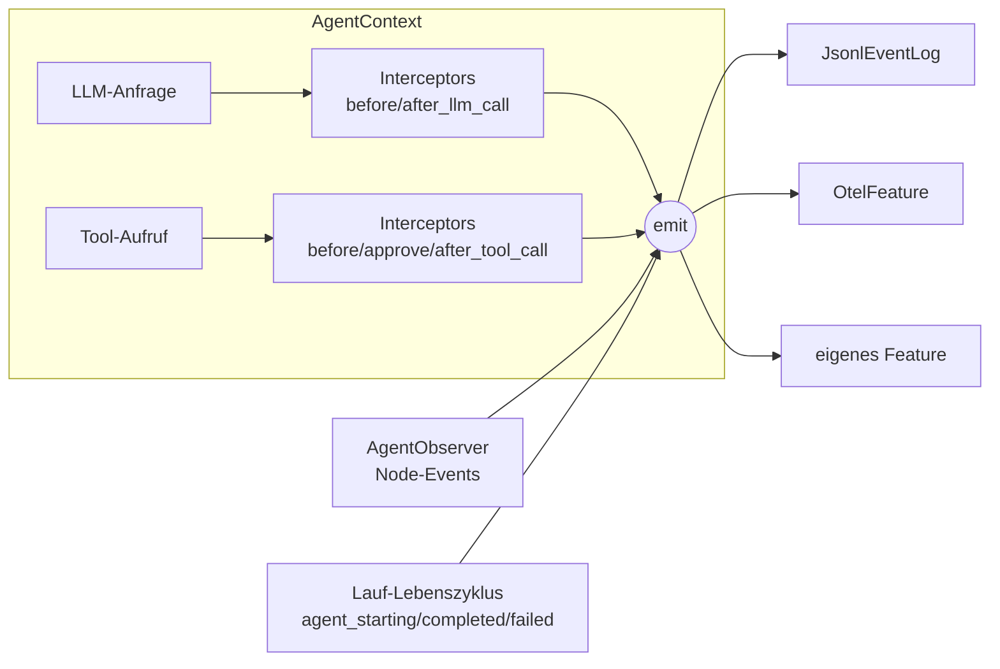
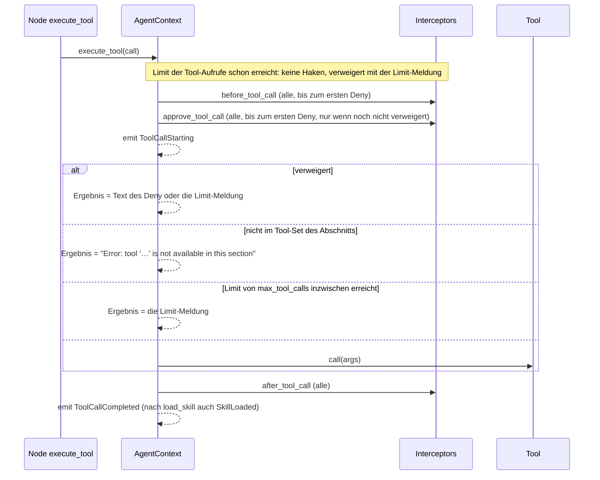

# Kapitel 7: Ereignisse und Beobachtung

Ein Agent soll nachvollziehbar sein: Welches Modell wurde gefragt, was hat es geantwortet, welches
Tool lief mit welchen Argumenten, was hat das gekostet? grauwolf beantwortet das mit
**Domain-Events** – typisierten Ereignissen, die der Agent während des Laufs meldet
([ADR-0007](../adr/0007-observability.md)). Darauf bauen zwei Erweiterungspunkte auf:

- **Features** hören nur zu. Sie bekommen jedes Event und machen etwas daraus: ein Protokoll,
  OpenTelemetry-Spans, Metriken.
- **Interceptors** greifen ein. Sie dürfen Prompts, Antworten und Tool-Aufrufe ändern oder
  Aufrufe verweigern – bis hin zur Freigabe durch einen Menschen.

Dieses Kapitel zeigt beides vom einfachen Zuhören bis zur asynchronen Freigabe und erklärt, wie
Token-Nutzung, Kosten und Budget durch den Kontext fließen. Wie du diese Funktionen als Nutzer
über die CLI einschaltest (`--events`, `--otel`, `--prices`, `--max-cost`, `--confirm-tools`),
beschreibt [Kapitel 9 des Nutzerhandbuchs](../handbuch/09-betrieb.md).



## 7.1 Die Event-Arten

Alle Events sind Varianten von `AgentEvent` in `crates/domain/grauwolf-agents/src/events.rs`.
Sie sind serialisierbar (`#[serde(tag = "event", rename_all = "snake_case")]`); als JSON trägt
jedes Event seinen Namen im Feld `event`, z. B. `{"event":"tool_call_completed", …}`.

| Event | Felder | Gemeldet von |
|---|---|---|
| `AgentStarting` | `input`, `caller?` (SPIFFE-ID des aufrufenden Workloads, ADR-0109), `trace_parent?` (`TraceParent { traceparent, tracestate? }`, der W3C-Trace-Kontext des Aufrufers als rohe Header-Werte, ADR-0123); beide bei `None` weggelassen, altes JSON ohne sie wird weiter gelesen | Run-Lebenszyklus (`grauwolf_agents::run_lifecycle`, von Interpreter und generiertem Code gemeinsam genutzt), zu Beginn jedes Laufs (auch beim Fortsetzen) |
| `AgentCompleted` | `output`, `usage?`, `cost?` | Run-Lebenszyklus, am Ende – nachdem das Gespräch gespeichert wurde |
| `AgentFailed` | `error`, `usage?`, `cost?` | Run-Lebenszyklus, bei Fehler (auch Budget, eine Ausgabe, die sich nicht umwandeln lässt, ein gescheitertes Speichern des Gesprächs); jeder Lauf endet mit genau einem von `AgentCompleted` / `AgentFailed` |
| `NodeStarting` / `NodeCompleted` | `path`, `input` bzw. `output` | `AgentObserver` an jeder Node-Grenze |
| `LlmCallStarting` | `model`, `tools` (Namen) | `AgentContext` vor jeder LLM-Anfrage |
| `LlmCallCompleted` | `answer`, `usage?`, `cost?`, `model?` | `AgentContext` nach der Antwort |
| `LlmCallFailed` | `error` | `AgentContext` |
| `LlmFallback` | `from`, `to`, `error` | `AgentContext`, wenn ein Modell scheitert und die Anfrage an das Ausweichmodell `to` geht ([ADR-0088](../adr/0088-model-fallbacks.md)) |
| `ToolCallStarting` / `ToolCallCompleted` | `call` bzw. `result` | `AgentContext::execute_tool` |
| `ModerationStarting` / `ModerationCompleted` / `ModerationFailed` | `model` bzw. `harmful`, `categories` bzw. `error` | Moderation ([ADR-0066](../adr/0066-content-moderation.md)); der geprüfte Text steht nie im Event |
| `DecisionStarting` / `DecisionCompleted` / `DecisionFailed` | `node` (ID des `decide`-Nodes), `answer`, `probability?`, `confidence?`, `model?` bzw. `error` | Entscheidungs-Nodes ([ADR-0100](../adr/0100-decision-node.md)); der bewertete Wert steht nie im Event |
| `ForEachItemStarting` / `ForEachItemCompleted` / `ForEachItemFailed` | `node` (ID des `for_each`-Nodes), `index` (ab 0), `error` | `for_each`-Nodes, je Element ([ADR-0101](../adr/0101-multi-agent-flows.md)); OpenTelemetry trägt sie als Span-Events am offenen Span ein |
| `MemoryRecalled` / `MemoryRemembered` / `MemoryFailed` | `facts` bzw. `error` | Automatisches Gedächtnis ([ADR-0069](../adr/0069-automatic-memory.md)) |
| `PlanBuilt` / `PlanStepExecuted` | `iteration`, `plan` | Planner (`grauwolf-planner`) |
| `SkillLoaded` | `name` | nach einem erfolgreichen `load_skill`-Aufruf (Tool-Ausführung; ADR-0103) |

Einige Regeln, die du beim Auswerten kennen solltest:

- `path` ist der Pfad des Nodes, in Subgraphen mehrteilig (`["sub", "call_llm"]`).
- Events zeigen, was **tatsächlich** gesendet bzw. ausgeführt wurde – also nach den Interceptors.
- Tool-Fehler sind keine eigenen Events: Sie stehen als Text im Ergebnis von
  `ToolCallCompleted` und beginnen mit `Error:` ([ADR-0027](../adr/0027-interceptors-features.md)).
- `usage` und `cost` fehlen im JSON, wenn sie unbekannt sind.
- Gestreamter Text ist **kein** Event. Er fließt über den Seitenkanal `FrameSink`
  ([ADR-0023](../adr/0023-streaming-side-channel.md)); das Event `LlmCallCompleted` enthält die
  zusammengesetzte Antwort.

## 7.2 Features: zuhören

### Der Vertrag

Ein Feature ist ein Trait mit einer einzigen Methode:

```rust
/// Erweiterung, die im [`crate::AgentContext`] installiert wird und alle Events erhält.
pub trait Feature: Send + Sync {
    /// Verarbeitet `event`; sollte schnell zurückkehren und nicht blockieren.
    fn on_event(&self, event: &AgentEvent);
}
```

`on_event` ist synchron und wird mitten im Lauf aufgerufen. Wer langsam exportiert (Netz,
Datenbank), puffert und schickt im Hintergrund – so macht es der Batch-Exporter von
OpenTelemetry. Ein Feature darf den Lauf nie abbrechen; Fehler schluckt es.

### Das einfachste Feature: Events sammeln

In Tests sammelt man Events meist in einem `Mutex<Vec<_>>` (angelehnt an
`crates/domain/grauwolf-agents/tests/events.rs`):

```rust
/// Feature, das alle Events sammelt.
#[derive(Default)]
struct Recorder(Mutex<Vec<AgentEvent>>);

impl Feature for Recorder {
    fn on_event(&self, event: &AgentEvent) {
        self.0.lock().unwrap().push(event.clone());
    }
}
```

Installiert wird es direkt am Kontext mit `install`; danach lässt sich die Reihenfolge prüfen:

```rust
let recorder = Arc::new(Recorder::default());
let mut ctx = AgentContext::new(executor, LlModel::new("mock", "m"), Prompt::builder("calc").build())
    .with_tools(ToolRegistry::builder().tool(Add).build())
    .install(recorder.clone());

block_on(graph.run(&mut ctx, "What is 2+3?".to_string())).unwrap();
// Event-Namen: llm_call_starting, llm_call_completed, tool_call_starting,
//              tool_call_completed, llm_call_starting, llm_call_completed
```

`graph.run` meldet keine Node-Events; die entstehen nur mit einem Beobachter (`AgentObserver`),
wie ihn der Interpreter über `run_observed` verwendet.

### Wo Features eingehängt werden

| Ebene | Methode | Gilt für |
|---|---|---|
| `AgentContext` | `install(feature)` | diesen Kontext (und seine Forks) |
| `Interpreter` | `with_feature(feature)` | jeden Lauf jedes geladenen Agenten |
| `InterpretedAgent::run_with` | `RunExtras { feature: Some(..), .. }` | nur diesen Lauf, z. B. eine HTTP-Anfrage |
| `AgentLoader` | `with_feature(feature)` | jeden geladenen Agenten samt Unteragenten |
| `AgentLoader` | `with_agent_features(Arc<dyn Fn(&AgentSpec) -> Vec<Arc<dyn Feature>>>)` | je Agent eigene Features, z. B. mit dem Namen der Spec |

### `JsonlEventLog`: jedes Event eine Zeile

Die Fassade bringt ein fertiges Feature mit, das jedes Event als JSON-Zeile schreibt
(`crates/apps/grauwolf-host/src/features.rs`):

```rust
impl<W: Write + Send> Feature for JsonlEventLog<W> {
    fn on_event(&self, event: &AgentEvent) {
        // Ein Protokoll darf den Lauf nicht abbrechen; Schreibfehler werden verworfen.
        if let (Ok(line), Ok(mut out)) = (serde_json::to_string(event), self.out.lock()) {
            let _ = writeln!(out, "{line}").and_then(|()| out.flush());
        }
    }
}
```

Die CLI schaltet es mit `--events` ein und schreibt nach stderr
(`crates/apps/grauwolf-cli/src/commands/spec/loader.rs`, `observed_loader`):

```rust
if options.events {
    loader = loader.with_feature(Arc::new(JsonlEventLog::new(std::io::stderr())));
}
```

Statt `stderr` kannst du jeden `Write` übergeben, z. B. eine `File`.

## 7.3 OpenTelemetry

**OpenTelemetry** (OTel) ist ein offener Standard für Traces: Ein Lauf wird zu einem Baum von
**Spans** (Zeitabschnitten mit Attributen), die ein Collector, Jaeger, Langfuse oder Datadog
anzeigt. grauwolf erzeugt die Spans aus den Events
([ADR-0049](../adr/0049-opentelemetry.md)) – Engine und Nodes wissen davon nichts.

### `OtelFeature` (Adapter `grauwolf-otel`)

`OtelFeature` ist ein gewöhnliches `Feature`, das einen Tracer bekommt und die Spans nach den
**GenAI Semantic Conventions** benennt – den OTel-Konventionen für KI-Anwendungen:

| Span | Entsteht aus | Attribute |
|---|---|---|
| `invoke_agent <name>` | `AgentStarting` … `AgentCompleted`/`AgentFailed` | `gen_ai.operation.name = invoke_agent`, `gen_ai.agent.name`, `grauwolf.caller` (wenn der Aufruf mit einer SPIFFE-ID kam), Nutzung, `grauwolf.cost` |
| `node <pfad>` | `NodeStarting` … `NodeCompleted` | `grauwolf.node.path` |
| `chat <modell>` | `LlmCallStarting` … `LlmCallCompleted`/`Failed` | `gen_ai.operation.name = chat`, `gen_ai.provider.name`, `gen_ai.request.model`, `grauwolf.tools`, Nutzung, `grauwolf.cost` |
| `execute_tool <name>` | `ToolCallStarting` … `ToolCallCompleted` (über die Aufruf-ID) | `gen_ai.tool.name`, `gen_ai.tool.call.id` |
| `decide <node>` | `Decision*` | `grauwolf.decision.node`, `.answer`, `.probability`, `.confidence`, `.model`; der Chat-Span eines modellbasierten Deciders ist darin verschachtelt |
| `moderate <modell>` | `Moderation*` | `gen_ai.operation.name = moderation`, `grauwolf.moderation.harmful`, `grauwolf.moderation.categories` |

Die Token-Nutzung steht in `gen_ai.usage.input_tokens`, `gen_ai.usage.output_tokens`,
`gen_ai.usage.cache_read.input_tokens` und `gen_ai.usage.cache_creation.input_tokens`. Das Modell,
das der Anbieter meldet (`Completion.model`, Event-Feld `model`), landet in `gen_ai.response.model`.
Gedächtnis- und Planner-Events werden **Span-Events** am innersten offenen Span
(`memory_recalled`, `plan_built`, `skill_loaded` …); `LlmFallback` wird das Span-Event `llm_fallback` am
offenen Chat-Span (`grauwolf.fallback.from`, `grauwolf.fallback.to`, `error.message`). Fehler setzen den
Span-Status; ein Tool-Ergebnis, das mit `Error:` beginnt, gilt als Fehler.

Inhalte – Antworten (`gen_ai.output.messages`), Tool-Argumente und -Ergebnisse, Pläne – zeichnet
das Feature nur mit `with_content(true)` auf, weil sie personenbezogene Daten enthalten können:

```rust
let feature = OtelFeature::new(tracer, "rechner").with_content(false);
```

Weil LLM-Aufrufe keine ID tragen, ordnet das Feature ein Ende dem zuletzt gestarteten offenen
Aufruf zu; in parallelen Zweigen können Chat-Spans deshalb vertauscht erscheinen.

### Ein Trace über Agenten hinweg (ADR-0123)

Ein Aufruf von einem Agenten an einen anderen soll ein Trace sein. Zwei Dinge tragen den Kontext, und keines
macht eine Domain-Crate von OpenTelemetry abhängig. Beide nutzen die W3C-Trace-Context-Header `traceparent` und
`tracestate` als einfache Strings.

**Ausgehend: vom Tracing-Feature zum HTTP-Client.** `Feature` hat eine Methode mit Standardimplementierung:

```rust
fn trace_headers(&self, call: Option<&str>) -> Vec<(String, String)> { Vec::new() }
```

`OtelFeature` überschreibt sie: Es sucht den offenen Span, der den Aufruf macht – den `execute_tool`-Span des
Tool-Aufrufs `call` oder, ohne ID, die innerste offene Entscheidung, den innersten offenen Node oder den
Agent-Span – und schreibt ihn mit dem `TraceContextPropagator` des SDK (die einzige Stelle im Workspace, die den
Propagator nutzt; der Adapter hängt dafür allein von `opentelemetry_sdk` ab). Die Agent-Runtime fragt die
installierten Features unmittelbar vor dem Aufruf nach den Headern und umhüllt den Aufruf mit
`grauwolf_tools::with_trace_headers(headers, future)`: `ToolExecution` für einen Tool-Aufruf des Modells (mit
seiner Aufruf-ID, damit parallele Aufrufe je ihren eigenen Span als Eltern bekommen), `AgentContext::run_agent_step`
für einen `agent`-Knoten oder ein `for_each`-Element (der Span des Knotens). A2A- und MCP-Clients lesen
`grauwolf_tools::current_trace_headers()`, wenn sie eine Anfrage bauen, und fügen die Paare hinzu: bei A2A
`SendMessage` und `SendStreamingMessage`, bei MCP die `POST`-Anfragen von Streamable HTTP und HTTP+SSE. Handshake,
Agent Card und Tool-Liste geschehen außerhalb eines Laufs und tragen keine; stdio kennt keine Header.

Der Scope gehört zum Future, nicht zu einem Thread oder einer Runtime: `with_trace_headers` ist ein `poll_fn`, der
beim Pollen des inneren Futures ein Thread-Local setzt und danach zurücksetzt. Deshalb funktioniert es auf jedem
Executor (die Domain-Crates haben keinen eigenen), hält über `.await` hinweg und ist für einen vom Aufruf
gestarteten Task nicht sichtbar. Leere Header lassen den umgebenden Scope bestehen, ein Unteragent ohne Tracing
setzt also den Trace des Aufrufs seines Aufrufers fort. Ohne Tracing-Feature wird nichts gesendet.

Ein Unteragent im selben Prozess (`agent_tools` mit `spec`) hat sein eigenes `OtelFeature`, läuft aber in diesem
Scope: `AgentRun` nimmt die Header des Scopes als `trace_parent`, wenn kein ausdrücklicher übergeben wurde; sein
Span `invoke_agent` ist deshalb ein Kind des `node`- oder `execute_tool`-Spans des Aufrufers.

**Eingehend: von der Anfrage zum Span.** Die Dienst-Routen lesen `traceparent` und `tracestate`
([Kapitel 8](08-server-und-protokolle.md#authentifizierung-mit-spiffe)) in `RunExtras.trace_parent`;
`AgentRun::with_trace_parent` meldet es als `AgentStarting.trace_parent` (generierter Code:
`RunOptions.trace_parent` → `RunHandles.trace_parent`). `OtelFeature` parst es mit dem Propagator und startet
`invoke_agent` mit diesem entfernten Span-Kontext als Eltern, im Trace des Aufrufers. Ein Header, der sich nicht
parsen lässt oder eine ID aus lauter Nullen hat, wird ignoriert, und der Agent beginnt einen neuen Trace.
`grauwolf.caller` wird wie bisher gesetzt.

Die Tests liegen in `crates/adapters/grauwolf-otel/tests/spans.rs` (Header je Span, Elternschaft, fehlerhafte
Header), `crates/domain/grauwolf-tools/src/trace_headers.rs` (der Scope) und
`crates/apps/grauwolf-server/tests/trace_context.rs`: Ein getraceter Lauf gegen einen wiremock-A2A-Agenten und
einen wiremock-MCP-Server prüft den ankommenden `traceparent`; jede Route reicht den eingehenden Header an den Lauf
weiter; und ein Coordinator und ein Reviewer-Dienst, beide in einen In-Memory-Exporter getraced, ergeben bei einem
JWT-SVID-Aufruf eine Trace-ID mit gesetztem `grauwolf.caller`.

### Export einrichten: `OtelTracing` (Fassade)

Den Export über OTLP/HTTP richtet `grauwolf::otel::OtelTracing` ein (Cargo-Feature `otel`).
Ohne Endpunkt gelten die Standard-Variablen `OTEL_EXPORTER_OTLP_ENDPOINT`,
`OTEL_EXPORTER_OTLP_HEADERS` und `OTEL_SERVICE_NAME` (Standard `grauwolf`). Der Test
`crates/apps/grauwolf-host/tests/otel.rs` zeigt den ganzen Weg gegen einen aufzeichnenden Server:

```rust
let tracing = grauwolf::otel::OtelTracing::init(Some(&collector.uri())).unwrap();
let feature = tracing.feature("echo", false);

feature.on_event(&AgentEvent::AgentStarting { input: json!("Hallo"), caller: None, trace_parent: None });
feature.on_event(&AgentEvent::AgentCompleted { output: json!("Hallo"), usage: None, cost: None });
tokio::task::spawn_blocking(move || tracing.shutdown()).await.unwrap().unwrap();
```

`shutdown` sendet offene Spans und blockiert – rufe es nicht direkt im async-Kontext auf. Damit
jeder Agent und Unteragent seinen eigenen `invoke_agent`-Span mit eigenem Namen bekommt, hängt die
CLI das Feature je Spec ein:

```rust
let (tracing, content) = (tracing.clone(), options.otel_content);
loader = loader.with_agent_features(Arc::new(move |spec: &AgentSpec| {
    vec![tracing.feature(&spec.name, content)]
}));
```

**Erzeugte Dienste** haben keine Flags; `grauwolf::service::main` liest daher `ServiceConfig.otel` / `otel_content` (`GRAUWOLF_OTEL`, `GRAUWOLF_OTEL_CONTENT`, vom `ServiceConfig` des Hosts geparst) und startet `ServiceTracing::start(&config, &env)` vor der Runtime. `GeneratedAgent::traced_by` legt das Feature des Hauptagenten in die Optionen jedes Laufs, und `provision_options_traced(env, chat_api, tracing)` gibt jedem Unteragenten über `with_agent_features` ein eigenes. Wenn `serve` zurückkehrt (SIGTERM oder Strg+C), ruft `main` `shutdown` auf, außerhalb der Runtime, weil es blockiert. Das Cargo-Feature `otel` von `grauwolf-server` (von `otel` der Facade weitergereicht) schaltet das ein; ohne es scheitert `GRAUWOLF_OTEL=1` beim Start mit `this build has no OpenTelemetry (feature `otel`)`.

Das Ereignisprotokoll von `--events` gibt es für einen erzeugten Dienst genauso: `ServiceConfig.events` (`GRAUWOLF_EVENTS`, vom `ServiceConfig` des Hosts geparst) lässt `main` `stderr_event_log()` (ein `JsonlEventLog` auf stderr, geteilt, sodass sich Zeilen nie mischen) an den Hauptagenten (`GeneratedAgent::logged_by`) und über `provision_options_logged(env, chat_api, tracing, events)` an jeden Unteragenten hängen.

## 7.4 Interceptors: eingreifen

### Die Haken

Ein `Interceptor` ([ADR-0047](../adr/0047-interceptors.md)) hat fünf Haken mit
Standard-Implementierungen, die nichts tun. Du überschreibst nur, was du brauchst:

```rust
pub trait Interceptor: Send + Sync {
    fn before_llm_call(&self, _prompt: &mut Prompt, _tools: &mut Vec<ToolDescriptor>) {}
    fn after_llm_call(&self, _answer: &mut Message) {}
    fn before_tool_call(&self, _call: &mut ToolCall) -> ToolDecision { ToolDecision::Proceed }
    fn approve_tool_call<'a>(&'a self, _call: &'a ToolCall) -> BoxFuture<'a, ToolDecision> {
        Box::pin(std::future::ready(ToolDecision::Proceed))
    }
    fn after_tool_call(&self, _result: &mut ToolResult) {}
}
```

- `before_llm_call` ändert Prompt und angebotene Tools **nur für diese Anfrage**, nicht den
  Verlauf.
- `after_llm_call` bearbeitet die Antwort, **bevor** sie an den Verlauf angehängt wird.
- `before_tool_call` darf Argumente umschreiben oder mit `ToolDecision::Deny(text)` verweigern;
  `text` geht dann als Tool-Ergebnis an das LLM.
- `approve_tool_call` ist der einzige asynchrone Haken: Er darf warten, z. B. auf einen Menschen.
- `after_tool_call` bearbeitet das Ergebnis, auch das eines verweigerten Aufrufs.

Mehrere Interceptors wirken in Installationsreihenfolge; Forks paralleler Zweige erben sie.

### Ablauf eines Tool-Aufrufs

`AgentContext::execute_tool` (`crates/domain/grauwolf-agents/src/context.rs`, die Schritte in
`tool_execution.rs`) verbindet die Haken mit den Events in dieser Reihenfolge:



### Beispiel: Anfrage und Antwort bearbeiten

Angelehnt an `crates/domain/grauwolf-agents/tests/interceptors.rs` – ergänzt eine Anweisung, blendet ein
Tool aus und schwärzt ein Geheimnis in der Antwort:

```rust
struct Guard;

impl Interceptor for Guard {
    fn before_llm_call(&self, prompt: &mut Prompt, tools: &mut Vec<ToolDescriptor>) {
        prompt.messages.insert(0, Message::system("Answer politely."));
        tools.retain(|tool| tool.name != "delete");
    }

    fn after_llm_call(&self, answer: &mut Message) {
        if let Message::Assistant(answer) = answer {
            for part in &mut answer.parts {
                if let grauwolf_prompt::AssistantPart::Text { text } = part {
                    *text = text.replace("secret123", "[removed]");
                }
            }
        }
    }
}

// am Kontext: ctx.intercept(Arc::new(Guard));
```

### Beispiel: Tool-Aufrufe umschreiben und verweigern

```rust
struct ToolGuard;

impl Interceptor for ToolGuard {
    fn before_tool_call(&self, call: &mut ToolCall) -> ToolDecision {
        if call.tool == "delete" {
            return ToolDecision::Deny("Deleting is not allowed.".into());
        }
        if let Some(a) = call.args["a"].as_i64() {
            call.args["a"] = serde_json::json!(a * 2);
        }
        ToolDecision::Proceed
    }

    fn after_tool_call(&self, result: &mut ToolResult) {
        result.content = result.content.chars().take(20).collect();
    }
}
```

Ein Interceptor aus der Praxis ist `ConfirmTools` in der CLI (`--confirm-tools`): Er fragt in
`before_tool_call` synchron auf der Konsole nach (`Run tool <name> with <args>? [y/N]`) und verweigert
alles außer `y` oder `yes` (`j`/`ja` gehen auch) mit `The user refused the call of <name>.`

### Moderation

Auch der Text einer Moderation (`AgentContext::moderate`, Node `llm_moderate`) läuft durch
`before_llm_call`: als Prompt mit der ID `grauwolf_agents::MODERATION_PROMPT_ID` (`"moderation"`),
einer Benutzer-Nachricht und ohne Tools. Geprüft wird danach der Text der Benutzer-Nachrichten –
ein Interceptor kann also z. B. persönliche Daten maskieren, bevor der Text an einen
Moderationsdienst geht, und Moderationen an der ID erkennen. `after_llm_call` gilt hier nicht (das
Urteil ist keine Nachricht); `llm_moderate` gibt im Feld `text` den ursprünglichen Text weiter
(ADR-0047 Nachtrag). Test: `crates/domain/grauwolf-agents/tests/moderation.rs`.

### Wo Interceptors eingehängt werden

`AgentContext::intercept`, `Interpreter::with_interceptor` und `AgentLoader::with_interceptor` –
analog zu den Features. Interceptors sind Code, kein Teil der Spec.

## 7.5 Freigaben: asynchron auf eine Entscheidung warten

Manche Tools sollen nur laufen, wenn jemand zustimmt – etwa ein Mensch im Web-Frontend
([ADR-0061](../adr/0061-tool-approval.md)). Dafür gibt es zwei Bausteine:

1. `Interpreter::with_tool_approval(["upper"])` (bzw. `AgentLoader::with_tool_approval`) macht
   Tools **freigabepflichtig**. Intern installiert der Interpreter in jedem Lauf ein
   `ApprovalGate` – einen Interceptor, der `approve_tool_call` implementiert.
2. Ein `ToolApprover` entscheidet je Lauf. Er wird über `RunExtras { approver, .. }` übergeben:

   ```rust
   pub type ToolApprover =
       Arc<dyn Fn(&ToolCall) -> BoxFuture<'static, ToolDecision> + Send + Sync>;
   ```

Ohne Freigeber lehnt das Tor ab (`tool '<name>' needs an approval that nobody can give here`). So
verhält sich auch jeder Unteragent, denn Unteragenten haben keinen Freigeber. Angelehnt an
`crates/domain/grauwolf-interpreter/tests/tool_approval.rs`:

```rust
/// Freigeber, der nur Aufrufe mit dem Argument `text = "hello"` erlaubt.
fn approver(seen: Arc<std::sync::Mutex<Vec<String>>>) -> ToolApprover {
    Arc::new(move |call| {
        seen.lock().unwrap().push(call.tool.clone());
        let decision = if call.args["text"] == "hello" {
            ToolDecision::Proceed
        } else {
            ToolDecision::Deny("Approval denied".into())
        };
        Box::pin(async move { decision })
    })
}

let output = block_on(agent().run_with(
    json!("Say it out loud"),
    RunExtras { approver: Some(approver(Arc::clone(&seen))), ..RunExtras::default() },
))
.unwrap();
```

Der HTTP-Dienst baut so einen Freigeber, der die Anfrage per SSE an den Client meldet und auf
dessen Antwort wartet – siehe [Kapitel 8](08-server-und-protokolle.md).

## 7.6 Nutzung, Kosten und Budget

Diese drei Werte entstehen im `AgentContext` und werden über Events sichtbar.

**Nutzung** ([ADR-0067](../adr/0067-token-usage.md)): Adapter liefern sie über
`LlmClient::execute_with_usage` als `Completion { message, usage: Option<Usage> }`.
`grauwolf_prompt::Usage` hat `input_tokens` (alle, gecachte eingeschlossen), `output_tokens` und
optional `cache_read_tokens`/`cache_write_tokens`. Die Nutzung gehört bewusst nicht zur
`Message`, sonst stünde sie im Verlauf und ginge an den Anbieter zurück. `AgentContext::usage()`
summiert alle Anfragen des Laufs **samt Forks** paralleler Zweige.

**Kosten** ([ADR-0071](../adr/0071-costs.md)): Mit einer Preistabelle
(`grauwolf_prompt::Prices`, Preise je Million Tokens unter `<anbieter>:<id>`) rechnet der Kontext
je Aufruf einen Betrag aus. Er steht in `LlmCallCompleted.cost`, die Summe in
`AgentContext::cost()` und in `AgentCompleted`/`AgentFailed`. Kennt die Tabelle das Modell nicht,
gibt es keinen Betrag – es wird nicht geschätzt. Angelehnt an
`crates/domain/grauwolf-agents/tests/usage.rs`:

```rust
let prices: grauwolf_prompt::Prices = serde_json::from_value(serde_json::json!({
    "currency": "USD",
    "models": { "mock:m": { "input": 1.0, "output": 10.0, "cache_read": 0.1 } }
}))
.unwrap();
let mut ctx = AgentContext::new(Arc::new(executor), LlModel::new("mock", "m"), prompt)
    .with_prices(Arc::new(prices))
    .install(recorder.clone());

block_on(ctx.request_llm()).unwrap();
let mut branch = ctx.fork();
block_on(branch.request_llm()).unwrap();
// ctx.cost() enthält beide Aufrufe, auch den im Fork
```

**Budget** ([ADR-0072](../adr/0072-run-budget.md)): `grauwolf_agents::Budget { max_tokens, max_cost,
max_tool_calls, max_prompt_tokens }` begrenzt einen Lauf (es implementiert `Default`). Vor **jeder**
LLM-Anfrage – normal, Streaming, strukturiert, mehrere Antworten, Zusammenfassung, Fakten-Anfrage,
Moderation – prüft der Kontext die bisherige Summe. Ist eine Grenze erreicht, kommt
`LlmError::BudgetExceeded`; der Executor wiederholt das nicht, und der Lauf endet mit `AgentFailed`
samt `usage`/`cost`. Ein einzelner Aufruf kann die Grenze überschreiten, weil sein Verbrauch vorher
unbekannt ist.

`max_prompt_tokens` wird an derselben Stelle geprüft, gegen die geschätzte Größe der nächsten Anfrage
([ADR-0087](../adr/0087-tokenizer.md)). `max_tool_calls` funktioniert anders
([ADR-0078](../adr/0078-run-limits-in-specs.md)): Ist die Grenze erreicht, werden weitere Tool-Aufrufe
nicht mehr ausgeführt; das Modell bekommt als Tool-Ergebnis `Error: limit of <n> tool calls per run reached –
answer now without further tools.` und der Lauf geht weiter.

```rust
let mut ctx = AgentContext::new(Arc::new(executor), LlModel::new("mock", "m"), prompt)
    .with_budget(grauwolf_agents::Budget { max_tokens: Some(127), ..Default::default() });

block_on(ctx.request_llm()).unwrap();          // verbraucht 120 + 7 = 127 Tokens
let second = block_on(ctx.request_llm());      // Err(LlmError::BudgetExceeded { .. })
```

Auf höherer Ebene setzt du Preise und Budget mit `Interpreter::with_prices`/`with_budget` oder
`AgentLoader::with_prices`/`with_budget`. Unteragenten erhalten über den Lader dasselbe Budget,
aber als eigenes – ihr Verbrauch zählt nicht zum aufrufenden Agenten.

Mehrere Antwortvarianten (`execute_choices` liefert `Choices { messages, usage }`) und Moderation
(`Moderation.usage`, Kosten zum Preis des Moderationsmodells über `add_usage_for`) zählen mit
(ADR-0067 Nachtrag). Summe, Kosten und die Zahl der Tool-Aufrufe stehen im Checkpoint
(`ContextSnapshot.usage`/`cost`/`tool_calls`) und laufen nach `restore` weiter – Grenzen gelten so
für den ganzen Lauf, auch über `resume` hinweg (ADR-0077 Nachtrag).

## Das Wichtigste in Kürze

- `AgentEvent` ist das gemeinsame, serialisierbare Vokabular für alles, was im Lauf passiert;
  Events zeigen den Zustand **nach** den Interceptors.
- Ein **Feature** (`on_event`) hört nur zu – `JsonlEventLog` und `OtelFeature` sind Beispiele.
  Einhängen über `install`, `with_feature`, `with_agent_features` oder `RunExtras::feature`.
- Ein **Interceptor** greift ein: Prompt und Antwort bearbeiten, Tool-Aufrufe umschreiben,
  verweigern oder mit `approve_tool_call` asynchron freigeben.
- Freigabepflichtige Tools: `with_tool_approval` plus `ToolApprover` in `RunExtras`; ohne
  Freigeber wird abgelehnt.
- Nutzung, Kosten und Budget leben im `AgentContext`, summieren Forks mit und erscheinen in
  `LlmCallCompleted` und `AgentCompleted`/`AgentFailed`.

**Weiter mit [Kapitel 8: Server und Protokolle](08-server-und-protokolle.md).**
