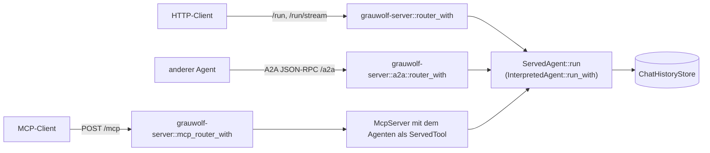
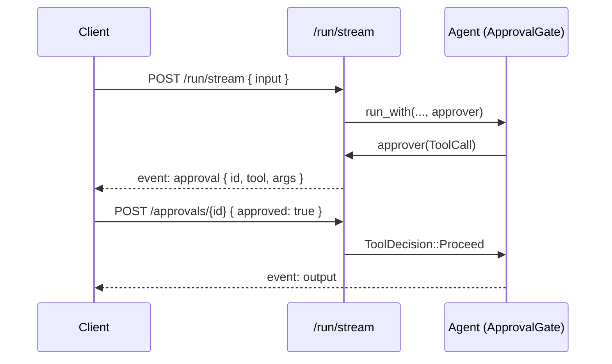

# Kapitel 8: Server und Protokolle

Bisher hast du Agenten im eigenen Prozess gestartet. In diesem Kapitel machst du sie für andere
erreichbar: als **HTTP-Dienst** für Web-Backends und Oberflächen, über **A2A** (Agent2Agent, ein
offenes Protokoll, mit dem Agenten einander Aufträge schicken) für andere Agenten und über **MCP**
(Model Context Protocol, ein Protokoll, über das KI-Anwendungen Tools anbieten und nutzen) für
Werkzeuge wie Desktop-Assistenten. Umgekehrt bindest du mit denselben Crates entfernte Agenten und
MCP-Server als Tools in deine Agenten ein.

Wie man den Dienst als Anwender startet (`grauwolf spec serve`, Tokens, Freigaben), steht im
Nutzerhandbuch in [Kapitel 8](../handbuch/08-externe-tools-und-agenten.md) und
[Kapitel 9](../handbuch/09-betrieb.md). Hier geht es darum, wie das im Code aufgebaut ist und wie du
es in eigenen Anwendungen nutzt oder erweiterst.

## Die beteiligten Crates

| Crate | Schicht | Aufgabe |
|---|---|---|
| `grauwolf-server` | apps | axum-Router für `/run`, `/run/stream`, `/approvals/{id}`, `/health`, A2A (`/a2a`, Agent-Karte) und `/mcp`; Zugangsprüfung |
| `grauwolf-a2a` | adapters | A2A-Client: entfernte Agenten als `DynTool` (auch streamend) |
| `grauwolf-mcp` | adapters | MCP-Client (stdio, Streamable HTTP, HTTP+SSE) und `McpServer` (Tools, Ressourcen, Prompts) |
| `grauwolf-cli` | apps | verdrahtet alles in `spec serve` und `spec mcp` |

Der Server kennt keine Anbieter und keinen Tool-Build: Er bekommt einen fertig geladenen
`InterpretedAgent` (siehe [Kapitel 3](03-rust-api.md)) und einen `ChatHistoryStore` für Gespräche.
Jede Anfrage startet einen eigenen Lauf mit `InterpretedAgent::run_with` und frischem Kontext; ein
geladener Agent bedient alle Anfragen nebenläufig.



## Der einfachste Dienst

`grauwolf_server::router(agent, history)` liefert einen gewöhnlichen `axum::Router`. Du bindest
ihn wie jeden axum-Router an einen `TcpListener`. Das folgende Beispiel orientiert sich an
`crates/apps/grauwolf-server/tests/server.rs` (dort mit `MockLlmClient` statt eines echten
Anbieters):

```rust
use std::sync::Arc;
use grauwolf_agents::memory::MemoryChatHistoryStore;
use grauwolf_interpreter::Interpreter;
use grauwolf_llm::PromptExecutor;
use grauwolf_spec::{AgentSpec, AgentSpecExt};
use grauwolf_test::MockLlmClient;

let spec = AgentSpec::from_json(&std::fs::read_to_string("examples/specs/echo.json")?)?;
let executor = PromptExecutor::builder()
    .client("ollama", Arc::new(MockLlmClient::new("Hallo")))
    .build();
let agent = Interpreter::new(Arc::new(executor)).load(&spec)?;

let router =
    grauwolf_server::router(Arc::new(agent), Arc::new(MemoryChatHistoryStore::default()));
let listener = tokio::net::TcpListener::bind("127.0.0.1:0").await?;
axum::serve(listener, router).await?;
```

In einer Anwendung lädst du den Agenten meist mit `AgentLoader` aus der Fassade, damit Tool-Code,
MCP-Server und Unteragenten der Spec mitkommen ([Kapitel 3](03-rust-api.md)).

Der Router kennt drei Endpunkte:

| Endpunkt | Körper | Antwort |
|---|---|---|
| `GET /health` | – | `ok` |
| `POST /run` | `{ input, conversation_id?, user_id? }` | `{ output }`, bei Fehlern Status 500 mit `{ error }` |
| `POST /run/stream` | wie `/run` | Server-Sent Events (siehe unten) |

`input` ist Text oder JSON nach dem Eingabetyp der Spec. Der Test
`runs_the_agent_and_continues_conversations` zeigt, dass zwei Aufrufe mit derselben
`conversation_id` ein Gespräch fortsetzen.

## Streaming mit Server-Sent Events

**Server-Sent Events** (SSE) sind ein einfacher HTTP-Strom, in dem der Server Ereignisse der Form
`event: <name>` / `data: <inhalt>` schickt. `/run/stream` liefert:

- `event: agent` – jedes `AgentEvent` des Laufs als JSON ([Kapitel 7](07-ereignisse-und-beobachtung.md)),
- `event: text` – Text-Deltas des Modells, sofern die Spec streamt,
- `event: approval` – eine wartende Freigabe (Abschnitt „Freigaben über den Stream“),
- zum Schluss `event: output` mit der Ausgabe als JSON oder `event: error`.

Technisch hängt der Handler dem Lauf über `RunExtras` drei Dinge an: ein `Feature`, das jedes Event
in einen `tokio::sync::mpsc`-Kanal schreibt, einen `frame_sink` für die Text-Deltas und einen
`approver`. Der Lauf selbst läuft in einem `tokio::spawn`; der Kanal wird zum SSE-Strom. Der Kern
in `crates/apps/grauwolf-server/src/lib.rs`:

```rust
/// Leitet die Events eines Laufs in den SSE-Kanal.
struct Forward(mpsc::UnboundedSender<Event>);

impl Feature for Forward {
    fn on_event(&self, event: &AgentEvent) {
        if let Ok(event) = Event::default().event("agent").json_data(event) {
            let _ = self.0.send(event);
        }
    }
}
```

Dasselbe Muster – ein `Feature` je Lauf über `RunExtras.feature` – kannst du nutzen, wenn du Events
in eine eigene Oberfläche, eine WebSocket-Verbindung oder eine Queue leiten willst.

## Gespräche und Benutzer

Mit `conversation_id` setzt ein Lauf ein Gespräch fort; der Speicher ist der übergebene
`ChatHistoryStore` (in der CLI ein Datei- oder SQL-Speicher). Mit `user_id` gehört das Gespräch
einem Benutzer: Den Schlüssel bildet `grauwolf_agents::memory::conversation_key(user, id)` – ohne
Benutzer `id`, mit Benutzer `users/<hex(user)>/<id>` (ADR-0060). Gesprächs-IDs von außen dürfen nur
`[A-Za-z0-9_-]` enthalten, ungültige IDs ergeben `400`. Dadurch kann niemand über eine geschickt
gewählte ID das Gespräch eines anderen Benutzers erreichen. Der Test
`binds_conversations_to_their_user` zeigt das: `anna` und `bob` haben unter derselben ID `c1`
getrennte Gespräche.

Ohne Zugangsprüfung **vertraut** der Dienst der Angabe `user_id`. Das ist richtig, wenn ein eigenes
Backend den Dienst aufruft und die Benutzer selbst anmeldet; für Endbenutzer, die direkt zugreifen,
gibt es Benutzer-Tokens (Abschnitt „Zugang: gemeinsames Token und Benutzer-Tokens“).

## Der Dienst für beliebige Agenten: `ServedAgent`

Die Routen brauchen keinen `InterpretedAgent`, sondern nur den Trait `ServedAgent`
([ADR-0093](../adr/0093-generated-service.md)): `input_schema()` (das Schema eines benannten
Eingabetyps, `None` für Text; daraus ergibt sich das Argument des MCP-Tools) und
`run(input, extras, user) -> BoxFuture<Result<Value, String>>`. `InterpretedAgent` implementiert ihn;
eine generierte Crate wird über `grauwolf_server::service` bedient (re-exportiert als
`grauwolf::service`, Kapitel 6). Die Router nehmen das Trait-Objekt über `router_for`,
`a2a::router_for` und `mcp_router_for` entgegen; `router_with`, `a2a::router_with` und
`mcp_router_with` sind dünne Hüllen für ein `Arc<InterpretedAgent>`. Ein Agent darf Handles
ignorieren, die er nicht unterstützt (ein generierter Agent hat z. B. kein Gesprächsgedächtnis).
`crates/apps/grauwolf-server/tests/served_agent.rs` bedient einen handgeschriebenen Agenten mit
`/health`, `/run`, `/run/stream`, A2A und MCP.

## Weitere Optionen mit `ServiceOptions`

`router_with(agent, history, options)` ist der vollständige Konstruktor; `router` und
`router_with_user_tools` sind Kurzformen. `ServiceOptions` hat drei optionale Felder:

| Feld | Typ | Wirkung |
|---|---|---|
| `user_tools` | `UserTools` = `Arc<dyn Fn(&str) -> Vec<Arc<dyn DynTool>>>` | Läufe mit `user_id` bekommen diese Tools; sie ersetzen gleichnamige Tools des Agenten (ADR-0059), z. B. das Langzeitgedächtnis des Benutzers |
| `run_tools` | `RunTools` = `Arc<dyn Fn() -> BoxFuture<'static, Vec<Arc<dyn DynTool>>>>` | wird vor **jeder** Anfrage an `/run` und `/run/stream` aufgerufen, z. B. um einen Tool-Ordner neu zu lesen (ADR-0074) |
| `facts` | `UserFacts` = `Arc<dyn Fn(Option<&str>) -> Arc<dyn FactMemory>>` | Gedächtnis je Benutzer für automatisches Abrufen und Ablegen (ADR-0069) |

`ServiceOptions::provisioned(agent)` füllt alle drei aus einem `ProvisionedAgent` (ADR-0114);
`ServiceOptions::extras_for(user)` macht aus allen dreien die `RunExtras` eines Laufs (`tools`,
`memory`). Seit [ADR-0089](../adr/0089-protocols-complete.md) nutzen `/run`, A2A
(`a2a::router_with(.., options)`, Benutzer = Besitzer der Aufgabe) und MCP über HTTP
(`mcp_router_with(server, agent, description, options)`, Benutzer aus dem Token) alle dieselben
Optionen, so sieht ein Benutzer über jedes Protokoll dieselben Tools und dasselbe Gedächtnis. Das
folgende Beispiel aus `crates/apps/grauwolf-server/tests/server.rs` (`loads_the_run_tools_for_each_request`)
liefert bei jeder Anfrage die Tools, die gerade in einer Liste stehen:

```rust
let available: Arc<std::sync::Mutex<Vec<Arc<dyn DynTool>>>> = Arc::default();
let run_tools: grauwolf_server::RunTools = {
    let available = Arc::clone(&available);
    Arc::new(move || {
        let tools = available.lock().unwrap().clone();
        Box::pin(async move { tools })
    })
};
let router = grauwolf_server::router_with(
    Arc::new(agent),
    Arc::new(MemoryChatHistoryStore::default()),
    grauwolf_server::ServiceOptions {
        run_tools: Some(run_tools),
        ..Default::default()
    },
);
```

Tools je Benutzer funktionieren genauso; im Test `gives_each_run_the_tools_of_its_user` baut die
Funktion für jeden Benutzer ein Tool `whoami`, das seinen Namen nennt:

```rust
let router = grauwolf_server::router_with_user_tools(
    Arc::new(agent),
    Arc::new(MemoryChatHistoryStore::default()),
    Arc::new(|user: &str| vec![Arc::new(WhoAmI(user.to_owned())) as Arc<dyn DynTool>]),
);
```

## Die Chat-API: `ChatApiOptions`

`ServiceOptions.chat_api: Some(ChatApiOptions { signature, observations })` ergänzt zwei Routen
([ADR-0094](../adr/0094-chat-api.md)): `POST /api/chat` – eine dünne Schicht über demselben Lauf wie
`/run` (Text-Eingabe `{ message }` → `{ response }`; typisierte Eingabe ist der Körper, typisierte
Ausgabe die Antwort; `400`/`500` mit `{ error }`; kein Gespräch, kein Freigeber) – und
`GET /api/signature` → `{ signature, observations }`, das `auth::check` ohne Token durchlässt.
`signature` ist die eingelesene Datei; `observations` ist eine Funktion, die das Objekt auf Anfrage
baut, sodass der Server nicht weiß, wie es gesammelt wird.

Das Sammeln übernimmt das Server-Crate (`grauwolf_server::chat_api::ChatApi`, `grauwolf_server::observations`;
re-exportiert als `grauwolf::chat_api` und `grauwolf::observations`): `ChatApi::from_dir(base_dir, env)`
liest `agent-signature.json` und `agent-names.json`; `observations().feature_for(spec name)` ist ein
`Feature` je Agent, das `llm_call_starting` und `llm_call_completed.model` in Einträge
`{modelId, firstSeen, lastSeen}` übersetzt (der Interpreter hängt es je Spec über
`AgentLoader::with_agent_features` ein, ein generierter Dienst über `GeneratedAgent::observed_by`, das den
Hauptagenten über `RunOptions.features` speist; der Rest von `RunExtras` – Gespräch, Anhänge, Freigeber,
Frame-Sink – wird ebenfalls auf `RunOptions` abgebildet, ADR-0119; und `service::provision_options`, das
dem `ProvisionOptions` eine Feature-Fabrik übergibt, damit jeder Unteragent des Dienstes ebenfalls unter
seinem eigenen Namen erfasst wird). Der Beobachter aus `observations().mcp_tools_observer()` sieht jede
MCP-Tool-Liste, gehasht durch `observations::schema_hash` (die CLI übergibt ihn an
`AgentLoader::with_mcp_tools_observer`, ein generierter Dienst an `ProvisionOptions::with_mcp_tools_observer`).
Ollama-Digests holt `OllamaClient::model_digest` beim Erstellen des Berichts, nicht während eines Laufs.
`ChatApi::options()` macht daraus alles zusammen `ChatApiOptions`.

## Zugang: gemeinsames Token und Benutzer-Tokens

Der Router selbst prüft keinen Zugang. Du legst die Prüfung als axum-Middleware darum:

- `with_token(router, token)` verlangt `Authorization: Bearer <token>` (ADR-0053),
- `with_auth(router, service_token, users)` kennt zusätzlich **Benutzer-Tokens** (ADR-0068).

`/health` und alles unter `/.well-known/` (die A2A-Agent-Karte) bleiben offen; alle anderen Pfade
antworten ohne gültiges Token mit `401`. Verglichen wird in konstanter Zeit, damit die Antwortzeit
nichts über das Token verrät.

Die beiden Arten von Tokens unterscheiden sich darin, wem der Lauf gehört:

- Das **gemeinsame Token** ist das eines vertrauenswürdigen Backends. Es darf jede `user_id`
  angeben.
- Ein **Benutzer-Token** gehört genau einem Benutzer. Der Dienst setzt `user_id` selbst; eine
  andere `user_id` im Körper ergibt `403` – bei `/run`, `/run/stream` und `/approvals/{id}`.

`Users::from_json` liest die Benutzerdatei `{ "<benutzer>": "sha256:<hex>" }`. Gespeichert wird nur
der SHA-256-Hash; `token_hash(token)` berechnet ihn, `new_user_token()` erzeugt ein neues Token
(`gw_` und 128 Bit Zufall). Aus `crates/apps/grauwolf-server/tests/users.rs`:

```rust
use grauwolf_server::Users;

const ANNA_TOKEN: &str = "gw_00112233445566778899aabbccddeeff";

let users = Users::from_json(
    &json!({ "anna": format!("sha256:{}", grauwolf_server::token_hash(ANNA_TOKEN)) })
        .to_string(),
)?;
let router = grauwolf_server::with_auth(router, Some("backend".into()), users);
```

Nach der Prüfung steht der Aufrufer als interne Extension an der Anfrage (`Caller::Service` oder
`Caller::User(name)`); die Handler lesen sie von dort. Wichtig für eigene Erweiterungen:
`with_auth` legt eine Schicht (`Router::layer`) um die Routen, die der Router **zu diesem Zeitpunkt**
hat. Füge eigene Routen also vorher mit `merge` hinzu, sonst sind sie ungeschützt.

Die CLI liest das gemeinsame Token aus `GRAUWOLF_SERVER_TOKEN` und verweigert den Start an einer
nicht-lokalen Adresse, wenn weder Token noch Benutzerdatei da sind. TLS gehört in einen Reverse-Proxy
davor. Workloads können sich statt mit Tokens mit SPIFFE ausweisen: siehe
[Authentifizierung mit SPIFFE](#authentifizierung-mit-spiffe).

## Authentifizierung mit SPIFFE

Wo im Cluster SPIRE läuft, können Aufrufer sich statt mit einem Token mit ihrer Workload-Identität ausweisen (ADR-0109). Die Interna der Identität (der Port `WorkloadIdentity`/`TlsIdentity`, der Workload-API-Client, die Prüfer, die Fakes) stehen in [Kapitel 9](09-identitaet-zugangsdaten-und-cluster-werkzeug.md#92-workload-identität-grauwolf-spiffe); dieser Abschnitt handelt davon, wie Dienst und Protokoll-Clients sie nutzen. Die Sicht der Benutzer steht in [Kapitel 9 des Benutzerhandbuchs](../handbuch/09-betrieb.md#agenten-rufen-agenten-mit-spiffe).

**Die Schichten, der Reihe nach.** `with_spiffe_auth(router, service_token, users, gate)` ist `with_auth` plus das SPIFFE-Gate (`ServiceConfig::secure` legt es um die Routen beider Ports; ohne Gate gelten nur die Token-Regeln des vorigen Abschnitts). Für jede Anfrage entscheidet es:

1. `ConnectInfo<PeerSpiffe>`: Die Verbindung kam über den mTLS-Listener, wo der Handshake das Client-Zertifikat schon geprüft und dessen SPIFFE-ID in die Verbindungsinfo gelegt hat. Diese ID gewinnt.
2. Ein `Authorization: Bearer`, das wie ein JWT aussieht (drei nicht leere Teile, nicht `gw_...`), ist ein JWT-SVID: Das `SpiffeGate` lässt es vom SPIRE-Agenten mit `validate_jwt_svid` für die Audience prüfen (`GRAUWOLF_SPIFFE_AUDIENCE`, Standard: die eigene ID des Dienstes). Ungültig ist `401`, eine Workload API, die nicht antwortet, `503`.
3. Sonst die Token-Regeln: Benutzer-Token, gemeinsames Token, anonym nur, wo es vorher erlaubt war.

Eine ID aus 1 oder 2 läuft durch die `CallerMap`: Eine zugeordnete ID wird zu `Caller::User(user)`, sodass Gespräche, Gedächtnis, Freigaben und Tool-Speicher genau wie bei einem Benutzer-Token folgen; eine ID ohne Eintrag ist `403`.

**Zwei Listener.** `SpiffeInbound::start` (Identität, Aufruferdatei, akzeptierte Trust Domains) liegt in `ServiceConfig::spiffe_inbound`. Der Hauptport bleibt einfaches HTTP für Menschen, den Ingress, die Probes und JWT-SVIDs. Mit `GRAUWOLF_SPIFFE=1` bedient ein `TlsListener` (ein `axum::serve::Listener` in `spiffe.rs`) den zweiten Port, `GRAUWOLF_SPIFFE_PORT`: Er nimmt TCP-Verbindungen an, macht die Handshakes nebenläufig (je 10 s, damit ein langsamer Client die anderen nicht aufhält), verlangt ein Client-Zertifikat und liefert jede Verbindung mit `PeerSpiffe`. `service::routers_with_history` gibt `ServiceRouters { main, mtls }` zurück, und `serve` bindet beide.

**`CallerMap`** ist die Aufruferdatei (`GRAUWOLF_SPIFFE_USERS`): exakte IDs und Präfixe mit `/*` am Ende, der spezifischste Eintrag gewinnt. `CallerMap::watch(path, interval)` fragt den aufgelösten Pfad, mtime und Größe alle zwei Sekunden ab, sodass der `..data`-Symlink-Tausch einer eingebundenen ConfigMap erkannt wird; eine ungültige neue Datei wird gemeldet, und die alte Zuordnung bleibt.

**A2A einmal je Port.** Die Agent-Karte nennt den Endpunkt, an den ein A2A-Client seine Nachrichten dann schickt. `routers_with_history` baut den A2A-Router deshalb zweimal: Die Karte des Hauptports nennt `config.public_url()`, die des mTLS-Ports `GRAUWOLF_SPIFFE_PUBLIC_URL` (Standard `https://localhost:<port>`). Run, MCP und der Rest werden einmal gebaut und geteilt. Der zusätzliche A2A-Port eines generierten Dienstes (`A2A_PORT`) gehört nicht zum mTLS-Entwurf und bleibt einfach.

**MCP über HTTP** liegt in `core`, neben `/run`, sodass `/mcp` an beiden Ports hinter derselben `with_spiffe_auth`-Schicht liegt; `agent_mcp` liest `Caller` und `CallerSpiffe` wie die anderen Handler aus der Anfrage.

**Von der Anfrage zum Ereignis.** `with_spiffe_auth` legt die ID als `CallerSpiffe` in die Extensions der Anfrage (nie ein Token). Die Handler (`/run`, `/run/stream`, `/api/chat`, A2A `rpc`, `agent_mcp`) kopieren sie als Text in `RunExtras.caller`; der Interpreter reicht sie an `AgentRun::with_caller` weiter, generierte Dienste gehen über `RunOptions.caller` des Hosts; der Lebenszyklus meldet sie als `caller` in `AgentEvent::AgentStarting`, und `OtelFeature` hält `grauwolf.caller` am Span `invoke_agent` fest.

**Die Client-Seite.** `grauwolf_spiffe::ClientAuth` (`AuthMode::Mtls` oder `Jwt`, dazu der erwartete `SpiffeMatch` bzw. die Audience) nehmen `grauwolf-a2a` und `grauwolf-mcp` entgegen: `A2aClient::connect_with_auth`, `McpClient::connect_http_with_auth` und `connect_sse_with_auth`. Für mTLS gibt es `reqwest::ClientBuilder::use_preconfigured_tls` eine `rustls::ClientConfig`; für JWT liefert es je Anfrage ein frisches Bearer. Der Host baut es aus der Spec in `spiffe::client_auth` (die Identität einmal je Prozess und Socket); das Provisionieren tut dies für interpretierte und generierte Agenten gleich.

**Fehlerabbildung.** Ein abgewiesener Handshake erschien früher als gewöhnlicher Verbindungsfehler („no connection ... refused or given up"), was die Ursache verbarg. `transport_error` (A2A) und `http_error` (MCP) fragen jetzt zuerst `grauwolf_spiffe::tls_refusal(&error)`: Es läuft die Fehlerkette ab (auch in `std::io::Error`, das in `source()` verbirgt, was es umhüllt), sucht einen rustls-Fehler und liefert den Grund des Prüfers, etwa `the server is <id>, expected <id>`. Die Meldung lautet dann `TLS handshake with <url> failed: <reason>; the call was not executed`, und nur ohne Abweisung heißt es `no connection to <url> (refused or given up after 30 s)`. Gefunden im Live-Check von ADR-0109.

**Der Trace-Kontext reist auf demselben Weg** (ADR-0123). `InboundTrace`, ein Extractor, liest `traceparent` und `tracestate` der Anfrage in `RunExtras.trace_parent`, und der A2A-Handler `rpc` tut dasselbe aus seiner `HeaderMap`: `/run`, `/run/stream`, `/api/chat`, A2A und `agent_mcp` reichen ihn alle weiter (bei MCP trägt ihn `ServedTool`; `GeneratedAgent` bildet ihn auf `RunOptions.trace_parent` ab). Die Handler laufen hinter der Authentifizierungsschicht, der Header wird also nur von Aufrufern gelesen, die sie bestanden haben; er verknüpft Spans und gewährt nichts, und er wird nie geloggt. Der Server parst ihn nicht: Ein fehlender Header ist `None`, und `OtelFeature` ignoriert einen fehlerhaften ([Kapitel 7](07-ereignisse-und-beobachtung.md#ein-trace-über-agenten-hinweg-adr-0123)).

**Tests.** `grauwolf-server/tests/spiffe.rs` (mTLS-Port, `403`, JWT am HTTP-Port, Neuladen nach einem Symlink-Tausch), `tests/spiffe_a2a.rs` (der A2A-Client gegen den Server, die Meldung zur TLS-Abweisung) und `tests/spiffe_service.rs` (`routers_with_history`, die Karte je Port); `grauwolf-a2a/tests/auth.rs`, `grauwolf-mcp/tests/spiffe.rs`; und in `grauwolf-generator/tests/equivalence.rs` der langsame Fall `generated_services_authenticate_callers_by_spiffe`. Alle laufen mit `TestCa` und `FakeWorkloadApi`/`FakeIdentity`, ohne SPIRE.

## Freigaben über den Stream

Manche Tools sollen nur nach Zustimmung eines Menschen laufen (ADR-0061). Im Interpreter machst du
sie mit `Interpreter::with_tool_approval([...])` freigabepflichtig (bzw. `AgentLoader::with_tool_approval`).
Intern entsteht daraus ein `ApprovalGate` – ein Interceptor, dessen Haken `approve_tool_call` den
Freigeber des Laufs fragt ([Kapitel 7](07-ereignisse-und-beobachtung.md)). Der Freigeber ist ein
`ToolApprover`:

```rust
// crates/domain/grauwolf-interpreter/src/approval.rs
pub type ToolApprover = Arc<dyn Fn(&ToolCall) -> BoxFuture<'static, ToolDecision> + Send + Sync>;
```

Hat ein Lauf keinen Freigeber (`RunExtras.approver` ist `None`), wird der Aufruf abgelehnt
(`tool '<name>' needs an approval that nobody can give here`); die Begründung geht als Tool-Ergebnis
an das LLM. Das gilt für `/run`, A2A, MCP und Unteragenten – überall dort fehlt ein Rückkanal zum
Menschen. Nur `/run/stream` setzt einen Freigeber:



Die ID ist 128 Bit Zufall und gilt nur, solange der Lauf wartet. `POST /approvals/{id}` nimmt
`{ approved, reason?, user_id? }` entgegen und antwortet mit `204`; eine unbekannte ID oder ein
fremder Benutzer ergibt `404`. Kommt innerhalb von `DEFAULT_APPROVAL_TIMEOUT` (5 Minuten) keine
Entscheidung, lehnt der Dienst mit `No approval given within 300 s` ab. Den vollständigen Ablauf mit
einem SSE-Leser zeigt `crates/apps/grauwolf-server/tests/approvals.rs`
(`asks_for_approval_in_the_stream_and_runs_the_tool_once_approved`).

Willst du Freigaben über einen anderen Kanal einholen (Chat-Nachricht, Ticket), schreibst du einen
eigenen `ToolApprover` und übergibst ihn in `RunExtras { approver: Some(...), .. }` an `run_with`.

## A2A-Server: der Agent für andere Agenten

`grauwolf_server::a2a::router(agent, history, info)` bietet A2A 1.0 über JSON-RPC an (ADR-0054);
`a2a::router_with(agent, history, info, options)` führt jeden Auftrag zusätzlich mit den
`ServiceOptions`-Handles seines Besitzers aus (ADR-0089).
`AgentCardInfo::from_spec(&spec, base_url)` füllt die **Agent-Karte** – die öffentliche
Selbstbeschreibung des Agenten – aus Name und System-Prompt der Spec; `base_url` ist die Adresse, unter
der andere den Dienst erreichen. Angelehnt an `crates/apps/grauwolf-server/tests/a2a.rs`:

```rust
use grauwolf_server::a2a::AgentCardInfo;

let agent = Arc::new(Interpreter::new(Arc::new(executor)).load(&spec)?);
let listener = tokio::net::TcpListener::bind("127.0.0.1:0").await?;
let base = format!("http://{}", listener.local_addr()?);
let router = grauwolf_server::a2a::router(
    agent,
    Arc::new(MemoryChatHistoryStore::default()),
    AgentCardInfo::from_spec(&spec, &base),
);
```

Der Router bietet:

- `GET /.well-known/agent-card.json` – Name, Beschreibung, Schnittstelle `{base}/a2a` mit
  `protocolBinding: "JSONRPC"`, `capabilities.streaming = true`, Ein-/Ausgabeformat (`text/plain`
  bzw. `application/json` bei benannten Typen).
- `POST /a2a` mit den Methoden `SendMessage` (Ergebnis `{ task }` im Zustand
  `TASK_STATE_COMPLETED` oder `TASK_STATE_FAILED`, Antwort als Artefakt `answer`),
  `SendStreamingMessage` (SSE: Task im Zustand `WORKING`, je Text-Delta ein `artifactUpdate`, zum
  Schluss ein `statusUpdate`), `GetTask` und `CancelTask`.

Fehler folgen den A2A-Codes: `-32001` unbekannter Task, `-32002` Task nicht abbrechbar, `-32004`
nicht angebotene Protokoll-Methode (z. B. `ListTasks`, Push-Benachrichtigungen), `-32601` unbekannte
Methode, `-32602` ungültige Parameter, `-32009` nicht unterstützte `A2A-Version`. Die `contextId`
einer Nachricht wird zur Gesprächs-ID; sie unterliegt denselben Regeln wie `conversation_id`, darum
kann kein Kontext das Gespräch eines Benutzers erreichen.

Mit Benutzer-Token (`Caller::User` in den Extensions, gesetzt von `with_auth`) gehört der Auftrag
diesem Benutzer: `start(params, owner)` bildet den Gesprächsschlüssel mit
`conversation_key(Some(user), contextId)`, und der `TaskStore` merkt sich den Besitzer jedes Tasks.
`GetTask`/`CancelTask` liefern nur eigene Tasks; fremde melden `-32001` wie unbekannte. IDs entstehen
mit `approvals::new_id()` (128 Bit aus `getrandom`). Der `TaskStore` hält höchstens
`MAX_STORED_TASKS` (1000) Tasks im Arbeitsspeicher und vergisst den ältesten zuerst
(ADR-0054 Nachtrag). Tests: `crates/apps/grauwolf-server/tests/a2a_users.rs`.

## A2A-Client: entfernte Agenten als Tools

Die Gegenrichtung steckt in `grauwolf-a2a` (ADR-0055). `A2aClient::connect(url, headers)` lädt die
Agent-Karte (`url` ist die Karte selbst oder die Basis-URL) und wählt die JSON-RPC-Schnittstelle.
`send(text)` schickt eine Nachricht und liefert die Text- und `data`-Parts der Antwort; Rückfragen
des Agenten (`INPUT_REQUIRED`, `AUTH_REQUIRED`) kommen als Text `Question from the agent: …` zurück,
gescheiterte Tasks als `A2aError::Task`. `send_streaming(text, on_text)` nutzt `SendStreamingMessage`
und reicht jedes Textstück an `on_text` weiter; das Lesezeitlimit gilt dann zwischen zwei Events statt
für den ganzen Lauf (ADR-0089). Angelehnt an `crates/adapters/grauwolf-a2a/tests/client.rs`:

```rust
use grauwolf_a2a::A2aClient;

let client = A2aClient::connect(
    &server.uri(),
    &[("Authorization".into(), "Bearer secret".into())],
)
.await?;
assert_eq!(client.name(), "weather");
let answer = client.send("What will the weather be like?").await?;
```

Als Tool für einen Agenten wird daraus mit `Arc<A2aClient>::tool(name, description)` ein `DynTool`
mit dem Argument `{ request }`; ohne Beschreibung gilt die aus der Agent-Karte. Meldet die Agent-Karte
`capabilities.streaming`, nutzt das Tool `send_streaming`, sonst `SendMessage`. Jeder Aufruf ist eine
eigene Nachricht ohne gemerkte `contextId` – so vermischen sich in einem Dienst keine Gespräche
verschiedener Nutzer. Verbindungen haben Zeitlimits (`CONNECT_TIMEOUT` 30 s, `DEFAULT_READ_TIMEOUT`
10 min, anpassbar mit `connect_with_read_timeout`; ADR-0065).

Für Specs erledigt das `AgentLoader`: Einträge in `agent_tools` mit `url` werden über
`A2aClient::connect` eingebunden, `${VAR}` in `headers` wird aus der Umgebung ersetzt
(`crates/apps/grauwolf-host/src/loader.rs`).

## MCP-Server: der Agent als Tool

`grauwolf_mcp::McpServer::new(name, tools)` bietet beliebige `DynTool`s über MCP an (ADR-0056).
`handle(message)` beantwortet eine JSON-RPC-Nachricht (`initialize`, `ping`, `tools/list`,
`tools/call`; Tool-Fehler als `isError: true`); für Benachrichtigungen liefert es `None`.
`with_resources(..)` ergänzt `resources/list`/`resources/read`, `with_prompts(..)` ergänzt
`prompts/list`/`prompts/get` (ADR-0089). Für einen Agenten bietet `grauwolf::mcp::agent_server(spec,
base_dir, tools)` aus der Fassade die Spec selbst an (`grauwolf://<name>/spec`), die Dokumente aus
`knowledge.sources` (`grauwolf://<name>/knowledge/<pfad>`) und einen Prompt `<name>` mit dem Argument
`request`. Darauf bauen zwei Transporte auf:

- **stdio**: `serve(reader, writer)` liest zeilenweise JSON-RPC. So arbeitet `grauwolf spec mcp`.
- **Streamable HTTP**: `grauwolf_server::mcp_router(server)` bietet `POST /mcp` an – zustandslos,
  Antwort als JSON, Benachrichtigungen mit `202 Accepted`. `mcp_router_with(server, agent,
  description, options)` bietet stattdessen `agent` als einziges Tool an und führt jeden Aufruf mit den
  Handles des Benutzers aus dem Token aus (`InterpretedAgent::into_tool_with`, ADR-0089).

Um einen Agenten anzubieten, machst du ihn mit `InterpretedAgent::into_tool` zum Tool. Angelehnt an
`crates/apps/grauwolf-server/tests/mcp.rs`:

```rust
use grauwolf_mcp::{McpClient, McpServer};

let agent = Arc::new(Interpreter::new(Arc::new(executor)).load(&spec)?);
let server = McpServer::new("echo", vec![agent.into_tool("echo", "Repeats")]);
let listener = tokio::net::TcpListener::bind("127.0.0.1:0").await?;
let base = format!("http://{}", listener.local_addr()?);
tokio::spawn(async move {
    axum::serve(listener, grauwolf_server::mcp_router(server)).await.unwrap()
});

let client = McpClient::connect_http(&format!("{base}/mcp"), &[]).await?;
let answer = client.call_tool("echo", json!({ "request": "Hello" })).await?;
```

Weil `McpServer` beliebige Tools nimmt, kannst du auch eigene `#[tool]`-Funktionen oder die Tools
einer `ToolRegistry` per MCP anbieten – nicht nur Agenten.

## MCP-Client: fremde Tools nutzen

`McpClient` spricht mit MCP-Servern auf vier Wegen:

- `McpClient::spawn(command, args)` startet den Server als Prozess (stdio),
- `McpClient::connect(reader, writer)` nutzt einen beliebigen Byte-Strom, praktisch für Tests,
- `McpClient::connect_http(url, headers)` spricht Streamable HTTP mit Sitzungs-ID (ADR-0051),
- `McpClient::connect_sse(url, headers)` spricht den älteren HTTP+SSE-Transport der Protokollversion
  2024-11-05 (ADR-0112, Spec `transport: "sse"`).

Der HTTP+SSE-Client (`src/sse.rs`) hält je Verbindung einen Ereignisstrom offen: `GET url` öffnet ihn,
das erste Event `endpoint` nennt die URI für die `POST`s (sie muss den Ursprung von `url` haben, sonst
verweigert der Client, bevor er irgendeinen Header dorthin schickt), und eine Lese-Task ordnet die
`message`-Events über `id` den wartenden Aufrufen zu. Er beantwortet Anfragen des Servers (`ping` mit
`{}`, alles andere mit -32601) und ignoriert Benachrichtigungen. Eine Wiederaufnahme gibt es nicht: Endet
der Strom, scheitern die wartenden Aufrufe, und der nächste Aufruf verbindet sich einmal neu mit einem
neuen `GET` und einem neuen Handshake. Zeitlimits wie bei Streamable HTTP; das Lesezeitlimit zählt je
Aufruf, der Leerlauf des Stroms darf ruhig bleiben.

Für Tests bietet das Feature `test-sse-server` von `grauwolf-mcp` `testing::SseTestServer` (ein
In-Memory-Server für diesen Transport; `SseBehavior` schaltet CRLF, mehrzeilige Daten, einen fremden
Endpunkt, Pflicht-Header und `POST`-Statuscodes um). `tests/sse.rs` des Crates und `tests/mcp_sse.rs`
des Hosts nutzen ihn. Das Beispiel `serve_sse_mcp` stellt ihn mit einem Tool für Live-Prüfungen bereit:

```bash
cargo run -p grauwolf-mcp --features test-sse-server --example serve_sse_mcp
grauwolf spec run docs/handbuch/beispiele/08-mcp-sse.json "Reverse the text 'grauwolf'."
```

Danach gibt es `list_tools`, `call_tool`, `list_resources`/`read_resource` und
`list_prompts`/`get_prompt`. `Arc<McpClient>::tools()` liefert alle Tools des Servers als `DynTool`,
`resource_tools(prefix)` die Ressourcen als zwei Tools. Aus
`crates/adapters/grauwolf-mcp/tests/client.rs`:

```rust
let client = std::sync::Arc::new(connected().await);
let tools = client.tools().await?;
let registry = tools
    .into_iter()
    .fold(grauwolf_tools::ToolRegistry::builder(), |builder, tool| builder.shared(tool))
    .build();
let echoed = registry.call("echo", json!({ "text": "via MCP" })).await?;
```

Für Specs startet die Provisionierung alle Einträge aus `mcp_servers` und gibt nur die dort
deklarierten Tools weiter ([Kapitel 4](04-tools-intern.md)).

## Alles zusammen: wie `spec serve` verdrahtet ist

Die CLI (`run` in `crates/apps/grauwolf-cli/src/commands/spec/serve.rs`) zeigt, wie die Teile zusammenpassen. In
Kurzform:

```rust
let (spec, agent) = service_loader(options, tracing.as_ref())?.load(file, None).await?;
let agent = Arc::new(agent);
// Ressourcen (Spec, Wissen) und Prompt des Agenten (ADR-0089)
let mcp = grauwolf::mcp::agent_server(&spec, base_dir, Vec::new()).await?;
let options = service_options(file, &spec, options).await?;
let router = grauwolf_server::router_with(Arc::clone(&agent), Arc::clone(&history), options.clone())
    // A2A und MCP mit denselben Tools und demselben Gedächtnis wie `/run` (ADR-0089)
    .merge(grauwolf_server::a2a::router_with(
        Arc::clone(&agent),
        history,
        grauwolf_server::a2a::AgentCardInfo::from_spec(&spec, &base_url),
        options.clone(),
    ))
    .merge(grauwolf_server::mcp_router_with(mcp, agent, agent_description(&spec), options));
let router = match (token, users) {
    (None, None) => router,
    (token, users) => grauwolf_server::with_auth(router, token, users.unwrap_or_default()),
};
axum::serve(listener, router).with_graceful_shutdown(/* Strg+C */).await
```

Dabei gilt:

- `service_loader` ist ein `AgentLoader` mit `with_tool_approval(--confirm-tools)`.
- `history` ist ein `FileChatHistoryStore` oder – mit `--conversations-db` – ein SQL-Speicher.
- `options` ist `ServiceOptions::provisioned(provisioned)`: `user_tools` und `facts` (Gedächtnis-Tools,
  Schlüssel-Wert-Speicher, Unteragenten und das automatische Gedächtnis des Benutzers) sowie `run_tools`
  (der Tool-Ordner) stammen aus dem `ProvisionedAgent`, den der Lader zurückgibt (`load_provisioned`);
  `/run`, A2A und MCP teilen sie sich (ADR-0114).
- Vor dem Binden verweigert der Dienst eine nicht-lokale Adresse ohne Token oder Benutzerdatei
  (`<address> is reachable from outside: set a token in GRAUWOLF_SERVER_TOKEN, pass --users or bind
  to 127.0.0.1`); nach dem Start gibt er `grauwolf service for <name> on http://<address>` aus.
- `--public-url` setzt die Basis-URL der Agent-Karte, z. B. hinter einem Reverse-Proxy.

Eigene Anwendungen können genauso vorgehen und weitere axum-Routen hinzufügen – vor `with_auth`.

## Das Wichtigste in Kürze

- `grauwolf-server` liefert axum-Router: `router`/`router_with` für `/run`, `/run/stream`,
  `/approvals/{id}` und `/health`, `a2a::router` für A2A, `mcp_router` für MCP über HTTP.
- Jede Anfrage ist ein Lauf eines `ServedAgent` (bei interpretierten Agenten `InterpretedAgent::run_with`);
  Feature, Frame-Sink, Gespräch, Tools, Gedächtnis und Freigeber kommen über `RunExtras`.
- `ServiceOptions` ergänzt Tools je Benutzer (`user_tools`), je Anfrage (`run_tools`) und das
  automatische Gedächtnis (`facts`) – für `/run`, A2A (`a2a::router_with`) und MCP (`mcp_router_with`)
  gleichermaßen.
- Gespräche gehören Benutzern (`conversation_key`); `with_auth` unterscheidet das gemeinsame Token
  eines Backends von Benutzer-Tokens, die `user_id` selbst festlegen.
- Freigabepflichtige Tools werden ohne Rückkanal abgelehnt; nur `/run/stream` fragt per
  `event: approval` und wartet auf `POST /approvals/{id}`.
- `with_spiffe_auth` bringt die Workload-Identität in dieselbe Schicht: einen mTLS-Listener (`TlsListener`, `PeerSpiffe`), JWT-SVIDs am HTTP-Port, die `CallerMap` und `CallerSpiffe` bis zu `agent_starting.caller`; die Clients nehmen ein `ClientAuth`.
- `grauwolf-a2a` und `grauwolf-mcp` machen entfernte Agenten und MCP-Server zu `DynTool`s;
  `McpServer` bietet beliebige Tools an, auch einen Agenten über `into_tool`, sowie Ressourcen und Prompts.

Weiter: [Kapitel 9](09-identitaet-zugangsdaten-und-cluster-werkzeug.md) – Workload-Identität, Quellen
für Zugangsdaten und das Operator-Programm für Kubernetes. Zurück zur [Übersicht des Entwicklerhandbuchs](README.md).
