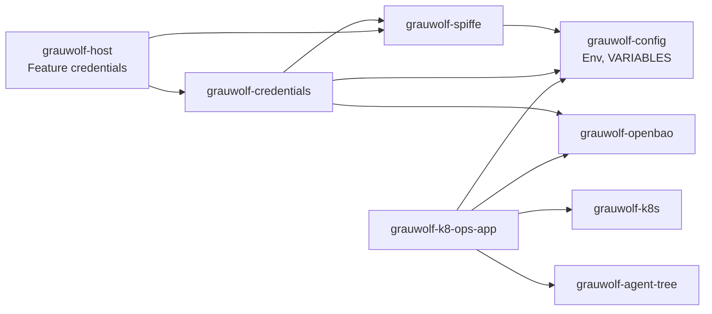
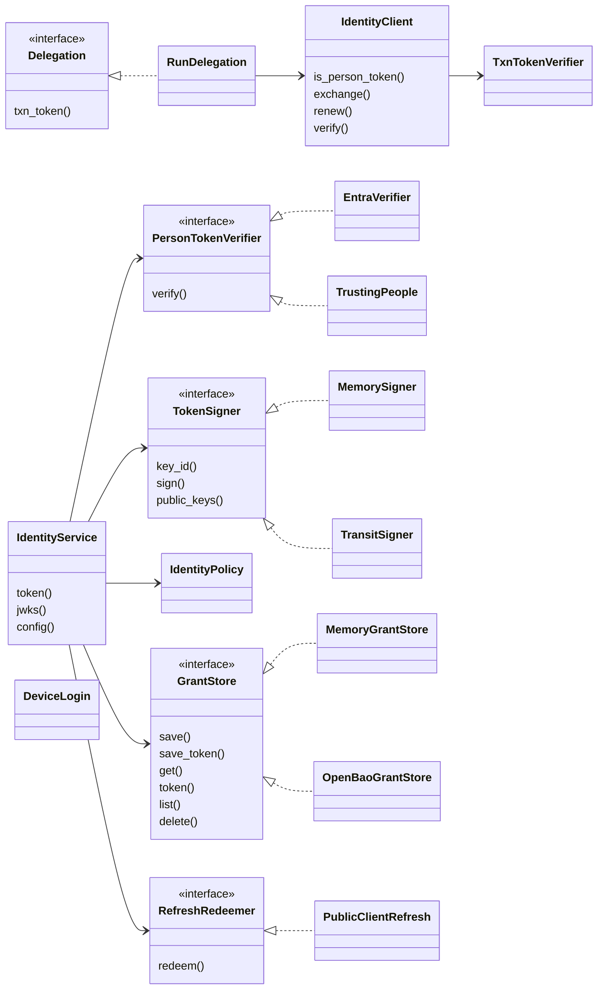
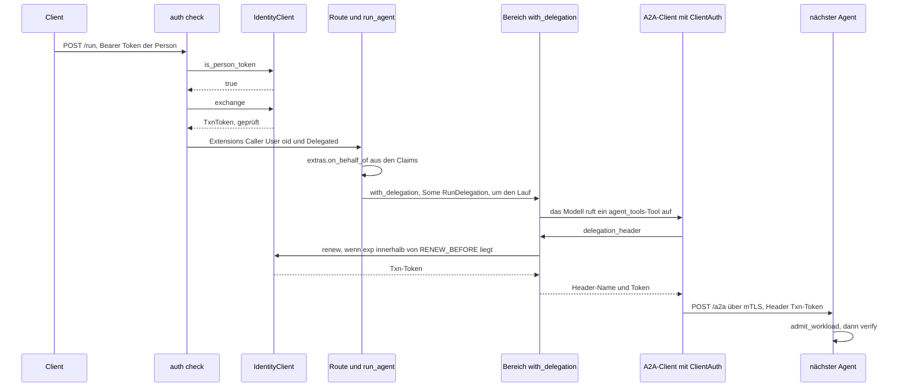

# Kapitel 9: Identität, Zugangsdaten und das Cluster-Werkzeug

Die Kapitel 1 bis 8 handeln vom Agenten selbst. Dieses Kapitel handelt vom Boden, auf dem er steht,
wenn er in Kubernetes läuft: **wer der Agent ist** (eine SPIFFE-Identität aus SPIRE), **woher seine
Geheimnisse kommen** (ein Vermittler für Geheimnisse, OpenBao, statt Umgebungsvariablen) und **wie ein
Cluster dafür eingerichtet wird** (das Operator-Programm `grauwolf-k8-ops`). Fünf Crates tragen das. Du
begegnest ihnen, wenn du eine Quelle für Zugangsdaten ergänzt, ändern willst, was das Operator-Programm
anlegt, oder einen Test schreibst, der einen Kubernetes-API-Server braucht.

Die Sicht des Anwenders beschreibt das Nutzerhandbuch in
[Kapitel 12](../handbuch/12-zugangsdaten-aus-openbao.md) (Zugangsdaten aus OpenBao mit SPIFFE) und
[Kapitel 13](../handbuch/13-cluster-einrichten.md) (`grauwolf-k8-ops`). Dieses Kapitel wiederholt sie
nicht; es geht um den Code. Die Entscheidungen stehen in
[ADR-0109](../adr/0109-workload-identity-with-spiffe.md),
[ADR-0110](../adr/0110-workload-identity-for-tools-and-credentials.md),
[ADR-0120](../adr/0120-grauwolf-k8-ops.md) und
[ADR-0121](../adr/0121-grauwolf-k8-ops-agent-deploy.md), samt ihren Implementierungsnotizen und
Live-Checks. Du solltest [Kapitel 1](01-architektur.md) (Schichten, Ports und Adapter) und
[Kapitel 5](05-erweitern.md) (Ports und Adapter in der Praxis) kennen.

## 9.1 Die Crates und wer von wem abhängt

| Crate | Schicht | Aufgabe |
|---|---|---|
| [`grauwolf-spiffe`](../../crates/adapters/grauwolf-spiffe/AGENTS.md) | adapters | Der Port `WorkloadIdentity` (ein JWT-SVID für eine Zielgruppe) und ein eigener, minimaler Workload-API-Client |
| [`grauwolf-openbao`](../../crates/adapters/grauwolf-openbao/AGENTS.md) | adapters | Die HTTP-API von OpenBao: JWT-Anmeldung und KV-Lesen (Agenten) sowie die Admin-Aufrufe der Einrichtung (Operatoren) |
| [`grauwolf-credentials`](../../crates/adapters/grauwolf-credentials/AGENTS.md) | adapters | Der Abschnitt `[credentials]` und `CredentialEnv`, ein `Env`, der zugeordnete Variablen aus `file:`- und `openbao:`-Quellen beantwortet |
| [`grauwolf-identity`](../../crates/adapters/grauwolf-identity/AGENTS.md) | adapters | Delegation (ADR-0111): Txn-Tokens, Tokens von Personen aus Entra und der Signaturschlüssel hinter Ports, die Entscheidungen des Identitätsdienstes und der Client des Agenten ([9.9](#99-delegation-grauwolf-identity)) |
| [`grauwolf-k8s`](../../crates/adapters/grauwolf-k8s/AGENTS.md) | adapters | `Cluster`, eine kleine JSON-API über kube-rs, und (Feature `testing`) `FakeCluster` |
| [`grauwolf-egress`](../../crates/adapters/grauwolf-egress/AGENTS.md) | adapters | Die Ziele eines Agenten-Baums, abgeleitet aus seinen Specs (`derive_tree`), die eine Tabelle der Standardadressen der Modell-Provider und `resolve_all` für `from_env` |
| [`grauwolf-k8-ops-app`](../../crates/apps/grauwolf-k8-ops-app/AGENTS.md) | apps | Das Operator-Programm: Bibliothek `grauwolf_k8_ops_app`, Binary `grauwolf-k8-ops` |



Drei Dinge sind zu beachten:

- **Die Laufzeit des Agenten sieht Kubernetes nie.** `grauwolf-k8s` (kube-rs, k8s-openapi) wird nur von
  `grauwolf-k8-ops-app` eingebunden. `grauwolf-host` bindet `grauwolf-credentials` und
  `grauwolf-spiffe` hinter dem Cargo-Feature `credentials` ein (in `default`, außerdem Feature der
  Fassade `grauwolf` und der CLI). Ein generierter Dienst zahlt also für einen HTTP-Client und `h2`,
  nicht für einen Kubernetes-Client.
- **`grauwolf-openbao` wird gemeinsam genutzt.** Die Quelle für Zugangsdaten des Agenten und das
  Operator-Programm verwenden dieselben `Bao`-Aufrufe. Anmeldung und KV-Lesen wurden aus
  `grauwolf-credentials` dorthin verschoben, ohne Verhalten oder Fehlertexte zu ändern (die Tests von
  `grauwolf-credentials` blieben grün).
- **`grauwolf-k8-ops-app` ist ein App-Crate, das kein anderes App-Crate berühren darf.** `cargo xtask
  check-arch` weist eine Abhängigkeit auf Host, Server, CLI, Fassade oder Tools-App zurück und ebenso
  jedes App-Crate, das davon abhängt (`arch::K8S_OPS_APP` in `xtask/src/arch.rs`). Es darf Adapter
  nutzen, darunter `grauwolf-agent-tree` (liest die Dateien des Agenten für `agent deploy --spec`; das
  bringt die Build-Crates der Tools ins Binary) und `grauwolf-spec`. Von `grauwolf-config` nutzt es nur
  `VARIABLES`, um Variablennamen zu prüfen.

## 9.2 Workload-Identität: `grauwolf-spiffe`

### Der Port und das Token

```rust
pub trait WorkloadIdentity: Send + Sync {
    fn jwt_svid<'a>(&'a self, audience: &'a str) -> BoxFuture<'a, Result<JwtSvid, SpiffeError>>;
}
```

Mehr braucht grauwolf heute von einer Identität nicht: ein JWT-SVID (ein kurzlebiges, signiertes Token,
das die SPIFFE-ID des Workloads nennt, `spiffe://<trust domain>/ns/<namespace>/sa/<service account>`) für
eine Zielgruppe. Der Port ist bewusst ein Trait: ADR-0109 sieht X.509-SVIDs, Trust Bundles, mTLS und die
Prüfung eingehender Tokens vor. Das werden weitere Methoden dieses Traits, damit Quellen für Zugangsdaten
und später die A2A- und MCP-Clients den Transport nie sehen.

`JwtSvid` hält das Token und die SPIFFE-ID. `token()` ist das Zugangsdatum; `spiffe_id()` ist für Logs
und Fehler gedacht (`login as spiffe://…`). Seine `Debug`-Implementierung gibt die ID aus und verbirgt
das Token (`finish_non_exhaustive`), und `SpiffeError` enthält ebenfalls nie ein Token. Behalte das bei,
wenn du Felder ergänzt: Ein Token, das in einer `{:?}`-Ausgabe einer Logzeile landet, ist ein Leck.

### Ein eigener Workload-API-Client, nicht das `spiffe`-Crate

`WorkloadApiClient` spricht gRPC (`FetchJWTSVID`) mit dem SPIRE-Agenten über den Unix-Socket, der in
`SPIFFE_ENDPOINT_SOCKET` steht (`ENDPOINT_VARIABLE`, `unix:///path`; `from_env` liefert ohne sie `None`,
bei Aufbauten ohne SPIRE ändert sich also nichts). Er baut direkt auf `h2` auf, und die Protobuf-Nachrichten
in `src/proto.rs` sind von Hand geschrieben, mit `prost`-Derive neben `proto/workload.proto`.

Warum nicht das `spiffe`-Crate? Es ließe sich offline bauen, zieht aber `tonic`, `prost-build` und
`protox`, `jsonwebtoken` und `x509-parser` für einen einzigen Unary-Aufruf in jeden Build, und das
Offline-Builder-Image ([ADR-0096](../adr/0096-builder-and-cli-images.md)) müsste sie mitführen
(ADR-0109, Implementierungsnotizen). `h2` ist ohnehin über `reqwest` und `hyper` in der Lock-Datei.
Für dich heißt das: kein `protoc`, keine Codegenerierung zur Build-Zeit, nichts zu committen, das
auseinanderlaufen könnte. Der Client setzt den Header `workload.spiffe.io: true`, den die API verlangt,
und verbindet sich pro Aufruf neu, sodass ein neu gestarteter SPIRE-Agent keine Sonderbehandlung braucht.
Wenn du einen Aufruf ergänzt (etwa `FetchX509SVID`), ergänze die Nachrichtentypen von Hand in `proto.rs`
und erweitere `proto/workload.proto`.

### Die Wiederholung beim Start

Ein Pod startet meist, bevor spire-controller-manager seinen Registrierungseintrag angelegt und der
SPIRE-Agent ihn synchronisiert hat. Live gefunden (ADR-0110): Der erste Aufruf bekommt dann
`PERMISSION_DENIED` („no identity issued“, gRPC-Status 7), und grauwolf brach früher sofort ab.
`jwt_svid` wiederholt jetzt den Aufruf:

- **Vorübergehend** (`is_transient`): `SpiffeError::Unavailable` (Socket fehlt oder ist nicht
  erreichbar) und `SpiffeError::Refused` mit Status 7 (`PERMISSION_DENIED`) oder 14 (`UNAVAILABLE`).
  Alles andere kehrt sofort zurück.
- **Pause** ab 200 ms, sich verdoppelnd bis 5 s (`with_first_backoff` verkürzt die erste Pause in Tests).
- **Frist** standardmäßig 30 s; `SPIFFE_FETCH_TIMEOUT` (`FETCH_TIMEOUT_VARIABLE`, `30s`, `250ms`, `1m`)
  oder `with_fetch_timeout` ändern sie, `0s` versucht genau einmal. Nach Ablauf der Frist ist der Fehler
  `SpiffeError::GaveUp`, der sagt, wie lange gewartet wurde und was der letzte Fehler war.

`agent deploy` setzt im Pod `SPIFFE_FETCH_TIMEOUT=2m`, weil die erste Identität auf einem ausgelasteten
Cluster länger als 30 s brauchen kann. Wenn du einen weiteren vorübergehenden Fall ergänzt, nimm ihn in
`is_transient` auf und schreibe vorher den Test (siehe unten).

### Tests ohne SPIRE

Das Feature `testing` (in den `dev-dependencies` einschalten) stellt bereit:

- `FakeIdentity`: eine prozessinterne `WorkloadIdentity` mit Test-Tokens (`FakeIdentity::new(id)`,
  `fail_with(reason)`, `audiences()`, um zu sehen, was angefragt wurde). Verwende sie überall dort, wo ein
  Unit-Test eine Identität braucht.
- `FakeWorkloadApi`: ein echter Workload-API-Server (auf `h2`, auf einem Unix-Socket, den du angibst; für
  den Pfad eignet sich `grauwolf_test::TestDir`). `start(socket, id, registered)` antwortet für einen nicht
  registrierten Workload mit `PERMISSION_DENIED` und prüft den Sicherheits-Header; `start_denying(socket,
  id, n)` verweigert die ersten `n` Aufrufe und stellt danach aus, so wird die Wiederholung getestet;
  `endpoint()` ist die `unix:`-Adresse, `requests()` die angefragten Zielgruppen.
- `test_token` und `test_token_claims`: Tokens in der Form von JWT-SVIDs, aber nicht signiert.

`tests/workload_api.rs` ist das Muster: Fake starten, `WorkloadApiClient` bauen, aufrufen, prüfen. Der Test
deckt den Normalfall ab, einen abgelehnten Workload, einen fehlenden Socket, den Endpunkt aus der
Umgebung, das Warten auf den Eintrag, einen Socket, der später erscheint, die Frist und die Frist aus
`SPIFFE_FETCH_TIMEOUT`.

### mTLS und eingehende Aufrufer (ADR-0109, Stufen 1 und 2)

Stufe 1 (ausgehendes mTLS und JWT-SVIDs für A2A und MCP) und Stufe 2 (HTTPS im Dienst, Prüfung der Aufrufer, Abbildung von SPIFFE-IDs auf Benutzer) sind gebaut; nichts davon ist offen. Sie erweitern dieses Crate und diesen Port. Die Aufrufer sind die A2A- und MCP-Clients (`grauwolf-a2a`, `grauwolf-mcp`) und der Dienst (`grauwolf-server`), die den Port wie die Quellen für Zugangsdaten vom Host erhalten. Wie Dienst und Clients ihn nutzen, steht in [Kapitel 8](08-server-und-protokolle.md#authentifizierung-mit-spiffe).

Der Port besteht aus zwei Traits und einem Bundle. `WorkloadIdentity` bekommt `validate_jwt_svid(token, audience) -> SpiffeId`: Der SPIRE-Agent prüft Signatur, Ablauf und Audience (`ValidateJWTSVID`), grauwolf braucht also keine JWT-Kryptografie; ein abgelehntes Token ist `SpiffeError::Refused`, für das `is_invalid_token()` wahr ist. `TlsIdentity` hat `id()`, `client_tls(&SpiffeMatch) -> rustls::ClientConfig` und `server_tls(&[Trust-Domains]) -> rustls::ServerConfig`; `Identity` ist beides. `WorkloadApiClient` ist der zustandslose JWT-Client; `SpiffeWorkload::connect(client)` startet zusätzlich die `X509Source`.

- **Lebende Quelle** (`source.rs`): Zwei Server-Streams, `FetchX509SVID` und `FetchX509Bundles`, aktualisieren das neueste SVID und das Bundle je Trust-Domain; ein abgebrochener Stream wird mit der sich verdoppelnden Pause neu verbunden, und `connect` wartet bis zur Abruf-Frist auf das erste SVID und Bundle (`SpiffeError::GaveUp`).
- **Rotation ohne Neustart** (`tls.rs`): `ResolvesServerCert` und `ResolvesClientCert` lesen die Quelle bei jedem Handshake; die Prüfer ebenso. Bestehende Verbindungen behalten ihr Zertifikat, neue bekommen das neue.
- **Prüfer**: Die Kette wird mit `webpki` (`EndEntityCert::verify_for_usage`) gegen das Bundle der **eigenen Trust-Domain des Zertifikats** geprüft, nicht gegen die Web-PKI und nicht gegen einen Hostnamen (SVIDs haben keinen DNS-Namen). Dann die SPIFFE-ID: Der Client prüft sie gegen den `SpiffeMatch` (`Id`, `Ids`, `TrustDomain`), der Server verlangt, dass die Trust-Domain in seiner Liste steht. Die ID ist die eine URI-SAN mit Schema `spiffe` (`der.rs` ist ein minimaler DER-Leser; zwei URI-SANs oder keine werden abgelehnt). Nur TLS 1.3.
- **Ausgehend**: `ClientAuth` (`mtls` oder `jwt` plus Audience) gibt den HTTP-Clients eine `rustls::ClientConfig` für `reqwest::ClientBuilder::use_preconfigured_tls` und je Anfrage ein frisches Bearer-Token. `grauwolf-a2a` und `grauwolf-mcp` nehmen es (`connect_with_auth`, `connect_http_with_auth`, `connect_sse_with_auth`); der Host baut es aus der Spec in `spiffe::client_auth`, die Identität einmal je Prozess und Socket (`spiffe::workload`). Erzeugte Crates provisionieren über denselben Host-Code.
- **Eingehend** (`grauwolf-server`, `spiffe.rs` und `auth.rs`): `SpiffeInbound::start` (Identität, Aufrufer-Datei, akzeptierte Domains), `TlsListener` (ein `axum::serve::Listener`, der die Handshakes nebenläufig macht und Verbindungen mit `PeerSpiffe`, der geprüften ID, als Connect-Info liefert), `CallerMap` (die Zuordnungsdatei; fragt alle zwei Sekunden den aufgelösten Pfad, mtime und Größe ab, sodass der Austausch des Symlinks `..data` einer ConfigMap bemerkt wird; eine ungültige neue Datei behält die alte Zuordnung). `with_spiffe_auth` entscheidet in dieser Reihenfolge: (1) `ConnectInfo<PeerSpiffe>`; (2) ein Bearer, der wie ein JWT aussieht, wird mit `validate_jwt_svid` für die Audience geprüft (ungültig: `401`, Workload API nicht erreichbar: `503`); (3) die Token-Regeln. Eine zugeordnete ID wird zu `Caller::User(user)`, sodass alles je Benutzer folgt; eine nicht zugeordnete ist `403`. Die ID des Aufrufers steht als `CallerSpiffe` in den Request-Extensions (nie ein Token). `service::routers_with_history` baut die Routen einmal je Port (`ServiceRouters { main, mtls }`): Run, MCP und der Rest werden geteilt, A2A aber zweimal gebaut, weil die Agent-Card den Endpunkt nennt, an den der Client danach schickt (`GRAUWOLF_SPIFFE_PUBLIC_URL`, Standard `https://localhost:<port>`; `spec serve` macht es ebenso). Der zusätzliche A2A-Port (`A2A_PORT`) gehört nicht zum mTLS-Entwurf: Er bleibt einfach, mit JWT-SVIDs. Von dort fließt sie als Text weiter: Die Handler (`/run`, `/run/stream`, `/api/chat`, A2A-`rpc`, das MCP-Tool) setzen `RunExtras.caller`; der Interpreter gibt sie an `AgentRun::with_caller`; bei generierten Diensten kopiert `GeneratedAgent::run` sie in `RunOptions.caller` des Hosts, dessen `handles()` sie in `RunHandles.caller` legt, und `RunHandles::start` ruft ebenfalls `with_caller` auf. Der Lebenszyklus meldet sie als `caller` in `AgentStarting`, und `OtelFeature` schreibt sie als `grauwolf.caller` auf den Span `invoke_agent` (einen eigenen HTTP-Request-Span gibt es nicht).
- **`tls_refusal`** (`tls.rs`): `tls_refusal(&error) -> Option<String>` läuft eine Fehlerkette ab, auch in `std::io::Error` (dessen `source()` verbirgt, was es umhüllt), sucht einen abgewiesenen rustls-Handshake und liefert den Grund der Prüfer (`the server is <id>, expected <id>`) oder rustls' eigene Meldung. Warum: Im Live-Check zeigte sich eine falsche `auth.spiffe.id` nur als `no connection ... (refused or given up after 30 s)`, weil reqwest einen gescheiterten Handshake als Verbindungsfehler meldet. `grauwolf-a2a` und `grauwolf-mcp` fragen es, bevor sie auf die Verbindungsmeldung zurückfallen, und sagen `TLS handshake with <url> failed: <reason>; the call was not executed`. Tests: `grauwolf-server/tests/spiffe_a2a.rs` und `grauwolf-mcp/tests/spiffe.rs`.
- **Fakes** (Feature `testing`): `TestCa` stellt zur Testzeit SVIDs für beliebige IDs aus (P-256, das DER von Hand gebaut und mit aws-lc-rs signiert; kein `rcgen`); `FakeIdentity` ist der In-Process-Port (`rotate()`, `expire()`, `trust(ca)`); `FakeWorkloadApi` liefert JWT, `ValidateJWTSVID` und beide X.509-Streams auf einem Unix-Socket (`rotate()`, `add_bundle()`, `disconnect_streams()`). Test-Tokens tragen eine Platzhalter-Signatur, die nur die Fakes akzeptieren.

Tests: `grauwolf-spiffe/tests/mtls.rs` (Handshakes, Rotation, Streams, Validierung), `grauwolf-server/tests/spiffe.rs` (mTLS-Port, 403, JWT am HTTP-Port, Neuladen nach Symlink-Tausch) und `tests/spiffe_a2a.rs` (der A2A-Client gegen den Server, beide mit Fakes), `grauwolf-spec/tests/auth.rs` (Validierung).

### Tools, die die Identität nutzen (ADR-0110, Stufe 1)

Die Identität erreicht vier weitere Stellen. Das Muster ist überall gleich: **Der Host löst auf, das Tool bekommt das Ergebnis.** Das Auflösen braucht die Workload API (async), das Bauen der Tools ist synchron; deshalb ist `provisioning::builtin_tools` async und ruft zuerst `builtin::resolve_auth(builtin, env)` auf. Das macht aus `builtin_tools.fetch.auth` und `git.auth` je ein `Arc<ClientAuth>` (über `spiffe::client_auth`, Fehler mit dem Namen `builtin_tools.fetch.auth.<host>`) und übergibt sie den Tools in `builtin::Settings`. Erzeugte Crates provisionieren über denselben Code und verhalten sich daher gleich; es gibt keinen eigenen Generator-Pfad und keinen neuen langsamen Test.

- **`fetch`** (`grauwolf-tools-web`): `FetchConfig.auth` ist eine Liste aus `(Host-Muster, ClientAuth)`; je Sprung entscheidet der erste passende Eintrag. Der Client bekommt `use_preconfigured_tls(tls_config)` und/oder `bearer_auth(jwt)`, daher trägt eine Weiterleitung zu einem Host ohne Eintrag nichts. Ein Identitäts-Host über `http://` wird in der Anfrage abgelehnt (`allow_http` gilt global, die Validierung kann das nicht entscheiden); ein abgelehnter Handshake wird mit `tls_refusal` gemeldet.
- **Git-Tools** (`grauwolf-tools-git`, `grauwolf-git`): `GitConfig.auth` wird zu `Settings.auth` (mTLS im blockierenden reqwest-Client des eigenen Transports) und `Settings.bearer`. Der Transport blockiert und läuft in `spawn_blocking`; ein JWT-SVID wird daher im asynchronen Teil des Aufrufs (`call_json`) geholt und in `Settings` übergeben; es geht nur an den Origin, wie das Token. `use_token` und `auth` schließen sich in der Validierung aus.
- **stdio-MCP** (`grauwolf-mcp`, `grauwolf-host`): `McpClient::spawn_with_env(command, args, env)`. `spawn` entfernt `SPIFFE_ENDPOINT_SOCKET` und `SPIFFE_FETCH_TIMEOUT` aus dem, was das Kind erbt (das Kind startet nicht mit geleerter Umgebung, aber die Identität muss freiwillig sein), und `mcp_servers.<n>.workload_api` fügt sie über `spiffe::workload_env` wieder hinzu. Das Kind bekommt die Identität des Agenten; SPIRE unterscheidet die Prozesse eines Pods nicht.
- **`run_command`**: `builtin_tools.command.workload_api` fügt dieselben zwei Variablen in `builtin::command_tool` zur Umgebung des Programms hinzu; die Spec lehnt es im Shell-Modus ab.

Tests: `grauwolf-tools-web/tests/spiffe.rs` (ein HTTPS-Server im Prozess mit erforderlichem Client-Zertifikat und `TestCa`), `grauwolf-tools-git/tests/spiffe.rs` (der Test-Git-Server unten), `grauwolf-mcp/tests/stdio.rs` mit `tests/fixtures/env_mcp_server.py`, `grauwolf-host/tests/workload_identity.rs` (Provisionierungsfehler; das Kind und das Kommando sehen den Socket), `grauwolf-spec/tests/workload_identity.rs` (Validierung).

### Der Test-Git-Server im mTLS-Modus (ADR-0110 Q5)

`grauwolf-git` (Feature `test-git-server`) hat einen Smart-HTTP-Server für Tests: Upload-Pack und seit Stufe 1 **Receive-Pack** (die Kommandos, das Pack mit dem Pack-Writer von libgit2 indiziert, Refs aktualisiert, `report-status`). `TestGitServer::start_spiffe(repository, &identity, &accepted, SpiffeAccess)` stellt ihn über rustls mit dem SVID der Identität bereit und **verlangt Client-Zertifikate**; die SPIFFE-ID des Aufrufers kommt aus dem Handshake in die Request-Extensions. `SpiffeAccess` ist das Mapping `{ "<id oder prefix/*>": { "user", "push" } }` (zuerst der genaue Eintrag, dann das längste Präfix, ganze Segmente; eine Datei wird bei jeder Anfrage neu gelesen, ein ConfigMap-Update wirkt also). Nicht abgebildete IDs bekommen `403`, Nur-Lese-IDs bekommen `403` beim Push. `RecordedRequest` hat auch `spiffe_id` und `status`.

Listener und Mapping sind eine kleine Kopie von `TlsListener` und `CallerMap` aus `grauwolf-server`: Ein Adapter darf nicht von einer App abhängen, und ein Verschieben nach unten hätte ein neues Crate für ~120 Zeilen bedeutet, die nur Tests nutzen. Kommt ein dritter Nutzer hinzu, gehören beide nach `grauwolf-spiffe`.

Das Beispiel `serve_folder … --spiffe <mapping> [--bind <addr>] [--trust-domain <d>]` führt ihn mit dem SVID aus der Workload API unter `SPIFFE_ENDPOINT_SOCKET` aus; `docker/test-git-server.Dockerfile` baut daraus ein Image (kein Release-Image), und `examples/test-git-server/` hat das Manifest (Restricted Pod Security: uid 65532, schreibgeschütztes Root-Dateisystem, `/tmp` als `emptyDir`, der CSI-Socket), eine Mapping-Datei und die Schritte.

## 9.3 Quellen für Zugangsdaten: `grauwolf-credentials`

### Die Idee: ein weiterer `Env`

Alles, was grauwolf von außen liest, läuft über den Port `Env` aus `grauwolf-config` (ADR-0108):
`Env::var(name)`, mit `ProcessEnv` als echter Implementierung und `MapEnv` für Tests. Eine Quelle für
Zugangsdaten ist **eine weitere Implementierung dieses Ports**. `CredentialEnv` beantwortet die im
Abschnitt `[credentials]` zugeordneten Variablen aus ihrer Quelle und jede andere Variable aus dem `Env`
darunter. Was `ATLASSIAN_API_TOKEN` oder `OPENAI_API_KEY` über `Env` liest, sieht den vermittelten Wert,
und kein Verbraucher muss davon wissen.

Der Abschnitt (das Format steht im Nutzerhandbuch) wird von `CredentialsConfig::parse(text, base)` in
`src/config.rs` gelesen: die optionale Tabelle `[credentials.openbao]` (`address`, `auth.spiffe` mit
`audience`, `role`, `mount`, `refresh`) und `[credentials.variables]`, eine Abbildung von Variablenname
auf eine Quellangabe. `parse_source` macht aus `file:/pfad` und `openbao:<mount>/<pfad>#<feld>`
(Alias `vault:`) eine `Source`; relative `file:`-Pfade sind relativ zur Konfigurationsdatei.

### Die Regeln

Sie werden beim Parsen oder in `CredentialEnv::start` durchgesetzt, und jede hat einen Test:

- **Nur Namen aus `VARIABLES`** dürfen zugeordnet werden; ein unbekannter Name ist ein Fehler.
- **Nicht zuordenbare Variablen.** Variablen, die der Prozess direkt aus seiner Umgebung liest, können
  nicht zugeordnet werden, weil eine Quelle für sie stillschweigend nicht wirken würde: `OTEL_EXPORTER_OTLP_*`,
  `CARGO`, `RUSTC`, `HOME`, `PATH`, `DOCKER_CONFIG` sowie die eigenen Variablen der Quellen
  `GRAUWOLF_CREDENTIALS`, `SPIFFE_ENDPOINT_SOCKET`, `SPIFFE_FETCH_TIMEOUT` (`NOT_THROUGH_ENV` in `config.rs`).
  Wenn du eine Variable ergänzt, die etwas mit `std::env::var` statt über `Env` liest, trag sie dort ein.
- **Konflikte.** Eine zugeordnete Variable, die auch in der Basis-Umgebung gesetzt ist, ist ein Fehler
  („remove one of them“): Es gibt keine stille Vorrangregel.
- **Kein Ausweichweg.** Eine Quelle, die beim Start nicht gelesen werden kann, lässt den Start mit einem
  Fehler scheitern, der Variable und Quelle nennt; nichts fällt auf die Umgebung zurück. Ein leerer Wert
  ist ebenfalls ein Fehler.
- Eine `openbao:`-Quelle braucht `[credentials.openbao]` (sonst Parse-Fehler) und eine Identität
  (`SPIFFE_ENDPOINT_SOCKET`; `start` scheitert mit dem Namen dieser Variable, wenn keine da ist).

### Auflösen und Erneuern

`CredentialEnv::start(base, &config, identity)` löst jede zugeordnete Variable einmal auf, **blockierend**,
und hält sie danach aktuell. Der synchrone Konfigurationscode (`Config`-Abschnitte, `ServiceConfig`) kann
nicht `await`en, deshalb läuft die Arbeit in einem eigenen Thread (`grauwolf-credentials`) mit einer
Current-Thread-Tokio-Laufzeit; das erste Ergebnis wird über einen Kanal zurückgegeben, sodass eine
fehlschlagende Quelle `start` scheitern lässt. Nach `refresh` (Standard 5 Minuten, `DEFAULT_REFRESH`)
löst der Thread alles erneut auf und tauscht die Abbildung unter einem `RwLock` aus; scheitert eine
Erneuerung, bleiben die alten Werte, und es wird auf stderr gemeldet („grauwolf: refreshing VAR from
SOURCE: reason“ – nur Variable und Quelle). Der Thread hält nur eine `Weak`-Referenz auf die Abbildung und
endet deshalb, wenn das letzte `CredentialEnv` gelöscht wird. `file:`-Quellen werden im selben Intervall
neu gelesen, ein abschließender Zeilenumbruch wird entfernt.

Die OpenBao-Seite ist `OpenBaoClient` (`src/openbao.rs`): Er meldet sich mit einem JWT-SVID an
(`POST /v1/auth/<mount>/login {role, jwt}`), hält das Token im Speicher und ersetzt es durch eine
**frische Anmeldung** (ein neues JWT-SVID, sie leben 5 Minuten), wenn es weniger als 30 s vor dem Ende
seines Leases steht (`TOKEN_MARGIN`), sowie einmal nach einem `403`; er liest KV-v2-Felder. Er erneuert
Tokens nicht.

### Wo es eingebunden ist

| Stelle | Wie |
|---|---|
| `grauwolf_host::credentials::env_for(base, spec file)` | Der eine Einstiegspunkt: `base` unverändert ohne Abschnitt `[credentials]`, sonst `CredentialEnv::for_spec`. Ohne das Cargo-Feature `credentials` ist eine Konfiguration, die Quellen verlangt, ein Fehler und wird nicht stillschweigend ignoriert. |
| `AgentLoader` (`credential_env(file)`, `with_credential_env(env)`) | `load_provisioned` (und damit `load`) baut die Umgebung einmal je Lader und teilt sie zwischen Klonen, sodass `spec run`, `chat`, `resume`, `mcp`, `serve`, Unteragenten und Provisionierung alle über die Quellen lesen. |
| `spec serve` (`grauwolf-cli`, `commands/spec/serve.rs`) | Baut die Umgebung selbst zuerst, weil sie darüber auch `GRAUWOLF_SERVER_TOKEN` und die Chat-API liest, und übergibt sie mit `with_credential_env` an den Lader. |
| Generierte Dienste (`grauwolf_server::service::main`) | Nutzt `GRAUWOLF_CREDENTIALS`, sonst `grauwolf.toml` in `GRAUWOLF_DATA_DIR`, und liest jede Variable darüber. |
| `grauwolf credentials check <VAR>…` / `--all` | `grauwolf_host::credentials::check_many` (`CredentialEnv::check_many`) löst jede Variable für sich auf, sodass eine fehlschlagende Quelle die anderen nicht verdeckt (ein OpenBao-Login wird geteilt), und gibt je Variable `resolved <VAR> from <file\|openbao\|environment> (N bytes)` aus oder den Fehler auf stderr; Exit-Code 1, wenn eine fehlschlägt. Das führt der Check-Job von `agent check` aus, mit den Namen aller zugeordneten Variablen. |

**Pfade, die es noch nicht nutzen:** das schlanke Programm `grauwolf tools …` (`grauwolf-tools-app`) liest
die Prozessumgebung (`ProcessEnv`); der Code, den `spec generate` ohne `--service` erzeugt (`run_app`),
baut seine Provisionierungsoptionen mit `ProcessEnv`; `RegistryAuth::from_env` aus `grauwolf-oci` hat im
Workspace keinen Aufrufer (der Host übergibt eine `RegistryConfig`, die über `Env` liest, Registry-
Zugangsdaten *können* also aus einer Quelle kommen); die OTLP-Variablen liest das SDK selbst, und der
Tool-Build liest `CARGO` und `RUSTC`. Wenn ein neuer Codepfad eine Variable liest, liest er sie über
`Env` und nimmt die Umgebung vom Lader, nicht von `ProcessEnv`.

### Eine neue Quellenart hinzufügen

Angenommen, du willst `exec:` (einen Befehl ausführen) oder eine `aws-sm:`-Quelle:

1. **Test zuerst**, in `src/config.rs` (Parsen, Ablehnungen) und `src/env.rs` (Auflösen); eine Quelle, die
   einen Server braucht, bekommt eine eigene Integrationstestdatei neben `tests/openbao.rs`, mit gemocktem
   Server (siehe 9.4).
2. Füge eine Variante zu `Source` hinzu und behandle sie in `parse_source` (am Präfix), in
   `Source::describe` (was in Fehlern erscheint: Schema und Ort, **nie einen Wert**) und in `resolve_all`
   in `src/env.rs`.
3. Braucht sie einen Client, erzeuge ihn in `CredentialEnv::start` wie `OpenBaoClient` (nur wenn eine
   Variable ihn nutzt) und gib ihm die Identität, falls er sich damit anmeldet.
4. Sind die HTTP-Aufrufe generisch genug auch für das Operator-Programm, lege sie in ein eigenes
   Adapter-Crate, wie `grauwolf-openbao` es ist, und nimm das Crate in die erlaubten Abhängigkeiten in der
   `AGENTS.md` auf.
5. Aktualisiere die `AGENTS.md` des Crates, [Kapitel 12 des Nutzerhandbuchs](../handbuch/12-zugangsdaten-aus-openbao.md),
   die [Referenz](../handbuch/referenz-konfiguration.md) und eine ADR-Notiz.

### Schwärzung: keine Werte in Fehlern, `Debug` oder Logs

Die Invariante (`AGENTS.md` des Crates, ADR-0110): Ein Wert erscheint nie in einem Fehler, einer Logzeile,
einer `Debug`-Ausgabe, einem Event oder einem Span; Fehler nennen nur Variable und Quelle. Im Code heißt
das:

- `CredentialError { variable, source, reason }` hat kein Wertfeld; seine `Display`-Ausgabe ist
  „VAR from SOURCE: reason“.
- Die `Debug`-Ausgabe von `CredentialEnv` nennt die Variablennamen, nicht die Abbildung.
- `BaoError` trägt den HTTP-Status und die Meldungen `errors` des Servers, nie einen Body.
- Die `Debug`-Ausgabe von `JwtSvid` verbirgt das Token.
- `read_file`-Fehler stammen aus `std::io::Error` (das den Pfad nennt, nicht den Inhalt) und festen Texten.

Die Tests erzwingen es mit einem Marker: `tests/openbao.rs` hat eine Konstante `SECRET` (`"jira-token-s3cret"`)
als Wert, den der Mock zurückgibt, und `errors_never_contain_secret_values` provoziert Fehler und prüft,
dass kein Fehlertext sie enthält; `env.rs` hat `debug_output_names_the_variables_but_not_the_values` und
`check_reports_source_and_length_but_not_the_value`; die Tests des Operator-Programms prüfen, dass die
Base64-Form eines gespeicherten Geheimnisses in keiner Ausgabe vorkommt. Wenn du einen Fehlerpfad
ergänzt, schreibe den Test, der einen erkennbaren Wert in den Mock legt und prüft, dass er in keiner
Meldung auftaucht.

## 9.4 Der OpenBao-Client: `grauwolf-openbao`

`Bao<T: Transport>` hält die Aufrufe; ein `Transport` sendet eine Anfrage (`Request { method, path,
token, body }`, der Pfad unterhalb der Serveradresse) und gibt `Response { status, body }` zurück.
`HttpTransport` spricht mit reqwest eine Adresse an (10 s Zeitlimit, Token im Header `X-Vault-Token`,
Fehler ohne die URL). Das Operator-Programm liefert einen zweiten Transport, `ProxyTransport`, der dieselbe
Anfrage über den Service-Proxy des Kubernetes-API-Servers schickt (9.6). Weil der Transport ein
Typparameter ist (`Bao<AnyTransport>` im Programm), wissen die Aufrufe nicht, wie sie reisen.

`Bao::new(transport)` hat kein Token; `with_token(token)` gibt denselben Server mit einem Token zurück
(Admin-Aufrufe brauchen eines; Agenten melden sich mit `login_jwt` an und nutzen dann `with_token`).

- **Agenten-Aufrufe:** `login_jwt(mount, role, jwt) -> Token` (Wert und Lease-Sekunden) und
  `kv_read_field(mount, path, field)`.
- **Admin-Aufrufe:** `health`, `capabilities_self`, `auth_methods`, `mounts`, `ensure_jwt_auth`,
  `jwt_config`, `ensure_kv2`, `ensure_policy`, `read_policy`, `delete_policy`, `ensure_jwt_role`,
  `read_jwt_role`, `list_jwt_roles`, `delete_jwt_role`, `kv_put_field`, `kv_list`,
  `kv_current_version`, `kv_delete_all`, `kv_delete_tree`. Die Helfer `jwt_role(audience, subject,
  policy)` und `kv_read_policy(mount, prefix)` bauen die Rolle (`role_type=jwt`, `user_claim=sub`,
  `bound_subject` = die exakte SPIFFE-ID, `token_ttl` 1 h) und die Policy (nur Lesen unterhalb des
  Präfixes des Agenten).

### Das Muster `ensure_*`: lesen, vergleichen, schreiben

Jedes `ensure_*` liest, was vorhanden ist, vergleicht es mit dem Sollzustand und schreibt **nur, wenn sie
sich unterscheiden**; es gibt `Outcome::Created`, `Updated` oder `Unchanged` zurück. Der Vergleich erfolgt
per *Teilmenge*: Die gespeicherte Rolle darf mehr Felder haben als die gewünschte (OpenBao ergänzt
Standardwerte), deshalb schreibt `ensure_jwt_role` nur, wenn ein gewünschtes Feld fehlt oder abweicht; eine
Policy wird als getrimmter Text verglichen. Ein Aufruf „ändert nichts über das hinaus, was sein Name sagt“;
Idempotenz ist Aufgabe der `ensure_*`-Aufrufe, die auf den `read_*`-Aufrufen aufbauen. Diese geben `None`
für ein fehlendes Objekt zurück (`find` bildet 404 auf `None` ab).

Wenn du einen Admin-Aufruf ergänzt, schreibe zuerst seinen `read_*` (was liefert der Server, wenn das
Objekt existiert, und was, wenn nicht?), dann das `ensure_*` mit den drei Ergebnissen. Fehler entstehen
über `BaoError::status(what, status, body)`: „what: HTTP 403: permission denied“, zusammengesetzt nur aus
Status und dem Feld `errors` des Servers.

### Tests

`tests/admin.rs` mockt OpenBao mit **wiremock** (`MockServer`, `Mock::given(method(…)).and(path(…))`,
`body_partial_json`) und nutzt dagegen `HttpTransport`. Typische Fälle: JWT-Auth einmal aktiviert und
konfiguriert, eine unveränderte bleibt unangetastet, ein KV-Mount der falschen Art, eine Rolle wird nur
geschrieben, wenn sie abweicht (`.expect(1)` am Schreib-Mock), eine auf das Präfix beschränkte Policy, ein
Baum wird rekursiv entfernt, mit einem Fehler, der keinen Wert enthält, Capabilities, ein versiegelter
Server. Das Operator-Programm nutzt wiremock nicht: Es hat ein kleines In-Memory-Fake-OpenBao hinter dem
Proxy-Hook von `FakeCluster` (9.5 und 9.6), das auch `ProxyTransport` ausübt.

## 9.5 Kubernetes-Zugriff: `grauwolf-k8s`

### `Cluster`: JSON-Werte und ein `Kind`

`Cluster` umhüllt ein `kube::Client`. Objekte sind einfache `serde_json::Value`s, angesprochen über ein
`Kind` (Gruppe, Version, Art, Plural, namespaced); `grauwolf_k8s::kinds` enthält die verwendeten
(`NAMESPACE`, `CONFIG_MAP`, `SECRET`, `SERVICE`, `POD`, `DEPLOYMENT`, `STATEFUL_SET`, `DAEMON_SET`,
`JOB`, `INGRESS`, `CRD`, `CSI_DRIVER`, `CLUSTER_SPIFFE_ID`, …). Es gibt keine generierten Typen und kein
`DynamicObject`: `ClusterSPIFFEID` und die eingebauten Arten werden gleich behandelt, und `k8s-openapi`
steht im Manifest nur, um das Feature der Kubernetes-Version (`v1_34`) auszuwählen, das kube braucht.
Eine neue Art ist eine weitere `const` in `kind.rs`. Anfragen laufen über `Client::send` als rohes
HTTP, sodass nichts von den Features `runtime` oder `ws` von kube abhängt.

| Aufruf | Was er tut |
|---|---|
| `get`, `list(kind, ns, label selector)` | Lesen; ein fehlendes Objekt ist `None` |
| `ensure(kind, ns, desired)` | Server-Side Apply, `force=true`, Feldmanager `grauwolf-k8-ops` (`FIELD_MANAGER`); `Outcome::Created/Updated/Unchanged` |
| `patch(kind, ns, name, patch)` | JSON-Merge-Patch (`null` entfernt ein Feld) eines bestehenden Objekts, übernimmt keine Eigentümerschaft; ein fehlendes Objekt ist ein 404-Fehler, es wird nie angelegt |
| `delete` | Propagation `Background`; `false`, wenn keines da war |
| `pod_log`, `pod_log_previous` | Die letzten Zeilen; das Log des Laufs vor einem Neustart |
| `pod_log_stream(ns, pod, tail, follow, sink)` | Das Log in Stücken aus **vollständigen Zeilen** an eine Closure, bis es endet (mit `follow` bis Pod oder Verbindung enden) |
| `can_i(verb, group, resource, ns)` | `SelfSubjectAccessReview`; `pods/log` ist eine Ressource mit Subressource |
| `version`, `raw(method, path, headers, body)` | `raw` ist jede Anfrage über den API-Server (genutzt für den Service-Proxy von OpenBao); ein HTTP-Fehlerstatus ist eine normale Antwort |

### `ensure` und die Annotation mit dem Hash

`ensure` überspringt den Schreibvorgang, wenn die Annotation `grauwolf.io/applied-hash` (`APPLIED_HASH`)
des bestehenden Objekts gleich `hash_of(desired)` ist (ein kurzer SHA-256 über das JSON des Sollobjekts).
Warum nicht Felder vergleichen? Der API-Server ergänzt Standardwerte in den Arrays eines Deployments, ein
Feldvergleich käme deshalb nie zur Ruhe. Der Preis: Eine von Hand gemachte Änderung an einem verwalteten
Objekt fällt erst auf, wenn sich das Sollobjekt ändert (Nutzerhandbuch Kapitel 13 sagt das, und `doctor`
prüft die für den Zugriff wichtigen Teile). Ein von Hand angelegtes Objekt hat keine Annotation, deshalb
überschreibt das erste `ensure` es und übernimmt die Felder (`updated`); so übernimmt `oidc install` einen
Provider, der aus `examples/spire-openbao/` gebaut wurde.

`hash_of` ist öffentlich, damit ein Programm einen Hash in eine Annotation der Pod-Vorlage schreiben kann.
`agent deploy` tut das: `grauwolf.io/config-hash` über die Pod-Spezifikation, den Text von `grauwolf.toml`
und die Dateien des Agenten. So schreibt ein unveränderter Deploy nichts, und ein geänderter startet genau
den Pod neu.

### Der rustls-Provider

`Cluster::connect(kubeconfig, context)` nimmt den Kontext der kubeconfig (`--context`; ohne ihn den aktuellen, und ein nicht vorhandener Kontext ist ein Fehler, der die verfügbaren auflistet) und merkt sich Server-URL und Kontext (`server()`, `context()`, `describe()` für die erste Zeile von `doctor`; `FakeCluster::cluster()` meldet `https://fake-cluster.test:6443`, Kontext `fake-context`). Es ruft zuerst `rustls::crypto::ring::default_provider().install_default()` auf und ignoriert
das Ergebnis. Warum: kube ist mit `ring` gebaut, andere Crates im selben Binary bringen aber `aws-lc-rs` mit;
sind zwei Provider eingebunden, weigert sich rustls zu wählen und **gerät beim ersten TLS-Client in Panik**.
Live gefunden: `doctor` gegen einen echten Cluster geriet sofort in Panik, während alle Tests grün waren,
weil `FakeCluster` kein TLS hat. Ein bereits installierter Provider bleibt bestehen. Der Regressionstest ist
ein Binary-Test, der das Programm auf eine HTTPS-Adresse richtet, auf der nichts lauscht, und einen Fehler
statt einer Panik erwartet (`tests/binary.rs`, `a_tls_connection_fails_with_an_error_not_a_panic`). Wenn du
dieser Crate einen TLS-Client hinzufügst oder einen weiteren Provider einbindest, halte diesen Test grün.

Fehler sind `K8sError { status, message }`: der HTTP-Status und die Meldung des API-Servers, **keine
Objekt-Bodies** (eine ConfigMap oder ein Secret kann Werte enthalten).

### `FakeCluster`: ein API-Server im Speicher

Das Feature `testing` liefert `FakeCluster`, einen `tower::Service`, den `Client::new` umschließen kann;
derselbe `Cluster`-Code läuft gegen ihn wie gegen einen echten Server. Er hält Objekte nach URL-Pfad (so ist
`/api/v1/namespaces/a/configmaps/c` zugleich der Schlüssel und das, was `GET` liefert), implementiert
Server-Side Apply als tiefes Zusammenführen, JSON-Merge-Patch (ein fehlendes Objekt ergibt 404),
Label-Selektoren, eine kaskadierende Namespace-Löschung und Zugriffsprüfungen. Er zeichnet `writes()` auf
(die `PATCH`-Pfade jedes Schreibvorgangs, der etwas änderte, in Reihenfolge; ein unveränderter `ensure`
schreibt nichts, die Liste beweist also die Idempotenz) und `deleted()`.

Seine Hooks machen ihn mehr als einen Speicher:

- `on_change(|fake, method, path| …)` läuft nach jedem erfolgreichen `PATCH` und `DELETE`, außerhalb der
  Sperre, sodass der Hook den Fake lesen und ändern darf. Ein Test **spielt die Controller**: Ein auf 0
  skaliertes StatefulSet lässt seine Pods verschwinden, ein Server mit frischem Volume schreibt eine CA für
  die neue Trust Domain. Ein vergessener Schritt zeigt sich dann als Timeout, statt stillschweigend zu
  bestehen.
- `set_deployment_outcome(DeploymentOutcome::Ready(log) | Starting(log) | CrashLoop(log) | Never)` lässt ein
  angewendetes Deployment eine Generation, einen Status und einen Pod `<name>-x1` bekommen (bereit, im
  Start, oder wartend mit `CrashLoopBackOff`) mit dem angegebenen Log.
- `set_job_outcome(JobOutcome::Succeeds(log) | Fails(log) | Never)` tut dasselbe für Jobs.
- `on_proxy(|method, service, path, body| (status, body))` antwortet auf Anfragen unterhalb von
  `.../services/<service>/proxy/…` – das Fake-OpenBao und der `/health` eines ausgerollten Agenten.
- `deny(verb, resource)` lässt Zugriffsprüfungen `allowed: false` antworten.
- `insert(path, object)` und `remove(path)` befüllen und ändern den Speicher ohne Hooks; `object(path)` und
  `paths(prefix)` prüfen ihn.

Ein Test damit, nach dem Muster von `crates/adapters/grauwolf-k8s/tests/cluster.rs`:

```rust
use grauwolf_k8s::testing::{DeploymentOutcome, FakeCluster};
use grauwolf_k8s::{Outcome, kinds};
use serde_json::json;

#[tokio::test]
async fn a_second_ensure_of_the_same_object_writes_nothing() {
    let fake = FakeCluster::new();
    fake.set_deployment_outcome(DeploymentOutcome::Ready("listening\n".into()));
    let cluster = fake.cluster();
    let desired = json!({"apiVersion": "apps/v1", "kind": "Deployment",
        "metadata": {"name": "d", "namespace": "a"},
        "spec": {"template": {"metadata": {"labels": {"app": "d"}},
            "spec": {"containers": [{"name": "main", "image": "x:1"}]}}}});

    let first = cluster.ensure(&kinds::DEPLOYMENT, Some("a"), &desired).await.unwrap();
    let again = cluster.ensure(&kinds::DEPLOYMENT, Some("a"), &desired).await.unwrap();

    assert_eq!((first, again), (Outcome::Created, Outcome::Unchanged));
    assert_eq!(fake.writes().len(), 1);
    let pods = cluster.list(&kinds::POD, Some("a"), Some("app=d")).await.unwrap();
    assert_eq!(pods[0]["status"]["containerStatuses"][0]["ready"], true);
}
```

Braucht dein Code eine Antwortform, die der Fake noch nicht liefert, erweitere `testing.rs` (und ergänze
einen Test für die Erweiterung in `tests/cluster.rs`), statt in den Tests des Programms einen Umweg zu gehen.

## 9.6 Das Operator-Programm: `grauwolf-k8-ops`

### Aufbau des Crates

Die Befehle sind Funktionen über `Services` und `Io`, sodass Tests sie ohne Binary ausführen:

- `Services` (`services.rs`) hält die `Settings` (globale clap-Optionen mit den Voreinstellungen des
  Clusters: Namespaces, Servicenamen, JWT-Mount, KV-Mount, Zielgruppe), den `Cluster` und einen
  `Bao<AnyTransport>` samt `has_token`. `Services::connect` liest die Kubeconfig und das Token
  (`--token-file` oder `OPENBAO_TOKEN`, nie ein Argument); `Services::new(settings, cluster, token)` ist,
  was Tests mit einem `FakeCluster` nutzen. `services.admin()?` liefert den OpenBao-Client oder den Grund,
  warum Admin-Aufrufe unmöglich sind (kein Token).
- OpenBao wird standardmäßig über den Service-Proxy des API-Servers angesprochen (`ProxyTransport`:
  `/api/v1/namespaces/<ns>/services/http:<name>:<port>/proxy/…`, daher braucht es nur die Kubeconfig)
  oder direkt mit `--openbao-addr` (`HttpTransport`); `AnyTransport` ist die Summe der beiden.
  `ProxyTransport` macht die eigenen `Status`-Fehler des API-Servers (kein solcher Service, keine
  Endpunkte) zu einer klaren Meldung, während die eigenen Fehler von OpenBao (sie tragen eine Liste
  `errors`) durchgereicht werden.
- `Io` (`io.rs`) ist die Stelle, an der ein Befehl ausgibt und liest: `line`, `text` (ein Logstück
  unverändert), `value` (ein Geheimnis, ungetrimmt), `error`, `read_line`, `confirm` (`Proceed? [y/N]`;
  ohne Eingabe heißt das nein) und `read_secret` (die verdeckte Eingabe im Terminal, sonst der gesamte
  stdin ohne einen abschließenden Zeilenumbruch; ein leerer Wert wird abgelehnt). `main.rs` fügt die
  verdeckte Eingabe nur hinzu, wenn stdin ein Terminal ist.
- `execute(command, &Services, &mut Io) -> i32` führt einen geparsten Befehl aus und macht ein
  `Err(message)` zu `error: …` auf stderr mit Exit-Code 1; `run(args, &mut Io)` parst, verbindet und führt
  aus (Exit-Code 2 bei einem Nutzungsfehler). `report::k8s` und `report::bao` liefern die Wörter `created`,
  `updated`, `unchanged`.

### Modulübersicht

| Modul | Inhalt |
|---|---|
| `cli` | clap-Derive: `Cli`, `Settings`, `Command`, `AgentCommand`, `SecretCommand`, `TrustDomainCommand`, … |
| `services`, `io`, `report` | siehe oben |
| `doctor` | Zwei Abschnitte (`PREREQUISITES`, `SETUP`); ein `Report` aus `Check { section, check, status, reason, hint }`; nur lesend, Exit-Code 1 bei jedem `fail` |
| `oidc` | `oidc install`: der OIDC-Discovery-Provider in seinem eigenen Namespace und seine `ClusterSPIFFEID` |
| `openbao_setup` | `openbao setup`: die JWT-Auth-Methode (mit der `jwks_url` des Providers), der KV-v2-Mount und die Policy `grauwolf-k8-ops`; `openbao token`. Die Policy ist eine Tabelle von `Rule { path, capabilities }` (`rules(settings)`, von `policy` gerendert), abgeleitet aus den Admin-Aufrufen von `grauwolf-openbao` und den Lesezugriffen von `doctor`; **ein neuer OpenBao-Aufruf braucht dort eine Regel** (sonst schlägt der Test `every_command_works_with_the_restricted_token` fehl) |
| `agent` | Namen (`role_name`, `kv_prefix`), Labels, die Sollobjekte (`namespace_object`, `service_account_object`, `cluster_spiffe_id_object`, `config_map_object`, `render_config`), `add`, `list`, `remove` |
| `secret` | `secret set/get/list/delete` unter `<kv>/agents/<agent>/<key>`, Feld `value` |
| `check` | `agent check`: der Job, der `grauwolf credentials check` ausführt |
| `deploy`, `agent_files` | `agent deploy/status/logs/undeploy`; der Baum des Agenten als ConfigMap mit einem `subPath`-Mount je Datei (`AGENT_MAP`, `SPEC_DIR`, `MAX_BYTES`) |
| `callers`, `caller_spec` | `agent allow/deny/callers`: die ConfigMap `grauwolf-callers` (`Callers`, `read_callers`, `callers_object`), die NetworkPolicy `grauwolf-mtls-callers` (`policy_object`, `sync_policy`, `policy_state`), `ports_of`, das Aufräumen für `agent remove` (`allowing`, `forget`); die Prüfung der Aufrufe einer Spec an andere Agenten (`spec_documents`, `check` → `Findings`), von `deploy` und `doctor` benutzt |
| `egress` | `agent deploy --egress` (ADR-0110 Stufe 6): `derive` (die Ziele des Baums über `grauwolf-egress`, aufgelöst mit `--env`, der OpenBao-Adresse und dem `--otel`-Endpunkt), `plan` (die NetworkPolicy `grauwolf-egress` und wovor zu warnen ist), `sync`, `remove`, `summary_of` (aus den Annotationen zurückgelesen von `status` und `doctor`) |
| `identity` | `identity install/status/uninstall/allow/deny` (ADR-0111 Q3, Q4): der Identitätsdienst im Namespace `identity` (`ClusterSPIFFEID`, Deployment, Service, die Richtlinien-ConfigMap `grauwolf-identity-policy` mit `parse_policy`/`policy_text`, die NetworkPolicy `grauwolf-identity-ingress`, sein Egress über `egress::plan`) und die OpenBao-Seite (Transit-Mount und -Schlüssel über `Bao::ensure_transit`/`ensure_transit_key`, `openbao_policy`, die JWT-Rolle); `for_agents`, `url_of`, `destination_of` und `hint_for` bedienen `agent deploy --identity`, `status`, `check` und `doctor`. Der Pod trägt die Labels eines Agenten-Pods (`grauwolf.io/agent=grauwolf-identity`), damit `deploy::wait_ready` und `egress::plan` passen; der Namespace hat kein Agenten-Label |
| `spire` | Die Trust Domain in einer Funktion (`spire::trust_domain`), `trust_domain_sources` (jede Stelle, die eine hält), Serverversion, Replikas, `spiffe_id` |
| `hcl`, `x509`, `consumers` | Helfer für `trust-domain`: ein Extraktor für die Trust Domain und ein zeilenweiser Umschreiber für HCL und YAML (ohne HCL-Bibliothek), die SPIFFE-Trust-Domains der CA-Zertifikate in einem PEM-Bundle per minimalem DER-Durchlauf (ohne X.509-Bibliothek), die TOML-Datei `--consumers` und die Ersetzungsregel (`replace_domain`) |
| `trust_domain`, `restore` | `trust-domain set` (Plan, Backup, Änderung, Prüfung) und `trust-domain restore <backup>`, das die Schritte des ersten wiederverwendet (`plan_recreate`, `spire_restarts`, `rewrite_configs`, `recreate_server`, `restart`, `verify`) |

### Konventionen

- **Wiederholbar.** Jeder Befehl kann erneut laufen und ändert nur, was abweicht; jedes Objekt gibt eine
  Zeile aus, die mit `created`, `updated` oder `unchanged` endet. Kubernetes-Objekte laufen über
  `Cluster::ensure`, OpenBao-Objekte über `ensure_*`. Ein Test je Befehl führt ihn zweimal aus und prüft,
  dass sich nichts ändert (`fake.writes()`, `env.bao_writes()`).
- **Vor dem ersten Schreibzugriff alles prüfen.** `secret set` prüft Namen, Schlüssel und Variable und findet
  den Namespace, bevor etwas gespeichert wird; `agent deploy` prüft Agent, Mengenangaben, `--env` und den
  Baum zuerst.
- **Zerstörerische Befehle nennen vorher, was sie tun, und brauchen `--yes`.** `agent remove`, `agent undeploy
  --purge-data` und `trust-domain set/restore --apply` listen den Plan auf und fragen dann mit `io.confirm()`,
  außer mit `--yes`; ohne Terminal und ohne `--yes` brechen sie ab. `trust-domain set` ohne `--apply` gibt
  nur den Plan aus (ein Test prüft, dass dann kein Schreibzugriff den Cluster oder OpenBao erreicht).
- **Geheimnisse nur über stdin oder die verdeckte Eingabe**, nie aus einem Argument oder der Umgebung, und
  nie in Ausgabe oder Fehlern (Fehler nennen nur Agent und Schlüssel). Die einzige Ausnahme ist
  `secret get <agent> <key> --reveal`, das nur den Wert ausgibt und ohne `--reveal` ablehnt.
- **Nur anfassen, was uns gehört.** Ein Namespace wird nur angefasst, wenn er `grauwolf.io/agent=<name>` und
  `app.kubernetes.io/managed-by=grauwolf-k8-ops` trägt (`AGENT_LABEL`, `MANAGED_BY`); `agent add` lehnt einen
  vorhandenen Namespace ohne dieses Label ab, `agent remove` löscht nie einen Namespace, und `agent list`
  lässt Namespaces aus, die beendet werden.
- **`--json`** gibt es dort, wo eine Maschine die Ausgabe liest (`doctor`, `agent list`, `agent status`,
  `secret list`). Baue einen `serde_json::Value` und gib ihn mit `io.line` aus.
- **Jeder OpenBao-Aufruf braucht eine Regel in der Policy.** Das Werkzeug muss mit einem Token funktionieren,
  das nur die Policy `grauwolf-k8-ops` hat (`openbao_setup::rules`). Das Fake-OpenBao in `tests/common/mod.rs`
  setzt eine Policy Pfad für Pfad durch (`env.restrict_to("grauwolf-k8-ops")`, dieselbe Regel des längsten
  Präfixes wie OpenBao, `sudo` für Schreibzugriffe unter `sys/auth/`, `denied` listet, was es abgelehnt hat),
  und `tests/restricted_token.rs` führt so jeden Befehl aus (außer `trust-domain`, dessen OpenBao-Lesezugriffe
  die Rollenzugriffe von `agent add` sind). Füge den neuen Aufruf dort hinzu, dann die Regel.
- **Doctor-Zeilen tragen einen Hinweis.** Eine Zeile ist `ok`, `warn` oder `fail` mit einem Grund und, wo es
  einen gibt, `next: <der Befehl oder Schritt, der es behebt>`. `Report::ok/warn/fail` nehmen Abschnitt, einen
  Prüfnamen, einen Grund und (bei warn, fail) einen Hinweis. Ein fehlendes Token ist bei den Prüfungen, die
  eines brauchen, eine Warnung, kein Fehler.
- **Früh scheitern, den Rückweg sichern.** Mehrstufige Änderungen schreiben zuerst ein Backup (`create_new`,
  Modus 0600, nie überschrieben), nennen den fehlgeschlagenen Schritt und die Backup-Datei und werden fertig,
  indem man denselben Befehl erneut ausführt (Fortsetzen: Stellen, die den neuen Zustand schon haben, bleiben
  unangetastet).

### Einen Befehl hinzufügen

Angenommen, `agent scale <name> <n>`:

1. **Test zuerst**, in `tests/commands.rs` (oder der Datei, die passt). `common::env()` liefert einen Fake-
   Cluster mit installiertem SPIRE und ein Fake-OpenBao hinter dem Proxy-Hook; `env.prepare().await` führt
   `oidc install` und `openbao setup` aus; `env.run(&["agent", "scale", …], "stdin text").await` liefert ein
   `Run { code, out, err }`. Prüfe die Ausgabe, den Exit-Code, `env.fake.writes()` und dass ein zweiter Lauf
   nichts schreibt.
2. **clap:** Ergänze eine Variante mit Doc-Kommentaren (sie werden zum Hilfetext) im passenden Enum in
   `cli.rs`. Ist ein Argument ein Geheimnis, ist es kein Argument: Lies es mit `io.read_secret`.
3. **Verteilung:** Ergänze den Zweig in `agent::run` (oder `execute` in `lib.rs` für einen neuen Befehl der
   obersten Ebene) und schreibe `pub async fn scale(services: &Services, io: &mut Io<'_>, …) -> Result<…,
   String>` in einem Modul. Gib `Err(message)` für Fehler zurück; `execute` gibt sie aus. Nutze
   `services.cluster` für Kubernetes und `services.admin()?` für OpenBao.
4. **Ausgabe:** Eine Zeile je geändertem Objekt mit `report::k8s(outcome)`; `io.confirm()` für alles
   Zerstörerische, mit einem Flag `--yes` in `cli.rs`.
5. **Doctor:** Wenn der Befehl etwas anlegt, dessen Fehlen den Agenten bricht, ergänze eine Prüfung in
   `doctor.rs` mit einem Hinweis, der deinen Befehl nennt, und einen Fall in `tests/doctor.rs`.
6. **Dokumentation:** die Befehlstabelle in der `AGENTS.md` des App-Crates, seine Invarianten, falls du eine
   ergänzt, [Kapitel 13 des Nutzerhandbuchs](../handbuch/13-cluster-einrichten.md), die `README.md` und die
   ADR (neue Entscheidungen als neue ADR, Details als Notiz in ADR-0120 oder ADR-0121).

### Aufrufer: `agent allow`, `deny` und `callers`

`callers.rs` ist die andere Hälfte der Eingangsprüfung aus 9.2 (ADR-0109 Q6-Q9, ADR-0121). Niemand darf einen Agenten über den mTLS-Port aufrufen, bis sein Besitzer es erlaubt; die Befehle halten drei Dinge im Gleichschritt:

- **Die Aufrufer-ConfigMap** `grauwolf-callers`, Schlüssel `callers.json`, im Namespace des Ziels: `{ "<SPIFFE-ID>": "<Benutzer>" }`, die Datei, die `GRAUWOLF_SPIFFE_USERS` nennt. `allow <target> --from <caller> [--as <user>]` schreibt `spiffe://<Trust Domain>/ns/<Namespace des Aufrufers>/sa/<caller>` (die Trust Domain aus `spire::trust_domain`), abgebildet auf den Namen des Aufrufers oder `--as`; beide Agenten müssen existieren. `Callers`, `parse_callers`, `callers_object` und `read_callers` sind der reine Teil. Der Pod bindet die ConfigMap als **Verzeichnis** ein, nie per `subPath`: Nur ein Verzeichnis folgt der Aktualisierung über den `..data`-Tausch, den `CallerMap` beobachtet. Sie gehört nicht zum Hash des Pod-Templates, sodass `allow` und `deny` den Pod nie neu starten.
- **Die NetworkPolicy** `grauwolf-mtls-callers` (`policy_object`, `sync_policy`, `policy_state`): Sie wählt die Pods `grauwolf.io/agent=<target>`, lässt den HTTP-Port von überall zu und den mTLS-Port von den `kubernetes.io/metadata.name`-Namespace-Selektoren der Aufrufer. Ohne Aufrufer entfällt die mTLS-Regel, statt mit leerem `from` geschrieben zu werden (eine Regel ohne `from` lässt jede Quelle zu). Die Ports kommen vom Deployment (`ports_of`, Standard 8080 und 8443). `sync_policy` vergleicht das lebende `spec` und patcht es, weil die Hash-Annotation von `ensure` eine Änderung von Hand überlebt; `callers` meldet dann `matches`, `differs` oder `missing`.
- **Die eigene Spec des Aufrufers** (`caller_spec::check`): Für jeden `agent_tools`- und `mcp_servers`-Eintrag, dessen URL-Host `<name>.<ns>.svc[.cluster.local]` eines Agenten des Clusters ist, warnt `deploy --spec` (schlägt nie fehl), wenn `auth.spiffe` fehlt oder nicht zur ID des Ziels passt, wenn die URL nicht `https` auf dem mTLS-Port ist (`jwt` geht an den HTTP-Port und ist ausgenommen) und wenn das Ziel den Aufrufer nicht erlaubt hat. `doctor` führt dieselbe Prüfung auf den Specs in der ConfigMap `grauwolf-agent` jedes Agenten aus und gibt je Agent eine Zeile `caller spec` aus, dazu die Zeilen `callers` und `NetworkPolicy` und die feste Warnung `NetworkPolicy enforcement` (die API nimmt eine Policy an, ob das Netzwerk-Plugin sie durchsetzt oder nicht).
- **Aufräumen.** `deny` entfernt auch die Einträge eines Agenten, den es nicht mehr gibt (erkannt an `/sa/<name>`). `agent remove` fragt `allowing`, welche anderen Agenten den entfernten erlauben, listet sie vor der Rückfrage auf und ruft für jeden `forget` auf, sodass nichts hängen bleibt; `undeploy` behält ConfigMap und Policy.

Jeder Befehl ist wiederholbar und meldet je Objekt `created`, `updated` oder `unchanged`. Tests: `tests/callers.rs` (allow, deny, callers, das Aufräumen von remove) und `tests/caller_spec.rs`.

### Egress: `spec egress` und `agent deploy --egress`

Stufe 6 von ADR-0110 (Nachtrag B) leitet die Netzregeln aus der Spec ab, statt sie von Hand zu schreiben.

- **Wo die Ableitung liegt.** `grauwolf-egress` (adapters) enthält `derive_tree(&AgentTree, &Options)`: eine Funktion für die CLI (`spec egress`, `app/egress.json` von `spec generate --dockerfile`) und für `grauwolf-k8-ops`. Das Spec-Modell weiß, worauf es zeigt, kennt aber den Standard-Host eines Providers nicht, und das Operator-Programm darf nicht vom Host abhängen; deshalb hält die Crate die eine Tabelle der Standardadressen (`providers::PROVIDER_ADDRESSES`). `grauwolf-host/tests/egress_addresses.rs` hält diese Tabelle gleich den `DEFAULT_BASE_URL`s der Provider-Adapter und `OPENAI_COMPATIBLE`; ein Provider mit anderer Adresse ist eine Änderung an beiden Stellen, und der Test schlägt fehl, bis sie gemacht ist.
- **Ein neues Ziel in der Spec** ist ein neuer Fall in `derive.rs` (`collect_spec`) und ein Test in `tests/derive.rs`. Ein Ziel ist `{ scheme, host, port, any_port, purpose, pointer, phase, from_env }` (`any_port`: ein `fetch`-Host im Cluster, `target::is_cluster_host`, hat keinen festen Port, also ist `port` `None`; ein externer behält 443 und mit `allow_http` 80); `Collector` fasst gleiche zusammen (Zwecke mit `; ` verbunden, Zeiger mit `, `) und sortiert sie (Lauf vor Build). Eine Adresse, die nur eine Variable kennt, hat keinen Host (nur `from_env`); eine Adresse mit Vorgabe hat sie, und `from_env` nennt die Variable, die sie ersetzen kann. `resolve_all(destinations, lookup)` setzt ein, was ein Deployment kennt; auch das rät nie.
- **`agent deploy --egress`** (`egress.rs`) liest den Baum, leitet die Ziele mit der OpenBao-Adresse aus der `grauwolf.toml` des Agenten ab, löst sie gegen `--env` und den `--otel`-Endpunkt auf, und `plan` macht aus jedem Ziel der Laufphase eines von: nichts (`localhost`), ein `ipBlock` (IP-Literale), ein Namespace mit Port (`<service>.<namespace>.svc…`, ein bloßer Name ist ein Service im Namespace des Agenten) oder ein externer Name. Bei einem Service wird der **Pod**-Port aus dem Service gelesen (`target_port`; ein fehlender Service oder ein benannter Port ergibt eine Warnung und den Service-Port), weil eine NetworkPolicy nach dem NAT des Service gilt. Ein Ziel „jeder Port“ (`any_port`) wird auf den Pod-Ports aller Ports seines Service erlaubt (`service_pod_ports`); ein Muster (`*.<namespace>.svc`), ein fehlender Service oder ein benannter Ziel-Port ergibt den ganzen Namespace ohne `ports` (bei den letzten beiden mit Warnung; nichts zu erlauben würde ein `fetch` brechen, das die Spec nennt, und ein erneutes Ausrollen schränkt ein, sobald der Service da ist). Externe Namen bekommen eine Regel: `0.0.0.0/0` außer den Cluster-Bereichen, auf der Vereinigung ihrer Ports; `--egress-strict` lässt sie weg. `sync` schreibt die Policy mit demselben Lesen-Vergleichen-Patchen wie die Policy der Aufrufer; ein Deploy ohne `--egress` und `undeploy` rufen `remove`. Die Zusammenfassung, die `status` und `doctor` ausgeben, wird aus den Annotationen `grauwolf.io/egress-*` der Policy zurückgelesen, sie brauchen also keine Spec.
  Ein benannter Ziel-Port (die Services, die `agent deploy` schreibt, nutzen `http` und `mtls`) wird zuerst über die Container-Ports der Deployments in diesem Namespace aufgelöst, deren Pod-Labels zum Selektor des Service passen (`named_port`); nur ein Name, den kein solches Deployment kennt, fällt wie beschrieben zurück.
  **Externe Namen hinter dem eigenen Ingress des Clusters** (`balanced_by`, Live-Test von ADR-0111): `plan` löst einen externen Host mit dem `Resolver` aus `Services` auf (`System`: der Resolver des Rechners, auf dem das Werkzeug läuft; `Fixed`: die Tabelle der Tests, `Env.dns`). Ein Service, dessen `status.loadBalancer.ingress[].ip` oder `spec.externalIPs` eine der Adressen enthält (und der einen Selektor hat), bekommt neben der externen eine eigene Regel: sein Namespace, sein Selektor als `podSelector`, die Pod-Ports hinter dem Ziel-Port (`target_port`, benannte Ports wie oben). Ausgegeben wird der Hinweis `egress: <host> resolves to the LoadBalancer of <ns>/<service>; allowing its pods (port <p>)`. Das gilt für `identity install` und `agent deploy --egress` gleichermaßen; die Grenze: Der Rechner des Werkzeugs muss den Host wie der Cluster auflösen (Split-DNS), sonst entsteht nur die externe Regel. Mit `--egress-strict` steht der Name nicht als blockiert da, wenn ein Service seine Adresse besitzt.
- **Grenzen von NetworkPolicies.** Die Ports eines externen `fetch`-Hosts werden angenommen (443, 80 mit `allow_http`); ein anderer Port wird blockiert. Eine Policy wird vom CNI oder Policy-Controller asynchron angewendet, die ersten Sekunden eines neuen Pods sind also womöglich nicht abgedeckt (k3s: eine sofort gestartete Probe erreichte Hosts, die die Policy blockiert, nach 20 s nicht mehr). Das ist eine Eigenschaft des Clusters, nicht von grauwolf; das Benutzerhandbuch sagt es ([Kapitel 13](../handbuch/13-cluster-einrichten.md#begrenzen-was-ein-agent-erreichen-darf-egress)).
- **Die Pods.** Die Policy wählt die Pods mit dem Label `grauwolf.io/agent=<agent>`. Der Check-Job von `agent check` trägt nur `app.kubernetes.io/name=grauwolf`, die Policy berührt ihn also nicht; der Init-Container `data-dirs` läuft im Pod des Agenten, braucht nichts Externes und fällt unter dieselbe Policy. Die Policy steckt nicht im Pod-Template, der Hash des Templates ändert sich also nicht.
- Tests: `grauwolf-egress/tests/derive.rs` (je Art), `grauwolf-cli/tests/egress.rs` (alle Beispiel-Specs, `app/egress.json`), `grauwolf-k8-ops-app/tests/egress.rs` (die Policy im Standard- und im strikten Modus, der Ziel-Port des Service, `fetch`-Hosts im Cluster (alle Ports eines Service, ein Muster, ein fehlender Service), ein Host hinter einer externen IP eines Service, der Lebenszyklus, `status`, `doctor`).

### Wie `agent deploy` einen Pod baut

`deploy.rs` ist das größte Modul des Programms und das, das die meisten der folgenden Fallen enthält; die
Form lohnt also, bekannt zu sein. Ein Deployment (eine Replika, Strategie `Recreate`, weil ein PVC nur von
einem Pod genutzt werden kann), ein ClusterIP-Service, optional ein Ingress (`--host`) und ein PVC
(`--data-size`). Der Pod ist unter dem restriktiven Pod Security Standard sauber (numerischer Benutzer 65532,
seccomp `RuntimeDefault`, alle Capabilities entfernt, keine Rechteausweitung, kein Service-Account-Token,
`fsGroup` 65532), hat das SPIFFE-CSI-Volume mit `SPIFFE_ENDPOINT_SOCKET`, mountet `grauwolf-config` unter
`/etc/grauwolf` mit `GRAUWOLF_CREDENTIALS` als Verweis auf seine `grauwolf.toml` und hat Startup-, Readiness-
und Liveness-Proben auf `/health`. Mit `--spec` wird der Baum des Agenten mit
`grauwolf_agent_tree::AgentTree::read` gelesen und in der ConfigMap `grauwolf-agent` gespeichert. Was einen
Build oder einen Abruf braucht (Tools mit Code, Tool-Pakete, Git-Skills), ein Baum von mehr als etwa 1 MB und
Dateien, die der Agent in seinem Ordner schreibt, werden abgelehnt, mit dem Rat, ein Image mit
`spec generate --service --dockerfile` zu bauen. Der Pod läuft immer mit `GRAUWOLF_SPIFFE=1` (ADR-0109
Q7-Q9): der Container- und Service-Port `mtls` (`--mtls-port`), `GRAUWOLF_SPIFFE_USERS` zeigt in die ConfigMap
`grauwolf-callers`, die als **Verzeichnis** eingehängt wird (ein `subPath`-Mount sähe Änderungen nicht: der
Dienst lädt beim Tausch von `..data` neu) und **nicht im Hash des Templates** ist, sodass `agent allow` und
`deny` ohne Neustart wirken. `deploy` legt die Zuordnung nur leer an, wenn sie fehlt, und hält die
NetworkPolicy `grauwolf-mtls-callers` bei seinen Ports. Bevor es schreibt, lässt `deploy --spec`
`caller_spec::check` über die Specs des Baums laufen (JSON-Dateien mit `spec_version`) und gibt Warnungen aus;
`doctor` lässt dieselbe Prüfung über die Specs in der ConfigMap `grauwolf-agent` laufen. Zwei Fallen dabei: Eine
Ingress-Regel ohne `from` lässt jede Quelle herein, also hat eine Policy ohne Aufrufer keine Regel für den
mTLS-Port; und `Cluster::ensure` vertraut seiner Hash-Annotation, die eine Änderung von Hand überlebt, deshalb
vergleicht `sync_policy` die tatsächliche `spec` und patcht sie.
Das Tracing gehört zum Pod und damit zum Hash: `--otel` (`DeployOptions::otel`, Endpunkt-Standard
`DEFAULT_OTEL_ENDPOINT`) hängt `--otel` und `--otel-content` an das Kommando `spec serve` und setzt
`OTEL_EXPORTER_OTLP_ENDPOINT` und `OTEL_SERVICE_NAME` (der Name des Agenten), die `OtelTracing::init_with` aus der
Umgebung liest; es gibt keinen Zustand außerhalb des Deployments, ein `deploy` ohne `--otel` entfernt also alles,
und `tracing_of(deployment)` liest es für `status` und `doctor` zurück (das Kommando hat `--otel`). Ohne `--spec`
gibt es kein Kommando zu erweitern, weil das Image so läuft, wie es ist; der generierte Dienst liest
`GRAUWOLF_OTEL=1` und `GRAUWOLF_OTEL_CONTENT=1` (ADR-0123), die `deploy` stattdessen setzt, und `tracing_of` liest
auch diese zurück. `--env` lehnt die vier Namen nur mit `--otel` ab (`RESERVED_OTEL`). `--events` (`DeployOptions::events`) funktioniert genauso: `--events` am `spec serve`-Befehl oder `GRAUWOLF_EVENTS=1` bei einem Image; `events_of(deployment)` liest es für `status` zurück, `--env GRAUWOLF_EVENTS` wird nur mit `--events` abgelehnt, und `agent logs --events-only` behält die Zeilen, die mit `{"event":` beginnen. `doctor` sucht nur den Service eines Endpunkts `http://<svc>.<ns>.svc…` (`collector_service`) und ruft
den Collector nie auf. Die NetworkPolicy hat `policyTypes: ["Ingress"]`, ausgehender Verkehr zum Collector wird von
grauwolf also nicht beschränkt.
Das Server-Token (32 Zufallsbytes aus `getrandom`, hex)
wird nur angelegt, wenn es in OpenBao fehlt, und in `grauwolf.toml` auf `GRAUWOLF_SERVER_TOKEN` abgebildet
(zuerst das Geheimnis, damit die Konfiguration nie auf nichts zeigt). Das Warten fragt alle 250 ms den
Rollout des Deployments ab und danach `/health` über den Service-Proxy, scheitert sofort bei
`CrashLoopBackOff`, `ImagePullBackOff` und ähnlichen wartenden Gründen und gibt den Zustand des Pods und die
letzten Logzeilen aus.

## 9.7 Fallen aus den Live-Checks

Jede dieser Fallen wurde gegen einen echten Cluster gefunden, nachdem die automatischen Tests grün waren.
Die Korrektur und der Regressionstest stehen in der genannten ADR.

| Falle | Was passiert | Wo sie heute steckt |
|---|---|---|
| **Restricted Pod Security verlangt eine numerische `runAsUser`** | Ein Pod, dessen Image-Benutzer per Name angegeben ist, wird abgelehnt („cannot verify user is non-root“) | Jeder Pod, den das Werkzeug erzeugt (`check.rs`, `deploy.rs`), setzt 65532; Tests `the_check_job_fits_the_restricted_standard` und die Deploy-Tests (ADR-0110, 0120) |
| **spire-controller-manager ignoriert `spire-system`** | Eine `ClusterSPIFFEID` wählt nie Pods im SPIRE-Namespace aus, daher bekam der OIDC-Discovery-Provider dort keine Identität | `oidc install` legt den Provider in einen eigenen Namespace, standardmäßig `spire-oidc` (ADR-0110) |
| **Der Registrierungseintrag erscheint Sekunden nach dem Pod** | Der erste Aufruf der Workload API: `PERMISSION_DENIED` („no identity issued“) | Die Wiederholung von `WorkloadApiClient::jwt_svid` und `SPIFFE_FETCH_TIMEOUT` (9.2; ADR-0110); `agent deploy` setzt 2 Minuten |
| **Der Service-Proxy des API-Servers verwirft `Authorization`** | Ein Aufruf eines Agenten über den Service-Proxy mit seinem Server-Token bekommt 401, obwohl `/health` funktioniert | Im Werkzeug nicht behebbar. `deploy` wartet auf `/health` (ohne Token); token-geschützte Aufrufe laufen über den Ingress oder kommen von innerhalb des Clusters; dokumentiert im Nutzerhandbuch Kapitel 13 (ADR-0121) |
| **ConfigMap-Volumes projizieren Symlinks** | Ein Volume mit `items` macht jede Datei zu einem Symlink in ein verstecktes Verzeichnis, und die Skill-Prüfung von `grauwolf-builtin-tools` lehnt einen Symlink ab, der aus seinem Skill-Ordner hinausführt | `agent_files` legt den Baum unter flachen Schlüsseln `<index>-<name>` ab und mountet **einen `subPath` je Datei**, also eine gewöhnliche Datei; eine Änderung startet den Pod über den Hash neu (ADR-0121) |
| **Eine Trust Domain, die in einer längeren enthalten ist** | `test.agentswork.de` enthält `agentswork.de`, daher meldete die Suche nach Resten der alten Domain die umgeschriebenen Zeilen selbst | Die Suche nach Resten lässt die neue Domain aus; `consumers::replace_domain` ersetzt `spiffe://<alt>`, gefolgt von einem Trennzeichen, und die exakten gequoteten Zeichenketten, nie einen bloßen Teilstring (ADR-0120) |
| **Namespaces im Beenden** | `agent list` zeigte noch Agenten, deren Namespace gelöscht wurde (und `restore` hätte ihre Rolle zurückgeschrieben) | `agent::agents` lässt Namespaces mit einem `deletionTimestamp` aus; `restore` überspringt die Rollen von Agenten, die nicht verwaltet werden oder gelöscht werden (ADR-0120) |
| **Zwei rustls-Provider** | kube nutzt `ring`, andere Crates `aws-lc-rs`; rustls gerät beim ersten TLS-Client in Panik | `Cluster::connect` installiert ring (9.5; ADR-0120) |
| **Eine geänderte Aufrufer-ConfigMap erreicht den Pod spät** | Nach `agent allow` oder `deny` bleibt die alte Antwort 30-90 s bestehen (das erste `403` nach einem `deny` kam nach etwa 40 s), weil das Kubelet eine geänderte ConfigMap mit Verzögerung in den Pod kopiert; der Dienst übernimmt die Datei dann innerhalb von 2 s | Nichts zu beheben: Es braucht keinen Neustart, also wird der Pod nicht neu gestartet. Die Tests des Neuladens nutzen einen Symlink-Tausch (`grauwolf-server/tests/spiffe.rs`); Kapitel 13 des Benutzerhandbuchs nennt die Verzögerung (Live-Check von ADR-0109) |
| **Eine NetworkPolicy trennt offene Verbindungen nicht** | Nach `deny` erreicht ein aufrufender Agent mit gepoolter Verbindung den mTLS-Port noch eine Weile | Die Aufruferdatei ist die maßgebliche Prüfung und weist den Aufrufer mit `403` ab; die Policy ist die zweite Linie, für neue Verbindungen (ADR-0109 Q9) |
| **Die Agent-Karte nennt einen Endpunkt je Port** | Ein Client, der die Karte über mTLS holte, wurde an den einfachen Port geschickt, weil der mTLS-Port die Karte des HTTP-Ports lieferte | `service::routers_with_history` baut A2A einmal je Port; die mTLS-Karte nennt `GRAUWOLF_SPIFFE_PUBLIC_URL`, das `deploy` auf `https://<name>.<ns>.svc:<mtls-Port>` setzt; Test in `grauwolf-server/tests/spiffe_service.rs` (ADR-0109) |
| **Ein abgewiesener TLS-Handshake sieht wie ein Verbindungsfehler aus** | Eine falsche `auth.spiffe.id` sagte nur `no connection ... (refused or given up after 30 s)` | `grauwolf_spiffe::tls_refusal` (9.2) in den A2A- und MCP-Clients: `TLS handshake with <url> failed: the server is <id>, expected <id>` (ADR-0109) |
| **Ein Aufrufer, dessen Ziel nicht erreichbar ist, startet nicht** | Die Agent-Karte des Ziels wird geholt, während der Aufrufer provisioniert wird; ein fehlendes `allow` (die NetworkPolicy verwirft die Verbindung), ein nicht deploytes Ziel oder eine falsche URL stoppt den Aufrufer also beim Start, nicht erst beim ersten Aufruf | Im Aufrufer nicht behebbar: `deploy` warnt vorher (`caller_spec::check`), `doctor` listet die Aufrufer; deploye zuerst das Ziel (Live-Check von ADR-0109, Kapitel 13 des Benutzerhandbuchs) |

Zwei weitere betreffen nicht das Werkzeug, sondern den Cluster und sind im
[Nutzerhandbuch Kapitel 12](../handbuch/12-zugangsdaten-aus-openbao.md) aufgeführt: OpenBao akzeptiert eine
`jwks_url` über einfaches HTTP innerhalb des Clusters, und `bound_issuer` wird nicht gesetzt, wenn der
SPIRE-Server keinen `jwt_issuer` hat.

Das Muster dahinter: **der Fake ist ein Modell, und ein Modell hat kein TLS, keinen zweiten Krypto-Provider,
keinen Admission-Controller und keinen Controller-Manager.** Was der Fake nicht zeigen kann, dafür ist ein
Live-Check da.

## 9.8 Testen und Live-Checks

### Was die schnellen Tests abdecken

Alle laufen ohne Cluster, SPIRE oder OpenBao und gehören zu `cargo xtask check --affected`:

- `grauwolf-spiffe`: der Client gegen `FakeWorkloadApi` (9.2).
- `grauwolf-openbao`: die Aufrufe gegen wiremock (`tests/admin.rs`).
- `grauwolf-credentials`: Parsen, die Dateiquelle und die `openbao`-Quelle gegen wiremock mit `FakeIdentity`
  (`tests/openbao.rs`: Anmeldung, KV-Lesen, `403` und eine erneute Anmeldung, Wiederverwendung des Tokens,
  erneute Anmeldung bei Ablauf, Erneuerung, eine fehlgeschlagene Erneuerung, Fehler ohne Werte). Host und
  CLI testen die Verdrahtung (`grauwolf-host` `tests/credentials.rs` und `credentials::tests`).
- `grauwolf-k8s`: `tests/cluster.rs` gegen `FakeCluster`.
- `grauwolf-k8-ops-app`: `tests/commands.rs` (oidc, openbao, agent, secret, check), `tests/doctor.rs` (jeder
  Doctor-Fall), `tests/deploy.rs` (deploy, status, logs, undeploy, die Deployment-Zeilen von `doctor`, der mTLS-Port und das
  Callers-Mount), `tests/callers.rs` (allow, deny, callers, das Aufräumen von remove) und `tests/caller_spec.rs`
  (die Warnungen von deploy, die Callers-Zeilen von `doctor`),
  `tests/trust_domain.rs` (Plan, Ablehnungen, Reihenfolge der Schreibzugriffe, Fortsetzen, Zeitlimits,
  Restore, mit eingespielten Controllern über `on_change`) und `tests/binary.rs` (das echte Binary:
  Nutzungsfehler, eine fehlende Kubeconfig, die TLS-Panik). Die CA-Zertifikate in `tests/` werden mit openssl
  erzeugt.
- Architektur: `cargo xtask check-arch` (der Regeltest ist `xtask/tests/arch_rules.rs`).

### Ein Live-Check

Die ADRs halten fünf Live-Checks fest (ADR-0110, ADR-0120 dreimal, ADR-0121). Das Verfahren, ohne alles, was
zu einem bestimmten Cluster gehört:

1. **Ein Image dafür bauen.** Ein Cluster braucht das Binary der geprüften Revision: das grauwolf-Image für
   `agent check` und `agent deploy`, aus dem Commit gebaut, und das Operator-Programm für deinen eigenen
   Rechner gebaut (`scripts/build-macos.sh --k8-ops` oder `cargo build -p grauwolf-k8-ops-app`). Notiere den
   Commit-Hash zusammen mit dem Ergebnis.
2. **Zuerst `doctor`, nur lesend.** Es muss die Voraussetzungen als ok melden (SPIRE, CSI-Treiber, CRD,
   Controller-Manager, OpenBao erreichbar und entsiegelt, ein Token mit den nötigen Rechten). Behebe das von
   Hand; `grauwolf-k8-ops` installiert kein SPIRE.
3. **Ein Plan vor `--apply`.** Bei Befehlen, die einen haben (`trust-domain set/restore`), lies den Plan gegen
   die echten Objekte: Er findet die richtigen ConfigMaps, das Volume Claim, das Bundle, die Neustarts. Die
   meisten Befunde der früheren Checks kamen von hier.
4. **Einen Test-Agenten und eine Test-Domain verwenden** und schreibende Befehle als Hin-und-zurück
   durchlaufen (Trust Domain setzen und zurück, Agent anlegen und entfernen), jeweils mit `--backup` und
   `--yes`.
5. **Von innen prüfen.** Nach einer Änderung `doctor` ausführen, dann `agent check` (der Job muss
   `resolved <VAR> from openbao (N bytes)` ausgeben), dann die Gegenprüfungen, auf die es ankommt: Ein Agent
   darf den Pfad eines anderen Agenten nicht lesen (OpenBao antwortet `permission denied`), und ein Pod unter
   einem anderen Service Account muss abgelehnt werden, ohne Wert in der Meldung.
6. **Aufrufe eines ausgerollten Agenten** erfolgen aus einem kurzen Job im Namespace des Agenten unter dem
   restriktiven Standard (siehe die Proxy-Falle oben), mit dem Token aus einem temporären Secret.
7. **Aufräumen.** Test-Agenten (`agent remove --purge-secrets --yes`), das Image, Build-Namespaces, temporäre
   Secrets und Jobs. Hinterlasse den Cluster so, wie du ihn vorgefunden hast, und schreibe in die ADR, was
   **nicht** geprüft wurde (der Ingress und das PVC von `agent deploy` wurden nicht live geprüft).
8. **Halte es fest:** ein Abschnitt „Live-Check (Datum, Image gebaut aus `<hash>`)“ in der ADR mit dem, was
   lief, was gefunden wurde (jeder Befund wird zu einer Korrektur mit Regressionstest) und was nicht geprüft
   wurde. Schreibe keine Cluster-Namen, Adressen oder Zugangsdaten hinein.

## 9.9 Delegation: `grauwolf-identity`

Delegation ([ADR-0111](../adr/0111-delegation-with-transaction-tokens.md), Stufen 1 und 3) lässt jeden Agenten
einer Kette nachprüfbar wissen, für welche Person er arbeitet, auch in unbeaufsichtigten Läufen auf dem Grant
einer Person. Die Seite der Nutzer, mit den Schritten der
Einrichtung, dem Ablauf zur Laufzeit und den Fallstricken der Live-Prüfung, steht in
[Kapitel 14 des Nutzerhandbuchs](../handbuch/14-im-auftrag-von-personen.md). Hier: wo es lebt, die Invarianten,
wie es getestet wird und wie du es erweiterst.

### Über die Crates hinweg

| Wo | Was |
|---|---|
| `grauwolf-tools` (`delegation.rs`, Domäne) | Der Port `Delegation` (`txn_token()`, vom Halter erneuert), der Task-lokale Bereich `with_delegation(Option<Arc<dyn Delegation>>, future)`, `current_delegation()` und `delegation_header()`; der Header-Name `TXN_TOKEN_HEADER` (`Txn-Token`). Kein HTTP, kein Tokenformat |
| [`grauwolf-identity`](../../crates/adapters/grauwolf-identity/AGENTS.md) | Das Txn-Token (`TxnClaims`, `issue`, `check`, `TxnTokenVerifier`), Tokens von Personen hinter `PersonTokenVerifier` (`EntraVerifier`), der Signaturschlüssel hinter `TokenSigner` (`MemorySigner`, `TransitSigner`), `IdentityService` und `IdentityPolicy` (ohne HTTP), `IdentityClient` und `RunDelegation` des Agenten sowie `DeviceLogin` (Device-Code-Flow und Erneuerung) |
| `grauwolf-openbao`, `grauwolf-credentials` | Transit: `Bao::transit_key` und `transit_sign` für den Signierer, `ensure_transit` und `ensure_transit_key` für die Einrichtung; die OpenBao-Anmeldung des Dienstes mit seinem JWT-SVID ist der `OpenBaoClient` aus `grauwolf-credentials` (eine `TokenSource`) |
| `grauwolf-host` (`identity.rs`) | Zusammenbau: `agent_client` (der `IdentityClient` aus `GRAUWOLF_IDENTITY_URL` mit einer `ClientAuth`), `service` (der `IdentityService` von `grauwolf identity serve`: Entra-Einstellungen, `TransitSigner`, die beobachtete Richtlinie); Re-Exporte für die CLI und den Server |
| `grauwolf-server` | `identity_router` und `serve_identity` (der Identitätsdienst über HTTP und mTLS) und in jedem Agenten die Logik für Eingang und Schritte in `auth.rs` sowie `run_agent` |
| `grauwolf-a2a`, `grauwolf-mcp`, `grauwolf-tools-web` | Die Weitergabe: der Header an internen ausgehenden Aufrufen (A2A-`post`, MCP `HttpTransport::post` und das `post` von HTTP+SSE, `fetch`) |
| `grauwolf-k8-ops-app` (`identity.rs`, `schedule.rs`) | `identity install | status | uninstall | allow | deny | grants`, `agent deploy --identity`, die Doctor-Zeile, `schedule add | list | remove | run-now` |
| `grauwolf-cli` (`commands/login.rs`, `commands/identity.rs`, `commands/grant.rs`, `commands/call.rs`) | `grauwolf login | logout`, `grauwolf identity serve`, `grauwolf identity grant create | list | revoke` und `grauwolf call` |

Die Ports und ihre Adapter:



`Delegation` liegt in `grauwolf-tools`, alles andere in `grauwolf-identity`; `TrustingPeople` und
`MemorySigner` sind für Tests (`TrustingPeople` hinter dem Feature `testing`). `DeviceLogin` steht für sich: Es
ist die Seite der Person und teilt mit den Agenten nur den Issuer.

### Das Token und der Dienst

Ein Txn-Token ist ein ES256-JWT mit JOSE-`typ` `txntoken+jwt` und den Claims `iss`, `aud` (die Trust Domain),
`sub` (die Entra-`oid` der Person), `name`/`upn`, `txn` (die Kette), `purp`, `azd`, `req_wl` (die Workload am
Eingang), `iat`, `exp` und `chain_exp`. `chain_exp` ist ein grauwolf-Claim, nicht im Transaction-Token-Entwurf:
Erneuerungen behalten `txn`, `sub`, `purp`, `req_wl` und `chain_exp`, und `exp` geht nie über `chain_exp`
hinaus (`MAX_CHAIN_LIFETIME`, 8 Stunden). Jede Workload der Trust Domain des Tokens darf erneuern; die Richtlinie
(`IdentityPolicy`) wird nur am Eingang gefragt, und zwar bevor das Token der Person geprüft wird.
`IdentityService::token` entscheidet nach dem angegebenen `subject_token_type`, sonst nach dem ungeprüften `iss`
(der eigene Issuer heißt Erneuerung) – ungeprüfte Claims wählen nur einen Codepfad. `IdentityError` wird zu
`400`/`401`/`403`/`503` und enthält nie ein Token. `TransitSigner` hält die Versionen des Schlüssels
`TRANSIT_KEYS_TTL` (60 s) lang zwischengespeichert, signiert mit der neuesten (`kid` `<key>-v<version>`) und
veröffentlicht alle, sodass eine Rotation in OpenBao überlappt.

### Eingang und Schritte in einem Agenten

`SpiffeInbound::start` baut aus `GRAUWOLF_IDENTITY_URL` einen `IdentityClient`
(`grauwolf_host::identity::agent_client`: `https://` mit mTLS, `http://` mit einem JWT-SVID für
`GRAUWOLF_IDENTITY_SPIFFE_ID`) und gibt ihn dem `SpiffeGate`; Tests benutzen `SpiffeGate::delegating_to` oder
`SpiffeInbound::delegating_to`. `auth::check` entscheidet dann, vor den Schritten aus
[9.2](#mtls-und-eingehende-aufrufer-adr-0109-stufen-1-und-2):

- **Eingang.** Ein Bearer, der wie ein JWT aussieht und nicht das gemeinsame Token ist, geht an
  `IdentityClient::is_person_token`: Ein `sub` mit `spiffe://…` ist ein JWT-SVID (ohne Aufruf entschieden);
  sonst wird das ungeprüfte `iss` mit `person_issuer` aus `GET /api/identity/config` verglichen, das einmal pro
  Prozess geholt wird. Das Token einer Person wird mit der eigenen Identität des Agenten getauscht
  (`exchange`); das `403` des Identitätsdienstes (der Agent steht nicht in seiner Richtlinie) ist `403` am Agenten
  (`IdentityError::Forbidden`), jede andere Ablehnung (`401`) ist `401`, ein nicht erreichbarer
  Dienst `503` (`refuse_delegation`). Ein JWT eines anderen Issuers fällt durch zur Prüfung als JWT-SVID.
- **Schritt.** Ein Header `Txn-Token` wird erst angesehen, nachdem ein SPIFFE-Aufrufer (Peer-Zertifikat oder
  JWT-SVID) über die Aufruferdatei abgebildet wurde (`admit_workload`); er wird mit `IdentityClient::verify`
  geprüft (zwischengespeicherte JWKS, `aud` = eigene Trust Domain, `exp`). Ungültig ist `401`, nicht
  erreichbare Schlüssel `503`. Ein Txn-Token von jedem anderen Aufrufer ist `403`; eines an einen Agenten ohne
  Identitäts-Client ist `401`.

Beide legen `Caller::User(<oid>)` und `Delegated` (das geprüfte `TxnToken` und den Client) in die Extensions
der Anfrage. Jede Route startet den Agenten über `run_agent(agent, input, extras, user, delegated)`: Es setzt
`RunExtras.on_behalf_of` (`OnBehalfOf { oid, name, upn, txn }`, gemeldet in `agent_starting` und als
Span-Attribute) und legt den Lauf in `with_delegation` mit einer `RunDelegation`, die innerhalb von
`RENEW_BEFORE` (60 s) vor `exp` erneuert. Wenn du eine Route hinzufügst, die einen Agenten startet, benutze
`run_agent`, nie direkt `ServedAgent::run`. `ServiceConfig::from_env_with` und `spec serve` rufen
`SpiffeServiceConfig::check_identity()` auf: `GRAUWOLF_IDENTITY_URL` ohne `GRAUWOLF_SPIFFE` ist ein Startfehler.

Der Codepfad eines Eingangs und eines Schritts:



### Weitergabe

Das Muster ist das der Trace-Header (ADR-0123): Der HTTP-Client fragt den Bereich, wenn er die Anfrage baut,
so reist kein Token durch Tool-Argumente und das Modell sieht nie eines. Der Unterschied:
`delegation_header()` kommt **nur dazu, wenn der Client eine `ClientAuth` hat** – A2A-`post`, MCP
`HttpTransport::post` und das `post` von HTTP+SSE sowie `fetch` für einen Host mit einem `auth`-Eintrag (pro
Weiterleitung neu geprüft). Eine gescheiterte Erneuerung lässt den Aufruf mit ihrem Grund scheitern. Wie der
Trace-Bereich gilt `with_delegation` über `.await` innerhalb des Futures; ein mit `tokio::spawn` gestarteter
Task erbt ihn nicht – `/run/stream` und A2A-Streaming legen den Lauf innerhalb des gestarteten Tasks in den
Bereich.

### Invarianten

- **Das Token erreicht nie das Modell, Logs oder Ereignisse.** Es ist kein Tool-Argument; das `Debug` von
  `TxnToken` lässt es weg; `OnBehalfOf` trägt `oid`, `name`, `upn` und `txn`, nie das Token; die Texte von
  `IdentityError` enthalten nie eines. `agent_starting_names_the_person_and_no_event_carries_the_token`
  durchsucht jedes Ereignis nach dem Token.
- **Weitergabe nur über SPIFFE-authentifizierte Verbindungen.** Nur Clients mit einer `ClientAuth` rufen
  `delegation_header()` auf; externe Hosts bekommen den Header nie. Auf der Empfängerseite wird ein Txn-Token
  nur von einem SPIFFE-Aufrufer aus der Aufruferdatei angenommen.
- **`chain_exp` begrenzt jede Kette.** Die Erneuerung behält es und begrenzt `exp` damit; danach ist die
  Erneuerung `401` ("the delegation chain has reached its maximum lifetime").
- **`aud` ist die Trust Domain**, als einfache Zeichenkette. Die Prüfung vergleicht es mit der eigenen Trust
  Domain des Agenten, die Erneuerung prüft zusätzlich, dass der Aufrufer darin liegt; ein Token überquert nie
  Trust Domains.
- **Ungeprüfte Claims wählen nur einen Weg.** `is_person_token` und `IdentityService::token` schauen auf
  `iss`/`sub`; die Entscheidung über Vertrauen trifft eine Prüfung.

### Im Cluster und auf der Kommandozeile (Stufe 1 Teil B)

- **`grauwolf-k8-ops identity install`** (Modul `identity`, siehe [9.6](#modulübersicht)) schreibt zuerst
  OpenBao (Transit-Mount, `ecdsa-p256`-Schlüssel – nie ersetzt –, die Policy `grauwolf-identity` mit genau
  `update transit/sign/<key>` und `read transit/keys/<key>`, die JWT-Rolle, gebunden an
  `spiffe://<td>/ns/identity/sa/grauwolf-identity`), dann die Kubernetes-Objekte, und wartet wie
  `agent deploy`. Die Richtlinien-ConfigMap ist als Verzeichnis eingehängt und nicht Teil des Pod-Hashs:
  `IdentityPolicy::watch` des Dienstes übernimmt `identity allow/deny` ohne Neustart, sobald das Kubelet die
  ConfigMap synchronisiert hat (60–90 s in der Live-Prüfung). Die Aufrufe decken neue Regeln in
  `openbao_setup::rules` ab (`sys/mounts/transit`, `transit/keys/*`, Policy und Rolle `grauwolf-identity`);
  `tests/identity.rs` führt die Befehle unter der eingeschränkten Policy aus. `--pull-secret` kopiert das
  Secret wie `agent deploy` und lässt ein gleiches stehen.
- **`agent deploy --identity`** fügt `GRAUWOLF_IDENTITY_URL` und `GRAUWOLF_IDENTITY_SPIFFE_ID` dem Pod hinzu
  (im Hash), nimmt den Dienst in die Egress-Ziele auf, und `--env` darf keine von beiden setzen. Der Ingress
  des Identitätsdienstes lässt den mTLS-Port aus jedem Namespace mit `grauwolf.io/agent` zu, weil jeder Agent
  einer Kette erneuert; wer eintritt, entscheidet die Richtliniendatei. Der eigene Egress des Dienstes nennt den
  Schlüssel-Host nur nach Port, ein Schlüssel-Host hinter dem eigenen Ingress des Clusters braucht also eine
  zusätzliche NetworkPolicy (Nutzerhandbuch Kapitel 14, Fallstricke).
- **`grauwolf login`** (`grauwolf-cli`, `commands/login.rs`) ist eine dünne Hülle um
  `grauwolf_identity::DeviceLogin` (von `grauwolf_host::identity` wieder exportiert): `start`, `wait`
  (`authorization_pending`, `slow_down` + `SLOW_DOWN_STEP`, `expired_token`, `access_denied`, die lokale
  Frist), `refresh` (behält das alte Refresh-Token, wenn der Server keines schickt). Die Formular-Bodies werden
  von Hand kodiert (das reqwest des Workspace hat kein Feature `form`). Der Cache wird in eine neue Datei mit
  Modus 0600 geschrieben und umbenannt; die CLI hat keinen Befehl, der einen Agenten aufruft, also ist
  `--print-token` die Übergabe an `curl`.

### Grants und Zeitpläne (Stufe 3)

Die Entscheidungen des Owners (2026-11-16, Q1–Q10 in ADR-0111), im Code umgesetzt:

- **Das Modell** (`grant.rs`): `Grant::new` prüft die SPIFFE-IDs, `valid_until` (Standard 30 Tage,
  höchstens 90, fünf Minuten Uhrentoleranz) und `max_run` (Standard 4 h, zwischen 60 s und dem
  `max_chain_lifetime` des Dienstes). `is_grant_id` (`grt_` + 32 Hex-Ziffern in Kleinbuchstaben) schützt
  jeden Store-Pfad, sodass eine Anfrage nie einen anderen KV-Pfad benennen kann.
- **Der Store** (`grant_store.rs`): `OpenBaoGrantStore` spricht KV v2 über den `Transport` von
  `grauwolf-openbao`, mit einem Token pro Aufruf aus dem `TokenSource` des Dienstes (dieselbe Anmeldung wie
  der Transit-Signer); die Metadaten unter `identity/grants/<id>`, das Refresh-Token unter
  `identity/grant-tokens/<id>`; Löschen entfernt zuerst das Token. Jeder OpenBao-Fehler ist `Unavailable`
  (`503`).
- **Einlösen** (`refresh.rs`): `RefreshRedeemer::redeem` liefert ein neues Access-Token und das zu
  speichernde Refresh-Token (rotiert oder das alte). `PublicClientRefresh` ist der öffentliche Client
  „grauwolf CLI“ am Token-Endpunkt (explizit oder aus der Discovery des Ausstellers, einmal gelesen); ein
  `4xx` ist `Unauthorized`, ein Transportfehler oder `5xx` `Unavailable`. Das Access-Token wird mit demselben
  `PersonTokenVerifier` geprüft wie Tokens von Personen, sodass die `oid` der Person aus einem geprüften
  Token stammt.
- **Der Dienst** (`service_grants.rs`): `with_grants(store, redeemer)`; `create_grant` (`allows_grant` der
  Richtlinie, danach eine Einlösung, deren Person der Ersteller sein muss), `own_grants`, `revoke_grant`
  (der Grant einer anderen Person ist `NotFound`, wie ein fehlender). Ein Grant-Lauf ist `token()` mit
  `subject_token_type` `GRANT_TYPE` (oder ein `grt_`-Subjekt ohne Typ) und `trigger`: die Prüfungen laufen
  in der Reihenfolge existiert (`401`) → Agent und Auslöser (`403`) → Richtlinie (`403`) → gültig (`401`) →
  einlösen (`401`/`503`) → gleiche `oid`; danach werden das rotierte Token und `last_used` gespeichert,
  `purp` sind die Zwecke, mit Leerzeichen verbunden, `azd` = `{"grant": id}`, `chain_exp` = jetzt +
  `max_run`, und eine Audit-Zeile wird ausgegeben. Die Erneuerung bleibt unverändert, sodass sie all das
  behält.
- **Der Agent** (`auth.rs`): `admit_workload` nimmt `Grauwolf-Grant` erst an, nachdem der SPIFFE-Aufrufer
  abgebildet ist, und ruft `IdentityClient::grant(id, caller)` auf; das Ergebnis ist wie bei einem Eingang
  ein `Delegated`. Der Header von jedem anderen Aufrufer ist `403`, zusammen mit `Txn-Token` `400`, an einen
  Agenten ohne Identitätsdienst `401`. `Delegated::on_behalf_of` liest `azd.grant` in `OnBehalfOf.grant`
  (`grauwolf.grant` am Span).
- **Die CLI**: `identity grant create` nutzt `DeviceLogin` mit den Einstellungen der Anmeldung für eine
  zweite Anmeldung und schreibt nie den Anmelde-Cache; `GrantsClient` bildet die Statuscodes des Dienstes
  zurück auf `IdentityError` ab. `grauwolf call` holt seine Zugangsdaten aus
  `grauwolf_host::identity::caller_credential` und sendet über `call_agent`; Exit-Code 3 bedeutet abgelehnt.
- **Das Cluster-Werkzeug**: `identity::Policy` hat `callers`, `grant_agents` und `triggers`;
  `identity allow|deny --grants|--trigger`; `identity install --grant-client-id`; die OpenBao-Richtlinie des
  Dienstes hat die zwei KV-Ordner; `identity grants` liest die Metadaten mit `Bao::kv_read` und nie die Daten
  der Tokens; `schedule.rs` baut Namespace, Dienstkonto, `ClusterSPIFFEID`, NetworkPolicy und CronJob, und
  `callers::admit|release` tragen den Zeitplan in die Aufrufer des Agenten ein.

### Wie man testet

Alles läuft ohne Entra, SPIRE, OpenBao oder Cluster:

| Attrappe | Wofür sie steht | Wo |
|---|---|---|
| `FakeEntra` (`grauwolf_identity::testing`, Feature `testing`) | ein Entra-Tenant: RSA-Schlüssel, zur Testzeit erzeugt, `jwks()`, `token(oid, name)`, `sign(claims)` für falsche Claims, `rotate(kid)`; Refresh-Tokens mit Rotation (`refresh_token(oid, name)`, `redeemer()`, `is_valid_refresh_token`) und `disable(oid)` | `tests/entra.rs`; auf wiremock bereitgestellt in `grauwolf-server/tests/identity_service.rs` und `delegation.rs` |
| `TrustingPeople` | ein `PersonTokenVerifier`, der die Person aus ungeprüften Claims nimmt (lehnt `"bad": true` ab) | Tests der Teile um die Prüfung herum |
| `MemorySigner` | ein `TokenSigner` mit einem P-256-Schlüssel im Speicher | die Tests des Dienstes und der Agenten |
| `FakeIdentity`, `FakeWorkloadApi` (`grauwolf-spiffe`) | die SVIDs der Workload und die Workload API | JWT-SVID-Aufrufer und die Anmeldung des Identitäts-Clients |
| `FakeKv` (`grauwolf_identity::testing`) | OpenBao KV v2 im Speicher, `set_down` für ein unerreichbares OpenBao | `tests/grant_store.rs` |
| `MemoryGrantStore` | der Grant-Speicher | `tests/grants.rs`, die Tests von Server und CLI |
| das falsche OpenBao in `grauwolf-k8-ops-app/tests/common` (kennt Transit-Schlüssel, ganze KV-Secrets in `kv_data`, `Env::store_grant`), `FakeCluster` (CronJobs, Jobs) | OpenBao und Kubernetes | `tests/identity.rs`, `tests/schedule.rs` |
| wiremock | Transit-Endpunkte, die Endpunkte für Device-Code und Token | `tests/transit_signer.rs`, `tests/device.rs`, `grauwolf-cli/tests/login.rs` |

- `grauwolf-identity`: `tests/txn.rs`, `entra.rs`, `service.rs`, `transit_signer.rs`, `agent.rs`, `device.rs`
  (ausstehend, langsamer, abgelaufen, abgelehnt, Erneuerung), `grant_store.rs`, `grants.rs` (anlegen, auflisten,
  widerrufen, ein Grant-Lauf und jede Ablehnung: falscher Auslöser oder Agent, ein Zweck außerhalb der Richtlinie,
  abgelaufen, widerrufen, gesperrte Person), `refresh.rs`; Unit-Tests des Grant-Modells und des Abschnitts `grants`
  der Richtlinie.
- Grants von Ende zu Ende: `grauwolf-server/tests/delegation.rs`
  `a_trigger_starts_a_run_on_a_grant_and_the_reviewer_sees_the_person_in_the_same_chain` und
  `grant_runs_are_refused_with_the_status_of_the_reason`; `identity_service.rs` (die Routen `/grants`);
  `grauwolf-cli/tests/grants.rs` (anlegen mit gemocktem Device-Code-Endpunkt gegen einen echten Identitätsrouter,
  auflisten, widerrufen, Ablehnungen) und `tests/call.rs` (das Binary mit einer `FakeWorkloadApi`);
  `grauwolf-k8-ops-app/tests/identity.rs` (der Abschnitt `grants`, `--grant-client-id`, `identity grants`) und
  `tests/schedule.rs`.
- `grauwolf-k8-ops-app/tests/identity.rs` (Installation, Richtlinie, allow/deny, status, uninstall, doctor,
  `agent deploy --identity`, das eingeschränkte Token), `grauwolf-cli/tests/login.rs` (der Ablauf mit einem
  Mock-Server auf eigener Laufzeit, der Cache mit 0600, `--status`, `--print-token` mit Erneuerung, `logout`),
  `grauwolf-openbao/tests/admin.rs` (die Transit-Verwaltungsaufrufe).
- `grauwolf-server/tests/identity_service.rs` (die HTTP-Seite des Dienstes) und `tests/delegation.rs`: Eingang,
  `401`/`403`/`503` am Eingang, ein gültiger Schritt, veränderte, abgelaufene, Tokens mit falschem `aud` und mit
  fremdem Schlüssel, die `403`-Fälle, Freigaben nur durch die Person, `on_behalf_of` in `agent_starting`, das
  Token in keinem Ereignis und durchgehend `a_coordinator_passes_the_person_on_to_the_reviewer_in_one_chain`
  (alices Token beim coordinator, dessen A2A-Tool das Txn-Token zum reviewer trägt, eine `txn`).
- Weitergabe mit wiremock oder den Servern im Prozess: `grauwolf-a2a/tests/auth.rs`,
  `grauwolf-mcp/tests/delegation.rs` (`SseTestServer::post_header`), `grauwolf-tools-web/tests/spiffe.rs`
  (ein Test-`Resolver` bildet einen Identitäts-Host und einen externen Host ab).

### Wie man erweitert

- **Ein neuer ausgehender Transport** (ein anderes Protokoll, ein anderer HTTP-Client) hängt
  `grauwolf_tools::delegation_header()` **nur dort an, wo er eine `ClientAuth` hat**, also wo der Aufruf per
  SPIFFE authentifiziert ist. Frag den Bereich, wenn die Anfrage gebaut wird (nicht, wenn das Tool entsteht),
  lass den Aufruf scheitern, wenn die Erneuerung scheitert, und schreib einen Test, dass der Header mit `auth`
  gesendet wird und ohne nicht. Ein Transport, der Tasks startet, muss den Bereich im Task öffnen.
- **Ein anderer Grant-Speicher** (eine Datenbank) implementiert `GrantStore`; halte das Refresh-Token aus `Grant`
  und aus jedem Fehler heraus, und prüfe IDs mit `is_grant_id`, bevor sie einen Pfad erreichen.
- **Der Zustimmungsablauf von ADR-0125** (der Dienst als vertraulicher Client) ist ein weiterer `RefreshRedeemer`
  und eine Route unter `/grants`, die einen Autorisierungscode empfängt; der Grant-Lauf ändert sich nicht.
- **Ein neuer Aussteller von Tokens für Personen** (ein anderer OIDC-Anbieter) kommt
  hinter `PersonTokenVerifier` und liefert eine `Person`; die Seite des Txn-Tokens und die Agenten bleiben, wie
  sie sind. Der Agent erkennt das Token einer Person an `person_issuer`, ein zweiter Aussteller braucht also auch
  eine Änderung an `GET /api/identity/config` und `is_person_token`.
- **Eine neue Route, die einen Agenten startet,** benutzt `run_agent`, so bekommt sie `on_behalf_of` und den
  Bereich.
- **Ein neuer Signierer** (ein HSM, ein eingehängter Schlüssel) implementiert `TokenSigner`: `key_id`, `sign`
  (JWS `r || s` für ES256) und `public_keys` mit jeder Version, die noch prüfen darf.

### Eine Live-Prüfung der Delegation

Die Schritte spiegeln [Kapitel 14 des Nutzerhandbuchs](../handbuch/14-im-auftrag-von-personen.md#schritt-für-schritt-einrichtung);
die allgemeinen Regeln aus [9.8](#ein-live-check) gelten (ein Image des Commits, zuerst `doctor`, aufräumen, im
ADR festhalten).

1. `openbao setup` mit einem Admin-Token (die neuen Regeln), dann `doctor`.
2. Die Anwendungen registrieren (`examples/delegation/entra-local-apps.sh`) und aus dem Cluster heraus prüfen,
   ob der JWKS-Host des Issuers antwortet (Prüf-Pod unten) – hier scheiterte die erste Live-Prüfung.
3. `identity install` (mit `--pull-secret` für eine private Registry), `identity status`.
4. `agent add`, `agent allow reviewer --from coordinator`, `agent deploy … --identity --events`,
   `identity allow coordinator`.
5. `grauwolf login`, dann den coordinator **über den Ingress oder aus einem Prüf-Pod** aufrufen, nie über den
   Proxy des API-Servers (er wirft `Authorization` weg).
6. `agent logs <agent> --events-only` beider Agenten lesen: dieselbe `txn`, `caller` beim reviewer.
7. Gegenproben (ADR-0111 Q7): ein Token einer anderen Audience (`401`), ein verändertes Txn-Token von einem
   abgebildeten Aufrufer (`401`), `identity deny coordinator` und nach einer Minute `403` mit dem Grund der
   Richtlinie; danach wieder `identity allow`.
8. Aufräumen: `identity uninstall --yes` (der Transit-Schlüssel bleibt), Test-Agenten, Prüf-Pods und ihre
   Secrets, `grauwolf logout`.

**Der Prüf-Pod.** Ein kurzer Pod mit `curl` ruft einen Agenten aus dem Cluster heraus mit dem Token der Person
auf. Leg das Token in ein vorübergehendes Secret, nicht in die Pod-Spec, und lösche beides danach:

```sh
kubectl -n default create secret generic probe-token \
  --from-literal=token="$(grauwolf login --print-token)"
kubectl -n default apply -f - <<'YAML'
apiVersion: v1
kind: Pod
metadata:
  name: delegation-probe
spec:
  restartPolicy: Never
  securityContext:
    runAsNonRoot: true
    runAsUser: 65532
    seccompProfile: { type: RuntimeDefault }
  containers:
    - name: curl
      image: curlimages/curl:8.11.1
      env:
        - name: TOKEN
          valueFrom: { secretKeyRef: { name: probe-token, key: token } }
      command: ["sh", "-c", "curl -sS --max-time 280 -w '\\nHTTP %{http_code}\\n' http://coordinator.coordinator.svc:8080/run -H \"Authorization: Bearer $TOKEN\" -H content-type:application/json -d '{\"input\": \"Review: the sky is green.\"}'"]
      securityContext:
        allowPrivilegeEscalation: false
        capabilities: { drop: ["ALL"] }
YAML
kubectl -n default logs -f delegation-probe
kubectl -n default delete pod delegation-probe && kubectl -n default delete secret probe-token
```

Der HTTP-Port des Agenten ist für jeden Namespace offen, der Prüf-Pod kann also überall laufen; derselbe Pod
mit einer anderen URL prüft den JWKS-Host des Issuers (`curl <jwks_uri>`) oder
`http://grauwolf-identity.identity.svc:8080/api/identity/config` des Identitätsdienstes.

## Das Wichtigste in Kürze

- Fünf Crates: `grauwolf-spiffe` (Identität), `grauwolf-openbao` (API des Vermittlers), `grauwolf-credentials`
  (Quellen als `Env`), `grauwolf-k8s` (Kubernetes) und das Programm `grauwolf-k8-ops-app`. Die Laufzeit des
  Agenten bindet die ersten drei ein (Feature `credentials`), nie Kubernetes.
- Die Identität ist ein Port (`WorkloadIdentity`); der Workload-API-Client ist eigen und minimal auf `h2`;
  eine noch nicht ausgestellte Identität wird bis `SPIFFE_FETCH_TIMEOUT` wiederholt. mTLS und die Prüfung
  eingehender Aufrufe sind offene Stufen von ADR-0109 und erweitern diesen Port.
- Eine Quelle für Zugangsdaten ist ein weiterer `Env`. Zugeordnete Variablen müssen in `VARIABLES` stehen,
  dürfen nicht in der Umgebung gesetzt sein, und eine Quelle, die beim Start scheitert, lässt den Start
  scheitern. Werte erscheinen nie in Fehlern, `Debug` oder Logs, und ein Test mit einem Markerwert prüft das.
- `Bao<T: Transport>` und `ensure_*` (lesen, vergleichen, schreiben) machen Einrichtungsaufrufe wiederholbar;
  `Cluster::ensure` leistet dasselbe für Kubernetes mit der Annotation `grauwolf.io/applied-hash`.
- `FakeCluster` samt seinen Hooks (`on_change`, `set_deployment_outcome`, `on_proxy`) ist, wie jeder Befehl
  getestet wird; was er nicht abbilden kann (TLS, Controller, Admission), findet ein Live-Check.
- Ein Befehl ist wiederholbar, gibt `created`/`updated`/`unchanged` aus, prüft vor dem Schreiben, nimmt
  Geheimnisse nur von stdin, verlangt `--yes` für zerstörerische Schritte und hat eine Doctor-Zeile mit Hinweis.
- Delegation (9.9): ein Txn-Token vom Identitätsdienst, am Eingang getauscht, in jedem Schritt nur von einem
  abgebildeten SPIFFE-Aufrufer angenommen und von den HTTP-Clients nur dort angehängt, wo sie eine `ClientAuth`
  haben. Jede Route startet Agenten über `run_agent`; das Token erreicht nie Modell, Logs oder Ereignisse. `grauwolf-k8-ops identity install` betreibt den Dienst,
  `agent deploy --identity` verbindet Agenten, `grauwolf login` meldet Personen mit dem Device-Code-Flow an.

Zurück zur [Übersicht des Entwicklerhandbuchs](README.md).
