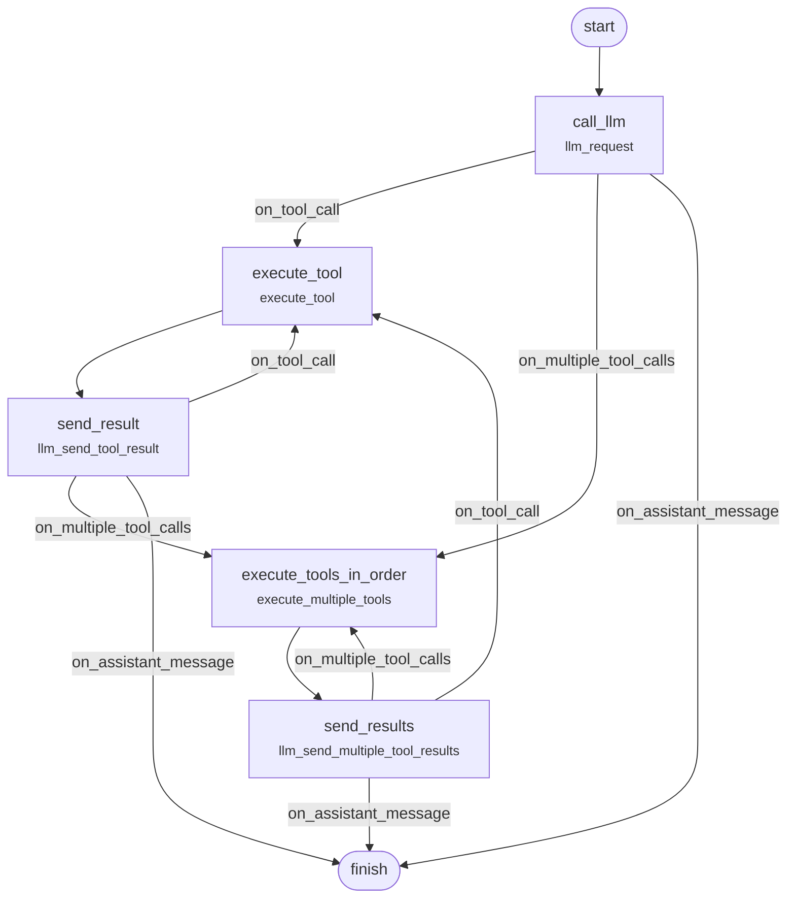

# Kapitel 1: Erste Schritte

In diesem Kapitel richtest du grauwolf ein, prüfst deinen ersten Agenten, führst ihn aus und
chattest mit ihm. Am Ende kennst du alle Befehle, die du für die tägliche Arbeit mit Specs
brauchst, und weißt, aus welchen Teilen eine Spec besteht.

Ein paar Begriffe vorweg:

- **Agent:** ein Programm, das mit einem Sprachmodell (LLM, *Large Language Model*) arbeitet,
  um eine Aufgabe zu erledigen – etwa Fragen beantworten, rechnen oder Dateien lesen.
- **Spec:** die Beschreibung eines Agenten als JSON-Datei. Darin steht, welches Modell er nutzt,
  welche Anweisungen er bekommt, welche Tools er hat und wie er abläuft. Rust-Code musst du
  dafür nicht schreiben.
- **CLI:** das Kommandozeilenprogramm `grauwolf`, mit dem du Specs prüfst und ausführst.

## Einrichtung

### Rust und das WebAssembly-Ziel

grauwolf ist in Rust geschrieben. Installiere die Rust-Toolchain über [rustup](https://rustup.rs)
und füge das Ziel `wasm32-unknown-unknown` hinzu:

```sh
rustup target add wasm32-unknown-unknown
```

Das WebAssembly-Ziel (kurz WASM) brauchst du, sobald ein Agent eigenen Tool-Code hat
([Kapitel 3](03-tools.md)): grauwolf übersetzt diesen Code nach WASM und führt ihn in einer
abgeschotteten Umgebung aus, der *Sandbox*.

Dann baust und installierst du die CLI aus dem Projektordner heraus:

```sh
cargo install --path crates/apps/grauwolf-cli
grauwolf --help
```

Danach heißt das Programm `grauwolf`. Ohne Installation geht es auch mit
`cargo run -p grauwolf-cli -- <befehl>`; in diesem Handbuch steht immer die kurze Form
`grauwolf <befehl>`.

### Ein Sprachmodell

Ein Agent braucht ein LLM. Du hast zwei Wege:

- **Lokal mit Ollama:** Installiere [Ollama](https://ollama.com), lade ein Modell und lass den
  Server laufen. Die Beispiele dieses Handbuchs nutzen `qwen3.5:9b`:

  ```sh
  ollama pull qwen3.5:9b
  ```

  grauwolf sucht Ollama standardmäßig unter `http://localhost:11434`; eine andere Adresse setzt
  du mit `OLLAMA_HOST`.
- **Über einen Cloud-Anbieter:** Setze den API-Schlüssel als Umgebungsvariable, z. B.
  `ANTHROPIC_API_KEY` für Claude, `OPENAI_API_KEY` für OpenAI oder `GEMINI_API_KEY` für Gemini.

Alles zu Anbietern und Modellen steht in [Kapitel 2](02-modelle.md).

### Arbeitsordner

Die Beispiele liegen in [`beispiele/`](beispiele/) (im Repository: `docs/handbuch/beispiele/`).
Die Befehle in diesem Handbuch gehen davon aus, dass du im Wurzelverzeichnis des
grauwolf-Repositorys stehst, und verweisen auf die Beispiele deshalb als
`docs/handbuch/beispiele/…`. Standardordner wie `.grauwolf/` entstehen dann ebenfalls dort.

## Deine erste Spec

Hier ist der kleinste sinnvolle Agent – ein freundlicher Assistent
([`beispiele/01-hallo.json`](beispiele/01-hallo.json)):

```json
{
  "spec_version": 1,
  "name": "hallo",
  "model": { "provider": "ollama", "id": "qwen3.5:9b" },
  "system_prompt": "Du bist ein freundlicher Assistent. Antworte kurz und auf Deutsch.",
  "strategy": { "kind": "single_run" }
}
```

Zeile für Zeile:

- `spec_version` – Version des Spec-Formats; derzeit immer `1`.
- `name` – Name des Agenten, in Kleinbuchstaben mit Ziffern und `_` (*snake_case*).
- `model` – welches LLM der Agent nutzt: Anbieter (`provider`) und Modell-ID (`id`).
- `system_prompt` – die Grundanweisung an das Modell. Sie steht vor jedem Gespräch.
- `strategy` – wie der Agent abläuft. `single_run` heißt: Frage an das Modell, eventuell Tools
  ausführen, Antwort zurückgeben. Mehr dazu in [Kapitel 4](04-ablaeufe.md).

## Eine Spec prüfen: `spec validate`

Bevor du einen Agenten startest, prüfst du die Spec. Das kostet nichts, braucht kein Modell und
findet Tippfehler sofort:

```sh
grauwolf spec validate docs/handbuch/beispiele/01-hallo.json
```

Ausgabe:

```text
docs/handbuch/beispiele/01-hallo.json: valid
```

### Wie Fehler aussehen

Spannend wird es bei Fehlern. Nimm diese absichtlich kaputte Spec (speichere sie zum Ausprobieren
z. B. als `kaputt.json`):

```json
{
  "spec_version": 1,
  "name": "Hallo Welt",
  "model": { "provider": "ollama", "id": "qwen3.5:9b" },
  "graph": {
    "nodes": [
      { "id": "frage", "kind": "llm_anfrage" }
    ],
    "edges": [
      { "from": "start", "to": "frage" },
      { "from": "frage", "to": "ende" }
    ]
  }
}
```

```sh
grauwolf spec validate kaputt.json
```

```text
kaputt.json:/name: 'Hallo Welt' is not a valid ID: allowed are lowercase letters, digits and '_', starting with a letter
kaputt.json:/graph/nodes/0/kind: unknown node kind 'llm_anfrage'
kaputt.json:/graph/edges/1/to: unknown node 'ende'
kaputt.json:/graph: 'finish' is not reachable from 'start'
```

Hinter dem Dateinamen steht jeweils ein **JSON-Pointer** – der Weg zur fehlerhaften Stelle.
`/graph/nodes/0/kind` heißt: im Feld `graph`, in der Liste `nodes`, im ersten Eintrag (gezählt ab 0),
das Feld `kind`. So findest du jeden Fehler, auch in großen Specs. grauwolf meldet **alle** inhaltlichen
Fehler auf einmal, und der Befehl endet mit einem Fehler-Exitcode – praktisch für Skripte und CI.

Eine Ausnahme gibt es: Passt die Datei gar nicht zum Format – etwa wegen eines falsch geschriebenen
Feldnamens –, bekommst du zunächst nur diese eine Meldung mit der Liste der erlaubten Felder:

```text
typo.json:/sytem_prompt: unknown field (allowed: `spec_version`, `name`, `model`, `system_prompt`, …)
```

Auch hier zeigt der Pointer die Stelle. Fehlende Pflichtfelder
(`…:/tools/0/description: missing required field`) und falsche Typen
(`…:/model/id: wrong type: integer `5`, expected a string`) sind ebenso klar. Nur wenn die Datei
überhaupt kein gültiges JSON ist, kommt die Meldung mit Zeile und Spalte (`invalid spec JSON: …`).

Unbekannte Felder sind immer ein Fehler. So fallen Tippfehler auf, die sonst stillschweigend
ignoriert würden.

## Einen Agenten ausführen: `spec run`

`spec run` nimmt die Spec und eine Eingabe und gibt die Antwort aus:

```sh
grauwolf spec run docs/handbuch/beispiele/01-hallo.json "Was ist die Hauptstadt von Frankreich?"
```

Die Antwort sieht etwa so aus (LLM-Antworten variieren von Lauf zu Lauf):

```text
Die Hauptstadt von Frankreich ist Paris.
```

Die Antwort geht auf die Standardausgabe (stdout), Meldungen und Fehler auf die Fehlerausgabe
(stderr). So kannst du die Antwort direkt weiterverarbeiten, z. B. mit `> antwort.txt`.

Die Eingabe ist Text, sofern die Spec nichts anderes vorgibt. Agenten mit strukturierter Eingabe
erwarten stattdessen JSON ([Kapitel 5](05-strukturierte-daten.md)).

Wenn Ollama nicht läuft, bekommst du eine Fehlermeldung, der der Dateiname der Spec vorangestellt
ist. Fehlt der Schlüssel für einen Cloud-Anbieter, nennt grauwolf genau die fehlende
Umgebungsvariable, etwa:

```text
provider 'anthropic' needs the environment variable ANTHROPIC_API_KEY
```

`spec run` hat viele Optionen – für Kosten, Budgets, Ereignisprotokolle, Gespräche und mehr. Die
wichtigsten lernst du in den folgenden Kapiteln kennen; alle listet `grauwolf spec run --help`
und die [CLI-Referenz](referenz-cli.md).

## Mit dem Agenten chatten: `spec chat`

Statt einer einzelnen Frage kannst du auch ein ganzes Gespräch führen:

```sh
grauwolf spec chat docs/handbuch/beispiele/01-hallo.json
```

Jede Zeile, die du eingibst, ist ein Lauf im selben Gespräch – der Agent merkt sich also, was bisher
gesagt wurde. Etwa so:

```text
> Ich heiße Mia.
Hallo Mia, schön dich kennenzulernen!
> Wie heiße ich?
Du heißt Mia.
> /exit
```

`/exit` oder Strg+D beendet den Chat, leere Zeilen werden übersprungen. Schlägt ein Lauf fehl,
erscheint der Fehler auf stderr, und der Chat läuft weiter. Ohne weitere Optionen lebt das Gespräch
nur, solange der Chat läuft; [Kapitel 7](07-gespraeche-und-wissen.md) zeigt, wie du es speicherst
und später fortsetzt.

## Den Ablauf ansehen: `spec graph`

Jeder Agent läuft als **Graph**: Schritte (*Nodes*) sind durch Pfeile (*Kanten*) verbunden.
`spec graph` zeichnet ihn als [Mermaid](https://mermaid.js.org)-Diagramm, das GitHub und viele
Editoren zum Beispiel direkt darstellen:

```sh
grauwolf spec graph docs/handbuch/beispiele/01-hallo.json
```

```text
flowchart TD
    start([start])
    finish([finish])
    call_llm["call_llm<br/><small>llm_request</small>"]
    execute_tool["execute_tool<br/><small>execute_tool</small>"]
    send_result["send_result<br/><small>llm_send_tool_result</small>"]
    execute_tools_in_order["execute_tools_in_order<br/><small>execute_multiple_tools</small>"]
    send_results["send_results<br/><small>llm_send_multiple_tool_results</small>"]
    start --> call_llm
    call_llm -->|on_tool_call| execute_tool
    call_llm -->|on_multiple_tool_calls| execute_tools_in_order
    call_llm -->|on_assistant_message| finish
    execute_tool --> send_result
    send_result -->|on_tool_call| execute_tool
    send_result -->|on_multiple_tool_calls| execute_tools_in_order
    send_result -->|on_assistant_message| finish
    execute_tools_in_order --> send_results
    send_results -->|on_tool_call| execute_tool
    send_results -->|on_multiple_tool_calls| execute_tools_in_order
    send_results -->|on_assistant_message| finish
```

So sieht das Diagramm gerendert aus:



Wie du siehst, steckt hinter dem kurzen `"strategy": { "kind": "single_run" }` ein vollständiger
Graph. Der untere Pfad (`execute_tools_in_order`) wird genommen, wenn das Modell in einer Antwort
mehrere Tools aufruft: Sie laufen nacheinander ab. [Kapitel 4](04-ablaeufe.md) erklärt, wie das
funktioniert und wie du eigene Abläufe baust.

## Das Format nachschlagen: `spec schema`

`spec schema` gibt das JSON-Schema des Spec-Formats aus – eine maschinenlesbare Beschreibung aller
Felder mit kurzen Erklärungen, einschließlich der Dateiverweise `tool_files` und `code_file` aus
[Kapitel 3](03-tools.md):

```sh
grauwolf spec schema > grauwolf-spec.schema.json
```

Viele Editoren (z. B. VS Code) nutzen es, um beim Tippen Vervollständigung und Prüfung anzubieten.
Verknüpfe das Schema in den Einstellungen deines Editors mit deinen Spec-Dateien. Ein `"$schema"`-Feld
in der Spec selbst funktioniert **nicht** – es wäre ein unbekanntes Feld und damit ein Fehler.

## Aufbau einer Spec, Feld für Feld

Nur drei Felder sind Pflicht: `spec_version`, `name` und `model`. Damit der Agent überhaupt etwas tut,
braucht er außerdem einen Ablauf – entweder `strategy` oder `graph`. Fehlen beide, meldet
`spec validate` `'finish' is not reachable from 'start'`; sind beide vorhanden, ist das ebenfalls ein
Fehler (`` `strategy` and `graph` are mutually exclusive ``).

| Feld | Pflicht | Standard | Bedeutung | Mehr |
|---|---|---|---|---|
| `spec_version` | ja | – | Version des Formats, derzeit `1` | hier |
| `name` | ja | – | Name des Agenten, snake_case | hier |
| `model` | ja | – | LLM: `{ "provider": …, "id": … }` | [Kapitel 2](02-modelle.md) |
| `system_prompt` | nein | keiner | Grundanweisung an das Modell | hier |
| `strategy` | nein* | – | Vorlage für den Ablauf: `single_run`, `react`, `verified` | [Kapitel 4](04-ablaeufe.md) |
| `graph` | nein* | leer | Dein eigener Ablauf aus `nodes` und `edges` | [Kapitel 4](04-ablaeufe.md) |
| `tools` | nein | keine | Tools mit eigenem Code | [Kapitel 3](03-tools.md) |
| `tool_files` | nein | keine | Tool-Definitionen aus eigenen Dateien | [Kapitel 3](03-tools.md) |
| `tools_dir` | nein | keiner | Ordner, aus dem vor jedem Lauf Tools geladen werden | [Kapitel 3](03-tools.md) |
| `builtin_tools` | nein | keine | Eingebaute Datei- und Benutzer-Tools | [Kapitel 3](03-tools.md) |
| `types` | nein | keine | Eigene Datentypen als JSON-Schemas | [Kapitel 5](05-strukturierte-daten.md) |
| `input`, `output` | nein | `"string"` | Ein- und Ausgabetyp des Agenten | [Kapitel 5](05-strukturierte-daten.md) |
| `subgraphs` | nein | keine | Benannte Teilabläufe | [Kapitel 6](06-subgraphen-und-planer.md) |
| `knowledge` | nein | keines | Eigene Dokumente durchsuchbar machen | [Kapitel 7](07-gespraeche-und-wissen.md) |
| `long_term_memory` | nein | keines | Langzeitgedächtnis | [Kapitel 7](07-gespraeche-und-wissen.md) |
| `mcp_servers` | nein | keine | Tools aus externen MCP-Servern | [Kapitel 8](08-externe-tools-und-agenten.md) |
| `agent_tools` | nein | keine | Andere Agenten als Tools | [Kapitel 8](08-externe-tools-und-agenten.md) |
| `self_tools` | nein | aus | Der Agent baut eigene Tools | [Kapitel 10](10-selbst-gebaute-tools.md) |

\* In der Praxis brauchst du fast immer eines der beiden.

Alle Felder mit allen Standardwerten findest du in der [Spec-Referenz](referenz-spec.md).

## Die wichtigsten Punkte

- Einrichtung: Rust, `rustup target add wasm32-unknown-unknown`, `cargo install --path crates/apps/grauwolf-cli`, dazu Ollama oder ein API-Schlüssel.
- Eine Spec ist eine JSON-Datei; `spec_version`, `name` und `model` sind Pflicht, dazu ein Ablauf über `strategy` oder `graph`.
- `grauwolf spec validate <datei>` prüft eine Spec und meldet alle Fehler mit einem JSON-Pointer.
- `grauwolf spec run <datei> "<eingabe>"` führt einen Lauf aus; die Antwort geht auf stdout.
- `grauwolf spec chat <datei>` führt ein Gespräch; `/exit` beendet es.
- `grauwolf spec graph <datei>` zeigt den Ablauf als Mermaid-Diagramm, `grauwolf spec schema` das Format als JSON-Schema.
- Unbekannte Felder sind Fehler – Tippfehler fallen sofort auf.

Weiter mit [Kapitel 2: Modelle und Anbieter](02-modelle.md).
