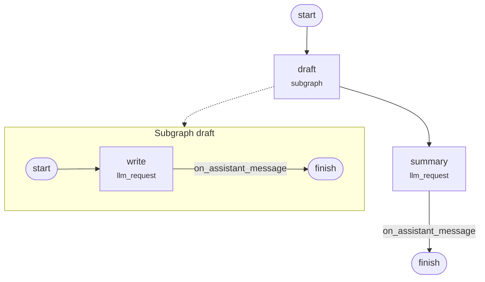
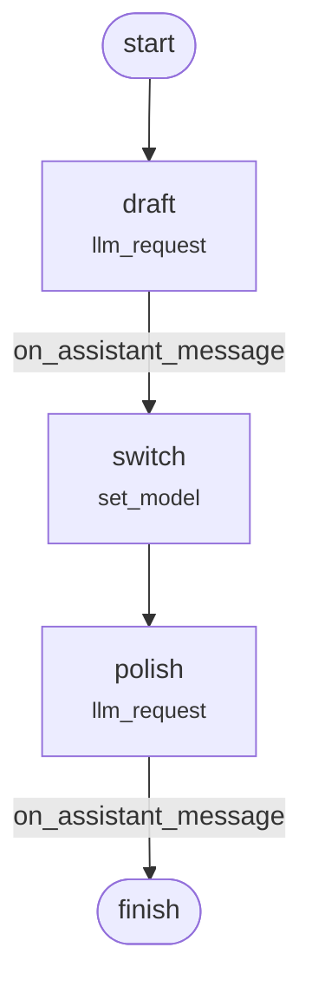

# Kapitel 2: Modelle und Anbieter

Jeder Agent braucht ein Sprachmodell. In diesem Kapitel lernst du, wie du das Modell in einer Spec
wählst, wie du lokale Modelle über Ollama und Cloud-Modelle von OpenAI, Anthropic, Gemini, Amazon
Bedrock und OpenAI-kompatiblen Diensten anbindest, wie ein Agent mehrere Modelle mischt – und wie du
im Blick behältst, was ein Lauf an Tokens und Geld kostet.

## Das Feld `model`

Das Modell steht im Pflichtfeld `model` und besteht aus zwei Teilen:

```json
"model": { "provider": "ollama", "id": "qwen3.5:9b" }
```

- `provider` – der **Anbieter**, also der Dienst, der das Modell bereitstellt. Eingebaut sind elf:
  `ollama`, `openai`, `anthropic`, `gemini`, `bedrock` sowie die OpenAI-kompatiblen Anbieter `openrouter`,
  `deepseek`, `mistral`, `groq`, `dashscope` und `xai`
  ([unten](#openai-und-kompatible-dienste)).
- `id` – die **Modell-ID**, genau so, wie der Anbieter sie nennt.

Zugangsdaten gehören nie in die Spec; sie kommen aus Umgebungsvariablen. So kannst du eine Spec
weitergeben, ohne Schlüssel preiszugeben.

`spec validate` prüft den Anbieternamen gegen die eingebauten Anbieter – überall, wo einer steht
(Hauptmodell, Subgraphen, `set_model`, Moderation, Embedding-Modelle). Ein Tippfehler fällt so schon
vor dem ersten Lauf auf:

```text
agent.json:/model/provider: unknown provider 'olama' (built-in: ollama, openai, anthropic, gemini, bedrock, openrouter, deepseek, mistral, groq, dashscope, xai)
```

Eigene Anbieter, die du in Rust registrierst, meldet `spec validate` ebenfalls als unbekannt – die
Prüfung kennt nur die eingebauten.

Vorübergehende Fehler eines Anbieters (z. B. Netzaussetzer) wiederholt grauwolf automatisch.

## Ollama: Modelle auf dem eigenen Rechner

[Ollama](https://ollama.com) betreibt Modelle lokal – ohne Kosten pro Anfrage und ohne dass Daten
deinen Rechner verlassen. Das Beispiel aus Kapitel 1 nutzt Ollama
([`beispiele/01-hallo.json`](beispiele/01-hallo.json)):

```json
{
  "spec_version": 1,
  "name": "hallo",
  "model": { "provider": "ollama", "id": "qwen3.5:9b" },
  "system_prompt": "Du bist ein freundlicher Assistent. Antworte kurz und auf Deutsch.",
  "strategy": { "kind": "single_run" }
}
```

| Variable | Pflicht | Bedeutung |
|---|---|---|
| `OLLAMA_HOST` | nein | Adresse des Ollama-Servers; Standard `http://localhost:11434`. `http://` darf wegfallen, z. B. `OLLAMA_HOST=gpu-server:11434`. |
| `OLLAMA_THINK` | nein | `false` (oder `0`) schaltet das „Nachdenken“ denkender Modelle ab, `true` (oder `1`) schaltet es ein. Ist nichts gesetzt, entscheiden Modell und Server. |

Denkende Modelle überlegen sich lange, bevor sie antworten. Das verbessert das Ergebnis oft, kostet
aber Zeit. Für schnelle Tests hilft:

```sh
OLLAMA_THINK=false grauwolf spec run docs/handbuch/beispiele/01-hallo.json "Nenne drei Farben."
```

Etwa so:

```text
Rot, Blau und Grün.
```

## OpenAI und kompatible Dienste

Für OpenAI setzt du `provider` auf `openai`
([`beispiele/02-openai.json`](beispiele/02-openai.json)):

```json
{
  "spec_version": 1,
  "name": "hello_openai",
  "model": { "provider": "openai", "id": "gpt-4o" },
  "system_prompt": "Du bist ein freundlicher Assistent. Antworte kurz und auf Deutsch.",
  "strategy": { "kind": "single_run" }
}
```

| Variable | Pflicht | Bedeutung |
|---|---|---|
| `OPENAI_API_KEY` | ja | API-Schlüssel |
| `OPENAI_BASE_URL` | nein | Anderer Endpunkt; Standard `https://api.openai.com/v1` |

```sh
export OPENAI_API_KEY=sk-…
grauwolf spec run docs/handbuch/beispiele/02-openai.json "Was ist ein Agent?"
```

Etwa so:

```text
Ein Agent ist ein Programm, das ein Sprachmodell nutzt, um Aufgaben selbstständig zu erledigen.
```

Mit `OPENAI_BASE_URL` sprichst du jeden Dienst an, der die OpenAI-Schnittstelle (Chat
Completions) nachbildet – etwa einen Firmen-Proxy oder einen anderen Modellanbieter. Wie beim
Standard endet die Adresse mit dem Versionspfad, z. B. `…/v1`.

Bekannte kompatible Anbieter haben einen **eigenen Namen** mit eigenem Schlüssel. So kann eine Spec
zum Beispiel im Hauptgraphen OpenAI und in einem Subgraphen Mistral nutzen:

| `provider` | Schlüssel | Standardadresse |
|---|---|---|
| `openrouter` | `OPENROUTER_API_KEY` | `https://openrouter.ai/api/v1` |
| `deepseek` | `DEEPSEEK_API_KEY` | `https://api.deepseek.com` |
| `mistral` | `MISTRAL_API_KEY` | `https://api.mistral.ai/v1` |
| `groq` | `GROQ_API_KEY` | `https://api.groq.com/openai/v1` |
| `dashscope` | `DASHSCOPE_API_KEY` | `https://dashscope-intl.aliyuncs.com/compatible-mode/v1` |
| `xai` | `XAI_API_KEY` | `https://api.x.ai/v1` |

```json
"model": { "provider": "mistral", "id": "mistral-small-latest" }
```

Eine andere Adresse setzt du mit `<NAME>_BASE_URL`, z. B. `DASHSCOPE_BASE_URL` für eine andere
Region. Was ein Anbieter nicht anbietet (etwa Moderation oder strukturierte Antworten nach einem
Schema), meldet er selbst als Fehler.

## Anthropic (Claude)

Für Claude setzt du `provider` auf `anthropic`
([`beispiele/02-anthropic.json`](beispiele/02-anthropic.json)):

```json
{
  "spec_version": 1,
  "name": "hello_claude",
  "model": { "provider": "anthropic", "id": "claude-haiku-5-5" },
  "system_prompt": "Du bist ein freundlicher Assistent. Antworte kurz und auf Deutsch.",
  "strategy": { "kind": "single_run" }
}
```

| Variable | Pflicht | Bedeutung |
|---|---|---|
| `ANTHROPIC_API_KEY` | ja | API-Schlüssel |

```sh
export ANTHROPIC_API_KEY=sk-ant-…
grauwolf spec run docs/handbuch/beispiele/02-anthropic.json "Erkläre Rekursion in einem Satz."
```

Etwa so:

```text
Rekursion heißt, dass eine Funktion sich selbst aufruft, bis sie einen einfachen Grundfall erreicht.
```

Fehlt der Schlüssel, bricht der Lauf vor der ersten Anfrage ab:

```text
provider 'anthropic' needs the environment variable ANTHROPIC_API_KEY
```

Bei Anthropic nutzt grauwolf automatisch den Prompt-Cache: Teile, die wiederholt gesendet werden
(System-Prompt, Tools, bisheriger Verlauf), werden zu einem günstigeren Satz abgerechnet, wenn
Anfragen innerhalb weniger Minuten aufeinander folgen. Dafür musst du nichts einstellen.

## Google Gemini

Für Gemini setzt du `provider` auf `gemini`
([`beispiele/02-gemini.json`](beispiele/02-gemini.json)):

```json
{
  "spec_version": 1,
  "name": "hello_gemini",
  "model": { "provider": "gemini", "id": "gemini-2.5-flash" },
  "system_prompt": "Du bist ein freundlicher Assistent. Antworte kurz und auf Deutsch.",
  "strategy": { "kind": "single_run" }
}
```

| Variable | Pflicht | Bedeutung |
|---|---|---|
| `GEMINI_API_KEY` | ja | API-Schlüssel aus Google AI Studio |
| `GEMINI_BASE_URL` | nein | Anderer Endpunkt; Standard `https://generativelanguage.googleapis.com` |

```sh
export GEMINI_API_KEY=…
grauwolf spec run docs/handbuch/beispiele/02-gemini.json "Was ist ein Agent?"
```

grauwolf spricht die native Gemini-API: Tools, strukturierte Antworten, Streaming, Anhänge und
Embeddings (z. B. `gemini-embedding-001` für `knowledge`) funktionieren wie bei den anderen Anbietern.
Denkende Modelle geben ihre Gedanken-Signaturen im Verlauf zurück; das erledigt grauwolf selbst.
Vertex AI wird nicht unterstützt.

## Amazon Bedrock

Für Modelle auf Amazon Bedrock setzt du `provider` auf `bedrock` und `id` auf die Modell-ID oder
Inference-Profile-ID, genau so, wie Bedrock sie nennt
([`beispiele/02-bedrock.json`](beispiele/02-bedrock.json)):

```json
{
  "spec_version": 1,
  "name": "hello_bedrock",
  "model": { "provider": "bedrock", "id": "eu.anthropic.claude-3-5-sonnet-20240620-v1:0" },
  "system_prompt": "Du bist ein freundlicher Assistent. Antworte kurz und auf Deutsch.",
  "strategy": { "kind": "single_run" }
}
```

Inference-Profile-IDs mit Regionspräfix (`eu.`, `us.`, `apac.`) funktionieren wie einfache Modell-IDs.
Das Modell muss für dein AWS-Konto in der verwendeten Region freigeschaltet sein; sonst antwortet
Bedrock mit `AccessDeniedException`, und grauwolf sagt dir das in der Fehlermeldung.

Die Zugangsdaten sind die üblichen AWS-Variablen. Entweder Zugriffsschlüssel (Anfragen werden mit
AWS Signature Version 4 signiert) oder ein Bedrock-API-Schlüssel:

| Variable | Pflicht | Bedeutung |
|---|---|---|
| `AWS_ACCESS_KEY_ID` | bei Zugriffsschlüsseln | Zugriffsschlüssel |
| `AWS_SECRET_ACCESS_KEY` | bei Zugriffsschlüsseln | Geheimer Schlüssel |
| `AWS_SESSION_TOKEN` | nein | Sitzungstoken temporärer Zugangsdaten (STS) |
| `AWS_BEARER_TOKEN_BEDROCK` | Alternative | Bedrock-API-Schlüssel; wird als Bearer-Token gesendet, nichts wird signiert. Sind beide gesetzt, gewinnt der API-Schlüssel |
| `AWS_REGION` | nein | Region, z. B. `eu-central-1`; sonst `AWS_DEFAULT_REGION`; Standard `us-west-2` |
| `BEDROCK_BASE_URL` | nein | Anderer Endpunkt (VPC-Endpunkt, Proxy); Standard `https://bedrock-runtime.<region>.amazonaws.com` |

```sh
export AWS_ACCESS_KEY_ID=… AWS_SECRET_ACCESS_KEY=… AWS_REGION=eu-central-1
grauwolf spec run docs/handbuch/beispiele/02-bedrock.json "Was ist ein Agent?"
```

grauwolf nutzt die Converse-API, sodass jedes Chat-Modell auf Bedrock mit einem einzigen
Nachrichtenformat funktioniert: Tools, strukturierte Antworten, Streaming, Bilder und Dokumente als
Anhänge (siehe Tabelle unten) sowie Reasoning-Blöcke. Hinweise:

- Zugangsdaten aus Instanzprofilen, EKS Pod Identity oder Web Identity werden nicht gelesen; übergib
  sie als die obigen Variablen (z. B. mit `aws configure export-credentials`).
- Bedrock kennt keine Tool-Auswahl „keine Tools“: Mit `tool_choice: none` werden die Tools nicht
  mitgeschickt (es sei denn, der Verlauf enthält schon Tool-Aufrufe; dann kann das Modell trotzdem
  eines aufrufen).
- Bedrock meldet nicht, welches Modell geantwortet hat, daher zeigt `--events` kein gemeldetes Modell.
- `think` ist für `bedrock` nicht verfügbar (wie für jeden Anbieter außer `ollama`).
- Embedding-Modelle auf Bedrock werden noch nicht unterstützt; `embedding_model` mit `bedrock` ist ein Fehler.

## Bilder, PDFs und Audio

Ein Lauf kann Dateien zusammen mit der Eingabe übergeben. In der CLI geht das mit `--attach`
(mehrfach angebbar):

```sh
grauwolf spec run seher.json "Was ist auf dem Bild zu sehen?" --attach wolf.png
```

Im Chat hängt die Zeile `/attach <datei>` die Datei an die **nächste** Eingabe an:

```text
> /attach wolf.png
Anhang für die nächste Eingabe: wolf.png
> Was ist auf dem Bild zu sehen?
Ein grauer Wolf im Schnee.
```

Das Bild bleibt Teil des Gesprächs; spätere Fragen dürfen sich darauf beziehen. grauwolf erkennt den
Typ an der Dateiendung: `.png`, `.jpg`/`.jpeg`, `.gif`, `.webp`, `.pdf`, `.wav` und `.mp3`, höchstens
20 MB pro Datei. Was jeder Anbieter versteht:

| Anbieter | Bilder | PDF | Audio (wav, mp3) |
|---|---|---|---|
| `openai` | ja (auch als URL) | ja | ja |
| `anthropic` | ja (auch als URL) | ja (auch als URL) | nein |
| `ollama` | ja (nur ohne URL), wenn das Modell Bilder versteht | nein | nein |
| `gemini` | ja (auch als URL) | ja (auch als URL) | ja (auch als URL) |
| `bedrock` | ja (png, jpeg, gif, webp; nur ohne URL oder als `s3://`) | ja (nur ohne URL oder als `s3://`) | nein |

Alles andere lehnt der Lauf **vor** der Anfrage mit einer Fehlermeldung ab, statt den Anhang
stillschweigend wegzulassen. Über den Dienst kommen Anhänge im Feld `attachments` der Anfrage an
([Kapitel 9](09-betrieb.md)).

## Ausweichmodelle: `fallbacks`

Fällt ein Anbieter aus oder ist überlastet, scheitert der Lauf – es sei denn, du trägst
Ausweichmodelle ein. grauwolf fragt sie nacheinander, wenn eine Anfrage nach den Wiederholungen
noch scheitert:

```json
"model": {
  "provider": "anthropic",
  "id": "claude-haiku-5-5",
  "fallbacks": [
    { "provider": "openai", "id": "gpt-4o-mini" },
    { "provider": "ollama", "id": "qwen3.5:9b" }
  ]
}
```

- Das gilt für jede Anfrage: normale, gestreamte (solange noch kein Text ausgegeben wurde),
  strukturierte, Verlaufskomprimierung, Fakten und Moderation. Die nächste Anfrage versucht wieder
  zuerst das eigentliche Modell.
- Ohne `fallbacks` ändert sich nichts. Bei erschöpftem Budget wird nicht gewechselt.
- Jeder Wechsel erscheint als Ereignis `llm_fallback` mit `from`, `to` und dem Fehler (`--events`,
  OpenTelemetry). Kosten zählen zum Preis des Modells, das geantwortet hat.
- Die Schlüssel aller eingetragenen Anbieter müssen in der Umgebung stehen.
- `spec validate` prüft die Liste: unbekannte Anbieter, ein Ausweichmodell gleich dem Modell und
  doppelte Einträge werden gemeldet, z. B. `/model/fallbacks/0: fallback model 'anthropic:claude-haiku-5-5' is already listed`.
  Embedding-Modelle haben keine Ausweichmodelle – ein anderes Modell würde andere Vektoren liefern.
- Das `model` eines Subgraphen, `set_model` und ein eigenes Moderationsmodell in `llm_moderate` können
  ebenfalls `fallbacks` haben.

## Temperatur und Denken: `temperature`, `think`

Zwei optionale Felder steuern, wie ein Modell antwortet:

```json
"model": { "provider": "ollama", "id": "qwen3.5:9b", "temperature": 0, "think": false }
```

- `temperature` (Zahl von 0 bis 2) wird als Sampling-Temperatur an den Anbieter geschickt. Mit
  `temperature: 0` antwortet ein Agent (fast) reproduzierbar. Ohne das Feld gilt der Standard des
  Anbieters.
- `think` (`true`/`false`) schaltet das Nachdenken von Ollama-Modellen für dieses Modell um und hat
  Vorrang vor `OLLAMA_THINK`. Andere Anbieter weist `spec validate` zurück, statt es stillschweigend
  zu ignorieren: `/model/think: 'think' is only supported by the provider 'ollama', not 'openai'`.
- Beide Felder sind überall verfügbar, wo ein Modell angegeben wird: `model`, seine `fallbacks`,
  `subgraphs.*.model` sowie die Parameter von `set_model` und `llm_moderate`. Embedding-Modelle haben
  keines von beiden.
- Der Antwort-Cache (ADR-0086) berücksichtigt beide Felder, daher liefert er nie eine Antwort, die mit
  einer anderen Temperatur aufgezeichnet wurde.

Beispiel: [`02-sampling.json`](beispiele/02-sampling.json).

## Mehrere Modelle in einem Agenten

Es lohnt sich oft, Modelle zu mischen: ein kleines, günstiges oder lokales Modell für einfache
Schritte, ein stärkeres für den anspruchsvollen Teil. grauwolf bietet dafür zwei Wege.

Wichtig für beide: Ein Lauf braucht die Zugangsdaten **aller** Anbieter, die in der Spec vorkommen –
auch wenn ein Teil der Spec in einem bestimmten Lauf gar nicht erreicht wird.

### Ein eigenes Modell für einen Subgraphen

Ein **Subgraph** ist ein benannter Teilablauf, den der Hauptablauf wie einen einzelnen Schritt
aufruft (ausführlich in [Kapitel 6](06-subgraphen-und-planer.md)). Er kann ein eigenes `model`
haben; danach gilt wieder das äußere. Hier schreibt Claude einen Entwurf, und das lokale Modell fasst
ihn zusammen ([`beispiele/02-modell-im-subgraph.json`](beispiele/02-modell-im-subgraph.json)):

```json
{
  "spec_version": 1,
  "name": "draft_and_summary",
  "model": { "provider": "ollama", "id": "qwen3.5:9b" },
  "system_prompt": "Zuerst schreibst du einen kurzen Entwurf auf Deutsch. Wenn du deinen Entwurf zurückbekommst, fasst du ihn in einem einzigen Satz zusammen.",
  "subgraphs": {
    "draft": {
      "model": { "provider": "anthropic", "id": "claude-haiku-5-5" },
      "graph": {
        "nodes": [{ "id": "write", "kind": "llm_request" }],
        "edges": [
          { "from": "start", "to": "write" },
          { "from": "write", "to": "finish", "when": { "kind": "on_assistant_message" } }
        ]
      }
    }
  },
  "graph": {
    "nodes": [
      { "id": "draft", "kind": "subgraph", "params": { "subgraph": "draft" } },
      { "id": "summary", "kind": "llm_request" }
    ],
    "edges": [
      { "from": "start", "to": "draft" },
      { "from": "draft", "to": "summary" },
      { "from": "summary", "to": "finish", "when": { "kind": "on_assistant_message" } }
    ]
  }
}
```

So sieht der Ablauf aus (`grauwolf spec graph docs/handbuch/beispiele/02-modell-im-subgraph.json`):



```sh
grauwolf spec run docs/handbuch/beispiele/02-modell-im-subgraph.json "Warum sind Igel nachtaktiv?"
```

Etwa so:

```text
Igel sind nachtaktiv, weil sie ihre Beute im Dunkeln leichter finden und Fressfeinden ausweichen.
```

Mehr über Nodes, Kanten und `when` erfährst du in [Kapitel 4](04-ablaeufe.md).

### Das Modell mitten im Lauf wechseln: `set_model`

Der Node `set_model` wechselt das Modell für den **Rest des Laufs**; der bisherige Verlauf bleibt
erhalten. Er gibt seinen Eingabewert unverändert weiter, deshalb nennt `value` seinen Typ (hier Text,
`"string"`). Im Beispiel entwirft das lokale Modell, und Claude poliert den Text
([`beispiele/02-modell-wechseln.json`](beispiele/02-modell-wechseln.json)):

```json
{
  "spec_version": 1,
  "name": "local_then_claude",
  "model": { "provider": "ollama", "id": "qwen3.5:9b" },
  "system_prompt": "Zuerst schreibst du einen kurzen Entwurf auf Deutsch. Wenn du deinen Entwurf zurückbekommst, polierst du die Sprache und gibst nur den fertigen Text aus.",
  "graph": {
    "nodes": [
      { "id": "draft", "kind": "llm_request" },
      {
        "id": "switch",
        "kind": "set_model",
        "params": { "provider": "anthropic", "id": "claude-haiku-5-5", "value": "string" }
      },
      { "id": "polish", "kind": "llm_request" }
    ],
    "edges": [
      { "from": "start", "to": "draft" },
      { "from": "draft", "to": "switch", "when": { "kind": "on_assistant_message" } },
      { "from": "switch", "to": "polish" },
      { "from": "polish", "to": "finish", "when": { "kind": "on_assistant_message" } }
    ]
  }
}
```



Faustregel: Ein in sich geschlossener Teil bekommt ein Modell am Subgraphen. Ab einer bestimmten Stelle
ein anderes Modell → `set_model`. Ein weiteres Beispiel steht in
[`examples/specs/two_models.json`](../../examples/specs/two_models.json).

## Tokenverbrauch sehen: `--events`

Anbieter rechnen nach **Tokens** ab – Wortstücken, aus denen Ein- und Ausgabe bestehen. Mit
`--events` schreibt grauwolf alle Ereignisse eines Laufs als JSON-Zeilen (JSONL) auf stderr,
darunter den Tokenverbrauch jeder LLM-Anfrage. Leite stderr in eine Datei um, damit die Antwort
lesbar bleibt:

```sh
grauwolf spec run docs/handbuch/beispiele/02-anthropic.json "Hallo!" --events 2> ereignisse.jsonl
```

`ereignisse.jsonl` enthält dann Zeilen wie diese (gekürzt):

```text
{"event":"agent_starting","input":"Hallo!"}
{"event":"node_starting","path":["call_llm"],"input":"Hallo!"}
{"event":"llm_call_starting","model":{"provider":"anthropic","id":"claude-haiku-5-5"},"tools":[]}
{"event":"llm_call_completed","answer":{…},"usage":{"input_tokens":412,"output_tokens":57}}
…
{"event":"agent_completed","output":"Hallo! Wie kann ich helfen?","usage":{"input_tokens":412,"output_tokens":57}}
```

- `llm_call_completed.usage` – Tokens dieser einen Anfrage: `input_tokens` (alle Eingabe-Tokens, auch
  die gecachten) und `output_tokens`; wenn der Anbieter sie meldet, außerdem `cache_read_tokens` und
  `cache_write_tokens`.
- `llm_call_completed.model` – das Modell, das der Anbieter als Antwortgeber meldet (etwa eine datierte
  Version des angefragten Modells); fehlt, wenn der Anbieter es nicht sagt. Wird auch als
  `gen_ai.response.model` in OpenTelemetry festgehalten.
- `agent_completed.usage` – die Summe für den ganzen Lauf. Schlägt der Lauf fehl, steht sie in
  `agent_failed`.

Meldet ein Anbieter keine Zahlen, fehlt `usage` einfach.

## Kosten berechnen: `--prices`

Tokens werden zu Beträgen, sobald du eine **Preistabelle** angibst. Preise ändern sich, deshalb stehen
sie nicht im Programm, sondern in einer eigenen Datei. Eine Vorlage liegt in
[`examples/prices.example.json`](../../examples/prices.example.json):

```json
{
  "currency": "USD",
  "models": {
    "anthropic:claude-haiku-5-5":  { "input": 0.10, "output": 0.50, "cache_read": 0.01, "cache_write": 0.125 },
    "anthropic:claude-sonnet-5-5": { "input": 2.00, "output": 10.00, "cache_read": 0.20, "cache_write": 2.50 },
    "anthropic:claude-opus-5-5":   { "input": 4.00, "output": 20.00, "cache_read": 0.20, "cache_write": 5.00 },
    "ollama:qwen3.5:9b":           { "input": 0, "output": 0 }
  }
}
```

- Schlüssel sind `<provider>:<model-id>`, Preise gelten **pro Million Tokens**.
- `cache_read` und `cache_write` sind optional; fehlen sie, gilt der Eingabepreis.
- Die Werte der Vorlage sind Beispiele – prüfe sie vor der Nutzung.
- Ein Modell ohne Eintrag bekommt keinen Betrag. grauwolf schätzt nicht.

```sh
grauwolf spec run docs/handbuch/beispiele/02-anthropic.json "Hallo!" --events \
  --prices examples/prices.example.json 2> ereignisse.jsonl
```

Jetzt tragen die Ereignisse zusätzlich `cost`, etwa so:

```text
{"event":"llm_call_completed","answer":{…},"usage":{"input_tokens":412,"output_tokens":57},"cost":0.0000697}
{"event":"agent_completed","output":"Hallo! Wie kann ich helfen?","usage":{"input_tokens":412,"output_tokens":57},"cost":0.0000697}
```

Der Betrag steht in der Währung aus `currency`: 412 × 0,10 $ + 57 × 0,50 $ pro Million Tokens.
`--prices` gibt es für `spec run`, `spec chat`, `spec serve`, `spec mcp` und `spec resume`.

## Antworten zwischenspeichern: `--llm-cache`

Wenn du dieselbe Anfrage mehrfach sendest – beim Entwickeln einer Spec, in Tests, für eine Demo –,
fragt grauwolf mit `--llm-cache <ordner>` das Modell nur beim ersten Mal:

```sh
grauwolf spec run docs/handbuch/beispiele/01-hallo.json "Was ist ein Agent?" --llm-cache .grauwolf/llm-cache
grauwolf spec run docs/handbuch/beispiele/01-hallo.json "Was ist ein Agent?" --llm-cache .grauwolf/llm-cache   # sofort, kostet nichts
```

„Dieselbe Anfrage“ heißt: gleicher Anbieter, gleiches Modell, gleicher Verlauf einschließlich
System-Prompt und Anhängen, gleiche Tools und – bei strukturierten Antworten – dasselbe Schema. Ändert
sich davon etwas, fragt grauwolf das Modell erneut. Antworten aus dem Cache zählen als 0 Tokens, belasten
also weder das Budget noch die Kosten.

- Der Cache gilt für alle LLM-Anfragen eines Laufs, auch für Subagenten und die Verlaufskomprimierung.
  „Best of n“ und Moderation fragen immer erneut.
- Bei gleicher Eingabe kommt immer dieselbe Antwort – gedacht für Entwicklung und Tests; im Betrieb
  nur bewusst einschalten.
- Es gibt kein Verfallsdatum: Lösche den Ordner, um erneut zu fragen.

In Rust hängst du einen Cache an den Executor: `PromptExecutor::builder().cache(Arc::new(
MemoryPromptCache::default()))` im Speicher, oder `grauwolf::cache::FilePromptCache::new(dir)`
als Dateien; beim `AgentLoader` über `with_llm_cache(..)`.

## Das Budget begrenzen: `--max-tokens` und `--max-cost`

Ein Agent, der in einer Tool-Schleife hängen bleibt, kann viel verbrauchen. Ein **Budget** setzt eine
Obergrenze pro Lauf:

- `--max-tokens <n>` – Eingabe- und Ausgabe-Tokens zusammen.
- `--max-cost <betrag>` – Kosten in der Währung der Preistabelle; braucht `--prices`.

```sh
grauwolf spec run docs/handbuch/beispiele/02-anthropic.json "Schreibe mir eine lange Geschichte." \
  --prices examples/prices.example.json --max-cost 0.01
```

grauwolf prüft das Budget **vor** jeder LLM-Anfrage. Ist die Grenze erreicht, endet der Lauf mit einem
Fehler wie diesem (sinngemäß):

```text
… run budget exhausted: 2140 of at most 2000 tokens used
```

Gut zu wissen:

- Eine einzelne Anfrage kann die Grenze überschreiten, weil ihr Verbrauch vorher nicht bekannt ist;
  danach startet keine weitere Anfrage.
- Bei `spec chat` gilt das Budget pro Zeile, beim Dienst (`spec serve`) pro Anfrage.
- Die CLI lehnt `--max-cost` ohne `--prices` ab:
  `--max-cost needs --prices: without a price table the cost is unknown`.
- Moderation und mehrere Antwortvarianten (`llm_request_best_of`) zählen ebenfalls zu Verbrauch, Kosten
  und Budget; Moderation zum Preis ihres eigenen Modells. Die Moderations-API von OpenAI berechnet keine
  Tokens und zählt deshalb nicht.
- Modelle ohne Preis in der Tabelle verursachen keine Kosten; ihre Tokens zählen trotzdem.

## Grenzen in der Spec: `limits`

Statt jedes Mal Optionen zu übergeben, kann ein Agent eigene Grenzen mitbringen
([`beispiele/02-grenzen.json`](beispiele/02-grenzen.json), gekürzt):

```json
"limits": { "max_steps": 20, "max_tool_calls": 5, "max_tokens": 20000 }
```

| Feld | Bedeutung | Wenn erreicht |
|---|---|---|
| `max_steps` | Node-Ausführungen pro Graph-Durchlauf (Standard 50; jeder Durchlauf eines Subgraphen zählt für sich) | Der Lauf wird abgebrochen |
| `max_tool_calls` | Tool-Aufrufe pro Lauf, auch in parallelen Zweigen und Subgraphen | Das Tool läuft nicht; dem Modell wird `Error: limit of 5 tool calls per run reached – answer now without further tools.` gemeldet, und es kann sauber abschließen |
| `max_tokens` | wie `--max-tokens` | Der Lauf wird abgebrochen |
| `max_cost` | wie `--max-cost`; braucht `--prices` | Der Lauf wird abgebrochen |
| `max_prompt_tokens` | Tokens pro Anfrage, vor dem Senden geschätzt (4 Zeichen ≈ 1 Token) | Die Anfrage wird nicht gesendet, der Lauf bricht ab: `the request would have about 2400 tokens, at most 2000 tokens are allowed` |

Gut zu wissen:

- Die Grenzen gelten für den ganzen Lauf, auch über `spec resume` hinweg: Was vor dem Abbruch verbraucht
  wurde, zählt mit.
- Befehlszeilenoptionen haben Vorrang: `--max-tokens 50000` lockert oder verschärft, was die Spec sagt,
  im Einzelfall; die übrigen Felder der Spec gelten weiter.
- `max_cost` ohne `--prices` ist beim Laden ein Fehler – sonst hätte die Grenze keine Wirkung.
- `max_prompt_tokens` schützt vor Anfragen, die das Kontextfenster sprengen oder unerwartet teuer werden;
  zusammen mit der Verlaufskomprimierung, die `on_history_tokens_above` auslöst
  ([Kapitel 4](04-ablaeufe.md)), bleibt der Verlauf darunter.
- `spec validate` meldet unmögliche Werte (`max_steps: 0`, `max_tokens: 0`, `max_prompt_tokens: 0`, `max_cost` ≤ 0)
  unter `/limits/<feld>`.
- `spec generate` übernimmt alle Grenzen; für `max_cost` braucht der erzeugte Agent eine Preistabelle
  (`GRAUWOLF_PRICES`, [Kapitel 11](11-code-erzeugen.md)).

## Die wichtigsten Punkte

- `model` = `{ "provider", "id" }`; eingebaut sind `ollama`, `openai`, `anthropic`, `gemini`, `bedrock` und die OpenAI-kompatiblen Anbieter.
- Zugangsdaten kommen aus der Umgebung: `OLLAMA_HOST`, `OLLAMA_THINK`, `OPENAI_API_KEY`, `OPENAI_BASE_URL`, `ANTHROPIC_API_KEY`, `GEMINI_API_KEY`, `GEMINI_BASE_URL`, `AWS_ACCESS_KEY_ID`, `AWS_SECRET_ACCESS_KEY`, `AWS_REGION` (oder `AWS_BEARER_TOKEN_BEDROCK`) für `bedrock`.
- OpenAI-kompatible Anbieter mit eigenem Namen: `openrouter`, `deepseek`, `mistral`, `groq`, `dashscope`, `xai` (Schlüssel in `<NAME>_API_KEY`, andere Adresse in `<NAME>_BASE_URL`).
- Ein Subgraph kann ein eigenes `model` haben; `set_model` wechselt für den Rest des Laufs.
- `fallbacks` im Modellschritt springen ein, wenn ein Anbieter ausfällt.
- Ein Lauf braucht die Zugangsdaten aller Anbieter, die in der Spec vorkommen.
- `--events` zeigt den Tokenverbrauch pro Anfrage und pro Lauf, `--prices <datei>` ergänzt die Kosten.
- `--max-tokens` und `--max-cost` begrenzen einen Lauf; `--max-cost` braucht `--prices`.
- `limits` in der Spec setzt Schritte, Tool-Aufrufe, Tokens und Kosten; die CLI hat Vorrang.
- `--llm-cache <ordner>` beantwortet identische Anfragen aus einem Cache, ohne Kosten.
- `--attach <datei>` bzw. `/attach <datei>` im Chat reicht Bilder, PDFs oder Audio mit der Eingabe weiter.

Weiter mit [Kapitel 3: Tools](03-tools.md).
