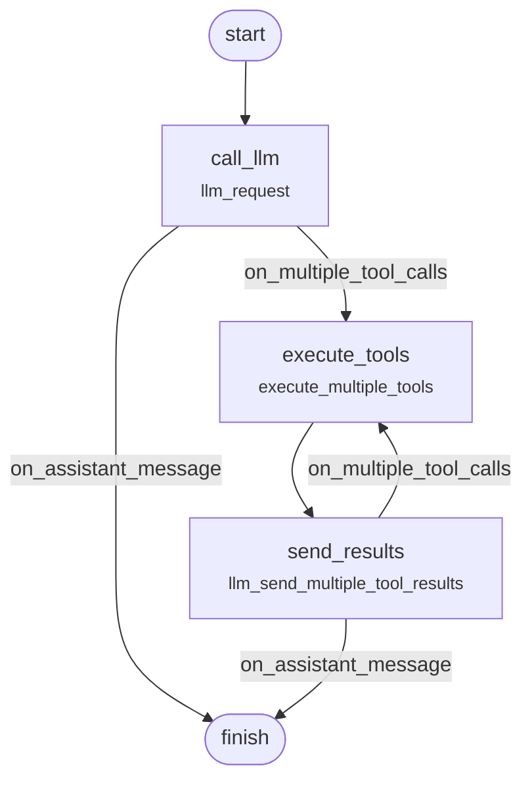
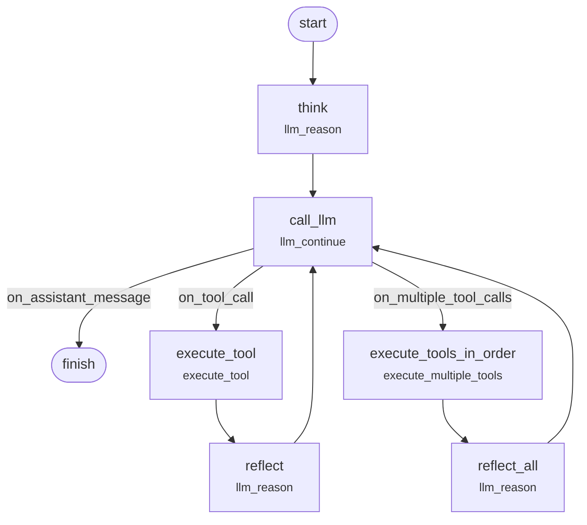
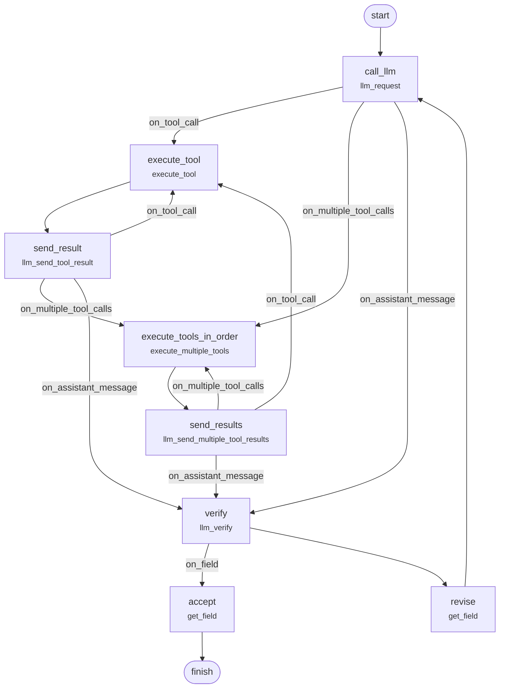
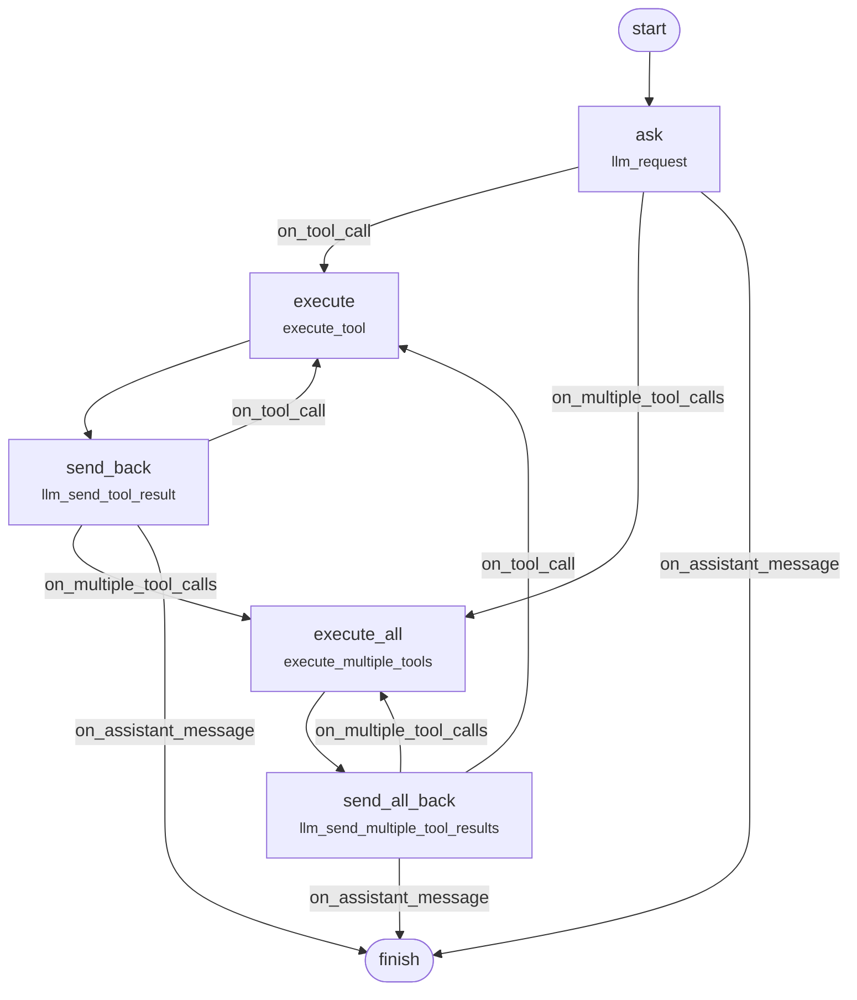

# Kapitel 4: Abläufe

Bisher hat jeder Agent dasselbe getan: das Modell fragen, Tools ausführen, antworten. In diesem Kapitel
lernst du, wie du den **Ablauf** eines Agenten festlegst – zuerst mit fertigen Vorlagen
(*Strategien*), dann mit eigenen Graphen aus Nodes und Kanten.

Ein paar Begriffe:

- **Graph:** der Ablauf eines Agenten. Er beginnt immer bei `start` und endet bei `finish`.
- **Node:** ein Schritt im Graphen, z. B. „das Modell fragen“ oder „ein Tool ausführen“. Welche Arten es
  gibt, legt der Node-Katalog von grauwolf fest.
- **Kante:** ein Pfeil von einem Node zum nächsten. Über Kanten fließen Werte: Der Node `start`
  liefert die Eingabe des Laufs, und was bei `finish` ankommt, ist die Antwort.
- **Bedingung:** eine Kante kann eine Bedingung (`when`) haben. Sie entscheidet, ob die Kante
  genommen wird, und kann den Wert dabei umformen.

## Strategien: fertige Abläufe

Eine Strategie ist eine Vorlage, die grauwolf beim Laden der Spec in einen vollständigen Graphen
verwandelt:

```json
"strategy": { "kind": "single_run", "params": { … } }
```

Es gibt vier Arten: `single_run`, `react`, `verified` und `chat` (für lange Gespräche, siehe
[Kapitel 7](07-gespraeche-und-wissen.md#lange-gespräche-die-strategie-chat)). `params` ist
optional; unbekannte Parameter oder Arten sind Fehler, z. B.
`/strategy: unknown strategy 'loop' (known: single_run, react, verified, chat)`. Den erzeugten
Graphen zeigt dir jederzeit `grauwolf spec graph <datei>`.

### `single_run`: der Tool-Kreislauf

`single_run` kennst du schon: Das Modell bekommt die Eingabe; ruft es ein Tool auf, wird es
ausgeführt und das Ergebnis zurückgegeben – so lange, bis eine Textantwort kommt. Den Graphen hast
du in [Kapitel 1](01-erste-schritte.md#den-ablauf-ansehen-spec-graph) gesehen.

Manche Modelle rufen gern mehrere Tools in einer Antwort auf. Der Kreislauf kann auch das: Enthält
eine Antwort genau einen Aufruf, nimmt sie den Weg `execute_tool` → `send_result`; enthält sie
mehrere, nimmt sie den Weg `execute_tools_in_order` → `send_results`. Der führt die Aufrufe
**nacheinander** in der Reihenfolge der Aufrufe aus und gibt alle Ergebnisse auf einmal zurück. Dasselbe
gilt für `react`, `verified` und `chat` (mit `parallel_tools` auf `false`). Sollen die Aufrufe einer
Antwort stattdessen **nebenläufig** laufen, nutzt du `parallel_tools`
([`beispiele/04-parallele-tools.json`](beispiele/04-parallele-tools.json)):

```json
{
  "spec_version": 1,
  "name": "parallel_calculator",
  "model": { "provider": "ollama", "id": "qwen3.5:9b" },
  "system_prompt": "Du bist ein Rechenassistent. Rufe das Tool add für jede Addition auf – bei mehreren unabhängigen Additionen rufe es gleichzeitig mehrfach auf.",
  "tools": [
    {
      "name": "add",
      "description": "Addiert zwei Zahlen a und b",
      "args": {
        "type": "object",
        "properties": { "a": { "type": "number" }, "b": { "type": "number" } },
        "required": ["a", "b"]
      },
      "code_file": "03-werkzeuge/addiere.rs"
    }
  ],
  "strategy": { "kind": "single_run", "params": { "parallel_tools": true } }
}
```

```sh
grauwolf spec run docs/handbuch/beispiele/04-parallele-tools.json "Was ist 1+2, 3+4 und 5+6?"
```

Etwa so:

```text
1+2 = 3, 3+4 = 7 und 5+6 = 11.
```



### `single_run` mit `moderate`: Eingaben vorher prüfen

Mit `"moderate": true` prüft das Modell jede Eingabe zuerst auf schädliche Inhalte. Ist sie
schädlich, endet der Lauf sofort mit einer Ablehnung als Antwort; sonst geht es normal weiter
([`beispiele/04-moderiert.json`](beispiele/04-moderiert.json)):

```json
{
  "spec_version": 1,
  "name": "moderated_helper",
  "model": { "provider": "ollama", "id": "qwen3.5:9b" },
  "system_prompt": "Du bist ein freundlicher Assistent. Antworte kurz und auf Deutsch.",
  "strategy": { "kind": "single_run", "params": { "moderate": true } }
}
```

```sh
grauwolf spec run docs/handbuch/beispiele/04-moderiert.json "Wie backe ich Brot?"
```

Etwa so:

```text
Mehl, Wasser, Hefe und Salz verkneten, gehen lassen und bei etwa 230 °C backen.
```

Vor dem Tool-Kreislauf stehen jetzt drei Nodes: `moderate` (`llm_moderate`) urteilt, `refuse`
liefert bei `harmful = true` die Ablehnung, `pass` reicht sonst den Text weiter. Für das Urteil legt
die Strategie den Typ `Moderation` an; ein eigener Typ dieses Namens ist deshalb nicht erlaubt.
`parallel_tools` und `moderate` lassen sich kombinieren.

### `react`: erst nachdenken, dann handeln

Bei `react` denkt das Modell vor der ersten Aktion und nach jedem Tool-Ergebnis nach – **ohne**
Tools – und handelt erst dann. Das hilft bei Aufgaben mit mehreren Schritten
([`beispiele/04-react.json`](beispiele/04-react.json); das Tool `add` ist dasselbe wie oben
und hier gekürzt):

```json
{
  "spec_version": 1,
  "name": "thoughtful_calculator",
  "model": { "provider": "ollama", "id": "qwen3.5:9b" },
  "system_prompt": "Du bist ein Rechenassistent. Nutze für jede Addition das Tool add und antworte auf Deutsch.",
  "tools": [ … ],
  "strategy": {
    "kind": "react",
    "params": {
      "reasoning_prompt": "Denke kurz darüber nach, welcher Rechenschritt als Nächstes nötig ist. Rufe noch kein Tool auf."
    }
  }
}
```

`reasoning_prompt` ist die Aufforderung zum Nachdenken. Lässt du sie weg, gilt die eingebaute
Aufforderung `Think about the task and plan the next steps. Do not call a tool yet.`, die grauwolf
auf Englisch an das Modell sendet. Eigene Aufforderungen kannst du in jeder Sprache schreiben.

```sh
grauwolf spec run docs/handbuch/beispiele/04-react.json "Addiere 3, 5 und 9."
```

Etwa so:

```text
3 + 5 + 9 = 17.
```



### `verified`: Antwort prüfen und überarbeiten

Bei `verified` prüft das Modell seine fertige Antwort selbst. Ist sie in Ordnung, geht sie zu
`finish`; sonst geht das Feedback als neuer Auftrag zurück, und der Tool-Kreislauf beginnt erneut
([`beispiele/04-geprueft.json`](beispiele/04-geprueft.json), `tools` gekürzt):

```json
{
  "spec_version": 1,
  "name": "verified_calculator",
  "model": { "provider": "ollama", "id": "qwen3.5:9b" },
  "system_prompt": "Du bist ein Rechenassistent. Nutze für jede Addition das Tool add und antworte auf Deutsch.",
  "tools": [ … ],
  "strategy": {
    "kind": "verified",
    "params": {
      "verify_prompt": "Prüfe, ob jede Zahl in der Antwort stimmt und ob die Frage vollständig beantwortet ist. Setze correct auf true oder false und beschreibe im Feedback, was falsch ist."
    }
  }
}
```

Das Urteil ist ein strukturierter Wert vom Typ `Verification` mit `correct`, `feedback` und
`answer`; die Strategie legt diesen Typ selbst an. Ohne `verify_prompt` gilt eine eingebaute
Prüfaufforderung, die grauwolf auf Englisch sendet: „Judge only the content of the answer below
against the task. You cannot see how the answer was obtained, so do not ask for tool calls or
working steps. Check the facts and numbers in the answer yourself. Set correct to false only if the
answer is wrong or leaves part of the task unanswered, and say in feedback exactly what is wrong;
otherwise set correct to true and leave feedback empty.“

```sh
grauwolf spec run docs/handbuch/beispiele/04-geprueft.json "Was ist 120 + 35 + 7?"
```

Etwa so:

```text
120 + 35 + 7 = 162.
```



Jede Prüfung kostet eine zusätzliche Anfrage. Kreisläufe sind übrigens nicht endlos: Nach mehr als
50 Node-Ausführungen bricht ein Lauf mit `more than 50 node executions – probably an endless loop` ab. Mit
`"limits": { "max_steps": n }` stellst du die Grenze selbst ein, und `max_tool_calls` begrenzt die
Tool-Aufrufe ([Kapitel 2](02-modelle.md#grenzen-in-der-spec-limits)).

## Eigene Graphen: `graph` mit `nodes` und `edges`

Reicht keine Vorlage, schreibst du den Graphen selbst. Statt `strategy` steht dann `graph` in der
Spec – beides zusammen ist ein Fehler.

```json
"graph": {
  "nodes": [ { "id": "…", "kind": "…", "params": { … } } ],
  "edges": [ { "from": "…", "to": "…", "when": { "kind": "…", "params": { … } } } ]
}
```

- Ein **Node** hat eine `id` (snake_case, eindeutig), eine Art `kind` aus dem Node-Katalog und je
  nach Art `params`. `start` und `finish` gibt es immer; als eigene IDs sind sie nicht erlaubt.
- Eine **Kante** verbindet `from` mit `to`. Ohne `when` reicht sie den Wert unverändert weiter.
- Gehen mehrere Kanten von einem Node aus, gewinnt die **erste passende** in der Reihenfolge der Spec.
  Passt keine, bricht der Lauf mit `no matching edge from node '…'` ab.

### Ein erster Graph: zwei Schritte hintereinander

Das Modell schreibt einen Absatz und kürzt ihn dann
([`beispiele/04-zwei-schritte.json`](beispiele/04-zwei-schritte.json)):

```json
{
  "spec_version": 1,
  "name": "draft_and_shorten",
  "model": { "provider": "ollama", "id": "qwen3.5:9b" },
  "system_prompt": "Zuerst schreibst du einen Absatz auf Deutsch zu einem Thema. Wenn du deinen Absatz zurückbekommst, kürzt du ihn auf höchstens zwei Sätze und gibst nur diese aus.",
  "graph": {
    "nodes": [
      { "id": "draft", "kind": "llm_request" },
      { "id": "shorten", "kind": "llm_request" }
    ],
    "edges": [
      { "from": "start", "to": "draft" },
      { "from": "draft", "to": "shorten", "when": { "kind": "on_assistant_message" } },
      { "from": "shorten", "to": "finish", "when": { "kind": "on_assistant_message" } }
    ]
  }
}
```

```sh
grauwolf spec run docs/handbuch/beispiele/04-zwei-schritte.json "Wölfe"
```

Etwa so:

```text
Wölfe leben in Rudeln mit klarer Rangordnung. Sie jagen gemeinsam und können weite Strecken zurücklegen.
```

Ein `llm_request` hängt seinen Eingabetext als Nachricht an den Verlauf an und fragt das Modell.
Beide Schritte teilen sich denselben Verlauf, deshalb „weiß“ der zweite, was der erste getan hat.

### Typen auf den Kanten

Jeder Wert auf einer Kante hat einen **Typ**, und grauwolf prüft beim Validieren, ob die Typen
zusammenpassen. Die eingebauten Typen:

| Typ | Bedeutung |
|---|---|
| `string` | Text |
| `message` | eine Antwort des Modells (Text oder Tool-Aufrufe) |
| `tool_call` / `tool_calls` | ein Tool-Aufruf / alle Tool-Aufrufe einer Antwort |
| `tool_result` / `tool_results` | ein Tool-Ergebnis / mehrere Ergebnisse |

Dazu kommen eigene Typen aus `types` ([Kapitel 5](05-strukturierte-daten.md)). `start` liefert den
Typ aus `input`, `finish` erwartet den aus `output` – standardmäßig beide `string`.

Ein `llm_request` liefert eine `message`, `finish` erwartet `string`. Deshalb braucht die Kante
zu `finish` die Bedingung `on_assistant_message`, die aus der Antwort den Text macht. Fehlt sie,
meldet `spec validate` etwa:

```text
type.json:/graph/edges/1: type error: target expects string, the edge delivers message
```

Weitere Prüfungen: Jeder Node muss von `start` aus erreichbar sein, von jedem Node muss ein Weg zu
`finish` führen, und Bedingungen müssen zum Wert passen, etwa
`/graph/edges/0/when: condition 'on_tool_call' expects message, the source delivers string`.

## Die wichtigsten Node-Arten

| Art | Typ (ein → aus) | Wirkung |
|---|---|---|
| `llm_request` | string → message | Eingabe anhängen, Modell mit allen Tools fragen |
| `llm_request_streaming` | string → message | wie `llm_request`; mit `--stream` erscheint der Text sofort |
| `llm_request_only_tools` | string → message | wie `llm_request`, ein Tool-Aufruf ist Pflicht |
| `llm_request_force_tool` | string → message | das Tool aus `params.tool` muss aufgerufen werden |
| `llm_request_best_of` | string → message | `params.choices` Antworten, eine Bewertung (`criteria`) wählt die beste |
| `llm_request_structured` | string → eigener Typ | Antwort als strukturierter Wert ([Kapitel 5](05-strukturierte-daten.md)) |
| `llm_continue` | string → message | erneut fragen, ohne die Eingabe erneut anzuhängen |
| `llm_reason` | `value` → string | nachdenken ohne Tools; `params.value` ist `string`, `tool_result` oder `tool_results`, optional `prompt` |
| `llm_verify` | string → eigener Typ | Antwort prüfen (`params.type`, optional `prompt`) |
| `llm_moderate` | string → eigener Typ | Text auf schädliche Inhalte prüfen (`params.type`, optional `provider` + `id`) |
| `execute_tool` | tool_call → tool_result | ein Tool ausführen |
| `llm_send_tool_result` | tool_result → message | Ergebnis an das Modell geben, Antwort holen |
| `execute_multiple_tools` | tool_calls → tool_results | mehrere Tools nebenläufig ausführen, oder nacheinander mit `params.sequential: true` |
| `llm_send_multiple_tool_results` | tool_results → message | alle Ergebnisse zurückgeben, Antwort holen |
| `get_field` | eigener Typ → string | ein Feld eines strukturierten Werts (`params.type`, `field`) |
| `set_model` | `value` → `value` | Modell wechseln ([Kapitel 2](02-modelle.md)) |
| `store` / `load` | `value` → `value` / `value` → `type` | Wert unter `params.key` ablegen bzw. wieder holen |
| `compress_history` | `value` → `value` | Verlauf kürzen (siehe unten) |
| `agent` | Text oder eigener Typ → Text oder eigener Typ | einen Unteragenten aus `agent_tools` als Schritt ausführen (siehe [Abläufe mit mehreren Agenten](#abläufe-mit-mehreren-agenten-agent-und-for_each)) |
| `decide` | `value` → `value` | einen Decider eine Frage zum Wert stellen; die Antwort wählt die Kante (siehe [Entscheidungen](#entscheidungen-verzweigen-nach-einer-frage)) |
| `code` | `input` → `output` | Rust-Code auf den Wert anwenden (siehe [Code in Graphen](#code-in-graphen-code-on_code-und-transform)) |

`value` und `type` in der Typspalte heißen: Der Typ steht als Name im gleichnamigen Parameter.
Dazu kommen die Arten `subgraph`, `parallel`, `plan` und `goap`, die andere Abläufe einbinden –
sie sind Thema von [Kapitel 6](06-subgraphen-und-planer.md) – und die Arten `agent` und
`for_each`, die Unteragenten ausführen (siehe [Abläufe mit mehreren Agenten](#abläufe-mit-mehreren-agenten-agent-und-for_each)). Alle Parameter stehen in der
[Spec-Referenz](referenz-spec.md).

## Die Bedingungen

| Bedingung | Typ (ein → aus) | Passt, wenn … |
|---|---|---|
| `on_assistant_message` | message → string | die Antwort keinen Tool-Aufruf enthält; liefert den Text |
| `on_tool_call` | message → tool_call | die Antwort genau einen Tool-Aufruf enthält |
| `on_multiple_tool_calls` | message → tool_calls | die Antwort mindestens einen Tool-Aufruf enthält; liefert alle |
| `on_field` | eigener Typ → derselbe | das Feld `params.field` den Wert `params.equals` hat |
| `on_decision` | beliebig → derselbe | die Antwort der letzten `decide`-Node eine von `params.answers` ist |
| `on_history_longer` | beliebig → derselbe | der Verlauf mehr als `params.messages` Nachrichten hat |
| `on_history_tokens_above` | beliebig → derselbe | der Verlauf mehr als `params.tokens` Tokens hat (geschätzt) |
| `on_code` | eigener Typ → derselbe | der Code `params.code` für den Wert `true` liefert (siehe [Code in Graphen](#code-in-graphen-code-on_code-und-transform)) |

## Den Tool-Kreislauf selbst bauen

Mit diesen Bausteinen baust du den Kreislauf von `single_run` nach – der Ausgangspunkt für eigene
Varianten ([`beispiele/04-tool-kreislauf.json`](beispiele/04-tool-kreislauf.json), `tools` gekürzt):

```json
{
  "spec_version": 1,
  "name": "handmade_calculator",
  "model": { "provider": "ollama", "id": "qwen3.5:9b" },
  "system_prompt": "Du bist ein Rechenassistent. Nutze für jede Addition das Tool add und antworte auf Deutsch.",
  "tools": [ … ],
  "graph": {
    "nodes": [
      { "id": "ask", "kind": "llm_request" },
      { "id": "execute", "kind": "execute_tool" },
      { "id": "send_back", "kind": "llm_send_tool_result" },
      { "id": "execute_all", "kind": "execute_multiple_tools", "params": { "sequential": true } },
      { "id": "send_all_back", "kind": "llm_send_multiple_tool_results" }
    ],
    "edges": [
      { "from": "start", "to": "ask" },
      { "from": "ask", "to": "execute", "when": { "kind": "on_tool_call" } },
      { "from": "ask", "to": "execute_all", "when": { "kind": "on_multiple_tool_calls" } },
      { "from": "ask", "to": "finish", "when": { "kind": "on_assistant_message" } },
      { "from": "execute", "to": "send_back" },
      { "from": "send_back", "to": "execute", "when": { "kind": "on_tool_call" } },
      { "from": "send_back", "to": "execute_all", "when": { "kind": "on_multiple_tool_calls" } },
      { "from": "send_back", "to": "finish", "when": { "kind": "on_assistant_message" } },
      { "from": "execute_all", "to": "send_all_back" },
      { "from": "send_all_back", "to": "execute", "when": { "kind": "on_tool_call" } },
      { "from": "send_all_back", "to": "execute_all", "when": { "kind": "on_multiple_tool_calls" } },
      { "from": "send_all_back", "to": "finish", "when": { "kind": "on_assistant_message" } }
    ]
  }
}
```

Lies die Kanten so: Nach `ask` geht es zum Tool, wenn das Modell eines aufruft, sonst mit dem
Text zu `finish`. Nach der Ausführung geht das Ergebnis zurück ans Modell, und dessen Antwort
entscheidet wieder: weiteres Tool oder fertig.

Die zweite Kante, `on_multiple_tool_calls`, fängt Antworten mit zwei oder mehr Tool-Aufrufen ab
(kleine Modelle schicken sie): `on_tool_call` verlangt genau einen Aufruf und steht zuerst, diese
Kante sieht also nur den Rest. Sie führt die Aufrufe mit `execute_multiple_tools` und
`"sequential": true` nacheinander aus und gibt alle Ergebnisse auf einmal zurück. Ohne sie bricht
eine solche Antwort den Lauf mit `no matching edge` ab, und `spec validate` warnt vor der fehlenden
Kante.

```sh
grauwolf spec run docs/handbuch/beispiele/04-tool-kreislauf.json "Was ist 40 plus 2?"
```

Etwa so:

```text
40 plus 2 ergibt 42.
```

## Entscheidungen: Verzweigen nach einer Frage

Manchmal muss der Ablauf nicht nach einem Feld einer strukturierten Eingabe verzweigen, sondern nach
einer *Einschätzung*: Betrifft dieses Ticket die Abrechnung oder ein technisches Problem? Ist es eine
Störung? Wie dringend ist es? Eine **Entscheidung** stellt eine typisierte Frage zum aktuellen Wert,
und die Antwort wählt die Kante. Der Wert selbst geht unverändert weiter.

```json
{ "id": "route", "kind": "decide", "params": {
    "value": "string",
    "kind": "choice",
    "question": "Welches Team soll dieses Support-Ticket bearbeiten?",
    "options": [
      { "name": "billing", "description": "Rechnungen, Zahlungen, Erstattungen und Preise" },
      { "name": "technical", "description": "Fehler, Abstürze und die Bedienung des Produkts" }
    ],
    "temperature": 0,
    "think": false } }
```

Die Kanten, die von einem `decide`-Node ausgehen, nutzen die Bedingung `on_decision` mit den Antworten,
die sie übernehmen:

```json
{ "from": "route", "to": "reply", "when": { "kind": "on_decision", "params": { "answers": ["billing"] } } },
{ "from": "route", "to": "diagnose", "when": { "kind": "on_decision", "params": { "answers": ["technical"] } } }
```

Das vollständige Beispiel ist [`beispiele/04-entscheiden.json`](beispiele/04-entscheiden.json): ein
Ticket-Router, in dem Abrechnungstickets eine Antwort bekommen, technische eine Analyse, und alles
andere unverändert weitergegeben wird.

### Die drei Arten von Fragen

| `kind` | Du gibst | Die Antwort ist |
|---|---|---|
| `choice` | `options`: 1 bis 255 Einträge `{ name, description? }` | der `name` der gewählten Option |
| `yes_no` | `threshold` (0 bis 1, Standard 0,5), optional `yes` und `no` (was sie bedeuten) | `yes`, wenn die Wahrscheinlichkeit für ja die Schwelle erreicht, sonst `no` |
| `score` | `levels`: 1 bis 255 Beschreibungen einer geordneten Skala, die niedrigste zuerst | die Beschreibung der Stufe: der gerundete mittlere Stufenindex, innerhalb der Skala gehalten |

`value` ist der Typ des durchlaufenden Werts (wie bei `store` oder `set_model`), `question` die Frage
in einfachen Worten. Namen und Stufenbeschreibungen müssen eindeutig sein. `decider` und `model`
bestimmen, wer antwortet (siehe unten).

### Regeln, die `spec validate` prüft

- `on_decision` darf nur von einem `decide`-Node ausgehen, und jede Kante von einem `decide`-Node muss
  `on_decision` nutzen. Die Bedingung liest das *letzte* Urteil, deshalb müssen die Kanten direkt auf
  den Node folgen.
- Jede Antwort der Entscheidung hat **genau eine** Kante: Eine Antwort ohne Kante
  (`DecisionAnswerUncovered`) würde den Lauf anhalten, eine Antwort mit zwei Kanten
  (`DecisionAnswerDuplicated`) wäre mehrdeutig. Eine Kante darf mehrere Antworten nennen.
- Eine Antwort, die die Entscheidung nicht hat (`UnknownDecisionAnswer`), ist ein Fehler an ihrer
  Stelle in `answers`.

### Wer antwortet: `decider`

- **`llm`** (der Standard) fragt das Modell des Agenten – oder das Modell in `model`, geschrieben als
  `provider/id`, z. B. `"model": "ollama/qwen3.5:9b"` – nach einer strukturierten Antwort: eine der
  erlaubten Antworten, bei `yes_no` die Wahrscheinlichkeit für ja. Frage, Optionen und Wert bilden eine
  eigene Anfrage; der Verlauf des Agenten bleibt unberührt. Es braucht keinen weiteren Dienst, kostet
  aber Tokens, und die Wahrscheinlichkeiten eines Sprachmodells sind weniger gut kalibriert als die
  eines Entscheidungsmodells. `temperature` (0–2) und `think` (`true`/`false`, nur für `ollama`) gelten
  nur für diese Anfrage, z. B. `"temperature": 0, "think": false` für wiederholbare, schnelle Urteile;
  sie folgen den Modellregeln aus [Modelle](02-modelle.md), und mit `system_one` sind sie ein Fehler.
- **`system_one`** fragt einen *System-One*-Dienst wie [RKEV](https://github.com/agentsw0rk/RKEV), der
  solche Fragen mit einem kleinen Entscheidungsmodell beantwortet – schnell und mit kalibrierten
  Wahrscheinlichkeiten. `model` ist dann der Name eines Checkpoints des Dienstes. Setze
  `RKEV_BASE_URL` (z. B. `http://localhost:8090`) und, falls der Dienst einen braucht, `RKEV_API_KEY`.
  Ohne `RKEV_BASE_URL` startet eine Spec mit einer `system_one`-Entscheidung nicht; die Fehlermeldung
  sagt das. Verbindungsfehler und ein beschäftigter Dienst (HTTP 503) werden wie LLM-Anfragen
  wiederholt; jeder andere Fehler lässt den Node mit der Meldung des Dienstes scheitern. Das Beispiel
  [`beispiele/04-entscheiden-system-one.json`](beispiele/04-entscheiden-system-one.json) stellt eine
  `yes_no`-Frage mit einer Schwelle von 0,7.

**Tipp: Optionen und Stufen beschreiben.** Kleine Entscheidungsmodelle beurteilen den Text der
Optionen, nicht nur ihre Namen. Bei nackten Stufen wie `["low", "medium", "high"]` stufte RKEVs
`kev-0.6b` den Satz „Production database is down, nobody can log in.“ als *low* ein (so, auf Englisch,
getestet). Mit Stufen, die sagen, was sie bedeuten – `"High: service down or many users blocked, act
immediately"` –, antwortete es *high*. Dasselbe gilt für `choice` (fülle `description` aus) und für
`yes_no` (`yes`, `no`). Die Antwort einer `score`-Entscheidung ist dann die ganze Beschreibung; halte
deshalb die `answers` der Kanten damit synchron.

### Was du danach siehst

Das Urteil der letzten Entscheidung wird im Speicher des Agenten unter `grauwolf.decision` abgelegt
(und ist damit Teil von Checkpoints). Die Ereignisse `decision_starting`, `decision_completed` (mit
`answer`, `probability`, `confidence` und `model`) und `decision_failed` melden jede Entscheidung –
nie den bewerteten Wert. OpenTelemetry zeigt jede als Span `decide <node>`
([Kapitel 9](09-betrieb.md)).

## Abläufe mit mehreren Agenten: `agent` und `for_each`

Ein Ablauf muss nicht aus einem Agenten mit vielen Nodes bestehen. Du kannst auch **Agenten**
hintereinanderschalten, jeder mit eigener Spec, eigenem Prompt, eigenem Modell und eigenen Tools,
und einen von ihnen einmal pro Element einer Liste laufen lassen. Zwei Node-Arten tun das; die
Unteragenten deklarierst du in `agent_tools`, wie in [Kapitel 8](08-externe-tools-und-agenten.md),
aber hier entscheidet der *Graph*, wann sie laufen – nicht das Modell.

### `agent`: ein Unteragent als Schritt

```json
{ "id": "research", "kind": "agent", "params": { "agent": "researcher" } }
```

`agent` führt den Eintrag `researcher` aus `agent_tools` mit dem Wert aus, der am Node ankommt, und
reicht dessen Antwort weiter. Er ist ein Schritt wie jeder andere: Nichts bleibt dem Urteil des
Modells überlassen, und ein Fehler des Unteragenten lässt den Node scheitern (eine Kante im Stil von
`on_error` gibt es nicht; der Lauf endet wie bei jedem Node-Fehler).

| Parameter | Bedeutung |
|---|---|
| `agent` | Name eines Eintrags aus `agent_tools` (eine lokale `spec` oder eine entfernte A2A-`url`) |
| `input`, `output` | Typnamen, standardmäßig `string`. Sie müssen die Typen der Spec des Unteragenten sein: `spec validate` vergleicht sie mit dessen eigener Spec |

Der Schritt hat **einen eigenen Verlauf** – der Verlauf des aufrufenden Agenten ändert sich nicht.
Alles andere gehört zum Lauf des Aufrufers: Tokenverbrauch, Kosten, Anzahl der Tool-Aufrufe und die
Grenzen aus [Kapitel 2](02-modelle.md) und [Kapitel 9](09-betrieb.md) werden geteilt (ein Unteragent
kann das Budget des Ablaufs nicht überschreiten), ebenso die Freigaben von Tools, die eine verlangen.
Der Unteragent meldet seine Ereignisse so, wie es ein Agent-Tool tut.

### `for_each`: ein Durchlauf pro Element

```json
{ "id": "write_all", "kind": "for_each", "params": {
    "input": "string",
    "output": "string",
    "body": { "agent": "writer" },
    "max_parallel": 2,
    "on_error": "skip" } }
```

| Parameter | Bedeutung |
|---|---|
| `body` | was pro Element läuft: `{ "agent": "<name>" }` (ein Unteragent aus `agent_tools`) oder `{ "subgraph": "<name>" }` (ein Subgraph `T → U`, [Kapitel 6](06-subgraphen-und-planer.md)) |
| `input` | `array<T>` oder `string` (Standard `array<string>`). Bei `string` wird der Text als JSON-Liste gelesen – ein Markdown-Codeblock darum, den Modelle gern ergänzen, wird ignoriert; jeder andere Text ist ein Fehler, der das sagt |
| `output` | `array<U>` oder `string` (Standard `array<string>`). Bei `string` wird die Liste als JSON-Text weitergegeben, z. B. an einen Agenten, der Text erwartet |
| `max_parallel` | wie viele Elemente gleichzeitig laufen, 1 bis 16 (Standard 1) |
| `on_error` | `fail` (Standard): das erste fehlschlagende Element lässt den Node scheitern, Elemente, die noch nicht gestartet sind, starten nicht; `skip`: das Element fehlt in der Ausgabe |

Die Ausgabe enthält die Ergebnisse der Elemente **in der Reihenfolge der Eingabe**, egal wie schnell
jedes einzelne war. Ein übersprungenes Element fehlt in der Ausgabe; das Ereignis
`for_each_item_failed` meldet es mit seinem Fehler. Jedes Element läuft auf seiner eigenen Kopie des
Verlaufs, so wie er war, als der Node startete; nichts fließt zurück in den Verlauf des Aufrufers.
Verbrauch, Kosten und Grenzen werden geteilt, `max_parallel: 2` ergibt also nicht zwei Budgets. Die
Elemente eines Nodes laufen nebenläufig innerhalb einer Task – sie brauchen keine eigenen Threads.

**Fortsetzen.** Jedes fertige Element wird im Fortschritt des Laufs gespeichert (unter
`grauwolf.for_each.<node id>`). Wird ein Lauf unterbrochen – oder scheitert der Node, oder geht das
Budget aus – und aus seinem Checkpoint fortgesetzt ([Kapitel 9](09-betrieb.md)), laufen nur die
fehlenden Elemente; übersprungene Elemente laufen nicht erneut.

**Ereignisse.** `for_each_item_starting`, `for_each_item_completed` und `for_each_item_failed` tragen
`node` und `index` (ab 0) – und beim letzten zusätzlich `error`. OpenTelemetry erfasst sie als
Span-Ereignisse.

### Ein vollständiger Ablauf

Das Beispiel [`beispiele/04-ablauf.json`](beispiele/04-ablauf.json) ist eine Pipeline aus drei
Agenten, einer Schleife über eine Liste und einer Entscheidung:

1. `researcher` (ein Agent mit eigener Spec, [`beispiele/04-ablauf/recherche.json`](beispiele/04-ablauf/recherche.json))
   antwortet mit einer JSON-Liste aus drei Themen;
2. der `for_each`-Node `write_all` lässt den Agenten `writer` für jedes Thema laufen, zwei auf einmal,
   und reicht die Artikel als JSON-Liste weiter;
3. `summarizer` verdichtet die Artikel;
4. der `decide`-Node `check` fragt, ob das Ergebnis eine stimmige Zusammenfassung ist: *yes* beendet
   den Ablauf, *no* lässt `summarizer` noch einmal laufen ([Entscheidungen](#entscheidungen-verzweigen-nach-einer-frage)).

```json
"graph": {
  "nodes": [
    { "id": "research", "kind": "agent", "params": { "agent": "researcher" } },
    { "id": "write_all", "kind": "for_each", "params": {
        "input": "string", "output": "string", "body": { "agent": "writer" },
        "max_parallel": 2, "on_error": "skip" } },
    { "id": "summarize", "kind": "agent", "params": { "agent": "summarizer" } },
    { "id": "check", "kind": "decide", "params": { "value": "string", "kind": "yes_no",
        "question": "Ist dies eine stimmige Zusammenfassung mehrerer kurzer Artikel?" } },
    { "id": "retry", "kind": "agent", "params": { "agent": "summarizer" } }
  ],
  "edges": [
    { "from": "start", "to": "research" },
    { "from": "research", "to": "write_all" },
    { "from": "write_all", "to": "summarize" },
    { "from": "summarize", "to": "check" },
    { "from": "check", "to": "finish", "when": { "kind": "on_decision", "params": { "answers": ["yes"] } } },
    { "from": "check", "to": "retry", "when": { "kind": "on_decision", "params": { "answers": ["no"] } } },
    { "from": "retry", "to": "finish" }
  ]
}
```

Starte es mit `grauwolf spec run beispiele/04-ablauf.json "Drei Themen über Tiere"`; mit `--events`
erscheinen die Ereignisse jedes Elements. Ein Ablauf kann sich nicht von allein wiederholen, die
Kanten des Graphen können das aber (mit einer Schrittgrenze, `limits.max_steps`); ein `for_each`-Body
darf `agent`-, `decide`- und weitere `for_each`-Nodes enthalten, solange kein Body sich selbst enthält.

### Listen mit benannten Typen

Mit einem benannten Typ für die Elemente hat eine Liste den Typ `array<Topic>`: `"input": "array<Topic>"`
bedeutet, dass die Elemente `Topic`-Werte sind, und ein Body-Subgraph muss dann `Topic` annehmen
(`spec validate` prüft das ebenso gegen `output`). Listen in den Typen von Node-Parametern schreibst
du als `array<T>`; der Abschnitt `types` selbst enthält weiterhin nur Objekte.

### Regeln, die `spec validate` prüft

- der `agent` eines `agent`-Nodes und eines `body` existiert in `agent_tools`; ein `body.subgraph`
  existiert und bindet sich nicht selbst ein, auch nicht über andere Bodies;
- `max_parallel` liegt zwischen 1 und 16, und `on_error` ist `fail` oder `skip`;
- `input` und `output` sind `array<T>` oder `string`, und `T` ist `string` oder ein deklarierter Typ;
- der Subgraph des Bodys nimmt die Elemente von `input` an und liefert die Elemente von `output`;
- die Typen auf den Kanten passen zueinander, wie bei jedem Node.

Dieselben Regeln gelten für erzeugte Crates (`spec generate`): Sie führen dieselben Laufzeitfunktionen
aus und laden Unteragenten aus `agent_tools` wie der Interpreter.

## Code in Graphen: `code`, `on_code` und `transform`

Manchmal ist ein Schritt keine Modellanfrage, sondern eine kleine Berechnung: einen Text bewerten,
einen Wert prüfen, ein Objekt in eine andere Form bringen. Dafür darf ein Graph Rust-Code an drei
Stellen enthalten:

| Wo | Was es ist | Funktion |
|---|---|---|
| Node `code` | ein Schritt, der seine Ausgabe aus seiner Eingabe berechnet | `fn run(input: In) -> Result<Out, String>` |
| Bedingung `on_code` | eine Kante, die genommen wird, wenn der Code `true` sagt; der Wert geht unverändert durch | `fn check(value: &In) -> bool` |
| `transform` an einer Kante | bildet den Wert der Kante ab, bevor der Zielnode ihn bekommt | `fn transform(value: In) -> Out` |

Du schreibst nur den **Rumpf** der Funktion, wie beim Tool-Code ([Kapitel 3](03-tools.md)). Der Code
wird wie ein Tool zu einem WebAssembly-Modul übersetzt und läuft in derselben Sandbox: kein
Dateisystem, kein Netzwerk, eine Grenze für Rechenzeit (Fuel) und Speicher. Er ist eine **reine
Funktion ihres Wertes**: Er sieht keinen Verlauf, keinen Speicher, keine Tools, kein Modell, keine
Uhr und keine Zufallszahlen, daher liefert derselbe Wert immer dasselbe Ergebnis.

Das Beispiel [`beispiele/04-code.json`](beispiele/04-code.json) lässt das Modell eine Bewertung
einordnen, bewertet die Antwort mit Code, verzweigt mit `on_code` und formt die Antwort mit einem
`transform`:

```json
"types": {
  "Verdict": { "type": "object", "properties": {
      "text": { "type": "string" }, "positive": { "type": "boolean" }, "words": { "type": "integer" } },
    "required": ["text", "positive", "words"] },
  "Reply": { "type": "object", "properties": {
      "subject": { "type": "string" }, "body": { "type": "string" } },
    "required": ["subject", "body"] }
},
"input": "string",
"output": "Reply",
"graph": {
  "nodes": [
    { "id": "judge", "kind": "llm_request" },
    { "id": "score", "kind": "code",
      "params": { "input": "string", "output": "Verdict", "code_file": "04-code/bewerten.rs" } }
  ],
  "edges": [
    { "from": "start", "to": "judge" },
    { "from": "judge", "to": "score", "when": { "kind": "on_assistant_message" } },
    { "from": "score", "to": "finish",
      "when": { "kind": "on_code", "params": { "input": "Verdict", "code": "value.positive" } },
      "transform": { "output": "Reply",
        "code": "Reply { subject: \"Thank you for the praise\".to_owned(), body: value.text }" } },
    { "from": "score", "to": "finish",
      "transform": { "output": "Reply",
        "code": "Reply { subject: format!(\"We will look into it ({} words)\", value.words), body: value.text }" } }
  ]
}
```

und `beispiele/04-code/bewerten.rs` enthält den Rumpf von `run`:

```rust
let lower = input.to_lowercase();
let positive = lower
    .split(|c: char| !c.is_alphabetic())
    .any(|word| ["gut", "toll", "super", "liebe", "hervorragend", "zufrieden", "positiv", "good", "great", "positive"].contains(&word));
if input.trim().is_empty() {
    return Err("the verdict is empty".to_owned());
}
Ok(Verdict {
    text: input.trim().to_owned(),
    positive,
    words: input.split_whitespace().count() as i64,
})
```

Mit `grauwolf spec run beispiele/04-code.json "The headphones are great."` geht die Antwort des
Modells durch `score`, die Kante mit `on_code` wird genommen, und das `transform` macht aus dem
`Verdict` eine `Reply` – `--events` zeigt die Nodes `judge` und `score`; die Umformung ist Teil der
Kante und hat deshalb keine eigenen Ereignisse. Eine negative Bewertung nimmt die zweite Kante.

### Der Node `code`

`params`: `input` und `output` (Typnamen) und `code` – oder `code_file`, eine Datei mit dem Rumpf,
relativ zur Spec; genau eins von beiden (wie bei Tools, siehe
[Kapitel 3](03-tools.md#tool-code-in-einer-eigenen-datei-code_file)). `input` und `output` sind
`string`, ein benannter Typ aus `types` oder eine Liste `array<T>` davon; die Katalogtypen wie
`message` sind nicht möglich. Im Code sind `In` und `Out` die Rust-Typen dafür (`String`, `Vec<…>`
oder die Struktur des benannten Typs). `Err(message)` lässt den Node mit dieser Meldung scheitern; die
Ausgabe ist ein Wert von `Out`, passt also immer zum Typ.

### Die Bedingung `on_code`

`params`: `input` – der Typ des Werts, der die Ausgabe des Quell-Nodes sein muss – und
`code`/`code_file` mit dem Rumpf von `fn check(value: &In) -> bool`. Liefert er `true`, wird die Kante
genommen und der Wert geht unverändert durch, wie bei `on_field`. **Ein fehlgeschlagener Check ist ein
Fehler des Laufs, nicht `false`**: ein Panic, ein Trap oder ein erschöpftes Fuel-Limit beendet den Lauf
mit einer Fehlermeldung, statt stillschweigend die nächste Kante zu nehmen.

### Das `transform` einer Kante

Eine Kante darf neben `when` ein `transform` haben: `{ "input"?, "output", "code" | "code_file" }`, mit
dem Rumpf von `fn transform(value: In) -> Out`. Es läuft, nachdem die Bedingung der Kante gepasst hat,
und bevor der Zielnode läuft; das Ziel bekommt `Out`, und genau das speichert auch ein Checkpoint, daher
wird bei einer Fortsetzung nicht erneut umgeformt. `spec validate` prüft die Kante gegen `output`;
`input` ist standardmäßig das, was die Kante liefert (die Ausgabe des Quell-Nodes, nach der Bedingung),
und muss, falls angegeben, genau dies sein. Eine Kante zu `finish` liefert `Out` als Ergebnis des
Graphen. Scheitert die Umformung durch ein Panic oder erschöpftes Fuel, schlägt der Lauf fehl.

### Typen im Code

Die Rust-Typen folgen den Regeln für strukturierte Daten ([Kapitel 5](05-strukturierte-daten.md)): Ein
benannter Typ wird zu einer Struktur mit `pub`-Feldern aus `String`, `i64` (`integer`), `f64`
(`number`), `bool` und `Vec<…>`; Felder, die nicht `required` sind, werden zu `Option<…>`. Feldnamen,
die Rust-Schlüsselwörter sind, schreibst du als `r#type`. Werte, die nicht zum Typ passen, werden
abgewiesen, bevor der Code läuft (`invalid input: field `stars`: expected an integer…`).

### Bauen, Cache und Fehler

Der Code wird zusammen mit den Tools gebaut: von `spec build`, zu Beginn von `spec run` und den anderen
Lauf-Befehlen (gecacht wie Tools) und von `spec generate` (als WASM-Module in das Crate eingebettet,
die sie genauso in der Sandbox ausführen wie der Interpreter). Es gelten dieselben Prüfungen wie für
Tool-Code (kein `include!`, `env!`, `mod`, `extern`, `unsafe`, keine Attribute). Compilerfehler nennen
die Stelle in der Spec, wie Validierungsfehler:

```text
spec.json:/graph/nodes/1/params/code:2:9: error: cannot find value `unknown_value` in this scope
spec.json:/graph/edges/1/transform/code:1:5: error: mismatched types
```

Für `spec generate --tool-sources` ([Kapitel 11](11-code-erzeugen.md)) wird jeder Code-Teil als
Gast-Crate `tools/<name>/` geschrieben, mit einem Eintrag in `tools/tools.json`, der eine `kind`
(`code`, `condition` oder `transform`) hat; `grauwolf tools build` baut ihn, und sein Bericht mit
`--format json` nennt den Eintrag und seine Art. Die Namen leiten sich vom Node oder der Kante ab:

| Teil | Name |
|---|---|
| Node `score` im Hauptgraphen | `code_main_score` |
| `on_code` an der Kante `score` → `finish` | `condition_main_score_finish` |
| `transform` an der Kante `score` → `finish` | `transform_main_score_finish` |
| dasselbe im Subgraphen `inner` | `code_sub_inner_score`, … |
| eine zweite Kante zwischen denselben Nodes | `transform_main_score_finish_2`, … |

### Regeln, die `spec validate` prüft

- `code`-Nodes, `on_code`-Bedingungen und Umformungen haben Code (`MissingCode` unter
  `…/params/code` bzw. `…/transform/code`);
- `input` und `output` sind `string`, deklarierte Typen oder `array<T>` davon (`UnknownType`);
- das `input` von `on_code` ist die Ausgabe des Quell-Nodes (`ConditionInputMismatch`);
- die `output` eines `transform` ist die Eingabe des Zielnodes (`TypeMismatch`), und ein angegebenes
  `input` ist das, was die Kante liefert (`TransformInputMismatch`);
- die Typen auf den Kanten von `code`-Nodes passen zueinander, wie bei jedem Node.

## Graphen ansehen mit `spec graph`

`grauwolf spec graph docs/handbuch/beispiele/04-tool-kreislauf.json` gibt diesen Mermaid-Text aus:



So liest du das Diagramm: `start` und `finish` sind abgerundet, jeder Node zeigt ID und Art, und
an den Pfeilen steht die Bedingung. Subgraphen erscheinen als eigene Blöcke, und ein gestrichelter
Pfeil zeigt, wer sie aufruft (siehe [Kapitel 2](02-modelle.md#ein-eigenes-modell-für-einen-subgraphen)).
Füge den Text in Markdown als ` ```mermaid `-Block ein, z. B. in eine README auf GitHub.

## Den Verlauf kürzen: History-Kompression

Jede Anfrage schickt den ganzen bisherigen **Verlauf** (alle Nachrichten des Laufs) an das Modell.
Bei langen Tool-Kreisläufen wird er groß, langsam und teuer. Der Node `compress_history` kürzt ihn
und reicht seinen Wert unverändert weiter:

- `"strategy": "keep_last"` mit `"keep": n` behält den System-Prompt und die letzten n Nachrichten.
- `"strategy": "summarize"` lässt das Modell den Verlauf zusammenfassen (eine zusätzliche Anfrage).
- `"strategy": "facts"` mit `"keep": n` behält die letzten n Nachrichten wörtlich und ersetzt alle
  älteren durch eine Liste von Fakten, die das Modell aus ihnen zieht (eine zusätzliche Anfrage).
  Danach steht die Liste im Verlauf als eine Nachricht `Facts from the
  conversation so far:` (eine eingebaute Überschrift, die grauwolf auf Englisch sendet) mit je einer
  Zeile `- …` pro Fakt; bei der nächsten Kürzung geht sie in der neuen Liste auf.

Welche nimmst du? `keep_last` ist kostenlos, vergisst aber alles Ältere. `summarize` behält den
Zusammenhang, verliert aber Einzelheiten. `facts` liegt dazwischen: Namen, Zahlen, Entscheidungen
und offene Fragen bleiben als einzelne Sätze erhalten, die letzten Nachrichten bleiben wörtlich.

Zusammen mit `on_history_longer` wird nur gekürzt, wenn der Verlauf zu lang ist
([`beispiele/04-kompression.json`](beispiele/04-kompression.json), gekürzt – `tools` wie oben):

```json
"graph": {
  "nodes": [
    { "id": "ask", "kind": "llm_request" },
    { "id": "execute", "kind": "execute_tool" },
    {
      "id": "trim",
      "kind": "compress_history",
      "params": { "value": "tool_result", "strategy": "keep_last", "keep": 6 }
    },
    { "id": "send_back", "kind": "llm_send_tool_result" },
    { "id": "execute_all", "kind": "execute_multiple_tools", "params": { "sequential": true } },
    {
      "id": "trim_all",
      "kind": "compress_history",
      "params": { "value": "tool_results", "strategy": "keep_last", "keep": 6 }
    },
    { "id": "send_all_back", "kind": "llm_send_multiple_tool_results" }
  ],
  "edges": [
    { "from": "start", "to": "ask" },
    { "from": "ask", "to": "execute", "when": { "kind": "on_tool_call" } },
    { "from": "ask", "to": "execute_all", "when": { "kind": "on_multiple_tool_calls" } },
    { "from": "ask", "to": "finish", "when": { "kind": "on_assistant_message" } },
    {
      "from": "execute",
      "to": "trim",
      "when": { "kind": "on_history_longer", "params": { "messages": 12 } }
    },
    { "from": "execute", "to": "send_back" },
    { "from": "trim", "to": "send_back" },
    { "from": "send_back", "to": "execute", "when": { "kind": "on_tool_call" } },
    { "from": "send_back", "to": "execute_all", "when": { "kind": "on_multiple_tool_calls" } },
    { "from": "send_back", "to": "finish", "when": { "kind": "on_assistant_message" } },
    {
      "from": "execute_all",
      "to": "trim_all",
      "when": { "kind": "on_history_longer", "params": { "messages": 12 } }
    },
    { "from": "execute_all", "to": "send_all_back" },
    { "from": "trim_all", "to": "send_all_back" },
    { "from": "send_all_back", "to": "execute", "when": { "kind": "on_tool_call" } },
    { "from": "send_all_back", "to": "execute_all", "when": { "kind": "on_multiple_tool_calls" } },
    { "from": "send_all_back", "to": "finish", "when": { "kind": "on_assistant_message" } }
  ]
}
```

Hier zeigt sich, warum die Reihenfolge der Kanten zählt: Die Kante zu `trim` steht vor der Kante zu
`send_back` und gewinnt deshalb, sobald der Verlauf mehr als 12 Nachrichten hat. (Der Weg für mehrere
Tool-Aufrufe darunter macht dasselbe mit `tool_results`.) Der gerade offene Tool-Aufruf bleibt beim
Kürzen immer erhalten, damit das Ergebnis dazu passt.

### Nach Größe statt nach Anzahl kürzen

Zwölf kurze Nachrichten sind etwas anderes als zwölf lange Tool-Ergebnisse. Mit
`on_history_tokens_above` kürzt du, sobald der Verlauf mehr als eine bestimmte Zahl an Tokens hat:

```json
{
  "from": "execute",
  "to": "trim",
  "when": { "kind": "on_history_tokens_above", "params": { "tokens": 6000 } }
}
```

grauwolf schätzt die Tokens vor der Anfrage: ein Token je angefangene vier Zeichen, dazu ein
kleiner Aufschlag je Nachricht und eine Pauschale von 1000 je Anhang. Je nach Sprache und Modell kann
die Schätzung um etwa ein Viertel abweichen – setze die Schwelle deshalb mit Abstand unter das
Kontextfenster deines Modells. Wie du eine zu große Anfrage ganz verhinderst, steht in
[Kapitel 2](02-modelle.md) unter `limits`.

## Das Wichtigste in Kürze

- Ein Ablauf ist ein Graph von `start` nach `finish`; über die Kanten fließen typisierte Werte.
- Strategien: `single_run` (Tool-Kreislauf; `parallel_tools`, `moderate`), `react` (`reasoning_prompt`), `verified` (`verify_prompt`), `chat` (lange Gespräche, Kapitel 7).
- Ein eigener `graph` besteht aus `nodes` (`id`, `kind`, `params`) und `edges` (`from`, `to`, optional `when`); `strategy` und `graph` schließen sich aus.
- Von mehreren Kanten gewinnt die erste passende; passt keine, bricht der Lauf ab. Nach jeder Modellantwort gilt die Reihenfolge `on_tool_call`, `on_multiple_tool_calls`, `on_assistant_message`; `spec validate` warnt, wenn `on_multiple_tool_calls` fehlt.
- `spec validate` prüft Typen, Erreichbarkeit und Parameter; `spec graph` zeichnet den Ablauf als Mermaid-Diagramm.
- `compress_history` (`keep_last`, `summarize`, `facts`) mit `on_history_longer` (Nachrichten) oder `on_history_tokens_above` (geschätzte Tokens) hält lange Verläufe klein.
- `decide` stellt eine typisierte Frage (`choice`, `yes_no`, `score`) zum Wert, beantwortet vom Modell (`llm`) oder einem System-One-Dienst (`system_one`); `on_decision`-Kanten verzweigen nach der Antwort, und jede Antwort braucht genau eine Kante.
- `agent` führt einen Unteragenten aus `agent_tools` als Schritt aus; `for_each` lässt einen `agent` oder einen Subgraphen pro Element einer JSON-Liste laufen, `max_parallel` auf einmal, Ergebnisse in Eingabereihenfolge, Fortschritt pro Element gespeichert.
- `code`-Nodes, `on_code`-Bedingungen und `transform`s an Kanten führen Rust-Code (`fn run`, `fn check`, `fn transform`) als Sandbox-WASM aus, wie Tools, als reine Funktionen ihres Wertes; `Err`, ein Panic oder erschöpftes Fuel lassen den Lauf scheitern, und ein fehlgeschlagener `on_code`-Check ist ein Fehler, nicht `false`.
- Ein Lauf endet nach spätestens 50 Node-Ausführungen je Graph; `limits.max_steps` ändert das.

Weiter mit [Kapitel 5: Strukturierte Daten](05-strukturierte-daten.md).
