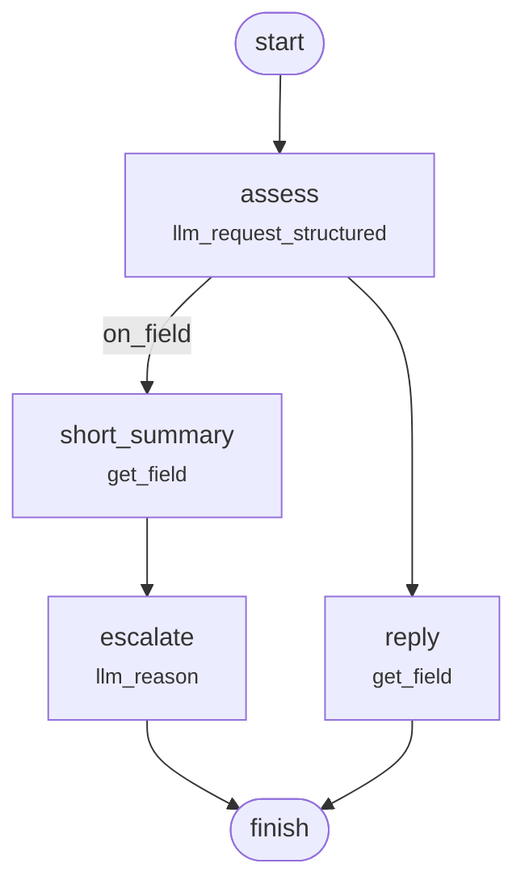

# Kapitel 5: Strukturierte Daten

Bisher haben deine Agenten Text bekommen und Text zurückgegeben. Oft willst du aber Daten mit fester
Form: ein Ticket mit Titel und Priorität, eine Einschätzung mit einem Ja/Nein-Feld, eine Anfrage
mit einer Kundennummer. Dafür beschreibst du in der Spec eigene **Typen**. grauwolf sorgt dann dafür, dass

- das Modell die Antwort genau in dieser Form liefert (sonst bricht der Lauf mit einer klaren Meldung ab),
- dein Ablauf nach einzelnen Feldern verzweigen kann,
- `spec validate` schon erkennt, wenn zwei Nodes nicht zusammenpassen.

Dieses Kapitel setzt voraus, dass du eigene Graphen aus Nodes und Kanten bauen kannst
([Kapitel 4](04-ablaeufe.md)).

## Typen beschreiben: `types`

Ein Typ ist ein benanntes **JSON-Schema** – eine Beschreibung, welche Felder ein JSON-Objekt hat
und welchen Datentyp jedes Feld hat. Du legst Typen im Abschnitt `types` an:

```json
"types": {
  "Ticket": {
    "type": "object",
    "description": "Ein Ticket, das aus einer Fehlermeldung entsteht.",
    "properties": {
      "title": { "type": "string", "description": "Kurze Zusammenfassung." },
      "priority": { "type": "integer", "description": "1 (höchste) bis 4." },
      "tags": { "type": "array", "items": { "type": "string" } },
      "effort": { "type": "number", "description": "Geschätzter Aufwand in Stunden." }
    },
    "required": ["title", "priority", "tags"]
  }
}
```

Ein paar Regeln gelten:

- **Typnamen** beginnen mit einem Großbuchstaben und bestehen nur aus Buchstaben und Ziffern
  (`Ticket`, `Einschaetzung`, `Anfrage2`). Umlaute, `_` oder Leerzeichen sind nicht erlaubt.
- Ein Typ ist immer ein Objekt (`"type": "object"`) mit `properties`.
- Für Felder kennt grauwolf diese Teilmenge von JSON Schema:

  | `type` | Bedeutung |
  |---|---|
  | `string` | Text |
  | `integer` | ganze Zahl |
  | `number` | Dezimalzahl |
  | `boolean` | `true` oder `false` |
  | `array` mit `items` | Liste; `items` beschreibt die Einträge, z. B. `{ "type": "string" }` |

- `required` nennt die Pflichtfelder. Alle anderen Felder sind optional: Sie dürfen fehlen oder
  `null` sein.
- `description` ist freiwillig, hilft dem Modell aber sehr, die Felder richtig zu füllen.
- **Feldnamen** bestehen aus Kleinbuchstaben, Ziffern und `_` (`kunden_nr`) und beginnen nicht
  mit einer Ziffer.

`spec validate` prüft jedes Schema gegen diese Teilmenge – dieselbe, die auch gilt, wenn du Rust-Code
erzeugst ([Kapitel 11](11-code-erzeugen.md)). Abweichungen meldet es mit der genauen Stelle, z. B.
`…:/types/Ticket/properties/owner: unsupported schema: supported are "string",
"integer", "number", "boolean" and "array"` für ein verschachteltes Objekt oder ein Feld ohne
`type`. Zusätzliche Schlüsselwörter wie `enum` gehen mit dem Schema an das Modell; grauwolf prüft die
Antwort gegen sie aber nicht.

## Die Antwort als Typ: `llm_request_structured`

Ein Typ allein tut noch nichts. Erst der Node `llm_request_structured` fragt das Modell nach einer
Antwort in diesem Typ. Er nimmt Text entgegen und liefert einen Wert des Typs, den du unter
`params.type` nennst. Mit `output` legst du fest, was der ganze Agent zurückgibt:

```json
{
  "spec_version": 1,
  "name": "ticket",
  "model": { "provider": "ollama", "id": "qwen3.5:9b" },
  "system_prompt": "Du machst aus Fehlermeldungen von Nutzern ein Ticket.",
  "types": { "Ticket": { "…": "wie oben" } },
  "output": "Ticket",
  "graph": {
    "nodes": [
      { "id": "capture", "kind": "llm_request_structured", "params": { "type": "Ticket", "retries": 1 } }
    ],
    "edges": [
      { "from": "start", "to": "capture" },
      { "from": "capture", "to": "finish" }
    ]
  }
}
```

Die vollständige Datei: [`beispiele/05-ticket.json`](beispiele/05-ticket.json).

Einige Dinge fallen auf:

- `input` fehlt. **Ist nichts angegeben, sind `input` und `output` immer `string`** – also Text.
  Hier bekommt der Agent Text und liefert ein `Ticket`.
- Zwischen `capture` und `finish` steht keine Bedingung. Anders als `llm_request` liefert
  `llm_request_structured` keine Nachricht, sondern direkt den fertigen Wert.
- `retries` (Standard `0`) erlaubt neue Versuche: Passt eine Antwort nicht zum Schema, meldet grauwolf
  dem Modell den Fehler und fragt erneut. Alle Versuche bleiben im Verlauf.

grauwolf schickt das Schema an das Modell; Ollama, OpenAI, Anthropic und Gemini nutzen dafür ihre
eingebaute Unterstützung für strukturierte Antworten. Ist die Antwort in einen Markdown-Codeblock
gepackt (```` ```json … ``` ````), entfernt grauwolf die Zäune vor der Prüfung. Danach wird die Antwort
**normalisiert**: Felder, die nicht im Schema stehen, fallen weg, ebenso `null` in optionalen
Feldern, und `number`-Felder werden zu Kommazahlen.

Aufruf:

```bash
grauwolf spec run docs/handbuch/beispiele/05-ticket.json \
  "Seit dem Update stürzt die App beim Speichern ab, und alle meine Änderungen sind weg!"
```

Die Ausgabe sieht etwa so aus – bei Typen gibt die CLI eingerücktes JSON aus:

```json
{
  "effort": 4.0,
  "priority": 1,
  "tags": [
    "absturz",
    "datenverlust",
    "update"
  ],
  "title": "App stürzt beim Speichern ab, Änderungen gehen verloren"
}
```

Ist die Antwort nach allen Versuchen unbrauchbar, bricht der Lauf ab, z. B. so:

```text
docs/handbuch/beispiele/05-ticket.json: … LLM answer does not fit type Ticket: /priority: expected integer
```

Der Teil nach dem Typnamen ist ein **JSON-Pointer** (die Stelle im JSON, z. B. `/priority`) mit dem
Grund. Andere Gründe sind `missing required field` oder, wenn überhaupt kein JSON zurückkam,
`LLM answer for type Ticket is not JSON: …`.

## Nach Feldern verzweigen: `on_field` und `get_field`

Mit einem Typ kann dein Ablauf Entscheidungen treffen. Zwei Bausteine aus dem Katalog helfen dabei:

- Die Kantenbedingung **`on_field`** mit `params { field, equals }` lässt den Wert nur durch, wenn das
  Feld `field` genau den Wert `equals` hat. Der Wert selbst wird unverändert weitergereicht.
- Der Node **`get_field`** mit `params { type, field }` holt ein Feld aus einem Wert des Typs
  `type` und gibt es als **Text** zurück. Zahlen und Wahrheitswerte werden als JSON-Text
  geschrieben (`3`, `true`); ein fehlendes Feld ergibt leeren Text.

Das folgende Beispiel bewertet eine Kundenanfrage. Ist sie dringend, schreibt der Agent eine Eskalation
an das Bereitschaftsteam; sonst gibt er die vorgeschlagene Antwort aus:

```json
"types": {
  "Assessment": {
    "type": "object",
    "properties": {
      "urgent": { "type": "boolean", "description": "true bei Datenverlust, Zahlungsproblemen oder Störungen." },
      "summary": { "type": "string", "description": "Das Anliegen in einem Satz." },
      "answer": { "type": "string", "description": "Eine kurze Antwort an den Kunden." }
    },
    "required": ["urgent", "summary", "answer"]
  }
},
"graph": {
  "nodes": [
    { "id": "assess", "kind": "llm_request_structured", "params": { "type": "Assessment", "retries": 2 } },
    { "id": "short_summary", "kind": "get_field", "params": { "type": "Assessment", "field": "summary" } },
    { "id": "escalate", "kind": "llm_reason", "params": { "value": "string", "prompt": "Schreibe eine knappe Eskalation an das Bereitschaftsteam: Was ist passiert, was muss getan werden?" } },
    { "id": "reply", "kind": "get_field", "params": { "type": "Assessment", "field": "answer" } }
  ],
  "edges": [
    { "from": "start", "to": "assess" },
    { "from": "assess", "to": "short_summary", "when": { "kind": "on_field", "params": { "field": "urgent", "equals": true } } },
    { "from": "assess", "to": "reply" },
    { "from": "short_summary", "to": "escalate" },
    { "from": "escalate", "to": "finish" },
    { "from": "reply", "to": "finish" }
  ]
}
```

Die vollständige Datei: [`beispiele/05-weiche.json`](beispiele/05-weiche.json). So sieht der Ablauf mit
`grauwolf spec graph` aus:



Die **Reihenfolge der Kanten** ist wichtig: Von mehreren Kanten, die einen Node verlassen, gewinnt die
erste, die passt. Deshalb steht die Kante ohne Bedingung zu `reply` nach der `on_field`-Kante und fängt
alle nicht dringenden Fälle auf. Passt keine Kante, bricht der Lauf mit
`no matching edge from node '…'` ab.

`equals` akzeptiert jeden JSON-Wert, also auch Texte (`"equals": "Rechnung"`) oder Zahlen. Der Vergleich
ist exakt: `"Rechnung"` ist nicht `"rechnung"`.

Aufruf, z. B.:

```bash
grauwolf spec run docs/handbuch/beispiele/05-weiche.json \
  "Ich wurde für dieselbe Bestellung dreimal abgebucht!"
```

```text
Eskalation: Einem Kunden wurde dieselbe Bestellung dreimal abgebucht. Bitte prüft die Zahlungen,
erstattet die doppelten Abbuchungen und informiert den Kunden noch heute.
```

## Strukturierte Eingabe: `input` und JSON mit `spec run`

Auch die Eingabe kann ein Typ sein. Dann übergibst du **JSON statt Text** an `spec run` (und in jeder
Zeile von `spec chat`). grauwolf prüft die Eingabe gegen den Typ und normalisiert sie, bevor der erste
Node läuft.

Nodes, die mit dem Modell sprechen (`llm_request` und seine Verwandten), erwarten Text. Deshalb holst
du zuerst mit `get_field` das Feld heraus, um das es geht:

```json
{
  "spec_version": 1,
  "name": "reply_letter",
  "model": { "provider": "ollama", "id": "qwen3.5:9b" },
  "system_prompt": "Du schreibst kurze, freundliche Antworten auf Kundenanfragen.",
  "types": {
    "Request": {
      "type": "object",
      "properties": {
        "customer": { "type": "string" },
        "text": { "type": "string" },
        "customer_number": { "type": "integer" }
      },
      "required": ["customer", "text"]
    }
  },
  "input": "Request",
  "graph": {
    "nodes": [
      { "id": "concern", "kind": "get_field", "params": { "type": "Request", "field": "text" } },
      { "id": "reply", "kind": "llm_request" }
    ],
    "edges": [
      { "from": "start", "to": "concern" },
      { "from": "concern", "to": "reply" },
      { "from": "reply", "to": "finish", "when": { "kind": "on_assistant_message" } }
    ]
  }
}
```

Die vollständige Datei: [`beispiele/05-eingabe.json`](beispiele/05-eingabe.json).

```bash
grauwolf spec run docs/handbuch/beispiele/05-eingabe.json \
  '{"customer": "Anna Berg", "text": "Wann kommt meine Bestellung an?"}'
```

Setze das JSON in einfache Anführungszeichen, damit die Shell die doppelten in Ruhe lässt. Die CLI
meldet ungültige Eingaben, bevor das Modell befragt wird, z. B. so:

```text
input is not JSON for type Request: expected value at line 1 column 1
docs/handbuch/beispiele/05-eingabe.json: input does not fit type Request: /text: missing required field
```

Strukturierte Eingaben sind besonders nützlich, wenn ein Programm deinen Agenten aufruft – etwa über den
HTTP-Dienst ([Kapitel 9](09-betrieb.md)) oder als Subagent eines anderen Agenten
([Kapitel 8](08-externe-tools-und-agenten.md)): Dann sind die Felder die Argumente des Tools.

## Typprüfung der Kanten

Jede Kante trägt einen Wert mit einem Typ. `spec validate` prüft, dass der Typ, den die Quelle liefert
(nach einer eventuellen Bedingung), genau dem entspricht, den das Ziel erwartet. Bei eigenen Typen zählt
der **Name**: `Ticket` passt nur zu `Ticket`, auch wenn ein anderer Typ dieselben Felder hätte.

Die wichtigsten Signaturen (Eingabe → Ausgabe) auf einen Blick:

| Baustein | Eingabe → Ausgabe |
|---|---|
| `start` | liefert den Typ aus `input` |
| `finish` | erwartet den Typ aus `output` |
| `llm_request_structured` | `string` → Typ aus `params.type` |
| `get_field` | Typ aus `params.type` → `string` |
| Bedingung `on_field` | Typ → derselbe Typ (nur eigene Typen) |
| `llm_request` | `string` → `message` |
| Bedingung `on_assistant_message` | `message` → `string` |

Typische Fehlermeldungen, wie `spec validate` sie ausgibt:

```text
05-ticket.json:/types/ticket: 'ticket' is not a valid type name: allowed are letters and digits, starting with an uppercase letter
05-ticket.json:/output: unknown type 'Tiket': allowed are 'string' and the names from 'types'
05-ticket.json:/graph/nodes/0/params: unknown type 'Unknown': allowed are 'string' and the names from 'types'
05-ticket.json:/graph/nodes/1/params: invalid parameters for 'get_field': /field: missing required parameter
05-ticket.json:/graph/edges/1: type error: target expects string, the edge delivers Ticket
05-ticket.json:/graph/edges/2: type error: target expects string, the edge delivers message
05-ticket.json:/graph/edges/3/when: condition 'on_field' expects <structured type>, the source delivers string
05-ticket.json:/graph/edges/4/when: condition 'on_assistant_message' expects message, the source delivers Ticket
```

So liest du sie:

- **`target expects string, the edge delivers Ticket`** – du führst einen Typ in einen Node, der Text
  braucht (oder in `finish`, obwohl `output` Text ist). Setze `get_field` dazwischen oder stelle
  `output` auf den Typ.
- **`target expects string, the edge delivers message`** – nach `llm_request` fehlt die Bedingung
  `on_assistant_message`, die die Nachricht in Text umwandelt.
- **`condition 'on_field' expects <structured type>`** – `on_field` funktioniert nur nach Nodes, die einen
  eigenen Typ liefern (der Platzhalter `<structured type>`).
- **`condition 'on_assistant_message' expects message, the source delivers Ticket`** –
  `llm_request_structured` liefert bereits den fertigen Wert; die Kante braucht keine Bedingung.

## Die wichtigsten Punkte

- `types` enthält benannte JSON-Schemas; Namen in PascalCase, Felder aus `string`, `integer`,
  `number`, `boolean` und `array` (mit `items`) – keine verschachtelten Objekte; `required` nennt die Pflichtfelder.
- `input` und `output` sind `string`, wenn nichts angegeben ist; ein Typname macht Ein- oder Ausgabe zu JSON.
- `llm_request_structured` (`params.type`, optional `retries`, Standard `0`) liefert die Antwort des Modells
  als Wert des Typs.
- `on_field` verzweigt nach einem Feldwert, `get_field` macht ein Feld zu Text.
- Kanten werden anhand des Typnamens geprüft; `spec validate` zeigt jede Abweichung mit einem JSON-Pointer.

Weiter mit [Kapitel 6: Subgraphen und Planer](06-subgraphen-und-planer.md).
