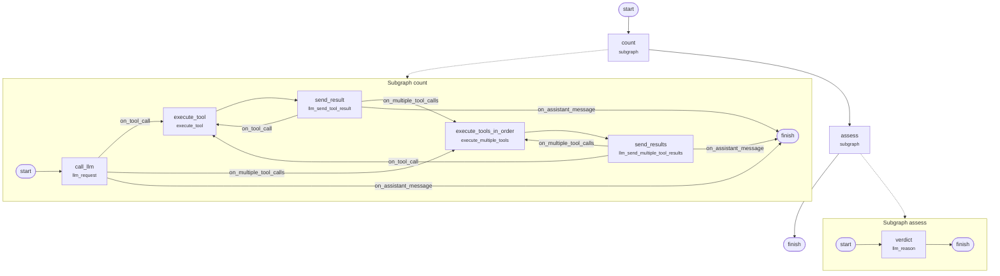
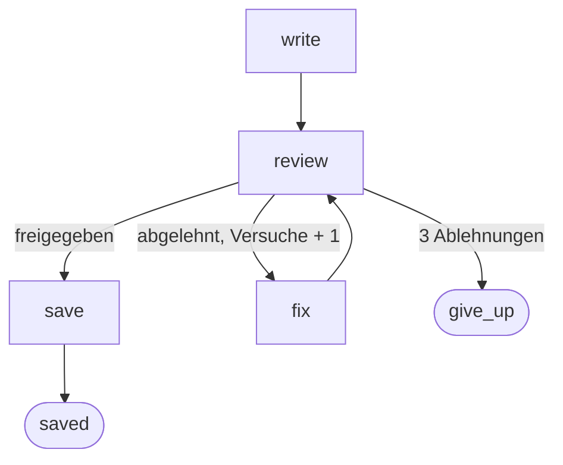

# 6 Subgraphen und Planer

Wenn Abläufe wachsen, willst du sie zerlegen: Ein Teil arbeitet mit Tools, ein anderer bewertet mit
einem stärkeren Modell. Manchmal sollen mehrere Teile gleichzeitig arbeiten, und manchmal kennst du
die Schritte vorher gar nicht – dann soll der Agent sie selbst planen.

Dieses Kapitel zeigt vier Bausteine, vom einfachen zum anspruchsvollen:

| Baustein | Wozu |
|---|---|
| `subgraph` | einen benannten Teilablauf einbinden – mit eigener Tool-Auswahl und eigenem Modell |
| `parallel` | mehrere Teilabläufe gleichzeitig laufen lassen und die Ergebnisse zusammenführen |
| `plan` | das Modell einen Plan machen und ihn Schritt für Schritt abarbeiten lassen |
| `goap` | aus festen Aktionen mit Vorbedingungen und Wirkungen automatisch den günstigsten Weg suchen – auch mit Zählern, Unteragenten und Erfolgsprüfungen |

Dafür brauchst du eigene Graphen aus [Kapitel 4](04-ablaeufe.md); Typen aus
[Kapitel 5](05-strukturierte-daten.md) helfen an einigen Stellen.

## Subgraphen: Teilabläufe mit eigenem Rahmen

Ein **Subgraph** ist ein benannter Graph im Abschnitt `subgraphs`. Er hat eigene `start`- und
`finish`-Nodes und wird im Hauptgraphen über einen Node der Art `subgraph` eingebunden. Jeder
Eintrag in `subgraphs` kennt diese Felder:

| Feld | Bedeutung | Standard |
|---|---|---|
| `input` | Eingabetyp: `string` oder ein Name aus `types` | `string` |
| `output` | Ausgabetyp: `string` oder ein Name aus `types` | `string` |
| `tools` | Tools, die im Subgraphen erlaubt sind; `[]` heißt: keine | alle Tools der Spec |
| `model` | eigenes Modell `{ provider, id }` nur für diesen Subgraphen | das äußere Modell |
| `graph` | Nodes und Kanten (Pflicht) | – |
| `self_tools` | darf der Agent hier eigene Tools bauen? siehe [Kapitel 10](10-selbst-gebaute-tools.md) | wie außen |

Das folgende Beispiel analysiert einen Text in zwei Teilen. `count` darf nur die zwei Zähl-Tools
nutzen und arbeitet mit dem lokalen Modell; `assess` bekommt gar keine Tools und ein eigenes
Modell von Anthropic:

```json
"subgraphs": {
  "count": {
    "tools": ["count_words", "count_sentences"],
    "graph": {
      "nodes": [
        { "id": "call_llm", "kind": "llm_request" },
        { "id": "execute_tool", "kind": "execute_tool" },
        { "id": "send_result", "kind": "llm_send_tool_result" }
      ],
      "edges": [ "… der Tool-Kreislauf aus Kapitel 4 …" ]
    }
  },
  "assess": {
    "tools": [],
    "model": { "provider": "anthropic", "id": "claude-haiku-5-5" },
    "graph": {
      "nodes": [
        { "id": "verdict", "kind": "llm_reason", "params": { "value": "string", "prompt": "Beurteile anhand der Zahlen in zwei Sätzen die Lesbarkeit des Textes." } }
      ],
      "edges": [
        { "from": "start", "to": "verdict" },
        { "from": "verdict", "to": "finish" }
      ]
    }
  }
},
"graph": {
  "nodes": [
    { "id": "count", "kind": "subgraph", "params": { "subgraph": "count" } },
    { "id": "assess", "kind": "subgraph", "params": { "subgraph": "assess" } }
  ],
  "edges": [
    { "from": "start", "to": "count" },
    { "from": "count", "to": "assess" },
    { "from": "assess", "to": "finish" }
  ]
}
```

Die vollständige Datei mit beiden Tools: [`beispiele/06-subgraph.json`](beispiele/06-subgraph.json).
`grauwolf spec graph` zeichnet Subgraphen als eigene Blöcke; die gestrichelte Linie zeigt, wo sie
eingebunden sind:



Aufruf, etwa so:

```bash
grauwolf spec run docs/handbuch/beispiele/06-subgraph.json \
  "Der Hund schläft. Die Katze auch. Nur der Papagei redet ununterbrochen."
```

```text
Mit 11 Wörtern in 3 Sätzen sind die Sätze sehr kurz und leicht verständlich. Für einen
längeren Text würde etwas Abwechslung im Satzbau die Lesbarkeit noch verbessern.
```

Was du wissen solltest:

- Der Node vom Typ `subgraph` hat die **Signatur des Subgraphen**: Er erwartet dessen `input` und
  liefert dessen `output`. Kanten werden wie gewohnt geprüft.
- Der Subgraph arbeitet im **selben Gesprächsverlauf** wie der Rest des Laufs. Nur Tool-Auswahl
  und Modell gelten, solange er läuft; danach gilt wieder das Äußere – auch wenn er mit einem Fehler
  endet.
- `tools` darf alle Tool-Namen der Spec nennen: eigene Tools, aber auch MCP-Tools, Unteragenten,
  das Such-Tool aus `knowledge` oder eingebaute Tools.
- Die Namen von Subgraphen sind wie Node-IDs klein geschrieben (`[a-z][a-z0-9_]*`).
- Ein Subgraph darf weitere Subgraphen einbinden, aber nie sich selbst – auch nicht über Umwege.

Typische Meldungen von `spec validate`:

```text
06-subgraph.json:/graph/nodes/0/params: unknown subgraph 'cuont'
06-subgraph.json:/subgraphs/count/tools/2: unknown tool 'square_root'
06-subgraph.json:/subgraphs/count/graph/nodes/3/params: subgraph 'count' includes itself
06-subgraph.json:/subgraphs/assess/graph: 'finish' is not reachable from 'start'
```

Jeder Subgraph wird wie der Hauptgraph geprüft; die Pfade beginnen dann mit
`/subgraphs/<name>/graph`.

## Parallel arbeiten: `parallel`

Ein Node der Art `parallel` startet mehrere Subgraphen **gleichzeitig**. Jeder Zweig bekommt
dieselbe Eingabe und eine eigene Kopie des Laufkontexts (Verlauf, Modell, Speicher), sodass sich die
Zweige nicht gegenseitig stören. Danach führt eine **Merge-Strategie** die Ergebnisse zusammen.

```json
"graph": {
  "nodes": [
    { "id": "views", "kind": "parallel", "params": { "subgraphs": ["pro", "contra"], "merge": "concat" } },
    { "id": "weigh", "kind": "llm_request" }
  ],
  "edges": [
    { "from": "start", "to": "views" },
    { "from": "views", "to": "weigh" },
    { "from": "weigh", "to": "finish", "when": { "kind": "on_assistant_message" } }
  ]
}
```

Die Subgraphen `pro` und `contra` bestehen je aus einem `llm_reason`-Node mit eigenem Auftrag. Die
vollständige Datei: [`beispiele/06-parallel.json`](beispiele/06-parallel.json).

Die Parameter:

| Parameter | Bedeutung |
|---|---|
| `subgraphs` | mindestens zwei Namen aus `subgraphs`; alle mit derselben Signatur (`input` und `output`) – sie wird zur Signatur des Nodes |
| `merge` | `concat`, `index` oder `llm_select` |
| `index` | nur bei `index`: welcher Zweig gewinnt, gezählt ab `0` |
| `criteria` | nur bei `llm_select`, optional: wonach das Modell den besten Zweig auswählt |

Die drei Strategien:

- **`concat`** hängt alle Ergebnisse als Abschnitte `## <branch>` aneinander. Der Verlauf des Laufs
  bleibt dabei unverändert. Das geht nur, wenn die Zweige Text liefern.
- **`index`** übernimmt Ergebnis und Kontext (Verlauf, Modell, Speicher) des Zweigs mit der
  angegebenen Nummer.
- **`llm_select`** lässt das Modell ohne Tools den besten Zweig nach `criteria` wählen und
  übernimmt dessen Ergebnis und Kontext. Ohne `criteria` gilt ein eingebautes Standardkriterium.

So wählt das Modell, statt zusammenzufassen:

```json
{ "id": "views", "kind": "parallel",
  "params": { "subgraphs": ["pro", "contra"], "merge": "llm_select", "criteria": "Die überzeugendste Sicht" } }
```

Mit `concat` sieht die Eingabe für `weigh` etwa so aus, die Antwort danach etwa wie darunter:

```text
## pro
Ein Lastenrad spart Parkplatzsuche und Spritkosten. ...

## contra
Ein Lastenrad ist teuer in der Anschaffung und braucht einen sicheren Stellplatz. ...
```

```bash
grauwolf spec run docs/handbuch/beispiele/06-parallel.json "Soll ich ein Lastenrad kaufen?"
```

```text
Für kurze Wege in der Stadt überwiegen die Vorteile. Kauf das Lastenrad, wenn du einen sicheren
Stellplatz hast – sonst probier erst ein Leihrad aus.
```

Typische Meldungen:

```text
…:/graph/nodes/0/params: invalid parameters for 'parallel': "subgraphs" needs at least two subgraph names
…:/graph/nodes/0/params: invalid parameters for 'parallel': all branches need the same signature (input and output)
…:/graph/nodes/0/params: invalid parameters for 'parallel': "merge": concat needs branches with output string
…:/graph/nodes/0/params: invalid parameters for 'parallel': "index" must be a number from 0 to 1
```

## Planen lassen: `plan`

Bei offenen Aufgaben („Plane ein Wochenende in Hamburg“) kennst du die Schritte vorher nicht. Ein
Node der Art `plan` lässt das Modell zuerst einen **Plan** machen – ein Ziel und eine Liste von
Schritten – und arbeitet die Schritte dann einzeln ab. Jeder Schritt läuft durch einen Subgraphen,
den du bestimmst; der kann also auch Tools benutzen.

```json
"subgraphs": {
  "step": {
    "graph": {
      "nodes": [ { "id": "call_llm", "kind": "llm_request" } ],
      "edges": [
        { "from": "start", "to": "call_llm" },
        { "from": "call_llm", "to": "finish", "when": { "kind": "on_assistant_message" } }
      ]
    }
  }
},
"graph": {
  "nodes": [
    { "id": "plan", "kind": "plan", "params": { "subgraph": "step", "critic": true, "max_iterations": 8 } }
  ],
  "edges": [
    { "from": "start", "to": "plan" },
    { "from": "plan", "to": "finish" }
  ]
}
```

Die vollständige Datei: [`beispiele/06-plan.json`](beispiele/06-plan.json).

| Parameter | Bedeutung | Standard |
|---|---|---|
| `subgraph` | führt jeden Schritt aus; muss `string` → `string` sein (Pflicht) | – |
| `critic` | vor jedem weiteren Schritt prüft ein **Critic** (eine zweite Anfrage an das Modell), ob der Plan noch trägt; sonst wird mit Begründung neu geplant | `false` |
| `max_iterations` | höchstens so viele Durchgänge, ganze Zahl ≥ 1 | `20` |

So läuft es ab:

1. Das Modell erstellt auf einem eigenen, kurzen Verlauf einen Plan aus Ziel und Schritten.
2. Jeder Schritt geht als Auftrag an den Subgraphen, mit der eingebauten Anweisung
   `Goal: …` / `Carry out step i of n: … and answer with the result.` (grauwolf sendet sie auf
   Englisch). Seine Tool-Auswahl und sein Modell gelten dabei.
3. Mit `critic` wird vor jedem weiteren Schritt geprüft. Abgelehnt wird nur, wenn die restlichen
   Schritte das Ziel nicht mehr erreichen können; dann entsteht ein neuer Plan, der die bisherigen
   Ergebnisse kennt. In allen anderen Fällen, auch bei einem unvollkommenen Plan, läuft es weiter.
4. Sind alle Schritte erledigt, ist das **Ergebnis des letzten Schritts** die Ausgabe des Nodes.

Der `plan`-Node selbst ist `string` → `string`. Reicht `max_iterations` nicht, bricht der Lauf mit
`plan not fulfilled after 8 steps` ab. Mit `--events` siehst du die Pläne als Ereignisse
`plan_built` und `plan_step_executed`.

```bash
grauwolf spec run docs/handbuch/beispiele/06-plan.json \
  "Plane zwei Tage Hamburg mit Kindern bei Regen, mit Uhrzeiten."
```

Die Ausgabe ist etwa ein fertiger Zwei-Tage-Plan – das Ergebnis des letzten Schritts.

## Aus Aktionen planen: `goap`

**GOAP** (Goal-Oriented Action Planning, zielorientierte Aktionsplanung) eignet sich, wenn du die
möglichen Aktionen schon kennst, die Reihenfolge aber aus der Lage folgen soll. Du beschreibst

- den **Zustand** als benannte Fakten: wahr/falsch, ein Text aus einer festen Liste, eine Zahl oder
  ein freier Text,
- **Aktionen** mit Vorbedingungen (`pre`), Wirkungen (`effects`) und Kosten (`cost`),
- **Ziele** als gewünschte Fakten, optional mit einer `priority`.

grauwolf sucht dann vor jedem Schritt vom aktuellen Zustand aus den günstigsten Weg zu einem Ziel
(mit dem A*-Suchverfahren) und führt die nächste Aktion über ihren Subgraphen (oder einen Unteragenten)
aus. Die Planung selbst kostet also keine Modellanfrage.

```json
{
  "id": "edit",
  "kind": "goap",
  "params": {
    "state": { "draft": "none", "facts_checked": false },
    "values": { "draft": ["none", "rough", "final"] },
    "actions": [
      { "name": "write_rough_draft", "subgraph": "write",
        "pre": { "draft": "none" }, "effects": { "draft": "rough" },
        "description": "Schreibe eine erste Fassung des Artikels." },
      { "name": "revise", "subgraph": "write",
        "pre": { "draft": "rough" }, "effects": { "draft": "final" },
        "description": "Überarbeite die Fassung: kürzer, klarer, mit einer Überschrift." },
      { "name": "check_facts", "subgraph": "check", "cost": 3,
        "pre": { "draft": "final" }, "effects": { "facts_checked": true },
        "description": "Prüfe die Aussagen des Artikels und gib die korrigierte Fassung aus." }
    ],
    "goals": [ { "name": "publish", "facts": { "draft": "final", "facts_checked": true } } ],
    "max_iterations": 6
  }
}
```

Die vollständige Datei mit den Subgraphen `write` und `check` (der zweite mit eigenem Modell):
[`beispiele/06-goap.json`](beispiele/06-goap.json).

Die Parameter im Einzelnen:

| Parameter | Bedeutung |
|---|---|
| `state` | Anfangsfakten; legt fest, welche Fakten es gibt und welchen Typ sie haben (Pflicht, siehe unten) |
| `values` | erlaubte Werte je Text-Fakt, z. B. `{ "draft": ["none", "rough", "final"] }`; ein Text-Fakt ohne Liste ist ein freier Text |
| `actions` | mindestens eine Aktion: `name` (eindeutig), ein Ausführender (`subgraph` mit Eingabe `string`, oder `agent`), optional `pre`, `effects`, `on_success`, `on_failure`, `cost` (Zahl ≥ 0, Standard `1`), `description`, `input`, `output_fact` und `success_contains` |
| `goals` | mindestens ein Ziel: `name`, `facts` und optional `priority` (ganze Zahl ≥ 0, Standard `0`) |
| `input_fact` | freier Text-Fakt, der vor der Planung die Eingabe des Nodes erhält |
| `output_fact` | freier Text-Fakt, dessen Wert das Ergebnis des Nodes ist (Standard: die Ausgabe der letzten Aktion) |
| `max_iterations` | höchstens so viele Schritte, Standard `20` |
| `max_search_nodes` | höchstens so viele Zustände je Suche, Standard `10000` |
| `max_plan_depth` | höchstens so viele Aktionen in einem Plan, Standard `50` |

Wie eine Aktion läuft:

- Ihr Subgraph bekommt die ursprüngliche Aufgabe plus `Action: <name>` (eine eingebaute
  Anweisung, die grauwolf auf Englisch sendet) und darunter die `description` – oder den Text deiner
  `input`-Vorlage (siehe unten). Weil alle Aktionen eines Subgraph-Ausführenden im selben Verlauf
  arbeiten, sieht `revise` die Rohfassung aus dem Schritt davor.
- Nach Erfolg gelten die `effects`. Liefert der Subgraph ein Objekt (einen eigenen Typ als
  `output`), überschreiben gleichnamige Felder die Fakten – Wahrheitswerte, Zahlen und freie Texte
  immer, Aufzählungstexte nur mit einem Wert aus `values`. Weicht das von der Erwartung ab, wird neu
  geplant. So kann eine Prüf-Aktion zum Beispiel `{ "facts_checked": false }` melden.
- Die Ausgabe des Nodes (`string` → `string`) ist die Ausgabe der letzten Aktion (oder der Wert von
  `output_fact`); ist ein Ziel schon zu Beginn erfüllt, ist sie leer. Findet die Suche keinen Weg,
  bricht der Lauf mit `no plan found: no goal is reachable from the current state within the
  search limits` ab.

```bash
grauwolf spec run docs/handbuch/beispiele/06-goap.json "Ein kurzer Artikel über Stadtbienen."
```

Die Ausgabe ist etwa der geprüfte Artikel aus `check_facts`.

### Zahlen, freie Texte und Vergleiche

Der Typ eines Fakts richtet sich nach seinem Anfangswert in `state`:

| Anfangswert | Typ | Bedingungen | Wirkungen |
|---|---|---|---|
| `true` / `false` | Wahrheitswert | `eq`, `ne` | setzen |
| `0` (JSON-Ganzzahl) | Ganzzahl | `eq`, `ne`, `gt`, `lt`, `ge`, `le` | setzen, `{ "add": n }` |
| `0.0` (JSON-Kommazahl – schreibe den Dezimalpunkt) | Zahl | dasselbe | setzen, `{ "add": n }` |
| `"none"` mit einer Liste unter `values` | Aufzählung | `eq`, `ne` | setzen |
| `""` ohne Liste | freier Text | `eq`, `ne` | setzen |

In `pre` und in den Fakten eines Ziels bedeutet ein einfacher Wert *gleich*; ein Objekt mit genau
einem Operator vergleicht anders: `{ "review_attempts": { "lt": 3 } }`, `{ "draft": { "ne": "" } }`.
Eine Wirkung ist ein einfacher Wert (setzen) oder `{ "add": 1 }` für Ganzzahlen und Zahlen. Der
Planer wendet `add` auch in der *erwarteten* Wirkung an, sodass sich eine Schleife über einen Zähler
wie jeder andere Weg planen lässt: Eine Vorbedingung wie `{ "lt": 3 }` begrenzt sie absichtlich. Weil
Zahlen unendlich viele Zustände ergeben, ist die Suche durch `max_search_nodes` und `max_plan_depth`
begrenzt; ein Ziel, das innerhalb dieser Grenzen nicht erreichbar ist, hat keinen Plan.

### Unteragenten, Vorlagen und Erfolgsprüfungen

Eine Aktion führt genau einen Ausführenden aus: einen `subgraph` oder einen `agent` – den Namen eines
Eintrags aus `agent_tools`, der wie ein `agent`-Node als Schritt läuft ([Kapitel 4](04-ablaeufe.md)):
Er teilt sich das Budget des Laufs und hat einen eigenen Verlauf. Er bekommt Text, muss also Text
annehmen.

| Schlüssel einer Aktion | Bedeutung |
|---|---|
| `input` | Text für den Ausführenden mit Platzhaltern: `{{fact}}` ist der Wert eines Fakts, `{{task}}` die Eingabe des Nodes; unbekannte Platzhalter sind Fehler. Ohne `input` bekommt der Ausführende die Aufgabe plus `Action: <name>` und die `description` |
| `output_fact` | freier Text-Fakt, der die Antwort des Ausführenden erhält |
| `success_contains` | die Aktion ist erfolgreich, wenn die Antwort diesen Text enthält (sonst, wenn der Ausführende nicht scheitert) |
| `effects` | was der Planer *erwartet*; gilt nach Erfolg, sofern `on_success` nichts anderes sagt |
| `on_success` | Wirkungen nach Erfolg (Standard: `effects`) |
| `on_failure` | Wirkungen nach einem Fehlschlag – ein Fehler des Ausführenden oder ein fehlendes `success_contains`. Danach wird vom neuen Zustand aus weitergeplant. Ohne `on_failure` beendet ein Fehlschlag den Lauf mit einem Fehler. Ein erschöpftes Laufbudget (`limits.max_tokens`, `max_cost`, `max_prompt_tokens`) beendet den Lauf immer, mit `on_failure` oder ohne |

### Beispiel: eine Prüfschleife

Ein Autor schreibt einen Text, ein Prüfer antwortet mit `APPROVED` oder `REJECTED: …`. Ein abgelehnter
Text wird überarbeitet – höchstens dreimal –, und der freigegebene Text wird gespeichert. Das Ziel
`saved` hat eine höhere Priorität als `give_up`; der Lauf endet bei dem Ziel, das zuerst erreicht
wird, und das Ergebnis ist in jedem Fall der letzte Entwurf:

```json
{
  "id": "editor",
  "kind": "goap",
  "params": {
    "state": {
      "topic": "", "draft": "", "feedback": "",
      "written": false, "reviewed": false, "approved": false, "saved": false,
      "review_attempts": 0
    },
    "input_fact": "topic",
    "output_fact": "draft",
    "actions": [
      { "name": "write", "agent": "writer",
        "input": "Schreibe einen kurzen Text mit Titel zu: {{topic}}",
        "output_fact": "draft",
        "pre": { "written": false },
        "effects": { "written": true, "reviewed": false } },
      { "name": "review", "agent": "reviewer",
        "input": "Prüfe diesen Text:\n{{draft}}",
        "output_fact": "feedback",
        "pre": { "written": true, "reviewed": false },
        "effects": { "reviewed": true, "approved": true },
        "success_contains": "APPROVED",
        "on_failure": { "reviewed": true, "review_attempts": { "add": 1 } } },
      { "name": "fix", "agent": "writer",
        "input": "Überarbeite den Text gemäß den Anmerkungen.\n\nText:\n{{draft}}\n\nAnmerkungen:\n{{feedback}}",
        "output_fact": "draft",
        "pre": { "reviewed": true, "approved": false, "review_attempts": { "lt": 3 } },
        "effects": { "reviewed": false } },
      { "name": "save", "subgraph": "save",
        "input": "Der Text wurde freigegeben:\n{{draft}}",
        "pre": { "approved": true },
        "effects": { "saved": true } }
    ],
    "goals": [
      { "name": "saved", "facts": { "saved": true }, "priority": 1 },
      { "name": "give_up", "facts": { "reviewed": true, "review_attempts": { "ge": 3 } } }
    ],
    "max_iterations": 12
  }
}
```

Der Planer erwartet, dass jede Prüfung freigibt. Lehnt einer ab, zählt `on_failure` den Versuch, und
der Text gilt als geprüft, aber nicht freigegeben – der günstigste Weg zu `saved` ist nun also `fix`,
`review`, `save`. Nach drei Ablehnungen ist `fix` nicht mehr erlaubt, und `give_up` gilt. Die
vollständige Datei mit den Unteragenten `writer` und `reviewer` und dem Subgraphen `save`:
[`beispiele/06-goap-pruefung.json`](beispiele/06-goap-pruefung.json).



### Zwischen Zielen wählen

Sind mehrere Ziele erreichbar, berechnet grauwolf für jedes den günstigsten Plan und verfolgt das Ziel
mit dem kleinsten Wert *Kosten / (priority + 1)*. Ein Ziel mit `"priority": 1` zählt also halb so
teuer wie eines ohne; bei gleichen Werten gewinnt das zuerst deklarierte Ziel. Der Lauf endet, sobald
irgendein Ziel gilt.

`spec validate` meldet Fehler in den Parametern genau, etwa so:

```text
06-goap.json:/graph/nodes/0/params: invalid parameters for 'goap': actions[0].effects.draft: value "half" is not in `values.draft`
06-goap.json:/graph/nodes/0/params: invalid parameters for 'goap': goals[0].facts: fact 'printed' is not in `state`
06-goap.json:/graph/nodes/0/params: invalid parameters for 'goap': actions[2]: subgraph 'check' receives the task as text and needs input string
06-goap.json:/graph/nodes/0/params: invalid parameters for 'goap': actions[1].pre.draft: gt, lt, ge and le need an integer or number fact
06-goap.json:/graph/nodes/0/params: invalid parameters for 'goap': actions[0].input: unknown placeholder '{{topic}}' (expected `task` or a fact of `state`)
```

## Was nehme ich wann?

| Situation | Baustein |
|---|---|
| Ein Teil braucht andere Tools oder ein anderes Modell, oder du willst Teile wiederverwenden | `subgraph` |
| Mehrere unabhängige Sichtweisen oder Lösungswege, danach zusammenfassen oder auswählen | `parallel` |
| Offene Aufgabe, deren Schritte das Modell festlegen soll | `plan` (mit `critic`, wenn Qualität wichtiger ist als Kosten) |
| Feste Aktionen mit klaren Voraussetzungen; die Reihenfolge soll nachvollziehbar und günstig sein | `goap` |

`parallel`, `plan` und `goap` binden ebenfalls Subgraphen ein; deren `tools` und `model` gelten
überall dort, wo sie laufen.

## Das Wichtigste in Kürze

- `subgraphs` enthält benannte Graphen mit `input`/`output` (Standard `string`), optional `tools`
  (Teilmenge, `[]` = keine) und `model`; eingebunden über `{ "kind": "subgraph", "params": { "subgraph": "<name>" } }`.
- `parallel` führt mindestens zwei Subgraphen gleicher Signatur gleichzeitig aus; `merge` ist
  `concat` (nur Text), `index` oder `llm_select` (optional `criteria`).
- `plan` lässt das Modell planen und jeden Schritt über einen `string` → `string`-Subgraphen
  ausführen; `critic` prüft zwischendurch, `max_iterations` (Standard 20) begrenzt.
- `goap` sucht über `state` (Wahrheitswerte, Aufzählungen, Ganzzahlen, Zahlen und freie Texte),
  `actions` (mit einem `subgraph` oder `agent` als Ausführendem, `pre`-Bedingungen, die mit
  `gt`/`lt`/… vergleichen dürfen, `effects`, die `add` nutzen dürfen, `input`-Vorlagen,
  `success_contains`, `on_failure`, `cost`) und `goals` (mit `priority`) den günstigsten Weg und
  plant nach jeder Aktion neu; die Suche ist durch `max_search_nodes` und `max_plan_depth` begrenzt.

Weiter mit [Kapitel 7: Gespräche, Gedächtnis und Wissen](07-gespraeche-und-wissen.md).
