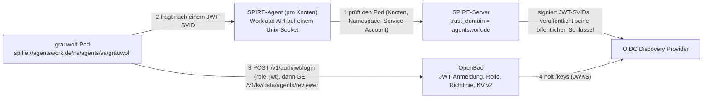

# 12 Zugangsdaten aus OpenBao mit SPIFFE

Die meisten Dienste, die ein Agent benutzt – Jira, Confluence, Git-Hosts, Modellanbieter –, wollen einen
API-Schlüssel oder ein Token. Üblicherweise steht er in einer Umgebungsvariable, also als langlebiges Geheimnis
im Image, im Manifest oder im Pod, lesbar für alles im Prozess. Dieses Kapitel zeigt die Alternative: Der Agent
weist mit seiner SPIFFE-Identität nach, **wer er ist**, und ein Geheimnis-Broker (OpenBao oder HashiCorp Vault)
gibt ihm nur die Zugangsdaten, die zu dieser Identität gehören.

Du brauchst dieses Kapitel, wenn du grauwolf in Kubernetes mit SPIRE und OpenBao betreibst. Ohne es ändert sich
nichts: Variablen kommen wie bisher aus der Umgebung.

## So greifen die Teile ineinander



| Teil | Was er tut | Was grauwolf damit macht |
|---|---|---|
| **SPIRE-Server und -Agent** | Geben jedem Workload eine Identität, eine SPIFFE-ID wie `spiffe://agentswork.de/ns/agents/sa/grauwolf`, nachdem sie den Workload geprüft haben (Node, Namespace, Service-Account). Die Identität kommt als kurzlebiges, signiertes Dokument; die JWT-Form (JWT-SVID) lebt 5 Minuten. | grauwolf liest `SPIFFE_ENDPOINT_SOCKET`, verbindet sich über diesen Unix-Socket mit der **Workload API** des Agenten und fragt nach einer JWT-SVID für eine Audience. Es hält selbst keinen Schlüssel und kein Geheimnis. |
| **ClusterSPIFFEID** (spire-controller-manager) | Die Registrierung: welche Pods (Label-Selektor) welche SPIFFE-ID (Vorlage) bekommen. | Nichts; sie sorgt dafür, dass die ID des Pods `…/ns/agents/sa/grauwolf` ist. |
| **SPIFFE-CSI-Treiber** (`csi.spiffe.io`) | Hängt den Socket des Agenten in den Pod ein. | Sein Mount-Pfad ist das, worauf `SPIFFE_ENDPOINT_SOCKET` zeigt. |
| **OIDC-Discovery-Provider** | Stellt die öffentlichen Schlüssel bereit, mit denen sich JWT-SVIDs prüfen lassen (`/keys`, ein JWKS), über HTTP. | Nichts direkt. OpenBao holt die Schlüssel von dort. |
| **OpenBao: JWT-Auth-Methode** | Nimmt ein JWT an, wenn seine Signatur gegen das JWKS stimmt und Audience und Subject zu einer **Rolle** passen. | grauwolf meldet sich mit `POST /v1/auth/<mount>/login {role, jwt}` an und hält das zurückgegebene Token nur im Speicher. |
| **OpenBao: Rolle und Policy** | Die Rolle bindet eine Audience und genau ein Subject (die SPIFFE-ID des Agenten) an eine Policy; die Policy erlaubt das Lesen bestimmter KV-Pfade. | Der Agent darf nur lesen, was seine Policy erlaubt. Ein anderer Agent hat eine andere ID, Rolle oder Policy. |
| **OpenBao: KV v2** | Speichert die Geheimnisse. | grauwolf liest `GET /v1/<mount>/data/<pfad>` und nimmt ein Feld. |

grauwolf gibt den Wert dann an denjenigen weiter, der nach der Variable gefragt hat – die Jira-Tools fragen nach
`ATLASSIAN_API_TOKEN`, der OpenAI-Anbieter nach `OPENAI_API_KEY` –, genau so, als stünde er in der Umgebung.
Werte werden im Speicher zwischengespeichert und nach `refresh` neu gelesen (standardmäßig 5 Minuten). Das
OpenBao-Token wird kurz vor seinem Ablauf und einmal nach einem `403` durch eine neue Anmeldung ersetzt (mit einer
neuen JWT-SVID).

## Die Trust Domain

Die **Trust Domain** (`agentswork.de` in diesem Kapitel) ist der Name des SPIFFE-Bereichs. Sie ist Teil jeder
SPIFFE-ID und muss überall, wo sie vorkommt, gleich sein:

| Wo | Einstellung |
|---|---|
| Konfiguration des SPIRE-Servers | `trust_domain` |
| Konfiguration des SPIRE-Agenten | `trust_domain` |
| `ClusterSPIFFEID` | die Vorlage nutzt `{{ .TrustDomain }}`, das SPIRE einsetzt – du schreibst sie nicht selbst |
| Konfiguration des OIDC-Discovery-Providers | `workload_api { trust_domain = … }` |
| OpenBao-Rolle | `bound_subject`, die vollständige SPIFFE-ID des Agenten: `spiffe://<trust domain>/ns/<namespace>/sa/<service account>` |
| JWT-Issuer | Setzt der SPIRE-Server `jwt_issuer`, verwenden Discovery-Provider und OpenBao-Auth-Methode (`bound_issuer`) denselben Wert; meist ist es ein Name unterhalb der Trust Domain |

grauwolf selbst braucht die Trust Domain nie: Es fragt die Workload API nach einem Token und reicht es weiter.
Der Ort, an dem es passen muss, ist `bound_subject`. Unterscheiden sich die Trust Domain in der SPIRE-Konfiguration
und die in der Rolle, lehnt OpenBao die Anmeldung mit einem `permission denied` ab, das die Rolle nennt. Das
Beispiel in `examples/spire-openbao/` liest die Trust Domain aus einer einzigen Variable, `TRUST_DOMAIN`, in
`env.sh`.

## SPIRE einrichten

Registrierung der Pods des Agenten: eine `ClusterSPIFFEID`, die sie über ein Label auswählt und die ID aus
Namespace und Service-Account bildet ([`examples/spire-openbao/manifests/20-grauwolf-clusterspiffeid.yaml`](../../examples/spire-openbao/manifests/20-grauwolf-clusterspiffeid.yaml)):

```yaml
apiVersion: spire.spiffe.io/v1alpha1
kind: ClusterSPIFFEID
metadata:
  name: grauwolf
spec:
  spiffeIDTemplate: "spiffe://{{ .TrustDomain }}/ns/{{ .PodMeta.Namespace }}/sa/{{ .PodSpec.ServiceAccountName }}"
  podSelector:
    matchLabels:
      app.kubernetes.io/name: grauwolf
  namespaceSelector:
    matchLabels:
      kubernetes.io/metadata.name: agents
```

Der Pod braucht den Socket des Agenten: Hänge das SPIFFE-CSI-Volume ein und zeige `SPIFFE_ENDPOINT_SOCKET` darauf:

```yaml
env:
  - name: SPIFFE_ENDPOINT_SOCKET
    value: unix:///spiffe-workload-api/agent.sock
volumeMounts:
  - { name: spiffe-workload-api, mountPath: /spiffe-workload-api, readOnly: true }
volumes:
  - name: spiffe-workload-api
    csi: { driver: csi.spiffe.io, readOnly: true }
```

Der Name der Socket-Datei ist das, was `socket_path` des SPIRE-Agenten sagt (im Beispiel `agent.sock`). Der
OIDC-Discovery-Provider ([`10-oidc-discovery-provider.yaml`](../../examples/spire-openbao/manifests/10-oidc-discovery-provider.yaml))
ist ein Deployment, das die Signaturschlüssel aus derselben Workload API liest und unter `/keys` ausliefert;
er ist selbst ein Workload und hat seine eigene `ClusterSPIFFEID`. Betreibe ihn in einem Namespace, den
spire-controller-manager nicht ausspart: Dessen `ignoreNamespaces` enthalten meist `spire-system`, und ein Pod
dort bekäme keine SPIFFE-ID, der Provider würde also keine Schlüssel liefern. Das Beispiel nutzt `spire-oidc`.

## OpenBao einrichten

Vier Dinge, alle in [`setup-openbao.sh`](../../examples/spire-openbao/setup-openbao.sh) (es nutzt die
`bao`-CLI):

1. **Die JWT-Auth-Methode**, der man sagt, wo die Schlüssel liegen:
   `bao auth enable -path=jwt jwt` und
   `bao write auth/jwt/config jwks_url=http://spire-oidc-discovery-provider.spire-oidc.svc/keys`.
2. **Eine Policy**, die das Lesen der Geheimnisse der Agenten erlaubt:
   ```hcl
   path "kv/data/agents/*" { capabilities = ["read"] }
   ```
3. **Eine Rolle**, die Audience und die SPIFFE-ID des Agenten an die Policy bindet:
   ```text
   bao write auth/jwt/role/grauwolf-agents \
     role_type=jwt user_claim=sub \
     bound_audiences=openbao \
     bound_subject=spiffe://agentswork.de/ns/agents/sa/grauwolf \
     token_policies=grauwolf-agents token_ttl=1h
   ```
   `bound_audiences` muss dem `audience` in der Konfiguration von grauwolf entsprechen; `bound_subject` ist die
   ID, die die `ClusterSPIFFEID` erzeugt. Mehrere Agenten, die dieselben Geheimnisse lesen dürfen, können sich
   eine Rolle über `bound_claims` mit einem Glob auf `sub` teilen; getrennte Rollen und Policies halten ihre
   Rechte auseinander.
4. **Das Geheimnis** in einem KV-v2-Mount: `bao kv put -mount=kv agents/reviewer jira=<token>`.

## grauwolf konfigurieren

Quellen für Zugangsdaten sind Deployment-Konfiguration, kein Teil der Spec (die Spec bleibt portabel).
Lege einen Abschnitt `[credentials]` in eine `grauwolf.toml` neben der Spec oder in die Datei, die
`GRAUWOLF_CREDENTIALS` nennt (diese hat Vorrang):

```toml
[credentials.openbao]
address = "https://openbao.internal:8200"
auth = { spiffe = { audience = "openbao", role = "grauwolf-agents", mount = "jwt" } }
# refresh = "5m"

[credentials.variables]
ATLASSIAN_API_TOKEN = "openbao:kv/agents/reviewer#jira"
OPENAI_API_KEY      = "file:/run/secrets/openai/api-key"
```

| Schlüssel | Bedeutung |
|---|---|
| `credentials.openbao.address` | Basisadresse von OpenBao (oder Vault). |
| `credentials.openbao.auth.spiffe.audience` | Audience der JWT-SVID; entspricht den `bound_audiences` der Rolle. |
| `credentials.openbao.auth.spiffe.role` | Die Rolle der JWT-Auth-Methode. |
| `credentials.openbao.auth.spiffe.mount` | Wo die JWT-Auth-Methode eingehängt ist; Standard `jwt`. |
| `credentials.openbao.refresh` | Intervall, nach dem Werte neu gelesen werden: `30s`, `5m`, `1h`; Standard `5m`. Gilt auch für `file:`-Quellen. |
| `credentials.variables.<NAME>` | Woher die Variable kommt. `openbao:<mount>/<pfad>#<feld>` ist ein Feld eines KV-v2-Geheimnisses (`vault:` ist ein Alias), `file:<pfad>` der Inhalt einer Datei ohne den abschließenden Zeilenumbruch (relative Pfade sind relativ zur Konfigurationsdatei). |

Regeln:

- Zugeordnet werden dürfen nur Variablen aus der [Tabelle der Umgebungsvariablen](referenz-cli.md#umgebungsvariablen).
  Variablen, die direkt aus der Prozessumgebung gelesen werden (`PATH`, `HOME`, `OTEL_EXPORTER_OTLP_*`,
  `SPIFFE_ENDPOINT_SOCKET`, …), können nicht aus einer Quelle kommen.
- Eine Variable, die zugeordnet **und** in der Umgebung gesetzt ist, ist ein Fehler: Es gibt keinen stillen Vorrang.
- Lässt sich eine Quelle beim Start nicht lesen – OpenBao ist nicht erreichbar, die Anmeldung wird abgelehnt, das
  Feld fehlt, die Datei ist weg –, bricht der Start mit einer Meldung ab, die Variable und Quelle nennt. Schlägt
  ein späteres Neulesen fehl, behält grauwolf den bisherigen Wert und meldet es auf stderr.
- Werte tauchen nie in Fehlern, Logs, Events oder Spans auf.
- Eine `grauwolf.toml` kann auch die Tool-Richtlinie (`[tool_packages]`) enthalten; die beiden Tabellen sind
  unabhängig.

Die Quellen gelten überall, wo Konfiguration gelesen wird: `spec run`, `chat`, `resume`, `mcp`, `serve` (auch
dessen Token und die Chat-API) und erzeugte Dienste (sie lesen `GRAUWOLF_CREDENTIALS`, sonst eine
`grauwolf.toml` in `GRAUWOLF_DATA_DIR`). Die Quellen brauchen das Cargo-Feature `credentials` (standardmäßig an);
ein Build ohne es lehnt einen Abschnitt `[credentials]` ab.

## Prüfen

`grauwolf credentials check` löst Variablen so auf, wie es ein Lauf täte, und zeigt je Variable in einer Zeile,
woher sie kam, nie den Wert. Nenne die Variablen oder nimm `--all` für jede im Abschnitt `[credentials]`
zugeordnete Variable; der Exit-Code ist 1, wenn eine fehlschlägt:

```text
$ grauwolf credentials check --all --config /etc/grauwolf/grauwolf.toml
resolved ATLASSIAN_API_TOKEN from openbao (41 bytes)
resolved GIT_TOKEN from openbao (30 bytes)
```

[`manifests/30-grauwolf-job.yaml`](../../examples/spire-openbao/manifests/30-grauwolf-job.yaml)
führt genau das in einem Job aus. Typische Fehler:

| Meldung | Ursache |
|---|---|
| `SPIFFE_ENDPOINT_SOCKET: is not set` | Das CSI-Volume oder die Variable fehlt im Pod. |
| `workload API at …: status 7: no identity issued` (`gave up after waiting 30s`) | Der Registrierungseintrag für den Pod fehlt oder ist noch nicht synchronisiert. Ein neuer Pod startet oft, bevor spire-controller-manager den Eintrag angelegt und der SPIRE-Agent ihn übernommen hat; grauwolf wartet daher bis zu `SPIFFE_FETCH_TIMEOUT` (Standard `30s`) mit wachsender Pause, und die Meldung oben erscheint erst danach. Bleibt sie bestehen, prüfe die Selektoren der `ClusterSPIFFEID` und ob der Namespace des Pods in den `ignoreNamespaces` des Controller-Managers steht. |
| `login as spiffe://…: login: HTTP 400: error validating token: invalid subject (sub) claim` | Das `bound_subject` der Rolle passt nicht zur SPIFFE-ID des Pods: Vergleiche Namespace, Service-Account und Trust Domain (die Meldung nennt die ID, die der Pod bekommen hat, z. B. `spiffe://agentswork.de/ns/agents/sa/default` bei einem Pod ohne eigenen Service-Account). |
| Der Pod wird abgewiesen (`runAsNonRoot` … cannot verify user is non-root) | Der Pod Security Standard `restricted` braucht ein numerisches `runAsUser` im `securityContext` des Pods; ein Benutzer des Images, der per Name angegeben ist, lässt sich nicht prüfen. Das Beispiel-Job setzt `65532`. |
| `login as spiffe://…: login: HTTP 400: … ` / `permission denied` | Die Rolle nimmt das Token nicht an: Audience, `bound_subject` (Trust Domain, Namespace, Service-Account) oder die JWKS-URL. |
| `read: HTTP 403` | Die Policy erlaubt den Pfad nicht: die Policy eines Agenten liest nur `kv/data/agents/<name>/*`. `grauwolf-k8-ops agent check` fügt einen Hinweis mit dem versuchten Pfad hinzu. |
| `credentials: X is mapped … and also set in the environment` | Entferne eines der beiden. |

## Das Beispiel

[`examples/spire-openbao/`](../../examples/spire-openbao/README.md) enthält die Manifeste und das Skript für einen
Live-Test auf einem Cluster mit SPIRE und OpenBao. Nichts davon wird für dich angewendet. Die Tests von grauwolf
selbst laufen ohne SPIRE und OpenBao: Tokens entstehen zur Testzeit, und OpenBao wird über HTTP nachgebildet.

## Grenzen dieser Stufe

- SPIFFE dient dazu, sich beim Geheimnis-Broker anzumelden. mTLS zwischen Agenten und zu MCP-Servern sowie die
  Prüfung der Identität von Aufrufern stehen in [ADR-0109](../adr/0109-workload-identity-with-spiffe.md); die Tools, die
  die Identität nutzen können (`fetch`, die Git-Tools, stdio-MCP-Server, `run_command`), stehen in
  [Kapitel 3](03-tools.md#fetch-mit-spiffe-fetchauth) und
  [Kapitel 8](08-externe-tools-und-agenten.md#einem-lokalen-server-die-identität-des-agenten-geben-workload_api) (ADR-0110).
- Nur Lesezugriffe auf KV v2. Dynamische Secrets-Engines (etwa kurzlebige GitHub-Tokens) werden noch nicht gelesen.
- Die Cert-Auth von OpenBao wird nicht unterstützt; die JWT-Auth-Methode ist der einzige Zugang.

Zu den Interna (die Crates, die Quellen für Zugangsdaten und wie du eine neue hinzufügst) siehe
[Entwicklerhandbuch, Kapitel 9](../entwickler/09-identitaet-zugangsdaten-und-cluster-werkzeug.md).
