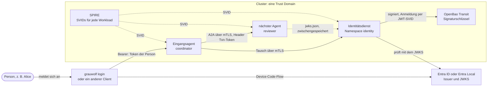
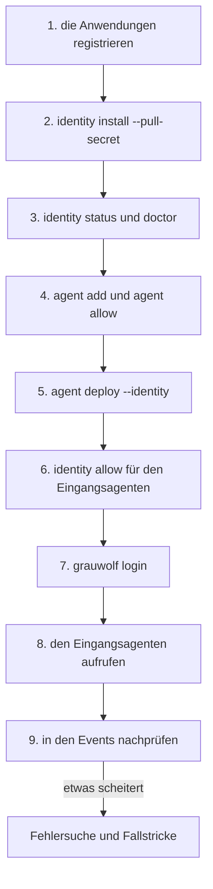
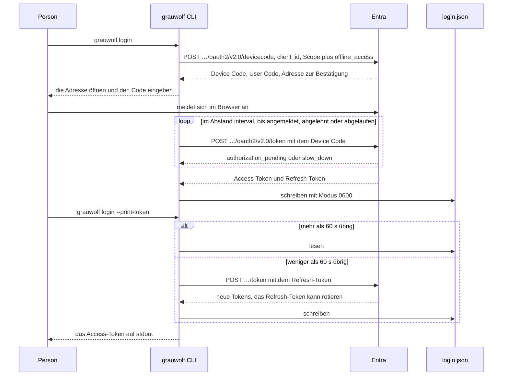
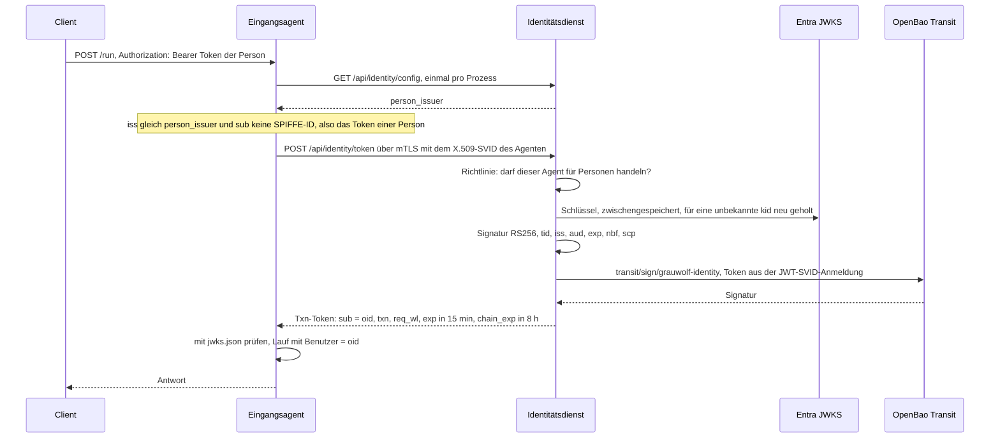
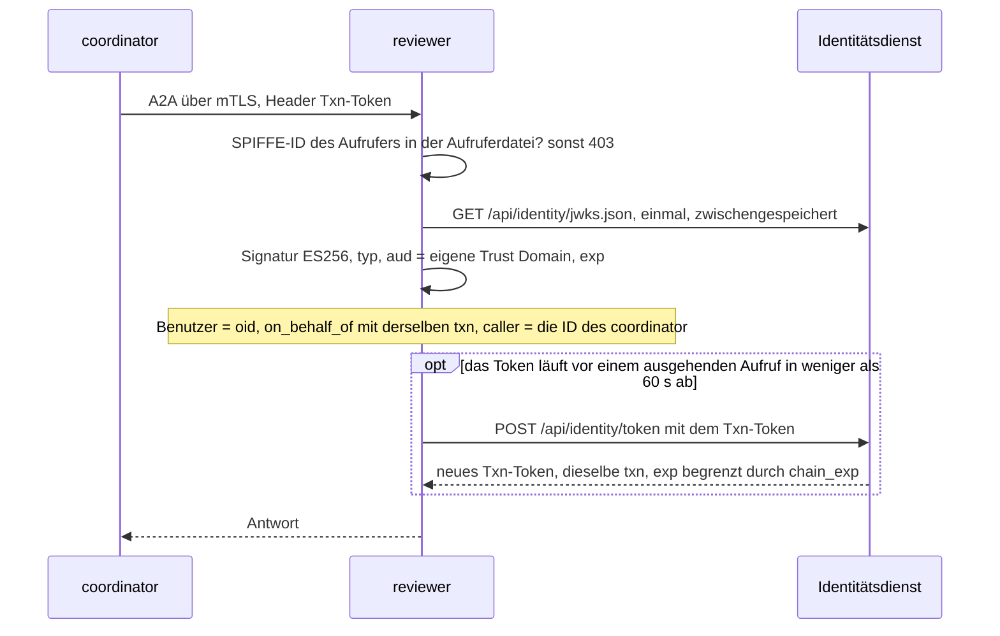
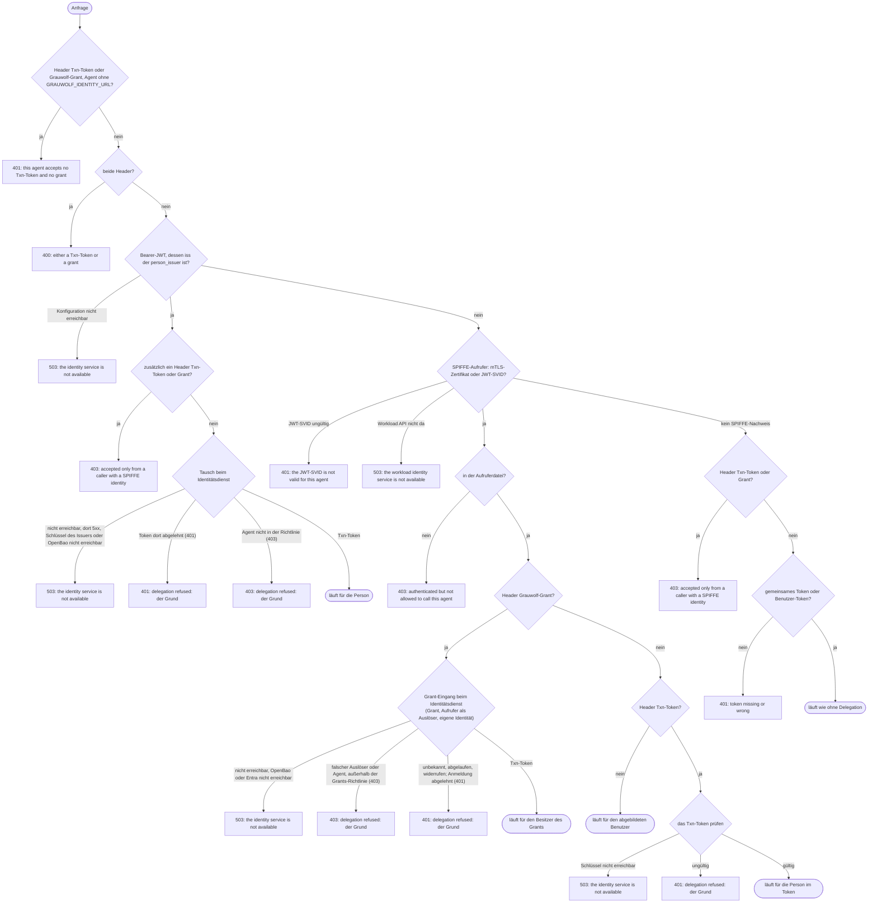
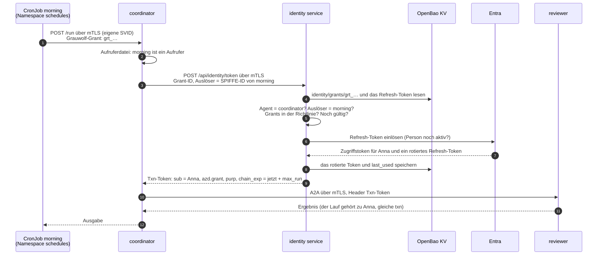

# 14 Im Auftrag von Personen handeln

Mit [Kapitel 12](12-zugangsdaten-aus-openbao.md) weiß ein Agent, **wer er ist**, und mit SPIFFE-Aufrufern
([Kapitel 9](09-betrieb.md#agenten-rufen-agenten-mit-spiffe)) weiß er, **welcher Agent** ihn aufruft. Er weiß
aber noch nicht, **für wen** die Agenten handeln. Dieses Kapitel schließt diese Lücke: was Delegation ist, was
du dafür brauchst, wie du sie Schritt für Schritt einrichtest, wie sie zur Laufzeit arbeitet und was zu tun
ist, wenn sie scheitert.

## Überblick

In einer Kette `Anna → coordinator → reviewer` sieht jeder Agent nur den vorherigen, und eine `user_id` im
Request-Body ist eine Angabe, nie ein Beweis: Wer aufrufen darf, kann jeden Namen hineinschreiben.

Delegation ([ADR-0111](../adr/0111-delegation-with-transaction-tokens.md)) macht "im Auftrag von Anna"
nachprüfbar. Anna meldet sich bei Entra ID an; am Eingang wird ihr Token gegen ein **Txn-Token** getauscht, ein
kurzlebiges Token, das der **Identitätsdienst** der Trust Domain signiert. Es reist unverändert mit jedem
internen Aufruf des Laufs, und jeder Agent prüft es zusammen mit der SPIFFE-Identität des Aufrufers. Die Person
darin wird zum Benutzer der Anfrage: Gespräche, Langzeitgedächtnis, Tools pro Benutzer und Freigaben gehören
Anna, und die Ereignisse nennen sie.

Du brauchst Delegation, wenn mehrere Agenten für Personen arbeiten und jeder Schritt – nachprüfbar – wissen
soll, wer gefragt hat: für das Audit, für Gedächtnis und Gespräche pro Person und für Freigaben, die nur die
Person geben darf. Ohne Identitätsdienst ändert sich nichts: Agenten handeln wie bisher mit ihren eigenen
Rechten.

Das ist Stufe 1 von ADR-0111 – Eingang, Prüfung und Weitergabe, am 2026-11-16 in einem k3s-Cluster mit Entra
Local live geprüft; die Fallstricke daraus stehen unter [Fehlersuche und Fallstricke](#fehlersuche-und-fallstricke) –
und Stufe 3: gespeicherte Grants für unbeaufsichtigte Läufe und Zeitpläne, die sie nutzen
([Unbeaufsichtigte Läufe](#unbeaufsichtigte-läufe-grants-und-zeitpläne)). Den Tausch des Txn-Tokens gegen Tokens
externer Systeme (Jira als Anna) bringt eine spätere Stufe ([Grenzen dieser Stufe](#grenzen-dieser-stufe)).

## Begriffe

| Begriff | Was es ist |
|---|---|
| **Token einer Person** | Ein Entra-Access-Token, das die Person bei der Anmeldung bekommen hat (hier: mit `grauwolf login`). Seine Audience (`aud`) ist die Application ID der "grauwolf identity API", sein Scope (`scp`) enthält `access_as_user`. Nur der Identitätsdienst prüft es. |
| **Txn-Token** | Ein JWT (ES256, JOSE-`typ` `txntoken+jwt`), signiert vom Identitätsdienst. `sub` ist die Entra-Objekt-ID der Person (`oid`), `aud` die Trust Domain, `txn` die ID der Kette, `req_wl` die SPIFFE-ID des Eingangsagenten. Es lebt 15 Minuten und lässt sich bis `chain_exp` erneuern, 8 Stunden nach dem Eingang. Es reist im Header `Txn-Token`. |
| **Identitätsdienst** | `grauwolf identity serve`, einer pro Trust Domain. Er tauscht Tokens von Personen gegen Txn-Tokens, erneuert sie und veröffentlicht die Schlüssel, die sie prüfen. Der Signaturschlüssel bleibt in OpenBao Transit. |
| **Eingangsagent** | Der Agent, den eine Person mit ihrem Token aufruft (`Authorization: Bearer`). Er tauscht das Token mit seiner eigenen Workload-Identität. Nur Eingangsagenten brauchen einen Eintrag in der Richtlinie. |
| **Schritt** | Ein Aufruf von einem Agenten zum nächsten (A2A, MCP über HTTP, `fetch` an einen Host mit `auth`). Er trägt das Txn-Token; das Ziel prüft es und läuft für die Person. |
| **Richtlinie** | Die Datei des Identitätsdienstes mit den Agenten (SPIFFE-IDs oder Präfixe), die Txn-Tokens im Auftrag von Personen anfordern dürfen: `identity allow` / `identity deny`. |
| **Aufruferdatei** | Die Liste jedes Agenten mit den SPIFFE-IDs, die ihn aufrufen dürfen (`agent allow`, [Kapitel 13](13-cluster-einrichten.md#agenten-sich-gegenseitig-aufrufen-lassen)). Ein Txn-Token wird nur von einem Aufrufer darin angenommen; Delegation fügt einem Aufruf eine Person hinzu, sie öffnet einen Agenten nie für neue Aufrufer. |

Die Teile und wer wem vertraut:



- Der **Identitätsdienst** vertraut der Signatur von Entra (Schlüssel aus dem JWKS des Issuers) und seiner
  eigenen Richtlinie.
- **Agenten** vertrauen dem Identitätsdienst: Sie sprechen mit ihrer SPIFFE-Identität mit ihm und prüfen
  Txn-Tokens mit seinen Schlüsseln.
- **Der nächste Agent** vertraut dem vorherigen nur, wenn die SPIFFE-ID des Aufrufers in seiner Aufruferdatei
  steht.
- **OpenBao** signiert nur für den Identitätsdienst: Seine Rolle ist an die SPIFFE-ID des Dienstes gebunden,
  und seine Policy erlaubt nichts außer dem Signieren mit einem Schlüssel und dem Lesen der öffentlichen
  Schlüssel.

## Voraussetzungen

| Voraussetzung | Wie du sie prüfst |
|---|---|
| Ein Cluster mit SPIRE (Server, Agents, spire-controller-manager), dem SPIFFE-CSI-Treiber und dem OIDC-Discovery-Provider ([Kapitel 13](13-cluster-einrichten.md#was-du-brauchst)) | `grauwolf-k8-ops doctor`: alle Zeilen ok |
| OpenBao initialisiert und entsiegelt, `grauwolf-k8-ops openbao setup` erledigt – und **nach jedem Update von `grauwolf-k8-ops` mit einem Admin-Token erneut ausgeführt**, damit die eingeschränkte Policy `grauwolf-k8-ops` den Transit-Mount und die Rolle `grauwolf-identity` abdeckt | `doctor`; sonst scheitert `identity install` mit dem eingeschränkten Token an einem Rechtefehler |
| Ein Identitätsanbieter: Entra ID oder Entra Local, mit den drei App-Registrierungen "grauwolf identity API", "grauwolf CLI" und "grauwolf identity service" ([Schritt 1](#1-die-anwendungen-registrieren)) | die IDs gibt `examples/delegation/entra-local-apps.sh` aus, oder das Azure-Portal zeigt sie |
| **Der Cluster erreicht den JWKS-Host des Issuers** aus einem Pod heraus: DNS löst ihn zu einer Adresse auf, die von den Pods aus erreichbar ist | ein Prüf-Pod (unten) bekommt das JWKS; siehe den Fallstrick [503 "the identity service is not available"](#503-the-identity-service-is-not-available) |
| Ein Image-Pull-Secret, wenn das grauwolf-Image aus einer Registry kommt, die Zugangsdaten verlangt | `kubectl get secret -n <namespace> <name>`; du gibst es als `--pull-secret <namespace>/<name>` mit |
| Die Agenten sind für Aufrufe zwischen Agenten mit SPIFFE eingerichtet ([Kapitel 13](13-cluster-einrichten.md#agenten-sich-gegenseitig-aufrufen-lassen)): `agent add`, `agent allow` und Einträge in `agent_tools` mit `auth.spiffe` auf dem mTLS-Port | ein Aufruf des coordinator mit seinem Server-Token erreicht den reviewer; `doctor` listet die Aufrufer |
| Das Modell-Backend ist von den Agenten aus erreichbar (z. B. `OLLAMA_HOST`) | `agent deploy` wartet auf `/health`; ein Testaufruf antwortet |

Um den JWKS-Host aus dem Cluster heraus zu prüfen, starte einen kurzen Prüf-Pod (die Adresse ist die
`jwks_uri`, die das Skript ausgibt oder die `/.well-known/openid-configuration` des Issuers nennt):

```sh
kubectl run jwks-probe --rm -i --restart=Never --image=curlimages/curl:8.11.1 -- \
  curl -sS -o /dev/null -w '%{http_code}\n' --max-time 10 <jwks_uri>
```

`200` ist gut. Ein Timeout heißt, dass die Adresse, die der Cluster für den Host auflöst, von den Pods aus
nicht erreichbar ist. Die eigenen Egress-Regeln des Identitätsdienstes sind eine zusätzliche Grenze (siehe den
Fallstrick).

## Schritt für Schritt: Einrichtung

Den ganzen Ablauf mit Entra Local zeigt auch [`examples/delegation/`](../../examples/delegation/README.md). Die
Werte unten sind die der Live-Prüfung; ersetze sie durch deine.



### 1. Die Anwendungen registrieren

Mit Entra Local führst du das Skript aus (die Admin-API von Entra Local ist nicht authentifiziert, siehe
[Entra Local und ein echtes Entra ID](#entra-local-und-ein-echtes-entra-id)):

```sh
cd examples/delegation
export BAO_ADDR=http://127.0.0.1:8200 BAO_TOKEN=...   # optional: speichert das Secret des Dienstes
./entra-local-apps.sh
```

Es legt die drei Anwendungen nur an, wenn sie fehlen, und gibt ihre IDs aus, danach einen Befehl
`identity install` und einen Befehl `grauwolf login` mit eingesetzten Werten:

```text
grauwolf identity API      <api id>  (api://grauwolf-identity, scope access_as_user)
grauwolf CLI               <cli id>
grauwolf identity service  <service id>
```

Mit einem echten Entra ID registrierst du dieselben drei Anwendungen im Azure-Portal
([unten](#entra-local-und-ein-echtes-entra-id)). In beiden Fällen gilt: **gib beide Audiences an: die Application ID
(eine GUID) der "grauwolf identity API" (das tragen v2.0-Tokens in `aud`) und ihre `api://…`-URI (v1.0-Tokens, der Token-Generator von Entra Local)**.

### 2. Den Identitätsdienst installieren

```sh
grauwolf-k8-ops identity install --image registry.example.com/grauwolf:<version> \
  --pull-secret default/registry \
  --tenant 11111111-1111-1111-1111-111111111111 \
  --issuer https://entra.agentswork.de/11111111-1111-1111-1111-111111111111/v2.0 \
  --audience <api id> --audience api://grauwolf-identity \
  --jwks-url <jwks_uri aus der Ausgabe des Skripts>
```

Lass `--pull-secret` weg, wenn das Image öffentlich ist, und `--jwks-url` bei einem echten Entra ID (die
Schlüssel kommen dann aus der OpenID-Discovery des Issuers). Der Befehl gibt eine Zeile pro Objekt aus
(`created`, `updated`, `unchanged`), wartet auf den Rollout und endet mit:

```text
identity service: ready, /health answers ok
mTLS endpoint https://grauwolf-identity.identity.svc:8443 (agents: `grauwolf-k8-ops agent deploy <agent> --identity`)
keys http://grauwolf-identity.identity.svc:8080/api/identity/jwks.json
no agent may act on behalf of people yet: `grauwolf-k8-ops identity allow <agent>`
```

Was er anlegt, steht unter [Im Cluster mit grauwolf-k8-ops](#im-cluster-mit-grauwolf-k8-ops).

### 3. Prüfen

```sh
grauwolf-k8-ops identity status
grauwolf-k8-ops doctor
```

`identity status` muss `installed, ready` sagen und die SPIFFE-ID
`spiffe://<trust domain>/ns/identity/sa/grauwolf-identity`, die Einstellungen, die Richtlinie (bisher
`0 caller(s)`) und `OpenBao role grauwolf-identity: exists, policy grauwolf-identity: exists, Transit key
transit/keys/grauwolf-identity: …` zeigen. `doctor` hat eine Zeile `identity service`.

### 4. Die Agenten anlegen und einander aufrufen lassen

```sh
grauwolf-k8-ops agent add coordinator
grauwolf-k8-ops agent add reviewer
grauwolf-k8-ops agent allow reviewer --from coordinator
```

Die Spec des coordinator ruft den reviewer auf dem mTLS-Port mit `auth.spiffe` auf, wie in
[Kapitel 13](13-cluster-einrichten.md#durchgang-coordinator-ruft-reviewer-auf)
([`13-koordinator.json`](beispiele/13-koordinator.json)). Ohne `auth.spiffe` wird das Txn-Token nicht
weitergegeben.

### 5. Die Agenten mit `--identity` ausrollen

Zuerst das Ziel, dann den Aufrufer:

```sh
grauwolf-k8-ops agent deploy reviewer --image registry.example.com/grauwolf:<version> \
  --spec docs/handbuch/beispiele/13-pruefer.json \
  --env OLLAMA_HOST=http://ollama.ollama.svc:11434 --identity --events
grauwolf-k8-ops agent deploy coordinator --image registry.example.com/grauwolf:<version> \
  --spec docs/handbuch/beispiele/13-koordinator.json \
  --env OLLAMA_HOST=http://ollama.ollama.svc:11434 --identity --events --host coordinator.example.com
```

`--identity` setzt `GRAUWOLF_IDENTITY_URL` und `GRAUWOLF_IDENTITY_SPIFFE_ID`; `--events` schreibt die
Events für Schritt 9 ins Pod-Log; `--host` legt einen Ingress für den Aufruf der Person an. `agent status
coordinator` zeigt dann `identity: on (https://grauwolf-identity.identity.svc:8443)`.

### 6. Den Eingangsagenten erlauben

```sh
grauwolf-k8-ops identity allow coordinator
```

```text
identity service allows spiffe://agentswork.de/ns/coordinator/sa/coordinator to act on behalf of people (purposes: any): created
```

Nur der Eingangsagent braucht das: `reviewer` prüft und erneuert nur. Die Änderung erreicht den laufenden
Dienst nach etwa einer Minute (siehe [Die Richtlinie ändern](#die-richtlinie-ändern)).

### 7. Anmelden

```sh
grauwolf login --authority https://entra.agentswork.de \
  --tenant 11111111-1111-1111-1111-111111111111 \
  --client-id <cli id> --scope api://grauwolf-identity/access_as_user
```

Es gibt eine Adresse und einen Code aus (`To sign in, open … in a browser and enter the code ….`); melde
dich dort an, z. B. als `alice@entralocal.dev`. Es endet mit `logged in as … at tenant …; tokens cached in
…/login.json`. `grauwolf login --status` zeigt, wer angemeldet ist und wie lange das Token gilt.

### 8. Den Eingangsagenten aufrufen

```sh
curl -sS https://coordinator.example.com/run \
  -H "Authorization: Bearer $(grauwolf login --print-token)" \
  -H 'content-type: application/json' -d '{"input": "Review: the sky is green."}'
```

Rufe über den Ingress auf (oder aus dem Cluster heraus), **nicht über `kubectl proxy`**: Der Proxy des
API-Servers entfernt den Header `Authorization`
([Fallstrick](#401-token-missing-or-wrong-über-kubectl-proxy)). Die Antwort ist das `{ "output": … }` des
coordinator.

### 9. Nachprüfen

```sh
grauwolf-k8-ops agent logs coordinator --events-only
grauwolf-k8-ops agent logs reviewer --events-only
```

Schau dir die Zeilen `agent_starting` an:

- in `coordinator`: `on_behalf_of` mit Alices `oid` und einer `txn`, und kein `caller` (Alice hat mit ihrem
  eigenen Token aufgerufen);
- in `reviewer`: dasselbe `on_behalf_of` mit **derselben `txn`**, und `caller`
  `spiffe://agentswork.de/ns/coordinator/sa/coordinator`.

```json
{"event":"agent_starting","input":"…","caller":"spiffe://agentswork.de/ns/coordinator/sa/coordinator","on_behalf_of":{"oid":"<alices oid>","txn":"<in jedem Agenten dieselbe>"}}
```

`name` und `upn` erscheinen nur, wenn das Token der Person sie trägt (ein echtes Entra ID tut das, Entra
Local nicht). Gegenproben: Ohne Token bekommt der Aufruf `401`; nach `identity deny coordinator` (und einer
Minute) bekommt Alices Aufruf `403` mit "delegation refused: …" im Body.

## Der Ablauf zur Laufzeit

### Die Anmeldung



### Der Eingang



Der Agent wählt den Weg nur anhand ungeprüfter Claims; geprüft wird das Token vom Identitätsdienst. Die
Richtlinie wird zuerst gefragt: Ein Agent außerhalb wird abgelehnt, bevor das Token der Person angesehen wird.

### Ein Schritt zum nächsten Agenten



Jede Workload der Trust Domain des Tokens darf erneuern; die Richtlinie wird nur am Eingang gefragt. Eine
gescheiterte Erneuerung lässt den ausgehenden Aufruf mit ihrem Grund scheitern.

### Was der Agent antwortet

Die Entscheidungen eines Agenten mit Identitätsdienst, in der Reihenfolge, in der der Code sie trifft:



| Anfrage | Antwort |
|---|---|
| Token einer Person, vom Identitätsdienst angenommen | Der Lauf handelt für die Person |
| Token einer Person, vom Identitätsdienst abgelehnt (Signatur, Tenant, Audience, Scope, Ablauf) | `401` `delegation refused: the identity service refused the token (… ): <reason>` |
| Token einer Person, aber der Agent steht nicht in der Richtlinie des Identitätsdienstes | `403` `delegation refused: the identity service refused the token (403 Forbidden): <reason>` |
| Token einer Person, Identitätsdienst oder Schlüssel des Issuers nicht erreichbar | `503` `the identity service is not available` |
| Ein JWT eines anderen Issuers (z. B. eines anderen Tenants) | nicht als Token einer Person erkannt: als JWT-SVID behandelt, `401` `the JWT-SVID is not valid for this agent` |
| `Txn-Token` von einem abgebildeten SPIFFE-Aufrufer, gültig | Der Lauf handelt für die Person im Token |
| `Txn-Token` verändert, abgelaufen, für eine andere Trust Domain, mit einem anderen Schlüssel signiert | `401` `delegation refused: Txn-Token …` |
| `Txn-Token` von einem Aufrufer ohne SPIFFE-Identität (gemeinsames Token, Benutzer-Token, anonym, Token einer Person) | `403` |
| `Txn-Token` von einer nicht abgebildeten SPIFFE-ID | `403` (wie ohne Token) |
| `Txn-Token` an einen Agenten ohne `GRAUWOLF_IDENTITY_URL` | `401` |
| `Grauwolf-Grant` von einem abgebildeten SPIFFE-Aufrufer | siehe [Was ein Grant-Lauf zur Antwort bekommt](#was-ein-grant-lauf-zur-antwort-bekommt) |

Ein `403` der Richtlinie des Identitätsdienstes kommt beim Aufrufer als `403` des Agenten an (das Token einer abgelehnten Person bleibt `401`); der Body nennt den
Grund (`… may not request tokens on behalf of people`). `gw_`-Benutzer-Tokens ([Kapitel 9](09-betrieb.md))
funktionieren in Umgebungen ohne Entra weiter; sie erzeugen nie ein Txn-Token.

**Freigaben** eines delegierten Laufs gehören der Person: Der coordinator kann einen Tool-Aufruf nicht
freigeben, zu dem der reviewer Anna fragt. Anna gibt mit ihrem eigenen Entra-Token unter
`POST /approvals/{id}` des fragenden Agenten frei.

## Wohin das Txn-Token geht

Das Token hängt automatisch an internen ausgehenden Aufrufen, und nur an Aufrufen mit Workload-Identität:

| Aufruf | Trägt das `Txn-Token`, wenn … |
|---|---|
| `agent_tools` über A2A | der entfernte Agent `auth.spiffe` hat |
| MCP-Server über HTTP (Streamable HTTP und HTTP+SSE) | der Server `auth.spiffe` hat |
| `fetch` | der Host einen Eintrag in `builtin_tools.fetch.auth` hat; nie an andere Hosts, nach jeder Weiterleitung neu geprüft |
| Lokale Unteragenten (Knoten `agent` und `for_each`, lokale `agent_tools`) | immer: Sie laufen im selben Prozess und im selben Lauf |

Ein Aufruf an einen externen Host trägt es nie. Tools an der Grenze (Jira, Confluence, git) benutzen in
Stufe 1 ihre eigenen Zugangsdaten. Das Txn-Token erreicht nie das Modell, die Logs oder die Ereignisse.

## Der Identitätsdienst

`grauwolf identity serve` läuft einmal pro Trust Domain als eigenes Deployment aus dem CLI-Image
([CLI-Referenz](referenz-cli.md#grauwolf-identity-serve)). Er braucht eine Workload-Identität
(`SPIFFE_ENDPOINT_SOCKET`) und bietet:

| Endpunkt | Wer | Zweck |
|---|---|---|
| `POST /api/identity/token` | Workloads (mTLS-Port oder ein JWT-SVID für seine SPIFFE-ID) | Eingang (Token einer Person), Grant-Läufe (eine Grant-ID und der Auslöser) und Erneuerung (ein Txn-Token) |
| `POST /api/identity/grants` | Personen (Entra-Access-Token als Bearer) | einen Grant anlegen (mit dem Refresh-Token einer eigenen Anmeldung); `201` mit dem Grant |
| `GET /api/identity/grants` | Personen | die eigenen Grants, nie ein Token |
| `DELETE /api/identity/grants/{id}` | Personen | einen eigenen Grant widerrufen: `204`; `404` für einen unbekannten Grant oder den einer anderen Person |
| `GET /api/identity/jwks.json` | öffentlich | die Schlüssel, die Txn-Tokens prüfen |
| `GET /api/identity/config` | öffentlich | `issuer`, `trust_domain`, `person_issuer` |
| `GET /health` | öffentlich | `ok` |

Der Signaturschlüssel bleibt in **OpenBao Transit** (ein `ecdsa-p256`-Schlüssel); der Dienst meldet sich mit
seinem JWT-SVID bei OpenBao an und hält den Schlüssel nie selbst. Seine Konfiguration:

```sh
GRAUWOLF_IDENTITY_TENANT=11111111-1111-1111-1111-111111111111
GRAUWOLF_IDENTITY_ISSUER=https://entra.agentswork.de/11111111-1111-1111-1111-111111111111/v2.0
GRAUWOLF_IDENTITY_AUDIENCE=22222222-2222-2222-2222-222222222222,api://grauwolf-identity   # Application ID und URI der API, kommagetrennt
GRAUWOLF_IDENTITY_PUBLIC_URL=https://grauwolf-identity.identity.svc:8443   # iss der Txn-Tokens
GRAUWOLF_IDENTITY_POLICY=/etc/grauwolf/identity-policy.json
GRAUWOLF_IDENTITY_TRANSIT_KEY=grauwolf-identity
GRAUWOLF_IDENTITY_OPENBAO_ADDR=https://openbao.openbao.svc:8200
GRAUWOLF_IDENTITY_OPENBAO_ROLE=grauwolf-identity
```

Alle Variablen und ihre Standardwerte stehen in der [CLI-Referenz](referenz-cli.md#umgebungsvariablen).

### Die Richtlinie

Die Richtliniendatei sagt, welche Agenten Txn-Tokens im Auftrag von Personen anfordern dürfen – die Agenten am
Eingang. Sie wird beim Start gelesen und alle 2 Sekunden auf Änderungen geprüft; eine kaputte neue Datei lässt
die alte gelten (das Log sagt `policy not reloaded, keeping the old one`).

```json
{ "callers": {
    "spiffe://agentswork.de/ns/coordinator/sa/coordinator": { "purposes": ["review"] },
    "spiffe://agentswork.de/ns/frontends/*": {}
} }
```

Der Abschnitt `grants` (optional) sagt, welche Einstiegsagenten auf Grants laufen dürfen, mit welchen Zwecken,
und welche Workloads solche Läufe starten dürfen:

```json
{ "callers": { … },
  "grants": {
    "agents": { "spiffe://agentswork.de/ns/coordinator/sa/coordinator": { "purposes": ["review"] } },
    "triggers": ["spiffe://agentswork.de/ns/schedules/*"]
} }
```

Er wird beim Anlegen eines Grants und bei jedem Lauf erneut geprüft; ein entfernter Eintrag stoppt bestehende
Grants also sofort. Jeder Zweck eines Grants muss in der Liste seines Agenten stehen (keine Liste: jeder Zweck).

Eine genaue ID gewinnt vor einem Präfix (`…/*`, ganze Pfadteile), das längste Präfix vor kürzeren. Ein Eintrag
ohne `purposes` erlaubt jeden Zweck; mit einer Liste muss ein angefragter Zweck darin stehen. Bei einem
interaktiven Eingang sendet ein Agent keinen Zweck, eine Liste in `callers` schränkt also noch nichts ein;
Grant-Läufe tragen die Zwecke des Grants. Ein Agent außerhalb der Richtlinie
bekommt vom Identitätsdienst `403`, was der Agent am Eingang als `403` weitergibt. Agenten weiter hinten in der
Kette brauchen keinen Eintrag: Sie prüfen und erneuern nur. Einzelheiten:
[Konfigurationsreferenz](referenz-konfiguration.md#die-richtliniendatei-des-identitätsdienstes).

## Was Agenten brauchen

Ein Agent nimmt mit zwei Variablen an der Delegation teil, neben seinen SPIFFE-Einstellungen:

| Variable | Bedeutung |
|---|---|
| `GRAUWOLF_IDENTITY_URL` | Der Identitätsdienst. `https://` heißt mTLS mit dem X.509-SVID des Agenten; `http://` heißt ein JWT-SVID als Bearer |
| `GRAUWOLF_IDENTITY_SPIFFE_ID` | Die SPIFFE-ID des Dienstes: über `https://` geprüft (Standard: jede ID der eigenen Trust Domain), über `http://` die Audience des JWT-SVID (dort Pflicht) |

`GRAUWOLF_IDENTITY_URL` braucht `GRAUWOLF_SPIFFE`: Ein Txn-Token wird nur von SPIFFE-Aufrufern angenommen, und
der Agent spricht mit seiner eigenen Identität mit dem Identitätsdienst. Ohne `GRAUWOLF_SPIFFE` scheitert der
Start mit `GRAUWOLF_IDENTITY_URL needs GRAUWOLF_SPIFFE`, in `spec serve` wie in erzeugten Diensten.

```sh
GRAUWOLF_SPIFFE=1
GRAUWOLF_SPIFFE_USERS=/etc/grauwolf/callers.json     # hier ist der coordinator abgebildet
GRAUWOLF_IDENTITY_URL=https://grauwolf-identity.identity.svc:8443
GRAUWOLF_IDENTITY_SPIFFE_ID=spiffe://agentswork.de/ns/identity/sa/grauwolf-identity
grauwolf spec serve reviewer.json --addr 0.0.0.0:8080
```

## Im Cluster mit grauwolf-k8-ops

`grauwolf-k8-ops` ([Kapitel 13](13-cluster-einrichten.md)) richtet all das ein, wie in den
[Schritten oben](#schritt-für-schritt-einrichtung). `identity install` legt wiederholbar an:

| Wo | Was |
|---|---|
| Namespace `identity` | eingeschränkter Pod Security Standard, Label `grauwolf.io/component=identity` (er ist kein Agent) |
| SPIRE | `ClusterSPIFFEID grauwolf-identity`: der Dienst ist `spiffe://<trust domain>/ns/identity/sa/grauwolf-identity` |
| Service-Account `grauwolf-identity` | mit `--pull-secret <namespace>/<name>` wird das Secret in den Namespace `identity` kopiert und an ihn gehängt; ein gleiches Secret, das schon da ist (z. B. von Kyverno geklont), bleibt unberührt |
| Deployment und Service `grauwolf-identity` | das CLI-Image mit `grauwolf identity serve`, HTTP-Port 8080 (Health, Schlüssel, Konfiguration) und mTLS-Port 8443; jede Einstellung als `GRAUWOLF_IDENTITY_*`-Variable |
| ConfigMap `grauwolf-identity-policy` | die Richtlinie (`policy.json`), als Verzeichnis eingehängt und nicht Teil des Pod-Hashes: Eine Änderung gilt ohne Neustart, sobald das Kubelet sie synchronisiert hat (etwa 60–90 s) |
| NetworkPolicies | `grauwolf-identity-ingress`: der mTLS-Port nur aus Namespaces mit dem Label `grauwolf.io/agent`, der HTTP-Port von überall; `grauwolf-egress`: DNS, OpenBao und der Schlüssel-Host (`--jwks-url`, sonst der Issuer) – ein externer Hostname nur nach Port, zu allen Adressen außerhalb der Cluster-Bereiche (`--cluster-cidr`) |
| OpenBao | der Mount `transit/`, der Schlüssel `grauwolf-identity` (`ecdsa-p256`, `--transit-key`; angelegt, wenn er fehlt, nie ersetzt oder rotiert), eine Policy, die nur mit ihm signieren und seine öffentlichen Schlüssel lesen darf, und eine JWT-Rolle, die an die SPIFFE-ID des Dienstes gebunden ist |

Seine Optionen: `--tenant`, `--issuer`, `--audience` (mehrfach möglich), `--image` (Pflicht), `--pull-secret`, `--jwks-url`
(Standard: die OpenID-Discovery des Issuers), `--scope` (Standard `access_as_user`), `--public-url` (`iss` der
Txn-Tokens; Standard die mTLS-URL im Cluster), `--policy <datei>` (ersetzt die Richtlinie; ohne sie bleibt sie,
wie sie ist), `--transit-key`, `--port`, `--mtls-port`, `--cluster-cidr`, `--egress-dns-namespace`,
`--egress-dns-selector`, `--timeout` ([CLI-Referenz](referenz-cli.md)).

`agent deploy --identity` setzt `GRAUWOLF_IDENTITY_URL` (`https://grauwolf-identity.identity.svc:8443`)
und `GRAUWOLF_IDENTITY_SPIFFE_ID`; ohne installierten Identitätsdienst lehnt es ab, und `--env` darf keine der
beiden Variablen setzen. Ein bereitgestellter Agent läuft immer mit SPIFFE, die Regel
"`GRAUWOLF_IDENTITY_URL` braucht `GRAUWOLF_SPIFFE`" ist also von selbst erfüllt. Mit `--egress` ist der
Identitätsdienst ein erlaubtes Ziel. `agent status` zeigt `identity: on (<url>)`; `agent check` und `doctor`
melden, wenn ein Agent den Dienst benutzt und er fehlt oder nicht bereit ist.

`identity allow <agent> [--purpose <zweck>]…` trägt den Agenten in die Richtlinie des Dienstes ein (ohne
`--purpose`: jeder Zweck; der Agent muss existieren), `identity deny <agent>` nimmt ihn wieder heraus (auch die
Einträge eines Agenten, den es nicht mehr gibt).

## Anmelden auf der Kommandozeile: `grauwolf login`

```sh
grauwolf login --authority https://entra.agentswork.de \
  --tenant 11111111-1111-1111-1111-111111111111 \
  --client-id <Application ID des grauwolf CLI> --scope api://grauwolf-identity/access_as_user
```

`grauwolf login` benutzt den Device-Code-Flow: Es gibt eine Adresse und einen Code aus, du meldest dich im
Browser an, und es wartet, bis die Anmeldung fertig ist (oder der Code abläuft). Die Tokens – das
Access-Token und, weil `offline_access` immer angefragt wird, ein Refresh-Token – liegen in
`<config dir>/login.json` mit Modus 0600 (Config-Verzeichnis: `--config-dir`, `GRAUWOLF_CONFIG_DIR`,
`$XDG_CONFIG_HOME/grauwolf`, `~/.config/grauwolf`). Die Einstellungen kommen aus den Flags, sonst aus
`GRAUWOLF_LOGIN_TENANT`, `GRAUWOLF_LOGIN_AUTHORITY`, `GRAUWOLF_LOGIN_CLIENT_ID`,
`GRAUWOLF_LOGIN_SCOPE`, sonst aus der letzten Anmeldung; die Authority ist standardmäßig
`https://login.microsoftonline.com`. Die Endpunkte sind `<authority>/<tenant>/oauth2/v2.0/devicecode` und
`…/token`.

| Befehl | Was er tut |
|---|---|
| `grauwolf login --status` | wer angemeldet ist (Name, upn, `oid`), der Tenant, wie lange das Access-Token gilt, ob es ein Refresh-Token gibt; Exit-Code 1, wenn niemand angemeldet ist |
| `grauwolf login --print-token` | nur das Access-Token auf stdout, vorher erneuert, wenn weniger als eine Minute übrig ist |
| `grauwolf logout` | löscht den Cache |

Kein Befehl der CLI ruft einen Agenten auf, also gibst du das Token selbst mit, wie in
[Schritt 8](#8-den-eingangsagenten-aufrufen).

## Unbeaufsichtigte Läufe: Grants und Zeitpläne

Ein Zeitplan startet einen Agenten nachts oder jeden Morgen, wenn niemand angemeldet ist. Um für Anna
zu handeln, braucht er ihre Erlaubnis im Voraus: einen **Grant**. Anna legt ihn einmal an; der Zeitplan
schickt danach nur die ID des Grants (`Grauwolf-Grant: grt_…`), und der Identitätsdienst macht daraus ein
Txn-Token für Anna. Jeder Lauf prüft erneut, dass Anna noch aktiv ist und noch zustimmt.

| Ein Grant enthält | Bedeutung |
|---|---|
| `id` | `grt_` und 32 Hex-Ziffern |
| `owner` | Annas `oid`, mit `name` und `upn`, wenn bekannt |
| `agent` | die SPIFFE-ID des Eingangsagenten, an dem die Läufe beginnen |
| `trigger` | die SPIFFE-ID der Workload, die Läufe starten darf, z. B. `spiffe://<td>/ns/schedules/sa/morning` |
| `purposes` | wofür die Läufe da sind; sie werden zum `purp` des Txn-Tokens |
| `valid_until` | Standard 30 Tage, höchstens 90 |
| `max_run` | wie lange ein Lauf höchstens dauern darf, Standard 4 h (höchstens die 8 h des Dienstes); er wird zum `chain_exp` der Kette |
| `created`, `last_used` | Unix-Sekunden |

Das Refresh-Token wird getrennt vom Grant gehalten und verlässt den Identitätsdienst nie.

### Ein unbeaufsichtigter Lauf



Der Identitätsdienst schreibt für jede Nutzung eine Zeile ins Log:
`grauwolf identity: grant grt_… used: oid=… trigger=spiffe://…/sa/morning agent=spiffe://…/sa/coordinator txn=…`.
`agent_starting` nennt den Grant in `on_behalf_of.grant` (im Span des Agenten als `grauwolf.grant`), damit
sich ein Lauf auf einem Grant von einem interaktiven Lauf unterscheiden lässt.

### Schritt für Schritt

1. **Grants im Identitätsdienst aktivieren.** Grants brauchen den öffentlichen Client, dessen
   Refresh-Tokens sie halten: „grauwolf CLI“, derselbe wie bei `grauwolf login`:

   ```sh
   grauwolf-k8-ops identity install … --grant-client-id <cli id>
   ```

   Der Dienst erhält `GRAUWOLF_IDENTITY_GRANT_CLIENT_ID` und den KV-Mount; seine OpenBao-Richtlinie darf
   genau `<kv>/identity/grants/` und `<kv>/identity/grant-tokens/` nutzen. Führe `openbao setup` nach einem
   Update von `grauwolf-k8-ops` mit einem Admin-Token erneut aus, damit dessen eigene Richtlinie Grants für
   `identity grants` lesen kann.

2. **Den Eingangsagenten und den Auslöser erlauben** im Abschnitt `grants` der Richtlinie:

   ```sh
   grauwolf-k8-ops identity allow coordinator --grants --purpose review
   grauwolf-k8-ops identity allow --trigger morning      # spiffe://<td>/ns/schedules/sa/morning
   ```

3. **Anna legt den Grant an.** Sie ist angemeldet (`grauwolf login --identity-url
   https://identity.example.org`, die öffentliche URL des Identitätsdienstes):

   ```sh
   grauwolf identity grant create \
     --agent spiffe://agentswork.de/ns/coordinator/sa/coordinator \
     --trigger spiffe://agentswork.de/ns/schedules/sa/morning \
     --purpose review --valid 30d --max-run 4h
   ```

   Der Befehl fragt nach einer **zweiten Anmeldung per Gerätecode**: Der Grant bekommt eine eigene
   Token-Familie mit `offline_access`, getrennt vom Anmelde-Cache. Die CLI schickt dieses Refresh-Token
   einmal an den Identitätsdienst (mit Annas Access-Token als Autorisierung) und behält keine Kopie; der
   Dienst löst es einmal ein, um zu prüfen, dass es Anna gehört, und lehnt einen Grant außerhalb der
   Richtlinie ab.

   ```text
   grant grt_5f0c… created
     agent:     spiffe://agentswork.de/ns/coordinator/sa/coordinator
     trigger:   spiffe://agentswork.de/ns/schedules/sa/morning
     purposes:  review
     valid to:  2026-12-16 08:12 UTC
     max run:   4 h
   ```

4. **Den Zeitplan anlegen:**

   ```sh
   grauwolf-k8-ops schedule add morning --agent coordinator --grant grt_5f0c… \
     --cron "0 7 * * 1-5" --input "Summarize the night." \
     --image registry.example.org/grauwolf:latest --pull-secret default/registry
   ```

   Er legt den Namespace `schedules` (restricted) an, das Dienstkonto `morning` mit eigener
   `ClusterSPIFFEID` (`spiffe://<td>/ns/schedules/sa/morning`), eine NetworkPolicy, die den Pods nur DNS
   und den mTLS-Port des Agenten erlaubt, und den CronJob, der
   `grauwolf call https://coordinator.coordinator.svc:8443/run --spiffe-id <coordinator> --grant grt_… --input …`
   mit dem SPIFFE-CSI-Volume ausführt. Der Coordinator nimmt `morning` als Aufrufer auf (Aufruferdatei und
   NetworkPolicy seines mTLS-Ports), so wie `agent allow` es tut. Die Ausgabe nennt, was der Richtlinie des
   Identitätsdienstes noch fehlt.

5. **Ausprobieren**, ohne auf die nächste Cron-Zeit zu warten, und beobachten:

   ```sh
   grauwolf-k8-ops schedule run-now morning
   kubectl -n schedules logs job/morning-manual-<n>
   kubectl -n identity logs deploy/grauwolf-identity | grep "grant grt_5f0c"
   ```

6. **Verwalten:** `grauwolf identity grant list` und `grauwolf identity grant revoke grt_…` (Anna, ihre
   eigenen Grants); `grauwolf-k8-ops identity grants [--revoke grt_…]` (Admins, alle Grants, nie ein
   Token); `grauwolf-k8-ops schedule list | remove <name>`.

### Was ein Grant-Lauf zur Antwort bekommt

| Situation | Antwort am Agenten |
|---|---|
| Der Auslöser ist der des Grants, der Agent der des Grants, beide in der Richtlinie, der Grant gültig, Anna aktiv | der Lauf handelt für Anna |
| Ein anderer Auslöser (auch einer in der Aufruferdatei), ein anderer Agent oder ein Agent oder Zweck außerhalb von `grants` in der Richtlinie | `403` `delegation refused: …` |
| Unbekannter, abgelaufener oder widerrufener Grant; das Refresh-Token abgelehnt (Person deaktiviert, Zustimmung widerrufen) | `401` `delegation refused: …` |
| Identitätsdienst, OpenBao oder Entra nicht erreichbar | `503` `the identity service is not available` |
| `Grauwolf-Grant` von einem Aufrufer ohne SPIFFE-Identität (gemeinsames Token, Benutzer-Token, Token einer Person) | `403` |
| `Grauwolf-Grant` von einer nicht abgebildeten SPIFFE-ID | `403` (nicht in der Aufruferdatei) |
| `Grauwolf-Grant` und `Txn-Token` zusammen | `400` |
| `Grauwolf-Grant` an einen Agenten ohne `GRAUWOLF_IDENTITY_URL` | `401` |

`grauwolf call` endet mit 0, wenn der Lauf geantwortet hat, mit 3, wenn er abgelehnt wurde (`401`/`403`),
und mit 1 bei allem anderen. So zeigt sich ein fehlgeschlagener CronJob-Lauf in `schedule list` und
`kubectl get jobs`.

### Wo Grants liegen

| Pfad in OpenBao KV v2 (`--kv-mount`, Standard `kv`) | Inhalt | Wer |
|---|---|---|
| `kv/identity/grants/<id>` | die Metadaten des Grants (die Tabelle oben) | der Identitätsdienst schreibt; Admins lesen mit `identity grants` |
| `kv/identity/grant-tokens/<id>` | `refresh_token`, bei jedem Lauf rotiert | nur der Identitätsdienst liest und schreibt; `revoke` löscht es |

Es gibt keine Datenbank. Beim Widerrufen wird zuerst das Token gelöscht, dann die Metadaten; ein Grant ohne
Token kann nicht mehr laufen.

### Lange Läufe

Das Txn-Token eines Laufs lebt 15 Minuten und wird von jedem Schritt transparent erneuert, wie bei
interaktiven Läufen. Die Erneuerung behält `azd.grant`, `purp` und `chain_exp`: Keine Erneuerung geht über
das `max_run` des Grants hinaus, gezählt ab dem Start des Laufs.

## Betrieb

### Die Richtlinie ändern

`identity allow` und `identity deny` bearbeiten die ConfigMap `grauwolf-identity-policy`; `identity install
--policy <datei>` ersetzt sie. Der Dienst braucht keinen Neustart, aber **Kubernetes aktualisiert eine
eingehängte ConfigMap erst bei der nächsten Synchronisation des Kubelets, nach etwa 60–90 Sekunden**; der Dienst
liest die Datei dann innerhalb von 2 Sekunden und loggt `policy … reloaded`. Der Befehl sagt es selbst (die Meldung bleibt englisch): `ConfigMap identity/grauwolf-identity-policy: updated (Kubernetes passes it to the pod within about a minute or two; the service then reads it again)`. Bis dahin gilt die alte
Richtlinie: Ein `deny` hält den nächsten Aufruf nicht sofort auf. `identity status` zeigt die Richtlinie in der
ConfigMap, nicht die, die der Pod schon geladen hat.

Ein `deny` hält nur neue Eingänge auf. Bereits ausgestellte Txn-Tokens bleiben gültig, bis sie ablaufen, und die
Agenten einer laufenden Kette können sie bis `chain_exp` erneuern.

### Den Signaturschlüssel rotieren

`grauwolf-k8-ops` legt den Transit-Schlüssel an und rotiert ihn nie. Zum Rotieren benutzt du OpenBao mit einem
Admin-Token (die eigene Policy des Dienstes darf nur signieren und lesen):

```sh
bao write -f transit/keys/grauwolf-identity/rotate
```

Was dann passiert:

- Der Dienst liest die Versionen des Schlüssels innerhalb einer Minute neu und signiert neue Txn-Tokens mit der
  neuesten Version (`kid` `grauwolf-identity-v<version>`).
- `jwks.json` listet jede Version, die Transit noch hat, also bleiben mit der alten Version signierte Tokens
  gültig, bis sie ablaufen (Rotation mit Überlappung).
- Agenten holen die Schlüssel neu, wenn ein Token eine `kid` nennt, die sie nicht kennen (höchstens alle
  10 Sekunden).
- Wenn du alte Versionen in Transit abschneidest (trim), bekommen damit signierte Tokens beim nächsten Schritt
  `401`; warte vorher mindestens die längste Kette ab (`chain_exp`, 8 Stunden).

### Deinstallieren und aufräumen

```sh
grauwolf-k8-ops identity uninstall            # fragt nach; --yes überspringt die Frage
```

Es entfernt den Namespace `identity` (Deployment, Service, Richtlinie, NetworkPolicies), die `ClusterSPIFFEID`
und Rolle und Policy `grauwolf-identity` in OpenBao. **Der Transit-Schlüssel bleibt**, ein späteres
`identity install` signiert also mit demselben Schlüssel; `--delete-key` löscht auch ihn, danach lassen sich
die damit signierten Tokens nicht mehr prüfen. Es warnt vor Agenten, die noch mit `--identity` ausgerollt sind:
Rolle sie ohne `--identity` neu aus, sonst bekommen Tokens von Personen `503`. Eine NetworkPolicy, die du für
den Schlüssel-Host von Hand angelegt hast ([unten](#503-the-identity-service-is-not-available)), geht mit dem
Namespace weg – sie liegt darin –, den CoreDNS-Eintrag in `kube-system` entfernst du selbst. `grauwolf logout`
löscht die zwischengespeicherten Tokens einer Person.

## Fehlersuche und Fallstricke

Gefunden in der Live-Prüfung vom 2026-11-16 (k3s, Entra Local hinter dem eigenen Ingress des Clusters).

### 503 "the identity service is not available"

**Symptom.** Der Aufruf der Person bekommt `503` mit `{"error": "the identity service is not available"}`;
das Log des Identitätsdienstes (`kubectl -n identity logs deploy/grauwolf-identity`) zeigt `error sending
request for url (…/keys)`.

**Ursache.** Der Identitätsdienst kann die Schlüssel des Issuers nicht holen. In der Live-Prüfung löste der Host
des Issuers auch im Cluster zu seiner öffentlichen IP auf, die von den Pods aus nicht erreichbar ist (kein
Hairpin-NAT am Router).

**Abhilfe.** Split-DNS im Cluster: Lass das DNS des Clusters den Host mit einer Adresse beantworten, die von
innen erreichbar ist, z. B. der internen Adresse des Ingress. Unter k3s fügst du der ConfigMap `coredns-custom`
in `kube-system` einen Server-Block hinzu:

```yaml
apiVersion: v1
kind: ConfigMap
metadata:
  name: coredns-custom
  namespace: kube-system
data:
  entra.server: |
    entra.agentswork.de:53 {
      hosts {
        <interne Adresse des Ingress> entra.agentswork.de
        fallthrough
      }
    }
```

Statt `hosts` gibt `forward . <interner DNS-Server>` den Namen an einen DNS-Server weiter, der die interne
Adresse kennt. Starte CoreDNS neu, wenn es die Änderung nicht übernimmt
(`kubectl -n kube-system rollout restart deployment coredns`), und prüfe dann mit dem Prüf-Pod aus den
[Voraussetzungen](#voraussetzungen).

**Und die Egress-Policy.** Wird der Host vom eigenen Ingress des Clusters bedient (seine LoadBalancer-IP oder
sein Service), enden die Pakete bei den Pods des Ingress-Controllers: Verkehr an eine LoadBalancer-IP wird im
Cluster auf den Pod umgeleitet. Diese Pods liegen in den Cluster-Bereichen, die `grauwolf-egress` des
Identitätsdienstes für einen externen Namen ausnimmt. `identity install` kümmert sich selbst darum: Es löst den
Schlüssel-Host auf (den Host von `--jwks-url`, sonst von `--issuer`), und gehört eine Adresse zur LoadBalancer-IP
oder einer externen IP eines Services im Cluster, erlaubt die Policy zusätzlich zur Regel für externe Adressen die
Pods dieses Services (seinen Selektor, seinen Namespace und die Pod-Ports hinter Port 443; ein benannter
Ziel-Port wird über die Deployments aufgelöst, die der Service auswählt). Die Ausgabe der Installation sagt es
(die Meldung bleibt englisch):

```text
egress: entra.agentswork.de resolves to the LoadBalancer of kube-system/traefik; allowing its pods (port 8443)
```

Den Host löst der Rechner auf, auf dem `grauwolf-k8-ops` läuft; er muss also dieselbe Adresse sehen wie der
Cluster (das Split-DNS oben). `agent deploy --egress` macht dasselbe für die Hosts von `fetch`, MCP-Servern und
Modellen. Kann die Installation die Adresse nicht wissen (bei dir löst der Name anders auf, oder der Service hat
keinen Selektor), bleibt die manuelle Policy der Ausweg; NetworkPolicies addieren sich, sie erweitert
`grauwolf-egress` also, ohne es anzufassen:

```yaml
apiVersion: networking.k8s.io/v1
kind: NetworkPolicy
metadata:
  name: identity-to-ingress
  namespace: identity
spec:
  podSelector:
    matchLabels:
      grauwolf.io/agent: grauwolf-identity
  policyTypes: ["Egress"]
  egress:
    - to:
        - namespaceSelector:
            matchLabels:
              kubernetes.io/metadata.name: kube-system
          podSelector:
            matchLabels:
              app.kubernetes.io/name: traefik
      ports:
        - protocol: TCP
          port: 8443
```

`identity install` richtet den DNS-Eintrag nicht ein.

### Das Image lässt sich nicht ziehen

**Symptom.** `identity install` wartet und meldet `ImagePullBackOff` oder `ErrImagePull`. **Ursache.** Die
Registry verlangt Zugangsdaten. **Abhilfe.** `identity install --pull-secret <namespace>/<name>`: Das Secret
wird in den Namespace `identity` kopiert und an den Service-Account gehängt. Klont Kyverno (oder ein ähnliches
Werkzeug) Pull-Secrets schon in jeden Namespace, bleibt ein gleiches vorhandenes Secret unberührt, die beiden
streiten sich also nicht darum.

### 401 "token missing or wrong" über `kubectl proxy`

**Symptom.** Ein Aufruf mit dem Token der Person über `kubectl proxy` oder den Service-Proxy des API-Servers
(`/api/v1/namespaces/…/services/…/proxy/…`) bekommt `401` `token missing or wrong`, obwohl `/health`
funktioniert. **Ursache.** Der API-Server entfernt den Header `Authorization`, bevor er die Anfrage
weiterleitet. **Abhilfe.** Rufe über einen Ingress (`agent deploy --host`) oder aus dem Cluster heraus auf,
z. B. aus einem Prüf-Pod.

### 401 wegen der Audience

**Symptom.** `401` `delegation refused: … access token is for another audience`. **Ursache.** Der
Identitätsdienst vergleicht `aud` mit den `--audience`-Werten. v2.0-Access-Tokens tragen die **Application ID (GUID)** der
"grauwolf identity API" in `aud`; v1.0-Tokens und der Token-Generator der Admin-Oberfläche von
Entra Local nehmen `api://grauwolf-identity`. **Abhilfe.** Gib beide an: `--audience <GUID> --audience
api://grauwolf-identity` (ein Token gilt, wenn sein `aud` eines davon ist), und hol das Token mit `grauwolf login` (Scope `api://grauwolf-identity/access_as_user`).

### `invalid_grant` beim Erneuern des Tokens

**Symptom.** `grauwolf login --print-token` scheitert mit `the refresh was refused (HTTP 400): invalid_grant …;
run `grauwolf login` again`. **Ursache.** Refresh-Tokens rotieren: Jede Erneuerung liefert ein neues und kann
das alte ungültig machen. Ein kopierter Cache (ein anderer Rechner, ein altes Backup) hält ein verbrauchtes
Refresh-Token. **Abhilfe.** Führe `grauwolf login` erneut aus; teile `login.json` nicht.

### Der Name fehlt in den Events

**Symptom.** `on_behalf_of` hat `oid` und `txn`, aber kein `name` und kein `upn`; `grauwolf login` sagt
`logged in as oid …`. **Ursache.** Die Access-Tokens von Entra Local tragen kein `name`, `upn` oder
`preferred_username`; die eines echten Entra ID schon. **Abhilfe.** Keine nötig: Die `oid` ist die Identität
der Person.

### Die Richtlinie lehnt ab: der Agent antwortet 403

**Ursache.** Der Identitätsdienst antwortet einem Agenten außerhalb seiner Richtlinie mit `403`; der Agent
gibt es als `403` weiter, das Token einer abgelehnten Person bleibt `401` (siehe
[Was der Agent antwortet](#was-der-agent-antwortet)). Der Body nennt den Grund: `delegation refused: the identity
service refused the token (403 Forbidden): spiffe://… may not request tokens on behalf of people`.
**Abhilfe.** `identity allow <agent>` und eine Minute warten.

### Eine geänderte Richtlinie gilt nicht sofort

**Ursache.** Das Kubelet synchronisiert eine geänderte ConfigMap erst nach etwa 60–90 Sekunden in den Pod.
**Abhilfe.** Warten; siehe [Die Richtlinie ändern](#die-richtlinie-ändern).

## Entra Local und ein echtes Entra ID

Die Live-Prüfung benutzt Entra Local, einen Emulator für einen Ausschnitt von Entra ID. Er kann den
Authorization-Code-Flow mit PKCE, Client Credentials, Refresh-Tokens und den Device-Code-Flow, mit
RS256-Tokens und einem JWKS – alles, was Stufe 1 braucht.

Er kann **nicht**:

- **On-Behalf-Of (OBO).** Annas Token gegen ein Token einer anderen Entra-geschützten API zu tauschen, ist
  Stufe 2 und wird gegen ein echtes Entra ID geprüft.
- **Föderierte Zugangsdaten (`client_assertion`).** Der Identitätsdienst kann sich nicht mit seinem JWT-SVID
  bei Entra anmelden; wo er ein vertraulicher Client sein muss (ADR-0125, vorgeschlagen), benutzt er ein
  Client-Secret. Grants brauchen das nicht: Der Dienst löst ihre Refresh-Tokens als der öffentliche Client
  "grauwolf CLI" ein.

**Sicherheit:** Die Admin-API von Entra Local (`/admin/…`) ist nicht authentifiziert: Wer sie erreicht, kann
Anwendungen und Tokens anlegen. Benutze Entra Local nur für interne Tests, und **lass den Ingress `/admin` nicht
nach außen geben**: Sperre diesen Pfad am Ingress, oder registriere die Anwendungen über ein
`kubectl port-forward` und gib nur die Token- und Discovery-Endpunkte frei.

| | Entra Local | Echtes Entra ID |
|---|---|---|
| Anwendungen | `examples/delegation/entra-local-apps.sh` | Azure-Portal oder `az ad app create` ([Schritte](../../examples/delegation/README.md#with-a-real-entra-id)) |
| `--issuer` | wie vom Skript ausgegeben, `https://<entra local>/<tenant>/v2.0` | `https://login.microsoftonline.com/<tenant>/v2.0` (setze `accessTokenAcceptedVersion` im Manifest der API auf 2, sonst sind die Tokens v1.0 mit einem anderen Issuer) |
| `--audience` | beide: die Application ID der "grauwolf identity API" und `api://grauwolf-identity` | dieselbe: v2.0-Tokens tragen die Application ID in `aud`, v1.0-Tokens die URI |
| `--jwks-url` | wie vom Skript ausgegeben | weglassen: Die Schlüssel kommen aus der OpenID-Discovery des Issuers |
| `grauwolf login --authority` | die Adresse von Entra Local | weglassen (Standard `https://login.microsoftonline.com`) |
| `name`, `upn` in den Events | fehlen | vorhanden |

Die drei Anwendungen sind die **grauwolf identity API** (bietet den Scope `access_as_user` an; die Audience der
Tokens von Personen), das **grauwolf CLI** (ein öffentlicher Client mit Device-Code-Flow) und der **grauwolf
identity service** (ein vertraulicher Client, nur für den Zustimmungsablauf von ADR-0125 nötig; Grants benutzen
den öffentlichen Client "grauwolf CLI"). Bei einem echten Entra ID ist der
Schlüssel-Host `login.microsoftonline.com`: Der Egress des Identitätsdienstes erlaubt dafür Port 443 zu allen
Adressen außerhalb des Clusters, weil eine NetworkPolicy keine Hostnamen kennt.

## Grenzen dieser Stufe

- Noch kein Tausch an der Grenze: Die eingebauten Jira-, Confluence- und git-Tools benutzen die Zugangsdaten
  des Agenten, nicht die der Person (Stufe 2).
- Grants entstehen nur auf der Kommandozeile; die Zustimmung über den Identitätsdienst als vertraulichen Client
  ist [ADR-0125](../adr/0125-grant-consent-through-the-identity-service.md) (vorgeschlagen). Zeitpläne in
  AgentWeaver nutzen noch keine Grants.
- Noch kein `"delegation": { "required": true }` in der Spec und kein `requires_delegation` an Tools:
  Delegation ist freiwillig.
- Interaktive Eingänge senden keinen Zweck, `purposes` in `callers` schränken also noch nichts ein; Grant-Läufe
  schränkt `grants.agents` ein.
- Ein widerrufener Grant oder eine gesperrte Person stoppt den nächsten Lauf, nicht einen laufenden: Dessen
  Txn-Token lebt weiter, bis seine Kette endet (höchstens `max_run`).
- Die Aufruferdatei entscheidet, wer ein Txn-Token weitergeben darf; eine eigene Liste delegierender Agenten
  gibt es nicht.
- `identity install` richtet für den Schlüssel-Host kein Split-DNS ein; den Egress zum eigenen Ingress des
  Clusters öffnet es, wenn der Host dorthin auflöst ([Fallstrick](#503-the-identity-service-is-not-available)).
- Ein `deny` widerruft keine schon ausgestellten Txn-Tokens; sie laufen mit ihrer Kette aus.

Das Innenleben (das Crate `grauwolf-identity`, Eingang und Prüfung in `grauwolf-server`, die Weitergabe) steht
in [Kapitel 9 des Entwicklerhandbuchs](../entwickler/09-identitaet-zugangsdaten-und-cluster-werkzeug.md#99-delegation-grauwolf-identity).
