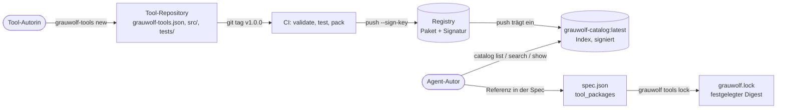

# 15 Der Tool-Katalog

In [Kapitel 3](03-tools.md#tool-pakete-aus-einer-registry-tool_packages) hast du Tool-Pakete aus
einer Registry benutzt und eigene mit `tools pack` und `tools push` veröffentlicht. Sobald ein Team
mehr als eine Handvoll Pakete veröffentlicht, stellen sich zwei Fragen: *Welche Tools gibt es?* und
*Kann ich ihnen trauen?* Eine Registry allein beantwortet sie nicht – ghcr.io zum Beispiel kann
nicht einmal seine Repositories auflisten. Dieses Kapitel zeigt dir

- was ein Paket über sich selbst sagt: Beschreibung, Lizenz, Build-Datum, Quelle, Sandbox-Grenzen;
- den **Tool-Katalog**: einen Index pro Registry, der jede Paketversion mit diesen Angaben auflistet,
  und wie deine Tool-Richtlinie jeden Eintrag beurteilt;
- wie du mit `grauwolf-tools new` ein eigenes Tool-Repository beginnst, mit einem CI-Workflow, der
  in den Katalog veröffentlicht.

Alles hier sind Befehle des schlanken Programms `grauwolf-tools` (und von `grauwolf tools …`, das
dieselben Befehle hat).

## Der Ablauf



Der Katalog hilft dir, ein Paket zu *finden*. Deine Spec nennt das Paket weiterhin über seine
Referenz, und `grauwolf.lock` legt seinen Digest fest – ein „neuestes aus dem Katalog“ gibt es in
einer Spec nicht.

## Was ein Paket über sich sagt

`grauwolf-tools.json` kann neben Name, Version und Tools ein paar weitere Felder tragen. Alle sind
optional:

```json
{
  "name": "text-tools",
  "version": "1.2.0",
  "description": "Counting and cleaning text",
  "license": "Apache-2.0",
  "authors": ["Ada Lovelace <ada@example.com>"],
  "source": "https://github.com/acme/text-tools",
  "tools": [
    {
      "name": "count_words",
      "description": "Counts the words of a text",
      "args": { "type": "object", "properties": { "text": { "type": "string" } } },
      "limits": { "memory_mib": 16, "fuel": 10000000, "time_ms": 500 },
      "capabilities": []
    }
  ]
}
```

- `limits` verlangt **strengere Sandbox-Grenzen** für ein Tool: den größten Speicher in MiB, das
  Rechenbudget (Fuel) und die Laufzeit eines Aufrufs in Millisekunden. Die Laufzeitumgebung wendet
  immer die strengeren aus den Grenzen des Pakets und ihren eigenen an; ein Paket kann sie also nur
  senken. Ein Tool, das seine Zeitgrenze überschreitet, wird mit „ran longer than its time limit“
  angehalten.
- `capabilities` nennt, was ein Tool vom Host braucht. Tools bekommen heute nichts – kein Netz,
  keine Dateien –, deshalb muss die Liste leer bleiben; `pack` und `validate` lehnen alles andere ab.
- Ohne `source` nimmt `pack` das Remote `origin` des Git-Checkouts, in dem der Ordner liegt, und in
  jedem Fall den ausgecheckten Commit als Revision.

`pack` schreibt all das, dazu das Build-Datum, die grauwolf-Version und die `rustc`-Version, als
**Standard-OCI-Annotationen** an das Paket-Manifest (`org.opencontainers.image.created`,
`.description`, `.source`, `.revision`, `.licenses`, `.authors`, `.version`, `.title` sowie
grauwolfs eigene `vnd.grauwolf.tools.abi`, `…built-with`, `…rustc`). Andere Registry-Werkzeuge
zeigen sie ebenfalls an. Das Build-Datum ist der Zeitpunkt des Packens; setzt du
`SOURCE_DATE_EPOCH` (Sekunden seit 1970, zum Beispiel die Commit-Zeit), ergibt derselbe Ordner
wieder denselben Digest:

```sh
SOURCE_DATE_EPOCH=$(git log -1 --format=%ct) grauwolf-tools pack .
```

`grauwolf-tools inspect <ref>` zeigt die Metadaten eines veröffentlichten Pakets:

```text
registry.example.com/team/text-tools:1.2.0
digest:  sha256:5f0c…
signature: signed by SHA256:Jx3k…
package: text-tools 1.2.0
abi:     1
description: Counting and cleaning text
created: 2026-11-16T09:30:00Z
source: https://github.com/acme/text-tools
revision: 4b1e9c…
license: Apache-2.0
authors: Ada Lovelace <ada@example.com>
built with: grauwolf 0.1.0
rustc: rustc 1.99.1 (58cf8f9c3 2026-10-13)
sources: included
tools:
  count_words: Counts the words of a text
    args:   {"type":"object",…}
    module: count_words.wasm sha256:9a2d…
    limits: memory 16 MiB, fuel 10000000, time 500 ms
```

Pakete, die gepackt wurden, bevor es diese Felder gab, lassen sich weiterhin holen und ansehen; sie
zeigen nur weniger.

## Der Katalog

Der Katalog ist ein kleiner JSON-Index, der **in der Registry selbst** liegt, als OCI-Artefakt
neben den Paketen: standardmäßig `<registry>/grauwolf-catalog:latest`. Er hat einen Eintrag pro
Paketversion mit der Referenz (per Digest festgelegt), der Beschreibung, den Tools mit ihren
Argumenten, Modulgrößen und Grenzen, Build-Datum, Quelle und Revision, Lizenz, Autoren, den
grauwolf- und rustc-Versionen und den Signaturen des Pakets.

### Welcher Katalog

Jeder Katalog-Befehl nimmt `--catalog`: entweder eine Registry (`registry.example.com`, also
`registry.example.com/grauwolf-catalog:latest`) oder eine volle Referenz
(`registry.example.com/team/tools-index:latest`). Ohne die Option entscheidet die
Umgebungsvariable `GRAUWOLF_TOOLS_CATALOG`; `catalog add` und `push` fallen auf den Katalog der
Registry des Pakets zurück. Setz die Variable einmal, dann brauchen die Befehle unten keine Option:

```sh
export GRAUWOLF_TOOLS_CATALOG=registry.example.com
```

Die Zugangsdaten sind die aller Registry-Befehle (`GRAUWOLF_REGISTRY_AUTH` oder die
Docker-Konfiguration). Lesen braucht Lesezugriff, Schreiben Push-Rechte auf das Katalog-Repository –
die eigenen Rechte der Registry entscheiden, wer den Katalog ändern darf.

### Tools finden: `catalog list`, `search`, `show`

```sh
grauwolf-tools catalog list
```

```text
catalog registry.example.com/grauwolf-catalog:latest (updated 2026-11-16T10:02:11Z, 3 entries)
index: signed by SHA256:Jx3k…: valid
NAME        VERSION  TOOLS  DESCRIPTION                  POLICY
math        1.0.0    2      Arithmetic for agents        allowed
text-tools  1.1.0    1      Counting and cleaning text   allowed
text-tools  1.2.0    1      Counting and cleaning text   refused: unsigned, and the policy requires signatures
```

`catalog search <text>` listet die Einträge, deren Name, Beschreibung oder Tool-Namen und
-Beschreibungen den Text enthalten (ohne Rücksicht auf Groß- und Kleinschreibung).
`catalog show <name>` zeigt die neueste Version vollständig, `--version 1.1.0` eine andere:

```sh
grauwolf-tools catalog search words
grauwolf-tools catalog show text-tools
```

```text
text-tools 1.2.0
reference: registry.example.com/team/text-tools@sha256:5f0c…
description: Counting and cleaning text
created: 2026-11-16T09:30:00Z
source: https://github.com/acme/text-tools
revision: 4b1e9c…
license: Apache-2.0
authors: Ada Lovelace <ada@example.com>
abi: 1
built with: grauwolf 0.1.0
rustc: rustc 1.99.1 (58cf8f9c3 2026-10-13)
versions: 1.1.0, 1.2.0
signature: signed by SHA256:Jx3k…
policy: allowed
tools:
  count_words: Counts the words of a text
    args:   {"type":"object",…}
    module: count_words.wasm sha256:9a2d… (48211 bytes)
    limits: memory 16 MiB, fuel 10000000, time 500 ms
    capabilities: none (no network, no files)
```

Alle drei nehmen `--json` für Skripte: `list` und `search` geben
`{ "catalog", "digest", "updated", "signature": { "status": "valid|invalid|unsigned|unchecked|none", … }, "entries": [ … ] }`
aus, `show` den Eintrag; jeder Eintrag trägt `"policy": { "allowed": true }` oder
`{ "allowed": false, "reason": "…" }`.

Um ein Paket zu benutzen, kopier seine Referenz in die Spec und leg sie fest wie in
[Kapitel 3](03-tools.md#tool-pakete-aus-einer-registry-tool_packages):

```json
"tool_packages": [{ "oci": "registry.example.com/team/text-tools:1.2.0" }]
```

### Deine Richtlinie entscheidet, bei jedem Lesen

Die Spalte **POLICY** steht nicht im Katalog. Jedes Mal, wenn du ihn liest, wendet grauwolf *deine*
Tool-Richtlinie (`[tool_packages]` einer `grauwolf.toml` im Arbeitsverzeichnis oder die Datei aus
`GRAUWOLF_TOOL_POLICY`; siehe [Kapitel 3](03-tools.md#vertrauen-die-tool-richtlinie-und-signaturen))
auf jeden Eintrag an: `allowed_registries` und mit `require_signatures` eine Signatur eines deiner
`oci_keys`. Der Eintrag speichert die Signaturen des Pakets selbst, also prüfen deine Schlüssel sie –
nicht die Schlüssel dessen, der den Eintrag geschrieben hat. Dasselbe Paket kann für ein Team
„allowed“ und für ein anderes „refused“ sein. Das Urteil ist eine Vorschau: Wenn eine Spec das Paket
benutzt, wird die Richtlinie am echten Paket erneut geprüft.

Der **Index** selbst kann signiert sein (siehe unten). Die zweite Zeile von `catalog list` sagt
`index: signed by <fingerprint>: valid`, `signed: invalid (…)`, `unsigned` oder „not checked“, wenn
du keinen Schlüssel hast. Die Schlüssel sind die `oci_keys` deiner Richtlinie plus jedes
`--key <datei.pub>`. Hat deine Richtlinie `require_signatures = true`, wird ein Katalog, dessen Index
nicht gültig von einem deiner Schlüssel signiert ist, als Ganzes abgelehnt.

### Schreiben: `push`, `catalog add`, `remove`, `sync`

`push` trägt die hochgeladene Version standardmäßig in den Katalog ein:

```sh
grauwolf-tools push dist registry.example.com/team/text-tools:1.2.0 --sign-key signing.key
```

```text
registry.example.com/team/text-tools:1.2.0@sha256:5f0c…
signed
catalog registry.example.com/grauwolf-catalog:latest: added text-tools@1.2.0
```

Mit `--sign-key` signiert der Schlüssel das Paket **und** den geänderten Index. `--catalog` nennt
einen anderen Katalog, `--no-catalog` lässt ihn aus. Wurde das Paket hochgeladen, der Katalog aber
nicht geändert (zum Beispiel ohne Push-Rechte auf `grauwolf-catalog`), sagt der Befehl das und
endet mit 1; trag es später mit `catalog add` ein.

```sh
grauwolf-tools catalog add registry.example.com/team/math:1.0.0      # einen Eintrag hinzufügen oder auffrischen
grauwolf-tools catalog remove text-tools@1.1.0                        # eine Version entfernen
grauwolf-tools catalog sync                                           # aus der Registry neu aufbauen
grauwolf-tools catalog sync --repository team/math --repository team/text-tools
```

`catalog add` liest Manifest, Metadaten und Signaturen des Pakets aus der Registry; dieselbe Version
noch einmal hinzuzufügen frischt ihren Eintrag auf. `catalog remove` entfernt einen Eintrag; das
Paket bleibt in der Registry. `catalog sync` **baut den Index neu auf**: Jedes Tag jedes
Repositorys, das ein Tool-Paket enthält, wird ein Eintrag, andere Artefakte (gewöhnliche Container-Images,
Multi-Arch-Indizes, Docker-Manifestlisten) werden übersprungen und nur in der Zusammenfassung gezählt
(`3 not tool packages`); `--verbose` nennt jedes mit seinem Medientyp (`skipped …: not a tool package
(<Medientyp>)`). Ein Tag, das aus anderem Grund scheitert, etwa durch einen echten Digest-Fehler
eines Tool-Pakets, wird immer genannt. Registries, die ihre Repositories auflisten
(`/v2/_catalog`, z. B. eine `registry:2` oder Harbor), brauchen nichts weiter; für die anderen
(ghcr.io) nennst du die Repositories mit `--repository`. Weil die Metadaten mit jedem Paket reisen,
lässt sich ein verlorener oder beschädigter Index so immer wieder aufbauen.

`add`, `remove` und `sync` nehmen `--sign-key`, um den geschriebenen Index zu signieren. Ein
Schreiben ohne hinterlässt einen unsignierten Index – wenn du signierst, signier also jedes
Schreiben.

**Mehrere Schreiber gleichzeitig.** Zwei Pipelines, die im selben Moment pushen, ändern beide den
Index. grauwolf liest den Index mit seinem Digest, macht seine Änderung und schreibt ihn unter der
Bedingung zurück, dass der Digest noch derselbe ist. War ein anderer Schreiber schneller, liest es
erneut und wendet seine Änderung noch einmal an – bis zu fünfmal, dann gibt es mit „the catalog …
kept changing“ auf, und du führst den Befehl einfach noch einmal aus. Viele Registries (auch die CNCF-
distribution `registry:2`) ignorieren die Bedingung. grauwolf merkt das beim ersten Schreiben und
gibt `note: <registry> ignores conditional writes; concurrent catalog writers are checked after the
fact` aus. Dann wartet es kurz zufällig (0,3 bis 1 s; mit `GRAUWOLF_TOOLS_CATALOG_SETTLE_MS` setzt du
eine feste Zahl Millisekunden), liest den Index erneut und prüft, ob *seine eigene Änderung*
darin ist: bei `add` und `sync` der Eintrag mit seinem Digest, bei `remove` kein Eintrag. Hat ein
anderer Schreiber ihn inzwischen überschrieben, wiederholt es die Runde. Die Prüfung ist nicht
lückenlos: Ein Schreiber, der den Index erst nach der Prüfung überschreibt, nimmt deinen Eintrag
unbemerkt wieder weg. Lass auf solchen Registries nur einen Schreiber zur Zeit arbeiten (etwa einen
CI-Job für alle Pushes) und repariere einen verlorenen Eintrag mit `catalog sync`.

## Ein Repository für deine Tools: `grauwolf-tools new`

`new` legt einen Paketordner an, der sich so, wie er ist, prüfen, packen und testen lässt:

```sh
grauwolf-tools new text-tools --tool count_words
```

```text
text-tools/
  grauwolf-tools.json                  Name, Version, Beschreibung, Lizenz, Autoren; das Tool
                                       count_words mit Argumenten, Grenzen und Capabilities
  src/count_words.rs                   der Code-Rumpf des Beispiel-Tools
  tests/count_words.rs                 Tests des Code-Rumpfs (`cargo test`)
  Cargo.toml, tests/support/           nur für `cargo test`; grauwolf ignoriert sie
  README.md                            Schritte zum Bauen, Prüfen, Testen, Packen, Pushen und Katalog
  .github/workflows/grauwolf-tools.yml CI: validate, test, pack; bei einem Tag v* signieren und pushen
  .gitignore
```

Das Beispiel-Tool ist nur ein Platzhalter: Seine Beschreibung lautet „What `<tool>` does, in one
sentence“, und sein Code setzt das Argument `input` in Großbuchstaben; ersetze beides durch dein
eigenes Tool. Ohne `--tool` heißt es `hello`; `--dir` schreibt woandershin als nach `./<name>`.
Der Ordner darf noch nicht existieren oder muss leer sein.

Der Test führt den Code-Rumpf als gewöhnliche Rust-Funktion aus, so wie grauwolf ihn einbettet; du
testest deine Tools also mit `cargo test`, ohne WASM zu bauen:

```rust
fn count_words(args: Value) -> Result<String, String> {
    include!(concat!(env!("OUT_DIR"), "/count_words.rs"))
}
```

### Der CI-Workflow

`.github/workflows/grauwolf-tools.yml` läuft im Image `ghcr.io/agentsw0rk/grauwolf-tools`, das die
Rust-Toolchain mit dem WASM-Ziel enthält – die CI braucht kein Rust-Setup. Bei jedem Push und Pull
Request prüft, testet und packt er (mit `SOURCE_DATE_EPOCH` auf der Commit-Zeit). Bei einem Tag
`v<version>` – die Version muss zu `grauwolf-tools.json` passen – pusht er das Paket außerdem,
signiert es und trägt es so in den Katalog ein. Richte in den Repository-Einstellungen ein:

| Einstellung | Art | Inhalt |
|---|---|---|
| `GRAUWOLF_REGISTRY_AUTH` | Secret | `{"registry.example.com": "user:token"}`, ein Token mit Push-Rechten auf das Paket-Repository und auf `grauwolf-catalog` |
| `GRAUWOLF_TOOLS_SIGNING_KEY` | Secret | der Inhalt des privaten Schlüssels aus `grauwolf-tools keygen signing` |
| `TOOLS_REGISTRY` | Variable | die Registry, z. B. `registry.example.com` |
| `TOOLS_REPOSITORY` | Variable | optional; Standard `<owner>/<name>` |

Gib den öffentlichen Schlüssel (`signing.pub`) den Leuten, die deine Tools benutzen: Sie tragen ihn
unter `oci_keys` in ihre Tool-Richtlinie ein, und der Katalog zeigt deine Pakete dann als signiert
und erlaubt.

## Das Wichtigste

- `grauwolf-tools.json` kann ein Paket beschreiben (`description`, `license`, `authors`, `source`)
  und pro Tool strengere Sandbox-`limits` verlangen; `pack` hält das als OCI-Annotationen fest, mit
  Build-Datum (`SOURCE_DATE_EPOCH`) und Git-Revision.
- Der Katalog ist ein Index in der Registry, standardmäßig `<registry>/grauwolf-catalog:latest`
  (`--catalog`, `GRAUWOLF_TOOLS_CATALOG`). `push` hält ihn aktuell, `catalog sync` baut ihn neu auf.
- `catalog list|search|show` beurteilen jeden Eintrag beim Lesen mit *deiner* Tool-Richtlinie; ein
  signierter Index wird gegen deine Schlüssel geprüft.
- Specs nennen Pakete weiterhin über ihre Referenz, und `grauwolf.lock` legt ihre Digests fest.
- `grauwolf-tools new` liefert ein Tool-Repository mit Tests und einem CI-Workflow, der in den
  Katalog veröffentlicht.
