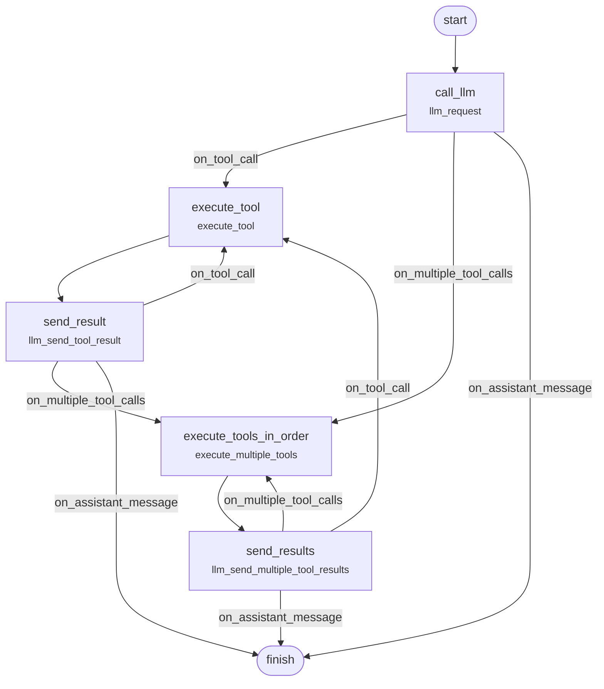

# Chapter 1: Getting started

In this chapter you set up grauwolf, validate your first agent, run it and chat with it. By the
end you know all the commands you need for everyday work with specs, and you know which parts a
spec consists of.

A few terms up front:

- **Agent:** a program that works with a language model (LLM, *large language model*) to get a
  task done – such as answering questions, doing calculations or reading files.
- **Spec:** the description of an agent as a JSON file. It states which model the agent uses,
  which instructions it gets, which tools it has and how it runs. You don't need to write any
  Rust code for it.
- **CLI:** the command-line program `grauwolf`, which you use to validate and run specs.

## Setup

### Rust and the WebAssembly target

grauwolf is written in Rust. Install the Rust toolchain via [rustup](https://rustup.rs)
and add the `wasm32-unknown-unknown` target:

```sh
rustup target add wasm32-unknown-unknown
```

You need the WebAssembly target (WASM for short) as soon as an agent has its own tool code
([Chapter 3](03-tools.md)): grauwolf compiles this code to WASM and runs it in an isolated
environment, the *sandbox*.

Then build and install the CLI from the project directory:

```sh
cargo install --path crates/apps/grauwolf-cli
grauwolf --help
```

After that, the program is called `grauwolf`. Without installing, you can also use
`cargo run -p grauwolf-cli -- <command>`; this guide always uses the short form
`grauwolf <command>`.

### A language model

An agent needs an LLM. You have two options:

- **Locally with Ollama:** Install [Ollama](https://ollama.com), pull a model and keep the
  server running. The examples in this guide use `qwen3.5:9b`:

  ```sh
  ollama pull qwen3.5:9b
  ```

  By default, grauwolf looks for Ollama at `http://localhost:11434`; you set a different address
  with `OLLAMA_HOST`.
- **Via a cloud provider:** Set the API key as an environment variable, e.g.
  `ANTHROPIC_API_KEY` for Claude, `OPENAI_API_KEY` for OpenAI or `GEMINI_API_KEY` for Gemini.

Everything about providers and models is in [Chapter 2](02-models.md).

### Working directory

The examples live in [`examples/`](examples/) (in the repository: `docs/user-guide/examples/`).
The commands in this guide assume that you are in the root directory of the grauwolf repository,
so they refer to the examples as `docs/user-guide/examples/…`. Default directories such as
`.grauwolf/` are then also created there.

## Your first spec

Here is the smallest useful agent – a friendly assistant
([`examples/01-hello.json`](examples/01-hello.json)):

```json
{
  "spec_version": 1,
  "name": "hello",
  "model": { "provider": "ollama", "id": "qwen3.5:9b" },
  "system_prompt": "You are a friendly assistant. Answer briefly and in English.",
  "strategy": { "kind": "single_run" }
}
```

Line by line:

- `spec_version` – version of the spec format; currently always `1`.
- `name` – name of the agent, in lowercase letters with digits and `_` (*snake_case*).
- `model` – which LLM the agent uses: provider (`provider`) and model ID (`id`).
- `system_prompt` – the basic instruction to the model. It comes before every conversation.
- `strategy` – how the agent runs. `single_run` means: ask the model, run tools if needed,
  return the answer. More on this in [Chapter 4](04-flows.md).

## Validating a spec: `spec validate`

Before you start an agent, you validate the spec. This costs nothing, needs no model and
catches typos immediately:

```sh
grauwolf spec validate docs/user-guide/examples/01-hello.json
```

Output:

```text
docs/user-guide/examples/01-hello.json: valid
```

### What errors look like

Errors are where it gets interesting. Take this deliberately broken spec (to try it out, save it
as `broken.json`, for example):

```json
{
  "spec_version": 1,
  "name": "Hello World",
  "model": { "provider": "ollama", "id": "qwen3.5:9b" },
  "graph": {
    "nodes": [
      { "id": "ask", "kind": "llm_query" }
    ],
    "edges": [
      { "from": "start", "to": "ask" },
      { "from": "ask", "to": "end" }
    ]
  }
}
```

```sh
grauwolf spec validate broken.json
```

```text
broken.json:/name: 'Hello World' is not a valid ID: allowed are lowercase letters, digits and '_', starting with a letter
broken.json:/graph/nodes/0/kind: unknown node kind 'llm_query'
broken.json:/graph/edges/1/to: unknown node 'end'
broken.json:/graph: 'finish' is not reachable from 'start'
```

After the file name, each line gives a **JSON pointer** – the path to the faulty spot.
`/graph/nodes/0/kind` means: in the field `graph`, in the list `nodes`, in the first entry (counted
from 0), the field `kind`. This way you find every error, even in large specs. grauwolf reports
**all** content errors at once, and the command ends with an error exit code – handy for
scripts and CI.

One exception: if the file doesn't fit the format at all – for example because of a misspelled
field name – you first get only this one message, with the list of allowed fields:

```text
typo.json:/sytem_prompt: unknown field (allowed: `spec_version`, `name`, `model`, `system_prompt`, …)
```

Here, too, the pointer shows the spot. Missing required fields
(`…:/tools/0/description: missing required field`) and wrong types
(`…:/model/id: wrong type: integer `5`, expected a string`) are just as clear. Only if the file is
not valid JSON at all do you get the message with line and column (`invalid spec JSON: …`).

Unknown fields are always an error. This protects you from typos that would otherwise be silently
ignored.

## Running an agent: `spec run`

`spec run` takes the spec and an input and prints the answer:

```sh
grauwolf spec run docs/user-guide/examples/01-hello.json "What is the capital of France?"
```

The answer looks roughly like this (LLM answers vary from run to run):

```text
The capital of France is Paris.
```

The answer goes to standard output (stdout), messages and errors go to stderr. So you can process
the answer directly, e.g. with `> answer.txt`.

The input is text unless the spec specifies otherwise. Agents with structured input expect JSON
instead ([Chapter 5](05-structured-data.md)).

If Ollama isn't running, you get an error message prefixed with the file name of the spec. If the
key for a cloud provider is missing, grauwolf tells you exactly which environment variable is
missing, for example:

```text
provider 'anthropic' needs the environment variable ANTHROPIC_API_KEY
```

`spec run` has many options – for costs, budgets, event logs, conversations and more. You will
get to know the most important ones in the following chapters; all of them are listed by
`grauwolf spec run --help` and in the [CLI reference](reference-cli.md).

## Chatting with the agent: `spec chat`

Instead of a single question, you can also have a whole conversation:

```sh
grauwolf spec chat docs/user-guide/examples/01-hello.json
```

Each line you enter is a run in the same conversation – so the agent remembers what has been said
so far. Roughly:

```text
> My name is Mia.
Hi Mia, nice to meet you!
> What is my name?
Your name is Mia.
> /exit
```

`/exit` or Ctrl+D ends the chat, empty lines are skipped. If a run fails, the error appears on
stderr and the chat continues. Without further options, the conversation only lives as long as
the chat is running; [Chapter 7](07-conversations-and-knowledge.md) shows how to save it and
continue it later.

## Viewing the flow: `spec graph`

Every agent runs as a **graph**: steps (*nodes*) are connected by arrows (*edges*).
`spec graph` draws it as a [Mermaid](https://mermaid.js.org) diagram, which GitHub and many
editors, for example, render directly:

```sh
grauwolf spec graph docs/user-guide/examples/01-hello.json
```

```text
flowchart TD
    start([start])
    finish([finish])
    call_llm["call_llm<br/><small>llm_request</small>"]
    execute_tool["execute_tool<br/><small>execute_tool</small>"]
    send_result["send_result<br/><small>llm_send_tool_result</small>"]
    execute_tools_in_order["execute_tools_in_order<br/><small>execute_multiple_tools</small>"]
    send_results["send_results<br/><small>llm_send_multiple_tool_results</small>"]
    start --> call_llm
    call_llm -->|on_tool_call| execute_tool
    call_llm -->|on_multiple_tool_calls| execute_tools_in_order
    call_llm -->|on_assistant_message| finish
    execute_tool --> send_result
    send_result -->|on_tool_call| execute_tool
    send_result -->|on_multiple_tool_calls| execute_tools_in_order
    send_result -->|on_assistant_message| finish
    execute_tools_in_order --> send_results
    send_results -->|on_tool_call| execute_tool
    send_results -->|on_multiple_tool_calls| execute_tools_in_order
    send_results -->|on_assistant_message| finish
```

Rendered:



As you can see, behind the short `"strategy": { "kind": "single_run" }` there is a complete
graph. The lower path (`execute_tools_in_order`) is taken when the model calls several tools in one
answer: they run one after another. [Chapter 4](04-flows.md) explains how it works and how to
build your own.

## Looking up the format: `spec schema`

`spec schema` prints the JSON schema of the spec format – a machine-readable description of all
fields with short explanations, including the file references `tool_files` and `code_file` from
[Chapter 3](03-tools.md):

```sh
grauwolf spec schema > grauwolf-spec.schema.json
```

Many editors (e.g. VS Code) use it to offer completion and validation as you type. Associate the
schema with your spec files in your editor's settings. A `"$schema"` field in the spec itself does
**not** work – it would be an unknown field and therefore an error.

## Structure of a spec, field by field

Only three fields are required: `spec_version`, `name` and `model`. For the agent to do anything,
it also needs a flow – either `strategy` or `graph`. If both are missing, `spec validate` reports
`'finish' is not reachable from 'start'`; if both are present, that is an error too
(`` `strategy` and `graph` are mutually exclusive ``).

| Field | Required | Default | Meaning | More |
|---|---|---|---|---|
| `spec_version` | yes | – | Version of the format, currently `1` | here |
| `name` | yes | – | Name of the agent, snake_case | here |
| `model` | yes | – | LLM: `{ "provider": …, "id": … }` | [Chapter 2](02-models.md) |
| `system_prompt` | no | none | Basic instruction to the model | here |
| `strategy` | no* | – | Template for the flow: `single_run`, `react`, `verified` | [Chapter 4](04-flows.md) |
| `graph` | no* | empty | Your own flow of `nodes` and `edges` | [Chapter 4](04-flows.md) |
| `tools` | no | none | Tools with their own code | [Chapter 3](03-tools.md) |
| `tool_files` | no | none | Tool definitions from separate files | [Chapter 3](03-tools.md) |
| `tools_dir` | no | none | Directory from which tools are loaded before every run | [Chapter 3](03-tools.md) |
| `builtin_tools` | no | none | Built-in file and user tools | [Chapter 3](03-tools.md) |
| `types` | no | none | Your own data types as JSON schemas | [Chapter 5](05-structured-data.md) |
| `input`, `output` | no | `"string"` | Input and output type of the agent | [Chapter 5](05-structured-data.md) |
| `subgraphs` | no | none | Named sub-flows | [Chapter 6](06-subgraphs-and-planners.md) |
| `knowledge` | no | none | Make your own documents searchable | [Chapter 7](07-conversations-and-knowledge.md) |
| `long_term_memory` | no | none | Long-term memory | [Chapter 7](07-conversations-and-knowledge.md) |
| `mcp_servers` | no | none | Tools from external MCP servers | [Chapter 8](08-external-tools-and-agents.md) |
| `agent_tools` | no | none | Other agents as tools | [Chapter 8](08-external-tools-and-agents.md) |
| `self_tools` | no | off | The agent builds its own tools | [Chapter 10](10-self-made-tools.md) |

\* In practice you almost always need one of the two.

You will find all fields with all defaults in the [spec reference](reference-spec.md).

## Key points

- Setup: Rust, `rustup target add wasm32-unknown-unknown`, `cargo install --path crates/apps/grauwolf-cli`, plus Ollama or an API key.
- A spec is a JSON file; `spec_version`, `name`, `model` are required, plus a flow via `strategy` or `graph`.
- `grauwolf spec validate <file>` validates a spec and reports all errors with a JSON pointer.
- `grauwolf spec run <file> "<input>"` executes a run; the answer goes to stdout.
- `grauwolf spec chat <file>` holds a conversation; `/exit` ends it.
- `grauwolf spec graph <file>` shows the flow as a Mermaid diagram, `grauwolf spec schema` the format as a JSON schema.
- Unknown fields are errors – typos are caught immediately.

Continue with [Chapter 2: Models and providers](02-models.md).
