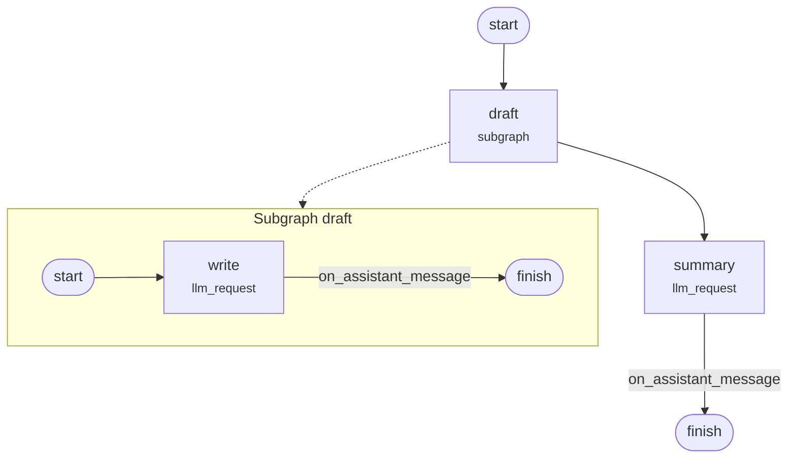
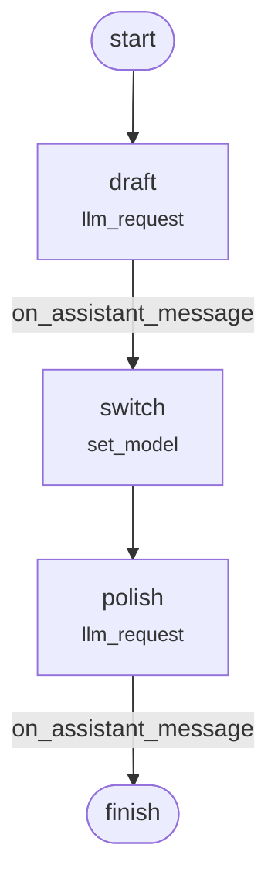

# Chapter 2: Models and providers

Every agent needs a language model. In this chapter you learn how to choose the model in a spec,
how to connect local models via Ollama and cloud models from OpenAI, Anthropic, Gemini, Amazon Bedrock and
OpenAI-compatible services, how an agent
mixes several models – and how to keep track of what a run costs in tokens and money.

## The `model` field

The model goes in the required field `model` and consists of two parts:

```json
"model": { "provider": "ollama", "id": "qwen3.5:9b" }
```

- `provider` – the **provider**, i.e. the service that offers the model. Built in are eleven:
  `ollama`, `openai`, `anthropic`, `gemini`, `bedrock` and the OpenAI-compatible providers `openrouter`,
  `deepseek`, `mistral`, `groq`, `dashscope` and `xai`
  ([below](#openai-and-compatible-services)).
- `id` – the **model ID**, exactly as the provider names it.

Credentials never go into the spec; they come from environment variables. This way you can pass
a spec on without giving away keys.

`spec validate` checks the provider name against the built-in providers – wherever one appears
(main model, subgraphs, `set_model`, moderation, embedding models). A typo is caught before the
first run:

```text
agent.json:/model/provider: unknown provider 'olama' (built-in: ollama, openai, anthropic, gemini, bedrock, openrouter, deepseek, mistral, groq, dashscope, xai)
```

Custom providers that you register in Rust are also reported as unknown by `spec validate` – the
check only knows the built-in ones.

grauwolf automatically retries temporary provider errors (e.g. network glitches).

## Ollama: models on your own machine

[Ollama](https://ollama.com) runs models locally – with no cost per request and without data
leaving your machine. The example from Chapter 1 uses Ollama
([`examples/01-hello.json`](examples/01-hello.json)):

```json
{
  "spec_version": 1,
  "name": "hello",
  "model": { "provider": "ollama", "id": "qwen3.5:9b" },
  "system_prompt": "You are a friendly assistant. Answer briefly and in English.",
  "strategy": { "kind": "single_run" }
}
```

| Variable | Required | Meaning |
|---|---|---|
| `OLLAMA_HOST` | no | Address of the Ollama server; default `http://localhost:11434`. `http://` may be omitted, e.g. `OLLAMA_HOST=gpu-server:11434`. |
| `OLLAMA_THINK` | no | `false` (or `0`) turns off the "thinking" of reasoning models, `true` (or `1`) turns it on. If unset, the model and server decide. |

Reasoning models think at length before answering. This often improves the result but takes
time. For quick tests, this helps:

```sh
OLLAMA_THINK=false grauwolf spec run docs/user-guide/examples/01-hello.json "Name three colors."
```

Roughly:

```text
Red, blue and green.
```

## OpenAI and compatible services

For OpenAI, set `provider` to `openai`
([`examples/02-openai.json`](examples/02-openai.json)):

```json
{
  "spec_version": 1,
  "name": "hello_openai",
  "model": { "provider": "openai", "id": "gpt-4o" },
  "system_prompt": "You are a friendly assistant. Answer briefly and in English.",
  "strategy": { "kind": "single_run" }
}
```

| Variable | Required | Meaning |
|---|---|---|
| `OPENAI_API_KEY` | yes | API key |
| `OPENAI_BASE_URL` | no | Different endpoint; default `https://api.openai.com/v1` |

```sh
export OPENAI_API_KEY=sk-…
grauwolf spec run docs/user-guide/examples/02-openai.json "What is an agent?"
```

Roughly:

```text
An agent is a program that uses a language model to complete tasks on its own.
```

With `OPENAI_BASE_URL` you can talk to any service that mimics the OpenAI interface (Chat
Completions) – such as a company proxy or another model provider. As with the default, the
address ends with the version path, e.g. `…/v1`.

Well-known compatible providers have **their own name** with their own key. This way a spec can,
for example, use OpenAI in the main graph and Mistral in a subgraph:

| `provider` | Key | Default address |
|---|---|---|
| `openrouter` | `OPENROUTER_API_KEY` | `https://openrouter.ai/api/v1` |
| `deepseek` | `DEEPSEEK_API_KEY` | `https://api.deepseek.com` |
| `mistral` | `MISTRAL_API_KEY` | `https://api.mistral.ai/v1` |
| `groq` | `GROQ_API_KEY` | `https://api.groq.com/openai/v1` |
| `dashscope` | `DASHSCOPE_API_KEY` | `https://dashscope-intl.aliyuncs.com/compatible-mode/v1` |
| `xai` | `XAI_API_KEY` | `https://api.x.ai/v1` |

```json
"model": { "provider": "mistral", "id": "mistral-small-latest" }
```

You set a different address with `<NAME>_BASE_URL`, e.g. `DASHSCOPE_BASE_URL` for a different
region. Whatever a provider doesn't offer (such as moderation or structured answers following a
schema), it reports as an error itself.

## Anthropic (Claude)

For Claude, set `provider` to `anthropic`
([`examples/02-anthropic.json`](examples/02-anthropic.json)):

```json
{
  "spec_version": 1,
  "name": "hello_claude",
  "model": { "provider": "anthropic", "id": "claude-haiku-5-5" },
  "system_prompt": "You are a friendly assistant. Answer briefly and in English.",
  "strategy": { "kind": "single_run" }
}
```

| Variable | Required | Meaning |
|---|---|---|
| `ANTHROPIC_API_KEY` | yes | API key |

```sh
export ANTHROPIC_API_KEY=sk-ant-…
grauwolf spec run docs/user-guide/examples/02-anthropic.json "Explain recursion in one sentence."
```

Roughly:

```text
Recursion means that a function calls itself until it reaches a simple base case.
```

If the key is missing, the run stops before the first request:

```text
provider 'anthropic' needs the environment variable ANTHROPIC_API_KEY
```

With Anthropic, grauwolf automatically uses the prompt cache: parts sent repeatedly (system
prompt, tools, history so far) are billed at a lower rate when requests follow each other within
a few minutes. You don't need to configure anything for this.

## Google Gemini

For Gemini, set `provider` to `gemini`
([`examples/02-gemini.json`](examples/02-gemini.json)):

```json
{
  "spec_version": 1,
  "name": "hello_gemini",
  "model": { "provider": "gemini", "id": "gemini-2.5-flash" },
  "system_prompt": "You are a friendly assistant. Answer briefly and in English.",
  "strategy": { "kind": "single_run" }
}
```

| Variable | Required | Meaning |
|---|---|---|
| `GEMINI_API_KEY` | yes | API key from Google AI Studio |
| `GEMINI_BASE_URL` | no | Different endpoint; default `https://generativelanguage.googleapis.com` |

```sh
export GEMINI_API_KEY=…
grauwolf spec run docs/user-guide/examples/02-gemini.json "What is an agent?"
```

grauwolf talks to the native Gemini API: tools, structured answers, streaming, attachments and
embeddings (e.g. `gemini-embedding-001` for `knowledge`) work as with the other providers.
Thinking models return their thought signatures in the history; grauwolf handles that itself.
Vertex AI is not supported.

## Amazon Bedrock

For models on Amazon Bedrock, set `provider` to `bedrock` and `id` to the model ID or inference
profile ID exactly as Bedrock names it
([`examples/02-bedrock.json`](examples/02-bedrock.json)):

```json
{
  "spec_version": 1,
  "name": "hello_bedrock",
  "model": { "provider": "bedrock", "id": "eu.anthropic.claude-3-5-sonnet-20240620-v1:0" },
  "system_prompt": "You are a friendly assistant. Answer briefly and in English.",
  "strategy": { "kind": "single_run" }
}
```

Inference profile IDs with a region prefix (`eu.`, `us.`, `apac.`) work like plain model IDs. The
model must be enabled for your AWS account in the region you use; otherwise Bedrock answers
`AccessDeniedException`, and grauwolf says so in the error message.

Credentials are the standard AWS variables. Either access keys (requests are signed with AWS
Signature Version 4) or a Bedrock API key:

| Variable | Required | Meaning |
|---|---|---|
| `AWS_ACCESS_KEY_ID` | with access keys | Access key |
| `AWS_SECRET_ACCESS_KEY` | with access keys | Secret key |
| `AWS_SESSION_TOKEN` | no | Session token of temporary credentials (STS) |
| `AWS_BEARER_TOKEN_BEDROCK` | alternative | Bedrock API key; sent as bearer token, nothing is signed. If both are set, the API key wins |
| `AWS_REGION` | no | Region, e.g. `eu-central-1`; else `AWS_DEFAULT_REGION`; default `us-west-2` |
| `BEDROCK_BASE_URL` | no | Different endpoint (VPC endpoint, proxy); default `https://bedrock-runtime.<region>.amazonaws.com` |

```sh
export AWS_ACCESS_KEY_ID=… AWS_SECRET_ACCESS_KEY=… AWS_REGION=eu-central-1
grauwolf spec run docs/user-guide/examples/02-bedrock.json "What is an agent?"
```

grauwolf uses the Converse API, so every chat model on Bedrock works with one message format:
tools, structured answers, streaming, images and documents as attachments (see the table below)
and reasoning blocks. Notes:

- Credentials from instance profiles, EKS Pod Identity or web identity are not read; pass them as
  the variables above (for example with `aws configure export-credentials`).
- Bedrock has no "no tools" tool choice: with `tool_choice: none` the tools are not sent (unless
  the history already contains tool calls, then the model may still call one).
- Bedrock does not report which model answered, so `--events` shows no reported model.
- `think` is not available for `bedrock` (as for every provider but `ollama`).
- Embedding models on Bedrock are not supported yet; `embedding_model` with `bedrock` is an error.

## Images, PDFs and audio

A run can pass files along with the input. In the CLI, you do this with `--attach` (can be given
multiple times):

```sh
grauwolf spec run seer.json "What is in the picture?" --attach wolf.png
```

In the chat, the line `/attach <file>` attaches the file to the **next** input:

```text
> /attach wolf.png
Attachment for the next input: wolf.png
> What is in the picture?
A gray wolf in the snow.
```

The image stays part of the conversation; later questions may refer to it. grauwolf recognizes
the type by the file extension: `.png`, `.jpg`/`.jpeg`, `.gif`, `.webp`, `.pdf`, `.wav` and
`.mp3`, at most 20 MB per file. What each provider understands:

| Provider | Images | PDF | Audio (wav, mp3) |
|---|---|---|---|
| `openai` | yes (also as URL) | yes | yes |
| `anthropic` | yes (also as URL) | yes (also as URL) | no |
| `ollama` | yes (only without URL), if the model understands images | no | no |
| `gemini` | yes (also as URL) | yes (also as URL) | yes (also as URL) |
| `bedrock` | yes (png, jpeg, gif, webp; only without URL, or `s3://`) | yes (only without URL, or `s3://`) | no |

The run rejects anything else **before** the request with an error message, instead of silently
dropping the attachment. Through the service, attachments come in the `attachments` field of the
request ([Chapter 9](09-operations.md)).

## Fallback models: `fallbacks`

If a provider fails or is overloaded, the run fails – unless you list fallback models. grauwolf
asks them one after another when a request still fails after the retries:

```json
"model": {
  "provider": "anthropic",
  "id": "claude-haiku-5-5",
  "fallbacks": [
    { "provider": "openai", "id": "gpt-4o-mini" },
    { "provider": "ollama", "id": "qwen3.5:9b" }
  ]
}
```

- This applies to every request: normal, streamed (as long as no text has been output yet),
  structured, history compression, facts and moderation. The next request tries the actual model
  first again.
- Without `fallbacks`, nothing changes. If the budget is exhausted, there is no switch.
- Every switch appears as an `llm_fallback` event with `from`, `to` and the error (`--events`,
  OpenTelemetry). Costs count at the price of the model that answered.
- The keys of all listed providers must be in the environment.
- `spec validate` checks the list: unknown providers, a fallback model equal to the model, and
  duplicate entries are reported, e.g. `/model/fallbacks/0: fallback model 'anthropic:claude-haiku-5-5' is already listed`.
  Embedding models have no fallback models – a different model would produce different vectors.
- The `model` of a subgraph, `set_model` and a custom moderation model in `llm_moderate` can also
  have `fallbacks`.

## Temperature and thinking: `temperature`, `think`

Two optional fields tune how a model answers:

```json
"model": { "provider": "ollama", "id": "qwen3.5:9b", "temperature": 0, "think": false }
```

- `temperature` (number from 0 to 2) is sent as the provider's sampling temperature. With
  `temperature: 0` an agent answers (almost) reproducibly. Without it, the provider's default applies.
- `think` (`true`/`false`) switches the reasoning of Ollama models for this model and takes
  precedence over `OLLAMA_THINK`. Other providers reject it in `spec validate` instead of
  ignoring it silently: `/model/think: 'think' is only supported by the provider 'ollama', not 'openai'`.
- Both fields are available wherever a model is given: `model`, its `fallbacks`, `subgraphs.*.model`
  and the parameters of `set_model` and `llm_moderate`. Embedding models have neither.
- The response cache (ADR-0086) keys on both, so a different temperature never returns an answer
  recorded with another one.

Example: [`02-sampling.json`](examples/02-sampling.json).

## Several models in one agent

It often pays to mix models: a small, cheap or local model for simple steps, a stronger one for
the demanding part. grauwolf offers two ways to do this.

Important for both: a run needs the credentials of **all** providers that appear in the spec –
even if part of the spec isn't reached in a particular run.

### A separate model for a subgraph

A **subgraph** is a named sub-flow that the main flow calls like a single step (covered in detail
in [Chapter 6](06-subgraphs-and-planners.md)). It can have its own `model`; afterwards the outer
one applies again. Here Claude writes a draft, and the local model summarizes it
([`examples/02-model-in-subgraph.json`](examples/02-model-in-subgraph.json)):

```json
{
  "spec_version": 1,
  "name": "draft_and_summary",
  "model": { "provider": "ollama", "id": "qwen3.5:9b" },
  "system_prompt": "First you write a short draft in English. When you then get your draft back, you summarize it in a single sentence.",
  "subgraphs": {
    "draft": {
      "model": { "provider": "anthropic", "id": "claude-haiku-5-5" },
      "graph": {
        "nodes": [{ "id": "write", "kind": "llm_request" }],
        "edges": [
          { "from": "start", "to": "write" },
          { "from": "write", "to": "finish", "when": { "kind": "on_assistant_message" } }
        ]
      }
    }
  },
  "graph": {
    "nodes": [
      { "id": "draft", "kind": "subgraph", "params": { "subgraph": "draft" } },
      { "id": "summary", "kind": "llm_request" }
    ],
    "edges": [
      { "from": "start", "to": "draft" },
      { "from": "draft", "to": "summary" },
      { "from": "summary", "to": "finish", "when": { "kind": "on_assistant_message" } }
    ]
  }
}
```

This is what the flow looks like (`grauwolf spec graph docs/user-guide/examples/02-model-in-subgraph.json`):



```sh
grauwolf spec run docs/user-guide/examples/02-model-in-subgraph.json "Why are hedgehogs nocturnal?"
```

Roughly:

```text
Hedgehogs are nocturnal because they find their prey more easily in the dark and avoid predators.
```

You will learn more about nodes, edges and `when` in [Chapter 4](04-flows.md).

### Switching the model mid-run: `set_model`

The `set_model` node switches the model for the **rest of the run**; the history so far is kept.
It passes its input value through unchanged, which is why `value` names its type (here text,
`"string"`). In the example, the local model drafts and Claude polishes
([`examples/02-switch-model.json`](examples/02-switch-model.json)):

```json
{
  "spec_version": 1,
  "name": "local_then_claude",
  "model": { "provider": "ollama", "id": "qwen3.5:9b" },
  "system_prompt": "First you write a short draft in English. When you then get your draft back, you polish its language and output only the finished text.",
  "graph": {
    "nodes": [
      { "id": "draft", "kind": "llm_request" },
      {
        "id": "switch",
        "kind": "set_model",
        "params": { "provider": "anthropic", "id": "claude-haiku-5-5", "value": "string" }
      },
      { "id": "polish", "kind": "llm_request" }
    ],
    "edges": [
      { "from": "start", "to": "draft" },
      { "from": "draft", "to": "switch", "when": { "kind": "on_assistant_message" } },
      { "from": "switch", "to": "polish" },
      { "from": "polish", "to": "finish", "when": { "kind": "on_assistant_message" } }
    ]
  }
}
```



Rule of thumb: one model for a self-contained part → model on the subgraph. A different model from
a certain point on → `set_model`. Another example is in
[`examples/specs/two_models.json`](../../examples/specs/two_models.json).

## Seeing token usage: `--events`

Providers bill by **tokens** – the word pieces that input and output consist of. With
`--events`, grauwolf writes all events of a run as JSON lines (JSONL) to stderr, including the
token usage of every LLM request. Redirect stderr to a file so the answer stays readable:

```sh
grauwolf spec run docs/user-guide/examples/02-anthropic.json "Hello!" --events 2> events.jsonl
```

`events.jsonl` then contains lines like these (shortened):

```text
{"event":"agent_starting","input":"Hello!"}
{"event":"node_starting","path":["call_llm"],"input":"Hello!"}
{"event":"llm_call_starting","model":{"provider":"anthropic","id":"claude-haiku-5-5"},"tools":[]}
{"event":"llm_call_completed","answer":{…},"usage":{"input_tokens":412,"output_tokens":57}}
…
{"event":"agent_completed","output":"Hello! How can I help?","usage":{"input_tokens":412,"output_tokens":57}}
```

- `llm_call_completed.usage` – tokens of this one request: `input_tokens` (all input tokens,
  including cached ones) and `output_tokens`; if the provider reports them, also
  `cache_read_tokens` and `cache_write_tokens`.
- `llm_call_completed.model` – the model the provider reports to have answered (for example a
  dated version of the requested model); missing if the provider does not say. Also recorded as
  `gen_ai.response.model` in OpenTelemetry.
- `agent_completed.usage` – the total for the whole run. If the run fails, it is in
  `agent_failed`.

If a provider reports no numbers, `usage` is simply missing.

## Calculating costs: `--prices`

Tokens turn into amounts when you provide a **price table**. Prices change, which is why they are
not in the program but in a separate file. A template is in
[`examples/prices.example.json`](../../examples/prices.example.json):

```json
{
  "currency": "USD",
  "models": {
    "anthropic:claude-haiku-5-5":  { "input": 0.10, "output": 0.50, "cache_read": 0.01, "cache_write": 0.125 },
    "anthropic:claude-sonnet-5-5": { "input": 2.00, "output": 10.00, "cache_read": 0.20, "cache_write": 2.50 },
    "anthropic:claude-opus-5-5":   { "input": 4.00, "output": 20.00, "cache_read": 0.20, "cache_write": 5.00 },
    "ollama:qwen3.5:9b":           { "input": 0, "output": 0 }
  }
}
```

- Keys are `<provider>:<model-id>`, prices apply **per million tokens**.
- `cache_read` and `cache_write` are optional; if they are missing, the input price applies.
- The values in the template are examples – check them before use.
- A model without an entry gets no amount. grauwolf does not estimate.

```sh
grauwolf spec run docs/user-guide/examples/02-anthropic.json "Hello!" --events \
  --prices examples/prices.example.json 2> events.jsonl
```

Now the events also carry `cost`, roughly like this:

```text
{"event":"llm_call_completed","answer":{…},"usage":{"input_tokens":412,"output_tokens":57},"cost":0.0000697}
{"event":"agent_completed","output":"Hello! How can I help?","usage":{"input_tokens":412,"output_tokens":57},"cost":0.0000697}
```

The amount is in the currency from `currency`: 412 × $0.10 + 57 × $0.50 per million tokens.
`--prices` is available for `spec run`, `spec chat`, `spec serve`, `spec mcp` and `spec resume`.

## Caching answers: `--llm-cache`

If you send the same request several times – while developing a spec, in tests, for a demo –
grauwolf with `--llm-cache <dir>` asks the model only the first time:

```sh
grauwolf spec run docs/user-guide/examples/01-hello.json "What is an agent?" --llm-cache .grauwolf/llm-cache
grauwolf spec run docs/user-guide/examples/01-hello.json "What is an agent?" --llm-cache .grauwolf/llm-cache   # instant, costs nothing
```

"The same request" means: same provider, same model, same history including system prompt and
attachments, same tools and – for structured answers – the same schema. If any of that changes,
grauwolf asks the model again. Answers from the cache count as 0 tokens, so they burden neither
the budget nor the costs.

- The cache applies to all LLM requests of a run, including sub-agents and history compression.
  "Best of n" and moderation always ask again.
- For the same input it always gives the same answer – intended for development and tests; in
  production, only turn it on deliberately.
- There is no expiry: delete the directory to ask again.

In Rust, you attach a cache to the executor: `PromptExecutor::builder().cache(Arc::new(
MemoryPromptCache::default()))` in memory, or `grauwolf::cache::FilePromptCache::new(dir)`
as files; with the `AgentLoader` via `with_llm_cache(..)`.

## Limiting the budget: `--max-tokens` and `--max-cost`

An agent that gets caught in a tool loop can consume a lot. A **budget** sets an upper limit per
run:

- `--max-tokens <n>` – input and output tokens combined.
- `--max-cost <amount>` – costs in the currency of the price table; needs `--prices`.

```sh
grauwolf spec run docs/user-guide/examples/02-anthropic.json "Write me a long story." \
  --prices examples/prices.example.json --max-cost 0.01
```

grauwolf checks the budget **before** every LLM request. Once the limit is reached, the run ends
with an error like this (roughly):

```text
… run budget exhausted: 2140 of at most 2000 tokens used
```

Good to know:

- A single request can exceed the limit because its consumption isn't known beforehand; after
  that, no further request starts.
- With `spec chat` the budget applies per line, with the service (`spec serve`) per request.
- The CLI rejects `--max-cost` without `--prices`:
  `--max-cost needs --prices: without a price table the cost is unknown`.
- Moderation and multiple answer variants (`llm_request_best_of`) also count toward usage, costs
  and budget; moderation at the price of its own model. OpenAI's moderation API doesn't charge
  tokens and therefore doesn't count.
- Models without a price in the table cause no costs; their tokens still count.

## Limits in the spec: `limits`

Instead of passing options every time, an agent can bring its own limits
([`examples/02-limits.json`](examples/02-limits.json), shortened):

```json
"limits": { "max_steps": 20, "max_tool_calls": 5, "max_tokens": 20000 }
```

| Field | Meaning | When reached |
|---|---|---|
| `max_steps` | Node executions per graph pass (default 50; each subgraph pass counts on its own) | The run is aborted |
| `max_tool_calls` | Tool calls per run, including parallel branches and subgraphs | The tool doesn't run; the model is told `Error: limit of 5 tool calls per run reached – answer now without further tools.` and can finish cleanly |
| `max_tokens` | like `--max-tokens` | The run is aborted |
| `max_cost` | like `--max-cost`; needs `--prices` | The run is aborted |
| `max_prompt_tokens` | Tokens per request, estimated before sending (4 characters ≈ 1 token) | The request is not sent, the run is aborted: `the request would have about 2400 tokens, at most 2000 tokens are allowed` |

Good to know:

- Limits apply to the whole run, also across `spec resume`: what was consumed before the abort
  counts too.
- Command-line options take precedence: `--max-tokens 50000` relaxes or tightens what the spec
  says in an individual case; the remaining fields of the spec still apply.
- `max_cost` without `--prices` is an error at load time – otherwise the limit would have no
  effect.
- `max_prompt_tokens` protects against requests that blow the context window or get unexpectedly
  expensive; together with history compression triggered by `on_history_tokens_above`
  ([Chapter 4](04-flows.md)), the history stays below it.
- `spec validate` reports impossible values (`max_steps: 0`, `max_tokens: 0`, `max_prompt_tokens: 0`, `max_cost` ≤ 0) at
  `/limits/<field>`.
- `spec generate` takes over all limits; for `max_cost` the generated agent needs a price table (`GRAUWOLF_PRICES`, [chapter 11](11-code-generation.md)).

## Key points

- `model` = `{ "provider", "id" }`; built in are `ollama`, `openai`, `anthropic`, `gemini`, `bedrock` and the OpenAI-compatible providers.
- Credentials come from the environment: `OLLAMA_HOST`, `OLLAMA_THINK`, `OPENAI_API_KEY`, `OPENAI_BASE_URL`, `ANTHROPIC_API_KEY`, `GEMINI_API_KEY`, `GEMINI_BASE_URL`, `AWS_ACCESS_KEY_ID`, `AWS_SECRET_ACCESS_KEY`, `AWS_REGION` (or `AWS_BEARER_TOKEN_BEDROCK`) for `bedrock`.
- OpenAI-compatible providers with their own name: `openrouter`, `deepseek`, `mistral`, `groq`, `dashscope`, `xai` (key in `<NAME>_API_KEY`, different address in `<NAME>_BASE_URL`).
- A subgraph can have its own `model`; `set_model` switches for the rest of the run.
- `fallbacks` in the model step in when a provider fails.
- A run needs the credentials of all providers that appear in the spec.
- `--events` shows token usage per request and per run, `--prices <file>` adds costs.
- `--max-tokens` and `--max-cost` limit a run; `--max-cost` needs `--prices`.
- `limits` in the spec sets steps, tool calls, tokens and costs; the CLI takes precedence.
- `--llm-cache <dir>` answers identical requests from a cache, at no cost.
- `--attach <file>`, or `/attach <file>` in the chat, passes images, PDFs or audio along with the input.

Continue with [Chapter 3: Tools](03-tools.md).
