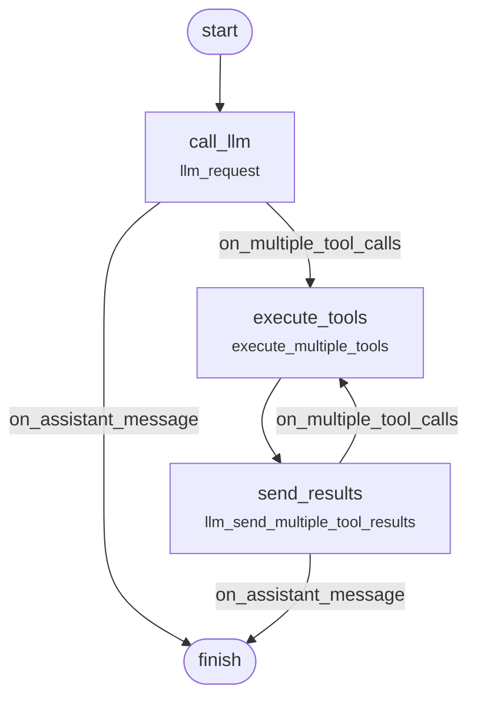
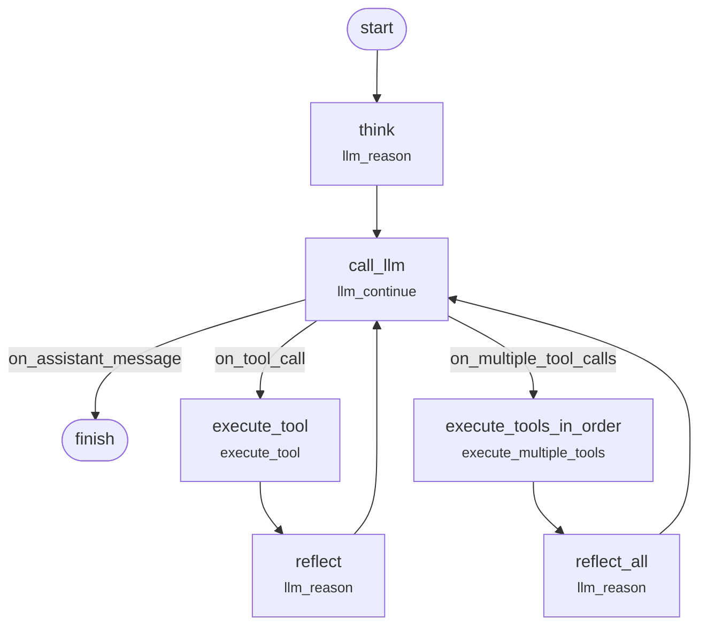
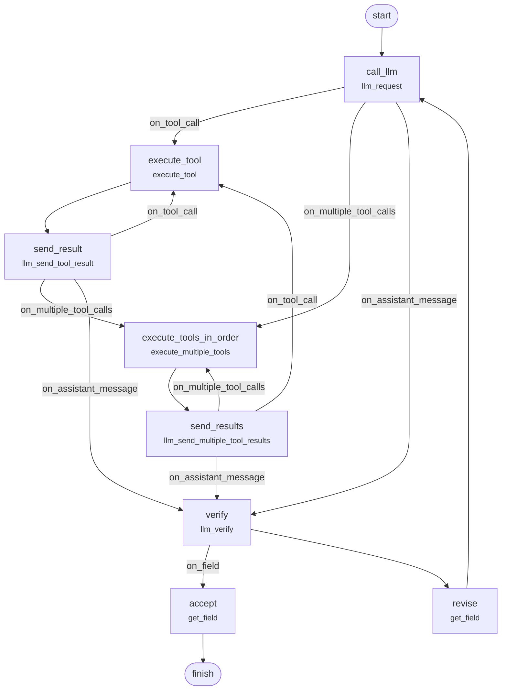
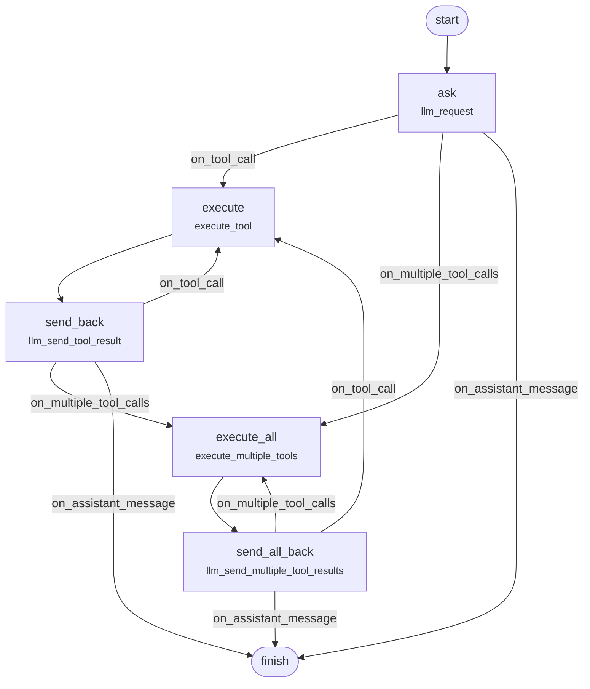

# Chapter 4: Flows

So far every agent has done the same thing: ask the model, run tools, answer. In this chapter you
learn how to define an agent's **flow** – first with ready-made templates (*strategies*), then with
your own graphs made of nodes and edges.

A few terms:

- **Graph:** the flow of an agent. It always begins at `start` and ends at `finish`.
- **Node:** a step in the graph, e.g. "ask the model" or "run a tool". Which kinds exist is defined
  by grauwolf's node catalog.
- **Edge:** an arrow from one node to the next. Values flow along edges: the `start` node delivers
  the input of the run, and whatever arrives at `finish` is the answer.
- **Condition:** an edge can have a condition (`when`). It decides whether the edge is taken and
  can transform the value along the way.

## Strategies: ready-made flows

A strategy is a template that grauwolf turns into a complete graph when loading the spec:

```json
"strategy": { "kind": "single_run", "params": { … } }
```

There are four kinds: `single_run`, `react`, `verified` and `chat` (for long conversations, see
[Chapter 7](07-conversations-and-knowledge.md#long-conversations-the-chat-strategy)). `params` is
optional; unknown parameters or kinds are errors, e.g.
`/strategy: unknown strategy 'loop' (known: single_run, react, verified, chat)`. You can see the
generated graph at any time with `grauwolf spec graph <file>`.

### `single_run`: the tool loop

You already know `single_run`: the model receives the input; if it calls a tool, the tool is run
and the result is returned – until a text answer comes back. You saw the graph in
[Chapter 1](01-getting-started.md#viewing-the-flow-spec-graph).

Some models like to call several tools in one answer. The loop handles that too: an answer with
exactly one call takes the path `execute_tool` → `send_result`; an answer with several calls takes
the path `execute_tools_in_order` → `send_results`, which runs the calls **one after another** in
call order and returns all results at once. The same holds for `react`, `verified` and `chat`
(with `parallel_tools` set to `false`). If you want the calls of one answer to run **concurrently**
instead, use `parallel_tools`
([`examples/04-parallel-tools.json`](examples/04-parallel-tools.json)):

```json
{
  "spec_version": 1,
  "name": "parallel_calculator",
  "model": { "provider": "ollama", "id": "qwen3.5:9b" },
  "system_prompt": "You are a calculation assistant. Call the tool add for every addition – for several independent additions, call it several times at once.",
  "tools": [
    {
      "name": "add",
      "description": "Adds two numbers a and b",
      "args": {
        "type": "object",
        "properties": { "a": { "type": "number" }, "b": { "type": "number" } },
        "required": ["a", "b"]
      },
      "code_file": "03-tools/add.rs"
    }
  ],
  "strategy": { "kind": "single_run", "params": { "parallel_tools": true } }
}
```

```sh
grauwolf spec run docs/user-guide/examples/04-parallel-tools.json "What is 1+2, 3+4 and 5+6?"
```

Roughly:

```text
1+2 = 3, 3+4 = 7 and 5+6 = 11.
```



### `single_run` with `moderate`: checking input first

With `"moderate": true` the model first checks every input for harmful content. If it is harmful,
the run ends immediately with a refusal as the answer; otherwise it continues as usual
([`examples/04-moderated.json`](examples/04-moderated.json)):

```json
{
  "spec_version": 1,
  "name": "moderated_helper",
  "model": { "provider": "ollama", "id": "qwen3.5:9b" },
  "system_prompt": "You are a friendly assistant. Answer briefly and in English.",
  "strategy": { "kind": "single_run", "params": { "moderate": true } }
}
```

```sh
grauwolf spec run docs/user-guide/examples/04-moderated.json "How do I bake bread?"
```

Roughly:

```text
Knead flour, water, yeast and salt, let the dough rise and bake it at about 230 °C.
```

There are now three nodes in front of the tool loop: `moderate` (`llm_moderate`) gives the verdict,
`refuse` delivers the refusal when `harmful = true`, and `pass` otherwise passes the text on. For
the verdict, the strategy creates the type `Moderation`; a type of your own with this name is
therefore not allowed. `parallel_tools` and `moderate` can be combined.

### `react`: think first, then act

With `react`, the model thinks before the first action and after every tool result – **without**
tools – and only then acts. This helps with tasks that take several steps
([`examples/04-react.json`](examples/04-react.json); the `add` tool is the same as above and
shortened here):

```json
{
  "spec_version": 1,
  "name": "thoughtful_calculator",
  "model": { "provider": "ollama", "id": "qwen3.5:9b" },
  "system_prompt": "You are a calculation assistant. Use the tool add for every addition and answer in English.",
  "tools": [ … ],
  "strategy": {
    "kind": "react",
    "params": {
      "reasoning_prompt": "Think briefly about which calculation step is needed next. Do not call a tool yet."
    }
  }
}
```

`reasoning_prompt` is the prompt for thinking. If you leave it out, the default is
`Think about the task and plan the next steps. Do not call a tool yet.` Your own prompts can be
in any language.

```sh
grauwolf spec run docs/user-guide/examples/04-react.json "Add 3, 5 and 9."
```

Roughly:

```text
3 + 5 + 9 = 17.
```



### `verified`: checking and revising the answer

With `verified`, the model checks its finished answer itself. If it is fine, it goes to `finish`;
otherwise the feedback goes back as a new task, and the tool loop starts again
([`examples/04-verified.json`](examples/04-verified.json), `tools` shortened):

```json
{
  "spec_version": 1,
  "name": "verified_calculator",
  "model": { "provider": "ollama", "id": "qwen3.5:9b" },
  "system_prompt": "You are a calculation assistant. Use the tool add for every addition and answer in English.",
  "tools": [ … ],
  "strategy": {
    "kind": "verified",
    "params": {
      "verify_prompt": "Check whether every number in the answer is correct and whether the question is fully answered. Set correct to true or false and describe in feedback what is wrong."
    }
  }
}
```

The verdict is a structured value of type `Verification` with `correct`, `feedback` and `answer`;
the strategy creates this type itself. Without `verify_prompt`, a built-in check prompt
applies: `Judge only the content of the answer below against the task. You cannot see how the answer was obtained, … Set correct to false only if the answer is wrong or leaves part of the task unanswered, … otherwise set correct to true and leave feedback empty.`

```sh
grauwolf spec run docs/user-guide/examples/04-verified.json "What is 120 + 35 + 7?"
```

Roughly:

```text
120 + 35 + 7 = 162.
```



Every check costs an additional request. Loops are not endless, by the way: after more than 50
node executions a run stops with `more than 50 node executions – probably an endless loop`. With
`"limits": { "max_steps": n }` you set the limit yourself, and `max_tool_calls` limits the tool
calls ([Chapter 2](02-models.md#limits-in-the-spec-limits)).

## Your own graphs: `graph` with `nodes` and `edges`

If no template fits, you write the graph yourself. The spec then contains `graph` instead of
`strategy` – both together are an error.

```json
"graph": {
  "nodes": [ { "id": "…", "kind": "…", "params": { … } } ],
  "edges": [ { "from": "…", "to": "…", "when": { "kind": "…", "params": { … } } } ]
}
```

- A **node** has an `id` (snake_case, unique), a `kind` from the node catalog and, depending on the
  kind, `params`. `start` and `finish` always exist; they are not allowed as your own IDs.
- An **edge** connects `from` with `to`. Without `when` it passes the value on unchanged.
- If several edges leave a node, the **first matching** one in spec order wins. If none matches,
  the run stops with `no matching edge from node '…'`.

### A first graph: two steps in a row

The model writes a paragraph and then shortens it
([`examples/04-two-steps.json`](examples/04-two-steps.json)):

```json
{
  "spec_version": 1,
  "name": "draft_and_shorten",
  "model": { "provider": "ollama", "id": "qwen3.5:9b" },
  "system_prompt": "First you write a paragraph in English on a topic. When you then get your paragraph back, you shorten it to at most two sentences and output only those.",
  "graph": {
    "nodes": [
      { "id": "draft", "kind": "llm_request" },
      { "id": "shorten", "kind": "llm_request" }
    ],
    "edges": [
      { "from": "start", "to": "draft" },
      { "from": "draft", "to": "shorten", "when": { "kind": "on_assistant_message" } },
      { "from": "shorten", "to": "finish", "when": { "kind": "on_assistant_message" } }
    ]
  }
}
```

```sh
grauwolf spec run docs/user-guide/examples/04-two-steps.json "Wolves"
```

Roughly:

```text
Wolves live in packs with a clear hierarchy. They hunt together and can cover long distances.
```

An `llm_request` appends its input text to the history as a message and asks the model. Both steps
share the same history, which is why the second one "knows" what the first one did.

### Types on the edges

Every value on an edge has a **type**, and grauwolf checks during validation whether the types fit
together. The built-in types:

| Type | Meaning |
|---|---|
| `string` | text |
| `message` | an answer from the model (text or tool calls) |
| `tool_call` / `tool_calls` | one tool call / all tool calls of an answer |
| `tool_result` / `tool_results` | one tool result / several results |

On top of that come your own types from `types` ([Chapter 5](05-structured-data.md)). `start`
delivers the type from `input`, `finish` expects the one from `output` – both `string` by default.

An `llm_request` delivers a `message`, `finish` expects `string`. That is why the edge to `finish`
needs the condition `on_assistant_message`, which turns the answer into its text. If it is missing,
`spec validate` reports something like:

```text
type.json:/graph/edges/1: type error: target expects string, the edge delivers message
```

Further checks: every node must be reachable from `start`, there must be a path from every node to
`finish`, and conditions must fit the value, e.g.
`/graph/edges/0/when: condition 'on_tool_call' expects message, the source delivers string`.

## The most important node kinds

| Kind | Type (in → out) | Effect |
|---|---|---|
| `llm_request` | string → message | append the input, ask the model with all tools |
| `llm_request_streaming` | string → message | like `llm_request`; with `--stream` the text appears immediately |
| `llm_request_only_tools` | string → message | like `llm_request`, a tool call is mandatory |
| `llm_request_force_tool` | string → message | the tool from `params.tool` must be called |
| `llm_request_best_of` | string → message | `params.choices` answers, an assessment (`criteria`) picks the best |
| `llm_request_structured` | string → own type | answer as a structured value ([Chapter 5](05-structured-data.md)) |
| `llm_continue` | string → message | ask again without appending the input again |
| `llm_reason` | `value` → string | think without tools; `params.value` is `string`, `tool_result` or `tool_results`, optional `prompt` |
| `llm_verify` | string → own type | check an answer (`params.type`, optional `prompt`) |
| `llm_moderate` | string → own type | check text for harmful content (`params.type`, optional `provider` + `id`) |
| `execute_tool` | tool_call → tool_result | run one tool |
| `llm_send_tool_result` | tool_result → message | give the result to the model, get the answer |
| `execute_multiple_tools` | tool_calls → tool_results | run several tools concurrently, or one after another with `params.sequential: true` |
| `llm_send_multiple_tool_results` | tool_results → message | return all results, get the answer |
| `get_field` | own type → string | one field of a structured value (`params.type`, `field`) |
| `set_model` | `value` → `value` | switch the model ([Chapter 2](02-models.md)) |
| `store` / `load` | `value` → `value` / `value` → `type` | store a value under `params.key` or fetch it again |
| `compress_history` | `value` → `value` | compress the history (see below) |
| `agent` | text or own type → text or own type | run a sub-agent from `agent_tools` as a step (see [Flows of several agents](#flows-of-several-agents-agent-and-for_each)) |
| `decide` | `value` → `value` | ask a decider a question about the value; the answer picks the edge (see [Decisions](#decisions-routing-by-a-question)) |
| `code` | `input` → `output` | run Rust code on the value (see [Code in graphs](#code-in-graphs-code-on_code-and-transform)) |

`value` and `type` in the type column mean: the type is given as a name in the parameter of the
same name. In addition there are the kinds `subgraph`, `parallel`, `plan` and `goap`, which embed
other flows – they are the topic of [Chapter 6](06-subgraphs-and-planners.md) – and the kinds `agent` and
`for_each`, which run sub-agents (see [Flows of several agents](#flows-of-several-agents-agent-and-for_each)). All parameters are
listed in the [spec reference](reference-spec.md).

## The conditions

| Condition | Type (in → out) | Matches if … |
|---|---|---|
| `on_assistant_message` | message → string | the answer contains no tool call; delivers the text |
| `on_tool_call` | message → tool_call | the answer contains exactly one tool call |
| `on_multiple_tool_calls` | message → tool_calls | the answer contains at least one tool call; delivers all of them |
| `on_field` | own type → same | the field `params.field` has the value `params.equals` |
| `on_decision` | any → same | the answer of the latest `decide` node is one of `params.answers` |
| `on_history_longer` | any → same | the history has more than `params.messages` messages |
| `on_history_tokens_above` | any → same | the history has more than `params.tokens` tokens (estimated) |
| `on_code` | own type → same | the code `params.code` returns `true` for the value (see [Code in graphs](#code-in-graphs-code-on_code-and-transform)) |

## Building the tool loop yourself

With these building blocks you can rebuild the `single_run` loop – the starting point for your own
variants ([`examples/04-tool-loop.json`](examples/04-tool-loop.json), `tools` shortened):

```json
{
  "spec_version": 1,
  "name": "handmade_calculator",
  "model": { "provider": "ollama", "id": "qwen3.5:9b" },
  "system_prompt": "You are a calculation assistant. Use the tool add for every addition and answer in English.",
  "tools": [ … ],
  "graph": {
    "nodes": [
      { "id": "ask", "kind": "llm_request" },
      { "id": "execute", "kind": "execute_tool" },
      { "id": "send_back", "kind": "llm_send_tool_result" },
      { "id": "execute_all", "kind": "execute_multiple_tools", "params": { "sequential": true } },
      { "id": "send_all_back", "kind": "llm_send_multiple_tool_results" }
    ],
    "edges": [
      { "from": "start", "to": "ask" },
      { "from": "ask", "to": "execute", "when": { "kind": "on_tool_call" } },
      { "from": "ask", "to": "execute_all", "when": { "kind": "on_multiple_tool_calls" } },
      { "from": "ask", "to": "finish", "when": { "kind": "on_assistant_message" } },
      { "from": "execute", "to": "send_back" },
      { "from": "send_back", "to": "execute", "when": { "kind": "on_tool_call" } },
      { "from": "send_back", "to": "execute_all", "when": { "kind": "on_multiple_tool_calls" } },
      { "from": "send_back", "to": "finish", "when": { "kind": "on_assistant_message" } },
      { "from": "execute_all", "to": "send_all_back" },
      { "from": "send_all_back", "to": "execute", "when": { "kind": "on_tool_call" } },
      { "from": "send_all_back", "to": "execute_all", "when": { "kind": "on_multiple_tool_calls" } },
      { "from": "send_all_back", "to": "finish", "when": { "kind": "on_assistant_message" } }
    ]
  }
}
```

Read the edges like this: after `ask`, the flow goes to the tool if the model calls one, otherwise
with the text to `finish`. After execution, the result goes back to the model, and its answer
decides again: another tool or done.

The second edge, `on_multiple_tool_calls`, catches answers with two or more tool calls (small models
send them): `on_tool_call` needs exactly one call and comes first, so this edge only sees the
rest, runs the calls one after another with `execute_multiple_tools` and `"sequential": true`, and
returns all results at once. Without it, such an answer stops the run with `no matching edge`, and
`spec validate` warns about the missing edge.

```sh
grauwolf spec run docs/user-guide/examples/04-tool-loop.json "What is 40 plus 2?"
```

Roughly:

```text
40 plus 2 is 42.
```

## Decisions: routing by a question

Sometimes the flow has to branch on something that is not a field of a structured value but a
*judgement*: is this ticket about billing or about a technical problem? Is it an outage? How
urgent is it? A **decision** asks a typed question about the current value and lets the answer
choose the edge. The value itself passes on unchanged.

```json
{ "id": "route", "kind": "decide", "params": {
    "value": "string",
    "kind": "choice",
    "question": "Which team should handle this support ticket?",
    "options": [
      { "name": "billing", "description": "Invoices, payments, refunds and prices" },
      { "name": "technical", "description": "Errors, crashes and how to use the product" }
    ],
    "temperature": 0,
    "think": false } }
```

The edges that leave a `decide` node use the condition `on_decision` with the answers they
handle:

```json
{ "from": "route", "to": "reply", "when": { "kind": "on_decision", "params": { "answers": ["billing"] } } },
{ "from": "route", "to": "diagnose", "when": { "kind": "on_decision", "params": { "answers": ["technical"] } } }
```

The complete example is [`04-decide.json`](examples/04-decide.json): a ticket router in which
billing tickets get a reply, technical ones a diagnosis, and everything else is passed on as it is.

### The three kinds of questions

| `kind` | You give | The answer is |
|---|---|---|
| `choice` | `options`: 1 to 255 entries `{ name, description? }` | the `name` of the chosen option |
| `yes_no` | `threshold` (0 to 1, default 0.5), optionally `yes` and `no` (what they mean) | `yes` if the probability of yes reaches the threshold, otherwise `no` |
| `score` | `levels`: 1 to 255 descriptions of an ordered scale, lowest first | the description of the level: the mean level index, rounded and kept inside the scale |

`value` is the type of the passing value (as with `store` or `set_model`), `question` the question
in plain words. Names and level descriptions must be unique. `decider` and `model` choose who
answers (see below).

### Rules that `spec validate` checks

- `on_decision` may only leave a `decide` node, and every edge that leaves a `decide` node must
  use `on_decision`. The condition reads the *latest* verdict, so the edges must follow the node
  directly.
- Every answer of the decision has **exactly one** edge: an answer without an edge
  (`DecisionAnswerUncovered`) would stop the run, an answer with two (`DecisionAnswerDuplicated`)
  would be ambiguous. An edge may list several answers.
- An answer that the decision does not have (`UnknownDecisionAnswer`) is an error at its place in
  `answers`.

### Who answers: `decider`

- **`llm`** (the default) asks the model of the agent – or the model in `model`, written
  `provider/id`, e.g. `"model": "ollama/qwen3.5:9b"` – for a structured answer: one of the allowed
  answers, or for `yes_no` the probability of yes. The question, the options and the value are one
  request of their own; the history of the agent is not touched. It needs no further service, but
  it costs tokens, and the probabilities of a language model are less calibrated than those of a
  decision model. `temperature` (0–2) and `think` (`true`/`false`, only for `ollama`) apply to this
  request alone, e.g. `"temperature": 0, "think": false` for repeatable, quick verdicts; they
  follow the model rules of [Models](02-models.md), and with `system_one` they are an error.
- **`system_one`** asks a *System One* service such as [RKEV](https://github.com/agentsw0rk/RKEV)
  that answers such questions with a small decision model, quickly and with calibrated
  probabilities. `model` is then the name of a checkpoint of the service. Set
  `RKEV_BASE_URL` (e.g. `http://localhost:8090`) and, if the service needs one, `RKEV_API_KEY`.
  Without `RKEV_BASE_URL` a spec with a `system_one` decision does not start; the error says so.
  Connection errors and a busy service (HTTP 503) are retried like LLM requests; any other error
  fails the node with the message of the service. The example
  [`04-decide-system-one.json`](examples/04-decide-system-one.json) asks a `yes_no` question with
  a threshold of 0.7.

**Tip: describe options and levels.** Small decision models judge the text of the options, not
only their names. With bare levels such as `["low", "medium", "high"]`, RKEV's `kev-0.6b` rated
"Production database is down, nobody can log in." as *low*; with levels that say what they mean –
`"High: service down or many users blocked, act immediately"` – it answered *high*. The same holds
for `choice` (fill in `description`) and for `yes_no` (`yes`, `no`). The answer of a `score`
decision is then the whole description, so keep the edges' `answers` in sync with it.

### What you can see afterwards

The verdict of the latest decision is kept in the agent's storage under `grauwolf.decision` (so it
is part of checkpoints). The events `decision_starting`, `decision_completed` (with `answer`,
`probability`, `confidence` and `model`) and `decision_failed` report every decision – never the
value that was judged – and OpenTelemetry shows each one as a span `decide <node>`
([Chapter 9](09-operations.md)).

## Flows of several agents: `agent` and `for_each`

A flow does not have to be one agent with many nodes. You can also chain **agents**, each with its
own spec, prompt, model and tools, and run one of them once per element of a list. Two node kinds
do this; the sub-agents are declared in `agent_tools`, as in [Chapter 8](08-external-tools-and-agents.md), but
here the *graph* decides when they run – not the model.

### `agent`: a sub-agent as a step

```json
{ "id": "research", "kind": "agent", "params": { "agent": "researcher" } }
```

`agent` runs the entry `researcher` of `agent_tools` with the value that arrives at the node and
passes its answer on. It is a step like any other: nothing is left to the model's judgement, and an
error of the sub-agent fails the node (an `on_error`-style edge does not exist; the run stops as
with every node error).

| Parameter | Meaning |
|---|---|
| `agent` | name of an entry of `agent_tools` (a local `spec` or a remote A2A `url`) |
| `input`, `output` | type names, `string` by default. They must be the types of the sub-agent's spec: `spec validate` compares them with the sub-agent's own spec |

The step has **its own history** – the history of the calling agent does not change. Everything
else belongs to the run of the caller: token usage, costs, tool-call counts and the limits of
[Chapter 2](02-models.md) and [Chapter 9](09-operations.md) are shared (a sub-agent cannot exceed
the budget of the flow), and so are the approvals of tools that ask for one. The sub-agent reports
its events as an agent tool does.

### `for_each`: one body per element

```json
{ "id": "write_all", "kind": "for_each", "params": {
    "input": "string",
    "output": "string",
    "body": { "agent": "writer" },
    "max_parallel": 2,
    "on_error": "skip" } }
```

| Parameter | Meaning |
|---|---|
| `body` | what runs for each element: `{ "agent": "<name>" }` (a sub-agent from `agent_tools`) or `{ "subgraph": "<name>" }` (a subgraph `T → U`, [Chapter 6](06-subgraphs-and-planners.md)) |
| `input` | `array<T>` or `string` (default `array<string>`). With `string` the text is parsed as a JSON array – a Markdown code fence around it, which models like to add, is ignored; any other text is an error that says so |
| `output` | `array<U>` or `string` (default `array<string>`). With `string` the list is passed on as JSON text, e.g. to an agent that takes text |
| `max_parallel` | how many elements run at the same time, 1 to 16 (default 1) |
| `on_error` | `fail` (default): the first failing element fails the node, elements that have not started do not start; `skip`: the element is left out of the output |

The output has the elements' results **in input order**, however fast each one was. A skipped
element is not in the output; the event `for_each_item_failed` reports it with its error. Each
element runs on its own copy of the history, as it was when the node started; nothing flows back
into the caller's history. Usage, costs and limits are shared, so `max_parallel: 2` does not give
two budgets. The elements of one node run concurrently within one task – they do not need threads.

**Resuming.** Every finished element is saved in the run's progress (under
`grauwolf.for_each.<node id>`). If a run is interrupted – or the node fails, or the budget runs
out – and is resumed from its checkpoint ([Chapter 9](09-operations.md)), only the missing
elements are run; skipped elements are not run again.

**Events.** `for_each_item_starting`, `for_each_item_completed` and `for_each_item_failed` carry
`node` and `index` (from 0) – and `error` for the last one. OpenTelemetry records them as span
events.

### A complete flow

The example [`04-flow.json`](examples/04-flow.json) is a pipeline of three agents, a loop over a
list and a decision:

1. `researcher` (an agent with its own spec, [`04-flow/researcher.json`](examples/04-flow/researcher.json))
   answers with a JSON list of three topics;
2. the `for_each` node `write_all` runs the `writer` agent for each topic, two at a time, and
   hands the articles on as a JSON list;
3. `summarizer` condenses the articles;
4. the `decide` node `check` asks whether the result is a coherent summary: *yes* ends the flow, *no*
   runs the summarizer once more ([Decisions](#decisions-routing-by-a-question)).

```json
"graph": {
  "nodes": [
    { "id": "research", "kind": "agent", "params": { "agent": "researcher" } },
    { "id": "write_all", "kind": "for_each", "params": {
        "input": "string", "output": "string", "body": { "agent": "writer" },
        "max_parallel": 2, "on_error": "skip" } },
    { "id": "summarize", "kind": "agent", "params": { "agent": "summarizer" } },
    { "id": "check", "kind": "decide", "params": { "value": "string", "kind": "yes_no",
        "question": "Is this a coherent summary of several short articles?" } },
    { "id": "retry", "kind": "agent", "params": { "agent": "summarizer" } }
  ],
  "edges": [
    { "from": "start", "to": "research" },
    { "from": "research", "to": "write_all" },
    { "from": "write_all", "to": "summarize" },
    { "from": "summarize", "to": "check" },
    { "from": "check", "to": "finish", "when": { "kind": "on_decision", "params": { "answers": ["yes"] } } },
    { "from": "check", "to": "retry", "when": { "kind": "on_decision", "params": { "answers": ["no"] } } },
    { "from": "retry", "to": "finish" }
  ]
}
```

Run it with `grauwolf spec run 04-flow.json "Three topics about animals"`; with `--events` the
events of every element appear. A flow cannot loop on its own, but the graph edges can (with a
step limit, `limits.max_steps`); a `for_each` body may contain `agent`, `decide` and further
`for_each` nodes, as long as no body includes itself.

### Lists with named types

With a named type for the elements, a list has the type `array<Topic>`: `"input": "array<Topic>"`
means the elements are `Topic` values, and a body subgraph must then take `Topic`
(`spec validate` checks this against `output` as well). Lists in the types of node parameters are
written `array<T>`; the `types` section itself still only contains objects.

### Rules that `spec validate` checks

- the `agent` of an `agent` node and of a `body` exists in `agent_tools`; a `body.subgraph` exists
  and does not include itself, directly or through other bodies;
- `max_parallel` is 1 to 16 and `on_error` is `fail` or `skip`;
- `input` and `output` are `array<T>` or `string`, and `T` is `string` or a declared type;
- the subgraph of the body takes the elements of `input` and returns the elements of `output`;
- the types on the edges match, as for every node.

The same rules apply to generated crates (`spec generate`): they run the same runtime functions
and, for sub-agents, load them from `agent_tools` like the interpreter.

## Code in graphs: `code`, `on_code` and `transform`

Sometimes a step is not a model call but a small computation: score a text, test a value, bring an
object into another shape. For these cases a graph may contain Rust code in three places:

| Where | What it is | Function |
|---|---|---|
| node `code` | a step that computes its output from its input | `fn run(input: In) -> Result<Out, String>` |
| condition `on_code` | an edge that is taken if the code says `true`; the value passes through unchanged | `fn check(value: &In) -> bool` |
| `transform` on an edge | maps the value of the edge before the target node receives it | `fn transform(value: In) -> Out` |

You write only the **body** of the function, as for tool code ([chapter 3](03-tools.md)). The
code is compiled to a WebAssembly module exactly like a tool and runs in the same sandbox: no file
system, no network, a limit on computing time (fuel) and memory. It is a **pure function of its
value**: it sees no history, no storage, no tools, no model, no clock and no random numbers, so
the same value always gives the same result.

The example [`04-code.json`](examples/04-code.json) asks the model to judge a review, scores the
answer with code, routes it with `on_code` and shapes the reply with a `transform`:

```json
"types": {
  "Verdict": { "type": "object", "properties": {
      "text": { "type": "string" }, "positive": { "type": "boolean" }, "words": { "type": "integer" } },
    "required": ["text", "positive", "words"] },
  "Reply": { "type": "object", "properties": {
      "subject": { "type": "string" }, "body": { "type": "string" } },
    "required": ["subject", "body"] }
},
"input": "string",
"output": "Reply",
"graph": {
  "nodes": [
    { "id": "judge", "kind": "llm_request" },
    { "id": "score", "kind": "code",
      "params": { "input": "string", "output": "Verdict", "code_file": "04-code/score.rs" } }
  ],
  "edges": [
    { "from": "start", "to": "judge" },
    { "from": "judge", "to": "score", "when": { "kind": "on_assistant_message" } },
    { "from": "score", "to": "finish",
      "when": { "kind": "on_code", "params": { "input": "Verdict", "code": "value.positive" } },
      "transform": { "output": "Reply",
        "code": "Reply { subject: \"Thank you for the praise\".to_owned(), body: value.text }" } },
    { "from": "score", "to": "finish",
      "transform": { "output": "Reply",
        "code": "Reply { subject: format!(\"We will look into it ({} words)\", value.words), body: value.text }" } }
  ]
}
```

and `04-code/score.rs` holds the body of `run`:

```rust
let lower = input.to_lowercase();
let positive = lower
    .split(|c: char| !c.is_alphabetic())
    .any(|word| ["good", "great", "love", "excellent", "satisfied", "positive", "happy"].contains(&word));
if input.trim().is_empty() {
    return Err("the verdict is empty".to_owned());
}
Ok(Verdict {
    text: input.trim().to_owned(),
    positive,
    words: input.split_whitespace().count() as i64,
})
```

With `grauwolf spec run 04-code.json "The headphones are great."` the model's answer ("This review
is positive.") goes through `score`, the `on_code` edge is taken, and the `transform` turns the
`Verdict` into a `Reply` – `--events` shows the nodes `judge` and `score`; the transformation is
part of the edge, so it has no events of its own. A negative review takes the second edge.

### The node `code`

`params`: `input` and `output` (type names), and `code` – or `code_file`, a file with the body
relative to the spec, exactly one of the two (as for tools, see
[Chapter 3](03-tools.md#tool-code-in-its-own-file-code_file)). `input` and `output` are `string`, a
named type from `types` or a list `array<T>` of these; the catalog types such as `message` are not
possible. Inside the code, `In` and `Out` are the Rust types for them (`String`, `Vec<…>` or the
struct of the named type). `Err(message)` fails the node with that message; the output is a
value of `Out`, so it always matches the type.

### The condition `on_code`

`params`: `input` – the type of the value, which must be the output of the source node – and
`code`/`code_file` with the body of `fn check(value: &In) -> bool`. If it returns `true`, the edge
is taken and the value passes through unchanged, as with `on_field`. **A failing check is an error
of the run, not `false`**: a panic, a trap or an exhausted fuel limit stops the run with an error
message instead of silently taking the next edge.

### The `transform` of an edge

An edge may have a `transform` next to `when`: `{ "input"?, "output", "code" | "code_file" }`, the
body of `fn transform(value: In) -> Out`. It runs after the condition of the edge matched and
before the target node runs; the target receives `Out`, and that is also what a checkpoint stores,
so a resumed run does not transform again. `spec validate` checks the edge against `output`;
`input` defaults to what the edge delivers (the output of the source node, after the condition)
and, if given, has to be exactly that. An edge to `finish` delivers `Out` as the result of the
graph. If the transformation panics or runs out of fuel, the run fails.

### Types in code

The Rust types follow the rules for structured data ([Chapter 5](05-structured-data.md)): a named
type becomes a struct with `pub` fields of `String`, `i64` (`integer`), `f64` (`number`), `bool`
and `Vec<…>`; fields that are not `required` are `Option<…>`. Field names that are Rust keywords
are written `r#type`. Values that do not fit the type are refused before the code runs
(`invalid input: field `stars`: expected an integer…`).

### Build, cache and errors

The code is built together with the tools: by `spec build`, at the start of `spec run`
and the other run commands (cached like tools), and by `spec generate` (embedded as WASM modules
in the crate, which runs them in the sandbox just like the interpreter does). The same checks as
for tool code apply (no `include!`, `env!`, `mod`, `extern`, `unsafe`, attributes). Compile errors
name the place in the spec like validation errors:

```text
spec.json:/graph/nodes/1/params/code:2:9: error: cannot find value `unknown_value` in this scope
spec.json:/graph/edges/1/transform/code:1:5: error: mismatched types
```

For `spec generate --tool-sources` ([Chapter 11](11-code-generation.md)) every piece of code is
written as a guest crate `tools/<name>/` with an entry in `tools/tools.json` that has a `kind`
(`code`, `condition` or `transform`); `grauwolf tools build` builds it, and its `--format json`
report names the entry and its kind. The names are derived from the node or the edge:

| Piece | Name |
|---|---|
| node `score` in the main graph | `code_main_score` |
| `on_code` on the edge `score` → `finish` | `condition_main_score_finish` |
| `transform` on the edge `score` → `finish` | `transform_main_score_finish` |
| the same in the subgraph `inner` | `code_sub_inner_score`, … |
| a second edge between the same nodes | `transform_main_score_finish_2`, … |

### Rules that `spec validate` checks

- `code` nodes, `on_code` conditions and transformations have code (`MissingCode` at
  `…/params/code` or `…/transform/code`);
- `input` and `output` are `string`, declared types or `array<T>` of these (`UnknownType`);
- the `input` of `on_code` is the output of the source node (`ConditionInputMismatch`);
- the `output` of a `transform` is the input of the target node (`TypeMismatch`), and a declared
  `input` is what the edge delivers (`TransformInputMismatch`);
- the types on the edges of `code` nodes match, as for every node.

## Viewing graphs with `spec graph`

`grauwolf spec graph docs/user-guide/examples/04-tool-loop.json` prints this Mermaid text:



How to read the diagram: `start` and `finish` are rounded, every node shows its ID and kind, and
the arrows are labeled with the condition. Subgraphs appear as separate blocks, and a dashed arrow
shows who calls them (see [Chapter 2](02-models.md#a-separate-model-for-a-subgraph)). Paste the
text into Markdown as a ` ```mermaid ` block, e.g. in a README on GitHub.

## Shortening the history: history compression

Every request sends the entire **history** so far (all messages of the run) to the model. In long
tool loops it becomes large, slow and expensive. The `compress_history` node shortens it and passes
its value on unchanged:

- `"strategy": "keep_last"` with `"keep": n` keeps the system prompt and the last n messages.
- `"strategy": "summarize"` has the model summarize the history (one additional request).
- `"strategy": "facts"` with `"keep": n` keeps the last n messages verbatim and replaces all older
  ones with a list of facts the model extracts from them (one additional request). Afterwards the
  list sits in the history as one message `Facts from the
  conversation so far:` with one line `- …` per fact; on the next compression it is merged into the new list.

Which one should you pick? `keep_last` is free but forgets everything older. `summarize` keeps the
context but loses details. `facts` lies in between: names, numbers, decisions and open questions
are kept as individual sentences, and the last messages stay verbatim.

Combined with `on_history_longer`, the history is only compressed when it is too long
([`examples/04-compression.json`](examples/04-compression.json), shortened – `tools` as above):

```json
"graph": {
  "nodes": [
    { "id": "ask", "kind": "llm_request" },
    { "id": "execute", "kind": "execute_tool" },
    {
      "id": "trim",
      "kind": "compress_history",
      "params": { "value": "tool_result", "strategy": "keep_last", "keep": 6 }
    },
    { "id": "send_back", "kind": "llm_send_tool_result" },
    { "id": "execute_all", "kind": "execute_multiple_tools", "params": { "sequential": true } },
    {
      "id": "trim_all",
      "kind": "compress_history",
      "params": { "value": "tool_results", "strategy": "keep_last", "keep": 6 }
    },
    { "id": "send_all_back", "kind": "llm_send_multiple_tool_results" }
  ],
  "edges": [
    { "from": "start", "to": "ask" },
    { "from": "ask", "to": "execute", "when": { "kind": "on_tool_call" } },
    { "from": "ask", "to": "execute_all", "when": { "kind": "on_multiple_tool_calls" } },
    { "from": "ask", "to": "finish", "when": { "kind": "on_assistant_message" } },
    {
      "from": "execute",
      "to": "trim",
      "when": { "kind": "on_history_longer", "params": { "messages": 12 } }
    },
    { "from": "execute", "to": "send_back" },
    { "from": "trim", "to": "send_back" },
    { "from": "send_back", "to": "execute", "when": { "kind": "on_tool_call" } },
    { "from": "send_back", "to": "execute_all", "when": { "kind": "on_multiple_tool_calls" } },
    { "from": "send_back", "to": "finish", "when": { "kind": "on_assistant_message" } },
    {
      "from": "execute_all",
      "to": "trim_all",
      "when": { "kind": "on_history_longer", "params": { "messages": 12 } }
    },
    { "from": "execute_all", "to": "send_all_back" },
    { "from": "trim_all", "to": "send_all_back" },
    { "from": "send_all_back", "to": "execute", "when": { "kind": "on_tool_call" } },
    { "from": "send_all_back", "to": "execute_all", "when": { "kind": "on_multiple_tool_calls" } },
    { "from": "send_all_back", "to": "finish", "when": { "kind": "on_assistant_message" } }
  ]
}
```

This shows why the order of the edges matters: the edge to `trim` comes before the edge to
`send_back` and therefore wins as soon as the history has more than 12 messages (the lower path
for several tool calls does the same with `tool_results`). The currently open
tool call is always kept during compression so that the result still matches it.

### Compressing by size instead of count

Twelve short messages are something different from twelve long tool results. With
`on_history_tokens_above` you compress as soon as the history has more than a certain number of
tokens:

```json
{
  "from": "execute",
  "to": "trim",
  "when": { "kind": "on_history_tokens_above", "params": { "tokens": 6000 } }
}
```

grauwolf estimates the tokens before the request: one token per started four characters, plus a
small surcharge per message and a flat 1000 per attachment. Depending on language and model, the
estimate can be off by about a quarter – so set the threshold with some margin below your model's
context window. How to prevent an oversized request altogether is described in
[Chapter 2](02-models.md) under `limits`.

## Key points

- A flow is a graph from `start` to `finish`; typed values flow along the edges.
- Strategies: `single_run` (tool loop; `parallel_tools`, `moderate`), `react` (`reasoning_prompt`), `verified` (`verify_prompt`), `chat` (long conversations, Chapter 7).
- A custom `graph` consists of `nodes` (`id`, `kind`, `params`) and `edges` (`from`, `to`, optional `when`); `strategy` and `graph` are mutually exclusive.
- Of several edges, the first matching one wins; if none matches, the run stops. After every LLM answer route `on_tool_call`, `on_multiple_tool_calls` and `on_assistant_message` in this order; `spec validate` warns if `on_multiple_tool_calls` is missing.
- `spec validate` checks types, reachability and parameters; `spec graph` draws the flow as a Mermaid diagram.
- `compress_history` (`keep_last`, `summarize`, `facts`) with `on_history_longer` (messages) or `on_history_tokens_above` (estimated tokens) keeps long histories small.
- `decide` asks a typed question (`choice`, `yes_no`, `score`) about the value, answered by the model (`llm`) or a System One service (`system_one`); `on_decision` edges route by the answer, and every answer needs exactly one edge.
- `agent` runs a sub-agent from `agent_tools` as a step; `for_each` runs an `agent` or a subgraph per element of a JSON list, `max_parallel` at a time, results in input order, progress saved per element.
- `code` nodes, `on_code` conditions and `transform`s on edges run Rust (`fn run`, `fn check`, `fn transform`) as sandboxed WASM like tools, as pure functions of the value; `Err`, a panic or exhausted fuel fail the run, and a failing `on_code` is an error, not `false`.
- A run ends after at most 50 node executions per graph; `limits.max_steps` changes that.

Continue with [Chapter 5: Structured data](05-structured-data.md).
