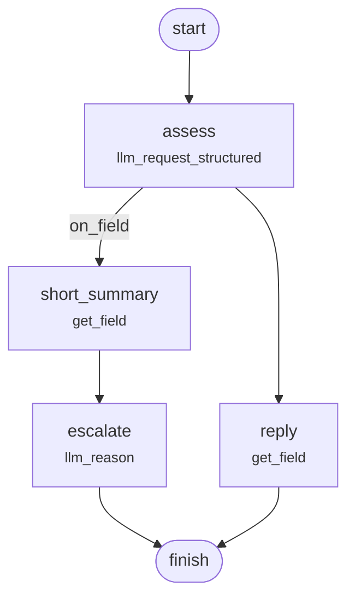

# 5 Structured data

So far your agents have received text and returned text. Often, though, you want data with a fixed
shape: a ticket with a title and a priority, an assessment with a yes/no field, a request with a
customer number. For this you describe your own **types** in the spec. grauwolf then makes sure
that

- the model returns an answer in exactly this shape (or the run stops with a clear message),
- your flow can branch on individual fields,
- `spec validate` already notices when two nodes do not fit together.

This chapter assumes you know how to build your own graphs from nodes and edges
([Chapter 4](04-flows.md)).

## Describing types: `types`

A type is a named **JSON Schema** – a description of which fields a JSON object has and which data
type each field has. You define types in the `types` section:

```json
"types": {
  "Ticket": {
    "type": "object",
    "description": "A ticket created from a bug report.",
    "properties": {
      "title": { "type": "string", "description": "Short summary." },
      "priority": { "type": "integer", "description": "1 (highest) to 4." },
      "tags": { "type": "array", "items": { "type": "string" } },
      "effort": { "type": "number", "description": "Estimated effort in hours." }
    },
    "required": ["title", "priority", "tags"]
  }
}
```

A few rules apply:

- **Type names** start with an uppercase letter and consist only of letters and digits
  (`Ticket`, `Assessment`, `Request2`). Umlauts, `_` or spaces are not allowed.
- A type is always an object (`"type": "object"`) with `properties`.
- For fields, grauwolf knows this subset of JSON Schema:

  | `type` | Meaning |
  |---|---|
  | `string` | text |
  | `integer` | whole number |
  | `number` | decimal number |
  | `boolean` | `true` or `false` |
  | `array` with `items` | list; `items` describes the entries, e.g. `{ "type": "string" }` |

- `required` lists the required fields. All other fields are optional: they may be missing or
  `null`.
- `description` is optional, but it helps the model a lot to fill in the fields correctly.
- **Field names** consist of lowercase letters, digits and `_` (`customer_no`) and do not start
  with a digit.

`spec validate` checks every schema against this subset – the same one that applies when you
generate Rust code ([Chapter 11](11-code-generation.md)). It reports deviations with the exact
location, e.g. `…:/types/Ticket/properties/owner: unsupported schema: supported are "string",
"integer", "number", "boolean" and "array"` for a nested object or a field without `type`.
Additional keywords such as `enum` are sent to the model along with the schema; grauwolf does not
check the answer against them, though.

## The answer as a type: `llm_request_structured`

A type on its own does nothing yet. Only the `llm_request_structured` node asks the model for an
answer in this type. It receives text and returns a value of the type you name under
`params.type`. With `output` you specify what the whole agent returns:

```json
{
  "spec_version": 1,
  "name": "ticket",
  "model": { "provider": "ollama", "id": "qwen3.5:9b" },
  "system_prompt": "You turn bug reports from users into a ticket.",
  "types": { "Ticket": { "…": "as above" } },
  "output": "Ticket",
  "graph": {
    "nodes": [
      { "id": "capture", "kind": "llm_request_structured", "params": { "type": "Ticket", "retries": 1 } }
    ],
    "edges": [
      { "from": "start", "to": "capture" },
      { "from": "capture", "to": "finish" }
    ]
  }
}
```

The complete file: [`examples/05-ticket.json`](examples/05-ticket.json).

A few things stand out:

- `input` is missing. **If not specified, `input` and `output` are always `string`** – that is,
  text. Here the agent receives text and returns a `Ticket`.
- There is no condition between `capture` and `finish`. Unlike `llm_request`,
  `llm_request_structured` does not return a message but the finished value directly.
- `retries` (default `0`) allows new attempts: if an answer does not fit the schema, grauwolf
  reports the error to the model and asks again. All attempts stay in the history.

grauwolf sends the schema to the model; Ollama, OpenAI, Anthropic and Gemini use their built-in support for
structured answers for this. If the answer is wrapped in a Markdown code block
(```` ```json … ``` ````), grauwolf removes the fences before checking. After that the answer is
**normalized**: fields that are not in the schema are dropped, as is `null` in optional fields,
and `number` fields become decimal numbers.

Call:

```bash
grauwolf spec run docs/user-guide/examples/05-ticket.json \
  "Since the update the app crashes when saving, and all my changes are gone!"
```

The output looks roughly like this – for types, the CLI prints indented JSON:

```json
{
  "effort": 4.0,
  "priority": 1,
  "tags": [
    "crash",
    "data-loss",
    "update"
  ],
  "title": "App crashes when saving, changes are lost"
}
```

If the answer is still unusable after all attempts, the run stops, for example like this:

```text
docs/user-guide/examples/05-ticket.json: … LLM answer does not fit type Ticket: /priority: expected integer
```

The part after the type name is a **JSON Pointer** (the location in the JSON, e.g. `/priority`)
with the reason. Other reasons are `missing required field` or, if no JSON came back at all,
`LLM answer for type Ticket is not JSON: …`.

## Branching on fields: `on_field` and `get_field`

With a type, your flow can make decisions. Two building blocks from the catalog help with this:

- The edge condition **`on_field`** with `params { field, equals }` only lets the value through if
  the field `field` has exactly the value `equals`. The value itself is passed on unchanged.
- The **`get_field`** node with `params { type, field }` extracts a field from a value of type
  `type` and returns it as **text**. Numbers and booleans are written as JSON text (`3`, `true`);
  a missing field results in empty text.

The following example assesses a customer request. If it is urgent, the agent writes an escalation
to the on-call team; otherwise it outputs the suggested answer:

```json
"types": {
  "Assessment": {
    "type": "object",
    "properties": {
      "urgent": { "type": "boolean", "description": "true for data loss, payment problems or outages." },
      "summary": { "type": "string", "description": "The concern in one sentence." },
      "answer": { "type": "string", "description": "A short answer to the customer." }
    },
    "required": ["urgent", "summary", "answer"]
  }
},
"graph": {
  "nodes": [
    { "id": "assess", "kind": "llm_request_structured", "params": { "type": "Assessment", "retries": 2 } },
    { "id": "short_summary", "kind": "get_field", "params": { "type": "Assessment", "field": "summary" } },
    { "id": "escalate", "kind": "llm_reason", "params": { "value": "string", "prompt": "Write a concise escalation to the on-call team: what happened, what needs to be done?" } },
    { "id": "reply", "kind": "get_field", "params": { "type": "Assessment", "field": "answer" } }
  ],
  "edges": [
    { "from": "start", "to": "assess" },
    { "from": "assess", "to": "short_summary", "when": { "kind": "on_field", "params": { "field": "urgent", "equals": true } } },
    { "from": "assess", "to": "reply" },
    { "from": "short_summary", "to": "escalate" },
    { "from": "escalate", "to": "finish" },
    { "from": "reply", "to": "finish" }
  ]
}
```

The complete file: [`examples/05-switch.json`](examples/05-switch.json). This is what the flow
looks like with `grauwolf spec graph`:



The **order of the edges** matters: of several edges leaving a node, the first one that matches
wins. That is why the edge without a condition to `reply` comes after the `on_field` edge and
catches all non-urgent cases. If no edge matches, the run stops with
`no matching edge from node '…'`.

`equals` accepts any JSON value, so also texts (`"equals": "invoice"`) or numbers. The comparison
is exact: `"Invoice"` is not `"invoice"`.

Call, for example:

```bash
grauwolf spec run docs/user-guide/examples/05-switch.json \
  "I was charged three times for the same order!"
```

```text
Escalation: A customer was charged three times for one order. Please check the payments,
refund the duplicate charges and inform the customer today.
```

## Structured input: `input` and JSON with `spec run`

The input can be a type, too. Then you pass **JSON instead of text** to `spec run` (and in every
line of `spec chat`). grauwolf checks the input against the type and normalizes it before the
first node runs.

Nodes that talk to the model (`llm_request` and its relatives) expect text. So you first use
`get_field` to extract the field that matters:

```json
{
  "spec_version": 1,
  "name": "reply_letter",
  "model": { "provider": "ollama", "id": "qwen3.5:9b" },
  "system_prompt": "You write short, friendly replies to customer enquiries.",
  "types": {
    "Request": {
      "type": "object",
      "properties": {
        "customer": { "type": "string" },
        "text": { "type": "string" },
        "customer_number": { "type": "integer" }
      },
      "required": ["customer", "text"]
    }
  },
  "input": "Request",
  "graph": {
    "nodes": [
      { "id": "concern", "kind": "get_field", "params": { "type": "Request", "field": "text" } },
      { "id": "reply", "kind": "llm_request" }
    ],
    "edges": [
      { "from": "start", "to": "concern" },
      { "from": "concern", "to": "reply" },
      { "from": "reply", "to": "finish", "when": { "kind": "on_assistant_message" } }
    ]
  }
}
```

The complete file: [`examples/05-input.json`](examples/05-input.json).

```bash
grauwolf spec run docs/user-guide/examples/05-input.json \
  '{"customer": "Anna Berg", "text": "When will my order arrive?"}'
```

Put the JSON in single quotes so the shell leaves the double quotes alone. The CLI reports invalid
input before the model is asked, for example like this:

```text
input is not JSON for type Request: expected value at line 1 column 1
docs/user-guide/examples/05-input.json: input does not fit type Request: /text: missing required field
```

Structured input is especially useful when a program calls your agent – for example through the
HTTP service ([Chapter 9](09-operations.md)) or as a sub-agent of another agent
([Chapter 8](08-external-tools-and-agents.md)): then the fields are the arguments of the tool.

## Type checking of edges

Every edge carries a value with a type. `spec validate` checks that the type the source delivers
(after any condition) is exactly the one the target expects. For your own types, the **name** is
what counts: `Ticket` only fits `Ticket`, even if another type had the same fields.

The most important signatures (input → output) at a glance:

| Building block | Input → output |
|---|---|
| `start` | delivers the type from `input` |
| `finish` | expects the type from `output` |
| `llm_request_structured` | `string` → type from `params.type` |
| `get_field` | type from `params.type` → `string` |
| condition `on_field` | type → the same type (own types only) |
| `llm_request` | `string` → `message` |
| condition `on_assistant_message` | `message` → `string` |

Typical error messages as `spec validate` prints them:

```text
05-ticket.json:/types/ticket: 'ticket' is not a valid type name: allowed are letters and digits, starting with an uppercase letter
05-ticket.json:/output: unknown type 'Tiket': allowed are 'string' and the names from 'types'
05-ticket.json:/graph/nodes/0/params: unknown type 'Unknown': allowed are 'string' and the names from 'types'
05-ticket.json:/graph/nodes/1/params: invalid parameters for 'get_field': /field: missing required parameter
05-ticket.json:/graph/edges/1: type error: target expects string, the edge delivers Ticket
05-ticket.json:/graph/edges/2: type error: target expects string, the edge delivers message
05-ticket.json:/graph/edges/3/when: condition 'on_field' expects <structured type>, the source delivers string
05-ticket.json:/graph/edges/4/when: condition 'on_assistant_message' expects message, the source delivers Ticket
```

How to read them:

- **`target expects string, the edge delivers Ticket`** – you are feeding a type into a node that
  needs text (or into `finish`, although `output` is text). Put `get_field` in between or set
  `output` to the type.
- **`target expects string, the edge delivers message`** – after `llm_request`, the
  `on_assistant_message` condition that turns the message into text is missing.
- **`condition 'on_field' expects <structured type>`** – `on_field` only works after nodes that
  deliver one of your own types (the placeholder `<structured type>`).
- **`condition 'on_assistant_message' expects message, the source delivers Ticket`** –
  `llm_request_structured` already delivers the finished value; the edge needs no condition.

## Key points

- `types` contains named JSON Schemas; names in PascalCase, fields made of `string`, `integer`,
  `number`, `boolean` and `array` (with `items`) – no nested objects; `required` lists the required fields.
- `input` and `output` are `string` if not specified; a type name turns input or output into JSON.
- `llm_request_structured` (`params.type`, optional `retries`, default `0`) returns the model's
  answer as a value of the type.
- `on_field` branches on a field value, `get_field` turns a field into text.
- Edges are checked by type name; `spec validate` shows every mismatch with a JSON Pointer.

Continue with [Chapter 6: Subgraphs and planners](06-subgraphs-and-planners.md).
