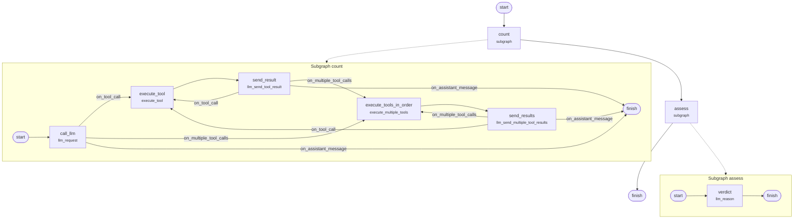
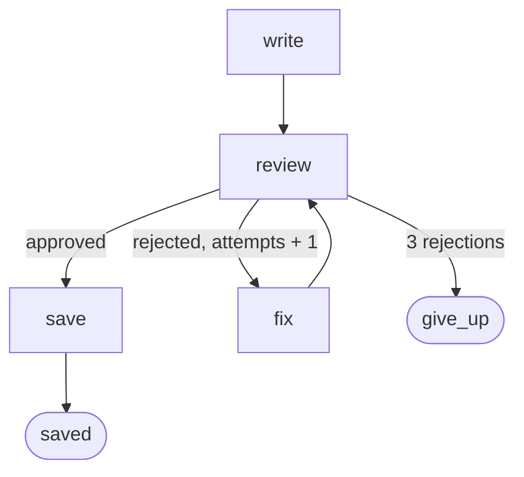

# 6 Subgraphs and planners

As flows grow, you want to break them up: one part counts with tools, another assesses with a
stronger model. Sometimes several parts should work at the same time, and sometimes you do not
know the steps in advance at all – then the agent should plan them itself.

This chapter shows four building blocks, from simple to demanding:

| Building block | Purpose |
|---|---|
| `subgraph` | include a named sub-flow – with its own tool selection and its own model |
| `parallel` | run several sub-flows at the same time and merge the results |
| `plan` | let the model make a plan and work through it step by step |
| `goap` | automatically find the cheapest path from fixed actions with preconditions and effects – also with counters, sub-agents and success checks |

You need your own graphs from [Chapter 4](04-flows.md); types from
[Chapter 5](05-structured-data.md) help in a few places.

## Subgraphs: sub-flows with their own frame

A **subgraph** is a named graph in the `subgraphs` section. It has its own `start` and `finish`
nodes and is included in the main graph through a node of kind `subgraph`. Every entry in
`subgraphs` knows these fields:

| Field | Meaning | Default |
|---|---|---|
| `input` | input type: `string` or a name from `types` | `string` |
| `output` | output type: `string` or a name from `types` | `string` |
| `tools` | tools allowed in the subgraph; `[]` means none | all tools of the spec |
| `model` | own model `{ provider, id }` for this subgraph only | the outer model |
| `graph` | nodes and edges (required) | – |
| `self_tools` | may the agent build its own tools here? see [Chapter 10](10-self-made-tools.md) | as outside |

The following example analyzes a text in two parts. `count` may only use the two counting tools
and works with the local model; `assess` gets no tools at all and its own model from Anthropic:

```json
"subgraphs": {
  "count": {
    "tools": ["count_words", "count_sentences"],
    "graph": {
      "nodes": [
        { "id": "call_llm", "kind": "llm_request" },
        { "id": "execute_tool", "kind": "execute_tool" },
        { "id": "send_result", "kind": "llm_send_tool_result" }
      ],
      "edges": [ "… the tool loop from Chapter 4 …" ]
    }
  },
  "assess": {
    "tools": [],
    "model": { "provider": "anthropic", "id": "claude-haiku-5-5" },
    "graph": {
      "nodes": [
        { "id": "verdict", "kind": "llm_reason", "params": { "value": "string", "prompt": "Based on the numbers, assess the readability of the text in two sentences." } }
      ],
      "edges": [
        { "from": "start", "to": "verdict" },
        { "from": "verdict", "to": "finish" }
      ]
    }
  }
},
"graph": {
  "nodes": [
    { "id": "count", "kind": "subgraph", "params": { "subgraph": "count" } },
    { "id": "assess", "kind": "subgraph", "params": { "subgraph": "assess" } }
  ],
  "edges": [
    { "from": "start", "to": "count" },
    { "from": "count", "to": "assess" },
    { "from": "assess", "to": "finish" }
  ]
}
```

The complete file with both tools: [`examples/06-subgraph.json`](examples/06-subgraph.json).
`grauwolf spec graph` draws subgraphs as separate blocks; the dashed line shows where they are
included:



Call, for example:

```bash
grauwolf spec run docs/user-guide/examples/06-subgraph.json \
  "The dog is sleeping. So is the cat. Only the parrot talks nonstop."
```

```text
With 13 words in 3 sentences, the sentences are very short and easy to understand. For a
longer text, some variety in sentence structure would improve readability even further.
```

What you should know:

- The node of type `subgraph` has the **signature of the subgraph**: it expects its `input` and
  delivers its `output`. Edges are checked as usual.
- The subgraph works in the **same conversation history** as the rest of the run. Only the tool
  selection and the model apply just while it runs; afterwards the outer ones apply again – even
  if it ends with an error.
- `tools` may name all tool names of the spec: your own tools, but also MCP tools, sub-agents, the
  search tool from `knowledge` or built-in tools.
- Subgraph names are lowercase like node IDs (`[a-z][a-z0-9_]*`).
- A subgraph may include other subgraphs, but never itself – not even indirectly.

Typical messages from `spec validate`:

```text
06-subgraph.json:/graph/nodes/0/params: unknown subgraph 'cuont'
06-subgraph.json:/subgraphs/count/tools/2: unknown tool 'square_root'
06-subgraph.json:/subgraphs/count/graph/nodes/3/params: subgraph 'count' includes itself
06-subgraph.json:/subgraphs/assess/graph: 'finish' is not reachable from 'start'
```

Every subgraph is checked like the main graph; the paths then start with
`/subgraphs/<name>/graph`.

## Working in parallel: `parallel`

A node of kind `parallel` starts several subgraphs **at the same time**. Every branch receives the
same input and its own copy of the run context (history, model, storage), so the branches do not
interfere with each other. Afterwards a **merge strategy** combines the results.

```json
"graph": {
  "nodes": [
    { "id": "views", "kind": "parallel", "params": { "subgraphs": ["pro", "contra"], "merge": "concat" } },
    { "id": "weigh", "kind": "llm_request" }
  ],
  "edges": [
    { "from": "start", "to": "views" },
    { "from": "views", "to": "weigh" },
    { "from": "weigh", "to": "finish", "when": { "kind": "on_assistant_message" } }
  ]
}
```

The subgraphs `pro` and `contra` each consist of one `llm_reason` node with its own instruction.
The complete file: [`examples/06-parallel.json`](examples/06-parallel.json).

The parameters:

| Parameter | Meaning |
|---|---|
| `subgraphs` | at least two names from `subgraphs`; all with the same signature (`input` and `output`) – it becomes the signature of the node |
| `merge` | `concat`, `index` or `llm_select` |
| `index` | only with `index`: which branch wins, counted from `0` |
| `criteria` | only with `llm_select`, optional: what the model uses to choose the best branch |

The three strategies:

- **`concat`** appends all results as sections `## <branch>`. The history of the run stays
  unchanged. Only works if the branches deliver text.
- **`index`** takes over the result and context (history, model, storage) of the branch with the
  given number.
- **`llm_select`** lets the model, without tools, choose the best branch according to `criteria`
  and takes over its result and context. Without `criteria`, a built-in default criterion applies.

This is how the model chooses instead of summarizing:

```json
{ "id": "views", "kind": "parallel",
  "params": { "subgraphs": ["pro", "contra"], "merge": "llm_select", "criteria": "The most convincing view" } }
```

With `concat`, the input for `weigh` looks roughly like this, and the answer afterwards roughly
like the one below:

```text
## pro
A cargo bike saves you from hunting for parking and cuts fuel costs. ...

## contra
A cargo bike is expensive to buy and needs a secure parking spot. ...
```

```bash
grauwolf spec run docs/user-guide/examples/06-parallel.json "Should I buy a cargo bike?"
```

```text
For short trips in the city, the advantages outweigh the drawbacks. Buy the cargo bike if you
have a secure parking spot – otherwise try a rental bike first.
```

Typical messages:

```text
…:/graph/nodes/0/params: invalid parameters for 'parallel': "subgraphs" needs at least two subgraph names
…:/graph/nodes/0/params: invalid parameters for 'parallel': all branches need the same signature (input and output)
…:/graph/nodes/0/params: invalid parameters for 'parallel': "merge": concat needs branches with output string
…:/graph/nodes/0/params: invalid parameters for 'parallel': "index" must be a number from 0 to 1
```

## Letting the model plan: `plan`

For open-ended tasks ("Plan a weekend in Hamburg") you do not know the steps in advance. A node of
kind `plan` lets the model first make a **plan** – a goal and a list of steps – and then works
through the steps one by one. Every step runs through a subgraph you choose, so it can use tools
as well.

```json
"subgraphs": {
  "step": {
    "graph": {
      "nodes": [ { "id": "call_llm", "kind": "llm_request" } ],
      "edges": [
        { "from": "start", "to": "call_llm" },
        { "from": "call_llm", "to": "finish", "when": { "kind": "on_assistant_message" } }
      ]
    }
  }
},
"graph": {
  "nodes": [
    { "id": "plan", "kind": "plan", "params": { "subgraph": "step", "critic": true, "max_iterations": 8 } }
  ],
  "edges": [
    { "from": "start", "to": "plan" },
    { "from": "plan", "to": "finish" }
  ]
}
```

The complete file: [`examples/06-plan.json`](examples/06-plan.json).

| Parameter | Meaning | Default |
|---|---|---|
| `subgraph` | executes every step; must be `string` → `string` (required) | – |
| `critic` | before every further step, a **critic** (a second request to the model) checks whether the plan still holds; otherwise it replans with a reason | `false` |
| `max_iterations` | at most this many passes, integer ≥ 1 | `20` |

This is how it works:

1. The model creates a plan made of a goal and steps, on a separate, short history.
2. Every step goes to the subgraph as the instruction
   `Goal: …` / `Carry out step i of n: … and answer with the result.`. Its tool selection and its
   model apply.
3. With `critic`, a check happens before every further step. The critic rejects only if the
   remaining steps cannot reach the goal any more; then a new plan is created that knows the
   results so far. In every other case, including an imperfect plan, the run carries on.
4. When all steps are done, the **result of the last step** is the output of the node.

The `plan` node itself is `string` → `string`. If `max_iterations` is not enough, the run stops
with `plan not fulfilled after 8 steps`. With `--events` you see the plans as the events
`plan_built` and `plan_step_executed`.

```bash
grauwolf spec run docs/user-guide/examples/06-plan.json \
  "Plan two days in Hamburg with kids in the rain, with times."
```

The output is roughly a finished two-day plan – the result of the last step.

## Planning from actions: `goap`

**GOAP** (Goal-Oriented Action Planning) is a good fit when you already know the possible actions,
but the order should follow from the situation. You describe

- the **state** as named facts: true/false, a text from a fixed list, a number or a free text,
- **actions** with preconditions (`pre`), effects (`effects`) and costs (`cost`),
- **goals** as desired facts, optionally with a `priority`.

Before every step, grauwolf then searches for the cheapest path from the current state to a goal
(using the A* search algorithm) and executes the next action through its subgraph (or a sub-agent). The planning
itself therefore costs no model request.

```json
{
  "id": "edit",
  "kind": "goap",
  "params": {
    "state": { "draft": "none", "facts_checked": false },
    "values": { "draft": ["none", "rough", "final"] },
    "actions": [
      { "name": "write_rough_draft", "subgraph": "write",
        "pre": { "draft": "none" }, "effects": { "draft": "rough" },
        "description": "Write a first version of the article." },
      { "name": "revise", "subgraph": "write",
        "pre": { "draft": "rough" }, "effects": { "draft": "final" },
        "description": "Revise the version: shorter, clearer, with a headline." },
      { "name": "check_facts", "subgraph": "check", "cost": 3,
        "pre": { "draft": "final" }, "effects": { "facts_checked": true },
        "description": "Check the claims of the article and output the corrected version." }
    ],
    "goals": [ { "name": "publish", "facts": { "draft": "final", "facts_checked": true } } ],
    "max_iterations": 6
  }
}
```

The complete file with the subgraphs `write` and `check` (the second with its own model):
[`examples/06-goap.json`](examples/06-goap.json).

The parameters in detail:

| Parameter | Meaning |
|---|---|
| `state` | initial facts; defines which facts exist and their type (required, see below) |
| `values` | allowed values per text fact, e.g. `{ "draft": ["none", "rough", "final"] }`; a text fact without a list is a free text |
| `actions` | at least one action: `name` (unique), an executor (`subgraph` with input `string`, or `agent`), optional `pre`, `effects`, `on_success`, `on_failure`, `cost` (number ≥ 0, default `1`), `description`, `input`, `output_fact` and `success_contains` |
| `goals` | at least one goal: `name`, `facts` and optionally `priority` (integer ≥ 0, default `0`) |
| `input_fact` | free-text fact that receives the input of the node before planning |
| `output_fact` | free-text fact whose value is the result of the node (default: the output of the last action) |
| `max_iterations` | at most this many steps, default `20` |
| `max_search_nodes` | at most this many states per search, default `10000` |
| `max_plan_depth` | at most this many actions in one plan, default `50` |

How an action runs:

- Its subgraph receives the original task plus `Action: <name>` (a built-in
  instruction) and the `description` below it – or the text of your `input` template (see below).
  Because all actions of a subgraph executor work in the same history, `revise` sees the rough
  draft from the step before.
- After success, the `effects` apply. If the subgraph delivers an object (one of your own types as
  `output`), fields with the same name overwrite the facts – booleans, integers, numbers and free
  texts always, enumeration texts only with a value from `values`. If that differs from what was
  expected, it replans. This way a checking action can report `{ "facts_checked": false }`, for
  example.
- The output of the node (`string` → `string`) is the output of the last action (or the value of
  `output_fact`); if a goal is already met at the start, it is empty. If the search finds no path,
  the run stops with `no plan found: no goal is reachable from the current state within the
  search limits`.

```bash
grauwolf spec run docs/user-guide/examples/06-goap.json "A short article about urban bees."
```

The output is roughly the checked article from `check_facts`.

### Numbers, free texts and comparisons

The type of a fact follows its initial value in `state`:

| Initial value | Type | Conditions | Effects |
|---|---|---|---|
| `true` / `false` | true/false | `eq`, `ne` | set |
| `0` (JSON integer) | integer | `eq`, `ne`, `gt`, `lt`, `ge`, `le` | set, `{ "add": n }` |
| `0.0` (JSON float – write the decimal point) | number | the same | set, `{ "add": n }` |
| `"none"` with a list under `values` | enumeration | `eq`, `ne` | set |
| `""` without a list | free text | `eq`, `ne` | set |

In `pre` and in the facts of a goal a plain value means *equal*; an object with exactly one
operator compares otherwise: `{ "review_attempts": { "lt": 3 } }`, `{ "draft": { "ne": "" } }`.
An effect is a plain value (set) or `{ "add": 1 }` for integers and numbers. The planner applies
`add` in the *expected* effect as well, so a loop over a counter is planned like any other path:
a precondition such as `{ "lt": 3 }` is how you bound it on purpose. Because numbers make the
number of states infinite, the search is limited by `max_search_nodes` and `max_plan_depth`; a
goal that cannot be reached within the limits has no plan.

### Sub-agents, templates and success checks

An action runs exactly one executor: a `subgraph` or an `agent` – the name of an entry of
`agent_tools`, which runs as a step like an `agent` node (chapter 4): it shares the budget of the run
and has a history of its own. It receives text, so it must take text.

| Key of an action | Meaning |
|---|---|
| `input` | text for the executor with placeholders: `{{fact}}` is the value of a fact, `{{task}}` the input of the node; unknown placeholders are errors. Without `input` the executor gets the task plus `Action: <name>` and the `description` |
| `output_fact` | free-text fact that receives the answer of the executor |
| `success_contains` | the action succeeded if the answer contains this text (otherwise if the executor did not fail) |
| `effects` | what the planner *expects*; applies after success unless `on_success` says otherwise |
| `on_success` | effects after a success (default: `effects`) |
| `on_failure` | effects after a failure – an error of the executor or a missing `success_contains`. Planning continues from the new state. Without `on_failure` a failure ends the run with an error. An exhausted run budget (`limits.max_tokens`, `max_cost`, `max_prompt_tokens`) always ends the run, `on_failure` or not |

### Example: a review loop

A writer writes a text, a reviewer answers `APPROVED` or `REJECTED: …`. A rejected text is
revised – at most three times – and the approved text is saved. The goal `saved` has a higher
priority than `give_up`; the run ends at whichever is reached first, and the result is the last
draft either way:

```json
{
  "id": "editor",
  "kind": "goap",
  "params": {
    "state": {
      "topic": "", "draft": "", "feedback": "",
      "written": false, "reviewed": false, "approved": false, "saved": false,
      "review_attempts": 0
    },
    "input_fact": "topic",
    "output_fact": "draft",
    "actions": [
      { "name": "write", "agent": "writer",
        "input": "Write a short text with a title about: {{topic}}",
        "output_fact": "draft",
        "pre": { "written": false },
        "effects": { "written": true, "reviewed": false } },
      { "name": "review", "agent": "reviewer",
        "input": "Review this text:\n{{draft}}",
        "output_fact": "feedback",
        "pre": { "written": true, "reviewed": false },
        "effects": { "reviewed": true, "approved": true },
        "success_contains": "APPROVED",
        "on_failure": { "reviewed": true, "review_attempts": { "add": 1 } } },
      { "name": "fix", "agent": "writer",
        "input": "Revise the text according to the remarks.\n\nText:\n{{draft}}\n\nRemarks:\n{{feedback}}",
        "output_fact": "draft",
        "pre": { "reviewed": true, "approved": false, "review_attempts": { "lt": 3 } },
        "effects": { "reviewed": false } },
      { "name": "save", "subgraph": "save",
        "input": "The text was approved:\n{{draft}}",
        "pre": { "approved": true },
        "effects": { "saved": true } }
    ],
    "goals": [
      { "name": "saved", "facts": { "saved": true }, "priority": 1 },
      { "name": "give_up", "facts": { "reviewed": true, "review_attempts": { "ge": 3 } } }
    ],
    "max_iterations": 12
  }
}
```

The planner expects every review to approve. If one rejects, `on_failure` counts the attempt and the
text counts as reviewed but not approved – so the cheapest path to `saved` is now `fix`, `review`,
`save`. After three rejections `fix` is no longer allowed and `give_up` holds. The complete file
with the sub-agents `writer` and `reviewer` and the subgraph `save`:
[`examples/06-goap-review.json`](examples/06-goap-review.json).



### Choosing between goals

If several goals can be reached, grauwolf computes the cheapest plan for each and pursues the goal
with the smallest *cost / (priority + 1)*. A goal with `"priority": 1` therefore counts as half as
expensive as one without; with equal values the goal declared first wins. The run ends as soon as
any goal holds.

`spec validate` reports errors in the parameters precisely, for example like this:

```text
06-goap.json:/graph/nodes/0/params: invalid parameters for 'goap': actions[0].effects.draft: value "half" is not in `values.draft`
06-goap.json:/graph/nodes/0/params: invalid parameters for 'goap': goals[0].facts: fact 'printed' is not in `state`
06-goap.json:/graph/nodes/0/params: invalid parameters for 'goap': actions[2]: subgraph 'check' receives the task as text and needs input string
06-goap.json:/graph/nodes/0/params: invalid parameters for 'goap': actions[1].pre.draft: gt, lt, ge and le need an integer or number fact
06-goap.json:/graph/nodes/0/params: invalid parameters for 'goap': actions[0].input: unknown placeholder '{{topic}}' (expected `task` or a fact of `state`)
```

## What do I use when?

| Situation | Building block |
|---|---|
| One part needs other tools or another model, or you want to reuse parts | `subgraph` |
| Several independent points of view or approaches, then summarize or choose | `parallel` |
| Open-ended task whose steps the model should define | `plan` (with `critic` if quality matters more than cost) |
| Fixed actions with clear prerequisites; the order should be traceable and cheap | `goap` |

`parallel`, `plan` and `goap` include subgraphs as well; their `tools` and `model` apply wherever
they run.

## Key points

- `subgraphs` contains named graphs with `input`/`output` (default `string`), optional `tools`
  (subset, `[]` = none) and `model`; included through `{ "kind": "subgraph", "params": { "subgraph": "<name>" } }`.
- `parallel` runs at least two subgraphs with the same signature at the same time; `merge` is
  `concat` (text only), `index` or `llm_select` (optional `criteria`).
- `plan` lets the model plan and executes every step through a `string` → `string` subgraph;
  `critic` checks in between, `max_iterations` (default 20) sets the limit.
- `goap` searches for the cheapest path using `state` (true/false, enumeration, integer, number and
  free-text facts), `actions` (a `subgraph` or an `agent` as executor, with `pre` conditions that
  may compare with `gt`/`lt`/…, `effects` that may `add`, `input` templates, `success_contains`,
  `on_failure`, `cost`) and `goals` (with `priority`), and replans after every action; the search is
  bounded by `max_search_nodes` and `max_plan_depth`.

Continue with [Chapter 7: Conversations, memory and knowledge](07-conversations-and-knowledge.md).
