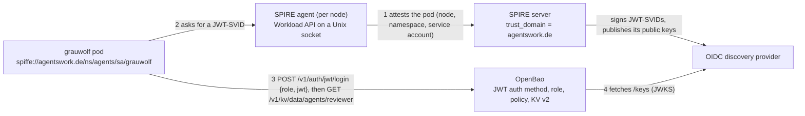

# 12. Credentials from OpenBao with SPIFFE

Most services an agent uses – Jira, Confluence, git hosts, model providers – want an API key or a
token. The usual place for it is an environment variable, which means a long-lived secret in the
image, the manifest or the pod, readable by everything in the process. This chapter shows the
alternative: the agent proves **who it is** with its SPIFFE identity, and a secret broker
(OpenBao, or HashiCorp Vault) hands it only the credentials that belong to that identity.

You need this chapter if you run grauwolf in Kubernetes with SPIRE and OpenBao. Without it nothing
changes: variables come from the environment as before.

## How the parts fit together



| Part | What it does | What grauwolf does with it |
|---|---|---|
| **SPIRE server and agent** | Give every workload an identity, a SPIFFE ID such as `spiffe://agentswork.de/ns/agents/sa/grauwolf`, after attesting it (node, namespace, service account). The identity is delivered as short-lived signed documents; the JWT form (JWT-SVID) lives 5 minutes. | grauwolf reads `SPIFFE_ENDPOINT_SOCKET`, connects to the agent's **Workload API** on that Unix socket and asks for a JWT-SVID for one audience. It holds no key or secret itself. |
| **ClusterSPIFFEID** (spire-controller-manager) | The registration: which pods (label selector) get which SPIFFE ID (template). | Nothing; it is what makes the pod's ID `…/ns/agents/sa/grauwolf`. |
| **SPIFFE CSI driver** (`csi.spiffe.io`) | Mounts the agent's socket into the pod. | Its mount path is what `SPIFFE_ENDPOINT_SOCKET` points to. |
| **OIDC discovery provider** | Serves the public keys that verify JWT-SVIDs (`/keys`, a JWKS) over HTTP. | Nothing directly. OpenBao fetches the keys from it. |
| **OpenBao: JWT auth method** | Accepts a JWT if its signature checks against the JWKS, its audience and subject match a **role**. | grauwolf logs in with `POST /v1/auth/<mount>/login {role, jwt}` and keeps the returned token in memory only. |
| **OpenBao: role and policy** | The role binds an audience and exactly one subject (the agent's SPIFFE ID) to a policy; the policy allows reading some KV paths. | The agent can read only what its policy allows. Another agent has another ID, role or policy. |
| **OpenBao: KV v2** | Stores the secrets. | grauwolf reads `GET /v1/<mount>/data/<path>` and takes one field. |

grauwolf then hands the value to whatever asked for the variable – the Jira tools ask for
`ATLASSIAN_API_TOKEN`, the OpenAI provider for `OPENAI_API_KEY` – exactly as if it were in the
environment. Values are cached in memory and read again after `refresh` (5 minutes by default); the
OpenBao token is replaced by a fresh login (with a new JWT-SVID) shortly before it expires and once
after a `403`.

## The trust domain

The **trust domain** (`agentswork.de` in this chapter) is the name of the SPIFFE realm. It is part
of every SPIFFE ID and has to be the same everywhere it appears:

| Where | Setting |
|---|---|
| SPIRE server configuration | `trust_domain` |
| SPIRE agent configuration | `trust_domain` |
| `ClusterSPIFFEID` | the template uses `{{ .TrustDomain }}`, which SPIRE fills in – you do not write it |
| OIDC discovery provider configuration | `workload_api { trust_domain = … }` |
| OpenBao role | `bound_subject`, the full SPIFFE ID of the agent: `spiffe://<trust domain>/ns/<namespace>/sa/<service account>` |
| JWT issuer | If the SPIRE server sets `jwt_issuer`, the discovery provider and the OpenBao auth method (`bound_issuer`) use the same value; it is usually a name under the trust domain |

grauwolf itself never needs the trust domain: it asks the Workload API for a token and passes it on.
The place that must match is `bound_subject`; if the trust domain in the SPIRE configuration and the
one in the role differ, OpenBao refuses the login with a `permission denied` that names the role.
The example in `examples/spire-openbao/` takes the trust domain from one variable, `TRUST_DOMAIN`,
in `env.sh`.

## Set up SPIRE

Registration of the agent's pods: a `ClusterSPIFFEID` that selects them by label and builds the ID
from the namespace and service account ([`examples/spire-openbao/manifests/20-grauwolf-clusterspiffeid.yaml`](../../examples/spire-openbao/manifests/20-grauwolf-clusterspiffeid.yaml)):

```yaml
apiVersion: spire.spiffe.io/v1alpha1
kind: ClusterSPIFFEID
metadata:
  name: grauwolf
spec:
  spiffeIDTemplate: "spiffe://{{ .TrustDomain }}/ns/{{ .PodMeta.Namespace }}/sa/{{ .PodSpec.ServiceAccountName }}"
  podSelector:
    matchLabels:
      app.kubernetes.io/name: grauwolf
  namespaceSelector:
    matchLabels:
      kubernetes.io/metadata.name: agents
```

The pod needs the agent's socket: mount the SPIFFE CSI volume and point `SPIFFE_ENDPOINT_SOCKET`
at it:

```yaml
env:
  - name: SPIFFE_ENDPOINT_SOCKET
    value: unix:///spiffe-workload-api/agent.sock
volumeMounts:
  - { name: spiffe-workload-api, mountPath: /spiffe-workload-api, readOnly: true }
volumes:
  - name: spiffe-workload-api
    csi: { driver: csi.spiffe.io, readOnly: true }
```

The socket file name is whatever the SPIRE agent's `socket_path` says (`agent.sock` in the
example). The OIDC discovery provider ([`10-oidc-discovery-provider.yaml`](../../examples/spire-openbao/manifests/10-oidc-discovery-provider.yaml))
is a deployment that reads the signing keys from the same Workload API and serves them at `/keys`;
it is a workload itself and has its own `ClusterSPIFFEID`. Run it in a namespace that
spire-controller-manager does not skip: its `ignoreNamespaces` usually contain `spire-system`, and
a pod there gets no SPIFFE ID, so the provider would serve no keys. The example uses `spire-oidc`.

## Set up OpenBao

Four things, all in [`setup-openbao.sh`](../../examples/spire-openbao/setup-openbao.sh) (it uses the
`bao` CLI):

1. **The JWT auth method**, told where the keys are:
   `bao auth enable -path=jwt jwt` and
   `bao write auth/jwt/config jwks_url=http://spire-oidc-discovery-provider.spire-oidc.svc/keys`.
2. **A policy** that allows reading the secrets of the agents:
   ```hcl
   path "kv/data/agents/*" { capabilities = ["read"] }
   ```
3. **A role** that ties the audience and the agent's SPIFFE ID to the policy:
   ```text
   bao write auth/jwt/role/grauwolf-agents \
     role_type=jwt user_claim=sub \
     bound_audiences=openbao \
     bound_subject=spiffe://agentswork.de/ns/agents/sa/grauwolf \
     token_policies=grauwolf-agents token_ttl=1h
   ```
   `bound_audiences` must equal the `audience` in grauwolf's configuration; `bound_subject` is the
   ID the `ClusterSPIFFEID` produces. Several agents that may read the same secrets can share a
   role through `bound_claims` with a glob on `sub`; separate roles and policies keep their rights
   apart.
4. **The secret** in a KV v2 mount: `bao kv put -mount=kv agents/reviewer jira=<token>`.

## Configure grauwolf

Credential sources are deployment configuration, not part of the spec (the spec stays portable).
Put a `[credentials]` section in a `grauwolf.toml` next to the spec, or in the file named by
`GRAUWOLF_CREDENTIALS` (which wins):

```toml
[credentials.openbao]
address = "https://openbao.internal:8200"
auth = { spiffe = { audience = "openbao", role = "grauwolf-agents", mount = "jwt" } }
# refresh = "5m"

[credentials.variables]
ATLASSIAN_API_TOKEN = "openbao:kv/agents/reviewer#jira"
OPENAI_API_KEY      = "file:/run/secrets/openai/api-key"
```

| Key | Meaning |
|---|---|
| `credentials.openbao.address` | Base address of OpenBao (or Vault). |
| `credentials.openbao.auth.spiffe.audience` | Audience of the JWT-SVID; equals the role's `bound_audiences`. |
| `credentials.openbao.auth.spiffe.role` | The role of the JWT auth method. |
| `credentials.openbao.auth.spiffe.mount` | Where the JWT auth method is mounted; default `jwt`. |
| `credentials.openbao.refresh` | Interval after which values are read again: `30s`, `5m`, `1h`; default `5m`. Also applies to `file:` sources. |
| `credentials.variables.<NAME>` | Where the variable comes from. `openbao:<mount>/<path>#<field>` is a field of a KV v2 secret (`vault:` is an alias), `file:<path>` the content of a file without its trailing newline (relative paths are relative to the configuration file). |

Rules:

- Only variables from the [table of environment variables](reference-cli.md#environment-variables)
  may be mapped. Variables that are read from the process environment directly (`PATH`, `HOME`,
  `OTEL_EXPORTER_OTLP_*`, `SPIFFE_ENDPOINT_SOCKET`, …) cannot come from a source.
- A variable that is mapped **and** set in the environment is an error: there is no silent
  precedence.
- If a source cannot be read at start-up – OpenBao is unreachable, the login is refused, the field
  is missing, the file is gone – the start fails with a message naming the variable and the source.
  A later failed refresh keeps the previous value and reports on stderr.
- Values never appear in errors, logs, events or spans.
- A `grauwolf.toml` can also hold the tool policy (`[tool_packages]`); the two tables are
  independent.

The sources apply everywhere configuration is read: `spec run`, `chat`, `resume`, `mcp`, `serve`
(also its token and the chat API), and generated services (they read `GRAUWOLF_CREDENTIALS`, else a
`grauwolf.toml` in `GRAUWOLF_DATA_DIR`). The sources need the Cargo feature `credentials` (on by
default); a build without it refuses a `[credentials]` section.

## Check it

`grauwolf credentials check` resolves variables the way a run would and prints, one line per
variable, where each came from, never the value. Name the variables, or use `--all` for every
variable mapped in the `[credentials]` section; the exit code is 1 if any fails:

```text
$ grauwolf credentials check --all --config /etc/grauwolf/grauwolf.toml
resolved ATLASSIAN_API_TOKEN from openbao (41 bytes)
resolved GIT_TOKEN from openbao (30 bytes)
```

[`manifests/30-grauwolf-job.yaml`](../../examples/spire-openbao/manifests/30-grauwolf-job.yaml)
runs exactly this in a Job. Typical failures:

| Message | Cause |
|---|---|
| `SPIFFE_ENDPOINT_SOCKET: is not set` | The CSI volume or the variable is missing from the pod. |
| `workload API at …: status 7: no identity issued` (`gave up after waiting 30s`) | The registration entry for the pod is missing or not synced yet. A new pod often starts before spire-controller-manager has created the entry and the SPIRE agent has synced it, so grauwolf waits up to `SPIFFE_FETCH_TIMEOUT` (default `30s`) with a growing pause; the message above appears only after that. If it persists, check the `ClusterSPIFFEID` selectors and that the pod's namespace is not in the controller-manager's `ignoreNamespaces`. |
| `login as spiffe://…: login: HTTP 400: error validating token: invalid subject (sub) claim` | The role's `bound_subject` does not match the pod's SPIFFE ID: compare namespace, service account and trust domain (the message names the ID the pod got, e.g. `spiffe://agentswork.de/ns/agents/sa/default` for a pod without its own service account). |
| The pod is rejected (`runAsNonRoot` … cannot verify user is non-root) | The restricted Pod Security Standard needs a numeric `runAsUser` in the pod's `securityContext`; an image user given by name cannot be checked. The example Job sets `65532`. |
| `login as spiffe://…: login: HTTP 400: … ` / `permission denied` | The role does not accept the token: audience, `bound_subject` (trust domain, namespace, service account) or the JWKS URL. |
| `read: HTTP 403` | The policy does not allow the path: an agent's policy reads only `kv/data/agents/<name>/*`. `grauwolf-k8-ops agent check` adds a hint with the path that was tried. |
| `credentials: X is mapped … and also set in the environment` | Remove one of the two. |

## The example

[`examples/spire-openbao/`](../../examples/spire-openbao/README.md) holds the manifests and the
script for a live check on a cluster with SPIRE and OpenBao. Nothing in it is applied for you.
Tests of grauwolf itself run without SPIRE and OpenBao: tokens are made at test time and OpenBao is
mocked over HTTP.

## Limits of this stage

- SPIFFE is used to log in to the broker. mTLS between agents and towards MCP servers, and
  validating the identity of callers, are in [ADR-0109](../adr/0109-workload-identity-with-spiffe.md);
  the tools that can use the identity (`fetch`, the git tools, stdio MCP servers, `run_command`)
  are described in [chapter 3](03-tools.md#fetch-with-spiffe-fetchauth) and
  [chapter 8](08-external-tools-and-agents.md#giving-a-local-server-the-agents-identity-workload_api) (ADR-0110).
- Only KV v2 reads. Dynamic secrets engines (for example short-lived GitHub tokens) are not read yet.
- Cert auth of OpenBao is not supported; the JWT auth method is the one way in.

For the internals (the crates, the credential sources and how to add one) see [developer guide chapter 9](../developer-guide/09-identity-credentials-and-the-cluster-tool.md).
