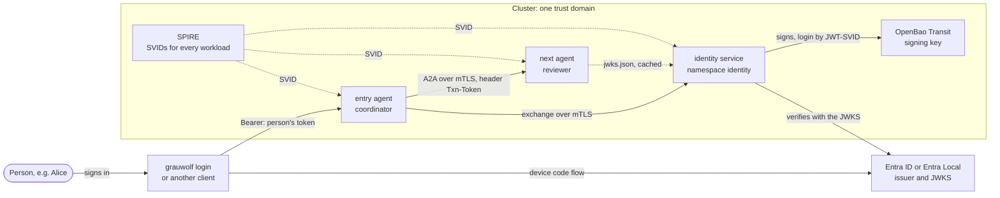
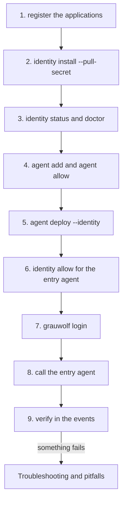
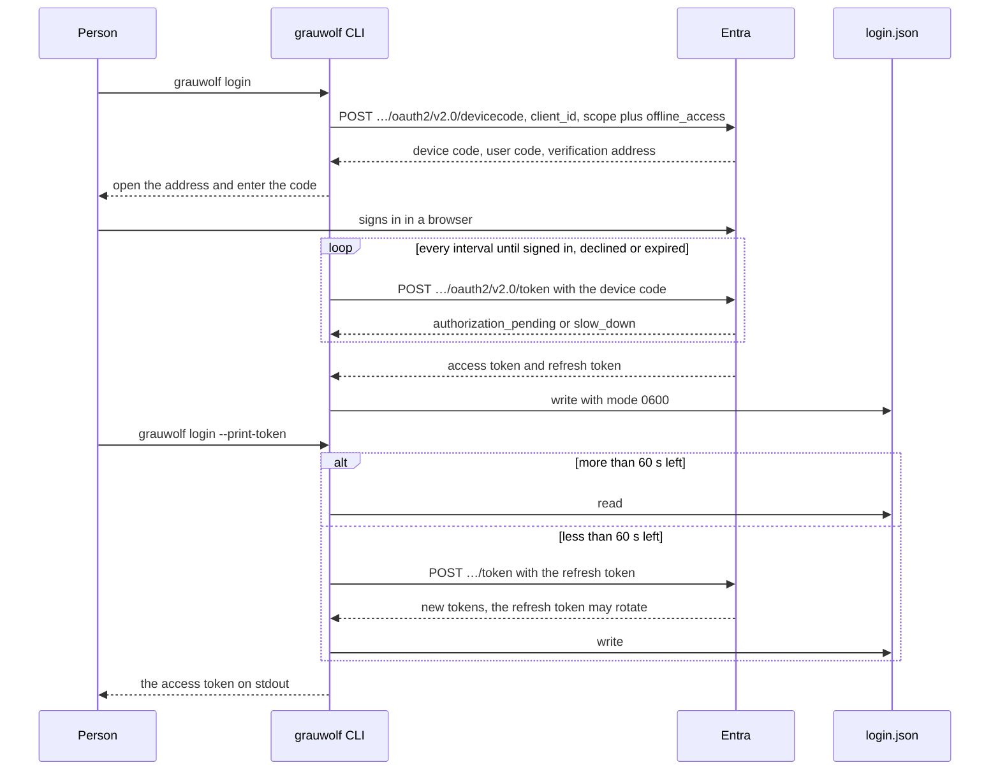
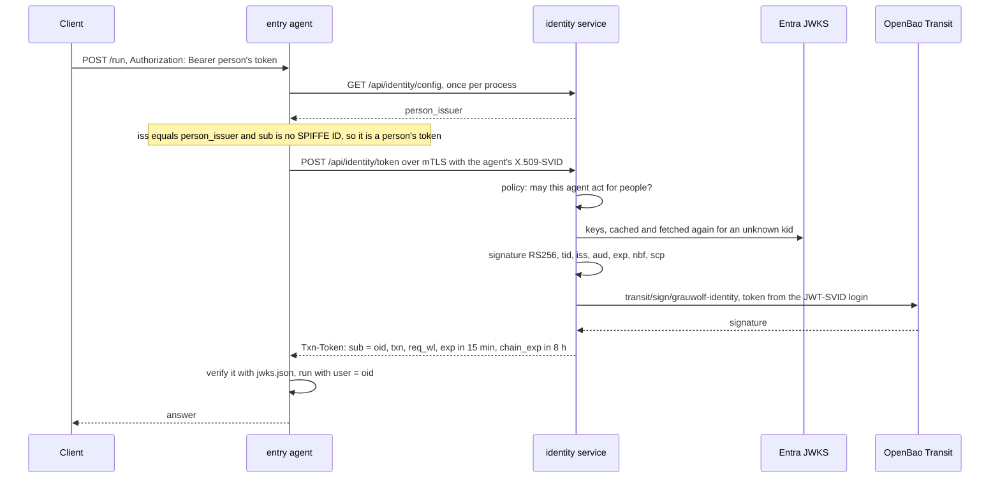
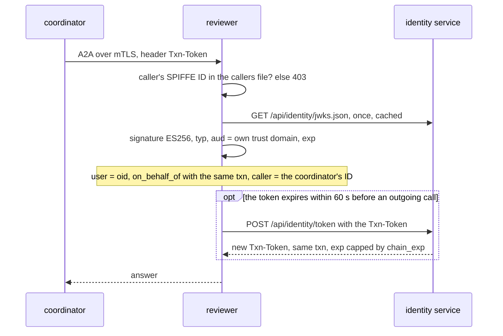
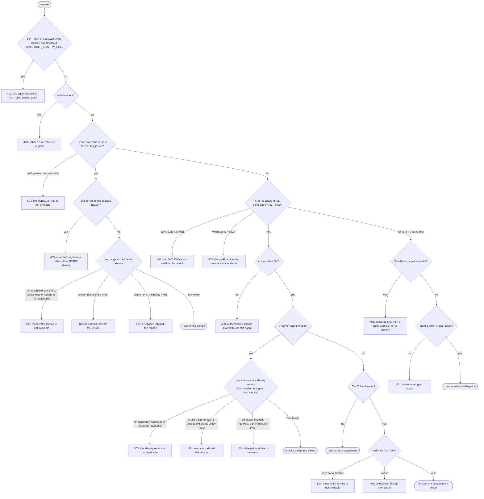
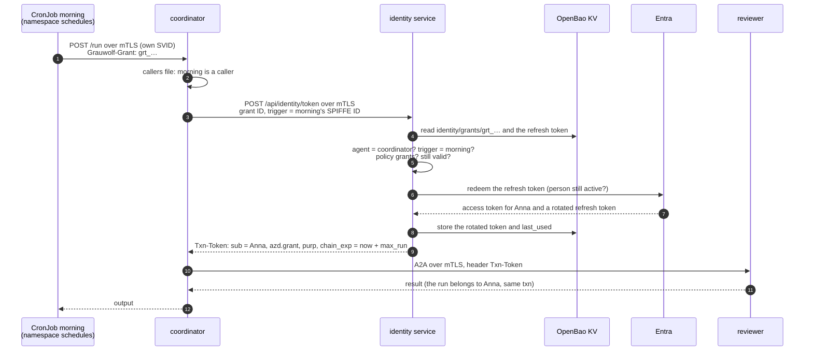

# 14. Acting on behalf of people

With [chapter 12](12-credentials-from-openbao.md) an agent knows **who it is**, and with SPIFFE
callers ([chapter 9](09-operations.md#agents-calling-agents-with-spiffe)) it knows **which agent** calls it. It does not know yet
**for whom** the agents act. This chapter closes that gap: what delegation is, what you need for it,
how to set it up step by step, how it works at run time, and what to do when it fails.

## Overview

In a chain `Anna → coordinator → reviewer` every agent sees only the previous one, and a `user_id` in
the request body is information, never proof: anyone who may call can write any name into it.

Delegation ([ADR-0111](../adr/0111-delegation-with-transaction-tokens.md)) makes "on behalf of Anna"
verifiable. Anna signs in with Entra ID; at the entry her token is exchanged for a **Txn-Token**, a
short-lived token signed by the **identity service** of the trust domain. It travels unchanged with
every internal call of the run, and every agent verifies it together with the caller's SPIFFE
identity. The person in it becomes the request's user: conversations, long-term memory, per-user
tools and approvals belong to Anna, and the events name her.

You need delegation if several agents work for people and each hop should know – verifiably – who
asked: for the audit, for per-person memory and conversations, and for approvals that only the person
may give. Without an identity service nothing changes: agents act with their own rights as before.

This is stage 1 of ADR-0111 – entry, verification and propagation, checked live on 2026-11-16 in a
k3s cluster with Entra Local; the pitfalls found there are in
[Troubleshooting and pitfalls](#troubleshooting-and-pitfalls) – and stage 3: stored grants for
unattended runs and schedules that use them ([Unattended runs](#unattended-runs-grants-and-schedules)).
Exchanging the Txn-Token for tokens of external systems (Jira as Anna) is a later stage
([Limits of this stage](#limits-of-this-stage)).

## Concepts

| Term | What it is |
|---|---|
| **Person's token** | An Entra access token the person obtained by signing in (here: with `grauwolf login`). Its audience (`aud`) is the application ID of the "grauwolf identity API", its scope (`scp`) contains `access_as_user`. Only the identity service verifies it. |
| **Txn-Token** | A JWT (ES256, JOSE `typ` `txntoken+jwt`) signed by the identity service. `sub` is the person's Entra object ID (`oid`), `aud` the trust domain, `txn` the ID of the chain, `req_wl` the entry agent's SPIFFE ID. It lives 15 minutes and can be renewed up to `chain_exp`, 8 hours after the entry. It travels in the header `Txn-Token`. |
| **Identity service** | `grauwolf identity serve`, one per trust domain. It exchanges people's tokens for Txn-Tokens, renews them, and publishes the keys that verify them. The signing key stays in OpenBao Transit. |
| **Entry agent** | The agent a person calls with her token (`Authorization: Bearer`). It exchanges the token with its own workload identity. Only entry agents need an entry in the policy. |
| **Hop** | A call from one agent to the next (A2A, MCP over HTTP, `fetch` to a host with `auth`). It carries the Txn-Token; the target verifies it and runs for the person. |
| **Policy** | The identity service's file of agents (SPIFFE IDs or prefixes) that may request Txn-Tokens on behalf of people: `identity allow` / `identity deny`. |
| **Callers file** | Each agent's list of SPIFFE IDs that may call it (`agent allow`, [chapter 13](13-setting-up-a-cluster.md#letting-agents-call-each-other)). A Txn-Token is accepted only from a caller in it; delegation adds a person to a call, it never opens an agent to new callers. |

The parts and who trusts whom:



- The **identity service** trusts Entra's signature (keys from the issuer's JWKS) and its own policy.
- **Agents** trust the identity service: they talk to it with their SPIFFE identity and verify
  Txn-Tokens with its keys.
- **The next agent** trusts the previous one only if the caller's SPIFFE ID is in its callers file.
- **OpenBao** signs for the identity service only: its role is bound to the service's SPIFFE ID and
  its policy allows nothing but signing with one key and reading the public keys.

## Prerequisites

| Prerequisite | How to check it |
|---|---|
| A cluster with SPIRE (server, agents, spire-controller-manager), the SPIFFE CSI driver and the OIDC discovery provider ([chapter 13](13-setting-up-a-cluster.md#what-you-need)) | `grauwolf-k8-ops doctor`: all lines ok |
| OpenBao initialized and unsealed, `grauwolf-k8-ops openbao setup` done – and **run again with an admin token after every update of `grauwolf-k8-ops`**, so the restricted policy `grauwolf-k8-ops` covers the Transit mount and the role `grauwolf-identity` | `doctor`; `identity install` with the restricted token fails with a permission error otherwise |
| An identity provider: Entra ID or Entra Local, with the three application registrations "grauwolf identity API", "grauwolf CLI" and "grauwolf identity service" ([step 1](#1-register-the-applications)) | the IDs are printed by `examples/delegation/entra-local-apps.sh`, or shown in the Azure portal |
| **The cluster reaches the issuer's JWKS host** from inside a pod: DNS resolves it to an address that is reachable from the pods | a probe pod (below) gets the JWKS; see the pitfall [503 "the identity service is not available"](#503-the-identity-service-is-not-available) |
| An image pull secret, if the grauwolf image comes from a registry that needs credentials | `kubectl get secret -n <namespace> <name>`; you pass it as `--pull-secret <namespace>/<name>` |
| The agents are set up for agent-to-agent calls with SPIFFE ([chapter 13](13-setting-up-a-cluster.md#letting-agents-call-each-other)): `agent add`, `agent allow`, and `agent_tools` entries with `auth.spiffe` on the mTLS port | a call of the coordinator with its server token reaches the reviewer; `doctor` lists the callers |
| The model backend is reachable from the agents (e.g. `OLLAMA_HOST`) | `agent deploy` waits for `/health`; a test call answers |

To check the JWKS host from inside the cluster, start a short probe pod (the address is the
`jwks_uri` that the script prints, or that the issuer's
`/.well-known/openid-configuration` names):

```sh
kubectl run jwks-probe --rm -i --restart=Never --image=curlimages/curl:8.11.1 -- \
  curl -sS -o /dev/null -w '%{http_code}\n' --max-time 10 <jwks_uri>
```

`200` is good. A timeout means the address the cluster resolves for the host is not reachable from
the pods. The identity service's own egress rules are an extra limit (see the pitfall).

## Step by step: setup

The whole flow with Entra Local is also in [`examples/delegation/`](../../examples/delegation/README.md).
The values below are those of the live check; replace them with yours.



### 1. Register the applications

With Entra Local, run the script (Entra Local's admin API is unauthenticated, see
[Entra Local and a real Entra ID](#entra-local-and-a-real-entra-id)):

```sh
cd examples/delegation
export BAO_ADDR=http://127.0.0.1:8200 BAO_TOKEN=...   # optional: stores the service's secret
./entra-local-apps.sh
```

It creates the three applications only if missing and prints their IDs, then an `identity install`
and a `grauwolf login` command with the values filled in:

```text
grauwolf identity API      <api id>  (api://grauwolf-identity, scope access_as_user)
grauwolf CLI               <cli id>
grauwolf identity service  <service id>
```

With a real Entra ID, register the same three applications in the Azure portal
([below](#entra-local-and-a-real-entra-id)). Either way, **give both audiences: the application ID (a
GUID) of "grauwolf identity API" (what v2.0 tokens carry in `aud`) and its `api://…` URI (v1.0 tokens, Entra Local's token generator)**.

### 2. Install the identity service

```sh
grauwolf-k8-ops identity install --image registry.example.com/grauwolf:<version> \
  --pull-secret default/registry \
  --tenant 11111111-1111-1111-1111-111111111111 \
  --issuer https://entra.agentswork.de/11111111-1111-1111-1111-111111111111/v2.0 \
  --audience <api id> --audience api://grauwolf-identity \
  --jwks-url <jwks_uri printed by the script>
```

Leave out `--pull-secret` when the image is public, and `--jwks-url` with a real Entra ID (the keys
then come from the issuer's OpenID discovery). The command prints one line per object (`created`,
`updated`, `unchanged`), waits for the rollout and ends with:

```text
identity service: ready, /health answers ok
mTLS endpoint https://grauwolf-identity.identity.svc:8443 (agents: `grauwolf-k8-ops agent deploy <agent> --identity`)
keys http://grauwolf-identity.identity.svc:8080/api/identity/jwks.json
no agent may act on behalf of people yet: `grauwolf-k8-ops identity allow <agent>`
```

What it creates is listed in [In a cluster with grauwolf-k8-ops](#in-a-cluster-with-grauwolf-k8-ops).

### 3. Check it

```sh
grauwolf-k8-ops identity status
grauwolf-k8-ops doctor
```

`identity status` must say `installed, ready`, show the SPIFFE ID
`spiffe://<trust domain>/ns/identity/sa/grauwolf-identity`, the settings, the policy (`0 caller(s)`
so far) and `OpenBao role grauwolf-identity: exists, policy grauwolf-identity: exists, Transit key
transit/keys/grauwolf-identity: …`. `doctor` has a line `identity service`.

### 4. Create the agents and let them call each other

```sh
grauwolf-k8-ops agent add coordinator
grauwolf-k8-ops agent add reviewer
grauwolf-k8-ops agent allow reviewer --from coordinator
```

The coordinator's spec calls the reviewer on the mTLS port with `auth.spiffe`, as in
[chapter 13](13-setting-up-a-cluster.md#walkthrough-coordinator-calls-reviewer)
([`13-coordinator.json`](examples/13-coordinator.json)). Without `auth.spiffe` the Txn-Token is not
passed on.

### 5. Deploy the agents with `--identity`

The target first, then the caller:

```sh
grauwolf-k8-ops agent deploy reviewer --image registry.example.com/grauwolf:<version> \
  --spec docs/user-guide/examples/13-reviewer.json \
  --env OLLAMA_HOST=http://ollama.ollama.svc:11434 --identity --events
grauwolf-k8-ops agent deploy coordinator --image registry.example.com/grauwolf:<version> \
  --spec docs/user-guide/examples/13-coordinator.json \
  --env OLLAMA_HOST=http://ollama.ollama.svc:11434 --identity --events --host coordinator.example.com
```

`--identity` sets `GRAUWOLF_IDENTITY_URL` and `GRAUWOLF_IDENTITY_SPIFFE_ID`; `--events` writes the
events to the pod log for step 9; `--host` makes an Ingress for the person's call. `agent status
coordinator` then shows `identity: on (https://grauwolf-identity.identity.svc:8443)`.

### 6. Allow the entry agent

```sh
grauwolf-k8-ops identity allow coordinator
```

```text
identity service allows spiffe://agentswork.de/ns/coordinator/sa/coordinator to act on behalf of people (purposes: any): created
```

Only the entry agent needs it: `reviewer` only verifies and renews. The change reaches the running
service after about a minute (see [Changing the policy](#changing-the-policy)).

### 7. Sign in

```sh
grauwolf login --authority https://entra.agentswork.de \
  --tenant 11111111-1111-1111-1111-111111111111 \
  --client-id <cli id> --scope api://grauwolf-identity/access_as_user
```

It prints an address and a code (`To sign in, open … in a browser and enter the code ….`); sign in
there, e.g. as `alice@entralocal.dev`. It ends with `logged in as … at tenant …; tokens cached in
…/login.json`. `grauwolf login --status` shows who is signed in and how long the token is valid.

### 8. Call the entry agent

```sh
curl -sS https://coordinator.example.com/run \
  -H "Authorization: Bearer $(grauwolf login --print-token)" \
  -H 'content-type: application/json' -d '{"input": "Review: the sky is green."}'
```

Call through the Ingress (or from inside the cluster), **not through `kubectl proxy`**: the API
server's proxy removes the `Authorization` header
([pitfall](#401-token-missing-or-wrong-through-kubectl-proxy)). The answer is the coordinator's
`{ "output": … }`.

### 9. Verify

```sh
grauwolf-k8-ops agent logs coordinator --events-only
grauwolf-k8-ops agent logs reviewer --events-only
```

Look at the `agent_starting` lines:

- in `coordinator`: `on_behalf_of` with Alice's `oid` and a `txn`, and no `caller` (Alice called
  with her own token);
- in `reviewer`: the same `on_behalf_of` with **the same `txn`**, and `caller`
  `spiffe://agentswork.de/ns/coordinator/sa/coordinator`.

```json
{"event":"agent_starting","input":"…","caller":"spiffe://agentswork.de/ns/coordinator/sa/coordinator","on_behalf_of":{"oid":"<alice's oid>","txn":"<the same in every agent>"}}
```

`name` and `upn` appear only when the person's token carries them (a real Entra ID does, Entra Local
does not). Counter-checks: without a token the call gets `401`; after `identity deny coordinator` (and
a minute) Alice's call gets `403` with "delegation refused: …" in the body.

## The runtime flow

### Signing in



### The entry



The agent decides the path from unverified claims only; the identity service verifies the token.
The policy is asked first: an agent outside it is refused before the person's token is looked at.

### A hop



Any workload of the token's trust domain may renew; the policy is asked only at the entry. A failed
renewal fails the outgoing call with its reason.

### What the agent answers

The decisions of an agent with an identity service, in the order the code takes them:



| Request | Answer |
|---|---|
| A person's token, accepted by the identity service | The run acts for the person |
| A person's token, refused by the identity service (signature, tenant, audience, scope, expiry) | `401` `delegation refused: the identity service refused the token (… ): <reason>` |
| A person's token, but the agent is not in the identity service's policy | `403` `delegation refused: the identity service refused the token (403 Forbidden): <reason>` |
| A person's token, identity service or the issuer's keys not reachable | `503` `the identity service is not available` |
| A JWT of another issuer (e.g. another tenant) | not recognised as a person's token: treated as a JWT-SVID, `401` `the JWT-SVID is not valid for this agent` |
| `Txn-Token` from a mapped SPIFFE caller, valid | The run acts for the person in the token |
| `Txn-Token` manipulated, expired, for another trust domain, signed by another key | `401` `delegation refused: Txn-Token …` |
| `Txn-Token` from a caller without SPIFFE identity (shared token, user token, anonymous, a person's token) | `403` |
| `Txn-Token` from an unmapped SPIFFE ID | `403` (as without a token) |
| `Txn-Token` to an agent without `GRAUWOLF_IDENTITY_URL` | `401` |
| `Grauwolf-Grant` from a mapped SPIFFE caller | see [what a grant run is answered](#what-a-grant-run-is-answered) |

A `403` of the identity service's policy reaches the caller as `403` at the agent (a refused person's token stays `401`); the body names
the reason (`… may not request tokens on behalf of people`). `gw_` user tokens
([chapter 9](09-operations.md)) keep working in setups without Entra; they never produce a Txn-Token.

**Approvals** of a delegated run belong to the person: the coordinator cannot approve a tool call
that the reviewer asks Anna about. Anna approves with her own Entra token at
`POST /approvals/{id}` of the agent that asks.

## Where the Txn-Token goes

The token is attached automatically to internal outgoing calls, and only to calls that use a
workload identity:

| Call | Carries the `Txn-Token` when … |
|---|---|
| `agent_tools` over A2A | the remote agent has `auth.spiffe` |
| MCP servers over HTTP (Streamable HTTP and HTTP+SSE) | the server has `auth.spiffe` |
| `fetch` | the host has an entry in `builtin_tools.fetch.auth`; never to other hosts, and checked again after every redirect |
| Local sub-agents (`agent` and `for_each` nodes, local `agent_tools`) | always: they run in the same process and inside the same run |

A call to an external host never carries it. Tools at the boundary (Jira, Confluence, git) use
their own credentials in stage 1. The Txn-Token never reaches the model, the logs or the events.

## The identity service

`grauwolf identity serve` runs once per trust domain, as its own deployment from the CLI image
([CLI reference](reference-cli.md#grauwolf-identity-serve)). It needs a workload identity
(`SPIFFE_ENDPOINT_SOCKET`) and serves:

| Endpoint | Who | Purpose |
|---|---|---|
| `POST /api/identity/token` | workloads (mTLS port or a JWT-SVID for its SPIFFE ID) | entry (a person's token), grant runs (a grant ID and the trigger) and renewal (a Txn-Token) |
| `POST /api/identity/grants` | people (Entra access token as bearer) | create a grant (with the refresh token of a separate sign-in); `201` with the grant |
| `GET /api/identity/grants` | people | own grants, never a token |
| `DELETE /api/identity/grants/{id}` | people | revoke an own grant: `204`; `404` for an unknown grant or one of another person |
| `GET /api/identity/jwks.json` | public | the keys that verify Txn-Tokens |
| `GET /api/identity/config` | public | `issuer`, `trust_domain`, `person_issuer` |
| `GET /health` | public | `ok` |

The signing key stays in **OpenBao Transit** (an `ecdsa-p256` key); the service logs in to OpenBao
with its JWT-SVID and never holds the key. Its configuration:

```sh
GRAUWOLF_IDENTITY_TENANT=11111111-1111-1111-1111-111111111111
GRAUWOLF_IDENTITY_ISSUER=https://entra.agentswork.de/11111111-1111-1111-1111-111111111111/v2.0
GRAUWOLF_IDENTITY_AUDIENCE=22222222-2222-2222-2222-222222222222,api://grauwolf-identity   # application ID and URI of the API, comma-separated
GRAUWOLF_IDENTITY_PUBLIC_URL=https://grauwolf-identity.identity.svc:8443   # iss of the Txn-Tokens
GRAUWOLF_IDENTITY_POLICY=/etc/grauwolf/identity-policy.json
GRAUWOLF_IDENTITY_TRANSIT_KEY=grauwolf-identity
GRAUWOLF_IDENTITY_OPENBAO_ADDR=https://openbao.openbao.svc:8200
GRAUWOLF_IDENTITY_OPENBAO_ROLE=grauwolf-identity
```

All variables and their defaults are in the [CLI reference](reference-cli.md#environment-variables).

### The policy

The policy file says which agents may request Txn-Tokens on behalf of people – the agents at the
entry. It is read at start and checked for changes every 2 seconds; a broken new file keeps the old
one (the log says `policy not reloaded, keeping the old one`).

```json
{ "callers": {
    "spiffe://agentswork.de/ns/coordinator/sa/coordinator": { "purposes": ["review"] },
    "spiffe://agentswork.de/ns/frontends/*": {}
} }
```

The `grants` section (optional) says which entry agents may run on grants, with which purposes,
and which workloads may start such runs:

```json
{ "callers": { … },
  "grants": {
    "agents": { "spiffe://agentswork.de/ns/coordinator/sa/coordinator": { "purposes": ["review"] } },
    "triggers": ["spiffe://agentswork.de/ns/schedules/*"]
} }
```

It is checked when a grant is created and again at every run, so a removed entry stops existing
grants at once. Every purpose of a grant must be in its agent's list (no list: any purpose).

An exact ID wins over a prefix (`…/*`, whole path segments), the longest prefix over shorter ones.
An entry without `purposes` allows any purpose; with a list, a requested purpose must be in it. In
interactive entries an agent sends no purpose, so a list in `callers` does not restrict anything
yet; grant runs carry the grant's purposes. An agent
outside the policy gets `403` from the identity service, which the entry agent passes on as `403`.
Agents further down the chain do not need an entry: they only verify and renew. Details:
[configuration reference](reference-config.md#the-identity-services-policy-file).

## What agents need

An agent takes part in delegation with two variables, next to its SPIFFE settings:

| Variable | Meaning |
|---|---|
| `GRAUWOLF_IDENTITY_URL` | The identity service. `https://` means mTLS with the agent's X.509-SVID; `http://` means a JWT-SVID as bearer |
| `GRAUWOLF_IDENTITY_SPIFFE_ID` | The service's SPIFFE ID: checked over `https://` (default: any ID of the own trust domain), the JWT-SVID audience over `http://` (required there) |

`GRAUWOLF_IDENTITY_URL` needs `GRAUWOLF_SPIFFE`: a Txn-Token is only accepted from SPIFFE callers
and the agent talks to the identity service with its own identity. Without `GRAUWOLF_SPIFFE` the
start fails with `GRAUWOLF_IDENTITY_URL needs GRAUWOLF_SPIFFE`, in `spec serve` and in generated
services alike.

```sh
GRAUWOLF_SPIFFE=1
GRAUWOLF_SPIFFE_USERS=/etc/grauwolf/callers.json     # the coordinator is mapped here
GRAUWOLF_IDENTITY_URL=https://grauwolf-identity.identity.svc:8443
GRAUWOLF_IDENTITY_SPIFFE_ID=spiffe://agentswork.de/ns/identity/sa/grauwolf-identity
grauwolf spec serve reviewer.json --addr 0.0.0.0:8080
```

## In a cluster with grauwolf-k8-ops

`grauwolf-k8-ops` ([chapter 13](13-setting-up-a-cluster.md)) sets all of this up, as in the
[steps above](#step-by-step-setup). `identity install` makes, repeatably:

| Where | What |
|---|---|
| Namespace `identity` | restricted Pod Security Standard, label `grauwolf.io/component=identity` (it is not an agent) |
| SPIRE | `ClusterSPIFFEID grauwolf-identity`: the service is `spiffe://<trust domain>/ns/identity/sa/grauwolf-identity` |
| Service account `grauwolf-identity` | with `--pull-secret <namespace>/<name>` the secret is copied into namespace `identity` and attached to it; an equal secret that is already there (e.g. cloned by Kyverno) is left untouched |
| Deployment and Service `grauwolf-identity` | the CLI image running `grauwolf identity serve`, HTTP port 8080 (health, keys, configuration) and mTLS port 8443; every setting as a `GRAUWOLF_IDENTITY_*` variable |
| ConfigMap `grauwolf-identity-policy` | the policy (`policy.json`), mounted as a directory and not part of the pod hash: a change applies without a restart, once the kubelet has synced it (about 60–90 s) |
| NetworkPolicies | `grauwolf-identity-ingress`: the mTLS port only from namespaces with the label `grauwolf.io/agent`, the HTTP port from anywhere; `grauwolf-egress`: DNS, OpenBao, and the keys host (`--jwks-url`, else the issuer) – an external host name only by port, to all addresses outside the cluster ranges (`--cluster-cidr`) |
| OpenBao | the mount `transit/`, the key `grauwolf-identity` (`ecdsa-p256`, `--transit-key`; created if missing, never replaced or rotated), a policy that may only sign with it and read its public keys, and a JWT role bound to the service's SPIFFE ID |

Its options: `--tenant`, `--issuer`, `--audience` (repeatable), `--image` (required), `--pull-secret`,
`--jwks-url` (default: the issuer's OpenID discovery), `--scope` (default `access_as_user`),
`--public-url` (`iss` of the Txn-Tokens; default the mTLS URL in the cluster), `--policy <file>`
(replaces the policy; without it the policy is kept), `--transit-key`, `--port`, `--mtls-port`,
`--cluster-cidr`, `--egress-dns-namespace`, `--egress-dns-selector`, `--timeout`
([CLI reference](reference-cli.md)).

`agent deploy --identity` sets `GRAUWOLF_IDENTITY_URL` (`https://grauwolf-identity.identity.svc:8443`)
and `GRAUWOLF_IDENTITY_SPIFFE_ID`; it refuses when the identity service is not installed, and `--env`
may set neither variable. A deployed agent always runs with SPIFFE, so the rule
"`GRAUWOLF_IDENTITY_URL` needs `GRAUWOLF_SPIFFE`" holds by itself. With `--egress` the identity service
is an allowed destination. `agent status` shows `identity: on (<url>)`; `agent check` and `doctor` say
when an agent uses the service and it is missing or not ready.

`identity allow <agent> [--purpose <p>]…` puts the agent into the service's policy (without
`--purpose`: every purpose; the agent must exist), `identity deny <agent>` takes it out (also the
entries of an agent that is gone).

## Signing in on the command line: `grauwolf login`

```sh
grauwolf login --authority https://entra.agentswork.de \
  --tenant 11111111-1111-1111-1111-111111111111 \
  --client-id <application ID of the grauwolf CLI> --scope api://grauwolf-identity/access_as_user
```

`grauwolf login` uses the device code flow: it prints an address and a code, you sign in in a
browser, and it waits until the sign-in is done (or the code expires). The tokens – the access token
and, because `offline_access` is always requested, a refresh token – are cached in
`<config dir>/login.json` with mode 0600 (config dir: `--config-dir`, `GRAUWOLF_CONFIG_DIR`,
`$XDG_CONFIG_HOME/grauwolf`, `~/.config/grauwolf`). The settings come from the flags, else
`GRAUWOLF_LOGIN_TENANT`, `GRAUWOLF_LOGIN_AUTHORITY`, `GRAUWOLF_LOGIN_CLIENT_ID`,
`GRAUWOLF_LOGIN_SCOPE`, else the last login; the authority defaults to
`https://login.microsoftonline.com`. The endpoints are `<authority>/<tenant>/oauth2/v2.0/devicecode`
and `…/token`.

| Command | What it does |
|---|---|
| `grauwolf login --status` | who is signed in (name, upn, `oid`), the tenant, how long the access token is valid, whether there is a refresh token; exit code 1 when nobody is |
| `grauwolf login --print-token` | the access token alone on stdout, refreshed first when less than a minute is left |
| `grauwolf logout` | removes the cache |

No command of the CLI calls an agent, so you pass the token yourself, as in [step 8](#8-call-the-entry-agent).

## Unattended runs: grants and schedules

A schedule runs an agent at night or every morning, when nobody is signed in. To act for Anna it
needs her permission in advance: a **grant**. Anna creates it once; the schedule then sends only
the grant's ID (`Grauwolf-Grant: grt_…`), and the identity service turns it into a Txn-Token for
Anna – each run checks again that Anna is still active and still consents.

| A grant holds | Meaning |
|---|---|
| `id` | `grt_` and 32 hex digits |
| `owner` | Anna's `oid`, with `name` and `upn` when known |
| `agent` | the SPIFFE ID of the entry agent the runs start at |
| `trigger` | the SPIFFE ID of the workload that may start runs, e.g. `spiffe://<td>/ns/schedules/sa/morning` |
| `purposes` | what the runs are for; they become `purp` of the Txn-Token |
| `valid_until` | default 30 days, at most 90 |
| `max_run` | how long one run may last, default 4 h (at most the service's 8 h); it becomes the chain's `chain_exp` |
| `created`, `last_used` | Unix seconds |

The refresh token is kept apart from the grant and never leaves the identity service.

### An unattended run



The identity service logs one line for every use:
`grauwolf identity: grant grt_… used: oid=… trigger=spiffe://…/sa/morning agent=spiffe://…/sa/coordinator txn=…`.
`agent_starting` names the grant in `on_behalf_of.grant` (and the agent span in `grauwolf.grant`), so
a run on a grant is told apart from an interactive one.

### Step by step

1. **Enable grants in the identity service.** Grants need the public client whose refresh tokens they
   hold – "grauwolf CLI", the same as `grauwolf login`:

   ```sh
   grauwolf-k8-ops identity install … --grant-client-id <cli id>
   ```

   The service gets `GRAUWOLF_IDENTITY_GRANT_CLIENT_ID` and the KV mount; its OpenBao policy may use
   exactly `<kv>/identity/grants/` and `<kv>/identity/grant-tokens/`. Run `openbao setup` again with
   an admin token after updating `grauwolf-k8-ops`, so its own policy can read grants for
   `identity grants`.

2. **Allow the entry agent and the trigger** in the `grants` section of the policy:

   ```sh
   grauwolf-k8-ops identity allow coordinator --grants --purpose review
   grauwolf-k8-ops identity allow --trigger morning      # spiffe://<td>/ns/schedules/sa/morning
   ```

3. **Anna creates the grant.** She is signed in (`grauwolf login --identity-url
   https://identity.example.org`, the identity service's public URL):

   ```sh
   grauwolf identity grant create \
     --agent spiffe://agentswork.de/ns/coordinator/sa/coordinator \
     --trigger spiffe://agentswork.de/ns/schedules/sa/morning \
     --purpose review --valid 30d --max-run 4h
   ```

   The command asks for a **second device code sign-in**: the grant gets a token family of its own
   with `offline_access`, apart from the login cache. The CLI sends that refresh token to the identity
   service once (with Anna's access token as authorization) and keeps no copy; the service redeems it
   once to check that it belongs to Anna, and refuses a grant outside the policy.

   ```text
   grant grt_5f0c… created
     agent:     spiffe://agentswork.de/ns/coordinator/sa/coordinator
     trigger:   spiffe://agentswork.de/ns/schedules/sa/morning
     purposes:  review
     valid to:  2026-12-16 08:12 UTC
     max run:   4 h
   ```

4. **Add the schedule:**

   ```sh
   grauwolf-k8-ops schedule add morning --agent coordinator --grant grt_5f0c… \
     --cron "0 7 * * 1-5" --input "Summarize the night." \
     --image registry.example.org/grauwolf:latest --pull-secret default/registry
   ```

   It creates namespace `schedules` (restricted), the service account `morning` with its own
   `ClusterSPIFFEID` (`spiffe://<td>/ns/schedules/sa/morning`), a NetworkPolicy that lets the pods
   reach only DNS and the agent's mTLS port, and the CronJob that runs
   `grauwolf call https://coordinator.coordinator.svc:8443/run --spiffe-id <coordinator> --grant grt_… --input …`
   with the SPIFFE CSI volume. The coordinator admits `morning` as a caller (callers file and the
   NetworkPolicy of its mTLS port), as `agent allow` does. The output names what the identity
   policy still lacks.

5. **Try it** without waiting for the cron line, and watch:

   ```sh
   grauwolf-k8-ops schedule run-now morning
   kubectl -n schedules logs job/morning-manual-<n>
   kubectl -n identity logs deploy/grauwolf-identity | grep "grant grt_5f0c"
   ```

6. **Manage:** `grauwolf identity grant list` and `grauwolf identity grant revoke grt_…` (Anna, her own
   grants); `grauwolf-k8-ops identity grants [--revoke grt_…]` (admins, every grant, never a token);
   `grauwolf-k8-ops schedule list | remove <name>`.

### What a grant run is answered

| Situation | Answer at the agent |
|---|---|
| The trigger is the grant's, the agent the grant's, both in the policy, the grant valid, Anna active | the run acts for Anna |
| Another trigger (even one in the callers file), another agent, or an agent or purpose outside `grants` in the policy | `403` `delegation refused: …` |
| Unknown, expired or revoked grant; the refresh token refused (person disabled, consent revoked) | `401` `delegation refused: …` |
| The identity service, OpenBao or Entra not reachable | `503` `the identity service is not available` |
| `Grauwolf-Grant` from a caller without SPIFFE identity (shared token, user token, a person's token) | `403` |
| `Grauwolf-Grant` from an unmapped SPIFFE ID | `403` (not in the callers file) |
| `Grauwolf-Grant` and `Txn-Token` together | `400` |
| `Grauwolf-Grant` to an agent without `GRAUWOLF_IDENTITY_URL` | `401` |

`grauwolf call` exits with 0 when the run answered, 3 when it was refused (`401`/`403`) and 1 for
anything else, so a failed CronJob run shows in `schedule list` and `kubectl get jobs`.

### Where grants are kept

| Path in OpenBao KV v2 (`--kv-mount`, default `kv`) | Content | Who |
|---|---|---|
| `kv/identity/grants/<id>` | the grant's metadata (the table above) | the identity service writes; admins read with `identity grants` |
| `kv/identity/grant-tokens/<id>` | `refresh_token`, rotated on every run | only the identity service reads and writes; `revoke` deletes it |

There is no database. Revoking deletes the token first, then the metadata; a grant without a token
can no longer run.

### Long runs

A run's Txn-Token lives 15 minutes and is renewed transparently by every hop, as for interactive
runs. Renewal keeps `azd.grant`, `purp` and `chain_exp`: no renewal goes beyond the grant's
`max_run`, counted from the run's start.

## Operations

### Changing the policy

`identity allow` and `identity deny` edit the ConfigMap `grauwolf-identity-policy`; `identity
install --policy <file>` replaces it. The service needs no restart, but **Kubernetes updates a
mounted ConfigMap only after the kubelet's next sync, roughly 60–90 seconds**; the service then picks
the file up within 2 seconds and logs `policy … reloaded`. The command says so: `ConfigMap identity/grauwolf-identity-policy: updated (Kubernetes passes it to the pod within about a minute or two; the service then reads it again)`. Until then the old policy applies: a
`deny` does not stop the next call at once. `identity status` shows the policy in the ConfigMap, not
the one the pod has loaded yet.

A `deny` stops only new entries. Txn-Tokens already issued stay valid until they expire, and the
agents of a running chain can renew them up to `chain_exp`.

### Rotating the signing key

`grauwolf-k8-ops` creates the Transit key and never rotates it. To rotate, use OpenBao with an admin
token (the service's own policy may only sign and read):

```sh
bao write -f transit/keys/grauwolf-identity/rotate
```

What happens then:

- The service reads the key's versions again within a minute and signs new Txn-Tokens with the
  newest version (`kid` `grauwolf-identity-v<version>`).
- `jwks.json` lists every version Transit still has, so tokens signed with the old version stay
  valid until they expire (rotation with overlap).
- Agents fetch the keys again when a token names a `kid` they do not know (at most every 10 seconds).
- If you trim old versions in Transit, tokens signed with them get `401` at the next hop; wait at
  least for the longest chain (`chain_exp`, 8 hours) before you do.

### Uninstalling and cleaning up

```sh
grauwolf-k8-ops identity uninstall            # asks; --yes skips the question
```

It removes namespace `identity` (Deployment, Service, policy, NetworkPolicies), the
`ClusterSPIFFEID` and the OpenBao role and policy `grauwolf-identity`. **The Transit key stays**,
so a later `identity install` signs with the same key; `--delete-key` deletes it too, after which
the tokens it signed can no longer be verified. It warns about agents still deployed with
`--identity`: deploy them again without `--identity`, else people's tokens get `503`. Remove a
NetworkPolicy you added by hand for the keys host ([below](#503-the-identity-service-is-not-available))
together with the namespace – it lives there – and the CoreDNS entry in `kube-system` yourself.
`grauwolf logout` removes a person's cached tokens.

## Troubleshooting and pitfalls

Found in the live check of 2026-11-16 (k3s, Entra Local behind the cluster's own ingress).

### 503 "the identity service is not available"

**Symptom.** The person's call gets `503` with `{"error": "the identity service is not available"}`;
the identity service's log (`kubectl -n identity logs deploy/grauwolf-identity`) shows `error
sending request for url (…/keys)`.

**Cause.** The identity service cannot fetch the issuer's keys. In the live check the issuer's host
resolved, inside the cluster too, to its public IP, which is not reachable from the pods (no hairpin
NAT at the router).

**Fix.** Split DNS in the cluster: let the cluster's DNS answer the host with an address that is
reachable from inside, e.g. the ingress's internal address. On k3s, add a server block to the
ConfigMap `coredns-custom` in `kube-system`:

```yaml
apiVersion: v1
kind: ConfigMap
metadata:
  name: coredns-custom
  namespace: kube-system
data:
  entra.server: |
    entra.agentswork.de:53 {
      hosts {
        <internal address of the ingress> entra.agentswork.de
        fallthrough
      }
    }
```

Instead of `hosts`, `forward . <internal DNS server>` hands the name to a DNS server that knows the
internal address. Restart CoreDNS if it does not pick the change up
(`kubectl -n kube-system rollout restart deployment coredns`), then check with the probe pod of the
[prerequisites](#prerequisites).

**And the egress policy.** If the host is served by the cluster's own ingress (its LoadBalancer IP
or its service), the packets end at the ingress controller's pods: traffic to a LoadBalancer IP is
redirected to the pod inside the cluster. Those pods are inside the cluster ranges that the
identity service's `grauwolf-egress` excludes for an external name. `identity install` handles this
itself: it resolves the keys host (the `--jwks-url` host, else the `--issuer` host), and if an
address belongs to the LoadBalancer IP or an external IP of a Service in the cluster, the policy
also allows that Service's pods (its selector, its namespace and the pod ports behind port 443, a
named target port resolved through the Deployments the Service selects), besides the rule for
external addresses. The install output says so:

```text
egress: entra.agentswork.de resolves to the LoadBalancer of kube-system/traefik; allowing its pods (port 8443)
```

The host is resolved by the machine `grauwolf-k8-ops` runs on, so it must see the same address as
the cluster does (the split DNS above); `agent deploy --egress` does the same for the hosts of
`fetch`, MCP servers and models. If the install cannot know the address (it resolves differently
on your machine, or the Service has no selector), the manual policy remains the fallback;
NetworkPolicies add up, so it widens `grauwolf-egress` without touching it:

```yaml
apiVersion: networking.k8s.io/v1
kind: NetworkPolicy
metadata:
  name: identity-to-ingress
  namespace: identity
spec:
  podSelector:
    matchLabels:
      grauwolf.io/agent: grauwolf-identity
  policyTypes: ["Egress"]
  egress:
    - to:
        - namespaceSelector:
            matchLabels:
              kubernetes.io/metadata.name: kube-system
          podSelector:
            matchLabels:
              app.kubernetes.io/name: traefik
      ports:
        - protocol: TCP
          port: 8443
```

`identity install` does not set up the DNS entry.

### The image cannot be pulled

**Symptom.** `identity install` waits and reports `ImagePullBackOff` or `ErrImagePull`.
**Cause.** The registry needs credentials. **Fix.** `identity install --pull-secret
<namespace>/<name>`: the secret is copied into namespace `identity` and attached to the service
account. If Kyverno (or a similar tool) already clones pull secrets into every namespace, an equal
existing secret is left untouched, so the two do not fight over it.

### 401 "token missing or wrong" through `kubectl proxy`

**Symptom.** A call with the person's token through `kubectl proxy` or the API server's service
proxy (`/api/v1/namespaces/…/services/…/proxy/…`) gets `401` `token missing or wrong`, although
`/health` works. **Cause.** The API server removes the `Authorization` header before it forwards the
request. **Fix.** Call through an Ingress (`agent deploy --host`) or from inside the cluster, e.g.
from a probe pod.

### 401 because of the audience

**Symptom.** `401` `delegation refused: … access token is for another audience`. **Cause.** The
identity service compares `aud` with the `--audience` values. v2.0 access tokens carry the **application ID
(GUID)** of "grauwolf identity API" in `aud`; v1.0 tokens and Entra Local's admin token
generator use `api://grauwolf-identity`. **Fix.** Give both: `--audience <GUID> --audience
api://grauwolf-identity` (a token is accepted when its `aud` is any of them), and get the token with `grauwolf login` (scope `api://grauwolf-identity/access_as_user`).

### `invalid_grant` when the token is refreshed

**Symptom.** `grauwolf login --print-token` fails with `the refresh was refused (HTTP 400):
invalid_grant …; run `grauwolf login` again`. **Cause.** Refresh tokens rotate: each refresh returns a
new one and may invalidate the old one. A copied cache (another machine, an old backup) holds a used
refresh token. **Fix.** Run `grauwolf login` again; do not share `login.json`.

### The name is missing in the events

**Symptom.** `on_behalf_of` has `oid` and `txn` but no `name` or `upn`; `grauwolf login` says
`logged in as oid …`. **Cause.** Entra Local's access tokens carry no `name`, `upn` or
`preferred_username`; a real Entra ID's do. **Fix.** None needed: the `oid` is the person's
identity.

### The policy denies: the agent answers 403

**Cause.** The identity service answers `403` to an agent outside its policy; the agent passes it on
as `403`, while a refused person's token stays `401` (see [What the agent answers](#what-the-agent-answers)).
The body names the reason: `delegation refused: the identity service refused the token (403
Forbidden): spiffe://… may not request tokens on behalf of people`. **Fix.** `identity allow <agent>`
and wait a minute.

### A changed policy does not apply at once

**Cause.** The kubelet syncs a changed ConfigMap into the pod only after roughly 60–90 seconds.
**Fix.** Wait; see [Changing the policy](#changing-the-policy).

## Entra Local and a real Entra ID

The live check uses Entra Local, an emulator of a slice of Entra ID. It supports the authorization
code flow with PKCE, client credentials, refresh tokens and the device code flow, with RS256 tokens
and a JWKS – everything stage 1 needs.

It does **not** support:

- **On-Behalf-Of (OBO).** Exchanging Anna's token for a token of another Entra-protected API is
  stage 2 and is checked against a real Entra ID.
- **Federated credentials (`client_assertion`).** The identity service cannot authenticate to
  Entra with its JWT-SVID; where it needs to be a confidential client (ADR-0125, proposed), it
  uses a client secret. Grants do not need it: the service redeems their refresh tokens as the public
  client "grauwolf CLI".

**Security:** Entra Local's admin API (`/admin/…`) is unauthenticated: anyone who reaches it can
create applications and tokens. Use Entra Local only for internal tests, and **do not let the
ingress expose `/admin`**: block that path at the ingress, or register the applications through a
`kubectl port-forward` and expose only the token and discovery endpoints.

| | Entra Local | Real Entra ID |
|---|---|---|
| Applications | `examples/delegation/entra-local-apps.sh` | Azure portal or `az ad app create` ([steps](../../examples/delegation/README.md#with-a-real-entra-id)) |
| `--issuer` | as printed by the script, `https://<entra local>/<tenant>/v2.0` | `https://login.microsoftonline.com/<tenant>/v2.0` (set `accessTokenAcceptedVersion` to 2 in the API's manifest, else the tokens are v1.0 with another issuer) |
| `--audience` | both: the application ID of "grauwolf identity API" and `api://grauwolf-identity` | the same: v2.0 tokens carry the application ID in `aud`, v1.0 tokens the URI |
| `--jwks-url` | as printed by the script | leave out: the keys come from the issuer's OpenID discovery |
| `grauwolf login --authority` | the address of Entra Local | leave out (default `https://login.microsoftonline.com`) |
| `name`, `upn` in the events | missing | present |

The three applications are the **grauwolf identity API** (exposes the scope `access_as_user`; the
audience of people's tokens), the **grauwolf CLI** (a public client with the device code flow) and the
**grauwolf identity service** (a confidential client, needed only for the consent flow of
ADR-0125; grants use the public client "grauwolf CLI"). For a real Entra ID
the keys host is `login.microsoftonline.com`: the identity service's egress allows port 443 to all
addresses outside the cluster for it, because a NetworkPolicy cannot match host names.

## Limits of this stage

- No exchange at the boundary yet: built-in Jira, Confluence and git tools use the agent's own
  credentials, not the person's (stage 2).
- Grants are created on the command line only; consent through the identity service as a
  confidential client is [ADR-0125](../adr/0125-grant-consent-through-the-identity-service.md)
  (proposed). AgentWeaver schedules do not use grants yet.
- No `"delegation": { "required": true }` in the spec and no `requires_delegation` on tools yet:
  delegation is optional.
- Interactive entries send no purpose, so `purposes` in `callers` do not restrict anything yet;
  grant runs are restricted by `grants.agents`.
- A revoked grant or a disabled person stops the next run, not a run already going: its Txn-Token
  lives on until its chain ends (at most `max_run`).
- The callers file decides who may pass a Txn-Token on; there is no separate list of agents that
  may delegate.
- `identity install` does not set up split DNS for the keys host; it does open the egress to the
  cluster's own ingress when the host resolves to it ([pitfall](#503-the-identity-service-is-not-available)).
- A `deny` does not revoke Txn-Tokens already issued; they run out with their chain.

For the internals (the crate `grauwolf-identity`, the entry and hop logic in `grauwolf-server`, the
propagation) see [developer guide chapter 9](../developer-guide/09-identity-credentials-and-the-cluster-tool.md#99-delegation-grauwolf-identity).
