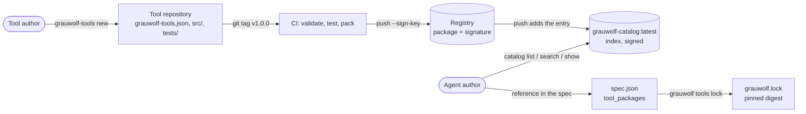

# 15 The tool catalog

In [chapter 3](03-tools.md#tool-packages-from-a-registry-tool_packages) you used tool packages
from a registry and published your own with `tools pack` and `tools push`. Once a team publishes
more than a handful of packages, two questions come up: *which tools are there?* and *can I trust
them?* A registry alone does not answer them – ghcr.io, for example, cannot even list its
repositories. This chapter shows

- what a package says about itself: description, licence, build date, source, sandbox limits;
- the **tool catalog**: one index per registry that lists every package version with that
  information, and how your tool policy judges each entry;
- how to start a tool repository of your own with `grauwolf-tools new`, with a CI workflow that
  publishes into the catalog.

Everything here is a command of the lean program `grauwolf-tools` (and of `grauwolf tools …`, which
has the same commands).

## The flow



The catalog helps you *find* a package. Your spec still names the package by its reference, and
`grauwolf.lock` pins its digest – there is no "latest from the catalog" in a spec.

## What a package says about itself

`grauwolf-tools.json` may carry a few more fields besides name, version and tools. All of them
are optional:

```json
{
  "name": "text-tools",
  "version": "1.2.0",
  "description": "Counting and cleaning text",
  "license": "Apache-2.0",
  "authors": ["Ada Lovelace <ada@example.com>"],
  "source": "https://github.com/acme/text-tools",
  "tools": [
    {
      "name": "count_words",
      "description": "Counts the words of a text",
      "args": { "type": "object", "properties": { "text": { "type": "string" } } },
      "limits": { "memory_mib": 16, "fuel": 10000000, "time_ms": 500 },
      "capabilities": []
    }
  ]
}
```

- `limits` asks for **stricter sandbox limits** for one tool: the largest memory in MiB, the
  compute budget (fuel) and the wall-clock time of one call in milliseconds. The runtime always
  applies the stricter of the package's and its own limits, so a package can only lower them. A
  tool that exceeds its time limit is stopped with "ran longer than its time limit".
- `capabilities` lists what a tool needs from the host. Tools today get nothing – no network, no
  files – so the list must stay empty; `pack` and `validate` refuse anything else.
- Without `source`, `pack` takes the `origin` remote of the git checkout the folder lies in, and
  in any case the checked-out commit as the revision.

`pack` writes all of this, plus the build date, the grauwolf version and the `rustc` version, as
**standard OCI annotations** on the package manifest (`org.opencontainers.image.created`,
`.description`, `.source`, `.revision`, `.licenses`, `.authors`, `.version`, `.title`, and
grauwolf's own `vnd.grauwolf.tools.abi`, `…built-with`, `…rustc`). Other registry tools show them
too. The build date is the time of packing; set `SOURCE_DATE_EPOCH` (seconds since 1970, for
example the commit time) and the same folder gives the same digest again:

```sh
SOURCE_DATE_EPOCH=$(git log -1 --format=%ct) grauwolf-tools pack .
```

`grauwolf-tools inspect <ref>` shows the metadata of a pushed package:

```text
registry.example.com/team/text-tools:1.2.0
digest:  sha256:5f0c…
signature: signed by SHA256:Jx3k…
package: text-tools 1.2.0
abi:     1
description: Counting and cleaning text
created: 2026-11-16T09:30:00Z
source: https://github.com/acme/text-tools
revision: 4b1e9c…
license: Apache-2.0
authors: Ada Lovelace <ada@example.com>
built with: grauwolf 0.1.0
rustc: rustc 1.99.1 (58cf8f9c3 2026-10-13)
sources: included
tools:
  count_words: Counts the words of a text
    args:   {"type":"object",…}
    module: count_words.wasm sha256:9a2d…
    limits: memory 16 MiB, fuel 10000000, time 500 ms
```

Packages packed before these fields existed still pull and inspect; they just show less.

## The catalog

The catalog is a small JSON index stored **in the registry itself**, as an OCI artifact next to
the packages: by default `<registry>/grauwolf-catalog:latest`. It has one entry per package
version with the reference (pinned by digest), the description, the tools with their arguments,
module sizes and limits, build date, source and revision, licence, authors, the grauwolf and rustc
versions, and the package's signatures.

### Which catalog

Every catalog command takes `--catalog`: either a registry (`registry.example.com`, meaning
`registry.example.com/grauwolf-catalog:latest`) or a full reference
(`registry.example.com/team/tools-index:latest`). Without it, the environment variable
`GRAUWOLF_TOOLS_CATALOG` decides; `catalog add` and `push` fall back to the catalog of the
package's own registry. Set the variable once and the commands below need no option:

```sh
export GRAUWOLF_TOOLS_CATALOG=registry.example.com
```

Credentials are the ones of all registry commands (`GRAUWOLF_REGISTRY_AUTH` or the Docker
configuration). Reading needs read access, writing needs push rights to the catalog repository –
the registry's own permissions decide who may change the catalog.

### Finding tools: `catalog list`, `search`, `show`

```sh
grauwolf-tools catalog list
```

```text
catalog registry.example.com/grauwolf-catalog:latest (updated 2026-11-16T10:02:11Z, 3 entries)
index: signed by SHA256:Jx3k…: valid
NAME        VERSION  TOOLS  DESCRIPTION                  POLICY
math        1.0.0    2      Arithmetic for agents        allowed
text-tools  1.1.0    1      Counting and cleaning text   allowed
text-tools  1.2.0    1      Counting and cleaning text   refused: unsigned, and the policy requires signatures
```

`catalog search <text>` lists the entries whose name, description, or tool names and descriptions
contain the text (ignoring case). `catalog show <name>` shows the newest version in full;
`--version 1.1.0` another one:

```sh
grauwolf-tools catalog search words
grauwolf-tools catalog show text-tools
```

```text
text-tools 1.2.0
reference: registry.example.com/team/text-tools@sha256:5f0c…
description: Counting and cleaning text
created: 2026-11-16T09:30:00Z
source: https://github.com/acme/text-tools
revision: 4b1e9c…
license: Apache-2.0
authors: Ada Lovelace <ada@example.com>
abi: 1
built with: grauwolf 0.1.0
rustc: rustc 1.99.1 (58cf8f9c3 2026-10-13)
versions: 1.1.0, 1.2.0
signature: signed by SHA256:Jx3k…
policy: allowed
tools:
  count_words: Counts the words of a text
    args:   {"type":"object",…}
    module: count_words.wasm sha256:9a2d… (48211 bytes)
    limits: memory 16 MiB, fuel 10000000, time 500 ms
    capabilities: none (no network, no files)
```

All three take `--json` for scripts: `list` and `search` print
`{ "catalog", "digest", "updated", "signature": { "status": "valid|invalid|unsigned|unchecked|none", … }, "entries": [ … ] }`,
`show` the entry; every entry carries `"policy": { "allowed": true }` or
`{ "allowed": false, "reason": "…" }`.

To use a package, copy its reference into the spec and lock it as in
[chapter 3](03-tools.md#tool-packages-from-a-registry-tool_packages):

```json
"tool_packages": [{ "oci": "registry.example.com/team/text-tools:1.2.0" }]
```

### Your policy decides, every time you read

The **POLICY** column is not stored in the catalog. Each time you read it, grauwolf applies *your*
tool policy (`[tool_packages]` of a `grauwolf.toml` in the working directory, or the file named by
`GRAUWOLF_TOOL_POLICY`; see [chapter 3](03-tools.md#trust-the-tool-policy-and-signatures)) to each
entry: `allowed_registries`, and with `require_signatures` a signature of one of your `oci_keys`.
The entry stores the package's signatures themselves, so your keys check them – not the keys of
whoever wrote the entry. The same package can be "allowed" for one team and "refused" for another.
The verdict is a preview: when a spec uses the package, the policy is checked again on the real
package.

The **index** itself can be signed (see below). The second line of `catalog list` says
`index: signed by <fingerprint>: valid`, `signed: invalid (…)`, `unsigned`, or "not checked" when
you have no key. The keys are your policy's `oci_keys` plus any `--key <file.pub>`. When your
policy has `require_signatures = true`, a catalog whose index is not validly signed by one of your
keys is refused as a whole.

### Writing: `push`, `catalog add`, `remove`, `sync`

`push` adds the pushed version to the catalog by default:

```sh
grauwolf-tools push dist registry.example.com/team/text-tools:1.2.0 --sign-key signing.key
```

```text
registry.example.com/team/text-tools:1.2.0@sha256:5f0c…
signed
catalog registry.example.com/grauwolf-catalog:latest: added text-tools@1.2.0
```

With `--sign-key`, the key signs the package **and** the updated index. `--catalog` names another
catalog, `--no-catalog` skips it. If the package was pushed but the catalog could not be updated
(no push rights to `grauwolf-catalog`, for example), the command says so and exits with 1; add it
later with `catalog add`.

```sh
grauwolf-tools catalog add registry.example.com/team/math:1.0.0      # add or refresh one entry
grauwolf-tools catalog remove text-tools@1.1.0                        # drop one version
grauwolf-tools catalog sync                                           # rebuild from the registry
grauwolf-tools catalog sync --repository team/math --repository team/text-tools
```

`catalog add` reads the package's manifest, metadata and signatures from the registry; adding the
same version again refreshes its entry. `catalog remove` drops an entry; the package stays in the
registry. `catalog sync` **rebuilds** the index: every tag of every repository that holds a tool
package becomes an entry, other artifacts (ordinary container images, multi-arch indexes,
docker manifest lists) are skipped and only counted in the summary line (`3 not tool packages`);
`--verbose` names each one with its media type (`skipped …: not a tool package (<media type>)`). A
tag that fails for another reason, such as a real digest mismatch of a tool package, is always
named. Registries that list their repositories (`/v2/_catalog`, e.g. a `registry:2` or
Harbor) need nothing more; for those that don't (ghcr.io), name the repositories with
`--repository`. Because the metadata travels with every package, a lost or damaged index is
always rebuilt this way.

`add`, `remove` and `sync` take `--sign-key` to sign the written index. A write without it leaves
an unsigned index – so if you sign, sign every write.

**Several writers at once.** Two pipelines that push at the same moment both update the index.
grauwolf reads the index with its digest, makes its change and writes it back on the condition that
the digest is still the same. If another writer was faster, it reads again and applies its change
again – up to five times, then it gives up with "the catalog … kept changing" and you simply run
the command again. Many registries (the CNCF distribution `registry:2` among them) ignore the condition. grauwolf
notices that on the first write and prints `note: <registry> ignores conditional writes; concurrent
catalog writers are checked after the fact`. Then it waits a short random time (0.3 to 1 s; set
`GRAUWOLF_TOOLS_CATALOG_SETTLE_MS` to a fixed number of milliseconds), reads the index again and
checks that *its own change* is in it: the entry with its digest after `add` and `sync`, no entry
after `remove`. If another writer overwrote it in the meantime, it repeats the round. The check
is not airtight: a writer that overwrites the index after the check, and only then, still loses
your entry unnoticed. On such registries let only one writer work at a time (for example one CI
job for all pushes) and repair a lost entry with `catalog sync`.

## A repository for your tools: `grauwolf-tools new`

`new` scaffolds a package folder that validates, packs and tests as it is:

```sh
grauwolf-tools new text-tools --tool count_words
```

```text
text-tools/
  grauwolf-tools.json                  name, version, description, license, authors; the tool
                                       count_words with arguments, limits and capabilities
  src/count_words.rs                   the code body of the example tool
  tests/count_words.rs                 tests of the code body (`cargo test`)
  Cargo.toml, tests/support/           only for `cargo test`; grauwolf ignores them
  README.md                            build, validate, test, pack, push and catalog steps
  .github/workflows/grauwolf-tools.yml CI: validate, test, pack; on a tag v* sign and push
  .gitignore
```

The example tool is only a placeholder: its description reads "What `<tool>` does, in one
sentence" and its code upper-cases an `input` argument; replace both with your own tool. Without
`--tool` it is called `hello`; `--dir` writes somewhere else than
`./<name>`. The folder must not exist yet or must be empty.

The test runs the code body as a plain Rust function, the way grauwolf embeds it, so you can test
your tools with `cargo test` without building WASM:

```rust
fn count_words(args: Value) -> Result<String, String> {
    include!(concat!(env!("OUT_DIR"), "/count_words.rs"))
}
```

### The CI workflow

`.github/workflows/grauwolf-tools.yml` runs in the image `ghcr.io/agentsw0rk/grauwolf-tools`, which
contains the Rust toolchain with the WASM target – CI needs no Rust setup. On every push and pull
request it validates, tests and packs (with `SOURCE_DATE_EPOCH` set to the commit time). On a tag
`v<version>` – the version must match `grauwolf-tools.json` – it also pushes the package, signs it
and so adds it to the catalog. Configure in the repository settings:

| Setting | Kind | Content |
|---|---|---|
| `GRAUWOLF_REGISTRY_AUTH` | secret | `{"registry.example.com": "user:token"}`, a token with push rights to the package repository and to `grauwolf-catalog` |
| `GRAUWOLF_TOOLS_SIGNING_KEY` | secret | the content of the private key from `grauwolf-tools keygen signing` |
| `TOOLS_REGISTRY` | variable | the registry, e.g. `registry.example.com` |
| `TOOLS_REPOSITORY` | variable | optional; default `<owner>/<name>` |

Give the public key (`signing.pub`) to the people who use your tools: they list it under
`oci_keys` in their tool policy, and the catalog then shows your packages as signed and allowed.

## Key points

- `grauwolf-tools.json` can describe a package (`description`, `license`, `authors`, `source`) and
  ask for stricter sandbox `limits` per tool; `pack` records this as OCI annotations, with the
  build date (`SOURCE_DATE_EPOCH`) and the git revision.
- The catalog is an index in the registry, `<registry>/grauwolf-catalog:latest` by default
  (`--catalog`, `GRAUWOLF_TOOLS_CATALOG`). `push` keeps it current; `catalog sync` rebuilds it.
- `catalog list|search|show` judge every entry with *your* tool policy at the moment you read; a
  signed index is checked against your keys.
- Specs keep naming packages by reference, and `grauwolf.lock` keeps pinning their digests.
- `grauwolf-tools new` gives a tool repository with tests and a CI workflow that publishes into the
  catalog.
